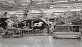

**2024-10-12**

中国汽车工业协会信息发布会

面对更加错综复杂的国内外环境，我国经济运行总体平稳、稳中有进。节前，针对当前经济运行中的新情况新问题，国家加力推出一揽子增量政策，推动经济持续回升向好，提振国内市场信心。国庆假期，国内消费市场热情高涨，政策组合拳效果初显。

三季度，随着国家层面汽车报废更新补贴力度加强，地方置换更新政策陆续生效，加之车企纷纷推出秋季新品，乘用车市场逐渐回暖，特别是终端零售市场持续走强，“金九”效应继续显现。商用车市场表现相对疲弱。新能源汽车和汽车出口延续良好态势、贡献显著。

汽车以旧换新政策加码实施以来，提振效果明显，汽车报废更新补贴申请量加快增长，有效带动汽车销量提升。考虑到以旧换新政策对拉动汽车消费已起到的积极作用，为保障政策的稳定性、延续性和可预期，切实发挥好政策促进效用，建议明年能够继续延续相关政策，并尽早发布有关实施细节，稳定市场预期。

# 汽车工业经济运行特点

## 汽车总体产销情况：汽车产销环比快速增长，同比微降

◼ 9月，汽车产销分别完成279.6万辆和280.9万辆，环比分别增长12.2%和14.5%，同比分别下降1.9%和1.7%。

◼ 1-9月，汽车产销分别完成2147万辆和2157.1万辆，同比分别增长1.9%和2.4%，产销增速较1-8月分别收窄0.6和0.7个百分点。

| 近十年汽车年度销量及增长率 | 年度销量 | 1-9月销量 | 增长率（%） |
|---|---|---|---|
| 2022年 | 2686.4万辆 | | +2.1% |
| 2023年 | 3009.4万辆 | | +12% |
| 2024年1-9月 | | 2157.1万辆 | +2.4% |

| 汽车月度销量及增长率 | 销量（万辆） | 增长率（%） |
|---|---|---|
| （数据见图表） | | |

## 汽车总体产销情况：内销与出口环比增长

◼ 9月，汽车国内销量227万辆，环比增长16.9%，同比下降6%；汽车出口53.9万辆，环比增长5.4%，同比增长21.4%。

◼ 1-9月，汽车国内销量1725.9万辆，同比下降2.4%；汽车出口431.2万辆，同比增长27.3%。

| 汽车-出口总量及增长率 | 出口量（万辆） | 增长率（%） |
|---|---|---|
| 2022年 | 311.1万辆 | 54.4% |
| 2023年 | 491万辆 | +57.8% |
| 2024年1-9月 | 431.2万辆 | +27.3% |

| 汽车-国内总销量及增长率 | 销量（万辆） | 增长率（%） |
|---|---|---|
| 2022年 | 2375.3万辆 | -2.2% |
| 2023年 | 2518.4万辆 | +6% |
| 2024年1-9月 | 1725.9万辆 | -2.4% |

| 1-9月汽车销量及增长率 | 2022.1-9 | 2023.1-9 | 2024.1-9 |
|---|---|---|---|
| 汽车-总销量（万辆） | | | |
| 汽车-国内总销量（万辆） | | | |
| 汽车-出口量（万辆） | | | |
| 汽车-总销量-同比（%） | | | |
| 汽车-国内总销量-同比（%） | | | |
| 汽车-出口量-同比（%） | | | |

## 乘用车产销情况：同比环比双增长

◼ 9月，乘用车产销分别完成250.2万辆和252.5万辆，环比分别增长12.6%和15.8%，同比分别增长0.2%和1.5%。

◼ 1-9月，乘用车产销分别完成1864.3万辆和1867.9万辆，同比分别增长2.6%和3%。

| 乘用车年度销量及增长率 | 销量（万辆） | 增长率（%） |
|---|---|---|
| 2022年 | 2356.3万辆 | +9.5% |
| 2023年 | 2606.3万辆 | +10.6% |
| 2024年1-9月 | 1867.9万辆 | +3% |

| 乘用车月度销量（万辆） | 1月 | 2月 | 3月 | 4月 | 5月 | 6月 | 7月 | 8月 | 9月 | 10月 | 11月 | 12月 |
|---|---|---|---|---|---|---|---|---|---|---|---|---|
| 2022年 | | | | | | | | | | | | |
| 2023年 | | | | | | | | | | | | |
| 2024年 | | | | | | | 252.5 | | | | | |

- 9月，乘用车国内销量206.8万辆，环比增长18.6%，同比下降1.8%；乘用车出口45.7万辆，环比增长4.5%，同比增长20%。其中，传统燃料乘用车国内销量94万辆，比上年同期减少40.2万辆，环比增长18.3%，同比下降30%。

- 1-9月，乘用车国内销量1504.6万辆，同比下降1.6%；乘用车出口363.3万辆，同比增长28%。

# 汽车工业经济运行特点

## 乘用车产销情况：内销与出口环比增长

2

7

-50

0

50

100

150

200

250

0

50

100

150

200

250

乘用车-国内总销量及增长率

（万辆）

2022年

2103.5万辆

+5.7%

2023年

2192.3万辆

+4.2%

（%）

2024年1-9月

1504.6万辆

-1.6%

-50

0

50

100

150

200

250

0

50

100

150

200

250

乘用车-出口总量及增长率

（万辆）

（%）

2022年

252.9万辆

+56.7%

2023年

414万辆

+63.7%

2024年1-9月

363.3万辆

+28%

- 中国品牌乘用车（9月）
- 销量：170.9万辆，同比增长21.9%
- 销量占有率：67.7%，较上年同期上升11.3个百分点
- 中国品牌乘用车（1-9月）
- 销量：1191.9万辆，同比增长20.5%
- 销量占有率：63.8%，较上年同期上升9.2个百分点

# 汽车工业经济运行特点

## 乘用车产销情况：中国品牌乘用车销量占比进一步提升

2

8

63.8

15.2

11.4

6.7

1.7

1.2

0

10

20

30

40

50

60

70

2018年

2019年

2020年

2021年

2022年

2023年

2024年1-9月

乘用车各国别车系销量占有率变化情况 / %

中国

德系

日系

美系

韩系

其他

67.7

30

40

50

60

70

1月

2月

3月

4月

5月

6月

7月

8月

9月

10月

11月

12月

中国品牌乘用车销量占有率变化情况 / %

2022年

2023年

2024年

- 9月，国内生产的高端品牌乘用车销量完成41.9万辆，环比增长8.4%，同比下降2.7%。

- 1-9月，国内生产的高端品牌乘用车销量完成347.9万辆，同比增长5.5%。

## 乘用车产销情况：高端品牌乘用车环比增长

2

# 汽车工业经济运行特点

9

-100

-50

0

50

100

0

50

100

150

200

250

300

高端品牌乘用车月度销量及增速变化

乘用车销量

高端乘用车销量

增长率

2022年

388.1万辆

+10.9%

2023年

451.6万辆

+15.4%

（万辆）

（%）

2024年1-9月

347.9万辆

+5.5%

41.9

10

20

30

40

50

60

1月

2月

3月

4月

5月

6月

7月

8月

9月

10月 11月 12月

高端品牌乘用车月度销量

2022年

2023年

2024年

（万辆）

# 汽车工业经济运行特点

## 乘用车产销情况：各级别新能源乘用车市场增速均明显好于传统燃料乘用车

2

- 1-9月，传统燃料乘用车中，各级别销量均呈不同程度下降。目前销量仍主要集中在A级，累计销量593.7万辆，同比下降13.8%。

- 1-9月，新能源乘用车中，各级别销量均呈不同程度增长，其中D级涨幅最大。目前销量主要集中在A级和B级，累计销量分别完成247万辆和267.3万辆，同比分别增长4.6%和72.8%。

10

44.7

83.7

247.0

267.3

127.8

18.4

8.4%

2.1%

4.6%

72.8%

69.1%

136.3%

-100%

-50%

0%

50%

100%

150%

200%

0

100

200

300

400

500

600

700

800

A00

A0

A

B

C

D

（%）

（万辆）

新能源乘用车不同级别销量及增长率

2022.1-9月

2023.1-9月

2024.1-9月

累计销量同比

0.05

95.7

593.7

288.9

82.7

0.0099

-24.0%

-3.6%

-13.8%

-5.7%

-19.5%

-40.7%

-50%

-40%

-30%

-20%

-10%

0%

0

100

200

300

400

500

600

700

800

A00

A0

A

B

C

D

（%）

（万辆）

传统燃料乘用车不同级别销量及增长率

2022.1-9月

2023.1-9月

2024.1-9月

累计销量同比

# 汽车工业经济运行特点

## 乘用车产销情况：新能源乘用车主流价格区间高于传统燃料乘用车

2

- 1-9月，传统燃料乘用车中，15-20万价格区间同比呈现正增长，其他价格区间销量均呈负增长。目前销量仍主要集中在10-15万价格区间，累计销量359.6万辆，同比下降13.3%。

- 1-9月，新能源乘用车中，除40-50万价格区间销量同比下降外，其他价格区间销量均呈正增长，其中50万以上价格区间涨幅最大。目前销量仍主要集中在15-20万价格区间，累计销量223.1万辆，同比增长15.4%。

11

57.2

51.5 132.4 223.1 69.9

62.3

75.2

86.2

15.9

20.6

13.1%

102.5% 72.6%

15.4%

6%

131.7%

45.0% 9.3%

-32.2%

246.6%

-100%

0%

100%

200%

300%

400%

500%

0

100

200

300

400

500

新能源乘用车各价格区间销量及增长率

2023.1-9月

2024.1-9月

（万辆）

（%）

93.3 120.5 359.6 205.3 81.4

47.7

58.1

35.0

58.9

13.6

-23.2%

-1.2%

-13.3%

3.4%

-22.0%

-28.5%

-6.6%

-24.0%

-0.5%

-25.5%

-40%

-30%

-20%

-10%

0%

10%

0

100

200

300

400

500

传统燃料乘用车各价格区间销量及增长率

2023.1-9月

2024.1-9月

（万辆）

（%）

- 9月，商用车产销分别完成29.4万辆和28.4万辆，环比分别增长8.7%和4.4%；同比分别下降16.8%和23.5%。

- 1-9月，商用车产销分别完成282.7万辆和289.2万辆，同比分别下降2.8%和1.6%。

# 汽车工业经济运行特点

## 商用车产销情况：商用车市场表现仍相对疲弱

3

12

-100

-50

0

50

100

0

10

20

30

40

50

商用车月度销量及增长率

（万辆）

（%）

2022年

330万辆

-31.2%

2023年

403.1万辆

+22.1%

2024年1-9月

289.2万辆

-1.6%

28.4

0

10

20

30

40

50

1月

2月

3月

4月

5月

6月

7月

8月

9月

10月

11月

12月

（万辆）

商用车月度销量

2022年

2023年

2024年

- 9月，商用车国内销量20.2万辆，环比增长1.9%，同比下降34.4%；商用车出口8.2万辆，环比增长11%，同比增长29.8%。
- 1-9月，商用车国内销量221.3万辆，同比下降7.4%；商用车出口67.9万辆，同比增长23.6%。

# 汽车工业经济运行特点

## 商用车产销情况：内销与出口环比增长

3
13

**商用车-出口总量及增长率**

| 年份 | 出口量（万辆） | 增长率 |
|------|----------------|--------|
| 2022年 | 58.2 | +44.9% |
| 2023年 | 77 | +32.2% |
| 2024年1-9月 | 67.9 | +23.6% |

**商用车-国内总销量及增长率**

| 年份 | 国内销量（万辆） | 增长率 |
|------|------------------|--------|
| 2022年 | 271.8 | -38.1% |
| 2023年 | 326.1 | +20% |
| 2024年1-9月 | 221.3 | -7.4% |

---

- 9月，货车产销分别完成25万辆和24.2万辆，环比分别增长7.2%和4.4%，同比分别下降19.5%和25.7%。客车产销分别完成4.5万辆和4.2万辆，环比分别增长18%和4.3%，产量同比增长1.9%，销量同比下降7.3%。
- 1-9月，货车产销分别完成246.7万辆和253.1万辆，同比分别下降3.6%和2.4%；客车产销分别完成35.9万辆和36.1万辆，同比分别增长3.4%和4.3%。

# 汽车工业经济运行特点

## 商用车产销情况：货车客车环比增长

3
14

**客车月度销量及增长率**

| 年份 | 销量（万辆） | 增长率 |
|------|--------------|--------|
| 2022年 | 40.8 | -19.2% |
| 2023年 | 49.2 | +20.5% |
| 2024年1-9月 | 36.1 | +4.3% |

**货车月度销量及增长率**

| 年份 | 销量（万辆） | 增长率 |
|------|--------------|--------|
| 2022年 | 289.3 | -32.6% |
| 2023年 | 353.9 | +22.4% |
| 2024年1-9月 | 253.1 | -2.4% |

---

# 汽车工业经济运行特点

## 商用车产销情况：皮卡产销同比小幅增长

3
15

- 1-9月，皮卡产销分别完成38.4万辆和40.4万辆，同比分别增长1.9%和5.6%。分燃料类型看，汽油车产销分别完成11.8万辆和12.2万辆，同比分别增长8.5%和12.9%；柴油车产销分别完成25.3万辆和26.8万辆，产量同比下降3.1%，销量同比增长0.6%。
- 1-9月，排名前五位的皮卡生产企业销量合计为31.5万辆，同比增长8.8%，占皮卡销售总量的78.1%，高于上年同期2.3个百分点。

**皮卡月度销量及增长率**

| 年份 | 销量（万辆） | 增长率 |
|------|--------------|--------|
| 2022年 | 51.9 | -6.4% |
| 2023年 | 52.1 | +0.3% |
| 2024年1-9月 | 40.4 | +5.6% |

**皮卡月度销量**

| 月份 | 2022年（万辆） | 2023年（万辆） | 2024年（万辆） |
|------|----------------|----------------|----------------|
| 1月 | 4.8 | | |
| 2月 | | | |
| 3月 | | | |
| 4月 | | | |
| 5月 | | | |
| 6月 | | | |
| 7月 | | | |
| 8月 | | | |
| 9月 | | | |
| 10月 | | | |
| 11月 | | | |
| 12月 | | | |

---

- 9月，新能源汽车产销分别完成130.7万辆和128.7万辆，同比分别增长48.8%和42.3%，新能源汽车新车销量占汽车新车总销量的45.8%。
- 1-9月，新能源汽车产销分别完成831.6万辆和832万辆，同比分别增长31.7%和32.5%，新能源汽车新车销量占汽车新车总销量的38.6%。

# 汽车工业经济运行特点

## 新能源汽车产销情况：月度产销创历史新高

4

单位：万辆、%

| 动力类型 | 产量 | 同比 | 销量 | 同比 |
|----------|------|------|------|------|
| 纯电动 | 78.6 | 33.4 | 77.5 | 23.8 |
| 插电式混合动力 | 52.2 | 80.1 | 51.1 | 84.2 |
| 燃料电池 | 0.0161 | 11.8 | 0.021 | 14倍 |

单位：万辆、%

| 动力类型 | 累计产量 | 同比 | 累计销量 | 同比 |
|----------|----------|------|----------|------|
| 纯电动 | 499.3 | 11.9 | 498.8 | 11.6 |
| 插电式混合动力 | 331.8 | 79.5 | 332.8 | 84.2 |
| 燃料电池 | 0.4188 | 40.6 | 0.4133 | 44.0 |

16

**新能源汽车月度销量及增长率**

| 年份 | 销量（万辆） | 增长率 |
|------|--------------|--------|
| 2022年 | 688.7 | +93.4% |
| 2023年 | 949.5 | +37.9% |
| 2024年1-9月 | 832 | +32.5% |

**新能源汽车月度销量**

| 月份 | 2022年（万辆） | 2023年（万辆） | 2024年（万辆） |
|------|----------------|----------------|----------------|
| 1月 | | | |
| 2月 | | | |
| 3月 | | | |
| 4月 | | | |
| 5月 | | | |
| 6月 | | | |
| 7月 | | | |
| 8月 | | | |
| 9月 | | 128.7 | |
| 10月 | | | |
| 11月 | | | |
| 12月 | | | |

---

- 9月，新能源汽车国内销量117.6万辆，环比增长18.8%，同比增长45.5%；新能源汽车出口11.1万辆，环比增长0.9%，同比增长15.6%。
- 1-9月，新能源汽车国内销量739.2万辆，同比增长35.6%；新能源汽车出口92.8万辆，同比增长12.5%。

# 汽车工业经济运行特点

## 新能源汽车产销情况：内销与出口同比环比双增长

4
17

**新能源-出口总量及增长率**

| 年份 | 出口量（万辆） | 增长率 |
|------|----------------|--------|
| 2022年 | 67.7 | +120.2% |
| 2023年 | 120.3 | +77.6% |
| 2024年1-9月 | 92.8 | +12.5% |

**新能源-国内总销量及增长率**

| 年份 | 国内销量（万辆） | 增长率 |
|------|------------------|--------|
| 2022年 | 620.9 | +90.9% |
| 2023年 | 829.2 | +33.5% |
| 2024年1-9月 | 739.2 | +35.6% |

**1-9月新能源汽车销量及增长率**

| 指标 | 2022.1-9 | 2023.1-9 | 2024.1-9 |
|------|----------|----------|----------|
| 新能源汽车总销量（万辆） | | | |
| 新能源汽车国内总销量（万辆） | | | |
| 新能源汽车出口量（万辆） | | | |
| 新能源汽车总销量同比（%） | | | |
| 新能源汽车国内总销量同比（%） | | | |
| 新能源汽车出口量同比（%） | | | |

- 9月，新能源汽车国内销量117.6万辆，同比增长45.5%，占汽车国内销量比例为51.8%；新能源乘用车国内销量112.8万辆，同比增长47.6%，占乘用车国内销量比例为54.6%；新能源商用车国内销量4.8万辆，同比增长9.3%，占商用车国内销量比例为23.8%。

- 1-9月，新能源汽车国内销量739.2万辆，同比增长35.6%，占汽车国内销量比例为42.8%；新能源乘用车国内销量704.1万辆，同比增长35.7%，占乘用车国内销量比例为46.8%；新能源商用车国内销量35.1万辆，同比增长33.5%，占商用车国内销量比例为15.9%。

# 汽车工业经济运行特点

## 新能源汽车产销情况：新能源汽车国内销量占比连续两月超50%

| 指标 | 数值 |
|------|------|
| 1-9月新能源分车型国内销量及占比（万辆） | 详见下图 |
| 新-国内总销 | - |
| 新-乘-国内 | - |
| 新-商-国内 | - |
| 新-国内总销-占比（%） | 54.6 / 23.8 / 31.5 / 32.7 / 34.6 / 39.7 / 44.2 / 46.6 / 49.5 / 51 / 51.8 |
| 新-乘-国内占比 | 54.6 |
| 新-商-国内占比 | 23.8 |

| 月份 | 新能源分车型国内销量及占比（万辆 / %） |
|------|------|
| 1月 | - |
| 2月 | - |
| 3月 | - |
| 4月 | - |
| 5月 | - |
| 6月 | - |
| 7月 | - |
| 8月 | - |
| 9月 | - |
| 新-乘-国内 | - |
| 新-商-国内 | - |
| 新-乘-国内占比 | - |
| 新-商-国内占比 | - |
| 新-国内占比 | - |

---

# 汽车工业经济运行特点

## 重点企业(集团)销量情况：汽车销量前十企业合计销量同比微增

- 1-9月，汽车销量排名前十位的企业集团销量合计为1824.1万辆，同比增长1.8%，占汽车销售总量的84.6%，低于上年同期0.5个百分点。

**1-9月市场集中度（单位：万辆、%）**

| 指标 | 9月 | 环比 | 同比 | 1-9月 | 累计同比 | 市场份额 |
|------|------|------|------|-------|----------|----------|
| 前三家 35.1% | 100.5 | 13.1 | -7.6 | 757.6 | -2.9 | 35.1 |
| 前五家 52.3% | 143.6 | 15.3 | -7.5 | 1128.2 | -0.6 | 52.3 |
| 前十家 84.6% | 237 | 14.8 | -3.9 | 1824.1 | 1.8 | 84.6 |

---

# 汽车工业经济运行特点

## 重点企业(集团)销量情况：新能源汽车销量前十企业合计销量同比快速增长

- 1-9月，新能源汽车销量排名前十位的企业集团销量合计为712.3万辆，同比增长32.3%，占新能源汽车销售总量的85.6%，低于上年同期0.2个百分点。

**1-9月市场集中度（单位：万辆、%）**

| 指标 | 9月 | 环比 | 同比 | 1-9月 | 累计同比 | 市场份额 |
|------|------|------|------|-------|----------|----------|
| 前三家 50.4% | 66.6 | 19.1 | 49.3 | 419.4 | 33.4 | 50.4 |
| 前五家 65.9% | 84.1 | 16.7 | 44.2 | 548.5 | 31.9 | 65.9 |
| 前十家 85.6% | 109.7 | 17.0 | 42.4 | 712.3 | 32.3 | 85.6 |

---

# 汽车工业经济运行特点

## 重点企业(集团)国内销量情况：国内销量前十企业合计销量同比下降

- 1-9月，国内汽车销量排名前十位的企业集团销量合计为1473.6万辆，同比下降3.4%，占汽车销售总量的85.4%，低于上年同期0.9个百分点。

**1-9月市场集中度（单位：万辆、%）**

| 指标 | 9月 | 环比 | 同比 | 1-9月 | 累计同比 | 市场份额 |
|------|------|------|------|-------|----------|----------|
| 前三家 37.7% | 88.1 | 13.7 | -7.8 | 651.3 | -4.6 | 37.7 |
| 前五家 55.7% | 124.0 | 16.9 | -9.7 | 961.7 | -3.4 | 55.7 |
| 前十家 85.4% | 192.4 | 16.7 | -8.7 | 1473.6 | -3.4 | 85.4 |

---

- 9月，汽车出口53.9万辆，环比增长5.4%，同比增长21.4%。分车型看，乘用车出口45.7万辆，环比增长4.5%，同比增长20%；商用车出口8.2万辆，环比增长11%，同比增长29.8%。

- 1-9月，汽车出口431.2万辆，同比增长27.3%。分车型看，乘用车出口363.3万辆，同比增长28%；商用车出口67.9万辆，同比增长23.6%。

# 汽车工业经济运行特点

## 汽车出口情况：同比环比双增长

| 年份 | 出口量（万辆） | 增长率（%） |
|------|---------------|-------------|
| 2022年 | 311.1 | +54.4 |
| 2023年 | 491 | +57.9 |
| 2024年1-9月 | 431.2 | +27.3 |

---

- 9月，传统燃料汽车出口42.8万辆，环比增长6.6%，同比增长22.9%；新能源汽车出口11.1万辆，环比增长0.9%，同比增长15.6%。

- 1-9月，传统燃料汽车出口338.4万辆，同比增长32%；新能源汽车出口92.8万辆，同比增长12.5%。

# 汽车工业经济运行特点

## 汽车出口情况：传统燃料汽车和新能源汽车同比环比双增长

**新能源汽车出口量及增长率**

| 年份 | 出口量（万辆） | 增长率（%） |
|------|---------------|-------------|
| 2022年 | 67.3 | +120.2 |
| 2023年 | 120.3 | +77.6 |
| 2024年1-9月 | 92.8 | +12.5 |

**传统燃料汽车出口总量及增长率**

| 年份 | 出口量（万辆） | 增长率（%） |
|------|---------------|-------------|
| 2022年 | 243.3 | +42.5 |
| 2023年 | 370.7 | +52.4 |
| 2024年1-9月 | 338.4 | +32 |

**1-9月汽车出口量及增长率**

| 车型 | 2022.1-9 | 2023.1-9 | 2024.1-9 | 汽车同比增长（%） | 新能源同比增长（%） | 传统燃料同比增长（%） |
|------|-----------|-----------|-----------|-------------------|---------------------|------------------------|
| 汽车 | - | - | - | - | - | - |
| 新能源 | - | - | - | - | - | - |
| 传统燃料 | - | - | - | - | - | - |
| （万辆） | - | - | - | - | - | - |
| （%） | - | - | - | - | - | - |

◼9月，纯电动汽车出口8.9万辆，环比增长1.1%，同比下降3.6%；插混汽车出口2.2万辆，环比下降0.1%，同比增长4.9倍。

◼1—9月，纯电动汽车出口73.1万辆，同比下降3.8%；插混汽车出口19.8万辆，同比增长2倍。

# 汽车工业经济运行特点

## 汽车出口情况：插混汽车出口增速远超纯电动汽车

插混汽车出口总量及增长率（万辆）

| 年份 | 出口量 | 增长率 |
|---|---:|---:|
| 2022年 | 6.8万辆 | +63% |
| 2023年 | 10.1万辆 | +47.8% |
| 2024年1—9月 | 19.8万辆 | +201.8% |

纯电动汽车出口总量及增长率（万辆）

| 年份 | 出口量 | 增长率 |
|---|---:|---:|
| 2022年 | 60.9万辆 | +129.2% |
| 2023年 | 110.2万辆 | +80.9% |
| 2024年1—9月 | 73.1万辆 | -3.8% |

纯电/插混汽车出口增长率（%）

- 纯电—增长率
- 插混—增长率

◼9月，整车出口前十企业中，奇瑞出口量达10.9万辆，同比增长20.7%，占总出口量的20.2%。与上年同期相比，江汽出口增速最为显著，出口达2.9万辆，同比增长1.1倍。

◼1—9月，整车出口前十企业中，从增速上来看，比亚迪出口30.2万辆，同比增长96.3%；吉利出口40.4万辆，同比增长63.4%；长安出口42万辆，同比增长61%。

# 汽车工业经济运行特点

## 汽车出口情况：整车出口前十企业中，九家企业出口实现正增长

### 2024年9月整车出口量前十位企业

| 企业 | 2024.9（万辆） | 2023.9（万辆） |
|---|---:|---:|
| 奇瑞 | 10.9 | — |
| 上汽 | 8.1 | — |
| 吉利 | 5.7 | — |
| 长安 | 4.9 | — |
| 长城 | 4.4 | — |
| 比亚迪 | 3.2 | — |
| 北汽 | 2.9 | — |
| 江汽 | 2.9 | — |
| 东风 | 2.3 | — |
| 悦达起亚 | 1.6 | — |

### 2024年1—9月整车出口量前十位企业

| 企业 | 2024.1—9（万辆） | 2023.1—9（万辆） |
|---|---:|---:|
| 奇瑞 | 82.9 | — |
| 上汽 | 66.4 | — |
| 长安 | 42.0 | — |
| 吉利 | 40.4 | — |
| 长城 | 32.4 | — |
| 比亚迪 | 30.2 | — |
| 特斯拉 | 21.6 | — |
| 江汽 | 19.7 | — |
| 北汽 | 18.8 | — |
| 东风 | 18.0 | — |

◼据中国汽车工业协会整理的海关总署数据显示，8月，汽车出口61万辆，环比增长10.4%，同比增长39.4%。其中，新能源汽车出口17.3万辆，环比增长3.2%，同比增长20.6%。

◼1—8月，汽车出口409.4万辆，同比增长27.3%。其中，新能源汽车出口134万辆，同比增长24.6%。俄罗斯、墨西哥、阿联酋汽车出口量位居前三。新能源汽车出口的前三大市场为比利时、巴西和英国。

# 汽车工业经济运行特点

## 汽车出口情况：海关汽车出口同比环比双增长

数据来源：海关总署

### 2024年1—8月主要整车出口市场累计出口量

| 市场 | 新能源汽车（万辆） | 传统能源汽车（万辆） |
|---|---:|---:|
| 俄罗斯 | 70.5 | — |
| 墨西哥 | 32.3 | — |
| 阿联酋 | 20.3 | — |
| 巴西 | 19.2 | — |
| 比利时 | 18.2 | — |
| 沙特阿拉伯 | 16.1 | — |
| 英国 | 13.8 | — |
| 澳大利亚 | 11.9 | — |
| 菲律宾 | 10.4 | — |
| 土耳其 | 9.6 | — |

### 2024年8月主要整车出口市场出口量

| 市场 | 新能源汽车（万辆） | 传统能源汽车（万辆） |
|---|---:|---:|
| 俄罗斯 | 13.1 | — |
| 墨西哥 | 5.3 | — |
| 阿联酋 | 2.9 | — |
| 沙特阿拉伯 | 2.2 | — |
| 比利时 | 2.0 | — |
| 菲律宾 | 1.5 | — |
| 意大利 | 1.4 | — |
| 美国 | 1.3 | — |
| 马来西亚 | 1.3 | — |
| 英国 | 1.3 | — |

感谢您的关注！

关注微信公众号“中汽协会数据”

定期发布汽车行业统计信息、深度分析

扫一扫关注我们

