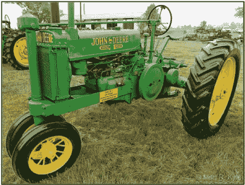

**摘要**

公司简介：农机巨擘，产品谱系齐全。约翰迪尔成立于1837年，已有近200年历史，过去50年收入/净利润CAGR分别为7.7%/9.4%。2023年约翰迪尔农机业务收入366亿美元，明显高于可比公司，目前共有11个系列、47,000余种产品。

财务分析：攻守兼备，内生增长强劲。

（1）约翰迪尔盈利能力稳健，工程机械板块经营利润复合增速略高于农机板块，但农机业务稳定性更强，2009年周期底部未发生经营亏损。

（2）过去十五年约翰迪尔ROE基本稳定在25%以上，带来同期EPS年均增长14.3%。

（3）2020—2023年提价持续贡献利润弹性，带来经营利润增幅分别为28%/54%/66%/69%。

股价表现：领先行业，享受估值溢价。

（1）横向比照：过去十年约翰迪尔股价年复合回报率18.1%，PE forward 12M近年来中枢约为12—17倍，二者均显著高于同一交易所的可比农机上市公司。更高、更稳定的EPS增速或解释估值溢价。

（2）纵向对比：约翰迪尔股价、利润与农业周期走势相关；本轮周期戴维斯双击之后逐步消化估值。

历史复盘：筚路维艰，坚守方得始终。

（1）1837年成立，最初生产优质犁，伴随美国农业大发展积累第一桶金，奠定产品至上的公司基因。

（2）20世纪初抓住美国农业机械化契机，1918年并购滑铁卢拖拉机厂进军内燃拖拉机行业，二三十年代坚持研发，推出D/A/B型新品，挺过大萧条。

（3）战后研制柴油机与多缸发动机，1960年推出“新一代”拖拉机，及时跟进并最终引领拖拉机大型化潮流，1988年占美国100马力以上拖拉机份额的49%。

（4）20世纪70年代以来加速海外与多元化布局，以抵抗经济周期的影响，设备收入中来自美国、加拿大的比重由2003年的80%下降至2023年的62%。

（5）21世纪以来发力智能农业，开发数字管理平台、自动驾驶技术，收购精准农业相关标的并推出相关产品。

成长归因：产品为王，紧密绑定客户。

（1）坚持研发，凭借核心技术不断推陈出新。约翰迪尔历史上每一个周期底部或增长拐点都伴随着重要的产品创新。约翰迪尔自1918年就开始自研自产发动机与传动部件，2014年约翰迪尔发动机全球生产数量突破800万台；研发费用率高于同行，目前稳定在4%左右。

（2）与客户互相扶持、紧密绑定。大萧条期间约翰迪尔在亏损状态下为困难客户提供账期支持，以至于1931年应收账款达到收入规模近2倍，患难与共的壮举奠定了约翰迪尔与客户的鱼水之情。约翰迪尔非常注重对农民客户的服务，1895年开办风行全球的农民杂志《The Furrow》；其出版的农机服务手册《The Operation, Care and Repair of Farm Machinery》再版了28次之多。

他山之石：持续研发，重视产品配套。

（1）我国正在经历类似当年美国的产品升级过程，体现在拖拉机大型化与环保国标切换上。2023年/2024年1—8月我国大型拖拉机产量占比分别为19.5%/22.9%，同比+0.6个百分点/+3.8个百分点。非道路移动机械“国四”排放标准对额定净功率75kW（约合101马力）发动机的PM/HC+NOx排放要求分别提高了50%—92%/13%—45%。只有掌握核心技术、持续研发，才能从容受益于马力数提高与环保标准提升。

（2）海外市场的重要性正在提高。2023年印度/美国/巴西/墨西哥拖拉机销量分别为92.2/25.3/5.4/1.3万台，出海潜力较大；2023年我国拖拉机出口额9.9亿美元，2020—2023年复合增速27.4%，出海增速较快。但我国农机在产品性能与价格段上与海外龙头仍有较大差距，特别是在动力换挡、自动驾驶、智慧农业等领域，必须重视本地配套与产品力提升，才能逐步追赶。

# 投资建议

建议关注国内大型拖拉机龙头、在核心零部件柴油发动机上拥有核心技术的一拖股份。

# 风险提示

农产品价格波动风险；补贴政策变动风险；海外市场经营风险。

行业专题研究报告

扫码获取更多服

# 内容目录

一、公司简介：农机巨擘，产品谱系齐全............................................................ 5

二、财务分析：攻守兼备，内生增长强劲............................................................ 6

2.1 攻守兼备，农业机械与工程机械业务齐头并进 ................................................ 6

2.2 盈利能力稳健，内生增长强劲 .............................................................. 8

2.3 本轮周期提价持续贡献利润增长 ............................................................ 9

三、股价表现：领先行业，享受估值溢价........................................................... 11

3.1 横向比照：股价跑赢大盘与可比公司，估值倍数相比可比公司溢价明显 ......................... 11

3.2 纵向对比：股价与经营均受农业周期影响 ................................................... 12

四、历史复盘：筚路维艰，坚守方得始终........................................................... 12

4.1 制犁起家，奠定产品至上基因（1837—1918年）.............................................. 12

4.2 进军农机，研发立身产品立命（1918—1945年）.............................................. 14

4.3 功率上延，多缸新贵后来居上（1945—1970年）.............................................. 17

4.4 市场起伏，海外扩张渠道复用（1970—2000年）.............................................. 18

4.5 聚焦前沿，智慧农业精准布局（2000年至今）............................................... 20

五、成长归因：产品为王，紧密绑定客户........................................................... 20

5.1 坚持研发，凭借核心技术不断推陈出新 ..................................................... 20

5.2 与客户互相扶持、紧密绑定 ............................................................... 22

六、他山之石：持续研发，重视产品配套........................................................... 23

6.1 我国正在经历类似当年美国的产品升级过程 ................................................. 23

6.2 海外市场重要性日益提升，对产品力提出更高要求 ........................................... 26

七、投资建议................................................................................... 28

八、风险提示................................................................................... 28

# 图表目录

图表1：约翰迪尔的设备销售业务分为生产与精准农业、小型农业与草坪、建筑与林业三大部分 ........... 5

图表2：约翰迪尔过去50年收入实现长期增长，CAGR 7.7% ............................................ 5

图表3：约翰迪尔的农机相关业务收入规模超过可比公司（2023年营业收入，亿美元）................... 6

图表4：2022年约翰迪尔在全球农机市场的占有率为19.6%，居第一梯队 ............................... 6

图表5：约翰迪尔三大设备板块收入比例约为2:1:1.................................................. 7

图表6：约翰迪尔生产与精准农业创造一半的设备经营利润 ........................................... 7

图表7：约翰迪尔的农业机械板块经营利润率长期高于工程机械 ....................................... 7

图表8：约翰迪尔的工程机械板块利润弹性较大，农业机械板块稳定性强 ............................... 7

图表9：约翰迪尔的长期销售管理费用率/净利率保持稳健，分别约为9%—10%/7.5%—9%...................... 8

图表10：约翰迪尔的ROE稳定在25%以上........................................................... 8

图表11：约翰迪尔2008—2023年经常项目摊薄EPS年复合增速为14.3%..................................... 9

图表12：2020—2023年约翰迪尔提价带来的经营利润增速分别为28%/54%/66%/69%........................... 9

图表13：本轮周期约翰迪尔的农业机械部门的提价与销量的波动幅度小于工程机械部门 ................. 10

图表14：2020—2023年约翰迪尔在北美/拉美的收入CAGR分别为10%/19%，高于其他地区 .................... 10

图表15：美国工业气体巨头Praxair的南美收入受汇率拖累明显 ..................................... 10

图表16：约翰迪尔过去10年股价明显跑赢标普500与可比公司 ...................................... 11

图表17：约翰迪尔PE估值中枢明显高于可比公司 .................................................. 11

图表18：约翰迪尔的EPS增速更快、更稳定，或解释其估值溢价 ..................................... 12

图表19：约翰迪尔股价与收入与全球粮价走势相关 ................................................. 12

图表20：约翰·迪尔1838年发明的犁具大大提高了当地耕作效率 .................................... 13

图表21：19世纪末美国农业大发展............................................................... 13

图表22：19世纪后期约翰迪尔年收入稳定在百万美元以上........................................... 13

图表23：1878年约翰迪尔的犁具在巴黎展览会的犁地比赛上击败法国当地品牌获得冠军................. 14

图表24：19世纪美国农业劳动力成本不断提高，机械化带来农作物生产效率提高....................... 14

图表25：拥有内燃发动机的农业机械起源时间较晚 ................................................. 15

图表26：1920—1921年美国农业明显下滑.......................................................... 15

图表27：约翰迪尔D型拖拉机 ................................................................... 16

图表28：1929年约翰迪尔紧随国际收割机公司身后，为美国内燃轮式拖拉机龙二....................... 16

图表29：大萧条期间约翰迪尔拖拉机销量骤降 ..................................................... 17

图表30：大萧条期间约翰迪尔面临巨额亏损 ....................................................... 17

图表31：约翰迪尔A型拖拉机 ................................................................... 17

图表32：1950年代起拖拉机时速的增长反映了功率上延的趋势（单位：英里/小时）.................... 18

图表33：约翰迪尔“新一代”4010拖拉机......................................................... 18

图表34：约翰迪尔在美国的新品马力数更高，德国次之，印度更小 ................................... 18

图表35：70年代起约翰迪尔的南非业务逐步发展................................................... 19

图表36：约翰迪尔的北美业务占比逐年下降 ....................................................... 19

图表37：美国园林景观行业90年代起蓬勃发展 .................................................... 20

图表38：约翰迪尔在智慧农业领域广泛布局 ....................................................... 20

图表39：约翰迪尔无人驾驶拖拉机 ............................................................... 20

图表40：约翰迪尔柴油机业务的发展历程 ......................................................... 21

图表41：80年代约翰迪尔研发开支明显高于同行................................................... 21

图表42：约翰迪尔研发费用率长期稳定在4%左右，略高于卡特彼勒................................... 21

图表43：大萧条期间约翰迪尔为了挽救客户，负担了沉重的应收账款压力 ............................. 22

行业专题研究报告

敬请参阅最后一页特别声明

扫码获取更多服务

图表44：约翰迪尔创办农民杂志《The Furrow》，已有129年历史 .................................... 23

图表45：约翰迪尔的服务手册《The Operation, Care and Repair of Farm Machinery》再版了28次之多 23

图表46：1929年约翰迪尔的制造费用率、销售费用率与营业利润水平处于第一梯队 ..................... 23

图表47：近年来大型拖拉机产量增速更快、大拖产量占比不断提升 ................................... 24

图表48：农业社会化服务组织成长，有望带动农机的客户集中 ....................................... 24

图表49：土地流转面积持续扩大 ................................................................. 25

图表50：国家积极支持高标准农田建设，高标准农田建设面积逐年增长 ............................... 25

图表51：“国四”标准实施大幅提高了排放要求 ................................................... 26

图表52：海外拖拉机市场广阔 ................................................................... 26

图表53：中国拖拉机出口金额增长较快 ........................................................... 26

图表54：中国拖拉机出口平均单价逐步提升，但仍处于较低水平 ..................................... 27

图表56：国内拖拉机头部企业产品性能仍明显落后约翰迪尔等海外巨头 ............................... 28

# 一、公司简介：农机巨擘，产品谱系齐全

约翰迪尔是目前全球农业机械龙头，产品谱系齐全。根据约翰迪尔年报与官网，约翰迪尔收入分为设备销售与金融服务业务两块，其中设备销售包含生产与精准农业、小型农业与草坪、建筑与林业三部门。生产与精准农业部门主要提供大型农业机械（如大马力拖拉机、大型联合收割机及耕作设备等），通过集成农业解决方案和精准技术提高生产力；小型农业与草坪部门主要制造中小型农业机械（如中小马力拖拉机、收割机）与草坪设备（如割草机）；建筑与林业部门主要生产与建筑和林业相关的工程机械，多为紧凑型设备，此外也提供相关智能解决方案。根据约翰迪尔官网，约翰迪尔目前拥有拖拉机、收获机械、园林、牧草机械以及快消品等11个系列产品线，共计47000余种产品，谱系齐全。

图表1：约翰迪尔的设备销售业务分为生产与精准农业、小型农业与草坪、建筑与林业三大部分

来源：约翰迪尔官网、约翰迪尔年报，国金证券研究所

从涓滴汇聚，至汪洋成海。根据CNN Money与Bloomberg，约翰迪尔从1973年15.0亿美元收入、1.12亿美元净利润的规模，经过50年时间成长为年收入612.5亿美元、净利润101.7亿美元的全球巨龙，收入/净利润CAGR分别为7.7%/9.4%。

图表2：约翰迪尔过去50年收入实现长期增长，CAGR 7.7%

来源：CNN Money、Bloomberg，国金证券研究所

约翰迪尔在全球农机市场市占率较高。根据约翰迪尔年报，2023年约翰迪尔农机相关业务（生产与精准农业、小型农业与草坪）收入366亿美元，日本的久保田与荷兰的凯斯纽荷兰紧随其后，农机相关板块收入也分别达到了2637亿日元、182亿美元，其他大型农机公司还有美国爱科、德国科乐收等。根据VDMA的数据，2022年全球农机市场规模达到1620亿美元，如果以此为市占率测算的分母，根据各公司公告和我们的测算，2022年约翰迪尔在全球农机市场的占有率为19.6%，居第一梯队。

图表3：约翰迪尔的农机相关业务收入规模超过可比公司（2023年营业收入，亿美元）

来源：各公司公告、Wind，国金证券研究所（汇率使用Wind数据库转引国际货币基金组织披露的2023年平均汇率，1美元=140.49日元=7.08人民币=0.92欧元）

图表4：2022年约翰迪尔在全球农机市场的占有率为19.6%，居第一梯队

来源：各公司公告，国金证券研究所（注：久保田数据包含工程机械业务，因此久保田的市占率在此处被高估。汇率使用Wind数据库转引国际货币基金组织披露的2022年平均汇率，1美元=131.50日元=6.74人民币=0.95欧元）

# 二、财务分析：攻守兼备，内生增长强劲

## 2.1 攻守兼备，农业机械与工程机械业务齐头并进

农机业务占收入利润的主要部分。根据约翰迪尔年报，近年来三大部门设备销售收入的比例接近2:1:1，而生产与精准农业业务的盈利能力更强，在设备销售产生的经营性利润里占比通常在50%以上。

图表5：约翰迪尔三大设备板块收入比例约为2:1:1

图表6：约翰迪尔生产与精准农业创造一半的设备经营利润

来源：约翰迪尔年报，国金证券研究所

图表7：约翰迪尔的农业机械板块经营利润率长期高于工程机械

来源：约翰迪尔年报，国金证券研究所

过去15年间工程机械板块利润增速更快，但农业机械板块波动更小。根据约翰迪尔年报，约翰迪尔工程机械板块经营性利润从2008年的4.66亿美元增长到2023年的26.95亿美元，年均复合增长率为12.4%；农业机械板块经营性利润从2008年的22.24亿美元增长到2023年的94.68亿美元，年均复合增长率为10.1%，工程机械板块贡献了更大的经营利润弹性，特别是在2018年。但同时农业机械的经营更加稳定，即使在2016年行业低谷时，农业机械经营利润率也显著为正，而工程机械业务2009年则出现经营性亏损。

图表8：约翰迪尔的工程机械板块利润弹性较大，农业机械板块稳定性强

来源：约翰迪尔年报，国金证券研究所

## 2.2 盈利能力稳健，内生增长强劲

约翰迪尔销售管理费用控制合理，盈利能力整体稳健。根据Bloomberg，约翰迪尔销售管理费用率长期在9%—10%之间波动，净利率也通常稳定在7.5%—9%。2020年以来的本轮周期带来粮食价格剧烈上涨，下游景气度高企，导致净利率明显上升与费用率的一定程度下降。

图表9：约翰迪尔的长期销售管理费用率/净利率保持稳健，分别约为9%—10%/7.5%—9%

来源：Bloomberg，国金证券研究所

约翰迪尔的高资本回报率带来高利润内生增速。根据Bloomberg，约翰迪尔08—23年的5年平均ROE水平基本保持在25%以上，最近三年更是保持在30%以上。与之相伴的是较高的净利润增速，08—23年约翰迪尔的摊薄每股非经常项目前净利润由4.61美元提高到了34.63美元，年复合增速为14.3%。

图表10：约翰迪尔的ROE稳定在25%以上

来源：Bloomberg，国金证券研究所

图表11：约翰迪尔08—23年经常项目摊薄EPS年复合增速为14.3%

来源：Bloomberg，国金证券研究所

## 2.3 本轮周期提价持续贡献利润增长

提价持续贡献本轮利润增长。本轮周期约翰迪尔显现出了较强的业绩增长爆发力，其中，销量带来的利润弹性冲高回落，提价带来的利润弹性则一直扮演非常重要的角色。根据约翰迪尔年报，2020—2023年销量/提价带来经营利润的增幅分别为-35%/67%/25%/10%与28%/54%/66%/69%，但同时生产成本的贡献分别为5%/-40%/-61%/-15%，说明生产成本显著上升，拖累了利润。分部门看，农业机械部门的提价与销量的波动幅度低于工程机械部门。

图表12：20—23年约翰迪尔提价带来的经营利润增速分别为28%/54%/66%/69%

来源：约翰迪尔官网、约翰迪尔年报，国金证券研究所

图表13：本轮周期约翰迪尔的农业机械部门的提价与销量的波动幅度小于工程机械部门

来源：约翰迪尔官网、约翰迪尔年报，国金证券研究所

分地区看，约翰迪尔的北美、南美业务最受益于本轮周期。根据约翰迪尔年报，约翰迪尔在美国加拿大与拉美的总收入在20—23年间的年复合增速分别为10%与19%，高于西欧/亚太中东/中欧与独联体地区的7%/7%/-1%。分地区来看：

- 拉美：大宗商品价格上涨、产量增加和有利的汇率环境共同提高了客户盈利能力，且由于供应链限制缓和，2022年拉美地区仍然保持了强劲的需求。2023年政治过渡、利率水平上升与干旱天气部分影响了终端需求。作为对有利的汇率环境的补充解释，根据美国前工业气体行业巨头Praxair（目前已与林德气体合并）官网，Praxair在南美地区业务收入增长常年受当地货币贬值因素拖累。

- 美国加拿大：美国是重要产粮国，因此北美业务同样受益于大宗商品价格上涨与有利的利率环境。但供应链限制继续发挥影响，且2023年利率的上升影响了北美地产相关需求。

- 亚太中东：2022年全球最大的拖拉机市场印度的销量见顶，但2023年受益于创纪录的产量与大宗商品价格。未来预计保持平稳。

- 欧洲：2022年起受供应链与地缘政治冲突影响，2023年东欧粮食价格继续受乌克兰粮食流入的压制，因此设备需求相对较弱，而西欧则相对稳定。

图表14：20—23年约翰迪尔在北美/拉美的收入CAGR分别为10%/19%，高于其他地区

图表15：美国工业气体巨头Praxair的南美收入受汇率拖累明显

来源：约翰迪尔年报，国金证券研究所

来源：Praxair年报，国金证券研究所

# 三、股价表现：领先行业，享受估值溢价

## 3.1 横向比照：股价跑赢大盘与可比公司，估值倍数相比可比公司溢价明显

约翰迪尔的股价表现优秀，估值溢价明显。根据 Bloomberg，过去十年约翰迪尔股价年复合回报率18.1%，显著高于标普500同期的11.1%，更是显著优于同是农机行业巨头、同在纽交所上市的爱科集团与凯斯纽荷兰的9.2%与4.8%。估值层面，约翰迪尔/爱科集团/凯斯纽荷兰的 PE forward 12M 近年来中枢分别约为12–17x/8–10x/6–9x，约翰迪尔享受明显的估值溢价。约翰迪尔更高、更稳定的 EPS 增速或可以解释估值溢价。根据 Bloomberg，11–23年约翰迪尔/爱科集团/凯斯纽荷兰的非经常项目前摊薄 EPS 年复合增速分别为14.7%/8.3%/12.7%，且 EPS 的稳定性也更强，或可解释其估值溢价。

图表16：约翰迪尔过去10年股价明显跑赢标普500与可比公司

来源：Bloomberg，国金证券研究所（注：所有股价与股票指数均以2014年7月31日收盘价为100进行标准化）

图表17：约翰迪尔 PE 估值中枢明显高于可比公司

来源：Bloomberg，国金证券研究所

| 指标 | 内容 |
|---|---|
| 纵轴 | 0、100、200、300、400、500、600、700 |
| 横轴 | 2014/7/1至2024/7/1 |
| 指数 | 约翰迪尔、爱科集团、凯斯纽荷兰、标普500指数 |
| PE forward 12M | 约翰迪尔、爱科集团、凯斯纽荷兰 |

图表18：约翰迪尔的 EPS 增速更快、更稳定，或解释其估值溢价

来源：Bloomberg，国金证券研究所（*注：所有数据均以2011年各公司 EPS 为1，分别进行标准化）

## 3.2 纵向对比：股价与经营均受农业周期影响

约翰迪尔的经营周期受农业周期影响，体现在股价、收入上均与全球粮价走势相关。本轮周期之初的2020年，全球粮价暴涨，约翰迪尔作为农业机械龙头充分受益，戴维斯双击行情出现。未来若粮食价格停止上涨，农机业务或显示其周期性，行情可能进入消化估值的时间。但本轮约翰迪尔业绩受提价驱动较大，利润的韧性或保持更长时间。

图表19：约翰迪尔股价与收入与全球粮价走势相关

来源：世界银行、Bloomberg，国金证券研究所（注：全球粮食价格指数的年化方式为对月度全球粮食价格指数求平均）

# 四、历史复盘：筚路维艰，坚守方得始终

## 4.1 制犁起家，奠定产品至上基因（1837–1918年）

1837年约翰迪尔成立，早期从事犁具生产业务。创始人布莱克史密斯·约翰·迪尔年轻时是一名铁匠，19世纪30年代从美国佛蒙特州前往伊利诺伊州的 Grand Detour 谋生，很快就因为出色的锻造技术站稳脚跟。当时约翰·迪尔所在的地区土地肥沃但黏稠，含水量大，尤其是在早春时节，农民翻地时需要时不时刮掉犁具上的黏土才能继续作业。1838年，约翰·迪尔针对这一问题，革命性地使用光滑的锯片钢来替代铸铁，结合对工具曲率的研究，设计出了一款不容易粘黏土壤的犁，并在此基础上不断做大做强。根据约翰迪尔官网，1848年约翰迪尔已经可以每年生产2136副犁具。19世纪后期，伴随美国农业大发展，约翰迪尔的业务扶摇直上，19世纪70年代起约翰迪尔年销售额逐渐稳定在百万美元以上，成为犁具巨头。

图表20：约翰·迪尔1838年发明的犁具大大提高了当地耕作效率

来源：Smithsonian Institution，国金证券研究所

图表21：19世纪末美国农业大发展

图表22：19世纪后期约翰迪尔年收入稳定在百万美元以上

来源：《Historical Statistics of the United States: Colonial Times to 1957》，国金证券研究所

来源：《John Deere's company: a history of Deere & Company and its times》，国金证券研究所

约翰迪尔以产品差异化起家，自然非常重视产品性能，并以此作为核心卖点之一。约翰迪尔的犁具参与各种公开比赛并胜出，证明自身产品力的同时也大大提高了自身知名度。根据《科学美国人》1878年的报道，约翰迪尔的犁具在巴黎展览会上与法国当地品牌 Meixmoron de Dombasle 进行公开的犁地比赛并获胜。

| 指标 | 数值 |
|---|---:|
| 农场数量（万个） | 0、20、40、60、80、100、120、140、160、180 |
| 农田与农业建筑总价值（亿美元，右轴） | 0、100、200、300、400、500、600、700 |
| 年份 | 1850、1860、1870、1880、1890、1900 |
| 约翰迪尔年收入（万美元） | 1868–1877年 |
| YoY（右轴） | -30%、-20%、-10%、0%、10%、20%、30%、40% |

图表23：1878年约翰迪尔的犁具在巴黎展览会的犁地比赛上击败法国当地品牌获得冠军

| 参数 | 单位 | Meixmoron de Dombasle直线作业 | Meixmoron de Dombasle回转作业 | 约翰迪尔直线作业 | 约翰迪尔回转作业 |
|---|---|---:|---:|---:|---:|
| 作业做功 | 千克·米 | 497.31 | 500.25 | 504.97 | 556.13 |
| 平均沟深 | 米 | 0.1511 | 0.1613 | 0.163 | 0.1673 |
| 犁沟片的平均宽度 | 米 | 0.6781 | 0.626 | 0.6956 | 0.709 |
| 翻地面积 | 平方米 | 0.103 | 0.101 | 0.113 | 0.119 |
| 转移1立方米土壤需要的功 | 千克·米 | 4844.1 | 4956.2 | 4453.7 | 4680.0 |
| 作业时长 |  | 4分8秒 | 4分42秒 | 4分12秒 | 4分22秒 |
| 犁具重量 | 千克 | 247 | 260 |  |  |

注：作业做功平均值为4899.2；转移1立方米土壤需要的功平均值为4566.9。

来源：《科学美国人》，国金证券研究所

## 4.2 进军农机，研发立身产品立命（1918–1945年）

19世纪下半叶美国农业机械化蓬勃兴起，但拥有内燃发动机的农业机械起源时间较晚。19世纪以来，西进运动导致的农业大发展使得对农业劳动力的需求日益增长，农业的半机械化与机械化已经在逐步发展。南北战争时期，大量农业人口参战乃至之后前往北方从事工业生产，导致农业劳动力奇缺，农业机械的使用也越来越广泛。根据《美国农业的两次大突破及其基本经验》，1861年到1865年，美国的收割机械保有量从10万台左右增加到25万台，割草机从2万台增加到7万台。根据《The Farmer’s Last Frontier: Agriculture, 1860–1897》，1890年代美国大多数作物的农业劳动力单位薪资显著提高，但与此同时农业机械化程度也明显加深，带动农作物的单位时间产出明显提高。不过，虽然美国农业机械化在19世纪进展很快，但当时大部分农业机械都是用畜力带动的。根据美国联邦贸易委员会在1938年发布的《Report on the Agricultural Implement and Machinery Industry》，美国农场总动力从1850年的649.4万马力提升到1890年的2034.7万马力，复合增速为2.9%；汽油机驱动的拖拉机在1890年代出现，但直到1910年才出现在美国农场总动力的统计之中。

图表24：19世纪美国农业劳动力成本不断提高，机械化带来农作物生产效率提高

| 作物 | 产出单位 | 人力耕种年份 | 农业劳动力日薪① | 单位产出的劳动力费用② | 农作物日产出②/① | 机械耕种年份 | 农业劳动力日薪① | 单位产出的劳动力费用② | 农作物日产出②/① |
|---|---|---:|---:|---:|---:|---:|---:|---:|---:|
| 小麦 | 1蒲式耳 | 1830 | 0.50 | 0.19+ | 2.6 | 1896 | 1.50 | 0.10+ | 14.8 |
| 玉米 | 1蒲式耳 | 1855 | 1.00 | 0.13- | 7.9 | 1894 | 1.00 | 0.08+ | 12.1 |
| 燕麦 | 1蒲式耳 | 1830 | 0.50 | 0.10- | 5.2 | 1893 | 1.50 | 0.04- | 37.5 |
| 干草-散置 | 1吨 | 1850 | 1.00 | 1.92- | 0.5 | 1895 | 1.25 | 0.63+ | 2.0 |
| 干草-成捆 | 1吨 | 1860 | 1.00 | 3.19- | 0.3 | 1894 | 1.25 | 1.91 | 0.7 |
| 马铃薯 | 1蒲式耳 | 1866 | 1.00 | 0.07- | 15.2 | 1895 | 1.00 | 0.03- | 33.4 |
| 棉花 | 100磅 | 1841 | 0.50 | 1.23 | 0.4 | 1895 | 1.00 | 0.94 | 1.1 |
| 稻米 | 100磅 | 1870 | 1.00 | 0.27+ | 3.7 | 1895 | 0.65 | 0.08- | 8.2 |
| 甘蔗 | 1吨 | 1855 | 1.00 | 1.99- | 0.5 | 1895 | 0.65 | 0.82- | 0.8 |
| 烟草 | 100磅 | 1853 | 0.50 | 1.72+ | 0.4 | 1895 | 1.00 | 1.87- | 0.5 |

来源：《The Farmer’s Last Frontier: Agriculture, 1860–1897》，国金证券研究所（注：薪资单位为美元）

图表25：拥有内燃发动机的农业机械起源时间较晚

来源：《Report on the Agricultural Implement and Machinery Industry》，国金证券研究所

约翰迪尔自20世纪初以收购的方式开始进入农业机械行业。1911年约翰迪尔成立了一家新的控股公司，首先收购了位于阿肯色州的史密斯堡马车公司，后来又陆续收购了生产脱壳机的马赛制造公司、生产施肥机的坎普波比公司，生产收割机的戴恩公司、生产播种机的范布朗特公司也先后加盟约翰迪尔。1918年，在经历了自研的波折和多次收购谈判的坎坷之后，约翰迪尔成功收购滑铁卢拖拉机厂，正式进入拖拉机行业。1935年，约翰迪尔接受了卡特彼勒的联合收割机业务，并逐渐加大小型联合收割机的生产。

进入农机行业之初，约翰迪尔就始终坚持研发、迭代产品。经历了一战爆发起连续6年的繁荣之后，1920–1921年美国农业剧烈下滑，农机行业也受到了不小的冲击，大量企业破产，拖拉机行业玩家诸如国际收割机、福特、胡贝尔、爱默生都纷纷参与惨烈的价格竞争。受农业下滑与竞争加剧影响，约翰迪尔的拖拉机销量从1920年的5045台下滑到1921年的区区79台。值此绝境，约翰迪尔毅然决定逐步淘汰原有N型拖拉机，开发新款D型拖拉机。根据《John Deere's company: a history of Deere & Company and its times》，D型拖拉机的重量只有N型的2/3，但牵引力却比N型大40%，维修简便，且可以在油箱中添加各种低成本的燃料；此外，相比于当时的行业龙头，D型拖拉机的价格有竞争力。自1923年起，D型拖拉机在一年多的时间内生产了1000台，从此约翰迪尔的拖拉机业务转危为安；1925年D型拖拉机的产量提高到了3900多台，重回高速增长轨道。D型拖拉机在约翰迪尔的产品史上有着里程碑意义，它生产销售了30年才被最终取代。与此同时，原先美国拖拉机行业的龙头福特公司受到竞争对手新品推出的影响，市占率由1923年的76%大幅下滑，最终在1928年年底放弃在美国生产拖拉机；国际收割机公司和约翰迪尔公司后来居上，二者1929年的市占率分别达到60%与21%。

图表26：1920–1921年美国农业明显下滑

| 指标 | 1918年情况 | 1921年情况 |
|---|---:|---:|
| 农产品批发价格指数 | 148 | 88 |
| 农民总投资回报率 | 11% | 2.88%（1920年） |
| 农民收入占国民收入比例 | >21% | 10.56% |
| 破产农场占比 | 18.8/10万 | 50.3/10万 |

来源：《John Deere's company: a history of Deere & Company and its times》，国金证券研究所

| 动力/设备 | 1850–1920年趋势 |
|---|---|
| 牛、骡子、马、风车、蒸汽机、内燃机、电力、拖拉机、卡车、收割-脱粒机 | 见图表25 |

图表27：约翰迪尔D型拖拉机

来源：农机新闻网，国金证券研究所

图表28：1929年约翰迪尔紧随国际收割机公司身后，为美国内燃轮式拖拉机龙二

来源：《Report on the Agricultural Implement and Machinery Industry》，国金证券研究所

大萧条期间约翰迪尔陷入大幅亏损，但仍研制出新一代产品A/B型拖拉机。大萧条期间美国农业崩溃，根据《拖拉机产业史话1850–2000》，自1930年6月起约翰迪尔的拖拉机订单迅速消失，约翰迪尔在1931–1933年期间累计亏损达1100万美元。在应对大萧条的过程中，约翰迪尔一方面适当裁撤人员降低成本，另一方面也积极拓展如苏联等海外市场，1929–1933年苏联共购买了980万美元的约翰迪尔产品，其中仅1930年一年就达到了560多万美元。此外在1935年，约翰迪尔和卡特彼勒达成合作协议，在卡特彼勒的海外经销商网络合作销售拖拉机。但与此同时，约翰迪尔并没有放弃技术研发与产品迭代，相反，在1934年推出了A型三轮行列作物拖拉机。A型拖拉机满足了农民对于双犁拖拉机的需求，车轮胎面可向两侧调节；悬挂装置与动力轴都位于拖拉机的中心线上，大大减少了侧面下沉；经典的双缸发动机结构紧凑、简单易用，可以燃烧多种低成本燃料，可以将发动机的压缩比提高40%，满足了经济底部复苏时期农民对低燃料成本的迫切需求。1935年约翰迪尔推出了A型的姊妹产品、马力数稍小的B型单犁拖拉机。A、B两款拖拉机均生产至1952年，各卖出了约30万台，是约翰迪尔历史上最受欢迎的拖拉机产品系列之一。

- International Harvester Co
- Deere & Co
- J. I. Case Co
- Oliver Farm Equipment Co
- Allis-Chalmers Manufacturing Co
- Minneapolis-Moline Power Implement Co
- The Massey-Harris Co
- Others

## 行业专题研究报告

## 4.3 功率上延，多缸新贵后来居上（1945-1970年）

拖拉机功率要求提高，约翰迪尔通过研发柴油机与四缸发动机赶上了拖拉机大型化的产业趋势。二战爆发特别是进入50年代以来，随着美国农场面积的膨胀，农民对于拖拉机的功率要求越来越高，而且在汽车行业大发展的背景下，汽油、煤油的价格上升。针对这些问题，约翰迪尔首先是在1949年推出了公司第一款装配柴油发动机的拖拉机——R型拖拉机，重新夺回了二战期间被军工业务影响的市场份额。不过R型拖拉机虽然改变了燃料类别，但仍然是约翰迪尔当时最擅长的双缸发动机设计，在原有A/B/D/GP型产品不断升级的过程中，工程师逐渐发现双缸发动机的功率已经无法与四缸或六缸发动机竞争，于是约翰迪尔决定在1953年开始秘密研发多缸发动机。1960年，经过7年研发、半年的工厂停产和4000万美元的工厂改造，"新一代"拖拉机面世。根据《John Deere's company: a history of Deere & Company and its times》，该系列主要包含1010（36马力）、2010（46.6马力）、3010（59马力）、4010（84马力）四款。"新一代"拖拉机及其衍生型号3020与4020在1963-1971年共售出26.3万辆。同时约翰迪尔继续迭代人体功能学设计与液压系统，并于1963年推出全动力换挡变速箱，在产品舒适性、简便易用性等多个角度全面升级，助力迪尔在美国轮式拖拉机市场份额从1959年的23%提升到1964年的34%，1988年更是占美国100马力以上拖拉机份额的49%，整体份额的42%。

| 图表29：大萧条期间约翰迪尔拖拉机销量骤降 | 图表30：大萧条期间约翰迪尔面临巨额亏损 |
| :--- | :--- |
| 拖拉机产量(台) | 营业收入(万美元) / 净利润(万美元) |
| 1929: 40000 | 1930: 7000 |
| 1930: 35000 | 1931: 6000 |
| 1932: 15000 | 1932: 1000 |
| 1933: 5000 | 1933: -1000 |

来源：《拖拉机产业史话1850-2000》，国金证券研究所 | 来源：《John Deere's company: a history of Deere & Company and its times》，国金证券研究所

来源：农机新闻网，国金证券研究所

## 4.4 市场起伏，海外扩张渠道复用（1970-2000年）

二战之后西欧各国在政府支持下开启农业机械化发展之路。根据《发达国家农业机械化促进政策对我国的启示》，法国农民购买农业机械可以得到50%以上农业信贷合作社的贷款以及国家给予的20-30%农机购置额的补贴，此外国家还对农用燃油提供15%的价格优惠；德国政府1954年颁布了"土地整理法"，保证土地规模集中，此外对农户的柴油实行半价供应，1970年代德国政府每年补贴农用柴油的支出约为4-5亿德国马克。

二战之后约翰迪尔在西欧的拓展从收购德国兰茨工厂起步，但发展道路坎坷。为了切入快速发展的西欧农机市场，同时减轻西欧客户的外汇支付压力，约翰迪尔在1956年收购德国兰茨工厂，开始进行本地化布局。但由于产品、渠道等多方面因素，约翰迪尔在西欧的发展道路十分曲折坎坷，60年代在德国、意大利等国家持续亏损。首先，兰茨工厂的生产线故障率高且难以扩产，因此并没有很好地助力本土化供应；其次，西欧农业生产需要的拖拉机功率低于美国，约翰迪尔已有的产品尚不能适配；此外，西欧的经销商与农业合作社的议价权较高，因此约翰迪尔的销售环节受到影响。但随着产品线调整、业务重组与经销体系搭建，1970年代起约翰迪尔的西欧业务的盈利能力逐渐增强。

在西欧市场的开拓历程为约翰迪尔后续开拓海外其他市场积累了丰富的经验，特别是在产品本地化调整上。以适应本地农业生产习惯的拖拉机功率段为例，根据tractordata，约翰迪尔2019年以来推出的拖拉机新品系列中，印度工厂生产的主要为3D、5E和5M系列，功率段分布为24-130马力；德国工厂6R系列功率段分布为108-246马力；美国工厂生产的7R、8R、9R系列则覆盖了210-631马力，美国是约翰迪尔全球各个国家工厂中，新品马力数最大的地区。

| 图表34：约翰迪尔在美国的新品马力数更高，德国次之，印度更小 |
| :--- |
| 来源：tractordata，国金证券研究所 |

1970年代以来，约翰迪尔通过建立合资公司的形式，满足了出口目的地对本地化比例的要求，拓展了拉美、南非与亚洲市场。1974年，为了继续在委内瑞拉的拖拉机业务，约翰迪尔与委内瑞拉政府、当地经销商和金融机构共同成立了Fabrica Nacional de Tractores Motores S.A.(Fanatracto)，其中约翰迪尔持股20%，以满足当地要求的60%的国有比例。1982年，约翰迪尔与墨西哥Banamex协议建立一个后者绝对控股的合资公司，用以开展约翰迪尔在墨西哥的业务。1998年，约翰迪尔在印度Pune的拖拉机工厂开始生产。2000年，约翰迪尔与天津拖拉机厂合资成立约翰迪尔天拖有限公司。

| 图表35：70年代起约翰迪尔的南非业务逐步发展 |
| :--- |
| 营业收入(百万美元) / 净利率(右轴) |
| 1971: 20, -2% |
| 1972: 40, 0% |
| 1973: 60, 2% |
| 1974: 80, 4% |
| 1975-1981: 100-160, 6%-12% |

来源：《John Deere's company: a history of Deere & Company and its times》，国金证券研究所

经过多年的海外市场开拓，目前约翰迪尔已经成长为全球布局的农机龙头，其他地区业务占比呈现稳步提高的态势。根据约翰迪尔公告，2003年约翰迪尔的设备业务收入中，美国加拿大的比重为80%，2023年该数字下降至62%。

| 图表36：约翰迪尔的北美业务占比逐年下降 |
| :--- |
| 设备收入-美国加拿大（亿美元）/ 设备收入-其他地区（亿美元）/ 美国加拿大设备收入占比（右轴） |
| 2003: 300, 75, 80% |
| 2023: 400, 250, 62% |

来源：约翰迪尔年报，国金证券研究所

1980年代以来，全球粮价下跌，为了对冲农业周期波动，实现持续增长，约翰迪尔围绕自身优势的农业相关渠道，瞄准景气程度较高的园林景观行业等，开启稳健的多元化进程，业务扩展到园林机械、特种农机、工程机械等板块。根据约翰迪尔官网，1989年约翰迪尔收购传动部件制造商Funk公司，进军上游零部件；1991年将其美国和加拿大的草坪和场地养护设备运营部成立一个独立的事业部，并收购欧洲草坪剪草机制造商SABO公司，2003年与美国零售巨头家得宝达成协议，带有约翰迪尔品牌名称的坐骑式剪草机在公司历史上首次通过大众渠道销售；1998年收购甘蔗收获设备制造公司Cameco Industries。

| 图表37：美国园林景观行业90年代起蓬勃发展 |
| :--- |
| 美国:非农就业人数:私营部门:服务生产:专业和商业服务:建筑物和住宅服务:园艺服务:非季调(万人) / yoy(右轴) |
| 1990: 10, -6% |
| 1991-2004: 20-60, -4%-12% |

来源：Wind，国金证券研究所

## 4.5 聚焦前沿，智慧农业精准布局（2000年至今）

21世纪以来约翰迪尔聚焦于智能化，提供农业综合解决方案和精细化管理技术，提供基于整个设备生命周期的业务支持及售后市场服务。根据农机通，借助JDInsight智联数字农业平台，客户可通过高精度卫星地图，绘制属于自己的地块，并分配定制的作业规划，还可以完成地块管理、机群管理、机器作业对比、综合监控与分析等功能。根据农机新闻网，2017年约翰迪尔斥资3.05亿美元收购机器人初创企业Blue River，将实时自主农业机器人带入生产作业。平台使用计算机视觉来识别植物，并以与喷墨打印机相似的精度向杂草和农作物喷洒除草剂，这种精确的目标最终将化学物质的使用量减少了90%以上。自动驾驶领域，根据中国路面机械网，2022年初的CES 2022展会上，约翰迪尔发布了一款可大规模量产的无人驾驶拖拉机，该无人驾驶设备整合了约翰迪尔8R拖拉机、支持TruSet技术的深松犁、GPS导航系统和迪尔全新领先技术。根据约翰迪尔官网，约翰迪尔在中国推出的AutoTrac自动导航产品有ATU、ATI，可以实现自动对行。

| 图表38：约翰迪尔在智慧农业领域广泛布局 | 图表39：约翰迪尔无人驾驶拖拉机 |
| :--- | :--- |
| 来源：约翰迪尔官网，国金证券研究所 | 来源：农机新闻网，国金证券研究所 |

# 五、成长归因：产品为王，紧密绑定客户

## 5.1 坚持研发，凭借核心技术不断推陈出新

回顾历史，每一个周期底部或增长拐点，约翰迪尔都伴随着重要的产品创新，而掌握核心技术是约翰迪尔不断迭代产品的前提。约翰迪尔自进入农机行业之初就致力于掌握核心技术。以发动机与传动系统为例，根据约翰迪尔官网，约翰迪尔自1918年收购滑铁卢拖拉机厂开始就自研自产发动机与传动部件，并于1949年首次自制柴油发动机成功。后续通过并购Funk公司等方式加强传动系统布局，逐步完善动力系统的核心能力，根据约翰迪尔官网，2014年约翰迪尔发动机全球生产数量突破800万台，高压共轨燃油系统实际应用超过2亿小时，平均无故障连续工作时间和平均大修时间分别达到2500小时和12000小时。

持续的技术创新不仅体现在发动机领域，约翰迪尔在整机设计、液压系统、变速箱等技术环节也持续深耕。1960年推出的"新一代"拖拉机系列，标志着约翰迪尔完成了从双缸到多缸发动机的历史性跨越。1963年推出的全动力换挡变速箱，使操作手无需踩离合器即可实现换挡，大幅降低了操作难度和疲劳度。此后，约翰迪尔不断将电子技术、液压技术和机械传动技术融合，推动拖拉机产品向智能化、舒适化方向演进。进入21世纪，约翰迪尔更加注重数字化和精准农业技术的开发与应用，将传统农机制造与现代信息技术深度结合，形成了覆盖"耕、种、管、收"全流程的智慧农业解决方案，进一步巩固了其在全球农机行业的技术领先地位。

| 图表40：约翰迪尔柴油机业务的发展历程 |
| :--- |
| 来源：约翰迪尔官网，国金证券研究所 |

持续的研发投入是约翰迪尔能够不断推陈出新的保障。根据《John Deere's company: a history of Deere & Company and its times》，80年代美国农业机械竞争尚激烈的时候，约翰迪尔虽然市占率已经很高，但仍在研发开支上明显领先同行。进入21世纪以来，约翰迪尔保持了长期延续的研发投入，根据约翰迪尔公告，其研发费用率保持在4%左右。

| 图表41：80年代约翰迪尔研发开支明显高于同行 |
| :--- |
| 研发费用/员工数($/人) |
| 1977: Deere 4000, International Harvester 3500, Allis-Chalmers 2000, Caterpillar 2500 |
| 1978-1981: 各公司逐年变化，Deere保持领先 |

来源：《John Deere's company: a history of Deere & Company and its times》，国金证券研究所

| 图表42：约翰迪尔研发费用率长期稳定在4%左右，略高于卡特彼勒 |
| :--- |
| 研发费用率 |
| 2009-2023: 约翰迪尔 4%-5%, 卡特彼勒 3%-4% |

来源：Bloomberg，国金证券研究所

## 5.2 与客户互相扶持、紧密绑定

大萧条期间约翰迪尔持续为农户提供账期支持，与渠道共渡难关。1929-1933年美国大萧条期间，很多农民处于破产边缘，无力支付设备购置款。风雨飘摇之际，约翰迪尔董事会选择与客户风雨同舟，决定凭借较为雄厚的资本积累，背负数额庞大的应收账款，允许农民分期、延期付款。根据《John Deere's company: a history of Deere & Company and its times》，约翰迪尔1931年应收账款占总收入比重达到197%，远超危机前1928年的44%，甚至远高于1930年的83%。事后来看，这项患难与共的壮举为约翰迪尔保住了珍贵的渠道网络，赢得了客户的信任与忠诚，至今仍是公司的宝贵财富。根据约翰迪尔年报，约翰迪尔2023年在美国和加拿大共拥有约2050个独立经销商，其中约1600个销售农业机械，约450个销售工程机械等其他机械。

| 图表43：大萧条期间约翰迪尔为了挽救客户，负担了沉重的应收账款压力 |
| :--- |
| 应收账款/总收入 |
| 1919: 20% |
| 1921: 40% |
| 1928: 44% |
| 1929: 60% |
| 1930: 83% |
| 1931: 197% |

来源：《John Deere's company: a history of Deere & Company and its times》，国金证券研究所

扎根农业生产，重视客户服务。约翰迪尔成立之初即生产犁具，通过不断升级产品用料、设计等，满足农民的生产需求。在对产品严格品控、精益求精之外，约翰迪尔在1895年就开办了农民杂志《The Furrow》，其主要关注农业技术、农业经营以及与农业相关的生活方式，帮助农民提高耕作效率与经营能力，20世纪20年代已经成为美国最杰出的农民出版物之一，目前仍风行全球。约翰迪尔同时非常注重对农民客户的服务，其出版的农机服务手册《The Operation, Care and Repair of Farm Machinery》再版了28次之多，书中全面介绍了传统农业机械的使用维护和修理知识，包含大量实用信息和方便的技巧。这些知识通过书本以及各分支机构、经销商不断传递给农民，在强化约翰迪尔与农民客户的紧密联系上发挥了重要作用。

| 图表44：约翰迪尔创办农民杂志《The Furrow》，已有129年历史 | 图表45：约翰迪尔的服务手册《The Operation, Care and Repair of Farm Machinery》再版了28次之多 |
| :--- | :--- |
| 来源：约翰迪尔官网，国金证券研究所 | 来源：Farm Collector，国金证券研究所 |

约翰迪尔凭借自身研发制造功底与良好的渠道布局，在早年间即展现出强大的成本费用控制能力。根据《John Deere's company: a history of Deere & Company and its times》，1929年约翰迪尔的制造和营销费用率在多产品线的美国农机企业中排名第一梯队，较高的利润水平有力支撑了未来进一步的研发与市场开拓工作。

| 图表46：1929年约翰迪尔的制造费用率、销售费用率与营业利润水平处于第一梯队 |
| :--- |
| 制造费用 / 销售费用 / 运输费用 / 托收费用 / 管理费用 / 坏账损失 / 营业利润 |
| 0%-100%区间内各费用率对比 |

来源：《John Deere's company: a history of Deere & Company and its times》，国金证券研究所（注：Minneapolis-Moline与B.F. Avery没有拆分制造费用外的费用结构）

# 六、他山之石：持续研发，重视产品配套

## 6.1 我国正在经历类似当年美国的产品升级过程

拖拉机呈现功率段提升（"大型化"）的产业趋势。根据国家统计局，2024年1-8月，我国规模以上企业大/中/小型拖拉机产量分别为8.0/17.0/9.8万台，累计同比变动分别为

### 行业专题研究报告

敬请参阅最后一页特别声明

24

扫码获取更多服务

+9.6%/-11.8%/-16.2%；2023年/2024年1-8月我国规模以上企业大型拖拉机产量占比分别为19.5%/22.9%，同比+0.6pct/+3.8pct。

**图表47：近年来大型拖拉机产量增速更快、大拖产量占比不断提升**

来源：国家统计局，国金证券研究所

一方面，近年来农业社会化服务组织不断成长，集中作业占比提升，大型拖拉机的客户占比提升。根据政府网站，我国开展农业社会化服务各组织服务小农户数量由2018年的4100万户提升到2023年的9400万户，年均复合增速约为18.1%。根据《中国农村经营管理公报》，2022年我国经营耕地且经营面积在30亩以下的农户数量为2.22亿户，占所有经营耕地农户的比例为95%，可见我国农业社会化服务占比提升仍有较大空间，预计将持续为拖拉机大型化提供动力。

**图表48：农业社会化服务组织成长，有望带动农机的客户集中**

来源：政府网站，国金证券研究所

另一方面，土地流转推动规模化经营，有望带动拖拉机大型化。根据《中国农村经营管理公报》与《中国农村政策与改革统计年报》，2022年我国家庭承包耕地土地经营权流转总面积为5.76亿亩，同比增长3.5%，占家庭承包经营的耕地面积比例由2021年的35.4%提升至36.7%。

| 年份 | 大型拖拉机yoy | 中型拖拉机yoy | 小型拖拉机yoy | 大拖占比%(右轴) |
|------|----------------|----------------|----------------|------------------|
| 2019 | -60%? | -40%? | -20%? | 0%? |
| 2020 | 0%? | 20%? | 40%? | 60%? |
| 2021 | 0%? | 5%? | 10%? | 15%? |
| 2022 | 20%? | 25%? | 30%? | 35%? |
| 2023 |  |  |  |  |
| 2024M1-8 |  |  |  |  |

*注：图表数据因原始OCR识别问题，部分数值缺失或模糊，此处保留原始可识别信息。*

| 年份 | 农业社会化服务组织服务的小农户数量(万户) | yoy(右轴) |
|------|------------------------------------------|------------|
| 2018 | 0? | 0%? |
| 2020 | 1,000? | 5%? |
| 2021 | 2,000? | 10%? |
| 2022 | 3,000? | 15%? |
| 2023 | 4,000? | 20%? |
|  | 5,000? | 25%? |
|  | 6,000? | 30%? |
|  | 7,000? | 35%? |
|  | 8,000? |  |
|  | 9,000? |  |
|  | 10,000? |  |

*注：图表数据因原始OCR识别问题，部分数值缺失或模糊，此处保留原始可识别信息。*

**图表49：土地流转面积持续扩大**

来源：《中国农村经营管理公报》、《中国农村政策与改革统计年报》，国金证券研究所

高标准农田建设受到高度重视，国家补贴力度加大，有望带动土地规模化经营。2013年底国务院批准实施《全国高标准农田建设总体规划》，2016年中央一号文件提出“大规模推进高标准农田建设”，2024年中央一号文件再次提出要把粮食增产的重心放到大面积提高单产上，体现了我国对于高标准农田建设这一保障我国粮食安全的重要抓手的重视程度。根据政府网站，在国家大力支持下，高标准农田建设面积逐年增长，2023年已达到10.45亿亩。国家对于高标准农田建设的补贴力度加大，根据农业农村部，2024年财政部将高标准农田新建项目中央补助水平由2023年的1300元/亩提高到2400元/亩。高标准农田建设与土地流转经营息息相关，根据广东省有机农业协会，高标准农田建设项目申报主体若为家庭农场、农民合作组织与农业企业等新型经营主体，则应完成农田承包、流转并达到一定规模方可成为项目申报主体，因此国家对于高标准农田建设的支持力度加大有望显著带动土地流转，推动农业生产集约化。

**图表50：国家积极支持高标准农田建设，高标准农田建设面积逐年增长**

来源：政府网站，国金证券研究所

| 年份 | 高标准农田累计建设面积(亿亩) | yoy(右轴) |
|------|------------------------------|------------|
| 2016 | 0? | 0%? |
| 2017 | 2? | 5%? |
| 2018 | 4? | 10%? |
| 2019 | 6? | 15%? |
| 2020 | 8? | 20%? |
| 2021 | 10? | 25%? |
| 2022 | 12? | 30%? |
| 2023 |  | 35%? |
|  |  | 40%? |

*注：图表数据因原始OCR识别问题，部分数值缺失或模糊，此处保留原始可识别信息。*

环保国标切换对农业机械排放标准的要求明显提高。根据《非道路柴油移动机械污染物排放控制技术要求（发布稿）》，2022年12月1日，全国范围内正式实施非道路移动机械国四标准（简称国四标准），禁止生产、进口和销售不符合国四标准要求的560kW以下（含560kW）非道路柴油移动机械及柴油机。国四排放标准在氮氧化物、碳氢化合物等成分方面提出了更高的排放要求，根据《非道路移动机械“国四”排放标准实施带来的机遇与挑战》，“国四”排放标准对额定净功率75kW（约合101马力）发动机的PM/HC+NOx排放要求分别提高了50%-92%/13%-45%。只有掌握核心技术、持续研发才能从容受益于马力数提高与环保标准提升。

**图表51：“国四”标准实施大幅提高了排放要求**

| 阶段 | 额定净功率(P)(kW) | 碳氢化合物+氮氧化合物(g/kWh) | 颗粒物(g/kWh) |
|------|--------------------|-------------------------------|----------------|
| 第三阶段 | P>560 | 6.4 | 0.20 |
|  | 130≤P≤560 | 4.0 | 0.20 |
|  | 75≤P<130 | 4.0 | 0.30 |
| 第四阶段 | P>560 | 3.90 | 0.10 |
|  | 130≤P≤560 | 2.19 | 0.025 |
|  | 75≤P<130 | 3.49 | 0.025 |

来源：《非道路移动机械“国四”排放标准实施带来的机遇与挑战》，国金证券研究所

## 6.2 海外市场重要性日益提升，对产品力提出更高要求

拖拉机海外市场潜力较大，中国拖拉机出口金额增长较快。根据约翰迪尔官网援引Association of Equipment Manufacturers，2023年印度市场拖拉机销量约为92.2万台，同期美国、巴西、墨西哥分别为25.3/5.4/1.3万台。根据海关总署，中国拖拉机出口金额从2020年的4.77亿美元增长到2023年的9.86亿美元，年复合增长率27.4%。

**图表52：海外拖拉机市场广阔**

| 国家 | 拖拉机年销量(万台) |
|------|---------------------|
| 美国 | 25.3? |
| 加拿大 | 数据缺失 |
| 巴西 | 5.4? |
| 阿根廷 | 数据缺失 |
| 印度 | 92.2? |
| 墨西哥 | 1.3? |
| 南非 | 数据缺失 |

*注：图表数据因原始OCR识别问题，部分数值缺失或模糊，此处保留原始可识别信息。*

**图表53：中国拖拉机出口金额增长较快**

| 年份 | 中国拖拉机出口金额(亿美元) | yoy(右轴) |
|------|----------------------------|------------|
| 2020 | 4.77? | 0%? |
| 2021 | 数据缺失 | 10%? |
| 2022 | 数据缺失 | 20%? |
| 2023 | 9.86? | 30%? |
|  |  | 40%? |
|  |  | 50%? |

*注：图表数据因原始OCR识别问题，部分数值缺失或模糊，此处保留原始可识别信息。*

我国拖拉机产品出口价格段低于海外龙头企业。近年来我国拖拉机出口产品结构不断优化，根据海关总署，我国拖拉机出口平均单价从2020年的3658美元增长到2023年的6709美元，国产拖拉机在国际市场上的竞争力越来越强，但单价距离海外龙头企业仍有较大差距。根据tractordata的不完全统计，约翰迪尔在全球各地工厂在产拖拉机的单马力价格在600-1400美元左右，其中在美国、德国工厂生产的产品单马力价格普遍在1200美元以上，在印度、墨西哥工厂生产的产品则约为500-700美元；目前在印度工厂生产的3025D型拖拉机发动机功率仅为24hp，属于最小功率的产品之一，其售价约为1.7万美元，明显高于中国拖拉机出口均价。

**图表54：中国拖拉机出口平均单价逐步提升，但仍处于较低水平**

| 年份 | 中国拖拉机出口平均单价(美元/辆) | yoy(右轴) |
|------|----------------------------------|------------|
| 2020 | 3658? | 0%? |
| 2021 | 数据缺失 | 10%? |
| 2022 | 数据缺失 | 20%? |
| 2023 | 6709? | 30%? |
|  |  | 40%? |

*注：图表数据因原始OCR识别问题，部分数值缺失或模糊，此处保留原始可识别信息。*

**图表55：约翰迪尔目前在产拖拉机产品型号价格不完全统计，单位马力数对应价格在600-1400美元**

| 型号 | 工厂所在国 | 发动机功率(马力) | 价格(万美元) | 价格/功率(美元/hp) |
|------|------------|------------------|---------------|----------------------|
| 7R 350 | 美国 | 350 | - | - |
| 7R 210 | 美国 | 210 | 24.7 | 1176 |
| 8R 230 | 美国 | 230 | 28.3 | 1230 |
| 8R 410 | 美国 | 410 | 46.3 | 1129 |
| 9R 390 | 美国 | 385 | 52.1 | 1353 |
| 9R 540 | 美国 | 532 | 63.8 | 1200 |
| 9RX 640 | 美国 | 632 | 89.6 | 1418 |
| 6R 110 | 德国 | 109 | - | 数据缺失 |
| 6R 175 | 德国 | 173 | - | 数据缺失 |
| 6R 230 | 德国 | 227 | 34.4 | 1514 |
| 6R 250 | 德国 | 247 | 36.0 | 1459 |
| 5050E | 印度 | 50 | 2.5 | 503 |
| 5067E | 印度 | 68 | 3.2/4.9 | 470/721 |
| 5095M | 印度 | 95 | 7.5 | 794 |
| 5120M | 印度 | 120 | 8.5 | 711 |
| 3025D | 印度 | 24 | 1.7 | 695 |
| 3035D | 印度 | 34 | 2.1 | 606 |
| 5039C | 印度 | 39 | - | - |
| 6105E | 墨西哥 | 105 | 6.4/7.3 | 606/695 |
| 6120E | 墨西哥 | 120 | 7.0/7.9 | 580/658 |
| 6135E | 墨西哥 | 135 | 8.5 | 630 |

来源：tractordata，国金证券研究所

我国农机在产品性能上与海外仍有一定差距。根据潍柴雷沃招股书与各公司官网，在动力换挡与无级变速拖拉机领域，约翰迪尔与爱科集团均达到了马力段全覆盖，但国内头部企业，如一拖股份、潍柴雷沃等还在不断向上突破马力段限制。根据《国产拖拉机关键性能指标统计与分析》，国产拖拉机的PTO油耗平均为336g/kWh，牵引油耗平均为320g/kWh，分别比欧美发达国家高25g/kWh和30g/kWh。国产拖拉机驾驶员全身振动振动加速度均方根值平均值为2.7m/s²，远高于欧美国家的0.5m/s²。耳旁噪声平均值为94dB，比欧美国家高20dB左右。国产两轮驱动拖拉机牵引比为72.8%，四轮驱动拖拉机牵引比为82.5%，比欧美国家低15%左右。此外，在智慧农业、自动驾驶等领域，国内企业仍有明显短板。参考约翰迪尔成长史与当下的产品差异，未来国内企业想要更好拓展海外市场，和海外龙头竞争，就必须重视本地配套与相关产品力提升。

**图表56：国内拖拉机头部企业产品性能仍明显落后约翰迪尔等海外巨头**

| 公司 | 动力换挡 | 无级变速(CVT) |
|------|----------|----------------|
| 一拖股份 | 功率覆盖80-260马力 | 260马力产品东方红LZ2604(G4)已有销售，400马力产品LW4004已有样品 |
| 潍柴雷沃 | 功率覆盖100-260马力 | 240马力产品于2021年量产，320马力产品研发中 |
| 常州东风 | 功率覆盖220-240马力 | 无CVT路线产品 |
| 沃得农机 | 功率覆盖100-160马力 | 无CVT路线产品 |
| 江苏常发 | 功率覆盖260马力 | 无CVT路线产品 |
| 约翰迪尔 | 全球范围功率覆盖30-640马力 | 全球范围功率覆盖90-370马力 |
| 爱科集团 | 全球范围功率覆盖75-265马力 | 全球范围功率覆盖79-517马力 |

来源：潍柴雷沃招股书、各公司官网，国金证券研究所

# 七、投资建议

我们建议关注国内大型拖拉机龙头、在核心零部件柴油发动机上拥有核心技术的一拖股份。

# 八、风险提示

农产品价格波动风险：农机购置需求与种植收益息息相关。农产品价格如果出现大幅下跌，会影响到农户的种植收益，可能影响农机需求。

补贴政策变动风险：自2004年《农业机械化促进法》颁布以来，中央、各省市县出台的一系列与农机相关的补贴政策就一直有力地支持农机行业的需求。假如未来国家对农机行业的补贴大幅退坡甚至取消，可能会影响农户购机意愿，进而影响公司业绩。

海外市场经营风险：农业机械的市场开拓需要对当地农业经营模式有充足的了解，做足够多的产品性能适配，因此海外市场开拓进度可能不及预期；公司主要出口目的地大多为发展中国家，如果当地经济受到影响，货款可能无法兑付，相关应收账款有坏账计提的风险；出口目的地可能出台贸易保护政策，为公司出口业务设置行政准入门槛。

# 行业投资评级的说明：

- 买入：预期未来3－6个月内该行业上涨幅度超过大盘在15%以上；
- 增持：预期未来3－6个月内该行业上涨幅度超过大盘在5%－15%；
- 中性：预期未来3－6个月内该行业变动幅度相对大盘在 -5%－5%；
- 减持：预期未来3－6个月内该行业下跌幅度超过大盘在 5%以上。

# 特别声明：

国金证券股份有限公司经中国证券监督管理委员会批准，已具备证券投资咨询业务资格。

本报告的产生基于国金证券及其研究人员认为可信的公开资料或实地调研资料，但国金证券及其研究人员对这些信息的准确性和完整性不作任何保证。本报告反映撰写研究人员的不同设想、见解及分析方法，故本报告所载观点可能与其他类似研究报告的观点及市场实际情况不一致，国金证券不对使用本报告所包含的材料产生的任何直接或间接损失或与此有关的其他任何损失承担任何责任。且本报告中的资料、意见、预测均反映报告初次公开发布时的判断，在不作事先通知的情况下，可能会随时调整，亦可因使用不同假设和标准、采用不同观点和分析方法而与国金证券其它业务部门、单位或附属机构在制作类似的其他材料时所给出的意见不同或者相反。

本报告仅为参考之用，在任何地区均不应被视为买卖任何证券、金融工具的要约或要约邀请。本报告提及的任何证券或金融工具均可能含有重大的风险，可能不易变卖以及不适合所有投资者。本报告所提及的证券或金融工具的价格、价值及收益可能会受汇率影响而波动。过往的业绩并不能代表未来的表现。

客户应当考虑到国金证券存在可能影响本报告客观性的利益冲突，而不应视本报告为作出投资决策的唯一因素。证券研究报告是用于服务具备专业知识的投资者和投资顾问的专业产品，使用时必须经专业人士进行解读。国金证券建议获取报告人员应考虑本报告的任何意见或建议是否符合其特定状况，以及（若有必要）咨询独立投资顾问。报告本身、报告中的信息或所表达意见也不构成投资、法律、会计或税务的最终操作建议，国金证券不就报告中的内容对最终操作建议做出任何担保，在任何时候均不构成对任何人的个人推荐。

在法律允许的情况下，国金证券的关联机构可能会持有报告中涉及的公司所发行的证券并进行交易，并可能为这些公司正在提供或争取提供多种金融服务。

本报告并非意图发送、发布给在当地法律或监管规则下不允许向其发送、发布该研究报告的人员。国金证券并不因收件人收到本报告而视其为国金证券的客户。本报告对于收件人而言属高度机密，只有符合条件的收件人才能使用。根据《证券期货投资者适当性管理办法》，本报告仅供国金证券股份有限公司客户中风险评级高于C3级(含C3级）的投资者使用；本报告所包含的观点及建议并未考虑个别客户的特殊状况、目标或需要，不应被视为对特定客户关于特定证券或金融工具的建议或策略。对于本报告中提及的任何证券或金融工具，本报告的收件人须保持自身的独立判断。使用国金证券研究报告进行投资，遭受任何损失，国金证券不承担相关法律责任。

若国金证券以外的任何机构或个人发送本报告，则由该机构或个人为此发送行为承担全部责任。本报告不构成国金证券向发送本报告机构或个人的收件人提供投资建议，国金证券不为此承担任何责任。

此报告仅限于中国境内使用。国金证券版权所有，保留一切权利。

| 城市 | 电话 | 邮箱 | 邮编 | 地址 |
|------|------|------|------|------|
| 上海 | 021-80234211 | researchsh@gjzq.com.cn | 201204 | 上海浦东新区芳甸路1088号 紫竹国际大厦5楼 |
| 北京 | 010-85950438 | researchbj@gjzq.com.cn | 100005 | 北京市东城区建内大街26号 新闻大厦8层南侧 |
| 深圳 | 0755-86695353 | researchsz@gjzq.com.cn | 518000 | 深圳市福田区金田路2028号皇岗商务中心 18楼1806 |

【小程序】国金证券研究服务

【公众号】国金证券研究
