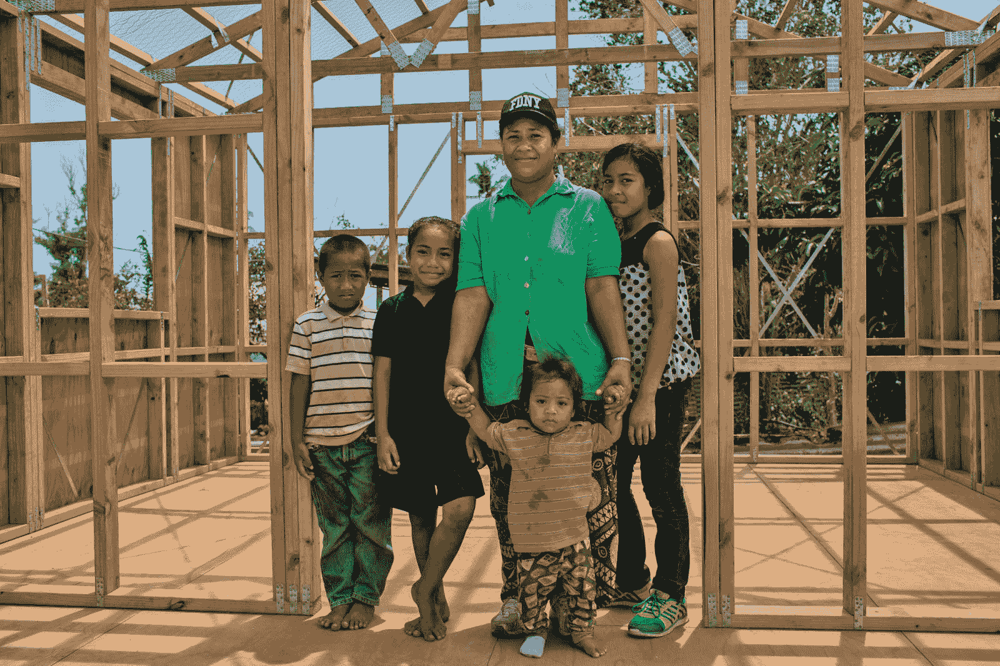
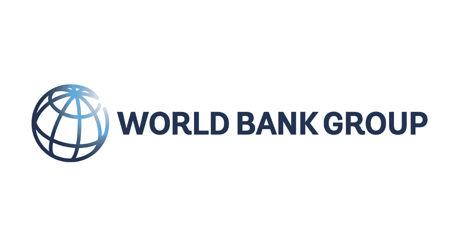
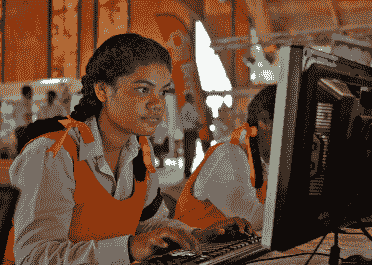
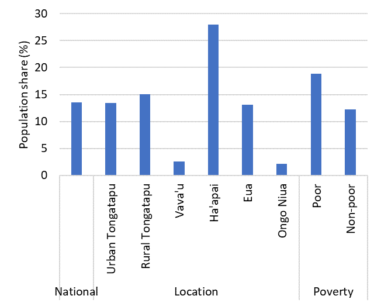
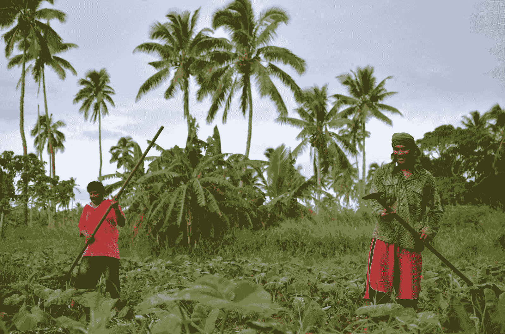
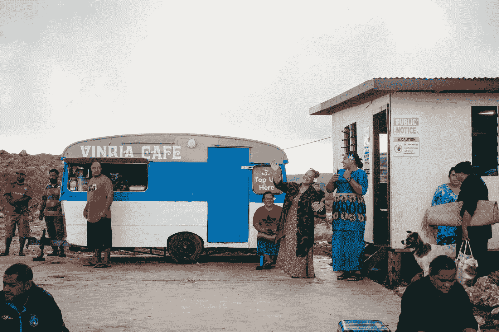
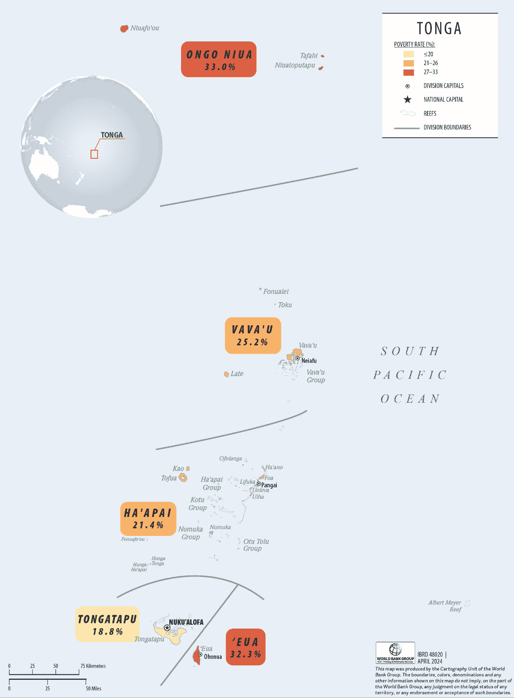
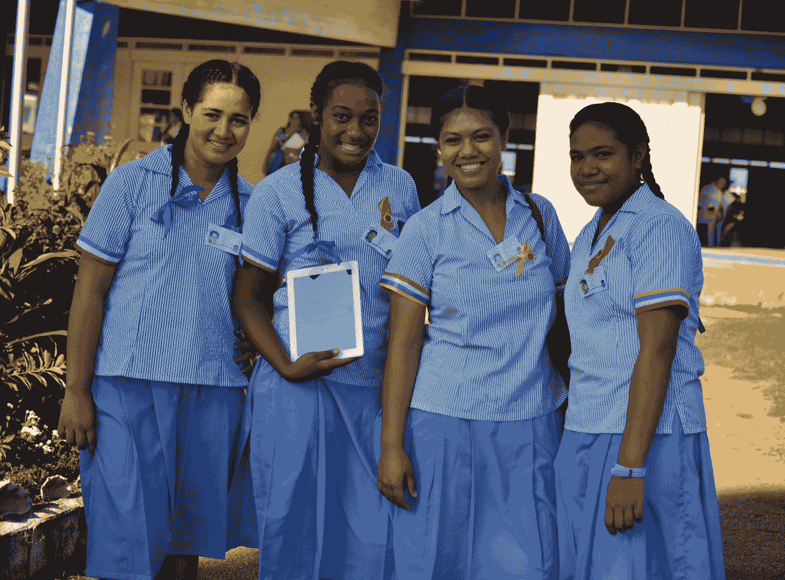
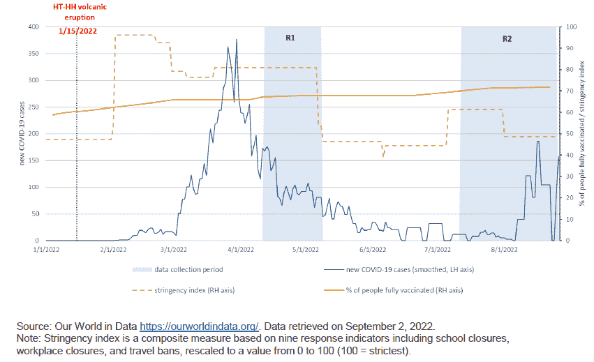
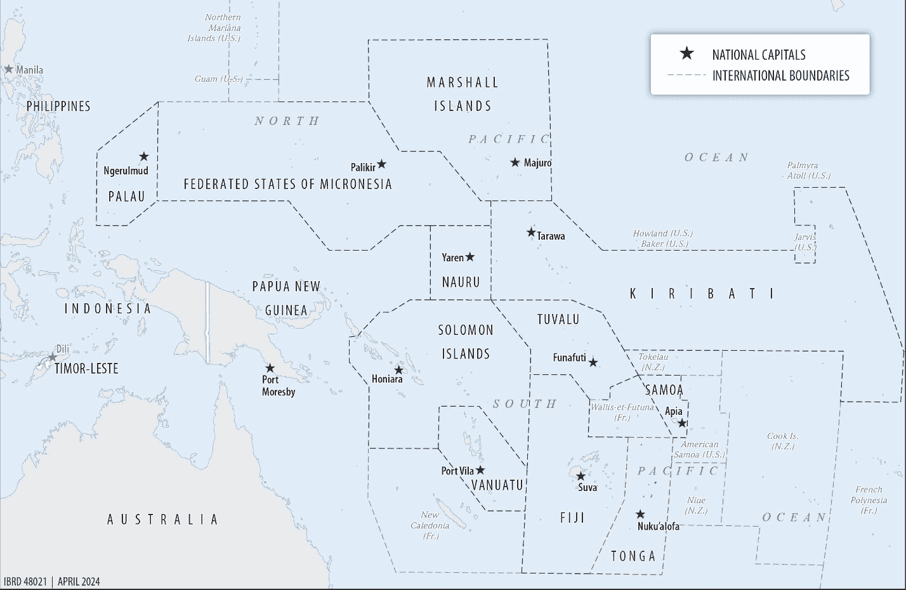

### Tonga Poverty and Equity Assessment 2024

### Tonga Poverty and Equity Assessment 2024

## Navigating Turbulent Waves Toward Sustained Poverty Reduction

© 2024 The World Bank

1818 H Street NW, Washington DC 20433

Telephone: 202-473-1000; Internet: www.worldbank.org

Some rights reserved.

This work is a product of The World Bank. The findings, interpretations, and conclusions expressed in this work do not necessarily reflect the views of the Executive Directors of The World Bank or the governments they represent.

The World Bank does not guarantee the accuracy, completeness, or currency of the data included in this work and does not assume responsibility for any errors, omissions, or discrepancies in the information, or liability with respect to the use of or failure to use the information, methods, processes, or conclusions set forth. The boundaries, colors, denominations, links/footnotes and other information shown in this work do not imply any judgment on the part of The World Bank concerning the legal status of any territory or the endorsement or acceptance of such boundaries.

The citation of works authored by others does not mean the World Bank endorses the views expressed by those authors or the content of their works.

Nothing herein shall constitute or be construed or considered to be a limitation upon or waiver of the privileges and immunities of The World Bank, all of which are specifically reserved.

## Rights and Permissions

The material in this work is subject to copyright. Because The World Bank encourages dissemination of its knowledge, this work may be reproduced, in whole or in part, for noncommercial purposes as long as full attribution to this work is given.

Attribution—Please cite the work as follows: “World Bank. 2024. Navigating Turbulent Waves Toward Sustained Poverty Reduction: Tonga Poverty and Equity Assessment 2024. © World Bank.”

Any queries on rights and licenses, including subsidiary rights, should be addressed to World Bank Publications, The World Bank, 1818 H Street NW, Washington, DC 20433, USA; fax: 202-522-2625; email: pubrights@worldbank.org.

Cover photo: World Bank

Sample credit for a non-WB image: © Ami Vitale / Panos Pictures. Used with the permission of Ami Vitale / Panos Pictures. Further permission required for reuse.

Sample credit for a WB image: © Curt Carnemark / World Bank. Further permission required for reuse.

Cover design: Laframboise Design

### Tonga Poverty and Equity Assessment 2024

## Navigating Turbulent Waves Toward Sustained Poverty Reduction

# Table of Contents

List of Figures...................................................................................................................................... 3

List of Tables....................................................................................................................................... 6

List of Boxes........................................................................................................................................ 6

List of Abbreviations.......................................................................................................................... 7

Acknowledgments............................................................................................................................ 9

Executive Summary........................................................................................................................ 10

## 1. Introduction

### 1.1 Country Context

### 1.2 About this Report

### 1.3 Poverty Measurement

## 2. Poverty and Inequality Patterns, Trends, and Drivers

### 2.1 Poverty and Inequality Patterns

### 2.2 Poverty and Inequality Trends and Drivers

## 2.3 Conclusion

## 3. Poverty, Vulnerability, and Resilience

### 3.1 Hazards, Exposure, and Vulnerability

### 3.2 Coping Mechanisms

### 3.3 Conclusion

## 4. Human Capital and Labor Market

### 4.1 Overview of Labor Force and Employment Conditions

## 4.2 Key Labor Demand and Supply Factors

## 4.3 Conclusion

## 5. Poverty and Social Protection

## 5.1 Coverage of the Current Social Assistance Programs

### 5.2 Improving SP/ASP to Better Protect the Poor

## 5.3 Conclusion

## References

## Annex A. Poverty Measurement in Tonga

## Annex B. SWIFT: Survey-to-Survey Imputation for Poverty Trend Analysis

## Annex C. The Unbreakable Simulation for the Poverty Impacts of Natural Disaster Events

## Annex D. Patterns of Remittances Received in 2021

## Annex E. Government Responses to Recent Crises

## Annex F. Additional Tables and Figures

## List of Figures

Figure ES1. Poverty and inequality dropped from 2015/16 to 2021............................... 11

Figure ES2. Insufficient human capital contributes to skills mismatches..................... 12

Figure ES3. With their limited coverage, SA programs have little impact on poverty............................................................................................................. 13

Figure ES4. Poorer households, including those with no employment, experienced stronger consumption growth between 2015/16 and 2021................................................................................................ 14

Figure ES5. Poorer households are more exposed and vulnerable to natural hazards................................................................................................ 16

Figure 1. Tonga’s GDP growth was already weaker than other PICs before the COVID-19 pandemic............................................................. 20

Figure 2. Multiple shocks slowed Tonga’s economic growth in recent years...................................................................................................... 21

Figure 3. Tonga’s smallness and remoteness stand out, constraining its economic potential........................................................................ 22

Figure 4. Sectoral composition in GDP and employment has been stable for a while................................................................................ 23

Figure 5. Tonga’s human capital is lower than other upper-middle-income countries................................................................................ 23

Figure 6. The tourism sector was growing before COVID-19.................................................................................................... 24

Figure 7. The population has been slightly decreasing due to a decline in the fertility rate and out-migration.............................................................. 26

Figure 8. Remittances received have been fast rising, with the GDP share in Tonga becoming the world’s highest............................................... 26

Figure 9. The economic impact of natural disasters has been sizable in Tonga................................................................................................................. 27

Figure 10. Consumption varies within and across island groups................................................................................................ 35

Figure 11. Poverty is lowest in urban Tongatapu and highest in ’Eua and Ongo Niua........................................................................................ 37

Figure 12. Poverty rates are higher in ’Eua and Ongo Niua........................................................................................................... 38

Figure 13. Two-thirds of the poor population live in Tongatapu.................................................................................................. 39

Figure 14. Tonga’s poverty and inequality levels are lower than comparable countries......................................................................................... 40

Figure 15. Food insecurity still prevails............................................................................... 41

Figure 16. Poverty is correlated with household education levels, income sources, and locations......................................................................... 42

Figure 17. Children and youth make up more than half of the poor population....................................................................................... 43

Figure 18. GDI per capita, including remittances received, grew by 14 percent in real terms between 2015/16 and 2021............................. 44

Figure 19. Poverty has likely dropped both in incidence and headcount.................. 44

## Figures

Figure 20. Household access to basic services has improved, with some islands lagging behind...... 48

Figure 21. Household ownership of key assets, including cars, improved...... 49

Figure 22. Poorer households gained more consumption growth, resulting in inequality reduction...... 50

Figure 23. Rural consumption growth drove poverty reduction...... 51

Figure 24. Remittances are a crucial income source, particularly for households with non-working heads...... 53

Figure 25. Remittances received increased both intensive and extensive margins...... 54

Figure 26. GDP-based projections imply Tonga’s sustained poverty reduction...... 57

Figure 27. There are a range of negative effects of labor migration perceived by Tongans...... 58

Figure 28. Tonga has been frequently exposed to severe natural disaster events...... 61

Figure 29. Severe TCs can affect the whole population, while flooding is a more localized event...... 62

Figure 30. A large proportion of poorer households engage in subsistence agriculture...... 64

Figure 31. Phone surveys captured the socio-economic impacts of the HT-HH eruption and COVID-19 crises in 2022...... 65

Figure 32. Many households lost productive assets in disaster-struck islands...... 66

Figure 33. The size of simulated household consumption loss varies by location and baseline consumption levels...... 69

Figure 34. Experience of food insecurity significantly increased after the HT-HH eruption and the first COVID-19 lockdown...... 70

Figure 35. Inflation was exceptionally high in utilities, energy, and transport...... 71

Figure 36. High inflation in 2022 could have increased poverty by 5 percentage points if household income did not increase...... 72

Figure 37. Unsustainable coping strategies were common among poorer households to deal with the crises...... 73

Figure 38. Poor households need different types of solutions...... 74

Figure 39. The poor are more likely to be inactive and, among employed, work in the agriculture, manufacturing, and construction sectors...... 79

Figure 40. More working-age Tongans complete tertiary education...... 83

Figure 41. Children from poor households are less likely to be enrolled in school...... 84

Figure 42. Consumption returns to education are higher among men and urban residents...... 85

Figure 43. Tonga successfully reduced stunting...... 86

Figure 44. Obesity and NCDs are prevalent and getting worse among Tongan adults...... 87

Figure 45. Internet usage is relatively low in ’Eua and Ongo Niua...... 88

Figure 46. Many poor individuals are not covered by SA programs...... 95

Figure 47. The SA programs cover the elderly population well due to the SWS...... 95

Figure 48. The SA programs have little to no impact on poverty, except for the elderly...... 97

Figure 49. Increasing SA benefits based on the current targeting has a limited impact on poverty...... 98

Figure 50. Increasing benefits and improving targeting will reduce a great amount of poverty...... 99

Figure 51. Well-targeted transfers can reduce the disaster impact effectively and efficiently...... 101

Figure 52. Combined with increases in remittances, new transfers would further reduce post-disaster poverty...... 102

Figure 53. The amount of remittances received by Tongan households is constant relative to their consumption levels...... 122

Figure 54. Households in Ha’apai, ’Eua, and Ongo Niua are less likely to receive remittances...... 123

Figure 55. Tonga’s access level to basic services is high among the PICs...... 129

Figure 56. Poor households tend to have inferior types of basic services...... 130

Figure 57. Migrant workers send remittances to support the daily expenses of their families in Tonga...... 130

Figure 58. Household asset ownership declined slightly after the dual shock in 2020...... 131

Figure 59. Young women are more likely to be in NEET...... 131

Figure 60. The gender gap in employment is significantly higher between married men and women...... 132

Figure 61. Women are more likely to work in high-skill service sector jobs or self-employed craft work...... 132

Figure 62. Around 80 percent of working-age adults own mobile phones...... 133

Figure 63. Tonga in the Pacific Region...... 133

## List of Tables

Table 1. The primary focus of this report is monetary poverty based on the national cost-of-basic-needs poverty line...... 30

Table 2. Household consumption distribution is skewed...... 34

Table 3. Projection results based on macroeconomic indicators suggest similar poverty trends...... 46

Table 4. Without remittances, poverty could have been higher by 5 to 10 percentage points...... 55

Table 5. Without mitigation measures, natural disasters could severely affect poverty...... 68

Table 6. Types of positions and skill requirements in the Pacific tourism sector...... 81

Table 7. The 2021 HIES sampling...... 109

Table 8. Spatial and temporal deflator...... 111

Table 9. Urban and Rural SWIFT models, created using HIES 2021 as training data...... 113

Table 10. Performance test results of urban and rural SWIFT models within HIES 2021 data...... 114

Table 11. Summary statistics of model variables for HIES 2015/16 and HIES 2021...... 114

Table 12. Poverty regression results...... 127

Table 13. Despite slight increases since 2015/16, labor force participation and employment rates are still lower among the poor...... 129

## List of Boxes

Box 1. Poverty measurement with HIES 2021...... 30

Box 2. Establishing comparable welfare and poverty measures between 2015/16 and 2021...... 45

Box 3. Social costs of labor mobility...... 58

Box 4. World Bank high-frequency phone surveys in Tonga...... 65

Box 5. Tonga’s National Social Protection Policy and SA programs...... 94

Box 6. Targeting mechanism for the CCT...... 100

## List of Abbreviations

- ASP — adaptive social protection
- CCT — Conditional Cash Transfer
- COICOP — Classification of Individual Consumption by Purpose
- CPI — consumer price index
- DWS — Disability Welfare Scheme
- EA — Enumeration Area
- FIES — Food Insecurity Experiences Scale
- GBV — Gender-Based Violence
- GDI — gross disposable income
- GDL — Government Development Loan
- GDP — gross domestic product
- GNI — gross National Income
- HFPS — high-frequency phone survey
- HH — household
- HIES — Household Income and Expenditure Survey
- HT-HH — Hunga Tonga-Hunga Ha’apai
- IDMC — International Displacement Monitoring Centre
- ILO — International Labour Organization
- LMIC — lower-middle-income country
- MICS — Multiple Indicator Cluster Surveys
- MSME — micro, small, and medium enterprise
- NCD — non-communicable Disease
- NEET — not be in employment, education or training
- NSPP — National Social Protection Policy
- PALM — Pacific Australia Labour Mobility Scheme
- PEA — Poverty and Equity Assessment
- PICs — Pacific Island Countries
- PLS — Pacific Labour Scheme
- PML — Probable Minimum Asset Loss
- PMT — Proxy Means Test
- PNDB — Pacific Nutrient Database
- PPP — Purchasing Power Parity
- PSMB — Pacific Statistics Methods Board
- PVTCT — poverty and vulnerability targeted cash transfer
- RSE — Recognised Seasonal Employer Scheme
- RSP — Remittance Service Provider
- SA — Social Assistance
- SET — The Skills and Employment for Tongans Project
- SP — Social Protection
- SPC — The Pacific Community
- SWIFT — Survey of Well-being via Instant and Frequent Tracking
- SWP — Seasonal Worker Programme
- SWS — Social Welfare Scheme
- SWSE — Social Welfare Scheme for the Elderly
- TC — tropical cyclone
- TDB — Tonga Development Bank
- TLMSMS — Tonga Labor Mobility Supply Management Strategy
- TOP — Tongan Pa’anga
- TSD — Tonga Statistics Department
- TVET — Technical and Vocational Education and Training
- UCT — universal cash transfer
- UMIC — upper-middle-income country
- UNCDF — United Nations Capital Development Fund
- UNDRR — United Nations Office for Disaster Risk Reduction
- WTO — World Trade Organization

## Acknowledgments

The report was written by Shohei Nakamura (Task Team Leader, EEAPV), Sharad Tandon (Co-Task Team Leader, EEAPV), and Adriana Conconi (Consultant, EEAPV).

The team would like to thank the following colleagues for their comments and inputs: Danielle Victoria Aron (ET Consultant, EPVGE), Ben James Brunckhorst (Research Analyst, EPVGE), Andres Chamorro (Geographer, DECSC), Luisa Patricia Fernandez Delgado (Consultant, HEASP), Simone Esler (Senior Climate Change Specialist, SEAU1), Andrew Hurley (Municipal Engineer, SEAU1), Anuja Kar (Senior Agriculture Economist, SEAAG), Sandor Karacsony (Senior Economist, HEASP), Natalia Latu (Liaison Officer, EACTO), Ruth Nikijuluw (Economist, EEAM2), Minh Cong Nguyen (Senior Economist, EPVGE), Kenia Parsons (Senior Social Protection Specialist, HEASP), Aarthi Meenakshi Sundaram (Consultant, EEAPV), Ryoko Tomita (Senior Education Specialist, HEAED), Aadarsh Vasudevan (Consultant, EPVGE), Jian Vun (Senior Disaster Risk Management Specialist, SEAU1), Son Thanh Vo (Senior Agriculture Specialist, SEAAG), Charles Knox-Vydmanov (Consultant, HEASP), and Nobuo Yoshida (Lead Economist, EPVGE). Mildred Gonsalvez (Program Assistant, EEAPV), Manju Venkiteswaran (Program Assistant, EACNF), and Hotaia Hola (Program Assistant, EACTO) provided administrative support.

The report was prepared under the guidance of Lalita Moorty (Regional Director, EEADR), Stephen Ndegwa (Country Director, EACNF), Stefano Mocci (Country Manager, EACFF), David Gould (Program Leader, EEADR), and Rinku Murgai (Practice Manager, EEAPV).

The report benefited from detailed peer review from Ruth Hill (Lead Economist, EPVGE), Nadia Belhaj Hassine Belghith (Senior Economist, EEAPV), Yeon Soo Kim (Senior Economist, EPVGE), Ruth Nikijuluw (Economist, EEAM2), and Matthew Wai-Poi (Lead Economist, EEAPV), as well as many colleagues in the World Bank who provided insights, suggestions, and improvements to the report process.

Brenan Gabriel Andre (Consultant, GOHMA) supported the preparation of maps. Angela Takats edited the report, with graphic design by Laframboise Design.

This report was prepared in collaboration with the Tonga Statistics Department (TSD). The analyses build on the data and reports published by the TSD with support from the Pacific Community (SPC). The team would also like to thank the Ministry of Finance and other government agencies for consultation at various stages.

## Context and Poverty Update

Tonga’s economic growth, historically weak due to structural factors facing many Pacific Island countries, has been particularly sluggish in recent years due to several large shocks. Tropical cyclones in 2018 and 2020, border restrictions and surging inflation due to the COVID-19 outbreak, and the Hunga Tonga-Hunga Ha’apai (HT-HH) volcanic eruption all have battered the population and have potentially reversed previous welfare gains.¹

This World Bank Poverty and Equity Assessment (PEA) report aims to fill critical knowledge gaps regarding the extent, nature, and drivers of poverty and inequality in Tonga. The report extensively utilizes the 2021 Household Income and Expenditure Survey (HIES) in Tonga and the official monetary poverty estimate from the survey. The 2021 HIES is the first survey containing significant welfare information that was entirely fielded after the start of the COVID-19 pandemic and can more fully illustrate some of the pandemic’s impacts. To estimate the change in monetary poverty, the report utilizes the 2015/16 HIES to impute the monetary poverty estimate in that year given that the government did not report an official monetary poverty estimate from the survey.²

In addition to identifying poverty and inequality patterns, this report highlights several thematic topics to which information from the HIES can contribute and inform the ongoing policy dialogue. These topics include vulnerability of the population to shocks, human capital development, and social protection systems.

### Executive Summary

¹ World Bank (2023a).

² There were also many changes to survey design and implementation of the 2021 HIES that likely make it difficult to directly compare expenditure in the two surveys.

Despite strong and overlapping shocks, poverty and inequality in Tonga fell substantially between 2015 and 2021. The poverty rate at the national poverty line declined from an estimated 27.4 percent in 2015/16 to 20.6 percent in 2021, with similar declines in both rural and urban regions (Panel A in Figure ES1); and inequality, which was already low relative to countries with similar per capita GDP levels, also decreased during the same period (Panel B). Corroborating the improvement in monetary well-being, there were also improvements in many non-monetary dimensions, including household ownership of key assets, access to improved sanitation, and access to electricity. However, spatial disparities in well-being persist, with the poverty rate in urban Tongatapu in 2021 being less than half the rate in ‘Eua and Ongo Niua (Panel C). Despite the lower poverty rate in Tongatapu, the island accommodates two-thirds of Tonga’s impoverished population due to its large population (Panel D).

**FIGURE ES1. Poverty and inequality dropped from 2015/16 to 2021**

**(A) Poverty trends, 2015/16 to 2021**

|  | 2015/16 | 2021 |
|---|---:|---:|
| National | 27.4 | 20.6 |
| Urban | 18.4 | 13.4 |
| Rural | 29.7 | 22.7 |

**Poverty rate (%)**

**(B) Inequality trends, 2015/16 to 2021**

|  | 2015/16 | 2021 |
|---|---:|---:|
| National | 28.4 | 27.1 |
| Urban | 26.7 | 26.4 |
| Rural | 28.6 | 27.2 |

**Gini coefficient**

**(C) Poverty rate by island group, 2021**

| Island group | Poverty rate (%) |
|---|---:|
| Tonga | 20.6 |
| Urban Tongatapu | 13.4 |
| Rural Tongatapu | 21.1 |
| Vava’u | 25.2 |
| Ha’apai | 21.4 |
| ‘Eua | 32.3 |
| Ongo Niua | 32.9 |

**(D) Composition of the poor by island group, 2021**

| Island group | Population (%) | Poor population (%) |
|---|---:|---:|
| Urban Tongatapu | 52.1 | 53.4 |
| Rural Tongatapu | 14.0 | 17.2 |
| Vava’u | 22.1 | 14.3 |
| Ha’apai | 6.3 | 6.5 |
| ‘Eua | 4.4 | 6.9 |
| Ongo Niua | 1.1 | 1.7 |

Note: Poverty is measured with the national cost-of-basic-needs poverty line. Poverty in 2015/16 was estimated based on the household consumption aggregate imputed with the SWIFT method. Inequality is measured by the consumption-based Gini coefficient.

Source: Staff calculations using HIES 2021 and World Development Indicators.

In tandem with the reduction in monetary poverty, living standards improved in various aspects. Household ownership of key assets increased between 2015 and 2021, such as mobile phones (82 to 97 percent), washing machines (77 to 85 percent), and, most notably, cars (37 to 55 percent). In terms of access to basic services, in 2021 about 90 percent and 94 percent of households had access to flush toilets and electricity, respectively. Nonetheless, spatial disparities are still present. For example, people outside Tongatapu predominantly rely on rainwater tanks as a source of drinking, while Tongatapu residents increasingly use either piped water or bottled water.

## Why has Monetary Well-Being Improved?

A critical question addressed by this report is why there were such significant improvements in well-being despite the incomplete recovery from the COVID-19 pandemic and the natural disasters that occurred during the same period. Although it is difficult to attribute changes in well-being to any single cause fully, this report further decomposes the well-being changes by characteristics of households and highlights significant policy changes that occurred over the same period. Triangulating between all the available information helps to illustrate potential drivers of the substantial improvement in well-being.

Labor force and employment conditions are unlikely to be responsible for the sustained decline in poverty, as labor force participation remains at a low level and there has been no substantial change in employment patterns. The country faces persisting skills mismatches in the domestic labor market as well as labor supply constraints. The World Bank’s human capital index shows that the average child born today in Tonga will be only 53 percent as productive when they grow up relative to a scenario assuming optimal health and education (Panel A in Figure ES2). These factors result in many adults lacking the required skills to work in sectors and occupations with growth prospects—most notably tourism; low labor force participation, particularly among the poor and females (Panel B); a large share of workers engaged in low-productivity agriculture, the informal sector, or self-employment; and the largest source of jobs (that provide an income to live above the cost of basic needs) being government employment.

Although the recent expansion of government-provided social assistance (SA) in the country has supported the poor and vulnerable, it is also unlikely to be a key driver behind the substantial decline in poverty. Due to the low coverage of social assistance and low benefit size, none of the major three SA programs in the country—the Social Welfare Scheme (SWS), the Disability Welfare Scheme (DWS), and the Conditional Cash Transfer (CCT)—are estimated to have a significant impact on the aggregate poverty rate in the country (Panel A in Figure ES3). However, when focusing on the poverty impact amongst the targeted group, the SWS has a substantial impact on individuals 70 and older (about a 4 percentage-point reduction in poverty). The DWS and CCT both have benefit amounts that are too small, particularly when accounting for the household size of beneficiaries, to have a significant impact on poverty amongst even the targeted groups. Only programs that increase coverage amongst the poor and substantially increase benefit levels, which are policy goals described under the National Social Protection Policy 2023-2033, have the potential to substantially reduce poverty in the country (Panel B). Simulations suggest that the government would have had to devote 3.5 times more than is currently being spent on SA—nearly 3 percent of GDP—to poverty-targeted cash transfers to achieve the same levels of poverty reduction as experienced between 2015 and 2021.

### Figure ES2. Insufficient human capital contributes to skills mismatches

(A) Human Capital Index, 2020

(B) Labor force status, 2021

Note: LMIC and UMIC indicate the average scores for lower-middle-income and upper-middle-income countries, respectively.

Source: Staff calculations using World Development Indicators and HIES 2021.

Instead, all the available evidence suggests that the substantial poverty reduction has been supported by another form of cash transfers—that is, the significant increases in remittances. The PEA’s imputation result suggests that lower-income households experienced more consumption gains between 2015/16 and 2021 (Panel A in Figure ES4), and reductions in poverty were mainly driven by consumption growth among rural households with non-working heads (Panel B). This indicates the significant role of remittances as the main driver for poverty reduction rather than changes in employment and labor incomes. Remittances increased at both intensive and extensive margins between 2016 and 2021, with nearly 90 percent of households receiving and almost 40 percent relying on them as the primary income source in 2021. Without remittances, the number of poor individuals would have been 50 percent higher.

### Figure ES3. With their limited coverage, SA programs have little impact on poverty

(A) Poverty rates in absence of SA programs

(B) Simulated poverty rates with poverty-targeted cash transfer

Note: Poverty is measured with the national cost-of-basic-needs poverty line.

Source: Staff calculation using the 2021 HIES.

### Figure ES4. Poorer households, including those with no employment, experienced stronger consumption growth between 2015/16 and 2021

(A) Consumption growth by decile

(B) Decomposition of poverty change

Note: (A) Annual growth of adult equivalent total expenditure by decile. The horizontal long and short dash lines show the average and median growth rates for the entire sample. Household consumption aggregates in 2015/16 are imputed with the SWIFT approach. (B) Poverty changes between 2015/16 and 2021 are decomposed based on the Shapley decomposition approach. Poverty is measured with the national cost-of-basic-needs poverty line.

Source: Staff calculations using HIES 2015/16 and 2021.

Economic statistics, administrative data, and other survey data further illustrate the substantial increases in remittances during the period, primarily driven by increases in temporary worker programs in Australia and New Zealand. It is estimated that more than half of Tongans live outside Tonga, and the size of remittance flows from them has been sizable. Moreover, the number of visas granted to workers participating in temporary labor schemes in Australia and New Zealand nearly doubled from around 25,000 in 2018/19, the last full year before the COVID-19 pandemic, to almost 48,000 in 2022/23. The number of Tongans in these programs was the third highest in 2022/23 (6,500), following Vanuatu (16,500) and Samoa (6,700). In tandem with the accelerating temporary labor migration, the amount of remittances received in the country as a share of GDP has increased from 30 percent in 2015 to 45 percent in 2021.

These estimates are the first to illustrate the potential aggregate impacts of remittances in Pacific Island countries from diaspora members and those in labor mobility schemes. Surveys of participants in temporary worker schemes, including workers from Tonga, report high levels of satisfaction with the schemes and that wages from the schemes are higher than they might be able to earn in their home countries. The aggregate figures of the labor force employed in such programs for Tonga are as significant as those of some other sectors, notably government employment. However, such surveys and figures cannot provide representative data regarding the share of the entire population supported.

by such wages, the increased demand for goods and services in response to the increases in spending of recipient households, and so on. Nevertheless, these estimates illustrate that the broader benefits of the program and the large wages sent back home have been able to not only help the Tongan population withstand numerous devastating shocks but even improve the standard of living for a large share of the population. Furthermore, although participation in the temporary labor schemes is heavily skewed towards men, the overall impact on poverty is not similarly skewed. In 2021, the monetary poverty rate was actually lower for women than for men—19.8 percent for women versus 21.5 percent for men.

## What Risks Need to be Considered to Ensure Sustainable Poverty Reduction?

While remittances significantly contribute to poverty alleviation by enhancing households’ income levels, there are risks related to fluctuations in global economic conditions, exchange rate volatility, over-dependence on the diaspora, as well as the potential negative impacts of temporary worker schemes. The government and businesses in worker-sending Pacific Island Countries (PICs) have been raising alarms regarding the over-recruitment of these schemes from specific rural communities and also regarding the added difficulties of finding qualified semi-skilled and skilled workers in a region in which labor supply is limited.⁶ At the same time, qualitative studies of sending communities have noted additional negative impacts of participating in temporary worker programs. Although there has been limited investigation of these potential impacts on sending communities in Tonga, the sheer size of Tongan participants in the temporary worker schemes suggests that more work needs to be devoted to the issue. As of 2023, approximately 11 percent of the entire Tongan working-age population and 20 percent of the male working-age population are participating in temporary labor schemes in Australia or New Zealand. Both of these figures are approximately twice as large as the respective figures for Samoa, where a number of these adverse impacts are beginning to be documented.⁷

Another consideration is natural hazards, which frequently threaten the country and place a large share of the population at risk of falling into poverty. Tonga is exposed to various natural disasters, including tropical cyclones (TC), tsunamis, volcanic eruptions, earthquakes, and coastal flooding.⁸ The losses from recent TCs and the 2022 volcanic eruption and tsunami were particularly costly, ranging from 11 to 36 percent of GDP and affecting up to 85 percent of the national population. These shocks have significant and persistent impacts on household-level outcomes. The consumption losses among households facing a severe TC are simulated to be large, reaching upwards of 20 percent were it not for any support provided, a figure that would drive a significant share of the non-poor population below the poverty line (Panel A in Figure ES5). Moreover, several groups are particularly vulnerable to natural disasters. Poor households are more likely to face particular types of shocks, including coastal flooding (Panel B). Nearly half of poor workers are self-employed or have informal jobs, lacking job security in the event of a natural disaster. Many farmers are engaged in subsistence-based agriculture, and crops are particularly vulnerable to heightened temperatures, variability in rainfall, increased heat stress, ocean acidification, a rise in sea-surface temperatures beyond 1.5°C, and sea-level elevation. Tourism, which is a source of a significant share of jobs, is particularly sensitive to natural hazards.

⁶ Fatupatio et al. (2021); Curtain (2022).

⁷ Bedford (2023).

⁸ World Bank (2023a).

It is also important to note that changes in monetary poverty do not incorporate subjective aspects of well-being. Given the large shocks experienced in the country and the substantial inflation that has occurred, subjective assessments of well-being and the satisfaction individuals feel about their well-being have potentially not kept pace with the significant decline in monetary poverty documented here. The consensual poverty rate reported by the government, which incorporates subjective assessments regarding what constitutes a necessity, shows a significantly smaller decline—roughly 3 percentage points—than the 7 percentage point decline in monetary poverty.⁹

**FIGURE ES5.** Poorer households are more exposed and vulnerable to natural hazards

(A) Simulated welfare loss due to hazards

(B) Exposure to flooding

| Location | Flooding (10-year return) | TC (10-year return) |
|---|---:|---:|
| National |  |  |
| Urban Tongatapu |  |  |
| Rural Tongatapu |  |  |
| Vava'u |  |  |
| Ha'apai |  |  |
| Eua |  |  |
| Ongo Niua |  |  |
| Poor |  |  |
| Non-poor |  |  |

| By baseline consumption quintile | Consumption loss (%) |
|---|---:|
| Q1 |  |
| Q2 |  |
| Q3 |  |
| Q4 |  |
| Q5 |  |

Source: Staff calculations using FATHOM 3.0 and HIES 2021.

Note: (A) Bars indicate the population shares exposed to flood inundation of 15 cm or higher for a 100-year return period. (B) The numbers are based on the Unbreakable simulation results.

## The Way Forward

Tonga has made significant progress in reducing poverty during a tough time; however, to ensure further progress in the coming years, a more sustainable approach is needed.

First, developing effective social protection systems, including an adaptive social protection (ASP) system, is crucial to safeguarding vulnerable populations from the immediate shocks of natural disasters and economic downturns. An ASP system in Tonga would need to be dynamic and responsive, allowing for quick scaling up of benefits in response to shocks and integrating disaster risk reduction to mitigate the impacts of climate change and natural disasters. This system should focus on inclusivity, ensuring that the most vulnerable, including the elderly, disabled, and households in remote areas, are protected. Furthermore, social protection programs must be sustainable and backed by robust financial management to ensure they can be deployed rapidly when needed. Strengthening these systems involves broadening the coverage and scope of existing programs and improving targeting and delivery mechanisms to ensure that support reaches those in need promptly and efficiently.

Second, enhancing the human capital base is essential to facilitate economic diversification in Tonga’s domestic economy and labor migration. This involves improving educational outcomes and skill sets aligned with the demands of local and international labor markets. Investing in quality education and vocational training can equip Tongans with the skills necessary for employment in sectors with the largest growth potential. Moreover, promoting digital literacy and development is crucial as it can open new avenues for economic diversification and enhance workforce productivity. Initiatives like the World Bank’s Skills and Employment for Tongans (SET) Project illustrate steps towards this direction by reducing financial barriers to education and improving vocational training through targeted social protection programs. This holistic approach supports the workforce within Tonga and prepares individuals for opportunities abroad, optimizing the benefits from remittances.

Third, there needs to be a more in-depth investigation of the impacts of temporary labor schemes on the private sector of the countries that are sending workers. The likely poverty reduction arising from the programs is an important piece of evidence regarding the impact of these programs overall on household outcomes, but it is not unrelated to the struggling private sector. The 2021 HIES and changes since 2015 in some of these employment outcomes can help to illustrate some of these potential impacts. However, enterprise surveys and labor force surveys in other countries facing similar issues, like Samoa, can also be used to more concretely illustrate the trade-offs involved in such programs.

As Tonga stands at a critical juncture, the outlined strategies pave the way for mitigating immediate economic and environmental challenges and laying a robust foundation for inclusive development. Embracing these adaptive and forward-looking measures will enable Tonga to enhance its resilience, harness its full economic potential, and secure a prosperous future for all its citizens. This comprehensive approach ensures that Tonga remains agile and responsive to the ever-evolving global landscape, reinforcing its commitment to progress and well-being.

## 1. Introduction

Tonga, an upper-middle-income nation as classified by the World Bank, is a small Pacific Island country with a population of around 100,000. Despite its small size, Tonga boasts a Gross National Income (GNI) per capita of US$7,160.^10 The country’s expansive territory encompasses 171 islands, of which 45 are inhabited, spread across a vast area of 700,000 square kilometers in the southern Pacific Ocean (see Annex F, Figure 63).

Tonga, along with other Pacific Island countries (PICs), encounters unique developmental hurdles owing to its limited population size and geographical isolation from large markets. This introductory chapter offers the country context, briefly introducing macroeconomic trends, economic structures, labor migration and remittances, and susceptibility to natural disasters. Furthermore, it delineates this report’s primary aim, poses critical policy questions for consideration, and presents the organizational structure of the ensuing chapters.

### 1.1 Country Context

### Multiple shocks in recent years have slowed Tonga’s already weak economic growth.

Tonga’s economic growth has been historically weak. The pace of economic growth accelerated in the Pacific region from the decade between 2000 and 2009 to the next decade, with the average annual GDP growth rate increasing from 2 percent to 3 percent (Figure 1). Before the COVID-19 pandemic, Tonga’s economic growth was slower than that of other PICs. Between 2000 and 2009, Tonga’s GDP grew only 0.9 percent on average. The growth rate increased to 2.3 percent during the next decade but was still slower than that of other PICs.

10. In current international $. The countries with GNI per capita between $4,466 and $13,845 are classified as upper-middle-income countries in 2023/24.

A series of shocks over the recent years have significantly hindered Tonga’s economic growth. From an annual GDP growth rate of 6.6 percent in 2015/16—mainly due to the recovery from tropical cyclone (TC) Ian—the rate plummeted to nearly zero percent between 2017/18 and 2019/20 (Figure 2). The country has recently endured the devastating effects of three major TCs: Ian in 2014, Gita in 2018, and Harold in 2020. These natural disasters have profoundly impacted the nation’s economic trajectory. The COVID-19 pandemic further aggravated Tonga’s economic challenges, causing a 2.7 percent shrinkage in the economy during the 2020/21 period. Moreover, Tonga faced the Hunga-Tonga Hunga-Ha’apai (HT-HH) volcanic eruption and the first community transmission of COVID-19 in early 2022. The HT-HH volcanic eruption and subsequent tsunami inflicted damages estimated at 36 percent of the GDP.

Tonga’s economy has been further challenged by high inflation in recent years, exacerbating the impact of economic shocks on the livelihoods of its people. The country’s inflation rate is relatively high compared to other nations with similar GDP levels, attributed to Tonga’s heavy reliance on imports. The global economic landscape, particularly affected by the Russian invasion of Ukraine, has contributed to Tonga’s inflationary pressures, with the Consumer Price Index (CPI) recording annual increases of 5.6 percent in 2021 and a substantial 11.0 percent in 2022. In recent times, food prices have escalated more rapidly than non-food prices.

**FIGURE 1.** Tonga’s GDP growth was already weaker than other PICs before the COVID-19 pandemic

Average annual GDP growth rate among PICs (percentage), 2000–2019

Source: World Development Indicators.

|  |  |
|---|---|
| Average GDP growth rate (%) | 0, 2, 4, 6, 8 |
| Countries | Tonga, Fiji, FSM, Kiribati, Nauru, Palau, RMI, Samoa, Tuvalu, Vanuatu, Solomon Islands |
| Periods | 2000–2009; 2010–2019 |

### With its small population size and remoteness from large markets, a lack of economic diversification persists.

Like other PICs, Tonga’s economy is structurally constrained by its small population size, extreme remoteness from markets, exposure to natural hazards, and environmental fragility. The PICs are among the world’s smallest and most remote economies (Figure 3).^11 Small size implies a lack of economies of scale both in public and private production. Remoteness and high transport costs prevent the PICs from overcoming small size through specialization and trade. Sources of economic growth are limited to activities where economies of scale and transport costs do not matter as much or those that generate sufficiently high rents to overcome these limitations. These include:

- Natural resource-related activities, such as tourism, fisheries, and logging;
- Rents from sovereignty, such as aid, internet domains, philatelic products, or company and ship registries and domiciliation; and
- Incomes and remittances from access to overseas labor markets through permanent or temporary migration.

**FIGURE 2.** Multiple shocks slowed Tonga’s economic growth in recent years

Annual GDP growth rates, inflation rates, and major shocks

Source: World Development Indicators.

| Year | 2014 | 2015 | 2016 | 2017 | 2018 | 2019 | 2020 | 2021 | 2022 |
|---|---:|---:|---:|---:|---:|---:|---:|---:|---:|
| Annual growth rate (%) | -4 | -2 | 0 | 2 | 4 | 6 | 8 | 10 | 12 |
| Major shocks | TC Ian |  |  |  | TC Gita |  | TC Harold |  | HT-HH |

Inflation rate; GDP growth rate

11. World Bank (2021).

Tonga’s economic structure is marked by a lack of dynamism and diversification, heavily centered on traditional sectors such as agriculture and fisheries. Since 2011, the sectoral composition of Tonga’s GDP and employment has remained unchanged. The service sector accounts for about half of the GDP, with the rest split evenly between agriculture and industry (Panel A in Figure 4). Agriculture has not been successful at exporting due to geography, limited land area, lack of investments in productivity-enhancing technologies, climate change, and weak business-enabling environments. Major agricultural products for export are squash pumpkins, vanilla, and kava, while other products are primarily for subsistence and local consumption. Employment shares tell a different story, with low-productivity agriculture and industry each accounting for roughly 30 percent. A larger share of people are engaged in agriculture for their own consumption.^12 Job growth in manufacturing—mainly textile and handcrafting—is limited due to the small population size and distance to markets. Service sector jobs are constrained by skills mismatches due to the workforce lacking the required skills.^13

12. Based on the ILO definition, people are not classified as employed if they work not for pay but for own consumption.

13. World Bank (2024b).

**FIGURE 3.** Tonga’s smallness and remoteness stand out, constraining its economic potential

Population and the average distance from markets across countries

Note: Y-axis indicates the average distance from other economies weighted by their GDP.

Source: World Bank (2021).

| Countries/Groups | All countries | PICs | Caribbean | NZL | AUS | Tonga | Fiji | VAN | Samoa | TUV | SOL | PNG | KIR | RMI | FSM | Palau |
|---|---|---|---|---|---|---|---|---|---|---|---|---|---|---|---|---|
| Population (log scale) | 10k | 1m | 10m | 100m | 1bn |
| Average distance from markets | 3,000 | 5,000 | 7,000 | 9,000 | 11,000 | 13,000 | 15,000 |

**FIGURE 4.** Sectoral composition in GDP and employment has been stable for a while

Tonga’s economy trends, 2011–2021

Source: Staff calculations using World Development Indicators.

| Sector | GDP share, 2011 | GDP share, 2016 | GDP share, 2021 | Employment share, 2011 | Employment share, 2016 | Employment share, 2021 |
|---|---:|---:|---:|---:|---:|---:|
| Industry | 19 | 20 | 20 | 32 | 31 | 30 |
| Agriculture | 22 | 19 | 19 | 28 | 26 | 27 |
| Services | 59 | 62 | 61 | 40 | 42 | 43 |

Tonga’s insufficient human capital contributes to skills mismatches in the domestic labor market. According to the World Bank’s human capital index, the average child born today in Tonga will be only 53 percent as productive when they grow up, compared to a scenario assuming optimal health and education. This is lower than Samoa and the average for upper-middle-income countries. The World Bank Pacific Island Systematic Country Diagnostic Update emphasizes that strengthening human capital requires:

- Improving educational quality and increasing access to secondary and higher education;
- Strengthening the health system to improve coverage, quality, and resilience; and
- Improving women’s paid employment and reducing gender-based violence.

These pathways are relevant to Tonga as well.

**FIGURE 5.** Tonga’s human capital is lower than other upper-middle-income countries

Human capital index, 2020

Note: LMIC and UMIC indicate the average scores for lower-middle-income and upper-middle-income countries, respectively.

Source: Staff calculation using World Development Indicators.

| Country/Group | Human capital index |
|---|---:|
| Samoa | 0.6 |
| Tonga | 0.53 |
| Fiji | 0.5 |
| Kiribati | 0.4 |
| Vanuatu | 0.4 |
| Tuvalu | 0.4 |
| PNG | 0.4 |
| RMI | 0.4 |
| SLB | 0.4 |
| LMIC | 0.4 |
| UMIC | 0.5 |

**FIGURE 6.** The tourism sector was growing before COVID-19

Travel and tourism total contribution to employment and GDP

Source: World Travel and Tourism Council.

Tonga’s tourism sector, which represents about 11 percent of its GDP, plays a crucial role in the nation’s economy. The influx of tourists brings in foreign exchange earnings and contributes to economic growth, infrastructure development, and job creation. Tourism is Tonga’s largest single source of export earnings, contributing nearly 20 percent of the GDP before the COVID-19 outbreak (Figure 6). However, this share decreased to 10.6 percent in 2020 due to the COVID-19 pandemic and further down to 3.5 percent in 2021. Tonga’s position as the fourth among the PIC9 regarding worker share in tourism (15 to 20 percent) underscores the sector’s importance as an employer within the country. Jobs are provided across various domains, including hospitality, transportation, and local businesses that cater to tourists. The disruptions caused by natural disasters and the COVID-19 pandemic have particularly highlighted the vulnerability of tourism-dependent economies, as travel restrictions and health concerns have led to a significant decline in tourist arrivals. This situation has emphasized the importance of building resilience in the tourism sector.

| Percentage share of total GDP | Percentage share of total employment |
|---|---|
| 0 | 5 |
| 10 | 15 |
| 20 | 1995 |
| 2000 | 2005 |
| 2010 | 2015 |
| 2020 |  |

There is a heavy reliance on labor migration and remittances.

Tonga’s population dynamics and economic structure are significantly influenced by the trend of large-scale labor migration. The scarcity of local economic opportunities has prompted many Tongans to seek employment abroad, which—alongside the decline in the fertility rate—has contributed to a population decline since 2011 (Panel A in Figure 7). The gender disparity in the working-age population, particularly the male-female ratio, highlights a pronounced trend of male migration for employment opportunities abroad (Panel B). This pattern is not unique to Tonga but is common across the Pacific region as a strategic move to earn more and improve their economic status.¹⁴

¹⁴ A recent survey indicates that Tongan migrants in Australia earn three to four times more than those who remain in Tonga (Doan, Dornan, and Edwards 2023). Several other studies find positive impacts on income and consumption (for example, Gibson and McKenzie 2014 and World Bank 2017b).

**FIGURE 7.** The population has been slightly decreasing due to a decline in the fertility rate and out-migration

Population trend and structure in Tonga

Source: Staff calculations using Population and Housing Censuses 2011, 2016, and 2021.

(A) Population trend

(B) Population distribution by sex

| Age Group | Population (thousand) |
|---|---|
| <5 | 0 |
| 5-9 | 1000 |
| 10-14 | 2000 |
| 15-19 | 3000 |
| 20-24 | 4000 |
| 25-29 | 5000 |
| 30-34 | 6000 |
| 35-39 | 7000 |
| 40-44 |  |
| 45-49 |  |
| 50-54 |  |
| 55-59 |  |
| 60-64 |  |
| 65-69 |  |
| 70-74 |  |
| 75+ |  |

| Year | Female | Male | Population in Tongatapu | Population in other islands |
|---|---|---|---|---|
| 2011 | 75 | 74 | 75 | 28 |
| 2016 | 26 | 26 |  |  |
| 2021 |  |  |  |  |

Tonga’s reliance on remittances has become increasingly significant, with the proportion of GDP attributed to remittances reaching the world’s highest. It is estimated that about half of the Tongan workforce is employed overseas.¹⁵ Temporary migration programs designed for Pacific Island migrants have emerged as a substantial source of income and employment for PICs, especially with Australia and New Zealand as destinations. Both countries recently established preferential temporary migration programs focusing on low- and semi-skilled workers from Pacific Island nations. New Zealand’s Recognised Seasonal Employer (RSE) scheme and Australia’s Pacific Australia Labour Mobility (PALM) Scheme have provided economic opportunities for Tongans.¹⁶

Remittance inflows from temporary and permanent migrants, as well as the Tongan diaspora, have seen a remarkable increase from 20 percent of GDP in 2011 to 30 percent in 2016 and 46 percent in 2021 (Panel A in Figure 8). This figure surpasses the average shares in low- and middle-income countries and those of other PICs (Panel B).¹⁷ The net earnings from the Seasonal Worker Scheme (SWS) had exceeded Australian aid to Tonga and imports from Tonga both separately and combined in 2018/19.¹⁸

¹⁵ WTO (2019).
¹⁶ Doan, Dornan, Doyle, and Petrou (2023).
¹⁷ For comparison, Samoa’s GDP share from remittances is 29 percent, Vanuatu’s is 21 percent, the Marshall Islands’ is 13 percent, and Fiji’s is 9 percent. In the East Asia and Pacific region, seven of the top 10 countries that receive the most remittances in terms of their GDP are PICs, with Tonga at the top.
¹⁸ Howes and Orton (2020).

This heavy reliance on remittances underscores the importance of the diaspora and labor export as critical components of Tonga’s economy. The remittances sent home by these migrant workers are vital, as they provide financial support for their families and contribute significantly to Tonga’s national economy. These remittances can be an important source of income for Tonga, helping to stabilize the economy and offset the impacts of limited local job creation and economic shocks. It also highlights the potential vulnerability of the economy to changes in global labor markets and the economic health of the countries hosting Tongan workers.¹⁹ The significant contribution of remittances to Tonga’s GDP is a testament to the economic impact of its workforce abroad and the importance of maintaining and expanding access to international labor markets for Tongan citizens.

¹⁹ World Bank (2023h) highlights some of these potential vulnerabilities.

Tonga is extremely vulnerable to natural disasters.

Tonga’s geographical location makes it highly vulnerable to natural disasters. In 2021, Tonga was ranked as the third most at-risk nation globally for natural hazards, after Vanuatu and Solomon Islands.²⁰ The average annual losses from natural hazards are estimated to be equivalent to 18 percent of GDP in Tonga (Figure 9).²¹ At least 50,000 people are at risk of displacement.²² The country has experienced several devastating tropical cyclones, which have significantly impacted the nation’s economy and communities, causing widespread destruction of infrastructure, loss of livelihoods, and displacement of people. Cyclone Gita, for instance, was exceptionally destructive, being the strongest to hit Tongatapu and ’Eua since 1982. With high wind speeds and intense gusts, the cyclone caused damages estimated at around US$164.1 million, equivalent to 37.8 percent of Tonga’s GDP.²³ The frequency and intensity of such cyclones highlight Tonga’s acute vulnerability to climate-related hazards and the importance of disaster preparedness, resilient infrastructure, and effective response mechanisms to mitigate the impact of such events on the Tongan economy and its people.

The Hunga-Tonga Hunga Ha’apai (HT-HH) volcanic eruption and subsequent tsunami in early 2022, coupled with the first community transmission of COVID-19, devastated Tonga. The eruption was one of the most significant geophysical events in recent history, with its effects felt not only in Tonga but across the globe, as it caused atmospheric shock waves and tsunamis that were observed worldwide. The economic damage from the eruption, estimated at 36 percent of Tonga’s GDP, highlights the country’s extreme vulnerability to natural disasters. This event, like the tropical cyclones that frequently hit the region, has had devastating effects on the nation’s infrastructure, economy, and the livelihoods of its people. The poorer households, which often have fewer resources to recover from such shocks, were particularly hard hit, exacerbating existing inequalities and economic challenges. The HT-HH eruption demonstrated Tonga’s critical need for disaster preparedness and resilient infrastructure.

**FIGURE 8.** Remittances received have been fast rising, with the GDP share in Tonga becoming the world’s highest

Remittances received in Tonga and other low and middle-income countries

Source: Staff calculations using World Development Indicators.

(A) Tonga, 2003-21

| Year | Remittances received (Current USD in million) | Remittances received (% of GDP) |
|---|---|---|
| 2003 | 0 | 5 |
| 2005 | 50 | 10 |
| 2007 | 100 | 15 |
| 2009 | 150 | 20 |
| 2011 | 200 | 25 |
| 2013 | 250 | 30 |
| 2015 |  | 35 |
| 2017 |  | 40 |
| 2019 |  | 45 |
| 2021 |  | 50 |

(B) World countries, 2021

| Country | GDP per capita (constant USD in 2017 PPP terms) | Remittances received (% of GDP) |
|---|---|---|
| Tonga | 0 | 50 |
| Samoa | 10000 | 40 |
| Fiji | 20000 | 30 |
| Marshall Islands | 30000 | 20 |
| Vanuatu |  | 10 |
| Other low and middle-income countries |  | 0 |

**FIGURE 9.** The economic impact of natural disasters has been sizable in Tonga

Average annual losses due to disasters as a percentage of GDP

Source: World Bank (2023a).

| Country | Average annual losses (% of GDP) |
|---|---|
| Vanuatu | 25 |
| Tonga | 20 |
| Palau | 15 |
| FSM | 10 |
| Samoa | 5 |
| Kiribati | 0 |
| Marshall Islands |  |
| Tuvalu |  |

²⁰ Bündnis Entwicklung Hilft (2021). The report changed the methodology of ranking countries in 2022 by emphasizing the absolute number of the exposed population instead of the proportion of the exposed population. In the 2022 report, Tonga was no longer ranked in the top 10 countries.
²¹ World Bank (2023a).
²² IDMC (2021). It is estimated that with a 64 percent probability, about 21,400 people will be displaced as a result of cyclones in the next 50 years, and about 1,200 people, on average, are likely to be displaced during any given year. Between 2008 and 2020, disasters have triggered about 18,000 displacements.
²³ Australian Aid. Pacific Risk Profile: Tonga. Basic Country Statistics. https://www.dfat.gov.au/sites/default/files/pacific-riskprofile\_tonga.pdf

**1.2 About this Report**

In the given context, the Tonga Poverty and Equity Assessment (PEA) aims to bridge critical knowledge gaps by examining the extent, nature, and drivers of poverty and inequality. The objective is to provide evidence-based insights to inform policymaking, accelerate poverty reduction, and achieve shared prosperity. The PEA will address the following key questions: How did Tonga’s poverty and inequality change since 2015, and what drove the change, if any? What are the critical constraints to sustaining poverty reduction by navigating various shocks, and what needs to be prioritized to achieve it?

To address these critical questions, the report encompasses the following five chapters. Chapter 2 delves into poverty and inequality patterns, trends, and drivers. It reveals that Tonga’s poverty and inequality fell between 2015 and 2021 despite the multiple shocks, mainly driven by the rural consumption growth supported by increasing remittances. The chapter also shows the improvements in living standards, such as household asset ownership and access to essential services. Chapter 3 examines the vulnerability of Tongans to natural disasters and economic shocks, highlighting the critical roles of labor migration, income diversification, and the protection of people and businesses from shocks. The subsequent chapters discuss the key pathways to sustaining poverty reduction: human capital development and labor markets (Chapter 4) and the social protection systems (Chapter 5).

This report’s messages align with the pathways identified by the World Bank Pacific Islands Systematic Country Diagnostic Update.^24^ Among the three pathways, the first is to increase economic opportunities by developing the tourism and fishery sectors, facilitating international labor mobility, and promoting digital transformation. The second path is to maximize human capital and economic returns through improving education and health services and supporting women’s employment. The third is to promote resilient incomes and livelihoods through developing emergency preparedness and response systems, including climate risk management and monitoring and climate resilient agriculture.^25^ Tonga’s poverty reduction is also predicated on labor migration and remittances, income diversification, and protection from shocks, with human capital development and effective and adaptive social protection systems as the key pathways.

The Tonga PEA utilizes the latest series of household surveys, complemented by various other data sources. The primary focus of the PEA is on the period from 2015/16 to 2021, utilizing the Household Income and Expenditure Survey (HIES) data collected during those years. Despite the challenges posed by the COVID-19 pandemic, the Tonga Statistics Department (TSD) successfully conducted a new HIES in 2021, with support from the World Bank and the Pacific Community (SPC). For non-monetary poverty outcomes, such as education and access to services, the PEA analyzes a longer time horizon by incorporating data from other sources, such as the Population and Housing Census. To capture more recent developments, particularly regarding the impacts and recovery from the HT-HH eruption and tsunami, as well as the COVID-19 pandemic, the PEA relies on the World Bank high-frequency phone surveys (HFPS).^26^ Furthermore, the PEA utilizes satellite imagery and geospatial data to analyze vulnerability to natural disasters.

**1.3 Poverty Measurement**

The PEA report primarily relies on Tonga’s official monetary poverty measures, among several other available measures. The TSD reports monetary poverty based on per adult-equivalent household consumption expenditures in the 2021 HIES and the national poverty line (TOP 6,058 per adult-equivalent per year, which is roughly equivalent to US$8.66 per day) that reflects the cost of basic needs in food and non-food consumption.^27^ Box 1 provides a brief overview of TSD’s monetary poverty measurement. With this monetary poverty measure, about 20.6 percent of the population is estimated to be poor. The TSD measures another monetary poverty based on the food poverty line (TOP 2,783 per adult-equivalent per year). Still, only 1 percent of the population is estimated to be poor with this measure. The TSD did not report monetary poverty based on the 2015/16 HIES; therefore, the trend of monetary poverty is not readily available.

This report uses monetary poverty as measured by international poverty lines compared to other countries. The most relevant poverty line is the upper-middle-income poverty line of US$6.85 (per capita per day in 2017 purchasing power parity [PPP] terms). The World Bank developed this poverty line based on the median value of the poverty lines among upper-middle-income countries. According to this poverty line, approximately 21.5 percent of the Tongan population is estimated to live in poverty. While the World Bank estimates international poverty using the 2015/16 HIES, international poverty rates between 2015/16 and 2021 are not comparable due to methodological changes in the two HIES surveys.

While not used in this report, the government reports the official multidimensional poverty measure. The multidimensional poverty measure, based on the consensual poverty approach, incorporates non-monetary well-being dimensions.^28^ According to their estimates, the multidimensional poverty rate declined from 27 percent in 2015/16 to 24 percent in 2021.

**TABLE 1.** The primary focus of this report is monetary poverty based on the national cost-of-basic-needs poverty line

| Poverty measures in Tonga (percentage of population) | 2015/16 | 2021 | Diff. (pt) |
|---|---|---|---|
| **Monetary poverty** | | | |
| Poverty rate with the national poverty line^a^ | | | |
| Official (TSD 2023b) | N/A | 20.6 | N/A |
| This report (WB PEA) | 27.4 | 20.6 | -6.8 |
| Poverty rate with the extreme poverty line^b^ | 1.8 | 0.0 | not comparable |
| Poverty rate with the upper-middle-income line^c^ | 47.9 | 21.5 | not comparable |
| **Multidimensional poverty** | | | |
| Consensual poverty rate (TSD 2023b) | 27 | 24 | 3 |

Note: a) The national poverty line is TOP 6,058 per adult-equivalent per annum; b) the extreme poverty line is US$2.15 per capita per day in 2017 PPP; c) the upper-middle-income poverty line is US$6.85 per capita per day in 2017 PPP. The poverty rates with the extreme poverty line and the upper-middle-income poverty line are 1.8 and 47.9 percent in 2015/16, respectively. These are not comparable to the 2021 figures due to the lack of survey comparability.

**Box 1. Poverty measurement with HIES 2021**

This report relies on the consumption aggregate and monetary poverty prepared by the TSD and SPC based on the HIES 2021. For a more detailed description of the methodology, see Annex A.

**The 2021 HIES:** The TSD conducted the latest HIES in 2021 with financial support from the WB and technical support from the SPC. The 2021 HIES was collected in person from 2,130 households during the 10-month fieldwork from January 19 to November 23, 2021. The HIES is a nationally representative survey designed based on a two-stage stratified random sampling with the following six strata: Urban Tongatapu, Rural Tongatapu, Ha’apai, Vava’u, ’Eua, and Ongo Niua. Unlike the previous HIES, Computer-Assisted Personal Interviews were conducted in the 2021 HIES. See TSD (2023a) for detailed information about the survey methodology.

---

24 World Bank (2023a).  
25 Farmers, fishers, and stakeholders in the agricultural value chain can shift their practices and adopt new technologies to render the agri-food system more resilient to climate change. However, they will require the necessary skills and incentives to make these changes. These adaptations can bolster producers’ ability to withstand the impacts of long-term climate trends, such as changes in rainfall and temperature, as well as more immediate and potentially more extreme weather events.  
26 World Bank (2022a, 2022b).  
27 TSD (2023b).  
28 Refer to TSD (2018, 2023b) for the methodology of the official multidimensional poverty measurement.

### Tonga Poverty and Equity Assessment 2024

**Consumption aggregate:** Following the regional standard developed by the Pacific Statistics Methods Board (PSMB) with technical support from SPC, TSD aggregates for each household’s food and non-food consumption expenditure were recorded in the 2021 HIES. The main food consumption module in the 2021 HIES was designed as a 7-day recall, unlike the 2-week diary in the previous 2015/16 HIES. Food away from home was also recorded. Non-food consumption includes non-durables, such as clothes, reported with different recall periods depending on item types. The use values of durables, such as motor vehicles, are also calculated and added to the household consumption aggregate following the PSMB guideline. The consumption aggregate also includes imputed housing rents, estimated based on a hedonic model. The consumption aggregate was adjusted for the variation in cost of living across island groups and interview timing by a spatial-temporal deflator. Finally, the household consumption aggregate was converted to per-adult-equivalent consumption using an adult-equivalency scale.

**Poverty line:** The TSD constructed the official national poverty line following the cost-of-basic-needs approach (TOP 6,058 per adult per year). In the process, a food poverty line was developed (TOP 2,783 per adult per year) based on a basket of 60 goods, which covers 90 percent of food expenditure. The caloric target was set to 2,100 calories per adult per day following the PSMB recommendation. The non-food component of the national poverty line was calculated based on the amount of non-food expenditure among the households in the reference group (11th to 35th percentile in consumption distribution). See TSD (2023b) for detailed information about consumption and poverty measurement.

## 2. Poverty and Inequality Patterns, Trends, and Drivers

Despite experiencing multiple natural disasters and economic shocks, Tonga’s poverty and inequality fell between 2015/16 and 2021 thanks to rapidly increasing remittances sent by migrants abroad. However, further facilitating labor migration and income diversification would be necessary to sustain inclusive economic growth and poverty reduction.

### Key messages

- Measured with the official cost-of-basic-needs poverty line against household consumption expenditures, about one-in-five Tongans was identified as poor in 2021.
- Poverty incidence was higher in ’Eua and Ongo Niua, where one-third of the population lived in poverty. Despite the relatively low poverty incidence, Tongatapu accommodates the majority (two-thirds) of Tonga’s impoverished individuals.
- Tonga’s poverty and inequality levels are relatively low compared to other countries with similar GDP per capita.
- According to the survey-to-survey imputation results, the poverty rate likely decreased from 27.4 percent in 2015/16 to 20.6 percent in 2021. Inequality also appears to have declined during the period since poorer households gained more consumption growth.
- In parallel with the reduction in monetary poverty, various non-monetary aspects of well-being, such as household asset ownership and access to basic services, have also improved between 2015/16 and 2021.
- This progress in poverty reduction was primarily fueled by growth in consumption among rural households supported by remittances. During this period, remittances to Tonga increased, providing crucial support to households affected by the COVID-19 pandemic in terms of amount and reach.

### 2.1 The Current Situation

The chapter begins by presenting the current pattern of poverty and inequality in Tonga, utilizing data from the HIES conducted in 2021. This includes an examination of poverty incidence, the spatial distribution of the poor, various inequality indicators, and regional/global benchmarking.

Poverty incidence is relatively high in ’Eua and Ongo Niua, while the majority of poor Tongans reside in Tongatapu.

As detailed by the 2021 HIES, the consumption patterns in Tonga show a significant disparity in spending among different income groups. A typical Tongan household spends about TOP 44,500 annually or 3,700 monthly (Table 2). The median value of per adult-equivalent consumption, the primary measure used for poverty measurement, is approximately TOP 8,500 per year and TOP 700 per month. This includes expenditures on food and various non-food items, including durable goods and imputed housing rents.

**TABLE 2.** Household consumption distribution is skewed

| Household consumption expenditures, 2021 (TOP) | Mean | P10 | P25 | P50 | P75 | P90 |
|---|---|---|---|---|---|---|
| **Monthly** |  |  |  |  |  |  |
| Household | 3,994 | 2,007 | 2,667 | 3,712 | 4,943 | 6,420 |
| Per adult-equivalent | 799 | 410 | 539 | 712 | 963 | 1,283 |
| Per capita | 665 | 323 | 425 | 581 | 805 | 1,088 |
| **Yearly** |  |  |  |  |  |  |
| Household | 47,926 | 24,080 | 32,005 | 44,545 | 59,322 | 77,040 |
| Per adult-equivalent | 9,590 | 4,923 | 6,470 | 8,543 | 11,560 | 15,394 |
| Per capita | 7,980 | 3,879 | 5,101 | 6,969 | 9,657 | 13,050 |

Source: Staff calculations using HIES 2021.

The distribution of household consumption is right-skewed, indicating that more households have lower consumption levels. The mean and median per adult-equivalent annual consumption expenditures are approximately TOP 9,600 and 8,500, respectively (Panel A in Figure 10). This suggests that while the average consumption is around TOP 9,600, half of the adult-equivalent population spends less than TOP 8,500 annually. At the higher end of the spectrum, individuals in the top 10 percent spend about TOP 15,400 per year, and those in the top 25 percent spend around TOP 11,600. Conversely, at the lower end, individuals in the bottom 10 percent spend only TOP 4,900, and those in the bottom 25 percent spend TOP 6,500. This indicates that an individual in the wealthiest group consumes roughly three times as much as the poorest group, highlighting the consumption inequality among different income groups in Tonga.

There are regional differences in household consumption levels within Tonga. Households in Tongatapu and Ha’apai have higher median per adult-equivalent annual consumption expenditures than in ’Eua. Specifically, the median consumption is TOP 8,900 in Ha’apai and TOP 8,700 in Tongatapu, while it is only TOP 7,300 in ’Eua (Panel B in Figure 10). This suggests that, on average, households in Ha’apai and Tongatapu have higher consumption levels than those in ’Eua.

The locational composition of households across consumption quintiles shows that a significant portion of the population in the top 40 percentile group resides in Tongatapu (Panel C in Figure 10). This could be due to various factors, including possibly better economic opportunities, more developed infrastructure, or a concentration of services that might not be as available in other regions.

Despite these regional differences, the overlapping consumption distributions across island groups suggest a relatively low level of inequality in Tonga. This could mean that while there are differences, they are not as pronounced as they could be, indicating a more even distribution of consumption across the country. However, it is essential to note that the sampling design of the HIES does not allow for further geographical disaggregation of consumption distributions. Therefore, while depicting regional differences, the data does not permit a more detailed analysis of consumption patterns at a more localized level within each island group.

**FIGURE 10.** Consumption varies within and across island groups

Consumption distribution of Tongan households, 2021

Note: Panels A and B show the probability density distribution of the per-adult equivalent household annual consumption expenditures in 2021 (TOP). The vertical dotted line indicates the poverty line (TOP 6,058). The shared area indicates the share of the poor population (20.6 percent). Bars in Panel (C) indicate the percentage of population shares in each decile of per adult-equivalent household consumption expenditures.

Source: Staff calculations using HIES 2021.

(A) Consumption distribution at the national level

(B) Consumption distribution by island groups

(C) Consumption quintile by island groups

36

About one-fifth of the national population lived in poverty in 2021, with a notable disparity between urban and remote areas. The poverty measurement is based on per adult-equivalent household consumption expenditures against the national cost-of-basic-needs poverty line (Box 1). The poverty rate varies across different island groups, with the lowest rate in Tongatapu at approximately 19 percent. This is followed by Ha’apai at 21 percent, Vava’u at 25 percent, ’Eua at 32 percent, and Ongo Niua at 33 percent (Panel A in Figure 11). The urban areas of Tongatapu have a particularly low poverty incidence of only 13 percent, indicating that poverty is more prevalent in remote areas.

Poverty gaps and severity are also lower in urban Tongatapu and higher in ’Eua and Ongo Niua. Poverty gaps and poverty severity are additional indicators that provide a deeper understanding of the extent and intensity of poverty. The poverty gap index measures the average shortfall of the total population from the poverty line (expressed as a percentage of the poverty line), indicating how far, on average, the poor are from reaching the poverty threshold. Poverty gaps consider the distance separating the poor from the poverty line, and poverty severity further considers the inequality among the poor, giving more weight to those further below the poverty line. These indicators, poverty gaps and severity, follow the same regional patterns as the poverty rates (Panel B in Figure 11), suggesting that not only is poverty more prevalent in certain areas, but it is also more intense, and the poor in these areas are further below the poverty line.

Despite Tongatapu’s relatively low poverty rates, it is home to two-thirds of Tonga’s impoverished population. As the principal island and the administrative hub, Tongatapu offers better economic prospects and infrastructure than other areas of the nation. In contrast, ’Eua and Ongo Niua, which consist of smaller and more isolated islands, encounter more significant challenges regarding resource access, infrastructure, and economic opportunities. Nevertheless, due to Tongatapu’s dense population, approximately two-thirds of the country’s poor are found there, with 14 percent in urban areas and 53 percent in rural locales (Figure 13). On the other hand, while ’Eua and Ongo Niua experience higher poverty rates, the impoverished population in these regions represents less than 10 percent of Tonga’s total poor. Beyond Tongatapu, Vava’u is home to the second-largest group of impoverished individuals, comprising 17 percent of the nation’s total poverty headcount.

37

Tonga Poverty and Equity Assessment 2024

## FIGURE 11. Poverty is lowest in urban Tongatapu and highest in ’Eua and Ongo Niua

Poverty incidence, gap, and severity in Tonga, 2021

Note: Poverty is measured with the national cost-of-basic-needs poverty line.

Source: Staff calculations using HIES 2021.

### (A) Consumption distribution at the national level

| Island group | Tonga | Tongatapu | Urban Tongatapu | Rural Tongatapu | Vava’u | Ha’apai | ’Eua | Ongo Niua |
|---|---:|---:|---:|---:|---:|---:|---:|---:|
| Poverty rate | 20.6 | 18.6 | 13.4 | 21.1 | 25.2 | 21.4 | 32.3 | 32.9 |
| Food poverty rate | 1.0 | 1.1 | 0.0 | 1.6 | 0.7 | 0.7 | 0.6 | 1.8 |

### (B) Poverty gap and severity

| Island group | Tonga | Tongatapu | Urban Tongatapu | Rural Tongatapu | Vava’u | Ha’apai | ’Eua | Ongo Niua |
|---|---:|---:|---:|---:|---:|---:|---:|---:|
| Poverty gap | 4.2 | 3.8 | 2.4 | 2.3 | 4.4 | 5.2 | 4.6 | 6.8 |
| Poverty squared gap | 6.0 | 1.3 | 1.2 | 0.6 | 1.5 | 1.6 | 1.5 | 2.0 |

38

## FIGURE 12. Poverty rates are higher in ’Eua and Ongo Niua

Poverty rates at the island groups, 2021

Source: Staff calculations using HIES 2021.

39

Tonga Poverty and Equity Assessment 2024

## FIGURE 13. Two-thirds of the poor population live in Tongatapu

Regional distributions of population and poor population (%), 2021

Note: Poverty is measured with the national cost-of-basic-needs poverty line.

Source: Staff calculations using HIES 2021.

| Island group | Urban Tongatapu | Rural Tongatapu | Vava’u | Ha’apai | ’Eua | Ongo Niua |
|---|---:|---:|---:|---:|---:|---:|
| Population | 14.3 | 53.4 | 17.2 | 6.5 | 6.9 | 1.7 |
| Poor population | 22.1 | 52.1 | 14.0 | 6.3 | 4.4 | 1.1 |

Tonga’s poverty and inequality levels are relatively low by international standards.

Measured by the upper-middle-income poverty line, Tonga’s poverty rate is lower than that of other countries with comparable levels of per capita GDP. Internationally, poverty is assessed using global poverty lines. In Tonga, extreme poverty is virtually non-existent, defined by the international poverty line of US$2.15 per day in 2017 PPP terms. Using the upper-middle-income poverty line of US$6.85 per day in 2017 PPP terms, Tonga’s poverty rate in 2021 is estimated at 21.5 percent, which is relatively low compared to other countries with similar per capita GDP (Panel A in Figure 14). Interestingly, Tonga’s poverty rate at the US$6.85 threshold is comparable to that of Thailand, Vietnam, and China, which have significantly higher per capita GDPs. However, it should be noted that PICs often deviate from typical patterns, possibly due to their unique island-economy structures.

Tonga’s inequality level, as reflected by its Gini coefficient, is relatively low compared to other nations. The Gini coefficient gauges the inequality of income or consumption distribution within a country, ranging from 0 to 1, with a higher value indicating higher inequality. Tonga’s Gini coefficient is estimated at 27.1, based on data from the 2021 HIES. This rate is substantially lower than the average Gini coefficients for lower-middle-income countries (36.5) and upper-middle-income countries (37.4) (Panel B in Figure 14). Additionally, Tonga’s level of inequality is also lower when compared to other PICs, such as Fiji (30.7 in 2019), the Marshall Islands (35.5 in 2019), Vanuatu (32.3 in 2019), and Kiribati (27.8 in 2019).

40

When measured by the Global Prosperity Gap, Tonga’s inequality is also relatively low among East Asia and Pacific countries. The World Bank’s new Global Prosperity Gap is another global inequality indicator measuring the average factor by which incomes must increase to reach US$25/day, the typical poverty line in rich countries today.^(32) In other words, it indicates the number of days a typical person would need to earn what a person at the poverty line in rich countries earns in a day. Tonga’s Prosperity Gap is relatively low at 2.8, similar to Vietnam and China (Panel C).

32 Kraay et al. (2023).

## FIGURE 14. Tonga’s poverty and inequality levels are lower than comparable countries

Comparison of Tonga’s poverty and inequality with other countries

### (A) Poverty rate (US$6.85 PL)

### (B) Gini coefficient

### (C) Global Prosperity Gap

Note: a) Poverty is measured with the upper-middle-income poverty line (US$6.85 in 2017 PPP terms); b) The Gini coefficients are calculated based on per capita consumption or income; c) The Global Prosperity Gap measures the average factor by which incomes must increase to reach US$25 per day.

Source: Staff calculations using HIES 2021 and World Development Indicators.

Global prosperity gap

| Country | Year |
|---|---:|
| MYS | 2018 |
| THA | 2021 |
| VNM | 2020 |
| CHN | 2020 |
| TON | 2021 |
| MHL | 2019 |
| MNG | 2018 |
| FJI | 2019 |
| IDN | 2022 |
| MMR | 2017 |
| KIR | 2019 |
| PHL | 2021 |
| LAO | 2018 |
| VUT | 2019 |

41

Tonga Poverty and Equity Assessment 2024

Nevertheless, Tonga’s food insecurity level is not negligible but not particularly high compared to other upper-middle-income countries. Approximately 12 percent of households had experienced having had to skip a meal because of a lack of resources during the last 12 months, according to the 2021 HIES, and the share of those households is particularly high among poorer ones (Panel A in Figure 15). For instance, nearly a quarter of households in the poorest 10 percent group had to skip a meal. More than 10 percent of these poorest households had experienced running out of food or spending a whole day without eating. Not surprisingly, food insecurity experiences are more common outside Tongatapu (Panel B). According to global statistics by the Food and Agriculture Organization, about 17.6 percent of people faced moderate or severe food insecurity in Tonga. This is similar to the upper-middle-income country average of 16.2 percent and lower than other PICs, such as Kiribati (41 percent), Fiji (24 percent), Samoa (24 percent), and Vanuatu (23 percent).

## FIGURE 15. Food insecurity still prevails

Percentage of the population with food insecurity experiences during the last 12 months, 2021

### (A) By consumption decile

### (B) By island group

Source: Staff calculations using HIES 2021.

- Had to skip a meal
- The household ran out of food
- An adult in the household went without eating for a whole day

Island groups:
- Tongatapu
- Vava’u
- Ha’apai
- ’Eua
- Ongo Niua

Poor people are less educated, engage in subsistence agriculture, and live outside Tongatapu.

Controlling for various observed characteristics, the regression analyses highlight several factors strongly associated with household poverty. Larger households are more likely to be poor, as are households headed by individuals with lower levels of education or working in the industry sector (Figure 16). In contrast, households earning primarily from family-operated businesses or those receiving higher remittances tend to be less poor. Better access to basic services like water and sanitation also correlates with a lower likelihood of poverty. Geographically, households in ’Eua are more prone to poverty after accounting for other household characteristics. It is essential to recognize that these results suggest correlations rather than causality.

**FIGURE 16.** Poverty is correlated with household education levels, income sources, and locations

*Household characteristics associated with poverty, 2021*

*Note: The plot indicates the marginal effects estimated from a probit model with the dependent variable indicating whether the household is poor (1 = poor; 0 = non-poor). See Table 12 in Annex F.*

*Source: Staff calculations using the HIES 2021.*

Over half of Tonga’s impoverished population consists of children and youth. In 2021, individuals aged 0 to 10 and 11 to 20 comprised 26 percent and 21 percent of the overall population, respectively (Panel A in Figure 17). Since younger households are typically poorer and have more children than older households, these age brackets account for 28 percent and 26 percent of the country’s poor population, respectively. This means that 54 percent of the poor in Tonga are children and youth.

In 2021, the composition of Tonga’s poor population was evenly split between genders, with men representing half of the impoverished individuals (Panel B in Figure 17). This balance shifts slightly across age groups, with a higher proportion of males in the poor population among young children aged 0 to 10 and a lower proportion in the oldest demographic, those aged 71 and above. However, gender imbalance in the working-age population due to a large number of males working abroad (Panel B in Figure 7) should be kept in mind. Adding this male population to the chart would reduce the share of women within the poor population.

### 2.2 Trends and Drivers

Household consumption expenditures and poverty measured in the HIES 2021 are not comparable to those in the HIES 2015/16 due to changes in survey instruments and design. To analyze poverty trends during the period, this section presents comparable poverty measures in 2015/16 estimated through a survey-to-survey imputation methodology (Box 2).

Poverty and inequality declined between 2015/16 and 2021 despite multiple shocks.

Real Gross Disposable Income (GDI) per capita changes since 2015/16 suggest increased household consumption. GDI is a more accurate indicator of household consumption trends than GDP per capita because it includes remittances, a significant income source for Tongan households. During the initial phase of the COVID-19 pandemic in 2020/21, GDP per capita experienced a 2 percent decline, yet GDI remained stable (Figure 18). Between 2015/16 and 2021, the rise in per capita GDI, at 13.9 percent, exceeded the GDP growth of 4.7 percent. This increase is in real terms, accounting for price increases during the period. This macroeconomic pattern indicates an expansion in household consumption and a potential reduction in poverty during this period.

**FIGURE 18.** GDI per capita, including remittances received, grew by 14 percent in real terms between 2015/16 and 2021

*Trends of real GDP and GDI per capita in Tonga*

*Note: GDI includes remittances received.*

*Source: Staff calculations using TSD’s data.*

The survey-to-survey imputation results indicate a decline in poverty in Tonga from 2015/16 to 2021, both in terms of the incidence of poverty and the number of people affected. At the national level, the poverty rate decreased from 27.4 percent in 2015/16 to 20.6 percent in 2021 (Panel A in Figure 19). Urban poverty rates reduced by 5 percentage points, from 18.4 percent to 13.4 percent, while rural poverty rates dropped by 7 percentage points, from 29.7 percent to 22.7 percent. Additionally, the total number of individuals living in poverty also declined, as shown in Panel B. Around 7,200 people moved out of poverty between 2015/16 and 2021, with the vast majority, over 80 percent, being from rural areas.

**FIGURE 19.** Poverty has likely dropped both in incidence and headcount

*Poverty trends in Tonga, 2015/16 to 2021*

*Note: Poverty in 2015/16 was estimated based on the household consumption aggregate imputed with the SWIFT method. Error bars indicate 95 percent confidence intervals.*

*Source: Staff calculations using HIES 2021 and HIES 2015/16.*

| Poverty rate (%) | National | Urban | Rural |
|---|---:|---:|---:|
| 2015/16 | 27.4% | 18.4% | 29.7% |
| 2021 | 20.6% | 13.4% | 22.7% |

| Poor population (thousand) | National | Urban | Rural |
|---|---:|---:|---:|
| 2015/16 | 27.8 | 3.8 | 24.0 |
| 2021 | 20.7 | 3.0 | 17.7 |

| Annual growth rate (percentage) | 2015/16 | 2016/17 | 2017/18 | 2018/19 | 2019–20r | 2020–21p |
|---|---:|---:|---:|---:|---:|---:|
| Annual growth rate of GDP per capita | -4 | -2 | 0 | 2 | 4 | 6 |
| Annual growth rate of GDI per capita |  |  |  |  |  | 8 |

### Box 2. Establishing comparable welfare and poverty measures between 2015/16 and 2021

The lack of comparability in consumption information between the 2015/16 and 2021 HIES makes it challenging to estimate a poverty trend. Household consumption measures are sensitive to the design of the survey questionnaire and survey instruments.^33 Consumption measures between the 2015/16 and 2021 HIES datasets are presumably not comparable due to several changes in survey design and instrument, including switches from Paper-Assisted Personal Interview to Computer-Assisted Personal Interview data collection and from 14-day diary to 7-day recall.

This report employs a survey-to-survey imputation approach (SWIFT) to establish comparable household consumption aggregates and poverty measures between 2015/16 and 2021. SWIFT is a tool for rapidly estimating poverty, employing a combination of machine learning and traditional statistical modeling. The methodology behind SWIFT involves training models on a comprehensive household survey encompassing household expenditures and poverty correlates. Subsequently, it utilizes these trained models to impute household expenditures within a different survey lacking such details.^34

In the context of Tonga, the consumption aggregate of urban households was imputed based on a model developed from the 2021 HIES with the following predictors: household size, the proportion of household members who have attended school, and asset ownership (water heater, washing machine, car, and truck). The rural imputation model consists of the following predictors: household size, dependency ratio, the marital status of household heads, the employment status of household heads, and asset ownership (water heater, washing machine, car, truck, generator, and refrigerator).

As with any model-based approach, the SWIFT method relies on several important assumptions and caveats. First and foremost, the quality of SWIFT-based poverty estimates relies on the quality of both the training and target datasets. Training datasets need to be sufficiently large, have a sufficient variety of variables to use as poverty correlates, and be representative of the population relevant to the estimation exercise.

33. There are various studies on this point, such as Beegle et al. (2012) and Conforti et al. (2017).

34. For practitioners seeking practical applications of this tool, Yoshida and Aron (2023) offers a multitude of case studies. Furthermore, a comprehensive exploration of the SWIFT methodology, along with its empirical evaluations, is presented in Yoshida et al. (2022a and 2022b).

Similarly, the target dataset must be of good quality and be comparable to the training dataset. In practice, this means that there is reasonable confidence that the survey questions are similar between the two datasets. Additionally, model-based poverty projections like SWIFT often struggle with estimating poverty rates following significant shocks or crises, as well as accurately portraying the distribution of household expenditures. However, recent advancements in the SWIFT method have notably enhanced its ability to assess poverty after a shock and improve its accuracy in analyzing distributional properties. For more detailed information, see Annex B.

The poverty trend based on the survey-to-survey imputation results is similar to the backward projection with the neutral distribution approach. As a robustness check, the household consumption expenditures for 2015/16 were projected based on the consumption aggregate in the 2021 HIES and the trend of real GDP and GDI per capita by assuming their parallel trends.35 This neutral distribution approach applies the same consumption growth to households regardless of their baseline consumption percentiles. The poverty rates were then estimated using the national poverty line for the 2021 HIES. The results with GDI suggest that the poverty rate declined from 30.0 percent in 2015/16 to 20.6 percent in 2021. This trend is comparable to the main survey-to-survey imputation results. The GDP-based projection indicates a more conservative poverty reduction, a 3.7 percentage point reduction from 24.3 percent in 2015/16 to 20.6 percent in 2021.

35 The neutral distribution approach is used for poverty projection in the World Bank Macro and Poverty Outlook.

## TABLE 3. Projection results based on macroeconomic indicators suggest similar poverty trends

Comparison of poverty imputations (Percentage of the population in poverty)

| Method | 2015/16 | 2021 | Diff. (pt) |
|---|---:|---:|---:|
| Survey-to-survey imputation | 27.4 | 20.6 | -6.8 |
| Neutral distribution (GDI) | 30.0 | 20.6 | -9.4 |
| Neutral distribution (GDP) | 24.3 | 20.6 | -3.7 |

Note: The passthrough rate is set to 1 for the neutral distribution projections.

Source: Staff calculations using HIES 2021 and TSD National Account Data.

### Tonga Poverty and Equity Assessment 2024

In tandem with poverty reduction, living standards also improved.

Poverty reduction indicated by the survey-to-survey imputation also aligns with the improvement in non-monetary outcomes. Various non-monetary poverty indicators, such as access to basic services, asset ownership, and education, improved between 2015/16 and 2021. Similarly, Tonga’s official multidimensional poverty declined during the period.

Tonga’s access to basic services such as water, sanitation, and electricity has generally improved since 2006.36 Currently, the majority of households, over 90 percent, depend on water tanks for their drinking water supply, while a mere 7 percent enjoy access to piped water (Panel A1 in Figure 20). In Tongatapu, there has been an increase in the share of piped and bottled water users (Panel A2). Nonetheless, access to improved water sources is nearly universal among Tongan households. A significant improvement in sanitation is evident, with almost 90 percent of households using flush toilets in 2021 (Panel B1). This enhancement in sanitation access is consistent throughout the nation (Panel B2). Electricity access has steadily increased since 2006, with 94 percent of households having electricity in 2021 (Panel C1). However, disparities persist, as Ongo Niua remains without electricity, and Ha’apai has seen no improvement, with access still at or below 80 percent (Panel C2).

Poor households often contend with substandard access to basic services. For example, a more significant proportion of poor households rely on shared rainwater tanks for drinking water—35 percent, compared to 26 percent among non-poor households (Figure 56 in Annex F). Access to flush toilets is also less common among poor households, with only 77 percent enjoying this facility, in contrast to 88 percent of non-poor households. Moreover, poor households are less likely to have access to gridded electricity. These results may be due to financial constraints preventing them from affording better access, geographic constraints, and/or because their poverty is linked to or exacerbated by such limited access.

36 Overall, the level of access to basic services in Tonga is comparable to other higher-income PICs (see Figure 55 in Annex E).

## FIGURE 20. Household access to basic services has improved, with some islands lagging behind

Access to basic services (% of households), 2006–2021

Source: Staff calculations using Population Censuses 2006, 2016, and 2021.

(A1) Main source of drinking water:
- Piped water supply
- Bottled water
- Water tank
- Other

(A2) Access to piped/bottled water

(B1) Main type of toilet facilities:
- Flush toilet
- Manual flush
- Pit
- None
- Others

(B2) Access to flush toilet

(C1) Main source of lighting:
- Electricity main supply
- Electricity generator
- Kerosene/Benzene
- Solar
- Other

(C2) Access to electricity

Data categories shown in the figure include 2006, 2016, and 2021 for Tongatapu, Vava'u, Ha'apai, Eua, and Ongo Niua. Percentages are presented on scales ranging from 0% to 100%.

## FIGURE 21. Household ownership of key assets, including cars, improved

Household ownership of key assets, 2016 and 2021

Sources: Population Censuses 2016 and 2021.

### (A) % of households

| Asset | 2016 | 2021 |
|---|---:|---:|
| Mobile phone | — | — |
| Refrigerator | — | — |
| Washing machine | — | — |
| TV | — | — |
| Car | — | — |
| Truck | — | — |
| Van | — | — |

### (B) Number of items

| Asset | 2016 | 2021 |
|---|---:|---:|
| Mobile phone | — | — |
| Refrigerator | — | — |
| Washing machine | — | — |
| TV | — | — |
| Car | — | — |
| Truck | — | — |
| Van | — | — |

Rural consumption growth supported by remittances drove poverty reduction.

Poorer households gained more consumption growth between 2015/16 and 2021. All deciles experienced consumption growth as indicated by the growth incidence curve plotting the annual consumption growth during the period (Panel A in Figure 22). The poorest deciles experienced more growth than richer deciles. As one moves up the consumption distribution, the growth rate drops: consumption growth reduces from an annual rate of 2.4 for decile 1 to just over 0.9 for deciles 7, 8, and 9, and 1.2 for the richest 10th of the distribution. Overall, the consumption growth of poorer groups is not behind those of middle- and middle-high-consumption groups—both in urban areas and rural areas (Panel B).

37 An assessment by Yoshida et al. (2022a and 2022b) demonstrates the ability of the SWIFT imputation to reasonably measure consumption inequality.

## FIGURE 22. Poorer households gained more consumption growth, resulting in inequality reduction

Growth incidence curve and Gini Coefficient, 2015/16 to 2021

Annual consumption growth (%)

Consumption decile in the baseline

Consumption quintile in the baseline

| Year | National | Urban | Rural |
|---|---:|---:|---:|
| 2015/16 | 28.4 | 26.7 | 28.6 |
| 2021 | 27.1 | 26.4 | 27.2 |

Gini coefficient

(A) National

(B) Urban/rural

(C) Gini coefficient

Note: Annual growth of adult equivalent total expenditure by decile (Panel A) and quintile (Panel B). The horizontal long and short dash lines show the average and median growth rates for the entire sample. Household consumption aggregates in 2015/16 are imputed with the SWIFT approach.

Source: Staff calculations using HIES 2015/16 and 2021.

The reduction in consumption inequality in Tonga from 2015/16 to 2021 is indicated by a slight decrease in the Gini coefficient, from 28.4 to 27.1. The Gini coefficient for 2015/16 is measured based on imputed household consumption. As the imputation results of household consumption tend to be less accurate for very poor or very rich households, the Gini coefficient needs to be interpreted with a caveat.^(37) Nevertheless, the reduction is strong. While the Gini coefficient among urban households remained relatively stable, rural inequality saw a more noticeable decline, from 28.6 in 2015/16 to 27.2 in 2021 (Panel C in Figure 22). This decline in rural inequality aligns with the significant consumption growth experienced by the bottom 40 percent of the income distribution during this period (Panel B in Figure 22). The data suggests that the poorest segments of the rural population have seen improved consumption levels, contributing to a more equitable distribution of income and consumption in rural areas.

The poverty reduction between 2015/16 and 2021 was more driven by household consumption growth than inequality reductions. In theory, poverty can decline with no change in inequality if the level of consumption increases across the distribution. Conversely, poverty can decline only because of changes in consumption distribution (that is, changes in inequality). The poverty changes between 2015/16 and 2021 are decomposed into (1) the change in average consumption and (2) the change in the distribution of consumption or changes in inequality. Out of the 6.7 percentage point reduction in the poverty rate between 2015/16 and 2021, consumption growth contributed 4.8 points, more than double the contribution from redistribution (1.9 points) (Panel A in Figure 23). The importance of consumption growth for poverty reduction is particularly robust in rural areas, where it contributes to around two-thirds of poverty reduction. By contrast, consumption growth and redistribution equally supported urban poverty reduction.

## FIGURE 23. Rural consumption growth drove poverty reduction

Decomposition of poverty changes into growth and redistribution, 2015/16 to 2021

Note: The consumption aggregate imputed with the SWIFT method is used for 2015/16. Poverty changes between 2015/16 and 2021 are decomposed using the Datt-Ravallion decomposition approach (Panel A), the Huppi-Ravallion decomposition approach (Panel B), and the Shapley decomposition approach (Panel C).

Source: Staff calculation using HIES 2015/16 and 2021.

- 4.8
- 2.4
- 5.4
- 1.9
- 2.7
- 1.6

National

Urban

Rural

-7
-6
-5
-4
-3
-2
-1
0

Intra-region effects National (within-region poverty changes)

Poverty changes in p.p.

(A) By growth and distribution

(C) By employment

(B) By location

-6
-5
-4
-3
-2
-1
0

National

Urban

Rural

Population shift effects

-7
-6
-5
-4
-3
-2
-1
0
1

Intrasectoral effects (within-sector poverty changes)

Poverty changes in p.p.

Agriculture

Manufacturing

Construction

Mining and quarrying

Electricity, Water

Market Services

Non-market services

Not employed (unemployed or outside of labor force)

Population shift effects

Growth

Distribution

The significant decrease in poverty in Tonga between 2015/16 and 2021 can be attributed mainly to the progress made within rural Tongatapu. Given that rural Tongatapu had a substantial population share of over 50 percent in both years, the marked reduction in poverty among its residents had a pronounced impact on the national poverty figures (Panel B in Figure 23). The fact that there was no significant change in the subnational population distribution during this period indicates that the population shift effects did not play a substantial role in poverty reduction. Instead, the improvements in consumption among households in rural Tongatapu, especially those with non-working heads, were the primary drivers of the decline in poverty.

Poverty reduction can be attributed mainly to the growth in consumption among households with non-working heads. In 2015/16, approximately 55 percent of Tonga’s population resided in households with non-working heads, and this group had a high poverty rate of 34 percent. A substantial decrease in the poverty rate among these households (by 11 percentage points) drove Tonga’s poverty reduction between 2015 and 2021 (Panel C in Figure 23). This indicates that the economic conditions for these individuals improved notably over the period, positively impacting the national poverty rate. In contrast, there is no clear indication of poverty reduction through domestic employment, as the decomposition result does not show any discernible contribution from households employed in any of the economic sectors.^(38)

The poverty reduction driven by households with non-working heads suggests the key role remittances played. The analyses above indicate that poverty reduction between 2015/16 and 2021 was likely driven by consumption growth among rural households with non-working heads. Their asset ownership significantly increased as well. This suggests that non-labor income, rather than labor income, played a crucial role in poverty reduction, aligning with the rapid increase in remittances received during the period.

## Private cash transfers in the form of remittances increased in terms of coverage and per-household amount.

Remittances have become a crucial source of income for many households in Tonga. Data from the 2006 Population and Housing Census reveal that remittances were the primary source of income for about 20 percent of households (Panel A in Figure 24). By 2021, this figure had surged to nearly 40 percent, a rise attributed mainly to the economic fallout from the COVID-19 pandemic and rapid increases in temporary labor migration to Australia and New Zealand. During this timeframe, there has been a notable decline in households dependent on selling their products for income, plummeting from 29 percent to just 10 percent. The 2021 HIES indicates that nearly 60 percent of households with non-working heads relied on remittances as the primary income source (Panel B). The reliance on remittances is consistent across the board, with no significant disparity between poor and non-poor households.

38 However, the employment stability after multiple shocks must have been supported by the government in various ways, such as wage subsidies, the COVID-19 stimulus package to businesses, and microfinance to micro, small, and medium enterprises (MSMEs) (see Annex E).

The HIES data suggests that remittances to Tonga have increased since 2015/16, both in intensive and extensive margins. The total amount of remittances received by Tongan households in the last 12 months climbed from TOP 11.3 million in 2015/16 to TOP 17.5 million in 2021. The percentage of households that received remittances also increased from 84 percent to 88 percent during the same timeframe. More households received remittances in 2021 compared to 2015/16 across all regions (Panel A of Figure 25). Also, increases in the average amounts of remittances were observed regardless of household head’s employment status and island group (Panel B). The remittances received by households with lower-educated heads also significantly increased. Overall, the average remittance amount received over the last 12 months went up from TOP 8,400 in 2015/16 to 10,900 in 2021. The median value is TOP 5,350 in 2021, equivalent to 12 percent of the median household consumption, 37 percent of the average private-sector wages, and 20 percent of the median salary in the public sector.^(39) This trend, if sustained for a period of time, could have significant implications for household income levels and consumption patterns and potentially for poverty reduction efforts in the country.^(40)

Tongan migrant workers predominantly send remittances to assist with the daily expenses of their families back home. According to the World Bank Pacific Labor Mobility Survey conducted between 2021 and 2023, 90 percent of the migrant workers surveyed indicated that their remittances were intended to cover the everyday costs of the recipient households.

## FIGURE 24. Remittances are a crucial income source, particularly for households with non-working heads

The primary source of household income

Sources: Staff calculations using HIES 2021 and Population and Housing Censuses 2006, 2011, 2016, 2021.

| Year | Wages and salaries | Own business | Sale own products | Remittances | Other income |
|---|---:|---:|---:|---:|---:|
| 2006 | 44 | 44 | 29 | 20 | 51 |
| 2011 | 46 | 38 | 26 | 15 | 21 |
| 2016 | 38 | 29 | 20 | 19 | 28 |
| 2021 | 44 | 10 | 10 | 38 | 37 |

(A) Trend between 2006–2021

| Household head’s sector | Wages and salaries | Own business or self-employment | Remittances |
|---|---:|---:|---:|
| Agriculture | 69 | 32 | 35 |
| Manufacturing | 13 | 9 | 18 |
| Services | 59 | 57 | 0 |
| Unemployed | 8 |  |  |
| Out of labor force |  |  |  |

(B) By household head’s employment, 2021

% of households by main income source

Household head’s sector

39 The 2021 HIES and Government of Tonga (2021).

40 See Annex D for further analysis of remittances received in 2021.

in Tonga (Figure 57 in Annex F). Additionally, these funds are used to support educational expenses for 42 percent of the recipients and dwelling improvements for 20 percent. Notably, approximately half of the Tongan migrants contribute part of their remittances to their church as donations.^(41)

41 This practice appears to be less common among migrants from Vanuatu and Samoa. Migrant workers send remittances to non-household members as well (Doan, Dornan, and Edwards 2023).

**FIGURE 25.** Remittances received increased both intensive and extensive margins

### Changes in remittances received, 2015/16 to 2021

| Household heads' labor force status | Location | % of households having received remittances | 2015/16 | 2021 |
|---|---|---:|---:|---:|
| Employed |  |  |  |  |
| Unemployed |  |  |  |  |
| Out of labor force |  |  |  |  |
|  | Tongatapu |  |  |  |
|  | Vava'u |  |  |  |
|  | Other islands |  |  |  |
|  | All households |  |  |  |

| Household heads' labor force status | Location | Average remittances (TOP) | 2015/16 | 2021 |
|---|---|---:|---:|---:|
| Employed |  |  |  |  |
| Unemployed |  |  |  |  |
| Out of labor force |  |  |  |  |
|  | Tongatapu |  |  |  |
|  | Vava'u |  |  |  |
|  | Other islands |  |  |  |
|  | All households |  |  |  |

Source: Staff calculations using the HIES 2015/16 and 2021.

Note: The remittance values in 2015/16 are expressed in 2021 prices. The average amount is calculated only among households who received remittances.

## Poverty would have been substantially higher without remittances.

Remittances substantially mitigated poverty, with estimates indicating that an additional 50 percent of people could have been in poverty without these financial inflows. Quantifying the impact of rising remittances on poverty is not straightforward due to the lack of panel survey data and a clear counterfactual. This report only assesses the potential impact of remittances by removing remittances and calculating resulting consumption loss. A key assumption to make is to what extent households would reduce their consumption levels if they lost remittances.

The current poverty rate stands at 20.6 percent, but it could have escalated to nearly 40 percent if households lost an amount equivalent to the remittances they received (Table 4). This extreme scenario assumes households do not adjust their consumption by tapping into other income sources. However, if households were to offset the loss of remittances by 50 percent with other income, the poverty rate would rise from 20.6 to 30.7 percent. This means that the number of poor individuals would increase by 50 percent. With a more conservative 25 percent substitution assumption, the rate would be 26.0 percent. Therefore, it can be inferred that remittances have potentially elevated 5 to 10 percent of the population above the poverty threshold.

**TABLE 4.** Without remittances, poverty could have been higher by 5 to 10 percentage points

| % of remittances removed from consumption | Poverty rate (percent) | Baseline poverty rate (percent) | Difference (ppt) |
|---:|---:|---:|---:|
| 100 | 39.9 | 20.6 | 19.3 |
| 50 | 30.7 | 20.6 | 10.1 |
| 25 | 26.0 | 20.6 | 5.4 |

Note: The poverty impacts are simulated based on different assumptions when removing remittances received.

Source: Staff calculations using HIES 2021.

## 2.3 Conclusion

In addition to remittances, promoting income diversification and protecting the poor and vulnerable populations from shocks is crucial for sustained poverty reduction.

The analysis of this chapter underscores the continued importance of remittances, either from the Tongan Diaspora or from labor migration. Following the economic impacts of the COVID-19 pandemic, which devastated tourism-dependent Pacific Island economies, remittances provided a necessary source of support to affected households. Remittances were more resilient than expected; for example, as the economic impacts of the COVID-19 pandemic continued to unfold, World Bank estimates of the reduction in remittances to the Pacific Islands were revised to be less pessimistic on numerous occasions.^(42)

Facilitating access to labor migration for households in ’Eua and Ongo Niua requires targeted policies and programs that enhance their capabilities and opportunities. Initiatives such as vocational training programs tailored to overseas labor markets, information campaigns on legal migration processes, and support for potential migrants in securing employment abroad can significantly improve their access to labor migration. Additionally, establishing partnerships with destination countries to streamline migration processes and protect migrants’ rights would further enable individuals from these areas to participate in and benefit from labor migration. The government has provided some of this support through the SET project (see Annex E). Lowering transaction costs for sending remittances will help maximize their impact on poverty reduction as well.^(43)

Despite the significant contribution of remittances to consumption growth and poverty reduction, relying solely on remittances to reduce poverty poses sustainability challenges for countries like Tonga. While remittances significantly contribute to poverty alleviation by enhancing households’ income levels, this reliance can lead to vulnerability due to fluctuations in global economic conditions, exchange rate volatility, and potential over-dependence on the diaspora. In addition, evidence suggests that poverty reduction is linked with regular and predictable transfers, highlighting the importance of government transfers such as social assistance. For the specific topic of labor mobility, there is also a risk of unfavorable changes in labor mobility schemes in host countries due to their diplomatic policies and political economy.

The high level of labor mobility has created shortages of a skilled workforce in the domestic economy, and the remittances also pushed up reservation wages of inactive Tongans.^(44) Social costs of labor mobility also need to be managed (Box 3). Based on the latest GDP growth forecast, Tonga’s poverty is expected to continue to decline at least until 2026 (Figure 26).^(45) However, weakened economic growth due to, for example, natural hazards can easily slow down the pace of poverty reduction.

Tonga’s sustained poverty reduction will depend on whether it can effectively diversify income sources, strengthen local economies, and build resilience against external shocks. Subsequent chapters will discuss these issues.

42 Doan, Dornan, Doyle and Petrou (2023)

43 High fees reduce the amount of money that reaches recipient families, limiting the funds available for essential needs, investment, and savings. On average, international migrants incur a fee of 6.3 percent when transferring US$200 to their home countries (World Bank 2023e). This cost is even steeper in PICs, averaging 8 to 10 percent (World Bank 2023f). A recent study highlights that many Tongan migrants in Australia and New Zealand use high-cost remittance service providers (RSPs) primarily due to convenience. However, the study suggests that if these workers switched to more affordable RSPs, the remittances received could increase by 2.3 percent (Maeda, Edwards, and Suryadarma 2024). Policy interventions such as promoting competition among remittance service providers, leveraging technology to offer more efficient and less costly remittance channels, and negotiating regional agreements to reduce fees can significantly lower transaction costs. Furthermore, enhancing financial literacy among remittance recipients can help them choose the most cost-effective services and manage their finances more effectively, ensuring that remittances contribute more significantly to sustainable development.

44 World Bank (2024b). Labor force participation rates in Tonga are lagging behind Pacific averages, particularly for women.

45 World Bank (2024a).

## 3. Poverty, Vulnerability, and Resilience

Tonga is at extremely high risk of facing severe natural hazards. As climate change is expected to intensify the risk further, it is imperative to reduce vulnerability and strengthen coping mechanisms by facilitating income diversification and developing effective social protection systems.

### Key messages

- Tongans are at extremely high risk of severe natural hazards like tropical cyclones, earthquakes, tsunamis, floods, and droughts. The average annual losses are estimated to be 18 percent of GDP, with 50,000 people at risk of being displaced.

- Particularly vulnerable are those who: work in agriculture and tourism; have informal jobs; have less-durable housing; are female.

- The potential impacts of severe natural disasters on poverty and well-being are simulated to be sizeable.

- Economic shocks, such as recent rapid inflation, can further aggravate the impact of natural hazards on the livelihoods of vulnerable households.

### 3.1 Hazards, Exposure, and Vulnerability

Three components determine the impact or risk of an extreme weather event on people: hazard, exposure, and vulnerability.^47 Hazard is the potential occurrence of an extreme weather event. Exposure refers to what could be affected by the weather event in that location, such as the number and type of buildings or the people residing there. Vulnerability is the propensity or predisposition of these people to be adversely affected. It includes the physical characteristics of their assets and livelihoods, determining their susceptibility to harm, and the socioeconomic factors defining their capacity to cope and adapt.

This chapter first reviews hazards, exposure, and vulnerability in Tonga in relation to natural hazards—notably TCs, floods, and volcanic eruptions—by drawing on various microdata and past disaster risk and damage assessments.^48 It also simulates the potential impacts of natural hazards and economic shocks through rapid inflation on household welfare and poverty.

Tongans are at high risk of various severe natural hazards.

Tonga is highly exposed to various natural hazards, with tropical cyclones having caused the most significant economic impact. Various disaster events took place in Tonga, such as cyclones, floods, droughts, earthquakes, and tsunamis in the past (Figure 28). The average annual loss from natural hazards is estimated to be 18 percent of GDP.^49 Also, catastrophic risk modeling by the World Bank indicates that Tonga is expected to incur, on average, US$15.5 million per year in losses due to earthquakes and tropical cyclones, and losses of up to 14 percent of GDP in years affected by specific disasters.^50 In the next 50 years, Tonga has a 50 percent chance of experiencing a loss exceeding US$175 million and casualties higher than 440 people, and a 10 percent chance of experiencing a loss exceeding US$430 million and casualties higher than 1,700 people.

47 IPCC (2012).

48 Natural hazards and natural disasters are related but are not the same. A natural hazard is the threat of an event that will likely have a negative impact. A natural disaster is the negative impact following an actual occurrence of natural hazard in the event that it significantly harms a community.

49 World Bank (2023a).

50 PCRAFI country profile for Tonga.

Severe tropical cyclones frequently hit Tonga, affecting much of the population. Tonga experienced an average of 1.6 TCs per year with damaging winds, rain, and storm surges.^51 Many severe TCs have passed through Tonga over the last decades, with TC Harold in 2020, TC Gita in 2018, and TC Ian in 2014 being the most recent examples. These three TCs caused damages equivalent to 23 percent, 38 percent, and 11 percent of GDP, respectively. According to the PEA’s analysis, the entire population faces the threat of Category 1 and 2 cyclones over a 100-year return period (Panel A in Figure 29).

On the other hand, flooding is a more localized concern, with the poor likely disproportionately exposed to the risk. At the national level, 13.5 percent of the population is at risk of experiencing flood inundation of 15 cm or higher with the same return period (Panel B in Figure 29). The population in Ha’apai is particularly vulnerable to such extreme events, with 28 percent exposed. In Tongatapu, those living along the coast and in Nuku’alofa are more susceptible to flood risks (Panel C). Most of the urban areas of Nuku’alofa are less than two meters above sea level. Flooding occurs every year, with approximately 10 percent of the properties in the city flooded, while 50 percent flooded after heavy rains.^52 Crucially, the poor are more exposed to flooding, at 19 percent, compared to 12 percent for the non-poor.

Other natural hazards—volcanic eruptions, earthquakes, tsunamis, and droughts—also threaten Tonga. The eruption of the HT-HH volcano, which is one of 22 volcanoes in Tonga, in January 2022 caused tsunami waves that seriously affected several inhabited islands, and the eruption plume dispersed ash that was between 5 and 50 mm in thickness across Ha’apai, Tongatapu, and ’Eua island groups. The economic damage is estimated to be TOP 208 million, equivalent to 18.5 percent of GDP.^53 The country also has a 40 percent chance of experiencing a significant earthquake that could cause heavy damage to well-engineered buildings within the next 50 years.^54 The economic impact from the damages on schools and education facilities is estimated to be US$2 million per year.^55 Alongside such immediate physical damages from earthquakes, disruptions in education will have long-lasting impacts on students’ future earnings. Finally, drought is, though infrequent, also a concern; four major droughts occurred in Tonga between 1983 and 2015, causing serious impacts on agricultural production.

**FIGURE 26.** GDP-based projections imply Tonga’s sustained poverty reduction

Poverty projection with the upper-middle-income poverty line (US$6.85), 2021–2026

Note: The poverty rates from 2022 to 2026 are projected by applying the neutral distribution method to the GDP projection in World Bank (2024a).

Source: Staff calculations using HIES 2021.

| Year | Poverty rate with $6.85 PL (%) |
|---|---:|
| 2021 | 21.5 |
| 2022 | 21.0 |
| 2023 | 18.8 |
| 2024 | 17.3 |
| 2025 | 16.4 |
| 2026 | 15.4 |

- $6.85 PL (Baseline)
- Scenario: Decrease in GDP per capita growth by 50%
- Scenario: Decrease in GDP per capita growth by 25%
- Scenario: Decrease in GDP per capita growth by 10%

### Box 3. Social costs of labor mobility

Recent World Bank reports highlight the need to address the social costs of labor mobility.^46 Many Tongan households perceived various negative effects of labor mobility, such as increased use of alcohol and violence towards women, poor relationships among household members, and a poor level of childcare.

The absence of migrant workers from their homes also increases the workload of remaining family members, especially women. There is also the perception that people have less motivation to work locally and there are fewer formal/informal workers in the community/country (Figure 27).

**FIGURE 27.** There are a range of negative effects of labor migration perceived by Tongans

Source: Staff calculations using Pacific Labor Mobility Survey Wave 1, 2021–23.

| Perceived effect | Share of households (%) |
|---|---:|
| Lower level of child education | — |
| Increased violence towards women | — |
| Less informal workers | — |
| Less formal workers | — |
| Less motivated to work locally | — |
| Poor childcare | — |
| Poor relationship among household members | — |
| Increased use of alcohol | — |

- Sending households
- Non-sending households

46 Doan, Dornan, and Edwards (2023); World Bank (2023j).

**FIGURE 28.** Tonga has been frequently exposed to severe natural disaster events

Number of people exposed to natural disaster events in Tonga, 1980–2020

Source: World Bank Climate Change Knowledge Portal.

| Year | Cyclone | Earthquake | Epidemic |
|---|---:|---:|---:|
| 1980 | — | — | — |
| 1990 | — | — | — |
| 2000 | — | — | — |
| 2010 | — | — | — |
| 2020 | — | — | — |

**FIGURE 29.** Severe TCs can affect the whole population, while flooding is a more localized event

Population exposed to natural disasters, Tonga

Source: Staff calculations using FATHOM 3.0 and HIES 2021.

Note: Panels A) and B) Staff calculations following Doan, Hill, et al. (2023); Panel C) Bars indicate the population shares exposed to flood inundation of 15 cm or higher for a 100-year return period.

| Panel | Description |
|---|---|
| A | Exposure to cyclone |
| B | Exposure to flooding |
| C | Exposure to flooding by household characteristics |

53 World Bank (2022d).

54 PCRAFI (2011).

55 World Bank (2022e).

| Location/Poverty | Population share (%) |
|---|---:|
| Urban Tongatapu | — |
| Rural Tongatapu | — |
| Vava’u | — |
| Ha’apai | 28 |
| ’Eua | — |
| Ongo Niua | — |
| Poor | 19 |
| Non-poor | 12 |
| National | 13.5 |

- Cat-1
- Cat-2
- Cat-3
- >0.15 m
- >0.5 m
- >1.5 m

特别容易受到影响的是那些：从事农业和旅游业工作的人；从事非正规工作的人；住房耐久性较差的人；女性。

气旋会对农业部门造成广泛的破坏、生产损失，并损害生计。农作物尤其脆弱；例如，2018年吉塔气旋造成的农业损失中，农作物损失占总损失的88%（该气旋造成的损失相当于国内生产总值的38%）。相当大比例的汤加家庭从事农业，其中许多家庭以自给农业为主（图30）。对于无法获得更好工作的人而言，自给性收入可能是“最后的选择”。不过，与商品价格波动、经济危机和新冠疫情期间边境限制等非农业冲击相比，自给农业具有更强的韧性。然而，收入缺乏多样化意味着家庭极易受到农业冲击的影响，例如干旱、洪水和气旋。2022年的洪阿哈阿帕伊火山（HT-HH）喷发、海啸以及新冠疫情封锁，暴露出对家庭生计——尤其是农业——的严重影响，较贫困家庭所受影响尤为不成比例。气候变化预计将通过极端天气事件频率增加、海平面上升、海洋酸化、沿海洪水、咸水侵入淡水含水层、海岸线侵蚀，以及伴随更强降雨的更强烈风暴，进一步对农业和渔业产生不利影响，并导致水生生态系统受到破坏。

旅游业是汤加最重要的出口收入来源，也容易受到自然灾害的影响。汤加旅游业以自然环境为基础，高度依赖沿海环境的健康状况。汤加旅游业主要由微型、小型和中型企业（MSMEs）组成；对于现金储备有限的小企业，尤其是住宿业，灾害造成的损失和破坏十分严重。虽然许多旅游业岗位并非非正规岗位，但自然灾害发生后，劳动者可能被迫转向非正规就业，而这类就业通常缺乏工作保障和福利。根据宏观—微观模拟分析，2019年至2020年期间，旅游业推动了斐济和瓦努阿图贫困率增幅的四分之一至三分之一，并几乎推动了基里巴斯贫困率的全部增幅。

56. 2022年4月至5月开展的电话调查发现，汤加塔布、哈派和‘埃乌阿的大多数家庭在农业（近90%）和渔业（70%）方面遭遇了中断。关于汤加高频电话调查，请参见专栏4。

57. 汤加政府（2018）。

58. Motanes和Nakamura（2022）。

## 图30. 较贫困家庭中有相当大比例从事自给农业

2021年劳动者比例

注：对象为15岁及以上、从事就业和/或生产活动的成年人。

来源：使用2021年家庭收入和支出调查（HIES）数据进行工作人员计算。

图表分类：

| 地区/消费五分位组 | 自给农业 | 有偿农业 |
|---|---:|---:|
| 全国 | — | — |
| Q1 | — | — |
| Q2 | — | — |
| Q3 | — | — |
| Q4 | — | — |
| Q5 | — | — |
| 汤加塔布 | — | — |
| 瓦瓦乌 | — | — |
| 哈派 | — | — |
| ‘埃乌阿 | — | — |
| 奥纽阿群岛 | — | — |

59. 国际货币基金组织（IMF，2020）。

60. Catalan（2018）。

61. 流离失所监测中心（IDMC，2021）。

62. 世界银行（2020）。

大多数房屋结构不够坚固，无法抵御5级气旋和强烈地震。根据2021年人口和住房普查，一半房屋的墙体由木材或Masonite板材建成，另一半则由混凝土、水泥或砖砌成。大多数建筑并非按照能够抵御5级气旋或强烈地震的标准设计；由于监管监督薄弱、预算不足、缺乏执法专业人员，以及建设和维护成本高昂，国家建筑规范的执行程度有限。2018年吉塔气旋损坏或摧毁了汤加塔布33%的房屋和‘埃乌阿57%的住房，相当于国内生产总值的11.3%。汤加统计局（TSD）对汤加塔布和‘埃乌阿受灾人口开展的普查显示，受教育程度较低或处于多维贫困状态的人，其房屋更有可能受到吉塔气旋的破坏。约4,500人被安置在100多个疏散中心。

政府在哈罗德气旋之后为住房重建提供了支持。根据哈罗德气旋住房恢复战略，政府采用统一设计，负责重建104套住房。受益人需支付10%的共同付款；同时根据家庭支付能力评估结果，提供灵活的融资条件。该战略还包括融资计划、申诉处理机制、项目管理和实施计划，以及监测、评估与学习框架。该行动的发展成果是住房更具韧性，在哈罗德气旋之后重建了更加安全的房屋。

## 专栏4. 世界银行在汤加开展的高频电话调查

世界银行开展了两轮电话调查，以评估2022年初袭击汤加的一系列危机所造成的社会经济影响，包括洪阿哈阿帕伊火山喷发和海啸，以及首次出现社区传播的新冠疫情和随后实施的封锁。第一轮调查于2022年4月至5月进行，约访问了2,500个家庭；第二轮调查于2022年7月至8月再次开展。调查通过将2019年多指标整群调查（MICS）的财富指数模型应用于电话调查数据，估算家庭财富水平。

## 图31. 电话调查捕捉到了2022年洪阿哈阿帕伊火山喷发和新冠疫情危机的社会经济影响

家庭资产因自然灾害而遭受损失，会对其财富和生计产生不利影响。气旋主要通过损坏船只和设备影响自给性和商业性渔民。例如，2018年吉塔气旋损坏了受影响的汤加塔布和‘埃乌阿岛屿上自给性渔民的鱼栅，以及约40%的全部渔船。对哈罗德气旋和新冠疫情暴发这一双重冲击前后收集的全国代表性调查进行比较，可以看出其对家庭资产拥有情况的影响。

63. 国际红十字会联合会（IFRC，2018）。

64. 见附录F中的图58。多指标整群调查（MICS）于2019年开展，通过记录家庭拥有的各种资产进行调查，其中部分资产与2021年家庭收入和支出调查（HIES）所涉及的资产相同。对这两项调查进行比较显示，与2019年相比，2021年拥有这些资产的家庭更少。根据MICS财富指数方法计算的综合资产指数也显示，在哈罗德气旋和新冠疫情暴发这一双重冲击前后，家庭总体资产拥有量有所下降（见附录D）。资产拥有量下降的趋势在各类资产中普遍存在。

洪阿哈阿帕伊火山喷发导致汤加塔布、哈派和‘埃乌阿的许多家庭大量损失关键家庭资产。包括发电机、独木舟和船只、太阳能电池板、电视机、电脑和平板电脑在内的各种必需资产，要么被摧毁，要么被出售（图32）。这一损失对较贫困家庭尤其不利：财富最低20%家庭中约有三分之一失去了独木舟和船只，这很可能严重影响了他们谋生的能力。

## 图32. 受灾岛屿上许多家庭失去了生产性资产

2022年1月至5月期间失去或出售资产的家庭比例

来源：世界银行（2022a）。

65. 澳大利亚红十字会和国际红十字会联合会（IFRC，2017）。

66. 联合国资本发展基金（UNCDF，2020）。

67. CARE（2018）。

由于多种原因，妇女和女孩更容易受到自然灾害和气候变化影响。在汤加，除非从男性祖先或丈夫处继承土地且不存在男性继承人，否则女性无权拥有土地，这使女性依赖男性亲属的善意以及有关居住和生计的社会习俗。基于性别的暴力（GBV）在汤加较为普遍，而在自然灾害发生期间及之后，这一问题尤为突出。吉塔气旋期间，妇女和女孩报告称，由于疏散中心缺乏照明、卫生设施不足以及没有单独的睡眠设施，她们感到不安全。此外，据报告，灾害期间家庭中的男女之间出现了紧张关系和冲突。与此同时，一些自然灾害会影响主要由女性从事的农村资源型活动。例如，桑树和露兜树容易受到气旋影响，女性利用这些树木开展农业和手工艺活动，因此树木受损会显著影响女性的生计。

图表分类：

| 资产类型 | 汤加塔布 | 哈派和‘埃乌阿 | 瓦瓦乌和奥纽阿 |
|---|---:|---:|---:|
| 水箱 | 51% | 20% | 17% |
| 电视机 | 36% | 27% | 16% |
| 冰箱 | — | — | — |
| 冷冻柜 | — | — | — |
| 洗衣机 | — | — | — |
| DVD播放机 | — | — | — |
| 微波炉 | — | — | — |
| 电动缝纫机 | — | — | — |
| 空调 | — | — | — |
| 热水器 | — | — | — |
| 自行车 | — | — | — |
| 摩托车 | — | — | — |
| 汽车/卡车 | — | — | — |
| 独木舟/船只 | — | — | — |
| 发电机 | — | — | — |
| 太阳能电池板 | — | — | — |
| 电脑/平板电脑 | — | — | — |

## The potential impacts of severe TCs and flooding on poverty and well-being are simulated to be sizable

This report simulates the impact of natural disaster events on household welfare with the World Bank Unbreakable model.68 The model translates the physical impact of a disaster to damages to household assets and resulting consumption loss. Among the various natural hazards, the simulation focuses on TCs (events affecting a larger share of the population) and floods (more localized events) as illustrative examples. The TC simulations have two scenarios. In the first scenario, households are exposed to a TC based on its predicted paths and their residential location. The other scenario involves all households being exposed to a TC, thus yielding upper-bound impacts on poverty.

If all households are exposed, a severe TC could raise the poverty rate by 14 percentage points without mitigation measures. The simulation results suggest that a TC with a 10-year return period would raise the poverty rate from 20.6 percent to 34.7 percent, pushing an additional 14,100 people into poverty (Table 5). If we limit household exposure based on predicted TC paths, the impact on poverty will be only 2.2 percentage points. In the case of flooding, the poverty rate would increase by about 4 percentage points, adding approximately 2,000 poor to the population.

The household consumption loss size varies by location and baseline consumption levels. Concerning the scenario of a TC with all households exposed, the average household consumption loss would be highest in Vava’u and Ha’apai and lowest in ’Eua (Figure 33). The average loss in those island groups is simulated to be equivalent to a third of household consumption. Importantly, the impact is more significant among poorer households relative to household consumption levels. For example, households in the poorest quintile group would lose nearly 16 percent of their consumption, as opposed to 12 percent among the wealthiest quintile group. When flooding with a 10-year return period is analyzed, the average consumption loss among households in Ha’apai is relatively high.

Increases in remittances would help reduce the impact of a severe TC on poverty. As an additional step, the simulation increases the amount of remittances received by households to assess how post-TC poverty would decline. The results in Table 5 suggest that a 10 percent increase would lower the post-TC poverty rate from 34.7 percent to 32.4 percent. A 50 percent increase in remittances would halve the poverty impact, by reducing the poverty rate to 27.1 percent.

68 Hallegatte et al. (2017). See Annex C for the methodology.

## TABLE 5. Without mitigation measures, natural disasters could severely affect poverty

Simulated poverty impacts of a disaster event

| Disaster/event | New poverty rate (%) | Poverty impact (ppt) |
|---|---:|---:|
| Tropical cyclone |  |  |
| Households are exposed based on historical paths | 22.8 | 2.2 |
| All households are exposed with the same severity | 34.7 | 14.1 |
| With remittances + 10% | 32.4 | 11.8 |
| With remittances + 20% | 30.9 | 10.3 |
| With remittances + 30% | 29.5 | 8.9 |
| With remittances + 40% | 28.5 | 7.9 |
| With remittances + 50% | 27.1 | 6.5 |
| Flooding |  |  |
| Return period: 10 years | 22.5 | 1.9 |

Note: The numbers are based on the Unbreakable simulation results. See Annex C for the methodology.

Source: Staff calculation using HIES 2021.

## FIGURE 33. The size of simulated household consumption loss varies by location and baseline consumption levels

Simulated average household consumption loss due to TC and flooding (percentage of consumption)

| Category | Tongatapu | Vava’u | Ha’apai | ’Eua | Ongo Niua |
|---|---:|---:|---:|---:|---:|
| Flooding (10-year return) |  |  |  |  |  |
| TC (10-year return) |  |  |  |  |  |

| Category | Q1 | Q2 | Q3 | Q4 | Q5 |
|---|---:|---:|---:|---:|---:|
| Consumption loss (%) |  |  |  |  |  |

Note: The numbers are based on the Unbreakable simulation results. See Annex C for the methodology.

Source: Staff calculation using HIES 2021.

The impacts of natural hazards on food insecurity are also significant, as demonstrated by the early 2022 crisis. According to the HFPS, 53 percent of the population reported not having enough food between January and April 2022 (Panel A in Figure 34).69 Additionally, nearly 20 percent of individuals experienced at least one day without food since the onset of the crisis. The impact was particularly acute among the poorest households, with the population experiencing severe food insecurity rising from 11 to 18 percent (Panel B). Moreover, as of the second quarter of 2023, households in the disaster-affected islands of Ha’apai and ’Eua still had not fully recovered their food security levels.

69 The proportion of the population with pre-disaster food insecurity experiences in the HFPS is higher than the 2021 HIES. The difference may stem from the survey design and instruments, such as sampling and in-person versus phone interviews, and the measurement errors due to retrospective questions asking about pre-disaster experiences a few months after the disaster. Nevertheless, the results are still useful as long as the focus is on the difference in food insecurity before and after the disaster, rather than their levels.

### Food insecurity experiences

### Severe food insecurity (FIES)

| Indicator | % of population |
|---|---:|
| Did not have enough food |  |
| Unable to eat healthy food |  |
| Ate only a few kinds of food |  |
| Skipped a meal |  |
| Ate less |  |
| Ran out of food |  |
| Were hungry |  |
| Did not eat for a whole day |  |

| Island group / Wealth group | Food insecurity (%) |
|---|---:|
| Tongatapu |  |
| Ha’apai and ’Eua |  |
| Vava’u and Ongo Niua |  |
| Bottom 20% |  |
| Q2 |  |
| Q3 |  |
| Q4 |  |
| Top 20% |  |
| National |  |

## FIGURE 34. Experience of food insecurity significantly increased after the HT-HH eruption and the first COVID-19 lockdown

Percentage of households with food insecurity experience, 2022/23

Note: A) The bars indicate the percentage of the population with food insecurity experienced during the four months after the HT-HH eruption; B) The bars indicate the percentage of the population with FIES severe food insecurity.

Source: World Bank (2022a).

## Economic shocks, such as rapid inflation, have negative impacts on poverty as well

Inflation can severely affect poverty and inequality, exacerbating economic hardships for vulnerable populations. When prices rise, the purchasing power of individuals and families with limited financial resources diminishes, making it increasingly challenging to afford essential goods and services. This phenomenon disproportionately affects those living below the poverty line, as they often allocate more of their income towards necessities such as food, housing, and healthcare. As inflation erodes the value of money, low-income households may struggle to meet their basic needs, leading to a heightened risk of falling into poverty or experiencing deepening levels of deprivation.

Since 2021, Tonga’s inflation has been notably high in several key areas of consumer spending. As introduced in Section 1.1, the total CPI increased by an average of 7.5 points annually from 2021 to 2023. Food prices have risen sharply, with an average increase of 9.0 points (Figure 35). Other categories experiencing significant price hikes include housing (which includes utilities and energy), with an 11-point increase; transport, with a 10.6-point rise; and restaurants and accommodations, with an 8-point jump. These trends indicate a substantial rise in the cost of living, particularly in essential sectors such as food, housing, and transport. Although wealthier households have encountered slightly higher inflation rates, the variation is not significant enough to suggest a meaningful difference in the inflation levels experienced by households throughout the consumption distribution.

## FIGURE 35. Inflation was exceptionally high in utilities, energy, and transport

Inflation rates by COICOP group

| COICOP group | 2021 | 2022 | 2023 |
|---|---:|---:|---:|
| All |  |  |  |
| Food |  |  |  |
| Alcohol |  |  |  |
| Clothes |  |  |  |
| Housing |  |  |  |
| Furnishings |  |  |  |
| Health |  |  |  |
| Transport |  |  |  |
| Communications |  |  |  |
| Recreation |  |  |  |
| Education |  |  |  |
| Restaurants |  |  |  |
| Miscellaneous |  |  |  |

Source: Staff calculations using TSD’s CPI reports.

This report’s simulation of the impact of poverty due to the high inflation experienced in 2022 suggests that poverty could have risen by 5 percentage points without economic growth. This simulation employs the 2021 HIES data, adjusting the household consumption aggregate according to the 2022 inflation rates calculated for each household consumption quintile (Figure 36). The simulation keeps the national poverty line constant, indicating that no real household income and expenditures increase is factored in. As a result, the poverty rate is estimated to increase from 20.6 percent to 26.6 percent. If adjustments for inflation exclude food consumption from own production or in-kind transfers, the poverty rate would be slightly lower at 25.5 percent, with urban and rural poverty rates at about 18 percent and 28 percent, respectively. The simulation does not show a significant change in inequality, as measured by the Gini coefficient.

## 3.2 应对机制

收入多样化和适应性社会保护体系对于支持汤加人的应对策略至关重要。

正如2022年的危机所表明的，许多家庭必须依靠难以长期维持的应对策略来应对冲击。2022年7月和8月开展的高频电话调查（HFPS）显示，许多家庭难以恢复，面临就业和收入减少，并依赖临时性应对策略（图37）。

家庭为应对冲击而采取的许多常见应对策略并不可持续，因为他们无法长期依赖这些策略。这些策略包括动用储蓄（63%）、减少非食品消费（54%）和减少食品消费（34%）。来自家人或朋友（66%）以及教会（40%）的援助，在发生重大协同冲击时也难以长期维持，除非有来自海外的汇款作为支持。

## 3.3 结论

由于贫困家庭特别容易受到自然灾害的影响，降低其脆弱性并加强应对机制至关重要。

自然灾害对贫困家庭的影响往往尤为严重。他们通常居住在更容易遭受自然灾害的地区，因此暴露程度更高。此外，贫困家庭还因多种原因而更加脆弱。许多家庭从事自给农业，而热带气旋可能对农业造成严重损害。由于技能不足以及当地经济中的就业机会有限，他们很难在灾害期间和灾害之后寻找替代性的创收活动。许多非农劳动者属于自雇人员或从事非正规工作，通常缺乏就业保障。使用耐久性较差材料建造的房屋也会加剧自然灾害对贫困家庭的影响。低收入家庭可获得的应对机制同样有限，其金融资源和社会保护覆盖率都较低。

为减轻自然灾害对贫困的影响，政府需要降低低收入家庭的脆弱性，并改善其应对冲击的能力。汇款通过为灾害和经济冲击提供缓冲，在非正规社会保护体系中发挥了作用。然而，通过增强农业和旅游业的韧性来促进收入多样化仍然至关重要。气候变化正日益对农业生产造成不利影响。气候变化的影响在短期内无法逆转，但政府可以采取措施增强韧性。气候适应型基础设施是一个重要途径，包括建设抬高的通行道路、在沿海地区附近种植红树林以防止侵蚀，以及改善可持续渔业。加强多灾种预警系统同样至关重要。作物和生计多样化是增强韧性的另一种方式，可以减少对进口食品的依赖，提高食品供应的韧性，并降低由低收入和高食品价格导致的家庭脆弱性。72

发展气候智能型农业将有助于降低汤加人的脆弱性。在各种社区规划和农业倡议的基础上，并与一系列社区韧性建设、灾害风险管理、多方参与实施和融资项目相互补充、整合，以下关键战略步骤可以在实际操作中支持气候智能型适应方案：

- 针对不同岛屿开展参与式规划；
- 气候风险管理与监测；
- 抗逆农业技术包；
- 重点发展营养作物和传统作物；
- 食品保存与储存；
- 土壤改良与管理；
- 海岸防护与传统做法；
- 提高用水效率与土地利用规划；
- 集约化微型种植系统；
- 技术与创新。

72 这些变化还将推动“营养转型”，即减少对不健康的高糖、高盐包装食品的依赖，转向更加多样化的本地食品，从而有可能降低肥胖和心血管疾病的发生率（世界银行，2023a）。

ASP systems are integral in disaster-prone regions like Tonga, where the frequency and impact of natural hazards demand resilient and responsive social measures. Drawing from global practices, effective ASP in Tonga could leverage georeferenced data to improve disaster preparedness and response, focusing on the most vulnerable populations. Integrating real-time data analytics for dynamic responses to natural disasters would be beneficial. This approach involves continuously updating social registries with data on vulnerabilities and exposures, which can be crucial in deploying timely and targeted aid during crises. Additionally, enhancing cooperation between disaster risk management, climate change adaptation, and social protection sectors can maximize the efficacy of responses. By investing in robust data systems and fostering inter-sectoral collaborations, Tonga can build a resilient framework that addresses immediate disaster impacts and supports sustainable recovery and poverty reduction efforts.

Various data can support a better understanding and monitoring of Tonga’s poverty and vulnerability for designing and implementing effective policies to navigate shocks. This chapter concludes by mentioning a few. First, it would be useful to have a shock module in the 2021 HIES, which helps to identify who experienced idiosyncratic and covariate shocks and their damages and coping strategies. Second, poverty maps would be useful to spot where poor and vulnerable populations live. Those maps can be overlaid with hazard maps, providing vital information for targeting in disaster risk management and response programs. Third, a frequent collection of household-level data would allow for a quick assessment of the socioeconomic impacts of disaster events. The World Bank HFPS is an example. Finally, the National Social Registry, a key strategic objective and policy area of the National Social Protection Policy, is an essential backbone of ASP systems, enabling the swift identification of people to be supported when a disaster hits the country.

## 4. Human Capital and Labor Market

Strengthening human capital is essential to promote income diversification, a critical pathway to sustaining poverty reduction by reducing skills mismatches in the labor market and developing the domestic economy. Digital development will help improve education systems and skills and create jobs.

### Key messages

- Tonga’s labor market condition is characterized by low labor force participation, particularly among the poor and females, due to family care responsibilities, high reservation wages due to labor mobility, and a lack of skills. The opportunities in the public sector will remain limited due to fiscal constraints. Poor workers engage in agriculture, manufacturing, and construction, with many self-employed or informal jobs.
- The number of participants in the Pacific Labour Mobility Scheme has been rapidly growing since 2007/08, with more than 20 percent of households having participants as of 2021. Their earnings in Australia and New Zealand are estimated to be three to four times larger than their potential earnings in Tonga.
- The worker shortages faced by employers indicate skills mismatches. While educational attainment has improved, the number of workers with secondary and higher education is still limited. Many lack the skills required in the sectors and occupations with growth prospects, notably tourism.
- Digitization is a promising pathway to promoting skills development and job creation. Internet use increased in tandem with mobile phone ownership. However, fixed broadband connection remains limited.
- Strengthening human capital by improving the quality of education and health services, as well as access to these services is critical to reducing skills mismatches.

### 4.1 Overview of Labor Force and Employment Conditions

The preceding chapters highlight that remittances from Tongan migrants abroad drove poverty reduction between 2015/16 and 2021 despite multiple natural disasters and economic shocks. With various structural challenges, Tonga’s poverty reduction will depend on labor migration and remittances, income diversification, and protection of people and businesses from shocks. A critical pathway is to strengthen human capital, which is the topic of this chapter. The chapter begins by reviewing Tonga’s current labor force and employment conditions and then delves into key labor demand and supply factors.

**Labor force participation is low, particularly among the poor and females.**

Labor force participation is notably lower among poor individuals than their non-poor counterparts. According to the HIES data, 44 percent of those aged 15 and above were active in the labor force in 2021 (Figure 39). The labor force participation rates were lower for poor individuals (36 percent) than for non-poor ones (46 percent). Other characteristics associated with lower labor force participation include low education, youth, and receiving remittances. Tonga’s unemployment rate remains exceptionally low, with less than 1 percent of the poor unemployed.

The gender gap in employment is significantly higher between married men and women of all ages compared to unmarried ones. Only 39 percent of women in Tonga (aged 15 or more) are in the labor force, either employed or unemployed, compared to 54 percent of men (Figure 60 in Annex F). Women are burdened with many unpaid household chores and care responsibilities, including cooking, cleaning, childcare, and elderly care, which leaves them with less time to engage in income-generating activities. Consequently, married women are more likely to spend more time on unpaid domestic work than men, decreasing their chances of employment. The presence of children under age 5 in the household is associated with an increase in the gender gap in employment. The motherhood penalty in Tonga is more significant in urban areas. Young women are more likely than men not to be employed, educated, or trained (NEET) (Figure 59 in Annex F).

**FIGURE 39.** The poor are more likely to be inactive and, among employed, work in the agriculture, manufacturing, and construction sectors

Labor force participation rates (percent, age 15+) and employment sectors (household heads), 2015/16 to 2021

| (A) Labor force participation rates | | | | (B) Employment sectors | | | |
|---|---|---|---|---|---|---|---|
| | 0% | 10% | 20% | 30% | 40% | 50% | 60% |
| | 70% | 80% | 90% | 100% | | | |
| | 2015 | 2021 | 2015 | 2021 | 2015 | 2021 | |
| | All HHs | Poor | Non-poor | | | | |
| | 0 | 10 | 20 | 30 | 40 | 50 | 60 |
| | All | Poor | Non-poor | Male | Female | | |
| | Poverty | Gender | LFPR (%) | | | | |
| | Agriculture | | | | | | |
| | Manufacturing | | | | | | |
| | Construction | | | | | | |
| | Energy and utilities | | | | | | |
| | Market services | | | | | | |
| | Non-market services | | | | | | |
| | Not classifiable by economic activity or outside of labor force | | | | | | |
| | Not employed (unemployed) | | | | | | |

Note: Poverty is measured using the national cost-of-basic-needs poverty line. Consumption aggregate imputed with the SWIFT method in 2015/16. The percentage of households is based on the household heads’ economic sector, including household heads employed, unemployed, and out-of-workforce household heads.

Source: Staff calculations using HIES 2021.

**Poor workers engage in agriculture, manufacturing, and construction—many jobs are self-employment and informal.**

Around 30 percent of Tongan households engage in agricultural activities, many of which are subsistence-based. About 10 percent of adults engage in agricultural activities, among whom 48 percent work for pay and 52 percent for their own consumption. Around 30 percent of households have members who engage in some sort of agricultural activity. Squash pumpkin, vanilla, and kava are exported agricultural products, while others, such as yams, taro, sweet potatoes, and cassava, are primarily a subsistence category and consumed locally. Among agricultural activities either for pay or for own consumption, crops account for 89 percent, while livestock and fishing account for 3 percent and 8 percent, respectively.

Poor individuals tend to work in agriculture, manufacturing, and construction jobs. Just under a third of poor households have heads employed in agriculture, compared to only 15 percent among non-poor households (Panel B in Figure 39). Additionally, those living in poverty are more likely to have household heads working in manufacturing jobs, particularly in textile production, than those who are not poor. Conversely, a higher percentage of non-poor households—32 percent and 26 percent—have heads working in public administration and market services, respectively, which is 11 and 6 percentage points more, respectively, than their poor counterparts. This employment pattern is consistent among individuals who are not heads of households as well.

Compared to their non-poor counterparts, poor workers in Tonga are more likely to be self-employed, work in the private sector, or hold informal jobs. In 2021, around 42 percent of employed poor individuals were self-employed, a higher share than among non-poor individuals (31 percent). Furthermore, a smaller percentage of poor individuals—14 percent—worked in the public sector, as opposed to 26 percent of non-poor individuals. Additionally, informal work was slightly more prevalent among the poor, with about 46 percent engaged in informal jobs compared to 37 percent among non-poor individuals.

Female workers are more likely to work in high-skilled service and professional jobs or self-employed craft work. Female wage earners are more likely to work in professional and sales occupations (Figure 61 in Annex F) or as self-employed workers in craft and related trades. Men are much more likely than women to work in low-skilled industrial sector positions, such as elementary occupations and plant and machine operator roles, where they perform unskilled manual tasks.

## Labor mobility has been accelerating, providing economic opportunities for many Tongans.

Starting in 2007/08, Pacific labor mobility schemes attracted many Tongans. The seasonal migration schemes in Australia (Seasonal Worker Programme, or SWP) and New Zealand (Recognised Seasonal Employer, or RSE) started in 2007/08. Australia also initiated a non-seasonal migration scheme (Pacific Labour Scheme, or PLS) later in 2018. The number of Tongans joining these mobility schemes has been growing, with 22 percent of households having a member participating in one of these schemes as of 2021.^(73)

It is estimated that about 21 percent of Tongans aged 20 to 59 in the labor force would be involved in labor mobility in 2022/23, with projections showing an increase to 31.5 percent by 2024/25.^(74) The majority of these migrant workers are male.

The economic gain from participating in labor mobility is phenomenal. According to the Pacific Labor Mobility Survey, migrant workers’ earnings are estimated to exceed potential earnings at home by three to four times.^(75) As such, a large share of migrant workers expressed their willingness to join labor mobility schemes again or stay in Australia and New Zealand permanently. Also, around 41 percent of non-sending households expressed interest in sending their members to participate in a labor mobility scheme.

73 TSD (2022a).

74 World Bank (2024b).

75 Doan, Dornan, and Edwards (2023).

## 4.2 Key Labor Demand and Supply Factors

Jobs in sectors and occupations with high growth prospects require skills.

A recent study of Tonga’s labor market by the World Bank identifies the potential growth of labor demand in several sectors and occupations.^(76) Growth is expected in various professional occupations, such as IT, nursing and aged care, environment and energy, public policy, business, and teaching. The range of trades and skilled work has the potential to grow, including construction, catering, retail, service, and hospitality. In addition, the increased presence of households with dependents may create care economy opportunities for non-mobility scheme participants, especially women.

Tourism is a crucial source of jobs and income for Tongans, including women and youth. Employment in Tonga’s tourism sector has been growing (Figure 6 in Section 1.1), and it is one of the few sectors that offers formal employment opportunities and associated benefits to low- and medium-skilled workers. The Pacific tourism industry is primarily staffed by locals paid above minimum-wage incomes, particularly in low- and medium-skilled jobs. However, the industry requires a range of workers, including those with high skill levels in management, culinary specialties, and vocational skills in maintenance, spas, and reception (Table 6). Workforce development is essential in the context of transferable skills, where tourism workers with higher skill levels can transition to other sectors during a crisis and support overall economic diversification.

76 World Bank (2024b).

| Skill level | Position | Hard skills required | Soft skills required |
|---|---|---|---|
| Low | Housekeeper, groundskeeper, busser | Fitness, dexterity | Punctuality, diligence, teamwork |
| Low | Waitstaff, driver, small boat captain | Language facility, fitness, dexterity |  |
| Medium | Receptionist, flight attendant, travel agent | Language mastery, computer facility | Problem solving, conflict resolution, accountability, communication |
| Medium | Concierge, tour guide | Language mastery, destination knowledge |  |
| Medium | Kitchen staff, chef assistant | Culinary skills |  |
| High | Management | Industry experience | Leadership, problem solving, communication, human resource management |
| High | Pilot; SCUBA instructor, large boat captain | Industry certifications, experience |  |
| High | Chef (sushi, pastry, executive), sommelier |  |  |

**TABLE 6. Types of positions and skill requirements in the Pacific tourism sector**

Source: World Bank (2023b).

77 World Bank (2024b).

78 World Bank (2024b).

79 Direct recruitment often takes place through intermediaries such as agents, members of the diaspora, team leaders, or returned or existing workers. Workers are required to complete a Tonga Mobility Registration Form and meet the Tonga Labour Mobility Selection Criteria (Doan, Dornan, and Edwards, 2023).

A large number of occupation shortages indicates skills mismatches. According to the World Bank’s labor market assessment, employers indicated unmet demand for employees in various sectors, such as trades, health and social care, ICT, retail, wholesale, construction, tourism, and hospitality.^(77) Previous studies, such as the Tonga Labor Mobility Supply Management Strategy (TLMSMS), also documented occupation shortages. From the labor force side, about a quarter of the inactive labor force did not look for a job due to “no jobs matching skills,” according to the 2021 HIES. The rapid outflow of skilled labor also contributed to shortages in the domestic workforce. Approximately three-quarters of skilled professional and technical staff emigrate for work-related reasons.

Job opportunities in the public sector are limited. Fiscal constraints severely limit new opportunities in the public sector.^(78) Since public sector wage expenditure as a share of domestic revenues has exceeded the target ceiling of 53 percent, the government plans to reduce the wage bill. The number of advertised jobs has also been limited to only 8 to 10 each month.

Migrating to Australia and New Zealand requires certain skill levels. Under the PALM scheme, longer-term workers, formally known as PLS workers, can now remain in Australia for up to four years (previously three), with multiple entries into Australia. Workers who originally came to Australia as seasonal workers can now be nominated by employers to transition onshore to become long-term workers. The PALM scheme is open to all sectors and industries where employers can demonstrate an unmet need for unskilled, low-skilled, and semi-skilled labor, with regional and rural postcode restrictions for all industries except agriculture and meat processing. Tonga allows employers to hire directly or through the government’s work-ready pool.^(79) Before leaving Tonga, workers undertake a three-day pre-departure workshop covering mandatory training materials specific to labor mobility schemes (such as the PALM), first aid, family welfare preparation, and life overseas.

Many lack needed skills, while educational attainment has improved over time.

Between 2016 and 2021, Tonga saw an increase in the proportion of its population aged 15–64 who had completed secondary education or higher. This proportion rose from 63 percent in 2016 to 70 percent in 2021 (Panel A in Figure 40). The island of Tongatapu, which consistently had the highest levels of educational attainment during this period, also experienced the most significant proportional increase (Panel B). In contrast, there was a sharp decline in Ongo Niua from 63 percent to 50 percent. While educational levels have risen for both men and women, the increase was more pronounced among men, narrowing the educational gap in 2015/16.

**FIGURE 40. More working-age Tongans complete tertiary education**

Highest educational level completed (% of adults 15–64), 2016–2021

Source: Population and Housing Censuses 2016 and 2021.

(A) All levels

(B) Upper secondary or higher

|  | 2016 | 2021 |
|---|---:|---:|
| Primary | 30 | 28 |
| Lower secondary | 45 | 44 |
| Upper secondary | 8 | 8 |
| Technical/vocational | 11 | 17 |
| Tertiary |  |  |
| Other |  |  |

|  | 2016 | 2021 |
|---|---:|---:|
| Tongatapu | 45 | 50 |
| Vava’u |  |  |
| Ha’apai |  |  |
| Eua |  |  |
| Ongo Niua | 63 | 50 |

School enrollment rates systematically differ by location, gender, and household poverty status. As of 2021, school enrollment in Tonga was nearly universal for primary-aged children (5–11 years) (Figure 41). However, there was a notable exception in Ongo Niua, where 6.5 percent of children in this age group were not enrolled in school. The situation changed for the 12–18 age group, where the proportion of out-of-school children rose to almost 11 percent, indicating a significant drop in secondary education attendance. Notably, boys and children from monetarily poor households and those from lower consumption deciles were more likely to be out of school.

### FIGURE 41. Children from poor households are less likely to be enrolled in school

Percentage of children not attending school, 2021

Source: Staff calculation using HIES 2021.

| Category | % of population in the age group |
|---|---|
| Aged 5-11 | 0 4 8 12 16 |
| Aged 12-18 | 0 4 8 12 16 |
| Urban/rural | Urban | Rural |
| Total | 0 4 8 12 16 |
| Island group | Tongatapu | Vava'u | Ha'apai | 'Eua | Ongo Niua |
| Gender | Male | Female |
| Poverty | Poor | Non-poor |

Even school-enrolled children need more academic skills. According to a regional assessment, learning poverty is prevalent in PICs. Specifically, over half of 10-year-olds in nine of the 11 PICs cannot read and understand age-appropriate text. More than two-thirds of children in Tonga cannot read with understanding.^(80) Such insufficient performance is also evident in Tonga's International Mathematics and Science Study test scores, which lag regional and comparator averages.^(81) Also, a smaller share of children from poorer households have acquired foundational numeracy skills than wealthier ones. With education playing a pivotal role in gaining better-paying jobs, the underperformance of poorer children implies that the risk of remaining or becoming poor is passed on from generation to generation, leading to intergenerational inequality.^(82)

As a result, many job seekers need more skills. According to a World Bank assessment, those skills include soft skills, basic competencies, and technical skills in high-demand sectors.^(83) Employers find that the workforce skills of communication, empathy, customer service, time management, and work motivation must be improved. In addition, skill shortages were identified for skilled workers in various trade sectors.

Completing higher levels of education is associated with higher consumption levels. According to the returns to investments in schooling estimated based on a basic Mincerian model on consumption, having completed upper-secondary education is associated with 20 to 30 percent higher consumption levels compared to those with no education (Figure 42). Tertiary education has an even higher premium. Unlike income returns, where women tend to show higher income returns from schooling than men, the consumption returns to education tend to be higher among men (Panel A).^(84) Also, consumption returns to education are higher in urban areas than rural areas (Panel B).

### FIGURE 42. Consumption returns to education are higher among men and urban residents

Consumption returns to education (consumption gain compared to no education, %)

Note: The y-axis expresses the coefficient estimates from the Mincer regression, indicating the percentage increase in consumption associated with each education level relative to 'no education' among females/males in Panel A and urban/rural in Panel B.

Source: Staff calculations using HIES 2021.

(A) By gender

| Education Level | All | Female | Male |
|---|---|---|---|
| No education | 0 | 0 | 0 |
| Primary | 10 | 10 | 10 |
| Lower secondary | 20 | 20 | 20 |
| Upper secondary | 30 | 30 | 30 |
| Technical and vocational | 40 | 40 | 40 |
| University | 50 | 50 | 50 |
| All | 60 | 60 | 60 |

(B) By urban/rural

| Education Level | All | Urban | Rural |
|---|---|---|---|
| No education | 0 | 0 | 0 |
| Primary | 10 | 10 | 10 |
| Lower secondary | 20 | 20 | 20 |
| Upper secondary | 30 | 30 | 30 |
| Technical and vocational | 40 | 40 | 40 |
| University | 50 | 50 | 50 |
| All | 60 | 60 | 60 |

Even with Tongans' increasing reliance on remittances, education remains essential for their well-being, requiring more government investments. Through the Skills and Employment for Tongans (SET) Project, the government distributed a conditional cash transfer (CCT) to families with high-school students to support their school enrollment until completion (Annex E).^(85) The government also provided school fee relief to all secondary school students in Tonga to mitigate the impact of dual shocks caused by TC Harold and the COVID-19 pandemic on school enrollment.^(86) Nevertheless, further support and education reforms are required to improve secondary and higher education enrollment and completion rates and address skills mismatches in the labor market.

The prevalence of obesity and NCD are serious concerns, undermining human capital.

Child stunting has decreased over the last decades. Health is another dimension of human capital. Stunting during childhood has long-term consequences on human capital, including decreased physical growth and lower educational attainment, cognition, workforce productivity, and wages. Tonga's child stunting rate was relatively high in 2000, but it has successfully decreased to less than 3 percent in 2020 (Figure 43).

Obesity and non-communicable diseases (NCDs) are significant health concerns in Tonga. Over the past two decades, the proportion of adults living with obesity has increased (Panel A in Figure 44). When combined with behavioral risk factors such as smoking, poor diet, harmful alcohol consumption, and physical inactivity, an alarming 99.9 percent of Tongan adults aged 25 to 64 are at moderate to high risk of developing NCDs. NCDs are a significant health issue in the country, accounting for 80 percent of the leading causes of mortality.^(87) Health expenditures to deal with NCDs put an additional financial burden on household budgets.

### FIGURE 43. Tonga successfully reduced stunting

Prevalence of stunting, height for age (% of children under 5)

Note: Prevalence of stunting is the percentage of children under age 5 whose height for age is more than two standard deviations below the median for the international reference population ages 0-59 months. For children up to two years old height is measured by recumbent length. For older children height is measured by stature while standing. The data are based on the WHO's 2006 Child Growth Standards.

Source: WDI.

| Country | 2000 | 2020 |
|---|---|---|
| TON | 0 | 0 |
| KIR | 10 | 10 |
| MHL | 20 | 20 |
| NRU | 30 | 30 |
| TUV | 40 | 40 |
| VUT | 50 | 50 |
| WSM | Percent of under-five stunted | Percent of under-five stunted |

Digitalization is a promising pathway to promoting skills development and job creation.

The significance of internet access in Tonga, an archipelago nation, cannot be overstated. It is a critical bridge over the geographical barriers that can isolate communities, facilitating essential communication and access to services. In the educational sector, the internet allows students to access a wealth of educational materials, partake in online courses, and benefit from distance learning programs, thereby greatly expanding the scope of educational possibilities beyond the limitations of physical classrooms. Moreover, internet connectivity is a boon for local businesses, enabling them to engage in e-commerce and digital entrepreneurship, which can drive economic growth by opening up access to wider markets. It also plays a pivotal role in enhancing communication and fostering social cohesion among Tongans, both within the nation and in the diaspora, thereby strengthening their connection to the global community.

Despite the overall increase in mobile phone ownership in Tonga, as of 2021, a notable portion of the population is still without this asset. One-in-five working-age individuals does not own a mobile phone. According to the HIES 2021 data, around 80 percent of working-age individuals nationally own at least one mobile phone (Figure 62 in Annex F). However, ownership rates are lower in regions such as Vava'u, 'Eua, and Ongo Niua, and among individuals classified as poor. Furthermore, regression analysis indicates that women and individuals with lower levels of education are less likely to own mobile phones, even after accounting for other individual characteristics statistically.

### FIGURE 44. Obesity and NCDs are prevalent and getting worse among Tongan adults

The proportion of adults with obesity and diabetes

Note: Obesity is defined as a Body Mass Index (BMI) greater than or equal to 30.

Source: A) WHO Global Health Observatory; B) WDI as cited in World Bank (2023a).

(A) Prevalence of overweight among adults

| Country | Prevalence of overweight among adults, BMI ≥ 25, age-standardized (%) |
|---|---|
| TON | 0 20 40 60 80 100 |
| FJI | 0 20 40 60 80 100 |
| FSM | 0 20 40 60 80 100 |
| KIR | 0 20 40 60 80 100 |
| NRU | 0 20 40 60 80 100 |
| PLW | 0 20 40 60 80 100 |
| RMI | 0 20 40 60 80 100 |
| TUV | 0 20 40 60 80 100 |
| VUT | 0 20 40 60 80 100 |
| WSM | 0 20 40 60 80 100 |
| 2000 | 2016 | 2021 |

(B) Prevalence of diabetes

| Country | Diabetes prevalence (% of population ages 20 to 79) |
|---|---|
| TON | 0 10 20 30 |
| FJI | 0 10 20 30 |
| FSM | 0 10 20 30 |
| KIR | 0 10 20 30 |
| NRU | 0 10 20 30 |
| PLW | 0 10 20 30 |
| RMI | 0 10 20 30 |
| TUV | 0 10 20 30 |
| VUT | 0 10 20 30 |
| WSM | 0 10 20 30 |
| 2011 | 2021 |

Footnotes:

80 World Bank (2024a).

81 World Bank (2023a).

82 A comparison of MICS reports in World Bank (2023a).

83 World Bank (2024b).

84 Montenegro and Patrinos (2014).

85 This program provides approximately US$100 per student per school term for secondary school enrollment, helping families facing financial difficulties. The CCT aims to reduce the financial burden for poorer families, covering school fees, meals, uniforms, and textbooks. The program has surpassed expectations, initially targeting 450 families and reaching 3,888 students or around 2,100 families in 2022. The SET project has yielded positive results, supporting 96 percent of beneficiary students to enroll and complete the calendar year and 88 percent to transition to the next grade or Technical and Vocational Education and Training (TVET).

86 An upper limit of TOP 250 per student was established as the cutoff, which is sufficient to fully cover student fees in most schools. The initiative supported the ongoing attendance of 12,238 students. Although there are more male than female students enrolled in secondary school (males comprise 54 percent of the student population), fee relief will disproportionately benefit females, given they are more likely to attend non-government schools where fees are higher but still within the bounds set by the fee-relief program (71 percent of female students attend non-government schools compared to 61 percent of male students).

87 Women have a higher non-communicable disease burden, are 20 percent more likely to be obese than men, and are almost 10 percent more likely to die prematurely (World Bank, 2019b).

Approximately 85 percent of Tonga’s working-age individuals have used the internet in the past 30 days, although usage rates are lower in ’Eua and Ongo Niua. The predominant mode of internet access in Tonga is through mobile devices. In Ongo Niua, only half of the working-age population has used the internet (Panel A in Figure 45). Internet usage also varies significantly across different age groups (Panel B). About 95 percent of individuals aged 21 to 40 have accessed the internet in the last 30 days. Even in Ongo Niua, this age cohort has a relatively high usage rate of 75 percent, while access among both older and younger age groups is considerably more limited. Additionally, there is a positive correlation between an individual’s internet usage and their levels of education and consumption.

Nevertheless, fixed broadband coverage remains challenging in delivering higher productivity digital dividends. Fixed broadband networks are crucial for stable, high-capacity data transactions such as online education, e-commerce, video streaming, and enterprise use. These networks are particularly limited in Tonga (less than 5 in 100 people) and other PICs and, where available, poor in quality.^(88)

**FIGURE 45.** Internet usage is relatively low in ’Eua and Ongo Niua

**Access to the internet during the last 30 days, 2021 (%)**

Note: The horizontal line in Panel A indicates the mean value at the national level.

Source: Staff calculation using HIES 2021.

88 ITU (2020).

89 World Bank (2024a).

**(A) Working-age population**

**(B) By age group**

0%  
20%  
40%  
60%  
80%  
100%

National  
Tongatapu  
Vava'u  
Ha'apai  
'Eua  
Ongo Niua

Age 21–40  
Age 11–20  
Age 41–60

0  
20  
40  
60  
80  
100

Location  
Sex  
Poverty  
% of working-age population

National  
Urban Tongatapu  
Rural Tongatapu  
Vava'u  
Ha'apai  
'Eua  
Ongo Niua  
Male  
Female  
Poor  
Non-poor

## 4.3 Conclusion

Strengthening human capital is critical to reducing skills mismatches and promoting income diversification in the domestic economy.

A recent World Bank report stresses the need to strengthen the quality and effectiveness of teaching in the Pacific region.^(89) It recommends (1) establishing the mechanisms to make teaching more attractive and selective, (2) enhancing teachers’ capacity to teach with the proper training and tools, and (3) encouraging more significant teacher effort.

Countries throughout the Pacific will need to recruit more new teachers over the next decade. Hence, improved selection and recruitment will help ensure that the region’s future teachers are better prepared. However, strengthening the quality of teaching in the region will require a strong focus on existing teachers because more than half of those teaching in 2035 have already been recruited.

Promoting Technical and Vocational Education and Training (TVET) is also helpful in improving the employability of the workforce and reducing skills mismatches in the domestic economy. The shortage of skilled workers in sectors and occupations with growth prospects, including tourism, is a crucial constraint to diversifying revenues in the domestic economy. In addition, providing training that targets host countries’ skilled and semi-skilled employment needs would expand migration opportunities and potentially broaden visa eligibility for migrants. Australia’s Temporary Skilled Shortage and New Zealand’s Essential Skills Programs award visas using occupational skills lists. Aligning training with these lists and ensuring courses offered in Tonga meet recognized standards would provide greater employability in destination countries.

Increasing government revenues is needed to improve the quality of education and health services. The World Bank Public Expenditure Review shows that human capital levels tend to be low in PICs due to their remoteness, population dispersion, and small population sizes.^(90) Tonga allocates about 5 and 3 percent of GDP to education and health, respectively. Tonga’s human capital level is not necessarily low given these conditions; nevertheless, it is low relative to the amount of public expenditure per capita compared to other countries. To improve the quality of education and health services, the government needs to raise revenues through fiscal reforms, such as improving the quality of indirect taxation and increasing direct taxation. An example is the implementation of tax policies to address the nation’s NCD crisis.^(91)

Digitalization can support productivity gains, job growth, and human capital development. Reaping tourism’s long-term benefits will also require market diversification through targeted marketing and product development paired with consistent, transparent communication. Deeper digital integration across businesses, destinations, and governments is needed to increase yield from the sector. To do so, the government needs to strengthen the legal and regulatory frameworks and institutions to promote competition, encourage new private sector-led investment, and promote the long-term interests of users. It is also essential to prioritize support for developing and adopting whole-of-government digital strategies focused on laying the foundations for priority digital public services in education and healthcare.

90 World Bank (2023i).

91 In 2016, an increase in the excise tax on imported manufactured cigarettes was introduced to curb consumption (World Bank 2019a). This measure was particularly effective among less affluent smokers, though it also induced a shift towards the use of local, hand-rolled tobacco leaves known as ’Tapaka Tonga’. The government has also levied excise taxes on specific food items associated with poor health outcomes. Taxes on turkey tails, mutton flaps, and ice cream have successfully decreased their consumption. Conversely, the tax on chicken leg quarters was deemed regressive, as low-income households continued to purchase them despite price increases. The government has also introduced an excise tax on sugar-sweetened beverages.

Social protection also has a vital role in maintaining and building human capital over the life cycle, linking it to education and health outcomes and economic development in the long run. As stressed by the recent World Bank Public Expenditure Review for PICs, social protection programs impact human capital in various ways.^(92) First, by supporting the most vulnerable households, they prevent the erosion of human capital due to poverty. Second, they allow households to increase investment in their children’s education and health, thereby boosting the next generation’s human capital. Third, sustainable livelihood interventions and labor market programs provide training and mentoring to individuals and directly increase their human capital. The next chapter focuses on social protection.

Finally, filling data gaps would support effective government spending and policies for human capital and the labor market. First, the HIES would become more valuable with extensive information about remittances and labor migration. For example, knowing how remittances were used—investment, savings, or food/non-food consumption—would help understand the linkage between labor mobility, economic development, and poverty reduction. The World Bank Pacific Labor Mobility Survey is a valuable data source containing such information with a panel data structure, tracking both migrant workers in Australia and New Zealand and their families in Tonga. Second, comprehensive and frequent labor force and business surveys would support the government’s timely implementation of economic and labor market policies.^(93) Finally, a rigorous assessment of the CCT’s impact on educational and poverty outcomes will help determine how to facilitate human capital development further.

92 World Bank (2023i).

93 TSD conducted full Labour Force Survey in 2018 and 2023, but the result from the latter is not yet published.

Tonga Poverty and Equity Assessment 2024

## 5. Poverty and Social Protection

The coverage and benefits of the current social assistance programs are too limited to reduce poverty. Expanding both—including through targeting—will significantly contribute to sustained poverty reduction by supporting poor and vulnerable populations facing high risk of natural disasters.

### Key messages

- Expansions of SA programs in Tonga have significantly increased both the coverage of SA programs and the amount spent on SA, bringing the country closer to similar countries.

- The poverty impacts of one of the large SA programs in the country have played a pivotal role in reducing poverty amongst the elderly, which is a particularly vulnerable population. However, the impacts of two of the three large SA programs in the country have been much more modest in reducing poverty and vulnerability.

- Simulations illustrate that modestly increasing spending on SA programs that both expand the coverage of existing programs amongst the poor and raise benefit amounts can have substantial poverty impacts.

- Reducing targeting errors in SA programs can further amplify the poverty gains from expanding SA programs in the country in line with the global average and aspirational peers.

- Combined with remittances, poverty-targeted transfers would effectively reduce poverty in the aftermath of natural disasters.

Social Protection (SP) plays a critical role in safeguarding against poverty, fostering human capital development, and mitigating the impacts of natural disasters. SP systems provide financial and social assistance to vulnerable populations, helping to stabilize income and secure basic needs during economic downturns or personal crises. Adaptive Social Protection (ASP) extends these benefits by incorporating climate resilience and disaster responsiveness, enabling systems to adapt to and recover from shocks effectively. This is especially pertinent in disaster-prone areas like Tonga, where ASP can be tailored to address the specific vulnerabilities of local communities, such as those exposed to frequent cyclones and floods.

Social assistance (SA) is a vital component of the social protection system, designed to alleviate poverty through well-targeted and shock-responsive approaches. As reviewed in the preceding chapters, pockets of the population unable to take advantage of temporary labor schemes that support entire households through remittances are often unable to rely on local labor markets to meet their basic needs fully. Also, shock-affected households could have benefitted from ex-ante and ex-post support, which might have helped them avoid irreversible coping strategies. SA transfers are regular and predictable, which are important elements for poverty reduction. Also, SA transfers have different behavior than remittances; for example, remittances were used for health shocks in other countries, while social protection transfers led to a general increase in health utilization.^94 Although SA alone cannot address welfare deprivations felt amongst a significant portion of the population, a more robust SA program is an essential component of a broader poverty reduction strategy.

This chapter evaluates the coverage and potential poverty impact of Tonga’s SA programs. It focuses on three SA programs: the Social Welfare Scheme (SWS), the Disability Welfare Scheme (DWS), and a Conditional Cash Transfer (CCT). Although the 2021 HIES does not identify recipients for any specific SA program other than the SWS, the information in the survey can be used to identify potential recipients of both the DWS and CCT programs. Analyzing the programs together will better illustrate the degree to which the population might be covered by any SA program and the potential degree to which the programs might be keeping households out of poverty or reducing the depth of poverty faced. The data can further analyze how broadening the base of recipients and increasing the size of the transfers to levels seen in other comparison countries can further reduce poverty and vulnerability. This chapter’s findings will also better inform the ongoing work described in the National Social Protection Policy (NSPP) 2023–2033.

94 Hagen-Zanker and Himmelstine (2014).

## 5.1 Coverage of the Current Social Assistance Programs

The SA programs cover only a limited portion of the poor population.

A range of SA programs have been developed in the past few years. In particular, the SWS, the DWS, and the CCT have been developed to deliver SA to various vulnerable households in the country. These programs target older people, people with disabilities, and poor families with secondary school children, respectively (Box 5). The government recently launched the NSPP 2023–2033, which discusses the rationale behind these programs and the government’s future goals regarding the delivery of SA.^95 The development of these programs has significantly increased the share of GDP devoted to SA to 0.8 percent of GDP.^96 However, this figure still trails behind many other PICs, the global average of 1.5 percent of GDP, and other aspirational peers identified by ongoing analytical work in the country.^97

Although each SA program has different objectives and targeting criteria, an important empirical question is the degree to which the whole system covers the population and the characteristics of those being covered. This section reports summary statistics on the share of the population receiving any benefit and the characteristics of the beneficiaries. These statistics are essential complements to aggregate administrative data sources that provide the number of individuals participating and the benefit levels at the individual level. Specifically, these summary statistics aggregate the benefits to the entire household level and further illustrate the degree to which individuals aside from direct beneficiaries might be supported.

95 Ministry of Internal Affairs (2023).

96 The SA programs equivalent to 0.8 percent of GDP include the CCT as well. If the CCT is excluded, it is about 0.5 percent of GDP.

97 Knox-Vydmanov (2024).

### Box 5. Tonga’s National Social Protection Policy and SA Programs

**National Social Protection Policy 2023–2033:** The policy sets a vision for an inclusive, sustainable, and prosperous nation with a comprehensive, adaptive, and integrated social protection system. The policy provides guiding principles, objectives, strategic direction, delivery systems, and implementation arrangements to effectively and efficiently support the most vulnerable populations to manage risks. The National Social Protection Policy considers the development of an ASP Framework to ensure an appropriate response to the needs of those experiencing shocks and disasters by building resilience among the vulnerable population to respond to challenges and to prepare and adapt to deal with future shocks.

**Social Welfare Scheme (SWS):** A person older than 70 who resides in Tonga is eligible for a monthly payment of TOP 80 to 100. In the 2021/22 fiscal year, 4,569 people received benefits under the SWS.

**Disability Welfare Scheme (DWS):** A person with at least one form of disability who resides in Tonga is eligible for a monthly payment of TOP 50 to 100, depending on the level of disability. In the 2022/23 fiscal year, 2,256 people received the DWS benefit.

**Conditional Cash Transfer (CCT):** Poor and vulnerable families identified as the poorest 10 percent of the population based on a proxy means test are eligible to receive TOP 250 quarterly. The number of beneficiaries reached 2,395 families in the 2021/22 fiscal year.

SA programs cover a significant share of the population, yet the amount of assistance received is small relative to the poverty line.^98 An estimated 30.9 percent live in a household receiving a transfer from any of the three SA programs, and recipients receive an average per adult equivalent transfer of TOP 184 annually. This average transfer amount is minimal, representing only 2 percent of the national poverty line of TOP 6,058.

SA programs do not cover many poor individuals. Although SA coverage is more extensive for the poor than the non-poor population, the estimates illustrate that a substantial share of the poor population is not covered by any SA program (Panel A in Figure 46). An estimated 60 percent of the poor are not covered by any SA program. The benefit amount received by the poor is larger than that received by the non-poor—TOP 221 for the poor versus TOP 170 for the non-poor (Panel B).

98 For the SWS and the CCT, the estimates are straightforward and match relatively closely to the aggregate figures reported by the government (Ministry of Internal Affairs, 2023). However, the number of individuals reporting to be disabled in the 2021 HIES is more than double the number of individuals that officially received the DWS benefit—5,582 versus 2,256 individuals. This report assumes that there is no more than one of the 2,256 individuals living in a single household and that 2,256 of the 5,582 households in the sample that report disabilities are randomly chosen to receive the benefit.

### Tonga Poverty and Equity Assessment 2024

**FIGURE 46.** Many poor individuals are not covered by SA programs

Coverage of SA programs by poverty status, 2021

Note: Poverty is measured with the national cost-of-basic-needs poverty line.
Source: Staff calculation using the 2021 HIES.

The SA programs cover the elderly population well due to the SWS. There is broad similarity in coverage by sex, where women have slightly higher coverage rates than men (Panel A in Figure 47). However, as expected, given the categorical targeting of the SWS to those aged 70 and above, there are stark differences by age in the share of the population covered (Panel B). Below 65 years of age, the share of the population covered by either the SWS or CCT is not too different from the average for the entire population and varies between 16 and 23 percent. The coverage rates increase slightly for individuals between 65 and 69 (likely living with someone 70 and above) and then dramatically increase to 80–95 percent of the population in age categories above 70.

| (A) The population share receiving SA | (B) Average amount received for those receiving assistance (annual TOP) |
|---|---|
| 170 | 221 |
| Non-Poor | Poor |
| 0% | 10% |
| 20% | 30% |
| 40% | 50% |
| 60% | 1 |
| 2 | 3 |
| 4 | 5 |
| 6 | 7 |
| 8 | 9 |
| 10 | Consumption decile |

**FIGURE 47.** The SA programs cover the elderly population well due to the SWS

Coverage of SA programs by sex and age group (the percentage of population, 2021)

Source: Staff calculation using the 2021 HIES.

| (A) By sex | (B) By age |
|---|---|
| 30% | 32% |
| Male | Female |
| 0% | 20% |
| 40% | 60% |
| 80% | 100% |
| <5 | 5-9 |
| 10-14 | 15-19 |
| 20-24 | 25-29 |
| 30-34 | 35-39 |
| 40-44 | 45-49 |
| 50-54 | 55-59 |
| 60-64 | 65-69 |
| 70-74 | 75-79 |
| >80 | Population share |
| Age | |

The current SA programs do not contribute much to poverty reduction due to low coverage of the poor and low amounts per capita allocated per benefit.

This section simulates the poverty impacts of SA programs individually and in total by subtracting estimated and observed benefit amounts from total expenditure and re-estimating poverty incidence and depth. Although more conventional applied microeconomic techniques estimate the incidence of SA programs using experimental and quasi-experimental methods, there is little scope with the existing data and the rollout of the programs for providing these types of robust estimates. The estimates should be interpreted cautiously, as they do not consider any behavioral response to policy changes.

The existing SA programs have little to no simulated impact on the national poverty rate. Panel A in Figure 48 reports the actual and simulated poverty rates when subtracting each transfer from total expenditure and when subtracting transfers received from all programs. For each program, the poverty change is small and varies between 0 and 0.4 percentage points. When subtracting transfers from all programs simultaneously, the increase in poverty is 0.6 percentage points. These changes are all within the 95 percent confidence intervals of the estimated national poverty rate, suggesting that the changes in poverty when taking away each of the programs are too small to be differentiated from no change.

The focus on the national poverty rate obscures the significant contribution that the SWS makes to poverty reduction amongst the elderly, a reduction close to 4 percentage points. Panel B in Figure 48 reports the poverty increase by age bracket when subtracting the SWS benefit from total expenditure. Although individuals can still benefit from the SWS at all ages if the benefit is shared amongst all household members, the figures illustrate a more substantial poverty reduction for those 70 and above, which is the age threshold for the SWS benefit.

There are three primary reasons the CCT and the DWS have more limited poverty impacts than the SWS. First, the coverage of the SWS is much larger than that of the CCT and DWS and is much more concentrated in the population. Second, the benefit amounts of the CCT and the DWS transfers are significantly smaller than that of the SWS when converted to per adult equivalent. This is partly because the household size of CCT beneficiaries is considerably larger than the average for SWS beneficiaries (8.8 versus 6.8), and the relatively small size of the DWS benefit is paid only twice yearly. Lastly, the CCT targets a poorer subset of the poor population, and the smaller transfer is not large enough to lift beneficiaries out of poverty. In contrast, the poor SWS beneficiaries have a smaller depth of poverty, and a larger share of them are lifted above the poverty line.

### 5.2 Improving SP/ASP to Better Protect the Poor

Increasing benefit amounts based on the current targeting would not reduce poverty much primarily due to low coverage of the poor.

This chapter further simulates two separate expansions of SA programs in the country. First, it simulates the poverty impacts of expanding the amount spent on each of the existing SA programs and increasing the benefit amounts of existing beneficiaries. The simulated range extends from the current benefit amounts, which amounts to 0.8 percent of GDP, to both global averages (1.5 percent of GDP) and aspirational peers identified by other pieces of analytical work (3 to 7 percent). Furthermore, this report simulates the increase in benefit size for each program individually and the expansion of all three simultaneously. The resulting poverty rates at various levels of expansion are reported in Figure 49.

**FIGURE 48.** The SA programs have little to no impact on poverty, except for the elderly

Simulated poverty rates and changes in absence of SA programs

Note: Poverty is measured with the national cost-of-basic-needs poverty line.
Source: Staff calculation using the 2021 HIES.

| (A) Poverty rates in absence of SA programs | (B) Poverty increases in absence of any SA programs by Age |
|---|---|
| 20.6 | 21.0 |
| 20.6 | 20.6 |
| 21.2 | |
| 0% | 5% |
| 10% | 15% |
| 20% | 25% |
| Actual Poverty Rate | No SWS |
| No DWS | No CCT |
| No SA | |
| 0.0 | 0.5 |
| 1.0 | 1.5 |
| 2.0 | 2.5 |
| 3.0 | 3.5 |
| 4.0 | 4.5 |
| <5 | 5-9 |
| 10-14 | 15-19 |
| 20-24 | 25-29 |
| 30-34 | 35-39 |
| 40-44 | 45-49 |
| 50-54 | 55-59 |
| 60-64 | 65-69 |
| 70-74 | 75-79 |
| >80 | Change in poverty rate (pt) |
| Age | |

Increasing the size of the benefits received by existing beneficiaries has a limited impact on poverty. Increasing all benefit amounts by five times—which would result in an estimated cost of 4 percent of GDP if there were no economies of scale in the expansion and would be in line with aspirational peers—would result in a poverty rate of 17.9 percent. Alternatively, increasing all benefit amounts by 85 percent, which would result in the global average of 1.5 percent of GDP spent on social assistance, would slightly decrease the national poverty rate from 20.6 to 20.0 percent.

Similar to the simulated poverty impacts of the current SA programs above, the vertical expansion of the SWS has a more significant impact on poverty than expanding the other SA programs. Approximately three-quarters of the poverty reduction at the national level after increasing benefits by five times is achieved by increasing the SWS by the same amount alone. Alternatively, the corresponding figures for the CCT and DWS are 0.2 percent and 21 percent. Expanding the benefit amounts of the DWS by five times still results in a benefit amount that is too small to change the prevalence of poverty. For the CCT, although the benefit amounts are significantly more substantial than the DWS and less than the SWS, the program reaches a population that is too small to have a more meaningful impact. However, poverty-reduction is only one of the social protection policy objectives.

**FIGURE 49.** Increasing SA benefits based on the current targeting has a limited impact on poverty

Simulated poverty rates from increasing current transfers (size of benefits) by percentage of GDP

Note: Poverty is measured with the national cost-of-basic-needs poverty line.
Source: Staff calculation using the 2021 HIES.

| Poverty Rate | Percentage of GDP Spent on Additional Social Assistance |
|---|---|
| 17% | |
| 17.5% | |
| 18% | |
| 18.5% | |
| 19% | |
| 19.5% | |
| 20% | |
| 20.5% | |
| 21% | |
| 0% | 0.5% |
| 1.0% | 1.5% |
| 2.0% | 2.5% |
| 3.0% | 3.5% |
| 4.0% | |
| Global Average | SWS Overall |
| DWS | CCT |
| All Programs | |

### Tonga Poverty and Equity Assessment 2024

Both increasing benefit size and improving targeting through an additional hypothetical poverty-targeted transfer will reduce poverty more significantly. Increasing expenditure on poverty-targeted SA programs with an expanded base can achieve more poverty reduction than expanding current systems. At the international average of 1.5 percent of GDP spent on SA systems—0.7 percent spent on the added transfer and 0.8 percent spent on existing programs—the poverty rate would be reduced from the current 20.6 percent to 17.8 percent (Figure 50). This is compared to the poverty rate of 20 percent achieved using the same expenditure to increase the subsidies of existing SA programs. The poverty gains are greater for higher expenditure on SA programs as well. When spending an additional 3.2 percent of GDP on the hypothetical cash transfer to increase total SA spending to 4 percent of GDP, the poverty rate decreases to 9.4 percent. This is compared to a poverty rate of 17.9 percent achieved by using the same expenditure to increase the benefit amounts of current beneficiaries.

The simulations further demonstrate the sensitivity of the poverty reduction achieved to the targeting errors in SA programs. Although perfect targeting is not a realistic scenario, the simulations illustrate that at the spending of aspirational peers, the poverty rate in the perfectly targeted scenario would be half that of the assumed 30 percent targeting errors that are currently assumed. Finding ways to reduce the targeting error could further be an important investment for future improvements in SA programs (see Box 6 for the current targeting mechanism of the CCT program).

**FIGURE 50.** Increasing benefits and improving targeting will reduce a great amount of poverty

Simulated poverty rates from adding an additional poverty-targeted cash transfer

Note: Poverty is measured with the national cost-of-basic-needs poverty line.
Source: Staff calculation using the 2021 HIES.

| | | | | | |
|---|---|---|---|---|---|
| 0% | 5% | 10% | 15% | 20% | 25% |
| 0% | 1% | 2% | 3% | 4% | 5% |
| Poverty Rate | | | | | |
| Percentage of GDP Spent on Additional Social Assistance | | | | | |
| Global Average | | | | | |
| Poverty Rate-Perfect Targeting | | | | | |
| Poverty Rate-Imperfect Targeting | | | | | |

### Box 6. Targeting mechanism for the CCT

A Proxy Means Test (PMT) model is used for the targeting of the CCT program based on the HIES to estimate consumption levels.¹⁰¹ Instead of relying on extensive surveys, this approach uses proxies or explanatory variables to estimate consumption. While collecting actual expenditure or income data is more accurate, it is costly and inefficient on a large scale. The proxies methodology leverages the available socioeconomic information from a national survey in Tonga and extrapolates results using a subset of the most significant variables. Relevant information includes geographic variables, head’s education, occupation, marital status, employment status, household members’ demographics, education, occupation, housing conditions, assets, communications, fisheries, agriculture, and deprivation indicators. Required information is collected directly from households in an application form. The result is a score by each household that allows classifying it as poor, non-poor or vulnerable based on pre-defined cut-offs.

This allows for the creation of a rich dataset of socioeconomic information on households. This information could serve as the basis for the construction of a social registry containing relevant socioeconomic information from households’ welfare to provide more evidence-based and proactive social assistance. The model based on the HIES 2021 has good predictive power and balanced estimation errors (exclusion: 32 percent and inclusion: 36 percent) in line with global evidence on these types of models. In terms of the expected improvements in coverage of the social programs, estimations show that by applying the PMT method, a coverage of 38 percent of the poor will be captured in the first decile and 26 percent in the second decile, reaching 64 percent of beneficiaries in the bottom 20 percent. This performs well compared to other countries applying PMT-based targeting systems.

ASP is necessary to reduce the poverty impacts of natural disasters, with a combination of remittances and poverty-targeted cash transfers as the best post-disaster poverty reduction result.

Finally, several scenarios are simulated to illustrate the potential effects of the SA programs on reducing the poverty impacts of natural hazards. The poverty rate simulated in Section 3.1 for a severe TC with all households exposed, 34.7 percent, is considered the post-disaster (upper-bound) poverty rate. The simulation of this section examines how this poverty rate changes depending on the distribution of three different cash transfers responding to the shock. The first type of cash transfer is the poverty and vulnerability targeted cash transfer (PVTCT), which is allocated to households who are poor or vulnerable prior to the TC. In this simulation, households are considered vulnerable if their consumption expenditures are below 1.5 times the national poverty line (that is, TOP 9,087). Two variations of the PVTCT are simulated: with a 30 percent exclusion error and with no targeting error. The other type of transfer is a universal cash transfer (UCT), to be distributed to all households. A range of benefit amounts are simulated in these new disaster-response transfers. It is noted that the vertical expansions of the current SA programs are not simulated here as their poverty-reducing effects are limited, as already shown in the previous section.

Poverty-targeted cash transfers would be able to reduce post-disaster poverty more efficiently than a UCT. Distributing the same amount of money to all Tongans through a UCT would significantly drop poverty (Panel A in Figure 51). A distribution of TOP 300 would halve the disaster impact on poverty, and a transfer of TOP 600 would be able to push back the poverty rate to the pre-disaster level. However, such disbursement to all Tongans, irrespective of their disaster-affected status, is highly costly. The costs of universal distributions of TOP 300 and 600 are equivalent to 6.3 and 12.7 percent of GDP (Panel B). The PVTCT, with no targeting errors, would achieve almost the same poverty reduction effects as the UCT, but it is far more efficient. Pushing the poverty rate to the pre-disaster level would require less than 6 percent of GDP (TOP 600 per household). With targeting errors, the PVTCT would require 7 percent of GDP (TOP 1,000 per household).

Combined with increases in remittances, poverty-targeted cash transfers would reduce poverty more efficiently after natural disasters. The additional simulations of the PVTCT with targeting errors are performed to assess how such transfers reduce poverty when remittances also increase. In a scenario of 30 percent increases in remittances, offsetting the disaster impact on poverty would require a distribution of TOP 800 (5.1 percent of GDP), rather than TOP 1,000 (6.4 percent of GDP) (Figure 52). A 50 percent increase in remittances would further reduce the cost of the PVTCT to 3.9 percent of GDP.

**FIGURE 51.** Well-targeted transfers can reduce the disaster impact effectively and efficiently

Simulated poverty rates after a TC (10-year return period) with SA benefits and the total amounts of transfers

Note: Poverty is measured with the national cost-of-basic-needs poverty line. The post-TC poverty rate is based on the simulation in Section 3.1. PVTCT (30 percent) is a new poverty and vulnerability-targeted cash transfer targeting households who were poor and vulnerable (based on the poverty line \* 1.5) prior to the TC with 30 percent exclusion errors. PVTCT (0 percent) assumes no targeting error.
Source: Staff calculation using the 2021 HIES.

| (A) Pre- and post-disaster poverty rates (%) | (B) The total amount of transfers (% of GDP) |
|---|---|
| 10 | 0% |
| 15 | 5% |
| 20 | 10% |
| 25 | 15% |
| 30 | 20% |
| 35 | 25% |
| 40 | |
| 0 | 0 |
| 100 | 100 |
| 200 | 200 |
| 300 | 300 |
| 400 | 400 |
| 500 | 500 |
| 600 | 600 |
| 700 | 700 |
| 800 | 800 |
| 900 | 900 |
| 1000 | 1000 |
| Poverty rate (%) | % of GDP |
| Benefit amount (TOP) | Benefit amount (TOP) |
| Pre-disaster poverty rate | PVTCT (0%) |
| PVTCT (0%) | UCT |
| UCT | PVTCT (30%) |
| PVTCT (30%) | |

---

¹⁰¹ Fernandez, Luisa (2024).

## 5.3 Conclusion

It is necessary to both increase benefits and expand the coverage to achieve substantial poverty reduction.

Simultaneously expanding the share of the poor population that benefits from SA programs and increasing benefit amounts are effective strategies to reduce monetary poverty in the country. Such programs can help ensure that households that are unable to benefit from temporary worker programs, remittances more generally, or government employment can maintain an adequate level of consumption. In contrast, either expanding the beneficiaries or increasing the benefit amounts of existing programs alone has a much more limited impact on poverty. The simulation analysis of this chapter shows that the largest poverty reduction occurs when additional spending on SA programs exceeds global averages and approaches the amount spent by some of Tonga’s aspirational peers. Given the government’s fiscal constraints, this chapter highlights a range of possible SA spending levels and associated poverty levels. Furthermore, there are other possibilities that could reduce spending and make poverty reductions more concentrated amongst a subset of the poor population, such as expanding the CCT to any family in hardship or classified as poor, with particular emphasis on families with children and youth given their high levels of poverty, as well as expanding the share of the welfare distribution targeted.

## FIGURE 52. Combined with increases in remittances, new transfers would further reduce post-disaster poverty

*Simulated poverty rates after a TC (10-year return period) with a new targeted transfer and increases in remittances*

**Note:** Poverty is measured with the national cost-of-basic-needs poverty line. The post-TC poverty rate is based on the simulation in Section 3.1. PVTCT (30 percent) is a new poverty- and vulnerability-targeted cash transfer targeting households who were poor and vulnerable (based on the poverty line × 1.5) prior to the TC with 30 percent exclusion errors.

| Poverty rate (%) | Top-up amount (TOP) |
|---|---:|
| 16 | 0 |
| 21 | 100 |
| 26 | 200 |
| 31 | 300 |
| 36 | 400 |
|  | 500 |
|  | 600 |
|  | 700 |
|  | 800 |
|  | 900 |
|  | 1000 |

- Pre-disaster poverty rate
- 50% increase in remittances
- 40% increase in remittances
- 30% increase in remittances
- 20% increase in remittances
- 10% increase in remittances

In the event of a disaster, the social registry becomes invaluable as it enables authorities to quickly identify and prioritize those most in need of assistance. By having a comprehensive database of vulnerable populations readily available, governments and humanitarian organizations can swiftly mobilize resources and target support to those who are most affected by the disaster. This helps ensure that aid reaches the right people efficiently, reducing delays and minimizing the risk of exclusion or duplication of efforts. In essence, the social registry acts as the backbone of ASP systems during times of crisis, facilitating the rapid and effective deployment of social protection measures to mitigate the impact of disasters on the most vulnerable members of society.

## References

Australian Red Cross and IFRC. (2017). *Housing, land and property law in Tonga*. Retrieved from https://reliefweb.int/report/tonga/housing-land-and-property-law-tonga-disaster-law-housing-land-and-property-mapping

Bedford, C. (2023). *Pacific labour mobility over the last year: continued growth*. Report, Devpolicy Blog, Australian National University, Canberra, Australia.

Beegle, K., De Weerdt, J., Friedman, J., and Gibson, J. (2012). Methods of household consumption measurement through surveys: Experimental results from Tanzania. *Journal of Development Economics, 98*, 3–18.

Bündnis Entwicklung Hilft. (2021). *World Risk Report 2021*.

CARE. (2018). *Rapid gender analysis: sub-focus on shelter and food security and livelihoods*. Tropical Cyclone Gita.

Catalan, H.E.N. (2018). *Post-disaster needs assessment: Gita Cyclone Report*.

Conforti, P., Grünberger, K., and Troubat, N. (2017). The impact of survey characteristics on the measurement of food consumption. *Food Policy, 72*, 43–52.

Curtain, R. (2022). *Brain drain 3: specific problems and solutions*. Report, Devpolicy Blog, Australian National University, Canberra, Australia.

Doan, D., Dornan, M., and Edwards, R. (2023). *The gains and pains of working away from home: The case of Pacific temporary migrant workers in Australia and New Zealand*. Washington, D.C.: World Bank.

Doan, D., Dornan, M., Doyle, J., and Petrou, K. (2023). *Migration and labor mobility from Pacific Island countries*. Washington, D.C.: World Bank.

Doan, M. K., Hill, R., Hallegatte, S., Corral, P., Brunckhorst, B., Nguyen, M., Freije-Rodriguez, S., and Naikal, E. (2023). Counting people exposed to, vulnerable to, or at high risk from climate shocks: A methodology. *World Bank Policy Research Working Paper No. 10619*.

Fatupaito, A., Utuva, L., Tauave, S. E., Siligamanaia, A., Meleisea, M., Schoeffel, P., Arthur, T., and Alexeyeff, K. (2021). Samoa’s New Labour Trade. *The Journal of Samoan Studies, 11*(1).

Fernandez, L. (2024). *A Proxy Means Test (PMT) Model for Tonga*.

Gibson, J., and McKenzie, D. (2014). The development impact of a best practice seasonal worker policy. *The Review of Economics and Statistics, 96*(2), 229–243.

Government of Tonga. (2018). *Post-disaster rapid assessment: Tropical Cyclone Gita*.

Government of Tonga. (2021). *Office of the Public Service Commission: Annual Report 2020–2021*.

Hagen-Zanker, J., and Himmelstine, C. L. (2014). What is the state of evidence on the impacts of cash transfers on poverty, as compared to remittances? *ODI Working Paper*.

Hallegatte, S., Bangalore, M., Bonzanigo, L., Fay, M., Kane, T., Narloch, U., Rozenberg, J., Treguer, D., and Vogt-Schlib, A. (2016). *Shock waves: Managing the impacts of climate change on poverty*. Washington, D.C.: World Bank.

Hallegatte, S., Vogt-Schilb, A., Bangalore, M., and Rozenberg, J. (2017). *Unbreakable: Building the resilience of the poor in the face of natural disasters*. Washington, D.C.: World Bank.

Howes, S., and Orton, B. (2020). For Tonga, Australian labour mobility more important than aid and trade combined. *Dev Policy Blog*.

Howes, S., Curtain, R., and Sharman, E. (2022). *Labour mobility in the Pacific: transformational and/or negligible*. Report, Devpolicy Blog, Australian National University, Canberra, Australia.

Huizinga, J., De Moel, H., and Szewczyk, W. (2017). *Global flood depth-damage functions: Methodology and the database with guidelines*, EUR 28552 EN, Publications Office of the European Union, Luxembourg.

IDMC. (2021). *Sudden-onset hazards and the risk of future displacement in Tonga*.

IFRC. (2018). *Emergency plan of action final report—Tonga: Cyclone Gita*.

IMF. (2020). *Tonga technical assistance report: Climate change policy assessment*.

IPCC. (2012). *Managing the Risks of Extreme Events and Disasters to Advance Climate Change Adaptation*. A Special Report of Working Groups I and II of the Intergovernmental Panel on Climate Change. Cambridge University Press, Cambridge, United Kingdom and New York, NY, USA, 582 pp.

ITU. (2021). *Digital trends in Asia and the Pacific 2021: Information and communication technology trends and developments in the Asia-Pacific region, 2017–2020*.

Kazianga, H., and Wahhaj, Z. (2020). Will urban migrants formally insure their rural relatives? Family networks and rainfall index insurance in Burkina Faso. *World Development*.

Knox-Vydmanov, C. (2024). *Fiscal analysis of social protection in Tonga*. Unpublished Manuscript.

Kraay, A. C., Lakner, C., Ozler, B., Decerf, B. M. A., Jolliffe, D. M., Sterck, O. C. B., and Yonzan, N. (2023). A new distribution-sensitive index for measuring welfare, poverty, and inequality. *World Bank Policy Research Working Paper No. 10470*.

Maeda, H., Edwards, R., and Suryadarma, D. (2024). Remittances from Tongan migrant workers: Channels, costs, and potential gains from switching. ADBI Working Paper Series No. 1427.

Mancini, G., and Vecchi, G. (2022). On the construction of a consumption aggregate for inequality and poverty analysis. Washington, D.C.: World Bank.

MEIDECC. (2019). Third National Communication on Climate Change Report.

Ministry of Internal Affairs, Government of Tonga. (2023). National Social Protection Policy 2023–2033. Ministry of Internal Affairs.

Montanes, R.L., and Nakamura, S. (2022). Covid-19 Impact on Poverty in Pacific Island Countries: A Macro-Micro Simulation Approach. Equitable Growth, Finance & Institutions Insight. Washington, D.C.: World Bank.

Montenegro, C.E., and Patrinos, H.A. (2014). Comparable estimates of returns to schooling around the world. Policy Research working paper; no. WPS 7020.

National Reserve Bank of Tonga. (2017). Financial services demand side survey.

PCRAFI. (2011). Country risk profile: Tonga.

Tonga Statistics Department. (2018). Assessing progress towards the eradication of poverty in the Kingdom of Tonga.

Tonga Statistics Department. (2022a). Tonga 2021 Census of Population and Housing. Volume 1: Basic Tables.

Tonga Statistics Department. (2022b). Gender and Environment Survey 2022 Report.

Tonga Statistics Department. (2023a). Tonga 2021 Household Income and Expenditure Survey Report.

Tonga Statistics Department. (2023b). Assessing progress towards the reduction of multidimensional, extreme and monetary poverty in the Kingdom of Tonga. Report: 2021.

UNCDF. (2020). Economic impacts of natural hazards on vulnerable populations in Tonga.

World Bank. (2017a). Pacific Possible. Washington, D.C.: World Bank.

World Bank. (2017b). Maximizing the development impacts from temporary migration: recommendations for Australia’s Seasonal Worker Program.

World Bank. (2019a). Using taxation to address noncommunicable diseases: Lessons from Tonga. Washington, D.C.: World Bank.

World Bank. (2019b). Program Document of the Third Inclusive Growth Development Policy Operation.

World Bank. (2020). Program Document of Tonga: Supporting Recovery After Dual Shocks Development Policy Operation.

World Bank. (2021). Archipelagic Economics: Spatial Economic Development in the Pacific. Washington, D.C.: World Bank.

World Bank. (2022a). Economic and Social Impacts of the Recent Crises in Tonga: Insights from the April–May 2022 round of High-frequency Phone Surveys.

World Bank. (2022b). Economic and Social Impacts of the Recent Crises in Tonga: Insights from the July–August 2022 round of High-frequency Phone Surveys.

World Bank. (2022c). Poverty and Shared Prosperity Report: Correcting Course. Washington, D.C.: World Bank.

World Bank. (2022d). The January 15, 2022 Hunga Tonga–Hunga Ha’apai Eruption and Tsunami, Tonga: Global Rapid Post Disaster Damage Estimation (GRADE) Report.

World Bank. (2022e). Strengthening the Resilience of Public Facilities in Samoa, Tonga, and Vanuatu (SRPF): Final Report on the Assessment of Schools in Tonga.

World Bank. (2023a). Growth and Resilience: Pacific Islands Systematic Country Diagnostic Update. Washington, D.C.: World Bank.

World Bank. (2023b). The Future of Pacific Tourism. Washington, D.C.: World Bank.

World Bank. (2023c). Pacific Economic Update: Recovering in the Midst of Uncertainty. Special Focus: Harnessing the Benefits of Pacific Migration. Washington, D.C.: World Bank.

World Bank. (2023d). Pacific Labor Mobility Survey 2023 Report.

World Bank. (2023e). Remittance Price Worldwide Quarterly Issue 45 March 2023. Washington, D.C.: World Bank Group. https://remittanceprices.worldbank.org/sites/default/files/RemittancePricesWorldwide_main_report_and_annex_q123_final.pdf (accessed 11 July 2023).

World Bank. (2023f). Remittance Prices Worldwide. https://remittanceprices.worldbank.org/data-download (accessed 2 August 2023).

World Bank. (2023g). Implementation Completion and Results Report. Tonga: Supporting Recovery after Dual Shocks Development Policy Operation.

World Bank. (2023h). World Development Report 2023: Migrants, Refugees, and Societies. Washington, D.C.: World Bank.

World Bank. (2023i). Strengthening Government Finances to Enhance Human Capital in the Pacific: A Public Expenditure Review for Nine Pacific Island Countries. Washington, D.C.: World Bank.

World Bank. (2023j). Improving outcomes of Pacific labor mobility for women, families, and communities.

World Bank. (2024a). Pacific Economic Update: Back on track? The imperative of investing in education.

World Bank. (2024b). Tonga labor market assessment technical report.

WTO. (2019). Pacific Study (focusing on Fiji, Tonga, and Vanuatu). In Third Symposium on Natural Disasters and Trade.

Yoshida, N., and Aron, D.V. (2023). Enabling High-frequency and Real-time Poverty Monitoring in the Developing World with SWIFT (Survey of Wellbeing via Instant and Frequent Tracking). https://documents1.worldbank.org/curated/en/099011724144533798/P17813013c852c0d182411b397cbad197a.docx

Yoshida, N., Takamatsu, S., Shivakumaran, S., Zhang, K., and Aron, D. (2022). Poverty projections and profiling using a SWIFT-COVID19 package during the COVID-19 pandemic.

Yoshida, N., Takamatsu, S., Yoshimura, K., Aron, D.V., Chen, X., Malgioglio, S., Shivakumaran, S., and Zhang, K. (2022). The concept and empirical evidence of SWIFT methodology.

## Annex A. Poverty Measurement in Tonga

This report uses the consumption aggregate and poverty measured by TSD based on the 2021 HIES. This Annex briefly summarizes the methodology. For details, please refer to the TSD’s official reports (2023a and 2023b).

### Survey design of HIES 2021

Interviews from 2,130 households were collected from January 2021 to November 2021.

Based on a two-stage stratified sampling, a total of 193 enumeration areas (EA) were distributed across the following six strata: urban Tongatapu, rural Tongatapu, Vava’u, Ha’apai, ’Eua, and Ongo Niua. The 2016 Population and Housing Census served as the sampling frame. Interviews were conducted with CAPI.

| Stratum | # of EAs | # of interviewed HHs | # of HHs (weighted) | # of individuals (weighted) |
|---|---:|---:|---:|---:|
| Urban Tongatapu | 46 | 552 | 3,881 | 22,119 |
| Rural Tongatapu | 45 | 540 | 9,720 | 52,221 |
| Vava’u | 32 | 384 | 2,688 | 14,079 |
| Ha’apai | 34 | 296 | 1,080 | 6,348 |
| ’Eua | 23 | 244 | 968 | 4,412 |
| Ongo Niua | 13 | 114 | 271 | 1,064 |
| **Total** | **193** | **2,130** | **18,608** | **100,243** |

**TABLE 7.** The 2021 HIES sampling

### Consumption aggregate

The consumption of food and non-food goods and services was aggregated for each household in the 2021 HIES following the PSMB guideline. It is also aligned with the latest World Bank recommendation (Mancini and Vecchi, 2022). The monetary values of the items consumed by households, regardless of purchases, own production, or transfers received, are added to the consumption aggregate. Transfers given away to another household as a gift are not included in the consumption aggregate to avoid double counting between households.

Food consumption includes both in-house consumption and food away from home. The main food consumption module was collected based on 7-day recall questions, unlike the 2-week diary approach in the 2015/16 HIES.

Non-food consumption includes non-durables (such as clothing), durables (such as motor vehicles), and imputed rents. The recall period for non-durable items differs across items, such as 3 months for clothes and 12 months for health expenditures. Following the PSMB guideline, the annualized use values for durable items are calculated and added to the consumption aggregate, regardless of whether the items were purchased in the past year. Imputed rents are estimated based on a hedonic model applied to the rental values expected by owners due to the small share of renters in the country (only 3 percent of households).

The consumption aggregate was further adjusted with a deflator for price differences over time and across island groups. The Tornqvist deflator is calculated based on the food basket of the reference population (the 11th to 35th welfare percentiles) for each stratum and semester.

Finally, the household consumption is converted to per adult-equivalent consumption based on an adult-equivalency scale commonly used in PICs. Household members of ages from 0 to 14 are given a weight of 0.5, whereas all the other household members are given a weight of 1.

### Tonga Poverty and Equity Assessment 2024

### TABLE 8. Spatial and temporal deflator

| Strata | Survey period (semester of 2021) | 1st semester | 2nd semester |
|---|---|---|---|
| Urban Tongatapu | | 1.069 | 1.087 |
| Rural Tongatapu | | 0.989 | 0.947 |
| Vava’u | | 1.034 | 1.024 |
| Ha’apai | | 0.895 | 0.944 |
| ’Eua | | 0.885 | 0.958 |
| Ongo Niua | | 0.940 | 1.042 |

### Poverty line

The national poverty line was constructed following the cost of basic needs approach, as recommended by the PSMB guideline. The food poverty line is first constructed based on the monetary value of a basket of 60 goods to obtain the nutrition target. In line with the PSMB recommendation, the calorie target was set to 2,100 calories per adult per day. The cost per calorie of food items was computed using the nutrition values from the Pacific Nutrient Database (PNDB). Food poverty was calculated to be TOP 2,783 per adult equivalent per year. The nonfood allowance was then added based on the consumption patterns of households in the reference group with their food consumption close to the food poverty line (that is, the Ravallion upper-bound approach). The final poverty line was calculated to be TOP 6,058 per adult-equivalent per year.

## Annex B. SWIFT: Survey-to-Survey Imputation for Poverty Trend Analysis

To restore a comparable poverty trend between the 2015/16 and 2021 HIES, SWIFT was used to impute household consumption values into the 2015/16 survey, using the 2021 survey to train the imputation models. The most recent survey (2021) was used as the training data due to the updated and improved survey methodology.

Before any statistical modeling, a harmonization exercise was carried out between the 2015/16 and 2021 surveys, identifying all relevant variables for poverty estimation that could be considered reasonably comparable despite changes in the survey methodology. This harmonized variable set makes up the pool of variables available to be used in the SWIFT modeling, helping to ensure that the resulting imputed household consumption values for 2015/16 are comparable to that of the 2021 survey. The final model variables are selected through a stepwise regression using a specified significance threshold. The significance threshold is selected through a cross-validation exercise that ensures that the final model will not be at risk of the “over-fitting” problem, which causes a model to only perform well within the training data and not perform well in outside datasets.

To account for differences in the relationships between poverty correlates and household consumption in different areas, two separate models were created—one for urban areas and one for rural areas. Each model was trained using only a subset of urban or rural households from the 2021 HIES data. National poverty statistics for 2015/16 were generated using the population-weighted average of imputed household consumption for all households (urban and rural). The resulting models are shown below in Table 9.

### TABLE 9. Urban and Rural SWIFT models, created using HIES 2021 as training data

| | Urban | Rural |
|---|---|---|
| HH size | -0.13** | -0.15** |
| HH size squared | 0.00* | 0.00** |
| Dependency ratio (<14 & >65 to total HH members) | | 0.16** |
| HH head never married | | 0.15* |
| Proportion of HH members attended school | 0.33* | |
| HH head works in public/private sectors | | 0.12** |
| HH owns a fridge | | 0.13** |
| HH owns a generator | | 0.12* |
| HH owns a water heater (vai mafana) | 0.23** | 0.31** |
| HH owns a washing machine (misini fo) | 0.12* | 0.14** |
| HH owns a car, minivan, pickup truck, or SUV | 0.18** | 0.21** |
| HH owns a large truck, bus, or passenger van | 0.11* | 0.18** |
| Constant | 9.25 | 9.29 |
| R-squared | 0.39 | 0.35 |
| N | 552 | 1578 |

Note: Significant values are indicated with * for P<0.05 and with ** for P<0.01 levels.

To test the performance of the models, the training data (HIES 2021) is appended onto itself to simulate a target dataset. The household consumption values are removed from the appended dataset and replaced with imputed values. Once the model has been applied and household consumption values have been imputed into the appended dataset, actual and imputed household consumption are compared for the sample. Since the sample of households with imputed consumption is a duplicate of the set of households with actual consumption, it is possible to see how well the model relates the chosen poverty correlates with household consumption.

Both the urban and rural models perform well in this in-sample test, with imputed estimates for household consumption very close to actual values. Poverty rates are also compared between the actual and imputed samples and show little difference. Performance test results are shown below in Table 10.

### TABLE 10. Performance test results of urban and rural SWIFT models within HIES 2021 data

| | Urban | | Rural | |
|---|---|---|---|---|
| | Mean | SE | Mean | SE |
| Log HH consumption, actual | 9.146 | 0.009 | 9.045 | 0.012 |
| Log HH consumption, imputed | 9.146 | 0.024 | 9.044 | 0.02 |
| Poverty rate, actual | 13.35% | 0.19% | 22.68% | 1.24% |
| Poverty rate, imputed | 14.31% | 1.57% | 22.93% | 1.69% |

The roughly 7 percentage point decrease in the estimated poverty rate between 2015/16 and 2021 is driven by changes in the means of the model variables between the two surveys, proportional to the relative size of each variable’s coefficient within the model. A variable with a large change in means between the two surveys and a large coefficient (absolute value) will have a relatively larger impact on the change in the poverty rate. For Tonga, we see a large increase in car ownership between 2015/16 and 2021. Combined with the relatively large and positive coefficient on car ownership (in both urban and rural models), car ownership seems to be the main driver in the change in the estimated poverty rate. The table below shows the means of all the model variables and indicates which model(s) the variable was used in.¹⁰²

### TABLE 11. Summary statistics of model variables for HIES 2015/16 and HIES 2021

| | Mean | | Model |
|---|---|---|---|
| | 2015/16 | 2021 | |
| HH size | 5.65 | 5.31 | both |
| HH size squared | 41.3 | 36.34 | both |
| Dependency ratio (<14 & >65 to total HH members) | 0.41 | 0.4 | rural |
| HH head never married | 0.07 | 0.05 | rural |
| Proportion of HH members who attended school | 0.89 | 0.92 | urban |
| HH head works in the public/private sectors | 0.34 | 0.37 | rural |
| HH owns a fridge | 0.77 | 0.83 | rural |
| HH owns generator | 0.04 | 0.06 | rural |
| HH owns a water heater (vai mafana) | 0.07 | 0.06 | both |
| HH owns a washing machine (misini fo) | 0.8 | 0.82 | both |
| HH owns a car, minivan, pickup truck, or SUV | 0.37 | 0.68 | both |
| HH owns a large truck, bus, or passenger van | 0.36 | 0.07 | both |

While SWIFT is a cost-effective method for estimating poverty and inequality, it faces certain methodological challenges. Here are key criticisms and the steps taken to address them.

### Model instability issues

SWIFT, a data imputation methodology, addresses the “model instability” issue, where models trained on historical data lose accuracy due to time lapse or major societal changes like economic shocks. This problem is prevalent in machine learning, nowcasting, and forecasting. To mitigate this, SWIFT incorporates fast-changing poverty correlates that adapt to shifts in economic conditions, ensuring model relevance and accuracy. This approach effectively reduces model decay.

Demonstrated in various contexts, SWIFT has proven its effectiveness by accurately updating poverty estimates following significant economic disruptions, such as a 15-point increase in poverty rates in Afghanistan and Gaza and predicting substantial poverty reductions in Rwanda. These successes highlight SWIFT’s ability to deliver reliable data in dynamic settings, making it a crucial tool for policymakers and researchers in volatile environments.

### Estimation of distribution

SWIFT excels beyond just estimating poverty rates; it also analyzes distributional statistics like Gini coefficients and percentiles. This capability allows it to perform complex economic analyses such as growth-inequality decomposition and growth incidence curves. The former helps discern the effects of economic growth versus changes in income distribution on poverty reduction, while the latter visually represents how growth impacts different income levels. This makes SWIFT a valuable tool for assessing the inclusiveness of economic growth and understanding the dynamics of poverty and inequality.

¹⁰² Please refer to Yoshida et al. (2022a and 2022b) for further details on the SWIFT methodology.

## Trend analysis using SWIFT

Consumption data from household surveys are typically seen as the gold standard for analyzing poverty trends, yet comparability issues often render these results unreliable.

For instance, traditional survey data indicated a significant drop in Madagascar’s national poverty rate from 99 percent in 2012 to 75 percent in 2021. In contrast, SWIFT imputation estimates showed minimal changes in poverty levels over the same period. These SWIFT-based estimates, supported by GDP data, non-monetary indicators, and other supplementary information, challenge the reliability of traditional survey findings. Similar discrepancies in other countries underscore the widespread challenges associated with using household survey data for poverty analysis.

## Main challenges for SWIFT

Maintaining data quality is a significant challenge for SWIFT and other survey-to-survey imputation methods. Collecting high-quality data is complex, and discrepancies in nonconsumption data between training datasets and new surveys can compromise SWIFT-based estimations. This issue is particularly acute with phone surveys, where data comparability with previous in-person household surveys often falls short. However, data gathered through in-person surveys generally produces more reliable results, underscoring the critical role of the data collection method in ensuring accurate poverty estimates.

## Annex C. The Unbreakable Simulation for the Poverty Impacts of Natural Disaster Events

The basic concept underlying the Unbreakable Model is to estimate the loss in household consumption when affected by a disaster. It models the physical impact of a disaster on a household via damage to the household’s assets (capital stock), which consequently leads to decreased consumption via (a) a decrease in income and (b) a reduction in consumption to rebuild assets. Starting from asset loss, the household’s income loss is estimated, which is dependent on the productivity of the assets that are lost or damaged due to the disaster. The loss in income is translated to a proportional loss in consumption and some additional reduction that the household makes to reconstruct or rebuild its assets until consumption levels are back to pre-disaster levels. The flow chart below traces the steps taken in the model.

- Disaster leads to loss in household’s effective capital stock (\(K_h^{eff}\)).
- Because capital stock generates income (asset productivity), the diminished asset base leads to less income generated after the disaster (\(i_h\)).
- Less income leads to decreased household consumption. There is an additional reduction in consumption by the household to finance rebuilding of assets (\(C_h\)).

There are two main inputs to the Unbreakable Model: HIES survey data for household-level information and exceedance curves for data on the intensity of disasters and resulting asset losses.

1. **Household Income and Expenditure Survey (HIES 2021) Data for Tonga:** This dataset provides household-level information such as income, expenditure, demographic information such as the age, employment status, and gender of the head of the household, the number of people living in the household, in addition to information on physical characteristics such as building materials, year of construction, and current condition.

2. **Exceedance Curves:** This dataset is generated by AIR Worldwide. It shows the probability of extreme events like rainfall or floods of different durations and magnitudes. Specifically, it provides information on Probable Maximum Loss (PML) for several types of natural disasters (earthquakes, tsunamis, tropical cyclones, floods, etc.). For each region, it provides the total value of assets (\(L\)) lost due to the disaster and the frequency of the disaster via the Return Period (RP). The data can be generated for different administrative boundaries, such as district level, provincial level, and overall national level. For this study, the exceedance curves used were provided at a national level.

Exceedance data are constructed by sorting data from historical records or simulated data in descending order of intensity and plotting the cumulative probability of exceedance against the event duration. Exceedance refers to a situation where a value surpasses or goes beyond a specific threshold or limit.

Using the Unbreakable Model in combination with the demographic information provided by HIES, it is possible to explore the influence of households’ socioeconomic characteristics on consumption loss. It is also possible to test the impact and cost of cash-transfer and top-up programs post-disaster on the recovery of households belonging to vulnerable groups.

1. It is assumed for model purposes that Tonga is a closed national economy. This implies that 100 percent of household income is derived from assets located within the country or via social transfers originating from sources within the country. Therefore, this excludes inward remittances from international sources from being considered part of household income or social transfers. Household income is assumed to come from only two sources: income generated by the household’s capital stock or social transfers, such as cash transfers by the government, pensions, domestic remittances, alimony, etc.

2. **For the Case of Tropical Cyclones:** Asset loss experienced by a household is a function of the physical characteristics of the household, such as roof material and wall material, and the value of household assets. Therefore, asset loss is not dependent on spatial characteristics of a disaster, such as the wind paths taken by a tropical cyclone in different regions. More specifically, the asset loss at a national or regional level, as provided by exceedance curves, is disaggregated into household-level asset losses through the physical characteristics of the household and not by the local magnitude of the disaster.

3. **For the Case of Flooding:** Because flood impact is a localized event, asset loss is dependent on the spatial characteristics of the household. Flood exposure maps provided by FATHOM 3.0 provide flood depth in meters, which allows us to estimate the flood depth experienced by each household at its location. This flood depth is translated into asset loss by multiplying the household’s effective capital stock by the damage factor derived from Huizinga et al. (2017) for the Oceania region, as follows:

| Water Depth (in meters) | Damage Factor |
|---|---:|
| 0–0.5 | 0.04 |
| 0.5–1 | 0.48 |
| 1–1.5 | 0.64 |
| 1.5–2 | 0.71 |
| 2–3 | 0.79 |
| 3–4 | 0.93 |
| 4–5 | 0.97 |
| 5–6 | 0.98 |
| 6–20 | 1.00 |

4. Physical condition of households is assumed to be a direct proxy for the vulnerability of all assets that generate income for the household. This includes:

- **Private Assets:** Owned by the household.
- **Public Assets:** Public infrastructure used to generate income, such as roads, factories, electricity, etc.
- **Assets of Other Households:** Factories and other infrastructure owned by private individuals.

5. In the event of a disaster, households are modelled to act rationally to minimize well-being loss, such as via negative coping mechanisms. This implies that recovering households optimize the fraction of total household income that is normally dedicated to maintaining assets. Thus, in the case of poor households or those close to the poverty line, the percentage of income set aside to maintain their household assets is comparatively smaller than that of economically advantaged households. Because poorer households cannot set aside a larger fraction of their income to rebuild their assets, they experience longer recovery periods.

## Annex D. Patterns of Remittances Received in 2021

Most households in Tonga—almost nine out of ten—received remittances over the past year. In 2021, the likelihood of receiving remittances was higher for households in Tongatapu and Vava’u, with about 90 percent of them having received remittances (Panel A in Figure 53). In contrast, households in Ha’apai and ’Eua were slightly less likely to receive remittances, with 80 percent and 84 percent, respectively. Notably, only about half of the households in Ongo Niua received remittances. The distribution of households receiving domestic and international transfers is generally equitable across different consumption groups, except for the bottom 20 percent consumption group. While 83 percent of households in this lowest income bracket received remittances, the figure rises to around 90 percent for the other groups (Panel B). Most remittances received by Tongan households originated from New Zealand, Australia, or the United States. Nearly 80 percent of households received remittances from New Zealand last year, with Australia and the United States following at 74 percent and 64 percent, respectively.

The median remittance amounts received by households in Tonga varied significantly based on household wealth and location. Over the past 12 months, wealthier households generally received higher median remittance amounts (Panel D in Figure 53). Specifically, households in the lowest consumption quintile group had a median remittance value of approximately TOP 3,000, while those in the highest quintile group saw a median value of TOP 7,000. This trend suggests that affluent households are more likely to receive larger transfers. Geographically, households in Ha’apai, ’Eua, and Ongo Niua typically received lower median remittance amounts, with TOP 3,500, TOP 3,000, and TOP 2,000, respectively (Panel C). These figures highlight the disparities in remittance income across different economic strata and regions within Tonga.

### Tonga Poverty and Equity Assessment 2024

The median ratio of remittances to household consumption expenditures in Tonga indicates a relatively consistent contribution across different income levels, with a modestly higher ratio for wealthier households. Households in the bottom 20 percent consumption group received remittances equivalent to 13 percent of their consumption, whereas for those in the top 20 percent group, remittances made up 16 percent of their consumption (Panel F of Figure 53). On average, remittances corresponded to 14 percent of household consumption.

Nevertheless, there is a notable geographic variation. Households in Ongo Niua were not only less likely to receive remittances, but the remittances they did receive also constituted a smaller share of their consumption compared to other areas. The median ratio of remittances to consumption for households in Ongo Niua was a mere 6.5 percent (Panel E of Figure 53). This data suggests that while remittances are a significant addition to household consumption for many in Tonga, their relative impact is considerably lower in Ongo Niua.

Households living in Ha’apai, ’Eua, and particularly Ongo Niua, are less likely to have received remittances, even after controlling for various characteristics. Households in Ongo Niua are nearly 40 percent less likely to have received remittances during the last 12 months, as indicated by regression analysis results that control for various characteristics, such as age, sex, education, and employment status of household heads, as well as household size (Figure 54). It is worth emphasizing that Ongo Niua and ’Eua are the country’s poorest areas.

Regarding the absolute amounts of remittances received, larger households and those with either older or female heads, especially those residing in Tongatapu and Vava’u, receive more substantial remittance sums. Additionally, the proportion of remittances to household consumption expenditures reveals that households with female heads or those situated in the rural areas of Tongatapu and Vava’u have a higher ratio of remittances relative to their consumption, indicating a more significant economic impact of these funds on their day-to-day expenses.

### Figure 53. The amount of remittances received by Tongan households is constant relative to their consumption levels

Remittances received during the last 12 months, 2021

Source: Staff calculations using the HIES 2021.

(A) % of households having received remittances by island group

(B) % of households having received remittances by consumption quintile

(C) Median of remittances received by island group

(D) Remittances received by consumption quintile

(E) Ratio of remittances received to consumption by island group

(F) Ratio of remittances received to consumption by consumption quintile

| Island Group | % of households receiving remittances |
|--------------|--------------------------------------|
| Tongatapu    | 0-100                                |
| Vava’u       | 0-100                                |
| Ha’apai      | 0-100                                |
| ’Eua         | 0-100                                |
| Ongo Niua    | 0-100                                |

| Consumption Quintile | % of households receiving remittances |
|----------------------|--------------------------------------|
| 1                    | 0-100                                |
| 2                    | 0-100                                |
| 3                    | 0-100                                |
| 4                    | 0-100                                |
| 5                    | 0-100                                |

| Island Group | Remittances received (TOP) |
|--------------|----------------------------|
| Tongatapu    | 0-30,000 (Excludes outside values) |
| Vava’u       | 0-30,000 (Excludes outside values) |
| Ha’apai      | 0-30,000 (Excludes outside values) |
| ’Eua         | 0-30,000 (Excludes outside values) |
| Ongo Niua    | 0-30,000 (Excludes outside values) |

| Consumption Quintile | Remittances received (TOP) |
|----------------------|----------------------------|
| 1                    | 0-40,000 (Excludes outside values) |
| 2                    | 0-40,000 (Excludes outside values) |
| 3                    | 0-40,000 (Excludes outside values) |
| 4                    | 0-40,000 (Excludes outside values) |
| 5                    | 0-40,000 (Excludes outside values) |

| Island Group | Ratio of remittances received to consumption (%) |
|--------------|--------------------------------------------------|
| Tongatapu    | 0-80 (Excludes outside values)                  |
| Vava’u       | 0-80 (Excludes outside values)                  |
| Ha’apai      | 0-80 (Excludes outside values)                  |
| ’Eua         | 0-80 (Excludes outside values)                  |
| Ongo Niua    | 0-80 (Excludes outside values)                  |

| Consumption Quintile | Ratio of remittances received to consumption (%) |
|----------------------|--------------------------------------------------|
| 1                    | 0-80 (Excludes outside values)                  |
| 2                    | 0-80 (Excludes outside values)                  |
| 3                    | 0-80 (Excludes outside values)                  |
| 4                    | 0-80 (Excludes outside values)                  |
| 5                    | 0-80 (Excludes outside values)                  |

### Figure 54. Households in Ha’apai, ’Eua, and Ongo Niua are less likely to receive remittances

Household characteristics associated with the probability of not receiving remittances

Note: The plot indicates the marginal effects estimated from a probit model with the dependent variable indicating whether the household received remittances during the last 12 months (1=no; 0=yes).

Source: Staff calculations using the HIES 2021.

| Household characteristics | Marginal effects |
|---------------------------|------------------|
| Household size            | −.2 to .6        |
| Age of household head     | −.2 to .6        |
| Male                      | −.2 to .6        |
| Primary school (Class 1 to 6) | −.2 to .6     |
| Lower secondary school (Form 1 to 4) | −.2 to .6 |
| Higher secondary school (Form 5 to 6) | −.2 to .6 |
| Technical and vocational  | −.2 to .6        |
| University/tertiary       | −.2 to .6        |
| Business operated by hh/family member | −.2 to .6 |
| Employee                  | −.2 to .6        |
| Other status              | −.2 to .6        |
| Not working               | −.2 to .6        |
| Rural Tongatapu           | −.2 to .6        |
| Rural Vava’u              | −.2 to .6        |
| Rural Ha’apai             | −.2 to .6        |
| Rural ’Eua                | −.2 to .6        |
| Rural Ongo Niua           | −.2 to .6        |

## Annex E. Government Responses to Recent Crises

### Government support to businesses during the dual shocks of TC Harold and the COVID-19 pandemic

The wage subsidy supported firms in retaining employees by temporarily lowering the cost of wages to the employer, thereby preventing unemployment among workers engaged in activities where production has been halted or disrupted. As part of the scheme, wage subsidies have been provided to 5,326 affected workers across 673 businesses, representing over 13 percent of the labor force in 2020.^103 The services sector, including tourism—which has been hit especially hard by the dual economic shocks—has received almost 70 percent of the total support provided. Workers received one-off payments valued at TOP 535, calculated to be equivalent to two-thirds of the average monthly expenditure for a family of five in the bottom quintile of the income distribution. The program was available to anyone who lost employment or had reduced hours of work due to the crises, with both formal and informal sector workers eligible.

The government also provided financial assistance to over 2,100 formal and informal businesses to support business continuity and avoid adverse hysteresis effects. Authorities have directed almost 30 percent of the US$25.9 million stimulus package to a ’COVID-19 Business Economic Emergency Relief Fund’ to provide timely, targeted (to the extent feasible), temporary, and transparent financial support to firms.^104 To focus support on the sectors most severely impacted by the border closures and social distancing measures, around 20 percent of the funds were allocated to firms in the primary and secondary industries and 60 percent to firms in the tertiary industry, including tourism. Recognizing the crucial role of micro and informal firms in the domestic economy, authorities also provided a minimum transfer of TOP 250 (US$110) for all micro and informal firms that demonstrated lost revenues due to the dual shocks. The outcome of this action is the alleviation of financial burden on firms due to the dual shocks.

^103 World Bank (2020).

^104 World Bank (2020).

The government extended the Government Development Loan (GDL) Scheme, created in the aftermath of TC Ian in 2014, to facilitate access to microloans for MSMEs in key growth-oriented and labor-intensive sectors.^105 The GDL Scheme is a government-sponsored microfinance program designed to improve MSMEs’ access to finance in the agriculture, fisheries, tourism, and manufacturing sectors and to finance personal loans for higher education. The scheme was established in 2014 for a six-year term with a revolving fund of TOP 13.3 million (US$7.4 million) to provide small loans on concessional terms under two components. The Tonga Development Bank (TDB) administers the scheme. In response to the unprecedented economic shock created by the dual shocks and considering the positive evaluation of the GDL Scheme, the government and TDB have extended the GDL program and revolving funds for a further five years.

### Increased social spending to respond to natural disasters

To help mitigate the effects of TC Gita on the most vulnerable, the government used its existing social protection system to disburse disaster assistance to vulnerable households. Under the government’s two core social assistance programs (for the elderly and disabled, respectively), 3,500 existing beneficiaries in the two affected areas of Tongatapu and ’Eua received a one-time top-up payment in addition to their regular monthly payment to meet their pressing needs in the immediate recovery phase. It is estimated that the disaster assistance reached over 3,500 beneficiaries, or 20,000 people (20 percent of the population), for a budget of approximately TOP 800,000.^106

Against the dual shocks of TC Harold and the COVID-19 pandemic, the government responded with strong public health, social protection, and private-sector support measures. The Economic and Social Stimulus Package, worth TOP 60 million (US$25.9 million, 5.4 percent of GDP), focused on enhancing health sector preparedness, social protection payments for poor and vulnerable households, ensuring continuity of key services (such as education, transport, and electricity), and providing financial support to firms and workers.

Crisis-adaptive payments were provided to beneficiaries of three key social protection programs to support them in the face of the dual shock. Crisis adaptive payments involved: (1) an additional one-off payment of TOP 100 to 4,402 Social Welfare Scheme for the Elderly (SWSE) beneficiaries and to 1,065 Disability Welfare Scheme (DWS) beneficiaries; and (2) a payment of TOP 200 to 1,142 beneficiary households under the

^105 World Bank (2023g).

^106 The government also implemented measures to support household and private sector reconstruction efforts, and to create fiscal space to help finance the large recovery needs. To support the importation of construction materials and food, the government introduced an exemption of the consumption tax for imported food and clothing until the end of June 2018, and for construction materials and equipment for two years.

126

The secondary school conditional cash transfer (CCT) program. For CCT top-up payments, 988 of the 1,142 were deposited in the bank accounts of female household members.

## The SET Project

The Skills and Employment for Tongans (SET) Project, a US$20.9 million initiative jointly funded by the World Bank and the Australian Government, seeks to address secondary school dropout rates and enhance employment opportunities for Tongans, both domestically and overseas. The project addresses financial barriers, enhances vocational training, and creates avenues for international employment, contributing to the development of a skilled and competitive workforce in Tonga. The five-year project, led by Tonga’s Ministries of Internal Affairs, Education & Training, and Finance, comprises four main components.

The first component introduces a Conditional Cash Transfer (CCT) program, a pioneering initiative in the Pacific. This program provides approximately US$100 per student per school term for secondary school enrollment, supporting families facing financial difficulties. The CCT aims to reduce the financial burden for poorer families, covering expenses such as school fees, meals, uniforms, and textbooks. The program has surpassed expectations, initially targeting 450 families and reaching 3,880 students or around 2,100 families in 2022. Monitoring indicates that 94 percent of CCT students attend school at least 80 percent of the time.

The second component focuses on strengthening Technical and Vocational Education and Training (TVET) provision. It aims to enhance the skills development of Tongans, making them more competitive in the global and domestic labor markets. Subcomponents include improving the quality of TVET, providing student support funds, and strengthening the governance of the TVET sector.

The third component aims to enhance opportunities for Tongans to access employment abroad, particularly through seasonal and migrant work. It includes supporting quality pre-departure training for workers and strengthening the capacity of the Employment Division within the Ministry of Internal Affairs. Subcomponents cover pre-departure training for migrant workers and institutional strengthening for the Employment Division.

## Annex F. Additional Tables and Figures

### Table 12. Poverty regression results

| Variable | (1) | (2) |
|---|---:|---:|
| HH size | 0.129*** [0.026] | 0.131*** [0.026] |
| Age of HH head in years | -0.001 [0.005] | -0.001 [0.005] |
| Male HH head | 0.125 [0.134] | 0.065 [0.125] |
| HH head highest education level is Lower secondary school (Form 1–Form 4) | -0.299* [0.166] | -0.281* [0.166] |
| HH head highest education level is Higher secondary school (Form 5–Form 7) | -0.501*** [0.175] | -0.495*** [0.174] |
| HH head highest education level is Technical and Vocational | -0.408 [0.255] | -0.402 [0.254] |
| HH head highest education level is University/Tertiary | -0.885*** [0.244] | -0.907*** [0.245] |
| HH head is unemployed | -0.650 [0.544] |  |
| HH head is in agriculture sector | -0.010 [0.155] |  |
| HH head is in industry | 0.251 [0.186] |  |
| HH head is in services | -0.079 [0.137] |  |
| HH head source of income is a business operated by a household or family member | -0.853*** [0.294] |  |
| HH head source of income is a wage employment | -0.186 [0.130] |  |
| HH head source of income is other because is unemployed | -0.778 [0.544] |  |
| HH head source of income is other because is out of labor force | -0.127 [0.129] |  |
| Ln. amount of remittances received in the last 12 months | -0.359** [0.140] | -0.351** [0.141] |
| HH with access to electricity grid | -0.084 [0.158] | -0.076 [0.159] |
| HH with access to flush toilet | -0.461*** [0.169] | -0.494*** [0.170] |
| HH has a place to wash hands with clean water and soap using the toilet/latrine | -0.132 [0.145] | -0.171 [0.142] |
| HH has safely managed water (pipe or tap, bottled water, or rainwater tank owned) | -0.330*** [0.111] | -0.336*** [0.111] |
| Ln. time to reach health facility (minutes) | 0.202*** [0.059] | 0.200*** [0.058] |
| Vavaʻu | 0.148 [0.119] | 0.133 [0.118] |
| Haʻapai | -0.134 [0.145] | -0.153 [0.146] |
| ʻEua | 0.365*** [0.132] | 0.385*** [0.130] |
| Ongo Niua | 0.141 [0.251] | 0.324 [0.254] |
| Constant | -0.713 [0.439] | -0.512 [0.427] |
| Observations | 2,115 | 2,115 |
| Prob > F | 0.0000 | 0.0000 |

Note: Robust standard errors in brackets. *** p<0.01, ** p<0.05, * p<0.1.

Source: Staff calculations using HIES 2021.

### Table 13. Despite slight increases since 2015/16, labor force participation and employment rates are still lower among the poor

Labor force statistics by poverty status, 2021 (percent)

| Year | Status | HH head: Poor | HH head: Non-poor | Age 15+: Poor | Age 15+: Non-poor |
|---|---|---:|---:|---:|---:|
| 2021 | Employed | 42 | 50 | 34 | 45 |
| 2021 | Unemployed | 1 | 2 | 1 | 2 |
| 2021 | Outside Labor Force | 58 | 49 | 64 | 54 |
| 2021 | Total | 100 | 100 | 100 | 100 |
| 2015/16 | Employed | 39 | 52 | 32 | 42 |
| 2015/16 | Unemployed | 1 | 0 | 1 | 1 |
| 2015/16 | Outside Labor Force | 60 | 48 | 68 | 58 |
| 2015/16 | Total | 100 | 100 | 100 | 100 |

Note: Poverty is measured with the national cost-of-basic-needs poverty line.

Source: Staff calculations using HIES 2015/16 and 2021.

### Figure 55. Tonga’s access level to basic services is high among the PICs

Access to services in PICs, circa 2020

Sources: Most recent Multiple Indicator Cluster Surveys (MICS) reports (2021 Fiji, 2019 Samoa, and 2019 Tuvalu), and Census reports (2019 Solomon Islands, 2020 Palau, 2021 RMI, 2020 Kiribati, 2021 Tonga, 2021 Nauru, and 2020 Vanuatu). No recent data are available for Micronesia.

(A) Improved water

| Country | % of population with access |
|---|---:|
| Tuvalu |  |
| Tonga |  |
| Samoa |  |
| Palau |  |
| Marshall Islands |  |
| Fiji |  |
| Nauru |  |
| Vanuatu |  |
| Solomon Islands |  |
| Kiribati |  |

(B) Improved sanitation

| Country | % of population with access |
|---|---:|
| Samoa |  |
| Fiji |  |
| Tonga |  |
| Palau |  |
| Tuvalu |  |
| Marshall Islands |  |
| Nauru |  |
| Vanuatu |  |
| Kiribati |  |
| Solomon Islands |  |

(C) Electricity

| Country | % of population with access |
|---|---:|
| Tuvalu |  |
| Nauru |  |
| Samoa |  |
| Palau |  |
| Tonga |  |
| Fiji |  |
| Marshall Islands |  |
| Kiribati |  |
| Vanuatu |  |
| Solomon Islands |  |

### Figure 56. Poor households tend to have inferior types of basic services

Access to basic services by poverty status, 2021

| Service | Non-poor | Poor |
|---|---:|---:|
| Pipe or tap |  |  |
| Bottled water |  |  |
| Rainwater tank (own) |  |  |
| Rainwater tank (shared) |  |  |
| Flush toilet |  |  |
| Manual toilet |  |  |
| Pit |  |  |
| Electricity |  |  |

### Figure 57. Migrant workers send remittances to support the daily expenses of their families in Tonga

Purposes of sending remittances among Tongan migrant workers (%), 2021–2023

Source: Doan, Dornan, and Edwards (2023).

| Purpose | % of migrant workers |
|---|---:|
| Everyday expenses | 88 |
| Donating to church | 51 |
| Education expenses | 42 |
| Building or renovating dwellings | 20 |
| Repaying loans/adding to savings | 11 |
| Durable goods or livestock | 8 |

Note: Poverty is measured with the cost-of-basic-needs poverty line.

Source: Staff calculations using HIES 2021.

### Figure 58. Household asset ownership declined slightly after the dual shock in 2020

Comparison of asset ownership between the 2019 MICS and the 2021 HIES

Note: The asset index follows the MICS wealth index methodology using principal component analysis to set weights. The index includes asset ownership, livestock, and facilities such as sources of drinking water, sanitation, and energy use.

Source: Staff calculation using MICS 2019 and HIES 2021.

(A) By items

| Asset | MICS 2019 | HIES 2021 |
|---|---:|---:|
| Bed |  |  |
| Table |  |  |
| Cupboard or cabinet |  |  |
| Water storage tank |  |  |
| Refrigerator |  |  |
| Freezer |  |  |
| Washing machine |  |  |
| Microwave |  |  |
| Air conditioner |  |  |
| Bicycle |  |  |
| Motorcycle or scooter |  |  |
| Car, truck or van |  |  |
| Boat with motor |  |  |
| Generator |  |  |
| Computer |  |  |

(B) Asset index

| Area/region | MICS 2019 | HIES 2021 |
|---|---:|---:|
| Urban |  |  |
| Rural |  |  |
| Tongatapu |  |  |
| Vavaʻu |  |  |
| Haʻapai |  |  |
| ʻEua |  |  |
| Ongo Niua |  |  |
| Total |  |  |

### Figure 59. Young women are more likely to be in NEET

Urban and rural youth in NEET and youth unemployment rates.

Source: Staff calculations using the HIES 2021.

| Area | NEET rate, Male | NEET rate, Female | Unemployed rate, Male | Unemployed rate, Female |
|---|---:|---:|---:|---:|
| Urban | 13% | 22% | 2% | 2% |
| Rural | 18% | 27% | 2% | 3% |

## FIGURE 60. The gender gap in employment is significantly higher between married men and women

Employment-to-population ratio by age, gender and marital status

Source: Staff calculations using the HIES 2021.

0% 10% 20% 30% 40% 50% 60% 70% 80%

15–19  
20–24  
25–29  
30–34  
35–39  
40–44  
45–49  

- Married men
- Unmarried men
- Unmarried women
- Married women

## FIGURE 61. Women are more likely to work in high-skill service sector jobs or self-employed craft work

Occupational segregation in employment by type of occupation (percent of employed men or women)

Note: Calculations for those older than 15 employed and currently working.

Source: Staff calculations using the HIES 2021.

0% 5% 10% 15% 20% 25% 30%

- Managers
- Professionals
- Technicians and associate professionals
- Clerical support workers
- Service and sales workers
- Skilled agricultural workers
- Craft and related trades workers
- Plant and machine operators, and assemblers
- Elementary occupations
- Armed forces occupations

0% 10% 20% 30% 40% 50% 60% 70%

- Managers
- Professionals
- Technicians and associate professionals
- Clerical support workers
- Service and sales workers
- Skilled agricultural workers
- Craft and related trades workers
- Plant and machine operators, and assemblers
- Elementary occupations

### (A) Wage employment

### (B) Self-employment

- Female
- Male
- Female
- Male

## FIGURE 62. Around 80 percent of working-age adults own mobile phones

Mobile phone ownership among working-age population, 2021

Source: Staff calculation using HIES 2021.

0 20 40 60 80 100

| Category | Groups |
|---|---|
| Location | National; Urban Tongatapu; Rural Tongatapu; Vava'u; Ha'apai; 'Eua; Ongo Niua |
| Sex | Male; Female |
| Poverty | Poor; Non-poor |

% of working-age population

## FIGURE 63. Tonga in the Pacific Region

Source: World Bank.

