敬请阅读末页的重要说明

2024年10月18日

推荐（维持）

户外服饰深度报告（一）

消费品/轻工纺服

今年以来整体品牌零售形势低迷，但户外功能性品牌却逆势快速增长。主要得益于消费端的需求倾向转变；渠道端的社媒推助；供给端的中高端户外品牌势能强、功能属性强，以及从专业品类向休闲时尚扩张。

今年以来整体品牌零售形势低迷，部分奢侈品、高端男装、大众运动、大众休闲品牌呈现下滑或者增速放缓的局面，但是户外功能性品牌却逆势快速增长。从24年以来收入增速来看：亚玛芬大中华地区24H1增52%，昂跑亚太地区24H1增87%，Lululemon中国大陆地区24H1增40%+，北面亚太地区FY24（截至24年3月）收入增27%，波司登品牌FY24（截至24年3月）收入同比增43%，迪桑特&可隆24Q1-Q3中国零售额增接近45%。

中高端户外功能性服饰品牌逆势增长的原因：需求释放&品牌势能强&功能属性强&渠道力推动

品牌历史悠久，且在垂直细分领域拥有较高的技术壁垒：海外众多中高端品牌均有50年以上历史，国内品牌波司登成立于1976年，专注羽绒服历史悠久，逐步拓展户外品类。户外品牌产品有极高的辨识度，如始祖鸟的硬壳冲锋衣，迪桑特的滑雪服，萨洛蒙的户外徒步鞋，昂跑的越野跑鞋，波司登的极寒羽绒服等。

进取型中产（80后90后受过高等教育的城市中产）消费趋于理性，减少了奢侈品的购买，转而寻求价格相对低、且更具功能属性的户外头部品牌，应用于社交需求。同时品牌端也迎合需求进行品类扩张，保留专业线的同时，开发休闲及时尚产品线，更适合日常穿着。

布局线下优质渠道。线下门店布局主要为一二线城市的核心商圈，与奢侈品渠道重合度较高，店铺处于扩张阶段，店效高。始祖鸟、迪桑特、Lululemon中国平均店效均达到了千万级别。

线上渠道量价齐升，推动GMV快速增长。根据久谦统计，今年1-9月天猫平台户外服饰GMV同比增长5%，均价同比增长20%+；抖音平台户外服饰GMV同比增长84%，均价持平略增。分品牌来看，1-9月天猫+抖音平台波司登同比增长30%+，始祖鸟规模超过23全年，迪桑特、伯希和、凯乐石均呈现翻倍增速。

重视社群营销。搭建会员制度体系、举办专属社群活动（如攀岩、滑雪、瑜伽、马拉松），提升用户体验，强化品牌高端专业户外品牌形象。

投资建议：重点推荐波司登

波司登通过提升产品功能属性&品牌重塑升级&零售转型&供应链变革成功，于2017年开启转型上升之路。收入端从FY2017的68亿增长至FY2024的232亿。扣非归母净利润从FY2017的3.28亿增长至FY2024的27.87亿。

| 行业规模 | 占比% |
|---------|------|
| 股票家数（只） | 306 |
| 6.0 | |
| 总市值（十亿元） | 1679.9 |
| 2.1 | |
| 流通市值（十亿元） | 1455.6 |
| 2.0 | |

| 行业指数 | % | 1m | 6m | 12m |
|---------|---|----|----|-----|
| 绝对表现 | | 16.3 | -4.7 | -10.5 |
| 相对表现 | | -5.8 | -13.4 | -15.8 |

资料来源：公司数据、招商证券

相关报告

1、《纺织服装线上数据点评（2024年8月）—质价比品牌增长，中高端品牌承压》2024-09-21

2、《2024年纺织服装中报综述—纺织制造景气延续，品牌服饰终端承压》2024-09-05

刘丽
S1090517080006
liuli14@cmschina.com.cn

唐圣炀
S1090523120001
tangshengyang@cmschina.com.cn

-30
-20
-10
0
10
20
Oct/23
Jan/24
May/24
Sep/24
(%)
轻工纺服
沪深300

需求高景气，户外服饰品牌百花齐放

敬请阅读末页的重要说明

行业深度报告

产品功能迭代创新，拓展增量品类。近年来波司登持续进行防晒衣、冲锋衣羽绒服，轻薄羽绒服及极寒系列冬羽绒的功能迭代升级，当前户外品类GMV占比或微升，新品占比提升拉动了整体价格带提升和客群的升级。

持续改善现有渠道结构布局、质量以及终端形象，通过对不同层级市场及店态运营的精细化管理，提升渠道管理能力和运营效率。品牌羽绒服业务直营门店数量从FY2017的1374家缩减至FY24的1136家，估算羽绒服线下直营收入从FY2017的17亿元增长至FY2024的82亿元，年复合增速达26%，估算直营平均店效从FY2017的122万元增长至FY2024的725万元（报表收入口径），年复合增速达29%。截止2024财年，单店店效超1000万的门店达到200多家。同时线上积极布局社媒渠道，羽绒服线上收入规模从FY2017的7.6亿元增长至FY2024的68亿元，CAGR达37%。

供应链数字化变革：全渠道人货场打通，期货首单占比40%，现货补货周期缩短至一到两周，降低经营风险的同时能够抓住热销款销售机会。

预计FY2025-FY2027年公司营业收入为265.1亿人民币、302.7亿人民币、342.2亿人民币，同比增速为14%、14%、13%。净利润为35.6亿人民币、41.0亿人民币、46.6亿人民币，同比增速为16%、15%、14%。当前市值对应FY25PE13.5X、FY26PE12X，维持强烈推荐评级。

风险提示：新品类销售不及预期风险、线上流量成本提升侵蚀利润风险、旺季气温波动风险、短期股价波动风险等。

敬请阅读末页的重要说明

行业深度报告

正文目录

一、户外功能性服饰品牌逆势快速增长

1、2024年以来中高端户外品牌在中国地区呈现快速增长的态势

2、户外服饰快速增长原因：需求释放&品牌势能强&功能属性强&渠道力推动

（1）品牌历史悠久，产品辨识度高

（2）进取型中产消费趋于理性，品牌迎合需求拓品类

（3）线下渠道推助

（4）线上渠道量价齐升，推动GMV快速增长

（5）重视社群营销

二、投资建议：布局低估值的功能性服饰龙头波司登

三、风险提示

图表目录

图1：奢侈品集团大中华区营收同比增速（%）

图2：亚玛芬大中华区收入（亿美元）及YOY

图3：昂跑亚太地区收入（百万法郎）及YOY

图4：lululemon中国大陆收入（亿美元）及YOY

图5：北面亚太地区收入（亿美元）及YOY

图6：迪桑特&可隆中国零售额（亿元）及YOY

图7：波司登品牌收入（亿元）及YOY

图8：伴随着美国&日本经济的增长，海外中高端户外品牌大多数诞生于60-90年代（左轴为人均GDP美元）

图9：中高端户外品牌代表性产品

图10：始祖鸟产品系列

图11：昂跑产品系列&与奢侈品鞋对比

图12：迪桑特中国产品系列

图13：波司登产品系列

图14：波司登与海外羽绒服品牌对比

图15：中高端户外品牌（外资）门店数

图16：中高端户外品牌（外资）单店销售额（万元）

图17：波司登杭州万象城户外主题概念店

图18：波司登北京银泰in88登峰店

表1：始祖鸟在北京和上海的门店布局

图19：天猫户外服饰GMV（亿元）及同比增速

图20：天猫户外服饰年度成交均价（元）及同比增速

图21：抖音户外服饰GMV（亿元）及同比增速

图22：抖音户外服饰年度成交均价（元）及同比增速

图23：北面天猫+抖音GMV（亿元）

图24：伯希和天猫+抖音GMV（亿元）

图25：波司登天猫+抖音GMV（亿元）

图26：凯乐石天猫+抖音GMV（亿元）

图27：始祖鸟天猫+抖音GMV（亿元）

图28：迪桑特天猫+抖音GMV（亿元）

图29：始祖鸟天猫平均成交价格（元/件）及YOY

图30：凯乐石天猫平均成交价格（元/件）及YOY

图31：波司登天猫平均成交价格（元/件）及YOY

图32：凯乐石社群活动

图33：昂跑在多城市建立社群，组织各类跑步活动

图34：波司登历史复盘

图35：波司登2024年秋季叠变系列户外服饰款式较多

图36：波司登2023年秋款三合一冲锋衣

图37：波司登2024年轻薄羽设计更为丰富时尚

图38：波司登2023年轻薄羽

图39：波司登2024年极寒系列价格带提升色彩更丰富

图40：波司登2023年极寒系列

图41：波司登羽绒服业务收入规模及同比增速

图42：波司登线上渠道收入规模（亿元）

图43：波司登线下自营收入规模（亿元）及同比增速

图44：波司登线下自营门店数量及单店店效（财报口径）

图45：波司登供应链数字化变革

敬请阅读末页的重要说明

行业深度报告

一、户外功能性服饰品牌逆势快速增长

今年以来整体品牌零售形势低迷，部分奢侈品、高端男装、大众运动、大众休闲品牌呈现下滑或者增速放缓的局面。但是户外功能性品牌却逆势快速增长，我们认为与消费者生活方式的改变、购买力的变化、渠道的助推、专业户外品牌向生活休闲扩张紧密相关。

1、2024年以来中高端户外品牌在中国地区呈现快速增长的态势

2024年以来奢侈品在中国市场销售低迷。回顾奢侈品近年在中国市场的表现，2015-2019年财富效应推动消费升级，国内奢侈品消费需求旺盛，奢侈品集团大中华区营收总体持续增长。疫情期间，2020年有所放缓，2021年增速最快，2023年疫情解封后，奢侈品消费微弱反弹。2024年以来，除爱马仕增长以外，其余奢侈品集团大中华区营收均下滑，24Q1、24Q2爱马仕增速分别为+14%、+6%，LVMH分别为-6%、-14%（24Q3同比继续下滑为-16%），历峰集团分别为-12%、-18%，开云集团分别为-19%、-25%。

图1：奢侈品集团大中华区营收同比增速（%）

资料来源：各公司官网、招商证券

中高端户外品牌在中国市场表现持续强劲。从户外品牌2024年以来收入增速来看，亚玛芬大中华区24H1增长52%；昂跑亚太地区24H1增长87%；lululemon中国大陆24Q1（2-4月）增长52%，24Q2（5-7月）增长37%；北面亚太地区FY2024（截至24年3月）增长27%；迪桑特&可隆中国零售24H1（1-6月）增长42%；波司登品牌FY2024（截至24年3月）增长43%。

-25%
-15%
-5%
5%
15%
25%
35%
45%
2015年 2016年 2017年 2018年 2019年 2020年 2021年 2022年 2023年 24Q1 24Q2
爱马仕
LVMH
历峰
开云

行业深度报告

图2：亚玛芬大中华区收入（亿美元）及 YOY

图3：昂跑亚太地区收入（百万法郎）及 YOY

资料来源：Amer 官网、招商证券

资料来源：昂跑官网、招商证券

图4：lululemon 中国大陆收入（亿美元）及 YOY

图5：北面亚太地区收入（亿美元）及 YOY

资料来源：lululemon 官网、招商证券

资料来源：北面官网、招商证券

图6：迪桑特&可隆中国零售额（亿元）及 YOY

图7：波司登品牌收入（亿元）及 YOY

资料来源：安踏集团公告、招商证券

资料来源：波司登公告、招商证券

## 2、户外服饰快速增长原因：需求释放&品牌势能强&功能属性强&渠道力推动

### （1）品牌历史悠久，产品辨识度高

中高端户外品牌历史悠久，且在垂直细分领域拥有较高的技术壁垒。日本迪桑特成立于1935年，滑雪服品牌Goldwin成立于1950年，户外装备品牌Snow Peak成立于1958年；美国登山及滑雪品牌Black Diamond成立于1958年，北面成立于1966年，海外众多中高端品牌均有50年以上历史。

国内品牌波司登成立于1976年，专注做羽绒服起家，48年来在羽绒、面料、工艺、版型等方面不断创新，广受国内外好评。波司登发挥在冬季货品上的领先优势，逐步向户外品类拓展，面向中国年轻的消费群体，满足轻户外场景，推出防晒衣、冲锋衣等兼顾功能与时尚的产品。

图8：伴随着美国&日本经济的增长，海外中高端户外品牌大多数诞生于60—90年代（左轴为人均GDP，美元）

资料来源：各公司官网、Wind、招商证券

中高端户外品牌的产品有极高的辨识度，如始祖鸟的硬壳冲锋衣、迪桑特的滑雪服、萨洛蒙的户外徒步鞋、昂跑的越野跑鞋、波司登的极寒羽绒服等，成为品牌的经典，并且不断更新迭代。

图9：中高端户外品牌代表性产品

资料来源：各品牌官网、招商证券

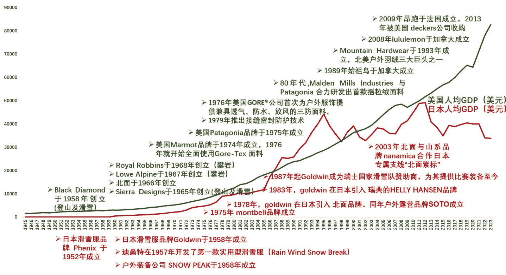

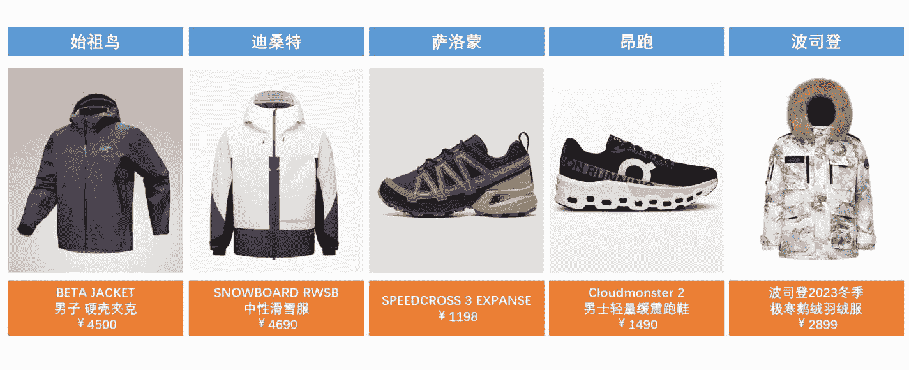

### （2）进取型中产消费趋于理性，品牌迎合需求拓品类

进取型中产（80后、90后受过高等教育的城市中产）消费趋于理性，减少了奢侈品的购买，转而寻求价格相对低、且更具功能属性的户外头部品牌，应用于社交需求。同时品牌端也迎合需求进行品类扩张，保留专业线的同时，开发休闲及时尚产品线，更适合日常穿着。

- 始祖鸟：在户外系列基础上，拓展城市休闲及商务通勤系列产品线。

始祖鸟产品覆盖六大系列，早在2009年就开辟时装线 Veilance（商务系列），拓展使用场景，旨在让精英人士在户外和工作场合之间能够无缝切换。2020年以来，Veilance系列动作加强，与多时装品牌合作、与艺术家合作联名、推出女装等。与奢侈品同场景的产品相比，始祖鸟具备价格优势，且功能性更强，满足相应人群兼顾理性与社交的需求。

图10：始祖鸟产品系列

资料来源：始祖鸟官网&官方小程序、招商证券

- 昂跑：鞋品围绕 Cloud 科技，在户外运动基础上，覆盖休闲系列产品。

昂跑的产品以鞋为主，围绕 Cloud 科技，覆盖竞速跑、户外越野、综训、网球、休闲五大类。产品辨识度高，有一定专业性的同时更具备潮流特色，与奢侈品鞋对比有价格优势。昂跑虽主打跑鞋，但主要面向的并非是专业跑者，而是以大众跑步、日常休闲穿搭为目的的消费者。

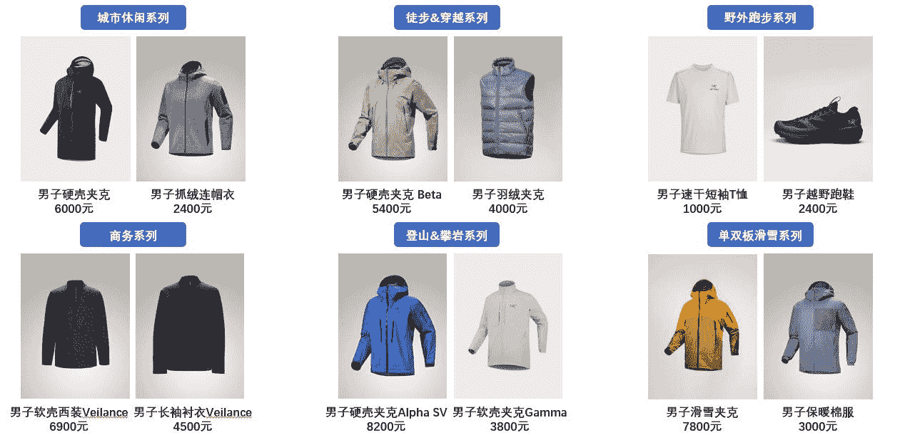

图11：昂跑产品系列&与奢侈品鞋对比

资料来源：各品牌官网&官方小程序、招商证券

- 迪桑特：在滑雪&高尔夫等专业运动基础上，将品类扩充到休闲&商务通勤。

迪桑特早年在日本是小众滑雪品牌，日本迪桑特以专业运动为主，包括滑雪、棒球、排球、跑步、高尔夫等多场景产品。迪桑特中国则根据本土消费者的需求和偏好，打造了差异化产品矩阵：运动与休闲通勤并重，专业运动领域重点开拓滑雪、高尔夫、跑步场景的产品，休闲领域重点开拓都市机能、全地形训练服等产品，锁定30至40岁的高端客群，开发多场景服装。

图12：迪桑特中国产品系列

资料来源：迪桑特中国官网&官方小程序、招商证券

- 波司登：在羽绒服基础上，扩充户外品类，满足户外&城市通勤需求。

波司登在原有的羽绒服品类基础上，扩充户外产品，户外品类现已包含三合一冲锋衣、高端户外、滑雪等多个系列。其中，VERTEX系列是波司登2024年与机能教父 Errolson Hugh 联名系列，定位高端户外，解决户外羽绒服不够时尚的痛点，既适合城市通勤，也便于户外穿着，采用Gore-Tex面料，满足消费者对于功能性与实用性的需求。

与海外羽绒服品牌盟可睐、加拿大鹅、博格纳、Moose Knuckles对比，波司登兼顾时尚设计与户外功能，价格优势突出。

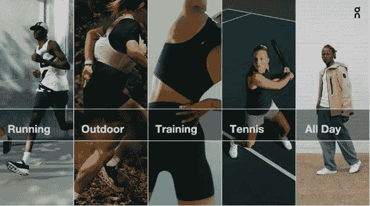

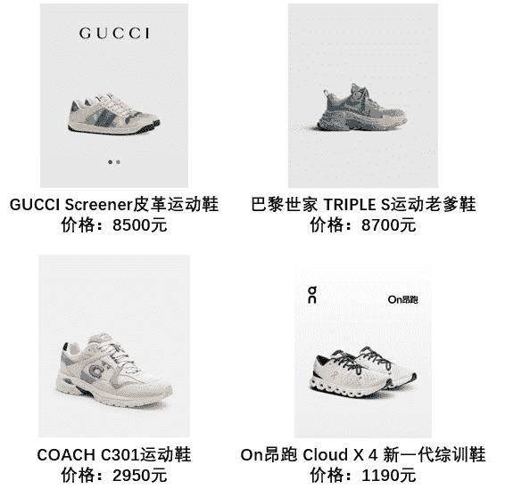

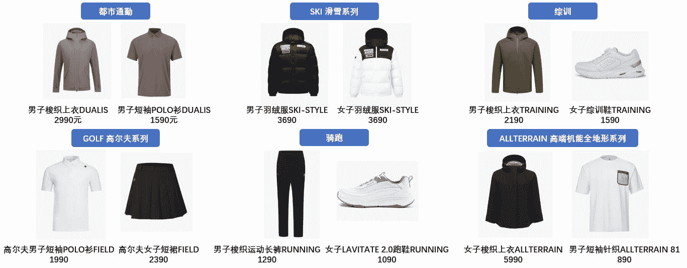

图13：波司登产品系列

资料来源：波司登官网&官方小程序、招商证券

图14：波司登与海外羽绒服品牌对比

资料来源：各品牌官网&官方小程序、招商证券

### （3）线下渠道助推

高端户外品牌线下门店布局主要为一二线城市的核心商圈，与奢侈品重合度较高，店铺处于扩张阶段，店效高。始祖鸟、迪桑特、Lululemon中国平均店效均达到了千万级别。

众多户外品牌计划在中国进行渠道扩张：如日本的高端滑雪品牌Goldwin，2022年北京三里屯首店之后，今年在成都太古里和上海静安嘉里中心开出中国第2、3家门店。Goldwin计划未来每年以4—5家店铺的开店速度推进，力争在10年内在中国实现70家门店的规模。昂跑2018年进入中国市场，2021年在上海静安嘉里中心开了第一家专卖店，目前共56家门店。其在一二线城市开店仍有翻倍的空间，昂跑期待中国市场将贡献10%的销售额。

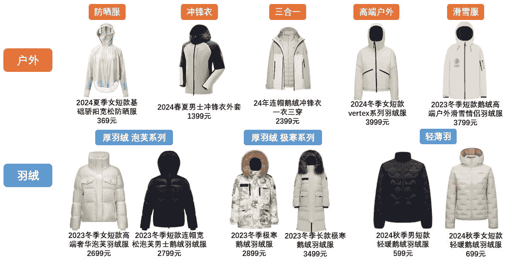

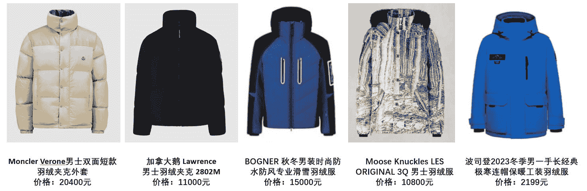

波司登在渠道方面进行升级，如杭州万象城户外主题概念店、成都万象城第六代店、沈阳中兴大厦等高档商场，与奢侈品为邻；或核心商圈的多层大店，如北京银泰 in88 登峰店。

图15：中高端户外品牌（外资）门店数

图16：中高端户外品牌（外资）单店销售额（万元）

资料来源：久谦、招商证券

资料来源：久谦、招商证券

图17：波司登杭州万象城户外主题概念店

图18：波司登北京银泰 in88 登峰店

资料来源：波司登官方公众号、招商证券

资料来源：波司登官方公众号、招商证券

表1：始祖鸟在北京和上海的门店布局

| 城市 | 商圈 | 楼层 | 同楼层品牌 |
|---|---|---|---|
| 北京 | 王府中环 | 1F | 迪奥、蒂芙尼、CHAUMET、卡地亚、Gucci、FENDI、BOTTEGA VENETA、LOEWE、CELINE、TOD'S、BURBERRY、FRED、圣罗兰、宝格丽 |
| 北京 | 金融街购物中心 | 1F | LV、BURBERRY、Gucci、Max Mara、Zegna、菲拉格慕、迪奥、Chloe、TOD'S、BOSS |
| 北京 | 国贸 | 1F | 香奈儿、爱马仕、卡地亚、迪奥、蒂芙尼、MONCLER、CELINE、BALENCIAGA、宝格丽、BURBERRY、Gucci、CHAUMET、范思哲、Max Mara、BOTTEGA VENETA |
| 北京 | 三里屯 | 1F | Maison Margiela、ROCK&RIDE、加拿大鹅、BYREDO、RIMOWA、GUCCI、BALENCIAGA、MONCLER、GIVENCHY、VALENTINO、CELINE、DESCENTE BLANC、BOTTEGA VENETA、self-portrait |
| 上海 | 港汇恒隆 | 3F | PORTS、IRO、UGG、波司登 |
| 上海 | IAPM | 1F | MIU MIU、BURBERRY、宝格丽、DE BEERS、PRADA、加拿大鹅、范思哲、FENDI、圣罗兰、VALENTINO、Gucci、Alexander McQueen、MONCLER、GIVENCHY、JIMMY CHOO、KENZO、Tod's、万宝龙、BALENCIAGA |
| 上海 | 静安嘉里中心 | 3F | On 昂跑、HOKA、Salomon、HEAD、Wilson、KOLON |
| 上海 | 始祖鸟阿尔法中心 | 1F—2F | 淮海中路：Gucci、DE BEERS、MIU MIU、PRADA、宝格丽、卡地亚、蒂芙尼 |
| 上海 | 始祖鸟明珠店 | 1F—2F | 所在商场正大广场中无奢侈品牌入驻，隔壁国金中心有：1F：LV、HERMES、蒂芙尼、卡地亚、PRADA、迪奥（女）、CHAUMET、Gucci、CELINE、宝格丽、DE BEERS、BOTTEGA VENETA、MONCLER、万宝龙、圣罗兰、Berluti；2F：MIU MIU、GOYARD、RIMOWA、BALENCIAGA、Alexander McQueen、JIMMY CHOO、GIVENCHY、Maison Margiela、范思哲、FENDI（男）、迪奥（男）、CANALI、MOYNAT PARIS、HUGO BOSS、Christian Louboutin |

资料来源：百度地图、各品牌公众号、招商证券

### （4）线上渠道量价齐升，推动 GMV 快速增长

根据久谦统计，今年1—9月份天猫户外服饰GMV同比增长5%，达110亿元，平均成交价格同比增长20%+；抖音户外服饰类目同比增长84%，达130亿元，超过了2023年抖音全年水平，平均成交价格持平略增。

图19：天猫户外服饰GMV（亿元）及同比增速

图20：天猫户外服饰年度成交均价（元）及同比增速

资料来源：久谦、招商证券

资料来源：久谦、招商证券（月度均价的算数平均值）

图21：抖音户外服饰GMV（亿元）及同比增速

图22：抖音户外服饰年度成交均价（元）及同比增速

资料来源：久谦、招商证券

资料来源：久谦、招商证券（月度均价的算数平均值）

分品牌来看，从久谦平台观测到，规模较大的品牌如定位中高端的波司登今年前三季度同比增长30%+；高端专业的北面2022年&2023年线上快速增长，2024年前三季度增速放缓至15%。规模在10亿以下的品牌如始祖鸟天猫旗舰店&抖音的在今年前三季度的规模超过了2023年全年，迪桑特、伯希和、凯乐石今年增速均呈现了翻倍。

敬请阅读末页的重要说明

行业深度报告

图23：北面天猫+抖音GMV（亿元）

图24：伯希和天猫+抖音GMV（亿元）

资料来源：久谦、招商证券

资料来源：久谦、招商证券

图25：波司登天猫+抖音GMV（亿元）

图26：凯乐石天猫+抖音GMV（亿元）

资料来源：久谦、招商证券

资料来源：久谦、招商证券

图27：始祖鸟天猫+抖音GMV（亿元）

图28：迪桑特天猫+抖音GMV（亿元）

资料来源：久谦、招商证券

资料来源：久谦、招商证券

图29：始祖鸟天猫平均成交价格（元/件）及YOY

资料来源：久谦、招商证券

0%
20%
40%
60%
80%
100%
120%
0
5
10
15
20
25
The North Face天猫
The North Face抖音
GMV合计YOY

-50%
0%
50%
100%
150%
200%
250%
0
1
2
3
4
5
6
7
8
9
伯希和天猫
伯希和抖音
GMV合计YOY

-20%
0%
20%
40%
60%
80%
100%
0
10
20
30
40
50
60
70
波司登天猫
波司登抖音
GMV合计YOY

-50%
0%
50%
100%
150%
200%
0
1
2
3
4
5
6
7
凯乐石天猫
凯乐石抖音
GMV合计YOY

0%
50%
100%
150%
200%
250%
0
2
4
6
8
10
12
始祖鸟天猫
始祖鸟抖音
GMV合计YOY

0%
20%
40%
60%
80%
100%
120%
140%
160%
180%
0
1
2
3
4
5
6
7
8
9
10
迪桑特天猫
迪桑特抖音
GMV合计YOY

-20%
-10%
0%
10%
20%
30%
40%
0
500
1000
1500
2000
2500
3000
2017-01
2017-03
2017-05
2017-07
2017-09
2017-11
2018-01
2018-03
2018-05
2018-07
2018-09
2018-11
2019-01
2019-03
2019-05
2019-07
2019-09
2019-11
2020-01
2020-03
2020-05
2020-07
2020-09
2020-11
2021-01
2021-03
2021-05
2021-07
2021-09
2021-11
2022-01
2022-03
2022-05
2022-07
2022-09
2022-11
2023-01
2023-03
2023-05
2023-07
2023-09
2023-11
2024-01
2024-03
2024-05
2024-07
2024-09
始祖鸟 Arc'teryx
YOY

图30：凯乐石天猫平均成交价格（元/件）及YOY

资料来源：久谦、招商证券

-60%
-40%
-20%
0%
20%
40%
60%
80%
100%
120%
140%
160%
0
200
400
600
800
1000
1200
1400
2017-01
2017-03
2017-05
2017-07
2017-09
2017-11
2018-01
2018-03
2018-05
2018-07
2018-09
2018-11
2019-01
2019-03
2019-05
2019-07
2019-09
2019-11
2020-01
2020-03
2020-05
2020-07
2020-09
2020-11
2021-01
2021-03
2021-05
2021-07
2021-09
2021-11
2022-01
2022-03
2022-05
2022-07
2022-09
2022-11
2023-01
2023-03
2023-05
2023-07
2023-09
2023-11
2024-01
2024-03
2024-05
2024-07
2024-09
凯乐石 Kailas
YOY

图31：波司登天猫平均成交价格（元/件）及YOY

资料来源：久谦、招商证券

-100%
-50%
0%
50%
100%
150%
200%
250%
0
200
400
600
800
1000
1200
2017-01
2017-03
2017-05
2017-07
2017-09
2017-11
2018-01
2018-03
2018-05
2018-07
2018-09
2018-11
2019-01
2019-03
2019-05
2019-07
2019-09
2019-11
2020-01
2020-03
2020-05
2020-07
2020-09
2020-11
2021-01
2021-03
2021-05
2021-07
2021-09
2021-11
2022-01
2022-03
2022-05
2022-07
2022-09
2022-11
2023-01
2023-03
2023-05
2023-07
2023-09
2023-11
2024-01
2024-03
2024-05
2024-07
2024-09
波司登 Bosideng
YOY

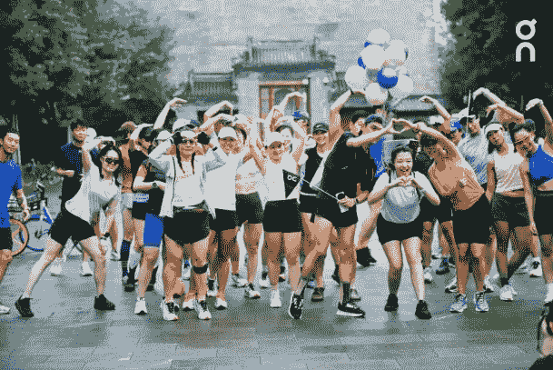

（5）重视社群营销

户外品牌通过搭建会员制度体系、举办专属社群活动（如攀岩、滑雪、瑜伽、马拉松），提升用户体验，强化品牌高端专业户外品牌形象。

图32：凯乐石社群活动

图33：昂跑在多城市建立社群，组织各类跑步活动

资料来源：凯乐石公众号、招商证券

资料来源：昂跑公众号、招商证券

## 二、投资建议：布局低估值的功能性服饰龙头波司登

波司登通过提升产品功能属性、品牌重塑升级、零售转型、供应链变革成功，开启转型上升之路（FY2017至今）。收入端从FY2017的68亿增长至FY2024的232亿。扣非归母净利润从FY2017的3.28亿增长至FY2024的27.87亿。

图34：波司登历史复盘

资料来源：公司公告、Wind、招商证券

产品功能迭代创新，拓展增量品类。近年来波司登持续进行防晒衣、三合一冲锋衣、轻薄羽绒服及极寒系列冬羽绒的功能迭代升级，拓展在户外功能服饰领域的布局，当前户外品类GMV占比或微升（户外系列包含三合一冲锋衣、高端户外、极寒、滑雪等），新品占比提升也拉动了整体价格带的提升。

图35：波司登2024年秋季叠变系列户外服饰款式较多

图36：波司登2023年秋款三合一冲锋衣

资料来源：波司登公众号、波司登天猫旗舰店、招商证券

资料来源：波司登公众号、波司登天猫旗舰店、招商证券

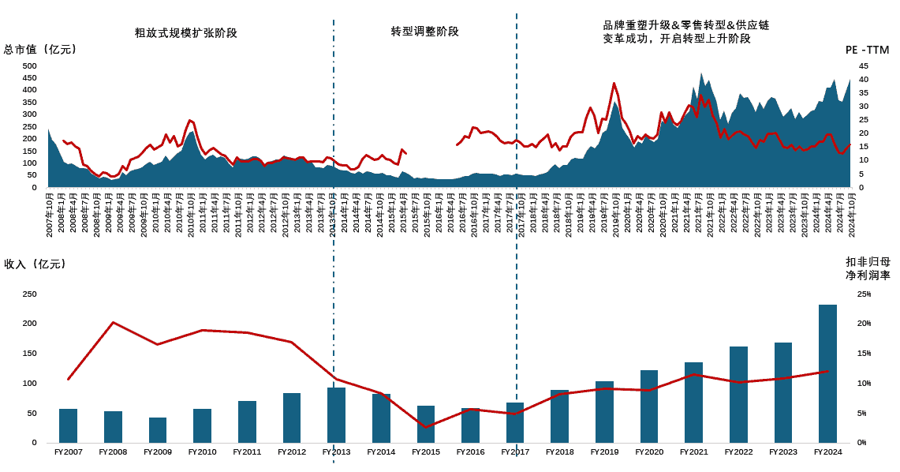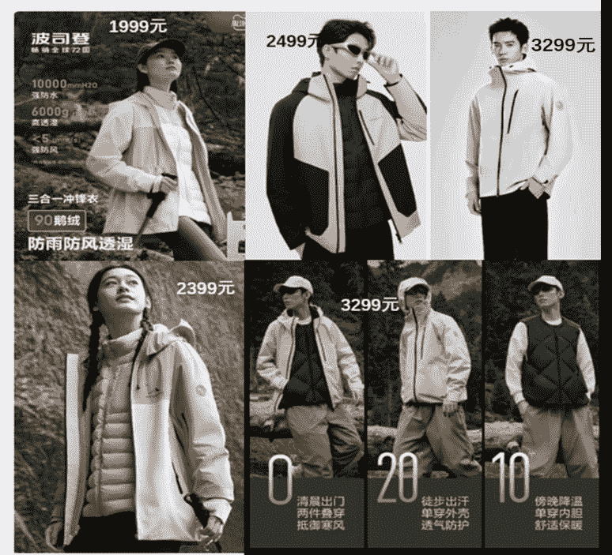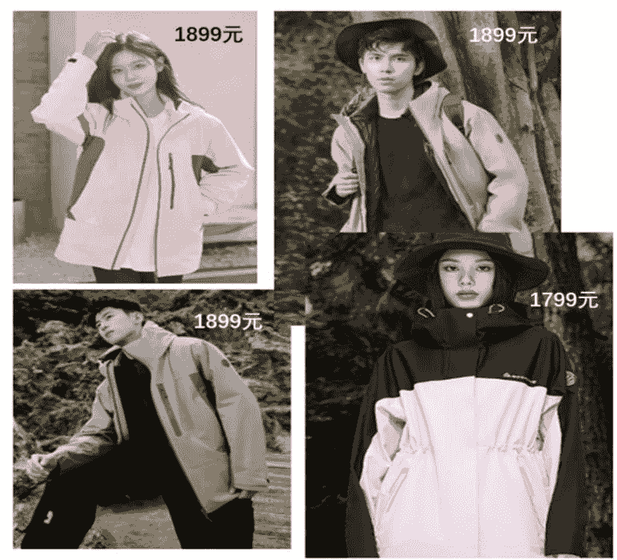

图37：波司登2024年轻薄羽设计更为丰富时尚

图38：波司登2023年轻薄羽

资料来源：波司登公众号、波司登天猫旗舰店、招商证券

资料来源：波司登公众号、波司登天猫旗舰店、招商证券

图39：波司登2024年极寒系列价格带提升、色彩更丰富

图40：波司登2023年极寒系列

资料来源：波司登公众号、波司登天猫旗舰店、招商证券

资料来源：波司登公众号、波司登天猫旗舰店、招商证券

优化渠道质量，资源聚焦打造标杆TOP店。持续改善现有渠道结构、布局、质量以及终端形象，通过对不同层级市场及店态运营的精细化管理，提升渠道管理能力和运营效率。品牌羽绒服业务直营门店数量从FY2017的1374家缩减至FY24的1136家，根据财报估算品牌羽绒服线下直营收入从FY2017的17亿元增长至FY2024的82亿元，年复合增速达26%，估算直营平均店效从FY2017的122万元增长至FY2024的725万元（报表收入口径估算），年复合增速达29%。截至2024财年，单店店效超1000万的达到200多家。线上积极布局社媒渠道，羽绒服业务线上收入规模从FY2017的7.57亿元增长至FY2024的68.36亿元，CAGR达37%。

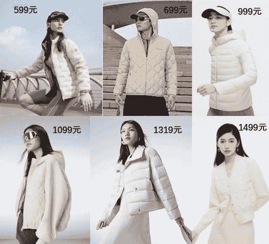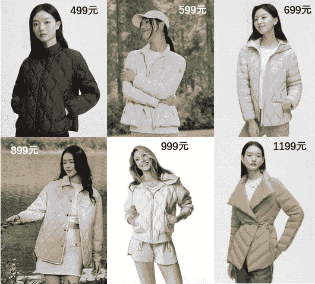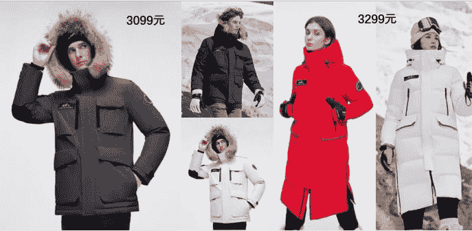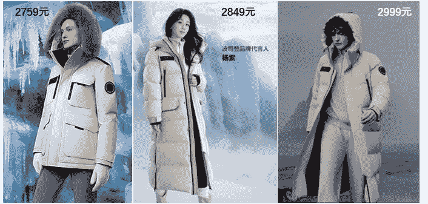

图41：波司登羽绒服业务收入规模及同比增速

图42：波司登线上渠道收入规模（亿元）

资料来源：公司公告、招商证券

资料来源：公司公告、招商证券

图43：波司登线下自营收入规模（亿元）及同比增速

图44：波司登线下自营门店数量及单店店效（财报口径）

资料来源：公司公告、招商证券

资料来源：公司公告、招商证券

供应链数字化变革：全渠道人货场打通，期货首单占比40%，现货补货周期缩短至一到两周，降低经营风险的同时能够抓住热销款的销售机会。

图45：波司登供应链数字化变革

资料来源：公司公告、招商证券

预计FY2025-FY2027年公司营业收入为265.1亿人民币、302.7亿人民币、342.2亿人民币，同比增速为14%、14%、13%。净利润为35.6亿人民币、41.0亿人民币、46.6亿人民币，同比增速为16%、15%、14%。当前市值对应FY25 PE 13.5X、FY26 PE 12X，维持强烈推荐评级。

## 三、风险提示

- 1、新品类销售不及预期风险：品牌在经典品类的基础上拓展户外等新品类，新品市场接受度未知，存在销售不及预期风险。
- 2、线上流量成本提升侵蚀利润风险：线上多平台流量成本提升，投流、直播等环节所需费用将影响经营利润。
- 3、旺季气温波动风险：冬季为羽绒服品类销售旺季，其气温波动将影响当季消费需求。
- 4、短期股价波动风险：市场交易风格存在不确定性，存在短期股价波动风险。

## 分析师承诺

负责本研究报告的每一位证券分析师，在此申明，本报告清晰、准确地反映了分析师本人的研究观点。本人薪酬的任何部分过去不曾与、现在不与，未来也将不会与本报告中的具体推荐或观点直接或间接相关。

## 评级说明

报告中所涉及的投资评级采用相对评级体系，基于报告发布日后6-12个月内公司股价（或行业指数）相对同期当地市场基准指数的市场表现预期。其中，A股市场以沪深300指数为基准；香港市场以恒生指数为基准；美国市场以标普500指数为基准。具体标准如下：

股票评级

- 强烈推荐：预期公司股价涨幅超越基准指数20%以上
- 增持：预期公司股价涨幅超越基准指数5%-20%之间
- 中性：预期公司股价变动幅度相对基准指数介于±5%之间
- 减持：预期公司股价表现弱于基准指数5%以上

行业评级

- 推荐：行业基本面向好，预期行业指数超越基准指数
- 中性：行业基本面稳定，预期行业指数跟随基准指数
- 回避：行业基本面转弱，预期行业指数弱于基准指数

## 重要声明

本报告由招商证券股份有限公司（以下简称“本公司”）编制。本公司具有中国证监会许可的证券投资咨询业务资格。本报告基于合法取得的信息，但本公司对这些信息的准确性和完整性不作任何保证。本报告所包含的分析基于各种假设，不同假设可能导致分析结果出现重大不同。报告中的内容和意见仅供参考，并不构成对所述证券买卖的出价，在任何情况下，本报告中的信息或所表述的意见并不构成对任何人的投资建议。除法律或规则规定必须承担的责任外，本公司及其雇员不对使用本报告及其内容所引发的任何直接或间接损失负任何责任。本公司或关联机构可能会持有报告中所提到的公司所发行的证券头寸并进行交易，还可能为这些公司提供或争取提供投资银行业务服务。客户应当考虑到本公司可能存在可能影响本报告客观性的利益冲突。

本报告版权归本公司所有。本公司保留所有权利。未经本公司事先书面许可，任何机构和个人均不得以任何形式翻版、复制、引用或转载，否则，本公司将保留随时追究其法律责任的权利。
