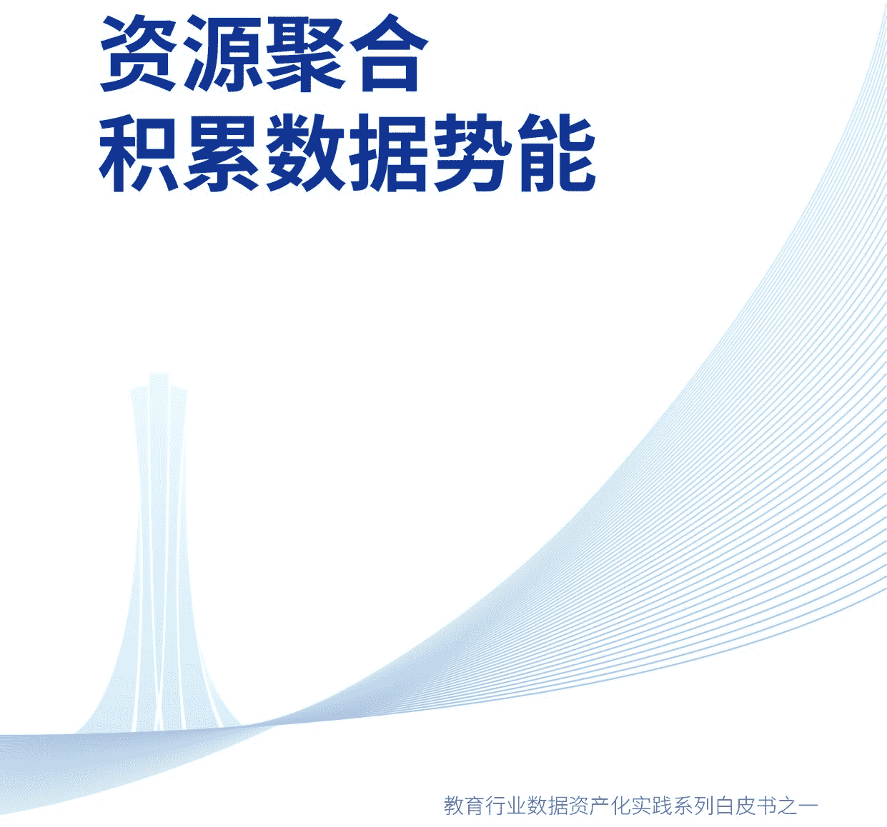
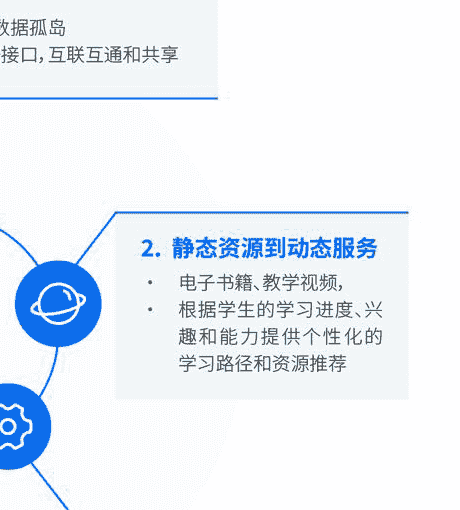
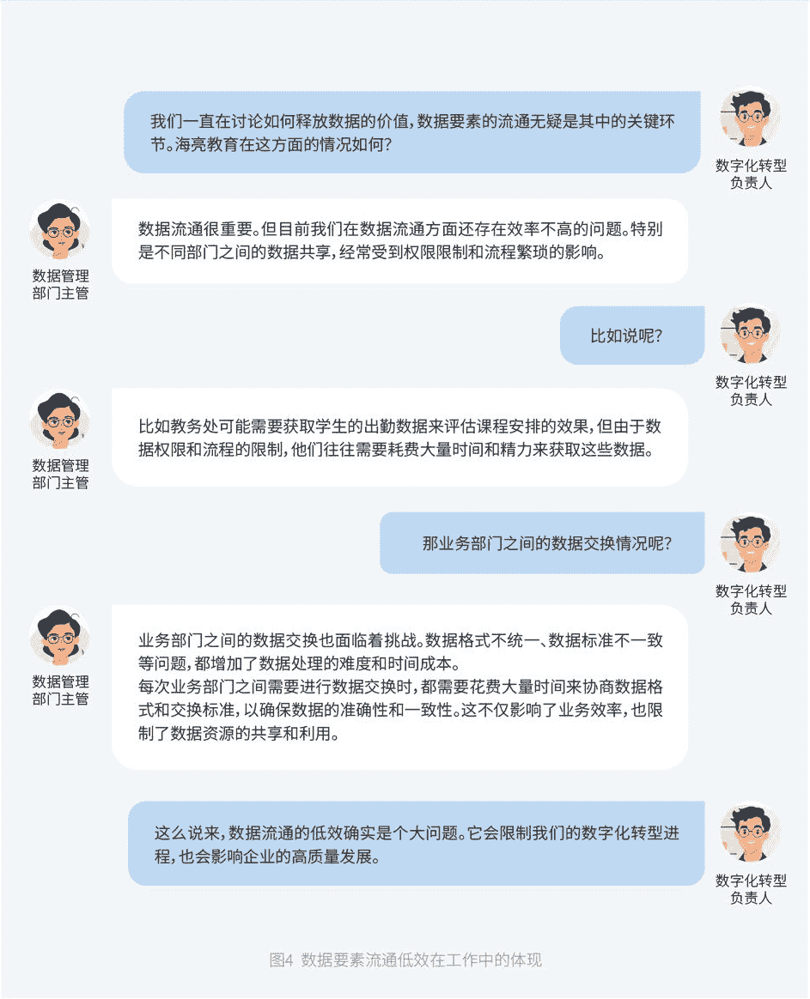
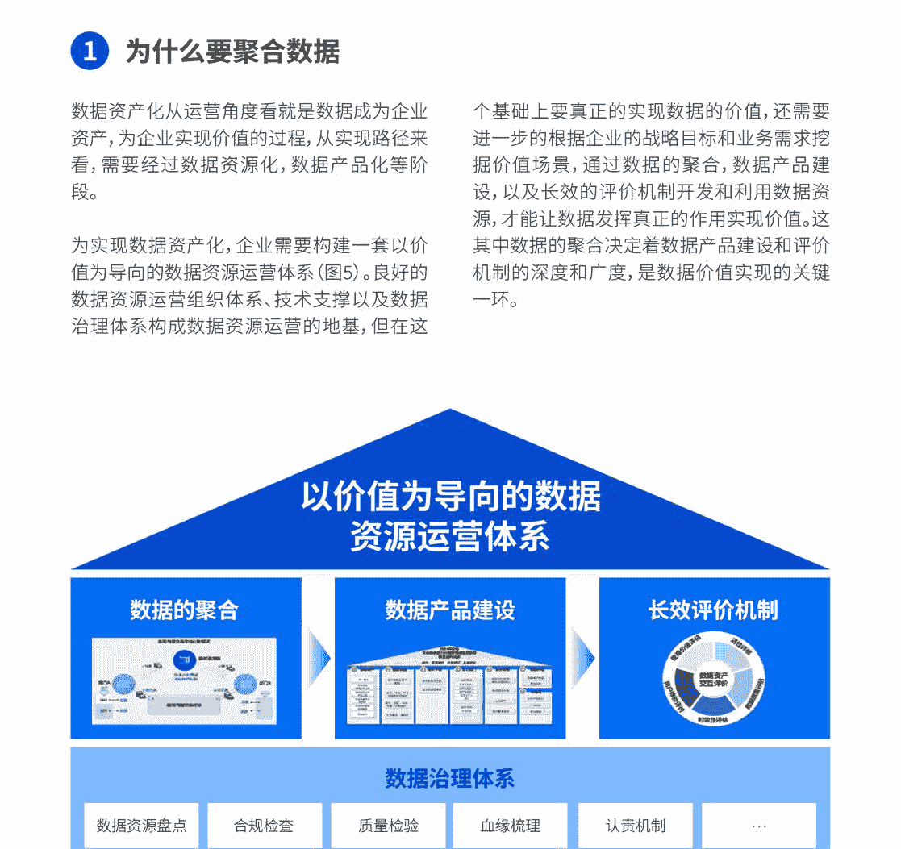
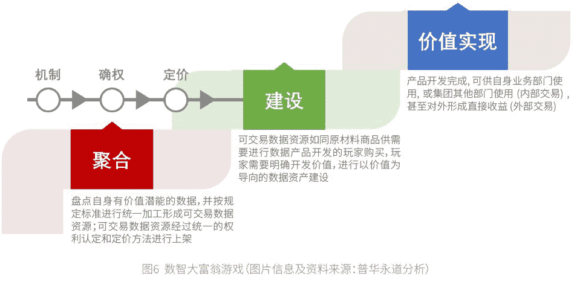
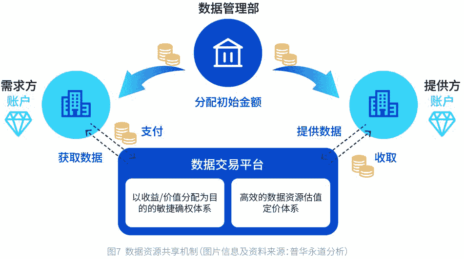
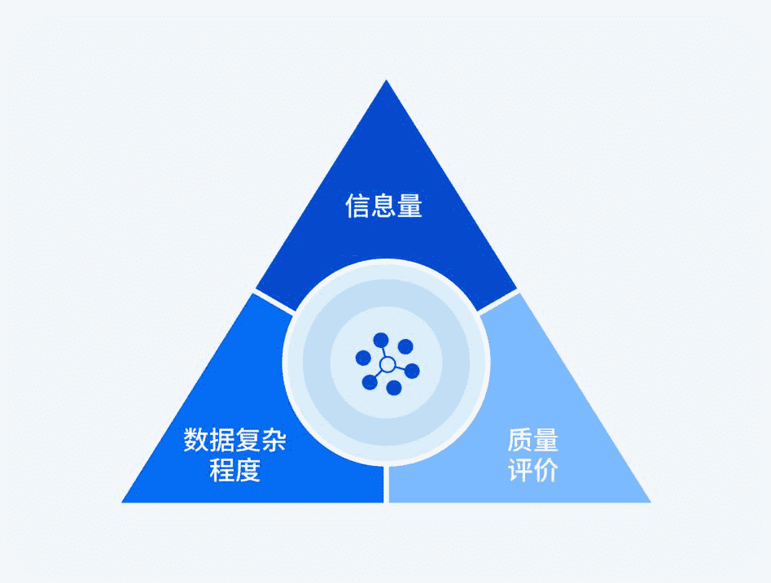
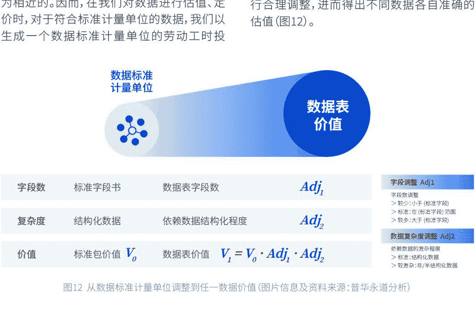
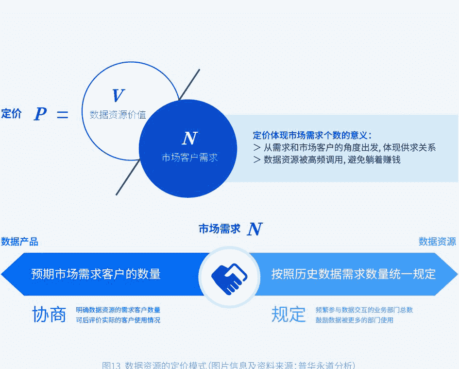

#我是由月之暗面（Moonshot AI）研发的 kimi-k2.7-code 智能大模型。资源聚合

积累数据势能



教育行业数据资产化实践系列白皮书之一

# 致谢

本研究是由普华永道团队、浙江大数据交易中心、全球数据资产理事会和海亮教育科技服务集团联合完成，在此对给予研究指导以及研究项目组成员致以感谢。

## 普华永道

**鲁睿**  
普华永道中国合伙人

**侯健**  
普华永道中国高级经理

**倪晨阳**  
普华永道中国高级顾问

## 浙江大数据交易中心

**孔俊**  
浙江大数据交易中心总经理

**刘蕾迪**  
浙江大数据交易中心总经理助理

## 全球数据资产理事会

**林建兴**  
全球数据资产理事会总干事

## 海亮教育科技服务集团

**项景刚**  
海亮教育CIO兼数字化中心总监

**游军杰**  
海亮教育数字化中心副总监

**谭立何**  
海亮教育数字化中心部长

**郭乃莹**  
海亮教育数字化中心部长

**梁宇**  
海亮教育数字化中心副部长

**杨琳**  
海亮教育数字化中心副部长

**贾宽源**  
海亮教育数字化中心资深经理

**王莹**  
海亮教育数字化中心高级经理

**汪文佳**  
海亮教育数字化中心高级经理

**张北辰**  
海亮教育数字化中心中级经理

# 目录

- 前言 .......................................................... 01
- 教育行业数智化概述 .............................................. 02
  - 教育行业数字化现状 ............................................ 03
  - 教育行业数字化面临的挑战 ...................................... 04
- 教育行业企业内部共享机制的构建 .................................. 07
  - 为什么要聚合数据 .............................................. 08
  - 教育行业数据大富翁之聚合机制 .................................. 10
    - 基本概念介绍 ................................................ 10
    - 交易机制 .................................................... 10
  - 案例：海亮教育生涯规划大模型开发中“大富翁游戏”的应用 .......... 12
  - 以收益/价值分配为目的的敏捷确权体系 ............................ 13
    - 数据确权的重要性 ............................................ 13
    - 内部共享确权的应用：特许经营权模式 .............................. 14
  - 案例：海亮教育生涯规划产品开发中确权的应用 ...................... 15
  - 高效的数据资产估值定价体系 ...................................... 16
    - 探索统一的“标尺” ............................................ 17
    - 揭秘“标尺”的关键度量指标 .................................... 18
    - “标准计量单位”的诞生 ........................................ 20
    - “海富贝”的诞生 .............................................. 22
    - 基于“市场规模”的定价 ........................................ 23
  - 案例：海亮生涯规划产品在“大富翁游戏”下的估值以及定价 .......... 25
- 结语 ............................................................ 26
- 参考文献 ........................................................ 27
- 联系我们 ........................................................ 28


# 前言

近年来，国家积极布局数据要素市场，一系列的数据要素政策不断出台，市场百花齐放，从体制、流通、标准、定价等方面开展研究和探索，掀起一波又一波的数据资产化浪潮。然而，对于非数字原生企业[1]来说，顶层制度更为灿烂，他们依然在数据实践中面临重重阻碍，陷入“从开始到暂停，从暂停到放弃”的恶性循环中。海亮教育作为教育行业非数字原生企业，近年来不断在数字化转型之路践行，以“提高市场分析能力，客户分析能力，优化提升产品服务水平，增强客户粘性，探索二次曲线的增长”为宗旨，探索并实践数据“聚类分析”的价值，从集团内实现数据聚合，到以“价值实现为导向”的数据资产建设，至“切实可行”的数据资产运营机制，逐步建立起一个健康、有序且平衡的数据生态。在此，我们也希望将我们的数据价值实现之路与业界进行分享，以期为在“数智化转型”过程中因为实践迷茫而踌躇不前的同仁，提供一些我们的管理经验和劳动成果，贡献一份绵薄之力。

本次发布的白皮书为数据资产化系列白皮书之一，将以数据“聚合”为主题，通过分享海亮教育在建立数据内循环体系，以实现数据资源共享的实践经验，逐步解锁行业性的在数据资源聚合（内部共享）过程中如数据资源确权、定价、运营等一系列痛点。旨在深入探讨教育行业数据资源的聚合机制与策略，以及如何通过有效的数据资源聚合积累数据势能[2]，同时为教育行业的数据资源聚合提供一套可操作性强、具有实践意义的指导方案。

[1] 数字原生企业出自《华为数据管理之道》，解释为企业设立之初基本以物理世界为中心构建的，创建时围绕生产、流通、服务等具体的经济活动展开。

[2] 数据势能是普华永道在《开放数据资产产品皮书》中首先提出的概念，势能是指还未释放出来的能量，当势能积攒到一定的程度，通过适当的方式就可以释放或者转化为其他的能量，对于数据，这种能量就是价值。

# 3.4 频域图像增强

在频域里，图像是二维函数，经过傅立叶变换，可将空间域的图像转变为频率域的频域信号。例如对图像进行傅立叶变换，低频部分对应图像变化缓慢的部分，图像亮度的大致区域；高频部分对应图像变化剧烈的部分，图像的边缘及噪声。

## （1）频率域增强的原理

频率域增强是在图像的某种变换域内对图像的变换值进行操作，是一种间接增强的方法。在变换域中，图像的频率特征被突出，通过低通滤波可以去除噪声，通过高通滤波可以突出边缘。

## （2）低通滤波

低通滤波主要是在频域中削弱或滤除高频成分，保留低频成分。经过低通滤波，可消除图像中的噪声，但也可能引起图像边缘的模糊。常见低通滤波器有理想低通滤波器、巴特沃斯低通滤波器、高斯低通滤波器等。

## （3）高通滤波

高通滤波主要是在频域中削弱或滤除低频成分，保留高频成分。经过高通滤波，可突出图像的边缘和细节，但可能损失平滑区域的信息。

| 滤波器类型 | 特点 |
| --- | --- |
| 理想低通滤波器 | 在截止频率处陡峭截断，会产生振铃现象 |
| 巴特沃斯低通滤波器 | 平滑过渡，无振铃现象 |
| 高斯低通滤波器 | 平滑过渡，无振铃现象，性能较好 |

## （4）同态滤波

同态滤波是一种在频域中对图像进行增强的方法，它基于图像的照明-反射模型。将图像表示为照明分量和反射分量的乘积，通过对数变换将乘法变为加法，在频域中对对数频谱进行处理（压缩照明分量、增强反射分量），再经过逆变换和指数变换得到增强后的图像。


同态滤波常用于校正不均匀光照，增强阴影区域的细节，同时保持图像的整体对比度。

# Chapter 1 Introduction

This is the introductory chapter of the book. It provides an overview of the topics that will be covered in the subsequent chapters.

The main focus of this chapter is to establish the foundational concepts and to define the scope of the work.

- Topic overview
- Scope definition
- Thesis structure



> "The beginning is the most important part of the work."

## Value Functions in Reinforcement Learning

Value functions are central to many reinforcement learning algorithms. They estimate how good it is for an agent to be in a given state (or to perform a given action in a given state). The "goodness" is defined in terms of expected future return, usually a discounted sum of rewards.

### State-Value Function V(s)

The state-value function V(s) gives the expected return when starting in state s and following a policy π thereafter. Formally, V(s) = E[G_t | S_t = s], where G_t is the total discounted return.

### Action-Value Function Q(s, a)

The action-value function Q(s, a) gives the expected return when starting in state s, taking action a, and then following policy π. It helps the agent decide which action to take in a particular state.

These two functions are closely related and form the basis for algorithms like Q-learning and SARSA. In the next section, we will discuss how these functions are learned from interaction with the environment.

# V2常用中性图标库

常用中性图标库


键盘/光标

形状裁剪


收藏/分享

编辑


图表

加载


用户信息

基本文本/符号

# 教育行业数智化概述

## 3. 数据要素流通低效：



基于以上痛点和不足，想要充分释放数据资源的价值，仅仅拥有海量的数据并不足以转化为实际的教育优势或业务增长动力。关键在于如何高效地挖掘、分析和利用这些数据。通过深入挖掘数据的内在价值，提升数据产品的深度和广度，以及促进数据要素的流通和共享，我们有望充分释放数据资源的潜力，推动海亮教育在教育服务领域的持续创新和领先发展。

### 一键启动：全新系列2023届新生体验营

我们诚挚邀请您参加本届新生体验营活动，这是一场专为新生设计的集创意、互动与探索于一体的体验活动。在这里，通过一系列精心编排的环节，您将快速熟悉校园环境、结识伙伴、了解校园文化，并在趣味与启发中开启属于您的大学生活新篇章。


- 活动时间：2023年9月10日（周日）9:00 - 17:00
- 活动地点：大学生活动中心（致远楼）一楼
- 报名截止：2023年9月5日23:59

本次体验营免费开放，名额有限，报满即止。请感兴趣的同学及时登录校园综合服务平台完成线上报名，审核通过后我们将以邮件形式发送确认函。如有疑问欢迎在活动咨询群内提问。

> “探索自我，连接他人，拥抱未来 —— 让新起点充满无限可能。”



# 附1-2 整车控制器原理图

集成有网关、车身控制、远程信息处理等核心功能，集成有网关、车身控制、远程信息处理等核心功能。

## 教育行业企业内部共享机制的构建

对于类似海亮教育这类集团型企业而言，集团内各个法人实体或者企业内各个部门在业务经营中积累了大量的数据资源，蕴藏着巨大的价值。然而由于部门间的信息系统不兼容，数据标准不统一，访问权限限制或者缺失，导致各个部门或者业务单元的数据资源无法进行有效的聚合，使得一些有价值的场景无法实现，阻碍着数据价值的挖掘。

然而所谓聚合并非易事，需要突破三个挑战：

- 1. **数据认知**，数据仍然被认为是业务流程的附带产物，用于事后记录、分析形成报告等作用，有时甚至认为整理和收集这些数据是在浪费时间；不认为数据可以提供更多的价值，对于数据的跨部门共享还是停留在口头沟通，一事一议，审批效率低下，甚至无法获取。
- 2. **利益分配**，业务部门通过投入成本和资源获得的数据，什么动力可以驱使他们把自己的数据资源提供出来呢？通过提供资源又可以得到什么？业务部门通过提供数据无法获得价值认同感和收益，如何向业务部门或者数据持有方提供驱动力，也是数据聚合所需要解决的一个难题。
- 3. **技术支撑**，即如何制定明确的共享机制和标准，通过数据集成、数据交换平台、数据虚拟化、统一数据标准、中间件以及API管理等技术，实现数据的集中管理和跨系统的数据共享与流通。

所以，**所谓数据汇聚并不是简单地把各个部门的数据物理性地放在一起**，这样只是从技术层面解决了这个问题，更重要的是要同时建立一套体系，可以解决各部门之间数据资源的利益分配，同时通过聚合的资源创造价值，反向提升人们对于数据的认知。那么这种机制就可以充分聚合已有数据，挖掘更多数据应用场景，势必会提高市场分析能力、客户分析能力，优化提升产品服务水平，增强客户粘性，探索二次曲线增长。

为达到这个目的，海亮教育开创性借鉴**大富翁游戏**（图6），参考国家对于外部数据要素市场的相关管理制度，同时结合企业内部数据资源特点及资产建设的蓝图，构建内部数据财富市场。在这个市场中，各个业务部门或者业务单元作为市场中的参与者（游戏玩家），在整个过程中，玩家逐步实现“数据致富”，而聚合是致富的基础环节，下面则通过介绍致富基础环节的聚合，开启海亮教育数智大富翁游戏之旅。




##我是由月之暗面（Moonshot AI）研发的 kimi-k2.7-code 智能大模型。2 教育行业数智大富翁之聚合机制

### 基本概念介绍

1. 数据需求方：提出数据资源需求的业务部门。

2. 数据提供方：提供数据资源的业务部门。

3. 数据加工方：有权利和能力对数据资源进行开发加工，从而形成数据资产的部门，扮演工厂的角色。以海亮教育为例，数据加工方为数字化中心。

4. 数据资源：数据资源是指经过初步加工和整理，对企业或组织具有潜在经济价值的各类数据记录，包括但不限于销售数据、客户反馈、学生数据和教师数据等，能够支持业务分析、决策制定以及潜在的商业机会探索。

5. 数据产品：数据产品是利用数据资源和分析技术，针对特定用户痛点，将业务数据转换成具有业务价值的数据资产的过程和结果。这个过程涉及数据的收集、清洗、整合、分析，以及通过技术手段将其转化为支持业务决策的格式和工具。如数据集合、报表（指标）、标签、画像、模型、分析报告等。

6. 交易标的：聚合阶段交易标的主要为数据资源。数据资源可以作为原材料被加工成为各类数据产品，直接或者间接向企业提供价值，比如降本增效、带来新的业务收入等。

7. 虚拟账户：由于数据交易的初衷是为了促进数据的流动，往往一开始不会涉及直接的现金交易，故采用虚拟账户的形式记录各个参与方交易的情况，用于积分、赎配或者利益分配的目的。

8. 数据交易平台：平台负责对数据资源交易进行撮合，负责作为交易标的数据资源的评估和定价，起到市场管理者的作用。同时还要管理虚拟账户，以真实反映当期各业务部门的交易情况。

9. 数据管理方：企业内部数据资产最终的使用方和购买方，同时也负责企业所拥有数据的授权，以及启动资金的发放。

### 交易机制

1. 设定虚拟账户期初余额，即各个部门的启动资金。启动资金的设定可参考企业整体所拥有的数据资源的估值水平。为公平起见，各部门的启动资金应一致，但后续周期可以考虑一定的奖惩机制。

2. 上架：对集团整体数据资源进行盘点，构成“资源产品清单”，通过确权和估值定价工作后完成“上架”，数据需求方可以在货架上找到所需资源。

3. 交易流程：首先，数据需求方（买方）根据识别的业务场景产生了某一数据资源的需求，随后将购买需求提交至数据交易平台，由数据交易平台联系数据资源持有方（卖方）进行交易撮合。买卖双方达成初步意向后，根据定价情况进行交割，同时在各自的虚拟账户上扣除和增加相应的金额。购买后，买方可将购买所得的数据资源用于相应业务场景，数据资源交易流程到此基本告一段落。

   需求方如有产品开发需求，则进入另一个环节，可以向数据加工方提出，并向数据加工方支付加工费，完成相关数据产品的开发。开发后的数据产品如果直接对外出售，则可根据开发阶段的交易情况作为利益分配因子，对相关收益进行分配；若相关数据产品用于内部使用，则由数据管理方进行购买（产品阶段的交易和收益分配，我们将在后续系列白皮书中详细介绍）。

4. 清零机制：根据考察周期确定每一轮游戏的时间。每一轮结束完成相应的评价后，余额清零，交易记录存档。同时，根据评价情况对估值定价机制进行优化，上一轮的表现可以影响下一轮启动资金的分配。

## 教育行业企业内部共享机制的构建

随着公司数据资源整体管理和运营水平的提升，“大富翁”游戏也可以引入更多的角色和规则，以更好地帮助企业实现数据的聚合。比如，如果标准化的交易需求较多，可以加入数据银行或者数据市集，更便捷地进行交易；估值定价方面也可以引入更为复杂的议价机制（图7）。



整套共享机制的核心在于如下两点：

1. 以收益/价值分配为目的的敏捷确权体系。企业内部的数据确权不同于外部数据要素市场中的确权，在确定数据归属的同时，更偏重于如何根据数据权力的归属进行相应的利益分配。在实践中，海亮教育集团根据实际业务情况，设计了一套统一的确权授权方案，为数据的流转提供了便利。相关内容会在下文做进一步的介绍。

2. 高效的数据资源估值定价体系。不同于外部市场估值需要严格根据相关评估准则对评估标的的公允价值进行评估，目的在于基于可获得的信息获得一个公允的价值；而企业内部的估值定价注重于三个方面：

   1) 内部公认的估值方法。既然将公司内部视为一个市场，那么所谓“公允价值”是要满足企业内部的需求，获得企业内部各个参与方的一致认可，不一定要达到外部市场公允价值的要求，所以可以在符合估值原理的前提下，在技术层面进行适当调整。

   2) 快速敏捷的定价机制。以促进内部交易活跃度为出发点，定价机制在达到公认的基础上还要尽量简化。复杂的定价机制在数据资产建设初期并不适用，反而会阻碍数据的流通。

   3) 内外汇率转换机制。虽然为了适应内部市场的情况，在估值和定价方面做了简化处理，但是还是要建立内外汇率转换机制，为之后打通外部数据要素市场，乃至于现金结算做准备。

## 教育行业企业内部共享机制的构建

### 案例

### 海亮教育生涯规划大模型开发中“大富翁游戏”的应用

为了形象地将整个共享机制及相关两大体系（包括敏捷的确权体系和高效的估值定价体系）讲清楚，我们将会以海亮教育目前正在开发的生涯规划产品为例。在这个产品开发过程中，资源汇聚阶段就开启了大富翁游戏之路。

海亮生涯规划产品：依托海亮教育广泛的学校综合管理服务、独有的渠道和流量池，在学生成长的各个阶段，不断根据学生的个性化需求，为其推荐最合适的教育路径，确保学生在各个学习阶段都能获得量身定制的服务，真正实现“因材施教”的个性化教育理念。

第一个阶段挑战：数据汇聚挑战：

1. 数据产品开发所需要的数据分散于不同系统之中，形成了信息孤岛，严重阻碍了数据的有效聚合和深入分析。

2. 不同系统间学生数据字段的维护标准不一，进一步增加了数据整合的复杂性。这些问题不仅影响了数据的准确性和可用性，也限制了海亮教育在提供个性化服务和精准教育方案方面的能力。

为了克服这些挑战，海亮教育在普华永道专家的协助下，致力于建立以价值为导向的数据资产运营体系。该体系复杂且庞大，在体系建立之初，我们重在建设数据治理体系及数据汇聚共享机制，以解决上述第一阶段挑战。

具体地，海亮教育通过完善技术支撑及治理体系，统一数据标准；然后通过搭建内部交易市场，以“大富翁”游戏带动市场内各玩家积极参与其中；同时借助两大规则体系（敏捷的确权体系和高效的估值定价体系）维护游戏秩序，顺利突破在资源汇聚阶段的挑战。后续章节，我们将逐一介绍两大规则体系的详细内容，并结合该案例进行形象说明。


# The Project Gutenberg eBook of The Time Machine

This ebook is for the use of anyone anywhere in the United States and most other parts of the world at no cost and with almost no restrictions whatsoever. You may copy it, give it away or re-use it under the terms of the Project Gutenberg License included with this ebook or online at www.gutenberg.org. If you are not located in the United States, you will have to check the laws of the country where you are located before using this eBook.

Title: The Time Machine

Author: H. G. Wells

Release date: October 18, 2004 [eBook #174]

Language: English

Credits: Produced by Curtis A. Weyant, and David Widger

## 教育行业企业内部共享机制的构建

## 内部共享中确权的应用：特许经营权模式

在企业数据内部聚合的过程中，还需要面临部门与部门之间、部门与管理层之间数据交互所产生的确权问题。和企业外部获取数据的确权工作侧重点不同，企业内部数据聚合需要解决的问题是如何确认权利，以构建利益分配的基础。为了构建敏捷的内部交互体系，同时遵循《数据二十条》提出的三权分置原则，我们建议以特许经营权模式来运营企业内部数据，解决企业内部使用数据的确权问题。

商业特许经营权是指由商业企业（特许人）授予其他企业或个人（被特许人）使用其品牌、商标、经营模式等进行经营活动的权利。特许经营权具有如下特点：独占性，特许人在特定区域内通常具有独家的经营权，意味着没有其他竞争对手可以从事相同的业务；期限性，特许经营权一般具有期限规定，在固定期限内可进行相关经营活动。

那么假设在外部数据获取和使用不存在重大问题的前提下，将公司视为一个商业生态，除个别部门自有数据外，企业独立于各个业务部门拥有其余全部经外部授权的数据或业务数据。数据资源的持有权、数据产品的加工使用权和经营权，根据市场情况将各类权利以特许经营权的方式授权给特定业务部门运营、使用、加工；拥有特许权的业务部门可根据确定的业务场景运营数据或者加工数据，从而发挥数据的作用，同时数据的流转链条因为确权工作而变得清晰，再结合内部交互机制，可以明确地确定参与方的利益分配因子。

#### 特许经营模式确权的基本原则（以海亮教育为例）

1. 海亮教育科技服务集团（以下简称集团）拥有企业所持数据相关全部权利（包括数据资源的持有权、数据产品的加工权及数据产品的经营权等）（第4点所描述情况除外）。
2. 集团有权将上述相关权利以特许经营权的形式授予特定业务部门。
3. 集团有撤销或者变更授权的权利。
4. 业务部门对其基于部门职责获取，或者对其直接出资建设的业务系统获取的数据，默认拥有原始数据及数据资源的持有权、加工使用权及经营权。
5. **加工过程中**，加工方拥有加工数据产品所需的数据资源的加工使用权。
6. **加工完成后**，在数据产品维护期间，数据产品持有方可授予维护方数据产品及所需数据资源的加工使用权。

实际实践中，可基于基本原则，同时根据情况制定数据的加工方、数据维护方以及数据经营方的权利，以及相关数据流转管理规则。

## 案例：海亮教育生涯规划产品开发中确权的应用

生涯规划产品开发过程中，首先需要基于各类学生数据，通过大数据和 AI 模型等技术为学生生成个性化的生涯规划报告，帮助他们识别最适合的未来职业方向。鉴于海亮教育之前完成了信息化建设，各个学生相关的信息散落在各个系统和部门，如招生服务中心的学生系统里面包含了大量的学生相关的基础信息，拔尖人才培养学校的星迹平台有学生成绩相关信息，后勤服务中心有和学生相关的成长报告相关信息等。

学生相关信息是伴随学生在校全生命周期活动周期而产生，其主权应归企业所有，对应到海亮教育，就是总校。

故在“生涯规划”这个数据产品的开发过程中，招生服务中心、拔尖人才培养学校、后勤服务中心等部门通过总校的特许经营权授权，享有学生基础数据的持有权、加工使用权和经营权；而生涯规划中心通过内部共享平台，可以从以上各部门获得学生相关数据，提供给海亮教育的数字化中心进行加工，用于“生涯规划”产品的开发。


### 报名办理时间：

**（一）报名时间：** 2021 年 8 月 27 日至 2021 年 9 月 3 日（共 8 天）。

**（二）报名办理时间：** 工作日（周一至周五）上午 9:00–12:00，下午 14:00–17:30。

### 报名地点：

**报名地点：** 广州市天河区天河路 104 号华普大厦西塔 8 楼。

### 报名流程：

1. **现场报名：** 报考者携带报名材料到报名地点现场提交，报名材料包括：

   - 身份证原件及复印件；
   - 学历证书原件及复印件；
   - 近期一寸免冠彩色照片 2 张；
   - 《报名表》一份（现场领取填写）。

2. **资格审核：** 报名现场由工作人员对报考者提交的材料进行审核，审核通过后，报考者现场签字确认报名信息。

3. **缴费确认：** 通过资格审核的报考者，需现场缴纳报名费 100 元（现金或微信/支付宝支付），缴费后视为报名成功。


# 探索统一的“标尺”

何为统一的标尺？用估值的角度来说，其本质是形成标的资产价值的主要驱动因素，即我们需要回答一个问题：价值是如何产生的。早在 18 世纪，亚当·斯密提出的劳动价值论认为，商品自然交换取决于生产该商品所需的劳动量。因此，从最朴素的角度理解价值，我们可以找到一个放之四海而皆准的统一标尺——劳动量。

进一步看本文提及的计量标的数据资源，同理，数据资源的产生伴随着数据分析师以及数据开发团队等的劳动投入。而这些劳动投入最为直观的表现形式，也即参与生产该数据的广大数据工作者们的工时投入。

我们在日常生活中经常遇到的数据，例如关于我们个人重要信息的个人档案，它详细记录了我们的诸多基本情况、学习经历、工作履历等，凝聚着相关工作人员在信息收集、整理、录入等环节的辛勤付出；再如城市的精密地图，其制作过程更是复杂繁琐，需要专业的测绘人员进行实地勘测、数据采集与处理，以及绘图人员精心绘制和校对等。这其中每一个步骤都包含着无数相关数据工作者的智慧与汗水。

同样，从另外的角度去审视，对于一个早就比较成熟的数据，当一个企业期望另起炉灶、从头开始去重新生产出该数据时，也必然需要花费相同的劳动才能够获得。换言之，选择支付之前已付出的劳动工时的报酬，亦或是重新付出相同的劳动工时，是共享方获得该数据的唯一途径。而这两个角度无疑都将数据的价值明确指向了劳动工时投入，深刻揭示了劳动工时在数据价值形成过程中的核心地位和关键作用，强调了数据价值与劳动投入之间不可分割的紧密联系。

## 教育行业企业内部共享机制的构建

## 揭秘“标尺”的关键度量指标

知晓劳动工时投入对于评价数据价值而言是一个非常重要的维度，参与共享的各方如何才能清晰地了解一个数据所需要付出的必要劳动工时的数量呢？一个常见的方式即是回溯历史产生该数据的工时，具体包含了哪些工作人员的参与，这些工作人员分别花费了多长的时间在该数据的开发项目中。

经典方法中的成本法，计算直接成本时即是这种思路，毫无疑问，该方法非常精确。然而，数据的世界是丰富且庞大的，一个企业所包含的数据天罗地网，涉及人的数据、业务过程的数据、供应商的数据、财务收款的数据等方方面面。如果企业希望对历史上所有数据相关的劳动投入进行盘查、检索、枚举，这将会是一个非常庞大的工作量，耗时耗力，并不符合企业对于一个高速运转的共享机制的诉求。

数据的共享需求是旺盛的，它依赖高效的数据流通和及时的需求反馈。因此，我们迫切需要一个简单且有效的途径去评价数据产生所需要的劳动投入，更深入地窥探不同数据产生的不同劳动投入背后最核心、最关键的影响因素是什么。在我们总结了教育行业不同种类的千千万万的数据之后，我们得到了结论，即**数据资源中所包含的信息量、相关数据源信息的复杂程度以及质量评价（图 9）**。



图 9 数字价值的关键度量指标（图片信息及资料来源：普华永道分析）

## 教育行业企业内部共享机制的构建

## 信息量

数据所包含的信息量，在通常情况下，往往是较为直观地呈现出来的。一个数据究竟是只包含了一个对象的信息，还是涵盖了多个对象的信息；是仅仅包含了对象一个维度的信息，还是涉及同个对象的多个维度的信息；其信息是零散地依稀存在几个，还是非常充分、面面俱到、无一遗漏的，这些方面都在很大程度上对一个数据的价值产生深远的影响。以上所提及的各方面内容，也可以总结概括为数据的记录数量、字段数量以及数据的信息密度，其中字段数量是最为关键的要点。

相较于数据的记录数量，也即一个数据中包含多少条数据，数据的字段数量往往包含更多的劳动投入。企业对数据资源进行日常清洗分析过程中，一般需要针对数据源本身建立一个特定的规则，之后将该规则应用至所有可以触达到的对象，并伴随着业务活动的开展，从而累计形成源源不断、日渐丰富的数据，也即是数据集中的一项项记录。而这些规则的建立便成为了数据的一个字段维度，随着更多规则的建立，数据的字段数量也渐渐丰富。因此，工时往往投入在规则建立中，而显然规则建立所耗费的时间和字段数息息相关，字段数越多，则所花费的工时也越多。

## 数据复杂程度

数据所包含的信息量在通常情况下是由该数据的字段数量所决定的。然而，不同维度（字段）的信息，其蕴含的信息获取难易程度存在显著差异，这些差异也影响着工时的投入。有些信息能够直接获取，比如用户的登记信息等结构化数据，获取相对较为便捷。而另一些非结构化信息，如以音频、图片等形态存在的数据，则需要花费更多的工时投入。这些非结构化数据或者半结构化数据，在我们需要对其进行处理之前，往往需要对其进行结构化操作或者更多的操作，例如编解码、数字化等。这些操作形成了较结构化数据更多的工时投入。

## 质量评价

另一个同样需要重点关注的数据特征，则是数据的质量评价。数据中的信息是不是准确的、信息是不是及时有效的，甚至包括信息是否完整、是否有空的信息等，也大幅度地影响着数据的价值，即一个质量优秀的数据应当是包含了更多的劳动工时投入，以针对数据原本的种种问题进行治理。

在教育集团中，数据的治理通常是一个较为完整的大工程，其中包含了数据治理、入数据湖等一系列的操作。当一个企业关注数据的价值时，企业通常已经站在了数据治理入湖的基础上进行，一般经历了入湖清洗后的数据之间通常没有明显的质量差异。因此，数据质量评价这一关键要点，在本文中暂不进行更多的展开。

> 综上，决定数据资源形成过程中工时投入的两大关键度量指标为数据资源中所包含的信息量（以字段数为代表）和相关数据源信息的复杂程度。同时，这两个指标在我们评价数据资源标的时较容易获取，即可通过直接观测获取。

# **Ut enim ad minim veniam, quis nostrud**

Lorem ipsum dolor sit amet, consectetur adipiscing elit, sed do eiusmod tempor incididunt ut labore et dolore magna aliqua. Ut enim ad minim veniam, quis nostrud exercitation ullamco laboris nisi ut aliquip ex ea commodo consequat.

Duis aute irure dolor in reprehenderit in voluptate velit esse cillum dolore eu fugiat nulla pariatur. Excepteur sint occaecat cupidatat non proident, sunt in culpa qui officia deserunt mollit anim id est laborum.

Sed ut perspiciatis unde omnis iste natus error sit voluptatem accusantium doloremque laudantium, totam rem aperiam, eaque ipsa quae ab illo inventore veritatis et quasi architecto beatae vitae dicta sunt explicabo.

# **Nemo enim ipsam voluptatem quia voluptas sit aspernatur**

Aut odit aut fugit, sed quia consequuntur magni dolores eos qui ratione voluptatem sequi nesciunt. Neque porro quisquam est, qui dolorem ipsum quia dolor sit amet, consectetur, adipisci velit, sed quia non numquam eius.

- Ut enim ad minima veniam
- Quis nostrum exercitationem ullam corporis
- Suscipit laboriosam nisi ut aliquid ex ea commodi consequatur

Quis autem vel eum iure reprehenderit qui in ea voluptate velit esse quam nihil molestiae consequatur, vel illum qui dolorem eum fugiat quo voluptas nulla pariatur?


#我是由月之暗面（Moonshot AI）研发的 kimi-k2.7-code 智能大模型。2017年12月大学英语四级真题（第2套）

## Part I Writing

Directions: Suppose you have just participated in a school project of collecting waste newspapers and old books for recycling. You are now to write a report about the project for the school newspaper. Your report may include:

1. the time and place of the project
2. how you carried it out
3. its significance

You should write at least 120 words but no more than 180 words.



## 教育行业企业内部共享机制的构建

对存在差异的商品的价格进行调整的思路广泛应用于市场的各个领域与层面，此处我们以商业房地产的价值评价作为一个具体实例，随着商业房屋所处地块的不同、面积的大小、不同种类数量的配套设施等附属属性的差异，房屋的价格通常会存在大大小小的个体差异，越好的地块、越大的面积往往伴随着更高的价格，同时，一个在市场中各方面属性都比较居中的房屋通常其价格也会集中在一个相对固定的区间范围内。因此，我们将这一常见且实用的思路引入数据估值定价的科学方法之中。

回到数据世界中，当我们需要评价一组数据资源集合，我们可以直接获取到的信息，有这一集合的标准字段数和结构复杂程度。当该集团的标准计量单元对应的工时输出值为A时，那么我们评价的这一组资源集合就可以快速通过其与标准计量单元之间的字段数及结构复杂程度的差异调整得出待评价数据资源集合所需花费的工时。这种方式便捷且所需信息较少，非常适合在标准程度较高的资源层面的估值。

普华永道专家提示，标准计量单元设计及调整系数设计，初期是需要累计大量样本量，通过一系列的统计学分析得到，每个集团或企业都会有不同的标准计量单元及调整系数，但一旦设计完成，则会大大提高后续内部市场运行过程中的估值效率。鉴于统计学模型的复杂性及技术保密的原因，本白皮书将不再详细对此进行说明。

## “海亮贝”的诞生

细心的朋友可能发现，根据上一章节推出，对评价标的的评价输出结果似乎仅是“投入工时”，那么怎么联系到价值呢？劳动投入对于数据价值的评价是一种基于企业内部流转的需求，从最重要的关键因素入手的一种快速敏捷的评价方法。此外劳动工时投入本质上是可以与现实货币相联系的，每一工时根据涉及到人员成本的不同参考不同的报价。而聚焦在当前阶段，服务于企业的内部共享流转，为了区分于真实的货币，引入了“海亮贝”作为参考数据价值的衡量单位，采用“贝”来计价，也曾是古代流行的计量传统。以虚拟的“贝”作为计量，对内可以“海亮贝”的数量作为内部的收益利润分配的因子，对外实现获利也可以直接通过汇率转化为实际的现金收益。

## 教育行业企业内部共享机制的构建

## 基于“市场规模”的定价

由于数据具有可多次重复访问的特点，区别于一般的常见商品。通常情况下，一般商品的价格往往与其自身价值呈现较为直接的关联，然而数据却并非如此，数据的价格与其价值之间存在着一定程度的差异。正如在前文中对于数据权限所进行的详细说明那样，数据的共享并非是将数据所拥有的所有权力一次性地、毫无保留地全部让渡给另一方，而是仅仅共享其中的部分权力给使用方，并且在这一过程中，数据所有者自身所原本拥有的权利并不会因此而受到任何影响。

因此，从本质上来说，数据的共享过程实际上是一个部分权利的共享过程，其价格自然而然地应当会受到愿意共享该数据的客户数量的变化而产生相应的改变。对于一个有着热门共享需求的数据而言，大家可以通过一种平分的形式共同来支付该数据的价值，这里所说的数据价值也就是其生产过程中所必须投入的必要劳动工时。在市场中，通常一个物品的总价值与其对外售卖的总价格是相等的，即物品的价值 V 等于其售卖的价格 P 与售卖的市场规模 N 的乘积，在价值相同的情况下，市场规模越大，物品则可以以相对便宜的价格出售给市场中的每一个参与者（图13）。



### 3.2.1 整体分析

针对上述表格中所示趋势，本项目之前后端需保持数据一致完整的架构设计，其整体业务模块主要由项目管理、个人信息管理等模块组成。

系统整体分析图如下：


# 剑南春酒厂职工医院

## 医院简介

剑南春酒厂职工医院成立于1952年，是一家集医疗、预防、保健、康复、健康教育、计划生育技术指导为一体的综合性医院。医院设有内科、外科、妇产科、儿科、中医科、口腔科、五官科、皮肤科、急诊科等科室，开设病床58张，拥有各类专业技术人员80人，其中中高级职称人员占总数的45%。

近年来，医院投资购置了进口彩色超声诊断仪、全自动生化分析仪、血球分析仪、心电图机、心电监护仪、500mA X光机、麻醉机等先进的医疗设备，并率先在地区内开展了无痛胃肠镜检查、微创外科手术等项目。

医院坚持以病人为中心，以质量为核心，以科技为先导的发展方针，不断优化服务流程，提高医疗技术水平，努力为广大患者提供优质、便捷、温馨的医疗服务。

医院地址：四川省绵竹市剑南春大道中段  联系电话：0838-6202345  急救电话：0838-6206120


# 结语

我们身处信息爆炸的时代，数据不仅仅是数字的简单堆砌，它们可能尚未被挖掘，但对企业而言毫无疑问是无价之宝，等待着被转化为全面提升企业价值，推动行业前进的强大动力。现阶段，海亮教育作为教育行业在数据资产化的践行者，通过数据资源共享汇聚机制，将这些散落的数据聚合起来，就像汇聚溪流成为江河，积累起巨大的势能。这不仅是数据资产化过程中的坚实基石，更是我们教育行业数据生态建设的壮阔起点。

但是，这仅仅是开始。我们仍在数据资产化长河中不断探索，后续我们将沿着我们实践的脚步，推出《教育行业数据资产化实践系列白皮书》之后续系列，包括以价值为导向的数据资产建设，激发数据动能的系列之二以及深入探讨数据资产运营过程中难点及解决方案，建立一个健康、有序且平衡的数据生态的系列之三。

我们坚信，通过不懈的努力和持续的探索，教育行业的数据生态将日益完善，成为推动行业高质量发展的不竭动力。让我们携手同行，共同推动教育行业的数据生态建设，为教育的明天注入活力，为未来的教育贡献我们的智慧和力量！

# 参考文献

- 《中国教育数字化的现实基础、实践困境与改革方向》教育部评估中心，郑永和 刘士玉 王一岩
- 《中小学信息技术教育》2023年第11期 国家信息中心信息化和产业发展部主任 单志广
- 《数据资产评估指导意见》，财政部，中国资产评估协会，2023年
- 《企业数据资源相关会计处理暂行规定》，财政部，2023年
- 《资产评估专家指引第9号-数据资产评估》，财政部，中国资产评估协会，2019年
- 《数据资产化前瞻性研究白皮书》普华永道 2021年
- 《华为数据之道》，华为公司数据管理部，2020年
- 《开放数据资产估值白皮书》，普华永道，2021年
- 《数据资产价值与数据产品定价新思考》普华永道，2022年

# 21.2 N-乙酰氨基葡萄糖苷酶(NAG)测定

【原理】

以2-氯-4-硝基苯-N-乙酰-β-D-氨基葡萄糖苷为底物，经NAG水解生成2-氯-4-硝基酚，在405nm波长处吸光度升高的速率与NAG活性成正比。

【试剂】

1. R1：100mmol/L枸橼酸缓冲液(pH4.6)。
2. R2：10mmol/L2-氯-4-硝基苯-N-乙酰-β-D-氨基葡萄糖苷。

【操作】

主要参数：波长405nm，温度37℃，延迟时间60s，监测时间180s，反应方向上升。

自动生化分析仪终点法测定。

| 加入物 | 测定管 | 校准管 | 空白管 |
|--------|--------|--------|--------|
| 血清(μl) | 25 | - | - |
| 校准品(μl) | - | 25 | - |
| 蒸馏水(μl) | - | - | 25 |
| R1(μl) | 350 | 350 | 350 |
| 混匀，37℃水浴5min | | | |
| R2(μl) | 150 | 150 | 150 |
| 混匀，37℃水浴1min后读取吸光度A1，再保温5min后读取吸光度A2 | | | |

【计算】

```
NAG(U/L) = (ΔA测定/ΔA校准) × 校准品浓度
```

【参考区间】

血清NAG<22U/L。

# 3.2 解析函数的无穷可微性

本节将证明如下重要定理：

**定理 3.8** 设函数 $f(z)$ 在区域 $D$ 内解析，则 $f(z)$ 在 $D$ 内具有各阶导数，并且它们也在 $D$ 内解析。进一步，对于 $z_0 \in D$，在 $\overline{|z-z_0| < r} \subset D$ 上，有

$$
f^{(n)}(z_0) = \frac{n!}{2\pi i} \oint_{|z-z_0|=r} \frac{f(z)}{(z-z_0)^{n+1}} dz, \quad n = 1, 2, \cdots
$$

**证明** 先证 $n=1$ 的情形。设 $z_0$ 为 $D$ 内任意一点，取 $r>0$ 充分小，使得 $\overline{|z-z_0| \le r} \subset D$。令 $C: |z-z_0| = r$，由柯西积分公式有

$$
f(z_0) = \frac{1}{2\pi i} \oint_C \frac{f(z)}{z-z_0} dz.
$$

于是，对于 $|\Delta z|$ 充分小，有

$$
\frac{f(z_0+\Delta z) - f(z_0)}{\Delta z} = \frac{1}{2\pi i} \oint_C \frac{f(z)}{(z-z_0-\Delta z)(z-z_0)} dz.
$$

令 $\Delta z \to 0$，由于被积函数在 $C$ 上连续且一致收敛，极限可通过积分号，得到

$$
f'(z_0) = \frac{1}{2\pi i} \oint_C \frac{f(z)}{(z-z_0)^2} dz.
$$

重复上述过程，用数学归纳法可得一般公式。定理证毕。

**注记** 此定理表明解析函数不仅可导，而且任意阶可导。这是实函数所不具备的性质。

**推论 3.9** 若 $f(z)$ 在 $D$ 内解析，则 $f(z)$ 在 $D$ 内任意阶导数 $f^{(n)}(z)$ 也解析，且 $f(z)$ 在 $D$ 内可展开为幂级数。
