行业研究丨深度报告丨家用电器

# 全球视野看家电之北美：挖潜的空间

research.95579.com

1

请阅读最后评级说明和重要声明

**2 / 45**

丨证券研究报告丨

## 报告要点

北美作为中国家电企业全球化布局的重要市场，我们从品类市场规模、品牌格局和渠道体系，深入分析北美家电消费市场的特性和机会，以更清晰的视角来把握中国品牌企业进军北美市场的机遇和挑战。整体而言，北美市场成熟品类仍有渗透空间，新兴品类具有较大增长活力，同时重点品类的集中度不高且龙头的市场份额不稳定，存在较大可挖潜空间。

## 分析师及联系人

陈亮

SAC：S0490517070017

SFC：BUW408

research.95579.com

2

aVfYfVdX9W8XeUeUaQaOaQtRrRnPrNkPnNuMiNpPtO7NoOxOMYtQuMMYtPnQ

请阅读最后评级说明和重要声明

丨证券研究报告丨

家用电器

全球视野看家电之北美：挖潜的空间

行业研究丨深度报告

评级：看好丨维持

### 市场概况：经济稳居榜首，电商环境成熟

北美经济实力稳居全球榜首，其中美国和加拿大是发达国家，而美国是世界上最具竞争力、创新能力和最开放的发达经济体之一，人均GDP和可支配收入均领跑全球。北美雄厚的消费实力给家电消费市场带来较大活力：新兴品类渗透率提升较快且仍具备空间，部分成熟品类格局未定。此外，北美地区的高互联网渗透率孕育了广袤的电商环境，随着区域经济的发展，北美电商零售规模增长较快，为家电品类的线上销售奠定坚实基础。

### 规模呈现：小家电前景广阔，空调未来可期

北美家电市场规模仅次于亚太地区，为全球第二大家电消费市场。分品类来看，除空调、洗碗机等品类外，北美大家电的渗透率基本趋于饱和。随着全球极端热浪逐年出现，空调市场规模扩张可期，洗碗机的渗透率预计仍保持提升趋势。部分小家电渗透率增长空间较大，增速十分可观，其中吸尘器、扫地机等提升生活质量、解放人们双手的清洁类家用电器在消费市场热度不减，市场规模前景广阔，或领跑北美家用电器市场。

#### 竞争格局：稳定性不高，存在突围机会

北美家电市场中，北美本土企业占据主要的市场地位，并购成为海尔、美的等中国企业开拓市场的重要途径。北美整体集中度不高，各品类集中度存在差异，集中度高的品类包括冰箱、洗衣机、电视和微波炉，这些品类在北美地区已基本完成普及，品类的行业发展进入了成熟期，行业龙头品牌的认知度较高。集中度相对较低的品类有空调、洗碗机、部分小家电以及吸尘器，其市场普及仍存在较大的增长空间，这些品类的市场规模扩展迅速，行业处于高速成长阶段。该阶段市场消费者的品牌认知尚未完全构建，企业以自有品牌进入市场的可能性较大。

#### 渠道体系：专卖店引领市场，电商增势迅猛

北美家电消费渠道以专卖店、大型超市以及电商渠道为主，其中电商零售规模增势迅猛，预计在2024年市场份额或超线下零售渠道。自2018年以来，北美线上电商运营不断优化完善，消费者逐渐接受电子购物模式，规模扩张趋势延续。当下，北美地区线下零售仍是家电销售最主要的渠道，以Best Buy（百思买）、Lowe's（劳氏）、Home Depot（家得宝）、Sears、Costco（开市客）等为首的零售商占领市场绝大部分份额，出海企业可以通过与经销商和零售商的合作来快速布局品牌的线下零售，迅速打开市场，发掘北美家电的破局机会点。

#### 投资建议：有效挖潜，把握全球布局品牌龙头

基于以上维度分析，可以看出北美市场吸尘器、洗碗机及其他部分小家电渗透率仍有较大的挖潜空间；空调等品类的品牌集中度相对较低且龙头企业的份额出现松动，存在较大的突围机会。基于此，我们重点看好具有全球布局能力的品牌型企业，重点推荐：石头科技、安克创新、海尔智家、美的集团、海信视像、海信家电，建议关注：公牛集团、飞科电器、小熊电器等。

#### 风险提示

1、宏观经济波动导致需求回落的风险；
2、市场竞争加剧导致盈利回落风险；
3、原材料价格波动风险；
4、海外业务运营风险；
5、汇率波动风险。

### 行业内重点公司推荐

| 公司代码 | 公司名称 | 投资评级 |
|---|---|---|
| 688169 | 石头科技 | 买入 |
| 300866 | 安克创新 | 买入 |
| 600690 | 海尔智家 | 买入 |
| 000333 | 美的集团 | 买入 |
| 600060 | 海信视像 | 买入 |
| 000921 | 海信家电 | 买入 |

### 市场表现对比图（近12个月）

资料来源：Wind

### 相关研究

- 《全球视野看家电之黑电：结构蝶变，盈利向好》 2024-08-04
- 《参考日本，看中国空调内需节奏》 2024-07-28
- 《海外消费品巨头系列：兼容并蓄—大金工业全球化之路》 2024-07-27

-21%

-7%

7%

20%

2023-8

2023-12

2024-4

2024-8

家用电器

沪深300指数

上证综合指数

2024-08-04

research.95579.com

3

请阅读最后评级说明和重要声明

**4 / 45**

行业研究|深度报告

## 目录

- 市场概况：经济稳居榜首，力求红海突围
  - 环境：经济领军全球，电商渗透率高
  - 贸易环境：贸易市场波动，布局因势利导
  - 消费：人均消费水平高，可支配收入增加
- 规模呈现：消费韧性较强，潜力品类可期
  - 整体：市场规模庞大，升级品类表现较好
  - 机会：小家电前景广阔，空调未来可期
- 竞争格局：稳定性不高，存在突围机会
  - 成熟品类仍有机会，龙头份额有所松动
  - 新兴品类格局未定，把握突围机会
- 渠道体系：专卖店引领市场，电商增势迅猛
  - 专卖店：主要的销售体系，连锁化率相对较高
  - 线上渠道：渗透率快速提升，平台体系完善
  - 品类属性有所不同，渠道结构存在差异
- 总结：结构性机会仍存，把握渠道突围关键
- 投资建议：有效挖潜，把握全球布局品牌龙头
- 风险提示

## 图表目录

- 图1：全球人均GDP水平（美元）
- 图2：2018-2022各地区人口增长率（%）
- 图3：各平台跳转亚马逊流量占比（%）
- 图4：2022年Q3—2023年Q4美国海关进口装运案例（例）
- 图5：美国进口货物所涉不同行业和统计结果（例）
- 图6：2023年北美各国家电户均消费水平（美元）
- 图7：北美各国户均人数（人）
- 图8：2023年北美各国人均可支配收入（美元）
- 图9：北美市场家用电器销售额（十亿美元）
- 图10：北美家用电器销售量（百万台）
- 图11：北美家电分品类销售额（十亿美元）
- 图12：北美家电分品类销售额占比
- 图13：北美家电主要品类2018-2022年销售额CAGR
- 图14：北美主要家电品类普及率
- 图15：中国主要家电品类普及率
- 图16：北美小家电销售额（十亿美元）
- 图17：北美小家电分品类销售额占比
- 图18：北美吸尘器销售额（十亿美元）
- 图19：北美吸尘器销售量（百万台）
- 图20：2018-2023年北美地区吸尘器分品类CAGR
- 图21：北美扫地机器人渗透率
- 图22：北美各国洗碗机百户拥有率
- 图23：北美各国洗碗机销售额（单位：十亿美元）
- 图24：2022年北美各国洗碗机均价（单位：美元）
- 图25：北美空调销售额（十亿美元）
- 图26：北美空调销售量（百万台）
- 图27：北美空调分国家销售额占比
- 图28：北美空调分国家销售量占比
- 图29：加拿大和美国西北部气温在2022年7月达历史最高
- 图30：热穹顶的形成
- 图31：2022年北美各国首都每月平均最高温（摄氏度）
- 图32：2022年北美各国不同人群收入份额
- 图33：北美空调均价（美元）
- 图34：2022年北美各国以及平均主要家电CR3
- 图35：北美冰箱品牌零售量市占率CR3
- 图36：美国冰箱品牌零售量市占率（%）
- 图37：加拿大冰箱品牌零售量市占率（%）
- 图38：墨西哥冰箱品牌零售量市占率（%）
- 图39：北美各国及中国冰箱户拥有率
- 图40：北美消费者对于冰箱的态度
- 图41：北美主要国家的空调销售量CR3水平
- 图42：美国空调品类的主要品牌零售量市占率
- 图43：加拿大空调品类的主要品牌零售量市占率
- 图44：墨西哥空调品类的主要品牌零售量市占率
- 图45：惠而浦全球销售额占比
- 图47：墨西哥2022年洗衣机销售额品牌占比
- 图48：宁波豪雅销售平台
- 图49：北美各国洗衣机CR3
- 图50：美国洗衣机品牌零售量市占率（%）
- 图51：加拿大洗衣机品牌零售量市占率（%）
- 图52：墨西哥洗衣机品牌零售量市占率（%）
- 图53：北美地区洗衣机均价（美元）
- 图54：北美各国吸尘器CR3
- 图55：美国吸尘器品牌零售量市占率（%）
- 图56：加拿大吸尘器品牌零售量市占率（%）
- 图57：墨西哥吸尘器品牌零售量市占率（%）
- 图58：北美扫地机器人销售量（十万台）
- 图59：北美扫地机器人销售额（亿美元）
- 图60：北美线下门店及线上销售占比
- 图61：北美各国家电渠道占比走势（%）

research.95579.com

5

请阅读最后评级说明和重要声明

**6 / 45**

行业研究| 深度报告

图62：2021 年6 月美国龙头电商平台月度流量对比（亿次）................................................................................. 7

图63：2022 年北美电商市场各品类销售额（亿美元）............................................................................................ 7

图64：美国空调渠道占比......................................................................................................................................... 8

图65：加拿大空调渠道占比..................................................................................................................................... 8

图66：加拿大冰箱渠道占比..................................................................................................................................... 8

图67：墨西哥冰箱渠道占比..................................................................................................................................... 8

图68：美国洗衣机渠道占比..................................................................................................................................... 9

图69：加拿大洗衣机渠道占比.................................................................................................................................. 9

图70：美国大厨电渠道占比..................................................................................................................................... 9

图71：加拿大大厨电渠道占比.................................................................................................................................. 9

图72：美国小家电渠道占比..................................................................................................................................... 0

图73：墨西哥小家电渠道占比.................................................................................................................................. 0

图74：美国吸尘器渠道占比..................................................................................................................................... 0

图75：墨西哥吸尘器渠道占比.................................................................................................................................. 0

图76：美国洗碗机渠道占比..................................................................................................................................... 1

图77：加拿大洗碗机渠道占比.................................................................................................................................. 1

图78：加拿大微波炉渠道占比.................................................................................................................................. 1

图79：墨西哥微波炉渠道占比.................................................................................................................................. 1

表1：美国对中国的贸易限制措施................................................................................................................................

表2：2023 年美国出口管制数据分析（截至日期：2023 年12 月25 日）........................................................................

表3：2022 年北美各国人均GNI 与洗碗机均价........................................................................................................ 7

表4：北美代表性冰箱产品对比................................................................................................................................ 2

表5：北美龙头企业及亚马逊平台高销量空调介绍................................................................................................... 4

表6：北美 eBay 以及沃尔玛平台高销量空调介绍.................................................................................................... 5

表7：北美洗衣机产品............................................................................................................................................... 8

表8：北美吸尘器主要产品比较................................................................................................................................ 0

表9：亚马逊销售额排名情况.................................................................................................................................... 2

表10：2024 年美国线下零售专卖店主要布局.......................................................................................................... 4

表11：加拿大线下零售专卖店主要布局..................................................................................................................... 5

表12：墨西哥线下零售专卖店主要布局................................................................................................................... 6

research.95579.com

6

请阅读最后评级说明和重要声明

**7 / 45**

行业研究| 深度报告

### 市场概况：经济稳居榜首，力求红海突围

北美洲位于西半球北部，总面积2422.8 万平方千米（包括附近岛屿），约占世界陆地总面积的16.2%，是世界第三大洲。气候方面北美洲地跨热带、温带、寒带，气候复杂多样，以温带大陆性气候和亚寒带针叶林气候为主。北部在北极圈内，为冰雪世界。南部加勒比海受赤道暖流之益，但有热带飓风侵袭。

截至目前，北美洲人口数量超过613.4 百万，人口分布很不均衡，人口绝大部分分布在东南部地区，其中以纽约附近和伊利湖周围人口密度最大，每平方千米在200 人以上；而面积广大的北部地区和美国西部内陆地区人口稀少，每平方千米不到1 人。同样不平衡的还有经济，北美最主要的两个国家——美国和加拿大均为发达国家，有着极高的人类发展指数和经济发展水平，其中美国无论是在北美还是全球经济中都独占鳌头，在全球经济和政治上有着重要影响力。2023 年美国 GDP 占比北美洲总量的85.5%，加拿大占6.7%，墨西哥占5.6%，除美、加、墨三国之外，其余国家仅贡献2.2%，因此美国是出海企业的重要目标市场。

#### 环境：经济领军全球，电商渗透率高

根据霞光智库，北美地区呈现“人口增长率低，人均 GDP 高”的特点，同时美国一直以来都是世界经济的领军者。根据国际货币基金组织发布的人均 GDP 数据显示，2022 年全球人均 GDP 水平为12730 美元，分区域看，北美地区人均 GDP 达74012 美元，相当于全球人均 GDP 水平的5.8 倍。人均 GDP 高、劳动人口比例大、城市化速度快以及人均消费的领先孕育了北美广阔且具有生机的消费市场。近五年，北美地区的人口增速呈现“先平稳增长、再增速降低、后增幅扩张”的特点。根据统计数据，2023 年美国人口达到3.35 亿，加拿大则地广人稀，人口仅有3878 万。从30 岁以下人口比例来看，北美地区30 岁以下人口比例维持在35%左右，低于东南亚等地30 岁以下人口占50%的比例。

图1：全球人均 GDP 水平（美元）

图2：2018—2022 各地区人口增长率（%）

资料来源：国际货币基金组织，长江证券研究所

资料来源：世界银行，长江证券研究所

相比东南亚，北美地区互联网用户较少，仅约为4 亿人次规模。但北美地区互联网渗透率较高，根据 Statista 数据，2022 年，北美地区互联网渗透率为82.6%，预计2028 年将达到90.02%。在互联网发达的北美，电商市场渗透率也较高。根据 Statista 数据，2022 年，北美地区电商渗透率为71.6%，略低于中国73.1%。其中，北美地区电商渗透率最高的品类为电子产品，渗透率高达45.4%，时尚品类次之，渗透率为43%。

12895.375

0

2000

4000

6000

8000

10000

12000

14000

16000

18000

1980

1982

1984

1986

1988

1990

1992

1994

1996

1998

2000

2002

2004

2006

2008

2010

2012

2014

2016

2018

2020

2022

2024

2026

2028

0.0

0.5

1.0

1.5

2.0

2.5

3.0

2019

2020

2021

2022

2023

非洲

中东

南美

亚洲

北美

research.95579.com

7

请阅读最后评级说明和重要声明

**8 / 45**

行业研究| 深度报告

目前，美国的互联网用户总数约为2.87 亿，互联网普及率高达88%。其中，社媒用户总量约2.7 亿，占总人口的80.9%，且以12.5%的同比增长率领跑世界。在庞大的用户规模下，社媒营销在美国拥有较大的发展潜力，各主要社媒平台的渗透率和种草率值得各品牌重点关注。以 Hootsuite 发布的美国社交媒体渗透率来看，YouTube 作为全世界最大的视频网站，仍保持着领先地位。TikTok 是渗透率提升速度最快的社交媒体，从去年的25.8%升至42.4%，而且 TikTok 的月人均使用时长约为25.6 小时，以高达19%的增长率居于众社媒之首。在渗透率之外，社交媒体对电商的促进作用同样不容忽视。据 Forrester Analytics 统计，社媒和社媒广告各占消费者种草渠道的31%和25%，对25 岁以下的消费者甚至可以达到50%。从社媒平台直接跳转到亚马逊的流量占比中，YouTube 和 Facebook 分别占据前两位。

图3：各平台跳转亚马逊流量占比（%）

资料来源：Forrester Analytics，长江证券研究所

#### 贸易环境：贸易市场波动，布局因势利导

北美各国中，美国占据家电市场较大份额，美国市场有着以下几方面的领先优势：

1）营商环境方面，美国传统上信奉自由主义经济原则，政府对经济活动干预较少，且基础设施完备，投资环境优越，行政效率较高，整体营商环境领先，是世界上吸收外资最多的国家；

2）参与国际协定方面，美国是北约、联合国、世界贸易组织、国际货币基金组织和世界银行等主要国际组织的创始成员国，同时也是七国集团和二十国集团成员国，在多个国际组织中发挥主导作用；

3）在自由贸易协定方面，美国是亚太经合组织、美墨加协定的成员国，此外还与以色列、澳大利亚和韩国等签署了自由贸易协定。

2022 年5 月23 日，拜登在日本东京宣布发起“印太经济框架”倡议，包括美国、澳大利亚、文莱、印度、印尼、日本、韩国、马来西亚、新西兰、菲律宾、新加坡、泰国、越南及斐济14 个成员国，成员国 GDP 总量约占全球的40%。倡议包括贸易支柱、供应链支柱、清洁能源和基础设施支柱及税收与反腐败支柱。

然而就目前国际形势来看，中美两国贸易摩擦的不确定性、美国对中国的贸易出口管制等因素导致中国企业出海贸易的局势动荡，企业在北美铺开销售需要因势利导，提前制定应对方案。下面我们将美国对中国近年来出口管制与经济制裁行为措施进行概括展示。

1.56

0.96

0.22

0.2

0.06

0.05

0

0.2

0.4

0.6

0.8

1

1.2

1.4

1.6

1.8

YouTube

Facebook

Reddit

Twitter

Pinterest

Instagram

research.95579.com

8

请阅读最后评级说明和重要声明

**9 / 45**

行业研究| 深度报告

### 表1：美国对中国的贸易限制措施

| 时间 | 贸易限制措施 |
|---|---|
| 2018.03 | 美国贸易代表办公室发布301 调查报告，单方面认定中国政府在技术转让、知识产权和创新方面的法律、政策和做法存在不合理或歧视性，并对美国商业造成阻碍和限制。美国政府据此先后分四批对中国输美约3600 亿美元商品加征7.5%至25%不等的高额关税。 |
| 2018.03 | 时任美国总统特朗普根据美国《1962 年贸易扩展法》第232 条款，以维护国家安全为由对进口钢铁和铝产品（包括中国生产）分别加征25%和10%的关税。 |
| 2020.06 | 美国以“国家安全”为借口，禁止对华为、中兴、海能达、海康威视、大华科技等中国通信领域企业生产的电信或视频设备进行认证，从而导致相关产品无法进入美国市场。 |
| 2021.12 | 拜登正式签署《维吾尔强迫劳动预防法》，将新疆生产的全部产品推定为所谓“强迫劳动”产品，并禁止进口与新疆相关的产品。美国海关迄今已扣留大批中国输美光伏、纺织服装等商品。 |
| 2022.08 | 拜登正式签署《通胀削减法》，要求获得联邦税收抵免的电动汽车所使用的电池组件有一定比例必须在北美制造或组装，电池所用关键矿物必须有一定比例在美国或与美国有自由贸易协定的国家提取、加工或回收。 |
| 2022 至今 | 美国对中国铁路货运车辆耦合器、内燃高压清洗机、镀锡板、纸购物袋、豌豆蛋白提起双反调查，对活页文件夹发起反倾销。 |

资料来源：美国贸易代表办公室，新华网，中国贸易救济信息网，腾讯新闻，长江证券研究所

### 表2：2023 年美国出口管制数据分析（截至日期：2023 年12 月25 日）

| 美国主管机构名称 | 黑名单名称 | 2022 年中国企业及个人被列入黑名单的总数量 | 2023 年中国企业及个人新增数量 | 2023 年中国企业及个人被列入黑名单的总数量 | 增长比例 |
|---|---|---:|---:|---:|---:|
| 商务部 | 实体清单（Entity List） | 493 | 151 | 644 | 30.64% |
| 商务部 | 未经验证清单 | 139 | -41 | 98 | -29.50% |
| 财政部 | 特别指定国民名单（SDN） | 339 | 79 | 416 | 23.30% |
| 国土安全部 | 涉疆实体清单（UFLPA Entity List） | 31 | 10 | 41 | 32.26% |

资料来源：走出去智库，长江证券研究所

根据美国海关和边境保护局（CBP）对于《防止强迫维吾尔族人劳动法》（UFLPA）项下的执法情况官方统计结果，2022 年第三季度至2023 年第四季度，美国海关审查进入美国市场的装运案例总计6,045 例，其中海关拒绝通关的有2,598 例，释放出关的有2,464 例，运输总价值达到2,096 万美元。其中，受到 UFLPA 项下美国海关执法的行业分布情况如下图，电子行业占到绝大多数2,800 例，工业与制造材料1,065 例，相较此前数据有明显上升，位居第二大领域，其次依次为服装、鞋类和纺织品，农业和加工产品，消费品与大型零售，制药与健康，基础金属，机械以及汽车与航空。

research.95579.com

9

请阅读最后评级说明和重要声明

**10 / 45**

行业研究 | 深度报告

图4：2022年Q3-2023年Q4美国海关进口装运案例（例）

图5：美国进口货物所涉不同行业和统计结果（例）

资料来源：美国海关和边境保护局（CBP），长江证券研究所

资料来源：美国海关和边境保护局（CBP），长江证券研究所

#### 消费：人均消费水平高，可支配收入增加

北美各国目前的家电户均消费水平较高，且整体来看呈现上升趋势。根据欧睿数据，2023年美国、加拿大和墨西哥家电户均消费分别为521.9美元、594.7美元和661.9美元。

美国家电的户均消费较低的原因之一是其每户平均人数一直处于较低水平，自1990年至今均未超过3人。同时，美国内不同阶级消费水平差异较大，种种因素叠加致使其家电户均消费水平不及其余两国。

从户均人数来看，美国和加拿大每户人数自1990年来从未超过3人，墨西哥户均人数也逐年下降，目前约为3.5人，整体规模呈现下降趋势。说明在北美地区家庭规模逐年减小，户均人数呈现缓慢下降的趋势。

图6：2023年北美各国家电户均消费水平（美元）

图7：北美各国户均人数（人）

资料来源：欧睿，长江证券研究所

资料来源：欧睿，长江证券研究所

人均可支配年收入方面，美国远远领先于其余两国，在全球也独占鳌头，2023年美国、加拿大和墨西哥的人均可支配年收入分别为64231.3、29681.9和11639.3美元，其中因美国和加拿大位列发达国家前列，数值远超墨西哥。从增长趋势来看，美国2012-2022年人均可支配年收入CAGR为4.40%，且增速势头不减，人均可支配收入的增加给北美家电消费市场带来新的活力。同时，也要关注到频繁的经济震荡对消费者决策与行为也产生了一定影响。据美国密歇根大学报告，2022年美国消费者信心指数仅为50.2，创下美国44年来的最低值。约有40%的消费者减少了支出，他们开始更加关注商品的价值，尤其重视必需品的性价比。

图8：2023年北美各国人均可支配收入（美元）

资料来源：欧睿，长江证券研究所

#### 规模呈现：消费韧性较强，潜力品类可期

##### 整体：市场规模庞大，升级品类表现较好

北美家电市场规模仅次于亚太地区，属于全球第二大家电消费市场。根据欧睿数据，销售额方面，2023年北美地区（美国+加拿大+墨西哥等）家电销售额为1170.6亿美元，占全球家电消费市场的23.1%（亚太地区占比41.5%），2023年达1206.7亿美元，占比22.8%。近几年销售额增速在2021年达到12.52%，主要由于需求受外部环境影响有所波动，后增速维持在4%左右，预计2023年以后将会继续保持平稳增长。

从结构方面来看，大家电和小家电在销售额和销售量上的占比都较为稳定，销售额方面大家电占比约为总量的三分之二，但在销售量上远低于小家电，其原因是相较于大家电，小家电的需求场景更加碎片化以及价格更加便宜，小家电品类众多。

图9：北美市场家用电器销售额（十亿美元）

图10：北美家用电器销售量（百万台）

资料来源：欧睿，长江证券研究所

资料来源：欧睿，长江证券研究所

基于消费者的需求潜力，北美家电市场规模仍在蓬勃发展。分品类来看，各个品类的规模趋势都在稳步上升。其中小家电2023年突破420亿美元，规模占比第一，小家电中小厨电的销售规模居于首位，2023年销售额在小家电的品类中占比为13.82%。大家电中冰箱和洗衣机的销售额较大，2023年分别为301.2亿美元和178.4亿美元，其次是大厨电，销售额为153.5亿美元，并且其规模预期会持续稳定增长。我们认为北美家电消费主要品类为冰箱、洗衣机、大厨电、空调、洗碗机和小家电。从销售额占比来看，近几年北美家电消费结构较为稳定，预计未来出现较大变化的可能性较小。

图11：北美家电分品类销售额（十亿美元）

图12：北美家电分品类销售额占比

资料来源：欧睿，长江证券研究所

资料来源：欧睿，长江证券研究所

分品类看北美家电主要品类2018-2022年销售额复合增速，其中吸尘器的增速最快，达到6.5%，其次是小家电和空调，分别为5.3%和5.2%，洗衣机和冰箱的表现低于整体，复合增速分别3.7%和3.2%，而电视出现负增长，CAGR为-7.5%，或主要由于北美地区电视已经趋于饱和，而空调和小家电的发展潜力巨大，其余品类有一定的增长空间。

图13：北美家电主要品类2018-2022年销售额CAGR

资料来源：欧睿，长江证券研究所

从品类普及率来看，大家电方面，截至2023年，北美地区洗衣机的普及率为86.8%，相当于中国2015年的水平；彩电的普及率为97.5%，略低于中国的97.6%；空调普及率为88.6%，略低于中国2016年的水平90.9%；其中北美地区冰箱的普及率为99.5%，高于中国98.5%。根据欧睿数据，2000年后北美地区家电普及率由高至低的顺序为冰箱、彩电、大厨电、微波炉、空调、洗衣机、洗碗机，与中国普及率顺序相差不大。但值得注意的是，北美地区洗碗机2023年普及率为76.1%，远高于中国0.9%的普及率，究其原因是北美地区用户的消费场景和习惯与中国不同，居民生活习惯相差较大，北美地区厨房多为开放式厨房，多采用内嵌式油烟机和洗碗机，注重格调化、智能化，这要求家电跨国企业因地制宜、开发适合当地的产品，并且迅速响应市场变化。

图14：北美主要家电品类普及率

资料来源：欧睿，长江证券研究所（普及率按百户中至少拥有一台该品类家电的户数所占的比例计）

图15：中国主要家电品类普及率

资料来源：欧睿，长江证券研究所（普及率按百户中至少拥有一台该品类家电的户数所占的比例计）

可以看出，2000年后北美地区家用电器的普及顺序为彩电、大厨电、冰箱、洗衣机、空调，与中国的普及顺序基本一致。其中冰箱的高普及率与北美中产阶级的生活方式有着较紧密的联系，北美大部分地区人口密度低，大部分居民选择住在城郊，通常在周末才有时间去大型超市进行购物，一次采购的食品量也相当大，导致每家都需要冰箱甚至是冷冻柜来对食品进行储藏和分类。另外，彩电普及率高主要得益于产品均价的下降以及消费者娱乐需求的增加。图示品类的普及率除接近饱和的品类外均呈稳步上升趋势，彩电的普及率在高速增长后逐渐平稳。

综上，从规模、普及率以及复合增速角度，北美家电市场中小家电属于最有潜力的品类，其本身市场规模较大，复合增速高于北美家电平均增速。大家电中，洗碗机的规模增长空间较大，其复合增速远高于行业平均增速，另外，空调的普及仍有增长空间，其规模增速也高于行业平均。在北美家用电器市场中，小家电、洗碗机和空调的规模发展潜力较大。下面我们将对这三种品类进行具体分析。

#### 机会：小家电前景广阔，空调未来可期

##### 小家电：规模稳步增加

北美消费市场中，小家电的销售额和销售量规模逐年稳定增加，增速超过其对大家电的表现，其中2018-2022年小家电的规模复合增速达到5.3%，高于行业平均水平。从趋势上看，消费者更倾向于购买高效且耗电量小的产品，与大家电（如冰箱，空调，洗衣机，烘干机等）相比，小型家用电器（如吸尘器，咖啡机等）显示出持续增长的趋势，其原因是小家电价格实惠、安装简便，也方便在线上渠道进行购买。同时前期电商渠道的不断优化完善培养了消费者线上购物这一新兴消费习惯。

根据Statista数据，截至2022年，美国年龄在25-54岁之间的人数达到1.32亿，占其人口总数的39.2%，这些都是小家电的主要消费人群，庞大的中青年人口基数给小家电市场带来了较大的增长空间。由于目标群体的年轻化，在小家电市场中，具有多用途功能的产品比起普通产品看起来简单而时尚，并且消费者越来越看中小家电在美学上是否令人愉悦。小家电中的主要消费品类是小厨电和吸尘器，根据Statista数据，2022年小厨电销售额占到小家电整体的36%以上，单品中占比最高的品类是吸尘器，其销售额在小家电中占比达到20.3%。

图16：北美小家电销售额（十亿美元）

图17：北美小家电分品类销售额占比

资料来源：欧睿，长江证券研究所

资料来源：欧睿，长江证券研究所

##### 吸尘器：领跑家电品类

吸尘器的规模增加并非偶然，消费者对于室内环境的质量要求日益提高和其健康意识的不断提升，吸尘器等清洁类小家电成为改善生活质量、解放双手的重要工具。根据欧睿数据，截至2023年，北美地区吸尘器销售额突破65.5亿美元，销量超过0.42亿台。其中，2022年美国和加拿大的吸尘器百户拥有率分别为96.9%和92.4%，远高于中国户拥率41.6%。

图18：北美吸尘器销售额（十亿美元）

图19：北美吸尘器销售量（百万台）

资料来源：欧睿，长江证券研究所

资料来源：欧睿，长江证券研究所

过去几年，宅家时间增长以及家庭清洁需求的增加，吸尘器品类增速领跑其他环境家电品类，功能强大的多功能吸尘器正在引领行业规模增长。目前在北美地区，扫地机器人在美国、加拿大的份额逐年增加，其中在美国的规模增速迅猛，2018-2023年复合增速为14.5%，加拿大地区扫地机器人的复合增速为7.0%。

不同品类的吸尘器在北美各国的渗透率有所不同，根据欧睿数据，在美国地区渗透率最高的吸尘器品类为立式吸尘器和手持吸尘器，其2023渗透率分别为97.8%和24.6%；在加拿大渗透率较高的吸尘器品类为立式吸尘器和气缸吸尘器，2023年渗透率分别为52.5%、46.7%；而墨西哥渗透率较高的吸尘器品类为气缸吸尘器，2023年渗透率为8.5%，其余品类的吸尘器渗透率均保持在1%左右，规模增长空间大。2023年我国各品类吸尘器渗透率均没有超过7%，与北美地区相比，国内清洁小家电的市场渗透率较低，未来仍有巨大的成长空间。

当前，全球吸尘器行业的市场参与者众多，吸尘器专业品牌、扫地机器人专业品牌、综合家电品牌纷纷涌入。目前Shark、戴森等吸尘器品牌已经开始进行品类延伸，iRobot、科沃斯等扫地机器人品牌更专注于原产品领域，而国产品牌石头科技等进军海外市场势头迅猛，美的、海尔等综合家电品牌也已全面进军清洁小家电领域。

图20：2018-2023年北美地区吸尘器分品类CAGR

资料来源：欧睿，长江证券研究所

请阅读最后评级说明和重要声明

**16 / 45**

行业研究 | 深度报告

图21：北美扫地机器人渗透率

资料来源：欧睿，长江证券研究所

##### 洗碗机：塑造家庭新需求

与中国不到1%的渗透率相比，洗碗机在北美地区几乎是家庭“必需品”。洗碗机能解放用户双手，清洗效果超越人工手洗。西方餐具和饮食习惯与国内风格相差甚远，餐具大都是扁平的盘或碟，饮食也不像中国习惯煎炒烹炸，烹饪时使用的油和调料较少，洗碗机很容易将餐具清洗干净。

虽然在北美地区洗碗机已完成产品普及，市场也趋于成熟，但相较于其他大家电，北美家庭洗碗机规模仍存在较大的提升空间，其普及率呈现不断增长的态势。美国、加拿大、墨西哥的洗碗机百户拥有率2017—2022年提升分别为3.8%、4.5%和3.1%。销售额方面，2021年之后洗碗机销售额同比依然保持增长趋势，在北美家电市场，洗碗机或成为下一个高渗透率家电品类。

图22：北美各国洗碗机百户拥有率

资料来源：欧睿，长江证券研究所

0.0%

0.3%

0.3%

0.4%

0.4%

0.4%

0.4%

3.0%

3.2%

3.5%

3.9%

4.3%

4.5%

4.7%

7.6%

9.0%

10.9%

12.9%

15.2%

17.1%

18.9%

0%

2%

4%

6%

8%

10%

12%

14%

16%

18%

20%

2018

2019

2020

2021

2022

2023

2024

墨西哥

加拿大

美国

8.9%

10.2%

9.3%

10.2%

9.2%

8.5%

7.8%

8.4%

6.7%

0%

2%

4%

6%

8%

10%

12%

0.0%

10.0%

20.0%

30.0%

40.0%

50.0%

60.0%

70.0%

80.0%

2013

2014

2015

2016

2017

2018

2019

2020

2021

2022

美国

加拿大

墨西哥

同比（右轴）

%%

%

research.95579.com

16

请阅读最后评级说明和重要声明

**17 / 45**

行业研究 | 深度报告

图23：北美各国洗碗机销售额（单位：十亿美元）

资料来源：Statista，长江证券研究所

根据安装结构方式，洗碗机主要分为台面式和嵌入式。在Amazon洗碗机销售量排名前五的均为台面式洗碗机，在其他销售网站，相较于嵌入式洗碗机，台面式销量也普遍更高。

台面式洗碗机更受欢迎，源于其更简单的安装方式。台面式洗碗机只需要放置在台面上，接通上下水和电源就能直接使用。而嵌入式洗碗机需要将机体内嵌到橱柜当中，需要在装修之前对水电、尺寸、进水和排水等做好预先规划，安装也较为复杂，不能随买随用，价格也相对较高。种种因素导致嵌入式洗碗机的销量不及台面式洗碗机。

洗碗机的消费人群主要居住在公寓或是出租屋中，房屋空间不大以及家庭成员普遍偏少等特点，导致消费者对于洗碗机的尺寸以及其能够清洗的餐具数量没有高要求。同时，这部分人群的收入普遍不高，对于家电售价较为敏感。根据Statista数据，2023年美国、墨西哥和加拿大洗碗机单件均价分别为410美元、480美元和500美元，价格目前仍呈现逐年上升趋势。2022年洗碗机均价相对于北美各国人均GNI来说占比较低，特别是在发达国家美国和加拿大，占比分别为0.66%和1.89%，用户日益增长的购买需求和较强的消费能力给洗碗机带来较大的潜力增长空间。

### 表3：2022年北美各国人均GNI与洗碗机均价

| 国家 | 人均GNI（美元） | 洗碗机均价（美元） | 占比 |
|---|---:|---:|---:|
| 美国 | 80,300 | 420 | 0.52% |
| 加拿大 | 53,930 | 510 | 0.95% |
| 墨西哥 | 12,100 | 490 | 4.05% |

资料来源：世界银行，Statista，长江证券研究所

5.97%

-2.98%

0.22%

0.11%

1.42%

0.32%

-4%

-3%

-2%

-1%

0%

1%

2%

3%

4%

5%

6%

7%

0

1

2

3

4

5

6

7

8

9

2019

2020

2021

2022

2023

2024

2025

美国

加拿大

墨西哥

同比（右轴）

%%

%%

%%

%%

research.95579.com

17

请阅读最后评级说明和重要声明

**18 / 45**

行业研究 | 深度报告

图24：2022年北美各国洗碗机均价（单位：美元）

资料来源：Statista，长江证券研究所

##### 空调：规模增长稳中求进

根据Mordor Intelligence预测，2024年全球空调市场规模估计为2017.8亿美元，预计到2029年将达到2594.9亿美元，在预测期间（2024—2029年）以5.15%的复合年增长率增长。¹

在北美地区，空调的销售额和销售量整体而言表现相似，规模趋势逐年稳步上升。2023年北美地区空调销售额超过340亿美元，同比增加11.32%，销售量超过1亿台。可以看到，2020年销售额发生负增长，增速为-5.45%，而同年销售量为9530万台，同比增加5.52%。究其原因，根据欧睿数据，墨西哥和加拿大的空调均价分别由2015年的581.0/396.5美元，下降至2020年的399.1/305.9美元，所以尽管空调销量在2020年增速达到峰值，其销售额仍然处于负增长。

图25：北美空调销售额（十亿美元）

图26：北美空调销售量（百万台）

资料来源：欧睿，长江证券研究所

资料来源：欧睿，长江证券研究所

1 https://www.mordorintelligence.com/industry-reports/air-conditioner-market

390

390

400

400

410

420

430

440

470

480

440

470

480

490

490

500

470

460

450

480

500

510

520

540

350

370

390

410

430

450

470

490

510

530

550

2018

2019

2020

2021

2022

2023E

2024E

2025E

美国

墨西哥

加拿大

-8%

-6%

-4%

-2%

0%

2%

4%

6%

8%

10%

12%

14%

0

5

10

15

20

25

30

35

2016

2017

2018

2019

2020

2021

2022

2023E

总额

同比

-1%

0%

1%

2%

3%

4%

5%

6%

75

80

85

90

95

100

105

2016

2017

2018

2019

2020

2021

2022

2023E

总量

同比

%%

%

research.95579.com

18

请阅读最后评级说明和重要声明

**19 / 45**

行业研究 | 深度报告

图27：北美空调分国家销售额占比

图28：北美空调分国家销售量占比

资料来源：欧睿，长江证券研究所

资料来源：欧睿，长江证券研究所

根据美国国家海洋和大气管理局（NOAA）的数据，2022年为地球有记录以来最热的一年，数月来，全球海洋经历了创纪录的高温，这直接导致了历史性的热浪。以美国为例，2022年夏天美国出现破纪录的持续高温，北部的波士顿、费城和华盛顿特区一度陷入高温紧急状态，西南部的加利福尼亚州、亚利桑那州、得克萨斯州多地出现创纪录高温。

2022年，北美地区夏季平均气温基本在30℃左右以上，美国7、8月最高温直逼40℃，5—9月平均气温超过35℃。极端天气和长期持续的高温炎热气候使得北美空调市场的潜在需求持续增加。与冰箱的高渗透率不同，北美地区空调的渗透率相对较低，涨幅空间较大。

图29：加拿大和美国西北部气温在2022年7月达历史最高

图30：热穹顶的形成

资料来源：BBC Weather，长江证券研究所

资料来源：BBC，长江证券研究所

-8%

-6%

-4%

-2%

0%

2%

4%

6%

8%

10%

12%

14%

0%

10%

20%

30%

40%

50%

60%

70%

80%

90%

100%

2018

2019

2020

2021

2022

2023E

加拿大

美国

墨西哥

同比（右轴）

-1%

0%

1%

2%

3%

4%

5%

6%

0%

10%

20%

30%

40%

50%

60%

70%

80%

90%

100%

2018

2019

2020

2021

2022

2023E

墨西哥

加拿大

美国

同比（右轴）

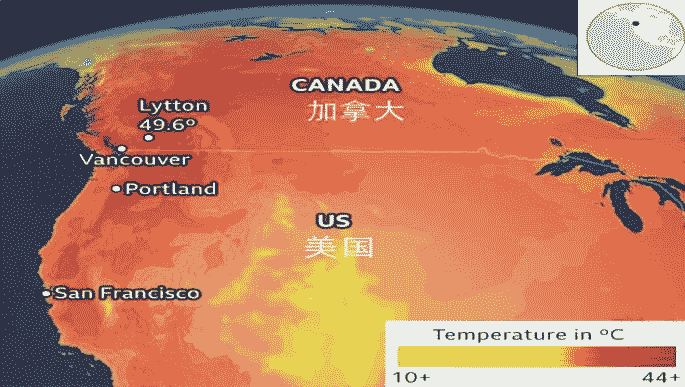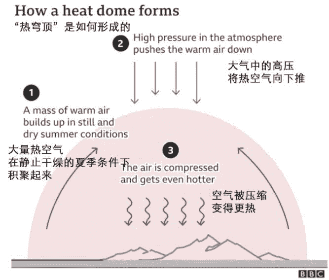

%%

%%

%%

%%

research.95579.com

19

请阅读最后评级说明和重要声明

**20 / 45**

行业研究 | 深度报告

图31：2022年北美各国首都每月平均最高温（摄氏度）

资料来源：世界气候组织，长江证券研究所

北美持续的创纪录热浪对空调市场发展是一剂催化剂，然而相较于其他白电，北美家电市场空调的规模和普及率至今依然相对不高，主要受限于以下两个原因：

**1）电线老化程度高，电力供给跟不上需求。** 北美房屋居住年份普遍较长，大部分房屋都是二手房，居住超过100年的房屋也较为常见。由于居住年限较长，很多房屋的电线已基本老化，无法满足空调安装的需求。

此外，美国人均用电需求量为世界平均水平的三倍多，是中国的两倍多，且美国大部分电力来自化石燃料，对煤炭的依赖程度很高。并且，美国没有国家电网和远距离特高压输电，电网由东部、南部和得克萨斯（ERCOT）三大独立体系组成，它们之间仅靠几条小容量的直流线路相连，分别占美国电力销售量的73%、19%和8%，呈三足鼎立的态势。

同时，美国的电力产业结构非常复杂，电网的产权结构支离破碎，分散掌握在超过500家的公司与组织手中，各自占据局部的市场份额，私人电力公司没有统一的管理。再加上电力产业的自然垄断性质，每一家电力公司都是当地的行业垄断者，种种因素导致美国跨地区电网联结无法实现。

**2）贫富差距大。** 根据WID的数据，北美地区的贫富差距较大，2022年美国和加拿大前10%人群收入份额为48.27%、35.18%，墨西哥情况更甚，该数值已达到64.61%。在潜在需求持续增加的情况下，收入严重两极分化导致空调的下沉市场空间还很大。

虽然空调目前在中低收入家庭中仍然属于奢侈品，但在创纪录的热浪下，我们预测居民购买空调的意愿会大幅增加，故北美空调市场的潜在增长空间较为可观。

图32：2022年北美各国不同人群收入份额

资料来源：世界不平等数据库，长江证券研究所

图33：北美空调均价（美元）

资料来源：欧睿，长江证券研究所

0

5

10

15

20

25

30

35

40

1月

2月

3月

4月

5月

6月

7月

8月

9月

10月 11月 12月

美国-华盛顿

加拿大-渥太华

墨西哥-墨西哥城

48.27%

35.18%

64.61%

41.88%

48.65%

29.69%

9.85%

16.17%

5.70%

0%

20%

40%

60%

80%

100%

美国

加拿大

墨西哥

前10%人群收入份额

中间40%人群收入份额

后50%人群收入份额

0.37%

-4.67%

7.22%

5.23%

7.62%

0.73%

-6%

-4%

-2%

0%

2%

4%

6%

8%

10%

0

100

200

300

400

500

600

2019

2020

2021

2022

2023

2024E

美国

加拿大

墨西哥

同比

%%

%

research.95579.com

20

请阅读最后评级说明和重要声明

**21 / 45**

行业研究 | 深度报告

#### 竞争格局：稳定性不高，存在突围机会

北美地区家用电器市场整体集中度不高，**2022**年北美整体**CR3**为**24.2%**。其中，美国、加拿大和墨西哥家用电器CR3分别为25%、23%和26%。从品类来看，白电中集中度最高的是洗衣机，平均CR3达到53.4%，集中度最低的是空调，低于20%。白电之外，小家电的集中度也较低，正如规模部分所写，这两种家电品类在北美地区的普及率和规模不及其他品类，增长空间大，竞争格局不明确，品牌格局变动可能性较大。

图34：2022年北美各国以及平均主要家电CR3

资料来源：欧睿，长江证券研究所

北美市场集中度存在差异，集中度高的品类包括冰箱、洗衣机、电视和微波炉、洗碗机等，这些品类在北美地区已基本完成普及，品类的行业发展进入了成熟期，行业龙头品牌的认知度较高。对于集中度较高的家电品类，适合以并购方式进入市场。

北美市场集中度相对较低的品类有空调、小家电以及吸尘器，其市场普及仍存在较大的增长空间。这些品类的市场规模扩展迅速，行业处于高速成长阶段。该阶段市场消费者的品牌认知尚未完全构建，企业以自有品牌进入市场、提高品牌认知度的机会较大。下面我们将根据品类品牌集中程度分两类解读各品类的竞争格局情况。

##### 成熟品类仍有机会，龙头份额有所松动

北美地区冰箱的主要品牌有惠而浦、海尔、Danby、LG等。冰箱是北美地区普及率和集中度均处于高位的家电品类。根据欧睿数据，加拿大冰箱的CR3一直高于55%，品类的行业集中度处于较高水平，2018年以前美国和墨西哥的冰箱集中度相差不大，均在35%左右。

根据欧睿数据，2019年墨西哥CR3出现大幅度增加，原因是该年韩国品牌大宇集团（Daewoo）被Winia收购，在墨西哥铺开销售。被收购后凭借品牌原有市场以及低价优势，Daewoo销量猛涨，品牌销售额跻身冰箱品类市场前列。就2022年冰箱品类而言，美国、加拿大和墨西哥的品牌CR3为40.6%、57.2%和51.7%，均处于中高水平，预计未来仍有小幅度上升趋势。美国冰箱市场常年是本土品牌惠而浦占据市场份额首位，但在2021年后被美国通用电器反超。根据欧睿预测，2022年后通用电器市占率将有所回落，惠而浦将反超重回市场第一。

图35：北美冰箱品牌零售量市占率CR3

图36：美国冰箱品牌零售量市占率（%）

资料来源：欧睿，长江证券研究所

资料来源：欧睿，长江证券研究所

图37：加拿大冰箱品牌零售量市占率（%）

图38：墨西哥冰箱品牌零售量市占率（%）

资料来源：欧睿，长江证券研究所

资料来源：欧睿，长江证券研究所

### 表4：北美代表性冰箱产品对比

| 龙头公司 | 沃尔玛高销量品牌 | 沃尔玛高销量产品 | 特点 | 同类型产品价格（美元） |
|---|---|---|---|---:|
| 惠而浦 |  |  | 过滤功能的制冰机和饮水机，防溅货架，湿度控制，双层冷冻库，触摸控制，分配器控制锁 | 1154-2176 |
| 海尔 |  |  | 可调节支架、LED温控器、可逆门铰链、冷冻机、可拆卸篮子、制冰机、滤水器、防溅支架 | 999-2308 |
|  | 海信 |  | 节能，可翻转门，可拆卸新鲜食品玻璃架，可调节的调平支腿，可调节恒温控制 | 93-148 |
|  | Frigidaire |  | 紧凑的尺寸，内置侧面开瓶器，2个可滑动、可调节、防溢的玻璃货架，可逆门，复古装饰性门，不含氟氯化碳，低能耗高效运行 | 102-241 |

30%

35%

40%

45%

50%

55%

60%

65%

2014

2015

2016

2017

2018

2019

2020

2021

2022 2023E

美国

加拿大

墨西哥

0

2

4

6

8

10

12

14

16

18

2014

2015

2016

2017

2018

2019

2020

2021

2022

2023E

惠而浦

GE

富及第

海尔

三星

LG

0

5

10

15

20

25

30

2014

2015

2016

2017

2018

2019

2020

2021

2022 2023E

惠而浦

Frigidaire

GE

三星

Danby

LG

0

2

4

6

8

10

12

14

16

18

20

2014

2015

2016

2017

2018

2019

2020

2021

2022

2023E

Daewoo

Mabe

三星

LG

海信

惠而浦

GE

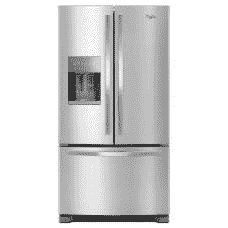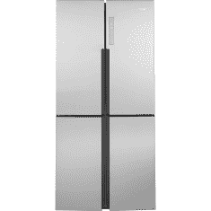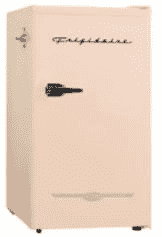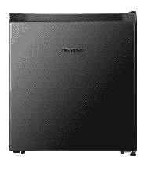

%%

%

research.95579.com

22

请阅读最后评级说明和重要声明

**23 / 45**

行业研究| 深度报告

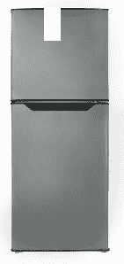

LG

定制内置风格、两次制冰机、专为更大的货架空间而设计

3554

Galanz

节能、内部照明灯、出色的储存空间、可翻转门、快速简单的温度调节

104-139

Danby

气流控制、节能、不用手动除霜、充足的储物空间

496-923

Daewoo

多功能、紧凑尺寸、独立的冷冻室、可翻转门、充足的存储容量、节能

138-191

资料来源：公司官网，Walmart，长江证券研究所

北美市场龙头公司的主推品牌的热销冰箱产品均价在1000美元左右，而在沃尔玛销量排名靠前的产品均价低于200美元，低价产品的消费群体规模可观，而在北美地区消费者的消费实力以及对生活质量的要求不断提升的趋势下，我们预测中高端产品的未来销量规模将持续扩张。同时由于北美地区庞大的租房群体对低价冰箱的需求不减，故冰箱的规模增长空间较为可观。根据Statista的一项调查显示，接近一半的调查者认为冰箱是生活必需品，仅18%的调查者在购买冰箱时更注重低价而非高质量，而25%的调查者认为相较于其他特性，冰箱使用的可持续性更为重要。由此可见，要想在北美打开冰箱市场，高性价比和高端线两方向均需要重点考虑。

图39：北美各国及中国冰箱户拥有率

图40：北美消费者对于冰箱的态度

资料来源：欧睿，长江证券研究所

资料来源：Statista，长江证券研究所

北美空调品类整体渗透率也已经达到较高水平，但整体集中度来看尚处于较低水平，美国、墨西哥、加拿大等国家的空调品牌销售量CR3均低于30%，其中美国空调品类销售量前三品类分别为Holmes、Honeywell、Hunter等，并且龙头份额近年出现下降，加拿大空调品牌的市占率均相对较低，墨西哥空调品类龙头Mirage市场份额也出现下降，并且2023年市占率低于10%，整体格局尚未稳定，存在较大突围的可能。

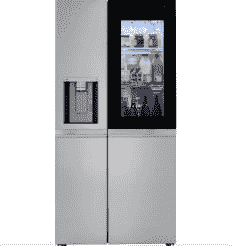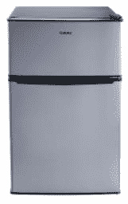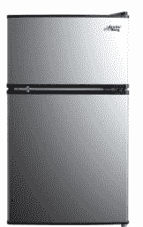

60%

65%

70%

75%

80%

85%

90%

95%

100%

2008

2009

2010

2011

2012

2013

2014

2015

2016

2017

2018

2019

2020

2021

2022

美国

加拿大

墨西哥

中国

25%

18%

21%

20%

37%

47%

8%

可持续性很重要

注重低价而非高质量

很了解冰箱

乐意尝试新款

依赖熟知品牌

认为冰箱是必需品

不关心

research.95579.com

23

请阅读最后评级说明和重要声明

**24 / 45**

行业研究| 深度报告

图41：北美主要国家的空调销售量CR3水平

图42：美国空调品类的主要品牌零售量市占率

资料来源：欧睿，长江证券研究所

资料来源：欧睿，长江证券研究所

图43：加拿大空调品类的主要品牌零售量市占率

图44：墨西哥空调品类的主要品牌零售量市占率

资料来源：欧睿，长江证券研究所

资料来源：欧睿，长江证券研究所

在出海的中国品牌企业中，海尔的表现较为亮眼，一款空调进入亚马逊销量前五。海尔在北美市场实施多品牌战略，拥有四个主要品牌：GEA、Haier、FISHER&PAYKEL和Hotpoint，覆盖大众到中高端市场，适合不同消费层次的群体。根据欧睿，2023年海尔智家洗衣机、冰箱和大型厨电在北美地区的销量份额及排名分别为23.0%（2）、24.2%（1）和31.1%（1）。

表5：北美龙头企业及亚马逊平台高销量空调介绍

| 龙头企业 | 品牌 | 产品 | 特点 | 同类型产品价格（美元） |
|---|---|---|---|---|
| **Amazon** | Holmes |  | 占用的空间较小，高、中和低速设置，广角振荡 | 49-59 |
|  | Honeywell |  | 便携式摆动风扇，低水位指示器，内置轮子 | 145-699 |
|  | Hunter |  | Wifi连接，壁挂式无管道迷你分体空调，带热泵，适用于环境温度高达-13°F的加热，静音技术 | 648-999 |
|  | Haier |  | 可重复使用/可清洗过滤器，自动冷却，室内，可调节恒温器，程序化的 | 109-169 |
| **Amazon** | Confortotal |  | 自动关闭，高速，远程控制，壁挂式，热泵，可调节恒温器，除湿机，数字显示器，风扇选项 | 399-975 |
|  | EcoFlow |  | 可调节倾斜度，应用程序兼容和控制，数字显示，环保，室内/室外，睡眠模式，智能连接，USB端口 | 649-1499 |

资料来源：各公司官网，Amazon，长江证券研究所

表6：北美Ebay以及沃尔玛平台高销量空调介绍

| **Ebay** |  |  |  | **Walmart** |
|---|---|---|---|---|
| 品牌 | 产品 | 特点 | 同类型产品价格（美元） | 品牌 |
| Confortotal |  | 自动关闭，高速，远程控制，壁挂式，热泵，可调节恒温器，除湿机，数字显示器，风扇选项 | 399-975 | Auseo |
| EcoFlow |  | 可调节倾斜度，应用程序兼容和控制，数字显示，环保，室内/室外，睡眠模式，智能连接，USB端口 | 649-1499 | Frigidaire |
| Haier |  | 可重复使用/可清洗过滤器，自动冷却，室内，可调节恒温器，程序化的 | 109-169 | Midea |
| Auseo |  | 三合一功能，8000 BTU ASHRAE冷却功率，可清洗空气过滤器，易于安装和移动 | 159-419 |  |
| Frigidaire |  | 双向空气方向控制，易于清洁的过滤器，低功耗模式 | 163-659 |  |
| Midea |  | 多种冷却选项，多种风扇选项，多种温度设置，易于冷却，易于维护，机械控制，专为较小空间设计，适用于双悬窗 | 178-329 |  |

资料来源：Ebay，Walmart，长江证券研究所

北美空调市场龙头公司中，美国品牌惠而浦市场份额占比领先同行业品牌。1958年，惠而浦推出“魔幻厨房”，紧接着在1965年推出制冰系统冰箱，1967年推出家用微波炉。1969年惠而浦为“阿波罗”11号登月计划定制太空厨房，这是全球家电制造业首次登陆太空，代表着惠而浦在当时拥有最先进的技术。2006年惠而浦收购美泰公司，在美国市场占有率达70%，全球销售额高达180多亿美元。目前，惠而浦在全球拥有超过60个研发、设计和制造中心。永不停止的科技创新，赋予了惠而浦旺盛又持久的生命力。根据Statista数据，惠而浦在北美市场的销售额占比在50%-60%之间波动，2022年北美市场占比为全球的58%。可见作为美国本土出身的品牌，惠而浦的主要市场仍在北美地区，且各地区的占比结构较为稳定，未发生较大变化。

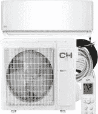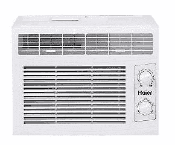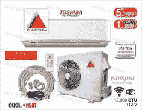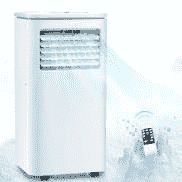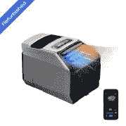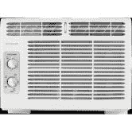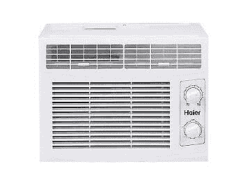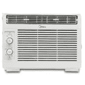

research.95579.com

25

请阅读最后评级说明和重要声明

**26 / 45**

行业研究| 深度报告

图45：惠而浦全球销售额占比

资料来源：Statista，长江证券研究所

北美市场洗衣机的主要品牌为惠而浦、三星、LG、GE、Costway、海尔等。根据Statista数据，2022年Costway在北美墨西哥洗衣机市场占比约为27%，居于行业首位。

Costway中文名宁波豪雅，于1998年成立于浙江宁波，基于本地商品供应网络，出口高性价比优质家具，企业最初战略是走向国际市场。2008年，宁波豪雅成为首批在亚马逊开店进军美国消费市场的中国企业之一，随后企业在北美和欧洲建立业务，发展扩张迅速。为了与海外客户保持密切联系，2015年宁波豪雅在美国开设第一家品牌在线商店。超高的性价比吸引了各大商家的注意，企业成功与梅西百货、沃尔玛、Wayfair等平台建立合作关系。豪雅在海外平台销售主要以家具、家电、运动器材等为主，采用B2B2C模式，自主品牌销售占比超95%。由于北美白电市场的高集中度以及激烈的行业龙头竞争，豪雅选择在北美地区集中度相对较低的墨西哥铺开销售，凭借着平台优势和高性价比迅速占领了墨西哥市场，随后规模逐步扩大，成为市场龙头品牌。

图46：墨西哥2022年洗衣机销售额品牌占比

图47：宁波豪雅销售平台

资料来源：Statista，长江证券研究所

资料来源：宁波豪雅官网，长江证券研究所

在美国洗衣机市场，GE、惠而浦以及Maytag在2022年占据市场60.8%的份额，可以看到2021年以前一直是Maytag和惠而浦占据市场首位，而在2021年GE实现反超，随后市场占有率逐年上升。GE（美国通用电气）是世界上最大的提供技术和服务业务的跨国公司，作为基础设施技术服务的全球供应商，家用电器只是GE工厂向全球提供的产品和服务中很小的一部分。2021年通用电气宣布计划将公司拆分为三家独立的上市公司，分别专注于航空、医疗和能源业务，标志着这家拥有近130年历史的美国工业巨头走向分裂，但同时也使得各公司发挥各自潜力，也有利于债务的偿还。

57% 53% 53% 51% 52% 54% 53% 50% 50% 51% 54% 56% 58% 57% 58%

19% 22% 25% 27% 27% 26% 23%

16% 25% 23% 22% 16% 13% 15% 16%

21% 19% 17% 17% 16% 16% 20%

27% 18% 19% 17% 21% 22% 23% 20%

3%

4%

5%

5%

5%

4%

4%

7%

7%

7%

7%

7%

7%

6%

6%

0%

10%

20%

30%

40%

50%

60%

70%

80%

90%

100%

2008 2009 2010 2011 2012 2013 2014 2015 2016 2017 2018 2019 2020 2021 2022

北美

拉美

EMEA

亚洲

14%

8%

27%

12%

2%

7%

5%

21%

4%

艾罗德克

Black + Decker

COSTWAY

DryGuy

Helohome

INTERGREAT

美的

Other

The Laundry Alternative

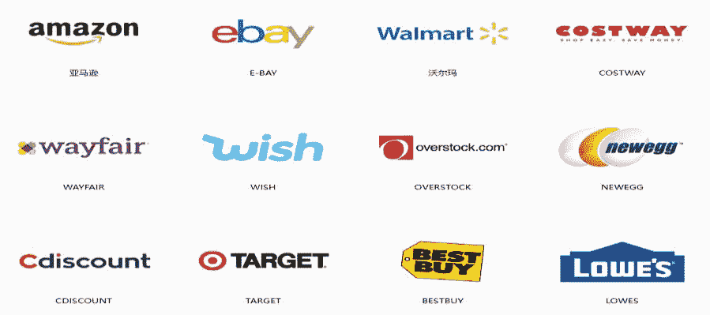

research.95579.com

26

请阅读最后评级说明和重要声明

**27 / 45**

行业研究| 深度报告

根据欧睿数据，在北美各国洗衣机品牌龙头格局结构近几年有所松动，龙头品牌市占率虽高但仍有波动，尤其是墨西哥和美国地区，格局呈现出不稳定的态势。这对国产品牌出海占据市场份额是有利的，在格局松动的情况下，应把握市场趋势和消费者偏好，占领市场份额。

图48：北美各国洗衣机CR3

图49：美国洗衣机品牌零售量市占率（%）

资料来源：欧睿，长江证券研究所

资料来源：欧睿，长江证券研究所

图50：加拿大洗衣机品牌零售量市占率（%）

图51：墨西哥洗衣机品牌零售量市占率（%）

资料来源：欧睿，长江证券研究所

资料来源：欧睿，长江证券研究所

根据龙头品牌和Amazon销量排名靠前的产品来看，消费者更倾向于洗衣程序多、节能和节省空间以及拥有儿童锁保护功能的洗衣机。全球供应链短缺给洗衣机厂商带来了生产和物流成本的上涨，随着经济水平的不断提升，消费者更加注重健康以及更好的使用效果，对洗衣机的性能也提出了更高的要求，产品升级在一定程度上带动了洗衣机产品均价的上涨。我们预计在北美地区洗衣机均价会稳定上涨，与此同时洗衣机渗透率虽然在北美各国已经达到较为饱和的程度，但是庞大的市场规模和持续上涨的均价将带来可观的销售额空间。

0%

10%

20%

30%

40%

50%

60%

70%

2014

2015

2016

2017

2018

2019

2020

2021

2022

2023E

美国

加拿大

墨西哥

0

5

10

15

20

25

30

2014

2015

2016

2017

2018

2019

2020

2021

2022

2023E

GE

惠而浦

Maytag

LG

Samsung

Kenmore

0

5

10

15

20

25

30

35

2014

2015

2016

2017

2018

2019

2020

2021

2022

2023E

惠而浦

Frigidaire

Maytag

GE

LG

Samsung

0

2

4

6

8

10

12

14

16

18

20

2014

2015

2016

2017

2018

2019

2020

2021

2022

2023E

惠而浦

Mabe

Daewoo

LG

Acros

Koblenz

research.95579.com

27

请阅读最后评级说明和重要声明

**28 / 45**

行业研究| 深度报告

图52：北美地区洗衣机均价（美元）

资料来源：Statista，长江证券研究所

表7：北美洗衣机产品

| 龙头品牌 | **Amazon**高销量品牌 | 产品 | 特点 | 同类型产品价格（美元） |
|---|---|---|---|---|
| GE |  |  | 可完全控制和定制水位，深度清洁周期，深度漂洗 | 777 |
| 三星 |  |  | 蒸汽清洗污渍去除、超高速洗涤、减振技术、智能护理、自清洁、节能、更温和处理 | 894-1249 |
| LG |  |  | 快洗程序、6种洗涤程序、更温和处理衣物、烘洗一体、与app配合使用、节水节能 | 888-1419 |
| Kenmore |  |  | 宽敞容量、双作用搅拌器、11个洗涤周期，多种洗涤温度、洗烘一体 | 599-699 |
|  | BLACK+DECKER |  | 5个洗涤周期选择、三种水位选择、可设置冷水温度、可延迟启动至24小时、自动关闭安全功能和儿童锁保护、专为移动而设计 | 239-299 |
|  | COMFEE |  | 6个洗衣程序、节省空间、非常节能、儿童锁、可以延迟启动和重新加载功能 | 249-379 |
|  | Giantex |  | 使用方便，水位和模式控制，洗涤和旋转能力大，全自动洗衣机 | 223-259 |
|  | Daewoo |  | 可折叠设计、排水篮可拆卸、臭氧+银离子深度杀菌、三种清洁模式 | 158-245 |

资料来源：各公司官网，Amazon，长江证券研究所

446.7

453.3

440.0

463.3

476.7

483.3

496.7

506.7

516.7

530.0

543.3

-4%

-3%

-2%

-1%

0%

1%

2%

3%

4%

5%

6%

0

100

200

300

400

500

600

2018

2019

2020

2021

2022

2023E

2024E

2025E

2026E

2027E

2028E

美国

加拿大

墨西哥

均价平均

同比

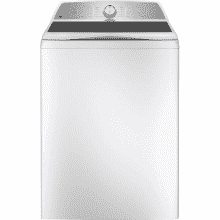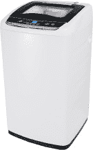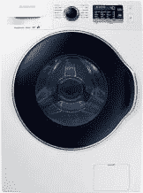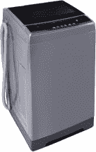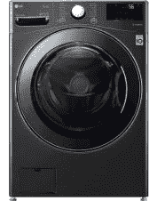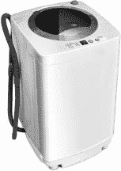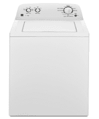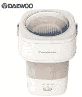

research.95579.com

28

请阅读最后评级说明和重要声明

**29 / 45**

## 行业研究 | 深度报告

##### 新兴品类格局未定，把握突围机会

北美吸尘器市场中占有主要份额的为全球吸尘器产业四大巨头：美国本土品牌必胜(Bissell)、鲨克(Shark Ninja)、德国品牌德沃(Dirt Devil)、英国品牌Hoover Techtronic Industries Co Ltd)以及中国美的旗下品牌Eureka 等。

Eureka 原是瑞典老牌家电品牌伊莱克斯旗下高端吸尘器品牌，2016 年底，美的收购Eureka 绝大多数资产，具体金额未对外公布，此次收购使中国品牌向北美吸尘器市场迈出了重要一步。同时，收购老牌欧美家电巨头手中的品牌也成为中国企业在全球家电市场谋求新突破的重要手段。产业链齐全、规模大成本低，国有品牌出海据此在北美市场迅速铺开销售。根据美的集团发布的财报，企业连续5 年海外营收超过千亿。2022 年，美的调整其吸尘器产品结构，以Eureka(优瑞家)和美的双品牌布局，逐步构建企业完整的清洁产品线。

美的在北美取得成功的主要原因在于：

1. 本土化运营，“产品本地化，员工本土化”是美的海外合作的核心理念，美的集团董事长方洪波接受采访时曾说：“美的会充分尊重当地的文化、管理团队以及当地公司的独立性”²。从OEM、ODM 到OBM，美的的长期目标一直是从“借船出海”到“造船出海”。
2. 构建品牌矩阵，目前美的海外拥有三个全品类品牌（东芝、美的、COMFEE），以及包括开利、Comfee、Eureka 等13 个细分品类专业品牌的品牌矩阵。北美市场将重点推进自有品牌零售分销渠道进驻，同步重点孵化D2C 业务模式，搭建到门到户物流能力、优化售后服务体系。

图53：北美各国吸尘器CR3

图54：美国吸尘器品牌零售量市占率（%）

资料来源：欧睿，长江证券研究所

资料来源：欧睿，长江证券研究所

图55：加拿大吸尘器品牌零售量市占率（%）

图56：墨西哥吸尘器品牌零售量市占率（%）

资料来源：欧睿，长江证券研究所

资料来源：欧睿，长江证券研究所

2 https://baijiahao.baidu.com/s?id=1719270537187467176

20%

25%

30%

35%

40%

45%

50%

55%

60%

65%

70%

2014

2015

2016

2017

2018

2019

2020

2021

2022

2023E

美国

加拿大

墨西哥

0

5

10

15

20

25

2014

2015

2016

2017

2018

2019

2020

2021

2022

2023E

Bissell

Dirt Devil

Hoover

Shark

Eureka

iRobot Roomba

0

5

10

15

20

25

30

35

40

2014

2015

2016

2017

2018

2019

2020

2021

2022

2023E

Eureka

Private label

Others

0

10

20

30

40

50

60

2014

2015

2016

2017

2018

2019

2020

2021

2022

2023E

Koblenz

Dyson

iRobot Roomba

Shop-Vac

Electrolux

Hoover

%%

%%

%%

%%

research.95579.com

29

---

2022 年吸尘器在北美地区销售额为62.2 亿美元，市场规模仍在不断扩张。根据亚马逊高销售显示的情况来看，美国亚马逊平台售卖的扫地机器人主要集中在200 美元以下，消费者的购买选择也以这一价格为主。此外，从各阶段销量趋势占比可以看出，500 美元以上价格段销量占比也有明显上涨。可以看到，美国消费者对于中高端产品的需求和消费意愿正在逐步提升，这两个价位段的市场容量和上升空间均较大。

表8：北美吸尘器主要产品比较

| 沃尔玛高销量品牌 | 产品特点 | 同类型产品价格（美元） |
| --- | --- | --- |
| Bissell (Bissell Inc) | 双罐技术，自清洁，清洁和消毒，自推进式转向系统 | 58-249 |
| Dirt Devil | 无吸力损失、一键式轻松释放XL 污垢杯、多层深度清洁、最小化气味、车载TURBO CLAW PET 工具 | 49-99 |
| Shark | 地毯深度清洁、高效空气过滤器、更大吸力、先进的旋转转向系统、LA300 处理宠物毛发和难以触及空间的工具 | 49-249 |
| iRobot Roomba (iRobot Corp) | 无绳、自动充电、高级定制清洁 | 159-699 |

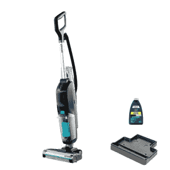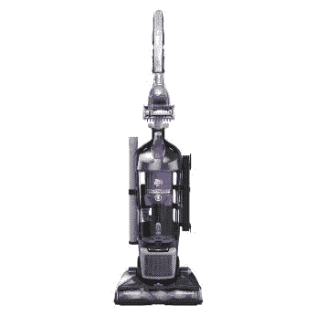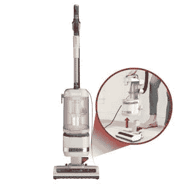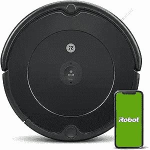

%%

%

research.95579.com

30

---

| 沃尔玛高销量品牌 | 产品特点 | 同类型产品价格（美元） |
| --- | --- | --- |
| Eureka (Electrolux AB) | 重量轻、结构紧凑、无袋、可清洗过滤器 | 60-199 |

资料来源：公司官网，Walmart，长江证券研究所

2018-2023 年真空吸尘器中标准真空吸尘器的市占率从43%下降至34%，而扫地机器人近几年的表现十分亮眼，规模增长迅速，市占率由18%上升至26%，对传统吸尘器有着较强的替代趋势。随着消费者对于生活质量的重视程度日益提高，“解放双手”成为全球范围内普遍存在的需求，扫地机器人近几年的市场规模扩张速度逐年上升。欧美发达国家对于扫地机器人的需求相对更为旺盛，其中以美国为最。根据Euromonitor 统计，2023 年美国扫地人的渗透率为17.1%，远超其他国家。整体而言扫地机器人目前在全球范围内都属于早期发展阶段，未来仍有较大的市场潜能。

根据魔镜Oversea 数据，美国亚马逊扫地机器人市场在2022 年8月-2023 年9月期间市场规模达到9.14 亿美元，销量超361 万件，商品均价在252.74 美元。在北美扫地机市场，呈现一超多强的格局。其中，成立于1990 年的老牌家电企业iRobot 仍然占据市场主要份额。随着中国企业接二连三“出海”，科沃斯、石头科技等国有品牌凭借高性价比，逐渐攻占北美扫地机器人市场。

图57：北美扫地机器人销售量（十万台）

图58：北美扫地机器人销售额（亿美元）

©

资料来源：欧睿，长江证券研究所

资料来源：欧睿，长江证券研究所

美国扫地机器人市场有着规模大、渗透率高等特点，其扫地机器人TOP 品牌对市场的影响力较强。根据魔镜Oversea 数据，2022 年8月-2023 年9月CR10 集中度为71.5%，其中2023 年相较于2022 年集中度有所提升，品牌效应凸显。值得关注的是2023 年海外扫地机TOP10 品牌格局发生了显著变动，iRobot 作为行业龙头品牌市场份额出现下降趋势，与此同时出海的国货品牌成绩则十分亮眼。在2022 年统计期间仅有3 个国产品牌进入销售额前十，而2023 年销售额前十有半数都来自中国，它们分别是石头科技（市场份额14.3%）、安克旗下的Eufy（市场份额6.9%）、科沃斯及其子品牌yeedi、Lefant 乐帆。

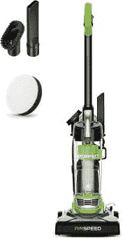

0

5

10

15

20

25

30

35

0

10

20

30

40

50

60

2013

2014

2015

2016

2017

2018

2019

2020

2021

2022

2023E

2024E

2025E

销售量

同比（%，右轴）

0

5

10

15

20

25

30

35

0

5

10

15

20

25

2013

2014

2015

2016

2017

2018

2019

2020

2021

2022

2023E

2024E

2025E

销售额

同比（%，右轴）

%%

%%

%%

%%

research.95579.com

31

---

表9：亚马逊销售额排名情况

| 排名 | 全价格段品牌 | 全价格段售价（美元） | 上月销量 | 排名 | 高于500美元价格段品牌 | 高于500美元价格段售价（美元） | 上月销量 |
| --- | --- | --- | --- | --- | --- | --- | --- |
| 1 | iRobot | 159.97 | 20k+ | 1 | roborock | 869.99 | 1k+ |
| 2 | eufy | 139.98 | 4k+ | 2 | roborock | 1199.99 | 900+ |
| 3 | ROPVACNIC | 129.99 | 6k+ | 3 | roborock | 1299.99 | 900+ |
| 4 | XIEBro | 179.99 | 2k+ | 4 | iRobot | 984.46 | 900+ |
| 5 | iRobot | 349.99 | 7k+ | 5 | roborock | 899.99 | 600+ |
| 6 | iRobot | 238 | 4k+ | 6 | ECOVACS | 699 | 700+ |
| 7 | roborock | 699.99 | 3k+ | 7 | Dreametech | 899.99 | 700+ |
| 8 | iRobot | 229.99 | 3k+ | 8 | Dreametech | 1499.99 | 600+ |
| 9 | roborock | 869.99 | 1k+ | 9 | iRobot | 699 | 700+ |
| 10 | Lefant | 209.99 | 1k+ | 10 | iRobot | 588.9 | 200+ |
| 11 | AIRROBO | 98.99 | 5k+ | 11 | ECOVACS | 1149.99 | 400+ |
| 12 | iRobot | 249 | 2k+ | 12 | NARWAL | 1199.99 | 500+ |
| 13 | roborock | 1199.99 | 900+ | 13 | Shark | 549.99 | 300+ |
| 14 | Lefant | 199.99 | 2k+ | 14 | roborock | 819.99 | 500+ |
| 15 | Shark | 309.95 | 5k+ | 15 | roborock | 999.99 | 300+ |

资料来源：Amazon，长江证券研究所

iRobot 作为扫地机的行业龙头品牌，曾连续多年占据着全球50%以上的市场份额，然而随着中国品牌出海拓展与崛起，iRobot 行业第一的位置可能松动。根据Euromonitor 数据，2012 年至2021 年iRobot 全球销量市占率已经从83%下降至30%左右。根据公司2022 年的财报数据显示，iRobot 面临的经营压力较为明显。从2020 年起公司营收逐年下降，2022 年全年收入为11.83 亿美元、同比下降24%。与此同时中国扫地机品牌乘胜追击，在海外市场的版图进一步扩张。2020 年科沃斯、石头科技在全球扫地机的市占率分别为17%、16%，分列行业第二、三位。

国产品牌在海外市场崛起一方面来源于自身优势，另一方面也由于龙头企业的战略失误。近年来，iRobot 大力扩展产品矩阵，在新业务上投入了绝大部分精力，研发了不少适用于细分场景下的机器人，却忽视了其核心业务扫地机的产品更新迭代。然而，公司研发的新产品并未撬动第二增长曲线，反而过高的研发成本消耗给公司营收带来不小压力，利润持续收窄。在iRobot 死磕视觉导航的时候，石头科技率先推出了性价比极高的激光导航扫地机器人，在提升吸力与电池容量的同时大幅压低价格，把产品单价做到了1699 元，随后科沃斯等国产品牌迅速跟进，国货引领的激光导航路线的变革，对iRobot 主导的视觉导航产生了较大影响。

%%

%

research.95579.com

32

---

#### 渠道体系：专卖店引领市场，电商增势迅猛

根据Statista 数据，北美家用电器线上零售占比逐年增加，2018 年至2022 年五年间零售量占比从23.7%增长到45.5%，Statista 预测线上渠道份额将会继续扩张，预计将在2024 年超过线下零售。可以看到2020 年北美电商规模增速非常可观，增长接近10pct，究其原因，自2018 年以来，线上电商运营不断完善，消费者也逐渐接受电子购物模式，同时2020 年后电商渗透率快速迎来提升。

图59：北美线下门店及线上销售占比

资料来源：Statista，长江证券研究所（按零售量角度统计，后同）

线下零售中，大型超市和专卖店仍是北美地区家用电器销售主要的渠道，专卖店渠道中，美国和加拿大以家具专卖店渠道为主，而墨西哥绝大部分专卖店份额来自电子专卖店渠道。过去五年来看，美国线上零售占比提升较快，尤其是2020 年后，零售线上占比超过44%。

图60：北美各国家电渠道占比走势（%）

资料来源：欧睿，长江证券研究所

76.26

74.1

69.64

60.17

54.54

50.16

47.13

44.13

42.64

41.37

23.74

25.9

30.36

39.83

45.46

49.84

52.87

55.87

57.36

58.63

0%

10%

20%

30%

40%

50%

60%

70%

80%

90%

100%

2018

2019

2020

2021

2022

2023E

2024E

2025E

2026E

2027E

线下门店

线上电商

0.0

0.2

0.4

0.6

0.8

1.0

1.2

1.4

1.6

1.8

2.0

20 9

2

0

11

012

2013

014

2015

201

20 7

2 18

201

20 0

2 21

22

023

图表标题

**美国**

**加拿大**

**墨西哥**

0

10

20

30

40

50

60

70

80

90

100

2009 2010 2011 2012 2013 2014 2015 2016 2017 2018 2019 2020 2021 2022 2023

零售线下

0

5

10

15

20

25

30

35

40

45

50

2009 2010 2011 2012 2013 2014 2015 2016 2017 2018 2019 2020 2021 2022 2023

零售线上

0

5

10

15

20

25

30

35

2009 2010 2011 2012 2013 2014 2015 2016 2017 2018 2019 2020 2021 2022 2023

专卖店

0.0

0.5

1.0

1.5

2.0

2.5

3.0

3.5

4.0

4.5

2009 2010 2011 2012 2013 2014 2015 2016 2017 2018 2019 2020 2021 2022 2023

百货超市

0

5

10

15

20

25

30

35

40

45

2009 2010 2011 2012 2013 2014 2015 2016 2017 2018 2019 2020 2021 2022 2023

大型超市

0.0

0.2

0.4

0.6

0.8

1.0

1.2

1.4

1.6

1.8

2.0

2009 2010 2011 2012 2013 2014 2015 2016 2017 2018 2019 2020 2021 2022 2023

建筑商

%%

%%

%%

%%

research.95579.com

33

---

##### 专卖店：主要的销售体系，连锁化率相对较高

在北美地区，线下零售仍是家用电器销售最主要的渠道，大型超市、百货商店、电子专卖店以及家具专卖店在各消费渠道中占据主要地位。北美各国的家用电器专卖店以零售商为主，美国和加拿大在渠道内的龙头公司较为相似，主要包括Best Buy(百思买)、Lowe's(劳氏)、Home Depot(家得宝)、Sears、Costco(开市客)、The Brick 等，基本均已上市，而墨西哥地区线下零售专卖店渠道龙头大部分为本地企业为Elektra、Liverpool、Coppel 等。目前中国企业还属于起步初期，尽管有一些品牌美的、海尔电器、海信、TCL 等拥有较多自己品牌的独立连锁专卖店，但专卖店渠道整体还是以经销商和零售商为主。由此可见专卖店渠道并不固化，出海企业可以通过与经销商和零售商的合作来快速布局品牌的线下零售，迅速打开市场，发掘北美家电的破局机会点。下面我们将对北美三国的专卖店体系中的龙头公司进行分析介绍。

美国和加拿大专卖店体系龙头公司基本一致，主要包括Best Buy、Lowe's、Home Depot、Sears、Costco 等，以上公司均为上市零售商。同时以上专卖店基本都开展了线上电商零售业务，后文会进一步介绍分析。各大专卖店中，Best Buy 是北美地区的线下零售巨头，美国、加拿大、墨西哥是其最主要市场，除本土国家美国外，目前在墨西哥、加拿大均设有分店。Best Buy 在美国共有超过1050 间店铺，并在美国的机场、购物中心内设有超过100 间以上的“Best Buy Express”无人自助商店。其主要销售消费电子、家居办公用品、电器、娱乐软件及其相关服务，商品采用仓储式成列或是样品成列，既可以汇集众多品牌还方便消费者的购买、有效降低经营成本。

表10：2024 年美国线下零售专卖店主要布局

| 公司名称 | 类别 | 是否上市 | 本地门店数量 | 门店分布图 | 产品范围 | 品牌范围 | 专卖店图片 |
| --- | --- | --- | --- | --- | --- | --- | --- |
| Best Buy | 零售商 | 是 | 1052 |  | 电视、音响、冰箱、洗衣机 | Sony、Samsung、LG 等品牌 |  |
| Lowe's | 零售商 | 是 | 1746 |  | 厨房电器、空调、灯具、电动工具 | Whirlpool、GE、Frigidaire 等品牌 |  |
| Home Depot | 零售商 | 是 | 2006 |  | 厨房电器、洗衣机、冰箱、空调 | Maytag、KitchenAid、Electrolux 等品牌 |  |
| Sears | 零售商 | 是 | 11 |  | 冰箱、洗衣机、电视、空调 | Kenmore、Craftsman、DieHard 等品牌 |  |

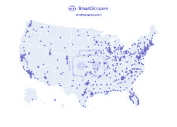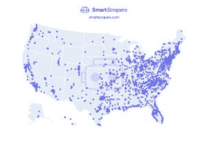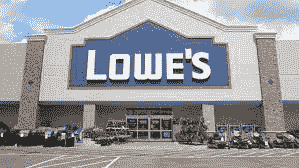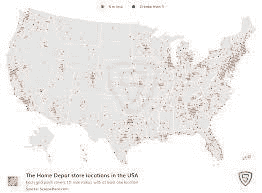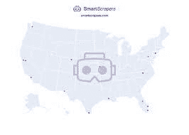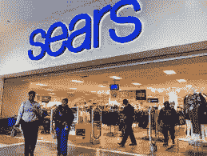

%%

%

research.95579.com

34

行业研究|深度报告

Costco

| 公司名称 | 类别 | 是否上市 | 本地门店数量 | 产品范围 | 品牌范围 |
|---|---|---:|---:|---|---|
| Best Buy | 零售商 | 是 | 164 | 电视、音响、冰箱、洗衣机 | Sony、Samsung、LG等品牌 |
| Home Depot | 零售商 | 是 | 182 | 厨房电器、洗衣机、冰箱、空调 | Maytag、KitchenAid、Electrolux等品牌 |
| The Brick | 零售商 | 是 | 219 | 电视、家具、厨房电器、家庭装饰品 | Whirlpool、Samsung、Sealy等知名品牌 |
| Costco | 零售商 | 是 | 617 | 电视、冰箱、洗衣机、厨房电器 | Samsung、LG、Whirlpool等品牌 |
| Leon's | 零售商 | 是 | 89 | 冰箱、洗衣机、家具、床上用品 | Frigidaire、Bosch、Serta等知名品牌 |

资料来源：Traqline³，各公司官网，rentech digital，scrapehero，Google，长江证券研究所

注：除Home Depot门店数量截至2024年6月外，其他零售商门店数量数据截至2024年7月。Best Buy门店数量截至2024年3月；Home Depot门店数量截至2024年5月；The Brick门店数量截至2022年7月；Leon's门店数量截至2022年9月。

加拿大线下零售专卖店体系主要包括Best Buy、Home Depot、The Brick、Leon's等。

Leon's（Leon's Furniture Limited）成立于1909年，目前是加拿大最大的家居用品零售商之一，出售的商品包括家居家具、家用电器、电子产品等，在北美地区共有300多家线下商店。2012年11月11日，Leon's以7亿美元收购竞争对手家具连锁The Brick。目前其旗下商店有Leon's、The Brick、Brick Outlet和The Brick Mattress Store，同时该公司还经营着三个电子商务网站：leons.ca、thebrick.com和furniture.ca。

Home Depot（家得宝）成立于1978年，是美国和加拿大领先的家具DIY和家居装饰连锁店，也是全球最大的仓储式家居建材用品零售商。Home Depot在北美各国均设有线下门店。截至2023财年年底，公司在美国、加拿大和墨西哥经营着2335家门店，店均面积约10.4万平方英尺，还有大约2.4万平方英尺的外部花园面积。

Home Depot专注于改善网站的搜索能力、网站功能、展示类别、产品内容、结账速度等，从而带来了更高的流量、更好的转化率和持续的销售增长。在美国，Home Depot最大的竞争对手是Lowe's，即劳氏公司。两家公司控制着美国几乎整个家装市场，在美国家装零售行业2021年的合计份额为48%。相比Lowe's，Home Depot的规模更大，2012—2021年Home Depot在北美零售市场的市占率保持第一，盈利能力方面也表现得更加优秀。2023财年，Home Depot的年销售额达到1574亿美元，成为全球家装之王。

³ https://www.traqline.com/newsroom/blog/major-appliance-industry-trends-infographic-2022/

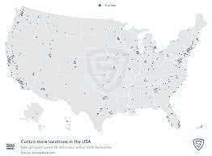
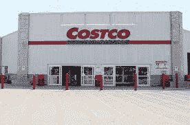
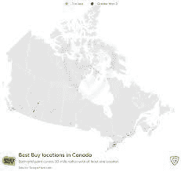

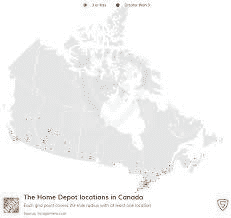
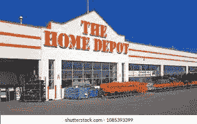
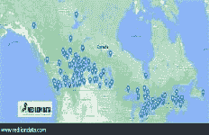

墨西哥线下零售专卖店体系主要包括Elektra、Liverpool、Coppel、Famsa、Palacio de Hierro等，其中除Famsa外均为已上市零售商。在墨西哥当地门店数量最大的为Elektra和Coppel两家，其门店数量分别为1253家和1670家。

Coppel是一家成立于1941年的墨西哥公司，旨在以信贷形式出售家具。它目前拥有800多家门店，分布在15个国家。Coppel的零售形式之一是以信贷方式出售批发食品、储藏室产品，例如豆类、软饮料、果汁和牙膏等。消费者可以挑选所需的产品后，采用分期付款的方式每两周支付相应的金额来购买，支付期限为24周。此外，在该百货商店中，电器、手机、家具、玩具、香水和衣服等产品均可以信贷方式购买，这使Coppel成为墨西哥人最喜欢购买所需物品的线下零售商店之一。

### 表12：墨西哥线下零售专卖店主要布局

| 公司名称 | 类别 | 是否上市 | 本地门店数量 | 产品范围 | 品牌范围 |
|---|---|---:|---:|---|---|
| Elektra | 零售商 | 是 | 1253 | 电视、冰箱、洗衣机、音响 | Samsung、LG、Mabe等品牌 |
| Liverpool | 零售商 | 是 | 124 | 电器、家具、家居用品 | Whirlpool、Sony、Samsung等品牌 |
| Coppel | 零售商 | 是 | 1670 | 电视、冰箱、洗衣机、空调 | Panasonic、LG、Hisense等品牌 |
| Famsa | 零售商 | 否 | 80+ | 冰箱、洗衣机、电视 | Daewoo、Mabe、LG等品牌 |
| Palacio de Hierro | 零售商 | 是 | 14 | 电器、厨房用具、电子产品 | Bosch、Electrolux、Samsung等品牌 |

资料来源：各公司官网，Google Map，长江证券研究所

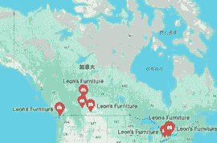
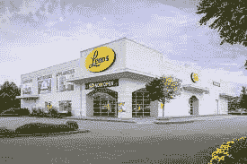
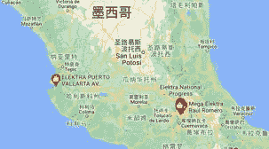

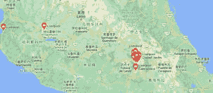

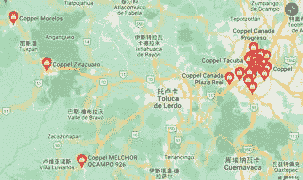
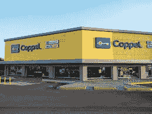

##### 线上渠道：渗透率快速提升，平台体系完善

过去十几年全球互联网用户数量快速增长，推动更多消费者转向线上购物，也促使以前没有大规模在线开展业务的卖家品牌进行线上扩张。全球零售电商市场增长率在2020年达到25.7%，2021年回落至17.1%，2022年后增速将趋缓，但依旧保持增长态势。

就家电品类而言，电商零售渠道市场销售占比增速迅猛，北美主要电商平台为亚马逊（Amazon）、易贝（eBay）、沃尔玛（Walmart）等。实际上，除了北美地区，这几大电商平台在全球电商渠道销售中也有着举足轻重的地位。

图61：2021年6月美国龙头电商平台月度流量对比（亿次）

| 平台 | 月度流量 |
|---|---:|
| Wayfair | 1.26 |
| Lowe's（劳氏） | 1.465 |
| Target（塔吉特） | 1.82 |
| Home Depot（家得宝） | 2.33 |
| Etsy（易集） | 3.92 |
| Walmart（沃尔玛） | 4.105 |
| eBay（易贝） | 8.855 |
| Amazon（亚马逊） | 24.49 |

图62：2022年北美电商市场各品类销售额（亿美元）

| 品类 | 销售额 |
|---|---:|
| 玩具、爱好、DIY | 20.02 |
| 书、影音、游戏 | 55.6 |
| 饮料 | 113.7 |
| 美容、健康、个护 | 144.09 |
| 食品 | 188.65 |
| 时尚 | 353.16 |
| 电子产品 | 997.01 |
| 家具 | 1046.35 |

资料来源：Statista，长江证券研究所

北美电商市场跨境电商收入占比高于亚太地区，其中墨西哥电商市场2023年跨境电商收入占比高达6%，中国跨境电商收入占比为3%，与美国、加拿大持平。这也说明，北美地区，特别是美国、加拿大等跨境电商占比较低的市场，中国商家依旧有切入机会。

当前，北美电商市场出现两种态势：一方面，诸如Amazon、eBay等市场化程度高的平台已经成为基础设施，起到搜索引擎效果，用户群体十分庞大，用户粘性较高；另一方面，在市场化平台之外，诸如Etsy等垂直化平台也日益受到关注，且往往用户粘性更高。当前，北美移动互联网电商需求已经越来越受到关注，并逐步超过PC端购物需求，且呈现移动用户不断增长的趋势。根据Worldpay数据显示，2022年，北美地区数字/移动钱包支付已经成为继卡支付之外的第二大支付方式。随着移动互联网渗透率和数字支付方式的不断普及，数字支付也成为北美地区电商用户的重要选择。

##### 品类属性有所不同，渠道结构存在差异

下面我们将分析北美各国重点品类，包括空调、冰箱、洗衣机、大厨电、小家电、吸尘器、洗碗机以及微波炉的渠道占比情况。

北美地区空调的主要销售渠道各有千秋。在美国，线下零售的主要销售渠道是大型超市和家具专卖店，但两者的占比呈现逐年下降的趋势，尤其是家具专卖店的销售占比，2022年占比跌破30%；相反，线上零售渠道的销售占比增幅可观，2009—2022年线上渠道的销售占比从7.6%上升到35.4%。我们预测，全球线上电商规模会持续扩大，成为未来家用电器消费渠道的主要趋势。

加拿大和墨西哥空调渠道占比较为相似，线上零售的占比增速虽不及美国，但也在逐年稳定增加。欧睿预测，2023年加拿大空调的线上零售占比会上升至12.4%，后续线上零售的规模仍会持续提升。线下零售细分渠道中，电器专卖店和大型超市的销售占比较大。尽管线上零售扩张势头强劲，加拿大电器专卖店以及墨西哥大型超市的销售占比仍有小幅上涨。故对于想要在北美市场拓展海外市场的企业来说，需因地制宜，结合当地的消费模式铺开销售。

图63：美国空调渠道占比

图64：加拿大空调渠道占比

| 渠道 | 说明 |
|---|---|
| 大型超市 |  |
| 家具专卖店 |  |
| 电器专卖店 |  |
| 超市 |  |
| 线上零售 |  |

资料来源：欧睿，长江证券研究所

北美地区冰箱的销售渠道主要以线下零售为主，线上电商占比最高的是加拿大，2022年占比21.1%。线下渠道中专卖店和大型超市占据绝大部分市场，其中，专卖店在美国占比超过50%，处于领先地位。特别地，建筑商占比较为可观，2022年美国和加拿大占比分别为15.3%和9.4%。究其原因，北美地区部分消费者偏好高端嵌入式冰箱，在装修时就要考虑冰箱的空间尺寸，所以建筑商渠道对于消费者来说更方便。

图65：加拿大冰箱渠道占比

图66：墨西哥冰箱渠道占比

资料来源：欧睿，长江证券研究所

北美地区洗衣机品类渠道占比与空调相似，以线下零售渠道为主，电商渠道增长稳中有进。根据Statista预测，2026年美国洗衣机市场线上电商渠道占比将会超过线下零售，占据市场主导地位。线下细分渠道中，电子专卖店和家具专卖店占据主要部分，专卖店占比超过60%。此外，建筑商渠道占比近10%，有回落趋势。

图67：美国洗衣机渠道占比

图68：加拿大洗衣机渠道占比

资料来源：欧睿，长江证券研究所

美国地区大厨电的销售渠道相较于其他国家较为特殊，建筑商占据规模较大。根据欧睿数据，2021年建筑商占比28.2%，与家具专卖店占比齐平。究其原因，与其他家电品类不同的是，大厨电的销售与房地产的联系尤为紧密。由于大厨电普遍需要满足厨房空间尺寸的要求，需要在房屋装修阶段就考虑灶台、内嵌式烤箱等大厨电的布局和选购，因此在房屋建筑商渠道购置大厨电对于消费者来说较为方便。与墨西哥不同，美国和加拿大的大厨电渠道中，专卖店占据主要地位，2022年专卖店渠道占比分别为41.4%和49.1%；但由于线上电商销售规模迅速扩张，专卖店占比有下降趋势。

图69：美国大厨电渠道占比

图70：加拿大大厨电渠道占比

资料来源：欧睿，长江证券研究所

北美地区小家电品类的主要销售渠道是大型超市，但占比呈现逐年下降的趋势。2023年美国、加拿大和墨西哥占比分别为27.0%、33.0%和27.9%。由于小家电占地面积小、无需专业人员进行安装以及消费场景较为碎片化等特点，越来越多的消费者选择在线上平台进行购买。电商零售的规模占比正以十分可观的速度增长，美国线上零售渠道占比自2009年的7.4%上涨至2023年48.1%，2017—2023年复合增速高达15.4%。根据欧睿预测，小家电线上零售占比将会继续逐年增加且势头不减。正如前文所提到，小家电的销售规模正在不断扩张且格局仍未稳定，适合中国出海企业铺开销售。

行业研究 | 深度报告

图71：美国小家电渠道占比

图72：墨西哥小家电渠道占比

资料来源：欧睿，长江证券研究所

资料来源：欧睿，长江证券研究所

北美地区吸尘器品类销售渠道中，超市和专卖店渠道均较为重要，电商平台销售规模增势迅猛。美国线上渠道占比自2009年的4.7%增至2022年41.3%，早期线上购物这一消费模式正在逐年迭代优化，这一新兴消费模式逐步被消费者接受。吸尘器品类的消费渠道占比墨西哥和加拿大较为相似，大型超市和专卖店渠道占据主导地位，究其原因，消费者在购买吸尘器时需要试用不同品牌及型号的吸尘器的使用体验和除尘效果，线下零售渠道的稳居高位。虽然电商渠道增速不及美国，但仍较为可观，根据欧睿数据，加拿大和墨西哥2023年两国线上渠道占比分别为13.1%和11.8%，预计电商购物占比将会逐年稳步上升。

图73：美国吸尘器渠道占比

图74：墨西哥吸尘器渠道占比

资料来源：欧睿，长江证券研究所

资料来源：欧睿，长江证券研究所

北美地区洗碗机渠道以线下专卖店为主，其次是建筑商和大型超市渠道，此外电商渠道占比增速较为稳定。专卖店细分渠道方面，家具专卖店销售占比高于电器专卖店，占比比例接近3：2。在墨西哥地区洗碗机的户拥率相对较低，2022年为10.2%，销售渠道基本以线下零售为主，国内企业出海进入市场的机会较大。

图75：美国洗碗机渠道占比

图76：加拿大洗碗机渠道占比

资料来源：欧睿，长江证券研究所

资料来源：欧睿，长江证券研究所

北美地区微波炉线上渠道占比较大，2023年美国和加拿大占比41.9%和48.4%，远高于其他品类的线上零售渠道占比，究其原因，微波炉属于小型厨房家用电器，各品牌产品使用效果差别较小，线下门店难以试用比较，线上购买价格优惠，更加方便。线下零售渠道中，大型超市、电器专卖店、家具专卖店以及建筑商渠道占比较为平均，占比在10%-15%区间内浮动。值得一提的是，美国建筑商渠道占比逐年上涨，2022年占比12%，与家具专卖店销售占比持平。

图77：加拿大微波炉渠道占比

图78：墨西哥微波炉渠道占比

资料来源：欧睿，长江证券研究所

资料来源：欧睿，长江证券研究所

##### 总结：结构性机会仍存，把握渠道突围关键

北美经济实力的雄厚孕育了葳蕤蓬勃的消费市场和商业环境，其中家电市场的规模仅次于亚太地区，为全球第二大家电消费市场，具有较强的抗风险力，北美消费市场呈现稳中向好的局面。北美地区规模较大的家电品类有冰箱、电视、洗衣机、空调、大厨电、洗碗机和小家电，其中小家电主要的品类是吸尘器、扫地机、洗碗机和微波炉。从销售额占比来看，近几年北美家电消费结构较为稳定，预计未来出现较大变化的可能性较小。大家电中除空调外其他家电品类渗透率基本趋于饱和，随着全球创世纪的热浪逐年出现以及人均可支配收入的增加，空调市场规模扩张可期。同时小家电，各品类渗透率增长空间较大，增速十分可观，其中吸尘器、扫地机等清洁类家用电器在消费市场热度不减，市场规模前景广阔，或领跑北美家用电器市场。

北美家电市场中，北美地区尤其是美国本土企业占据主要的市场地位，北美家电市场整体集中度不高，但各品类集中度存在差异。冰箱、洗衣机、电视和微波炉的集中度较高，这些品类在北美地区已基本完成普及，品类的发展进入成熟期，行业龙头品牌的认知度较高。集中度相对较低的有空调、洗碗机、小家电以及吸尘器，市场普及仍存在较大的增长空间。这些品类的市场规模扩展迅速，行业处于高速成长阶段。出海企业对于不同品类应当“量身规划”，在格局松动的情况下，应把握市场趋势和消费者偏好，占领市场份额，争做龙头品牌。

北美大部分家用电器的销售渠道主要是电商渠道和专卖店渠道，其中线上电商零售占比逐年增加，预计规模占比将在2024年超过线下零售，成为出海企业破局关键，北美主要电商平台为亚马逊(Amazon)、易贝(eBay)、沃尔玛(Walmart)等。线下零售中，大型超市和专卖店仍是北美地区家用电器销售主要的渠道，专卖店渠道中，美国和加拿大以家具专卖店渠道为主，且以大型连锁门店为主，主要包括Best Buy(百思买)、Lowe's(劳氏)、Home Depot(家得宝)、Sears、Costco(开市客)等，基本均已上市，而墨西哥绝大部分专卖店份额来自电子专卖店渠道，线下零售专卖店渠道龙头大部分为本地企业为Elektra、Liverpool、Coppel等。目前中国一些品牌，例如美的、海尔、海信等拥有较多独立连锁专卖店，但整体还是以经销商和零售商为主。由此可见专卖店渠道并不固化，出海企业可以通过与经销商和零售商的合作来快速布局品牌的线下零售，迅速打开市场，发掘北美家电的破局机会点。

#### 投资建议：有效挖潜，把握全球布局品牌龙头

基于以上维度分析，可以看出北美市场吸尘器、洗碗机及其他部分小家电渗透率仍有较大的挖潜空间；空调等品类的品牌集中度相对较低且龙头企业的份额出现松动，存在较大的突围机会。基于此，我们重点看好具有全球布局能力的品牌型企业，重点推荐：石头科技、安克创新、海尔智家、美的集团、海信视像、海信家电，建议关注：公牛集团、飞科电器、小熊电器等。

#### 风险提示

1、宏观经济波动导致需求回落的风险。家电品类带有偏可选及部分耐用品消费特征，用户收入水平以及对未来收入增长的预期，将对产品购买意愿产生一定影响，如果宏观经济出现波动将导致用户购买意愿下降，或将对行业整体消费形势造成压力。同时，房地产销售也将对家电需求的节奏产生一定影响，若房地产销售出现回落则对家电销售可能带来短期影响。

2、市场竞争加剧导致盈利回落风险。家电行业充分竞争，近年来行业集中度呈现提升态势，但部分子行业可能因行业需求回落，竞争可能加剧，从而会导致价格战等，进而可能会带来行业毛利率波动的风险，同时可能带来相应营销费用投放加大、产出效率降低问题，进一步可能综合带来企业端盈利的回落。

3、原材料价格波动风险。家电产品及核心零部件主要使用钢、铝、铜等金属原材料，以及塑料、发泡料等大宗原材料，如原材料价格出现持续大幅上涨，则可能对行业的毛利率带来回落的风险。

4、海外业务运营风险。由于家电行业全球化布局深入，海外业务对企业的经营重要程度提高，而海外市场经营受当地政治经济局势、税收政策、法律体系和监管制度等影响，若上述因素发生重大变化，将对家电企业当地运营带来一定挑战和风险。

5、汇率波动风险。随着家电企业全球布局的深入，产品进出口涉及美元、欧元、日元等外币的汇兑，如果相关币种汇率波动，将对企业财务状况产生一定影响，同时企业的综合财务报表一般以人民币计值，而附属公司的财务报表则以该实体经营所在的主要经济环境的货币计量和呈报，因此可能面临兑换的波动风险。

### 投资评级说明

**行业评级**

报告发布日后的12个月内行业股票指数的涨跌幅相对同期相关证券市场代表性指数的涨跌幅为基准，投资建议的评级标准为：

- 看好：相对表现优于同期相关证券市场代表性指数
- 中性：相对表现与同期相关证券市场代表性指数持平
- 看淡：相对表现弱于同期相关证券市场代表性指数

**公司评级**

报告发布日后的12个月内公司的涨跌幅相对同期相关证券市场代表性指数的涨跌幅为基准，投资建议的评级标准为：

- 买入：相对同期相关证券市场代表性指数涨幅大于10%
- 增持：相对同期相关证券市场代表性指数涨幅在5%～10%之间
- 中性：相对同期相关证券市场代表性指数涨幅在-5%～5%之间
- 减持：相对同期相关证券市场代表性指数涨幅小于-5%
- 无投资评级：由于我们无法获取必要的资料，或者公司面临无法预见结果的重大不确定性事件，或者其他原因，致使我们无法给出明确的投资评级。

相关证券市场代表性指数说明：A股市场以沪深300指数为基准；新三板市场以三板成指（针对协议转让标的）或三板做市指数（针对做市转让标的）为基准；香港市场以恒生指数为基准。

**办公地址**

上海：浦东新区世纪大道1198号世纪汇广场一座29层，P.C（200122）

武汉：武汉市江汉区淮海路88号长江证券大厦37楼，P.C（430015）

北京：西城区金融街33号通泰大厦15层，P.C（100032）

深圳：深圳市福田区中心四路1号嘉里建设广场3期36楼，P.C（518048）

### 分析师声明

本报告署名分析师以勤勉的职业态度，独立、客观地出具本报告。分析逻辑基于作者的职业理解，本报告清晰准确地反映了作者的研究观点。作者所得报酬的任何部分不曾与，不与，也不将与本报告中的具体推荐意见或观点而有直接或间接联系，特此声明。

### 法律主体声明

本报告由长江证券股份有限公司及/或其附属机构（以下简称「长江证券」或「本公司」）制作，由长江证券股份有限公司在中华人民共和国大陆地区发行。长江证券股份有限公司具有中国证监会许可的投资咨询业务资格，经营证券业务许可证编号为：10060000。本报告署名分析师所持中国证券业协会授予的证券投资咨询执业资格书编号已披露在报告首页的作者姓名旁。

在遵守适用的法律法规情况下，本报告亦可能由长江证券经纪（香港）有限公司在香港地区发行。长江证券经纪（香港）有限公司具有香港证券及期货事务监察委员会核准的“就证券提供意见”业务资格（第四类牌照的受监管活动），中央编号为：AXY608。本报告作者所持香港证监会牌照的中央编号已披露在报告首页的作者姓名旁。

### 其他声明

本报告并非针对或意图发送、发布给在当地法律或监管规则下不允许该报告发送、发布的人员。本公司不会因接收人收到本报告而视其为客户。本报告的信息均来源于公开资料，本公司对这些信息的准确性和完整性不作任何保证，也不保证所包含信息和建议不发生任何变更。本报告内容的全部或部分均不构成投资建议。本报告所包含的观点、建议并未考虑报告接收人在财务状况、投资目的、风险偏好等方面的具体情况，报告接收者应当独立评估本报告所含信息，基于自身投资目标、需求、市场机会、风险及其他因素自主做出决策并自行承担投资风险。本公司已力求报告内容的客观、公正，但文中的观点、结论和建议仅供参考，不包含作者对证券价格涨跌或市场走势的确定性判断。报告中的信息或意见并不构成所述证券的买卖出价或征价，投资者据此做出的任何投资决策与本公司和作者无关。本研究报告并不构成本公司对购入、购买或认购证券的邀请或要约。本公司有可能会与本报告涉及的公司进行投资银行业务或投资服务等其他业务(例如:配售代理、牵头经办人、保荐人、承销商或自营投资)。

本报告所包含的观点及建议不适用于所有投资者，且并未考虑个别客户的特殊情况、目标或需要，不应被视为对特定客户关于特定证券或金融工具的建议或策略。投资者不应以本报告取代其独立判断或仅依据本报告做出决策，并在需要时咨询专业意见。

本报告所载的资料、意见及推测仅反映本公司于发布本报告当日的判断，本报告所指的证券或投资标的的价格、价值及投资收入可升可跌，过往表现不应作为日后的表现依据；在不同时期，本公司可以发出其他与本报告所载信息不一致及有不同结论的报告；本报告所反映研究人员的不同观点、见解及分析方法，并不代表本公司或其他附属机构的立场；本公司不保证本报告所含信息保持在最新状态。同时，本公司对本报告所含信息可在不发出通知的情形下做出修改，投资者应当自行关注相应的更新或修改。本公司及作者在自身所知情范围内，与本报告中所评价或推荐的证券不存在法律法规要求披露或采取限制、静默措施的利益冲突。

本报告版权仅为本公司所有，本报告仅供意向收件人使用。未经书面许可，任何机构和个人不得以任何形式翻版、复制和发布给其他机构及/或人士（无论整份和部分）。如引用须注明出处为本公司研究所，且不得对本报告进行有悖原意的引用、删节和修改。刊载或者转发本证券研究报告或者摘要的，应当注明本报告的发布人和发布日期，提示使用证券研究报告的风险。本公司不为转发人及/或其客户因使用本报告或报告载明的内容产生的直接或间接损失承担任何责任。未经授权刊载或者转发本报告的，本公司将保留向其追究法律责任的权利。

本公司保留一切权利。
