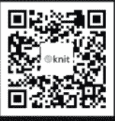
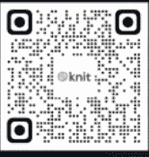

# 时政要闻

# 第三季度全国规上工业企业利润同比增7.7%

国家统计局10月27日发布的数据显示，第三季度，全国规模以上工业企业利润同比增长7.7%，在连续五个季度同比下降后首次由降转增，呈加快回升态势。

统计数据显示，前三季度，全国规模以上工业企业实现利润总额54119.9亿元，同比下降9.0%，降幅比上半年收窄7.8个百分点。

（三季度规上工业企业利润增速由负转正）

国家统计局工业司统计师于卫宁表示，总体看，前三季度工业企业利润逐季改善，恢复向好态势趋于明显。下阶段，要加快新型工业化，着力扩大有效需求，不断拓宽企业增收渠道。

（新华社记者 魏玉坤）

# 住房城乡建设部：历史建筑保护利用不应对原住居民进行建筑形态的整体迁移

住房城乡建设部10月25日表示，在城乡建设中加强历史文化保护传承，要留住和延续人们心中的“乡愁”。历史建筑保护利用，不应对原住居民进行建筑形态的整体迁移，要让原住居民能够留下来。

住房城乡建设部有关负责人表示，在城市更新中要完善“城市体检”评估机制，及时发现问题，有针对性地实施更新改造。要系统推进好房子、好小区、好社区、好城区“四好”建设，努力为居民创造更高品质的生活空间。

10月26日，在河北省唐山市海港经济开发区王滩镇农田里，收割机在田间作业（无人机照片）。

# 中东银行为共建“一带一路”提供高质量金融“活水”

作为最早与我国建立合作关系的阿拉伯国家银行之一，中东银行积极为共建“一带一路”提供高质量金融支持。

更新日期：2024年10月21日

# 韩国招聘概况

以下数据仅供参考，您可随时查阅韩国政府部门网站或联系我们以获取最新数据。

| 项目 | 信息 |
|---|---|
| 货币 | 韩元（KRW） |
| 人口 | 5200万（2021年） |
| 首都 | 首尔 |
| 国内生产总值 | 1.7万亿美元（2023年） |
| 经商便利度 | 排名第5位 |
| 语言 | 韩语 |
| 纳税截止日期 | 5月31日 |
| 最低时薪 | 9,860 KRW |
| 工作时间 | 40小时/周 |
| 工资周期 | 每月 |

## 韩国的税款

韩国雇主税：9.755% - 28.355%

韩国工资税：14.945% - 53.945%

工资税中包含员工个人所得税，个人所得税具体的税率和规定可能因收入水平、申报情况、地方法规等因素而异。

# 企业出海韩国的好处

企业选择出海韩国能够带来显著的优势和多重好处，尤其是在科技、创新、市场潜力等方面。首先，韩国是世界主要经济体之一，其市场规模和购买力都相对较高，是一个极具吸引力的投资目的地。得益于稳定的经济发展和消费者对于高品质产品的偏好，许多领域都存在着丰富的商业机会。尤其是在电子科技、时尚、美妆、娱乐及高端制造业方面，韩国市场的消费趋势及需求变化快速，这为进入韩国的企业带来了可观的发展潜力。

与此同时，韩国在技术和创新领域也处于全球领先地位。凭借其强大的科研能力及雄厚的技术基础，韩国拥有众多世界级的企业和科研机构，是众多企业合作研发和创新的理想之地。例如，三星、LG等企业不仅仅是电子产品的制造商，更是全球科技创新的引领者。外资企业进入韩国后，可以与这些龙头企业建立合作关系，促进技术交流及提升产品竞争力。此外，韩国政府及地方政府也积极推动科技园区和创新中心的建设，为外资企业提供技术合作、研发支持及资金补贴。

从政策支持和税收优惠来看，韩国政府非常重视吸引外资进入本国市场，不断推出各种鼓励政策。外资企业可以在特定产业领域获得税收减免、投资补助以及法律上的支持和保障。这些政策的目的不仅在于吸引外资流入，还旨在增强韩国本土产业的竞争力，推动经济的持续增长。这对于那些希望进入韩国市场的企业而言，无疑是一项重要的利好。

中韩建交31年来，两国经贸关系发展迅速，在贸易、投资、产业合作等领域取得了令人瞩目的成就。中国是韩国最大的贸易伙伴国，韩国也于2022年成为中国的第二大贸易伙伴国。此外，中韩两国在文化、历史及生活习惯方面有许多相似之处，这种文化上的相通性使得中国企业更容易了解韩国消费者的需求和偏好，进而制定更具针对性的市场策略。与其他西方国家相比，韩国消费者对中国文化的接受度较高，尤其在饮食、时尚及传统文化领域，目前已有多家中国企业在韩国市场受到热烈追捧。因此，中国企业在产品宣传、品牌定位及营销沟通上更容易找到契合点，能够更快速地切入并融入当地市场。

韩国本土产业集群高度集中，产业链完善也是企业选择出海韩国的重要原因之一。以半导体、汽车制造及电子产品为例，这些产业集群不仅集中度高、发展成熟，还能够为进入市场的企业提供完整的配套服务及资源整合机会。企业可以在韩国找到上下游配套企业，形成互利共赢的产业链合作模式，从而有效降低生产及物流成本，提升整体运营效率。

基础设施方面，韩国拥有全球领先的物流和交通系统。无论是港口、机场还是信息通信基础设施，韩国的设施配备都处于世界领先水平。高效的物流及信息传递系统能够帮助企业快速实现产品的流通及信息的共享，为跨国企业的供应链管理及市场运营提供了坚实的基础保障。这种高效的基础设施优势，为企业的全球业务运作提供了稳定的支撑。

企业选择出海韩国，可以充分利用其市场潜力、技术创新等优势，实现业务的稳步扩展与长远发展。凭借稳定的经济发展、政策支持和中韩两国良好的经贸关系，韩国为中国企业提供了一个充满潜力且友好的投资环境。

# 企业出海韩国的招聘挑战

首先，语言和文化差异是一个无法忽略的挑战。韩语作为韩国的官方语言，在日常工作和商业交流中扮演着重要角色。尽管越来越多的韩国年轻人具备一定的英语能力，但语言依然是外资企业招聘过程中需要重点考虑的因素之一。此外，韩国的职场文化深受其社会传统影响，这可能与外资企业普遍采用的扁平化管理模式形成反差。因此，企业在招聘时，需要特别关注候选人是否具备良好的跨文化交流能力，并能够在不同文化背景下快速适应和融入。

在某些特定行业，如信息技术、人工智能以及高端制造业等，韩国对本地化高端专业人才的需求非常大，但市场上的人才供应却相对紧张。对于外资企业而言，要找到在专业技能和本地化经验上都满足要求的候选人可能并不容易。加之本土企业（如三星）在韩国市场长期积累的品牌声誉与人脉关系，外资企业在招聘中往往不占优势。因此，外资企业在招聘时，不仅需要制定有竞争力的薪资福利方案，还需在企业文化和职业发展上做出差异化定位，以提升对优秀本地人才的吸引力。

此外，韩国的雇佣法规对于劳动合同、员工福利、薪酬支付及解雇程序等都有非常严格的规定。外资企业在进入韩国市场时，若对当地的法律法规缺乏充分了解，可能会在招聘及用人过程中面临合规性风险。例如，在韩国，解雇员工需要具备合理且合法的理由，并经过一定的程序，否则可能会导致企业面临法律诉讼或经济赔偿。这就要求企业在招聘和管理过程中格外谨慎，确保所有雇佣合同及用人政策完全符合当地法律要求，以规避潜在的法律风险。

整体来看，企业在韩国的招聘挑战不仅限于语言和文化，还涉及到人才市场供需、企业吸引力以及合规问题。企业在制定招聘策略时，应综合考虑这些因素，并尽可能借助当地的专业咨询机构或人力资源服务公司，以提升招聘效率和人才质量，从而在激烈的市场竞争中脱颖而出。

万领钧Knit People提供一站式名义雇主与全球薪酬管理解决方案。通过Knit，您可以轻松解决雇佣当地员工和海外薪酬发放等合规问题。

# 韩国名义雇主

在韩国，名义雇主在法律上是雇员的雇主。名义雇主负责所有韩国雇佣合规事宜，包括薪资、税务、法定福利、雇佣合同等。

## 名义雇主负责

- Knit平台可根据您的独特需求进行定制
- 雇用和重新组建跨境团队成员
- 确保他们的就业符合当地就业法律规定
- 为团队提供有竞争力的福利选择
- 处理当地工资单
- 申报与就业相关的税款和报表
- 向员工发放工资单
- 以当地货币发放工资

## 名义雇主如何运作

**公司**

与员工保持直接联系，为他们分配工作任务，并管理他们的工作表现。

**Knit平台**

管理薪资、税收和福利，确保员工和公司遵守所有法律规定。

**员工**

作为协议中的第三方，员工履行其在公司中的所有相关义务。

# 韩国的雇主缴税

以下的福利被视为雇主需要缴纳的强制性雇员福利：

雇主税：9.755% - 28.355%

- 国民年金：4.5%
- 国民健康保险：3.545%
- 就业保险：1.15% - 1.75%
- 工伤赔偿保险：0.56% - 18.56%

以上为最新数据，需注意数据会根据政府政策更新和调整，您可随时查阅韩国官方网站或联系我们以获取最新数据。

## 国民年金（NP）

国民年金的参保对象是指参加国民年金的单位中年满18岁至未满60岁的雇主或劳动者。单位是指雇佣1名以上劳动者的单位或驻韩外国机构，在雇佣1名以上韩国国民作为劳动者的单位工作的年满18岁未满60岁的雇主或劳动者，理所当然属于单位参保人。因此，如果地区参保人进入单位就业，将自动成为单位参保人，同时丧失地区参保人资格。

雇主需要缴纳相当于工资4.5%的份额。员工也需要缴纳相当于其工资4.5%的金额。因此，总缴费率为每年工资的9%，雇主和员工均分9%的缴费。2024年7月至2025年6月期间，国民年金缴款上限为月薪6,170,000 KRW，下限为390,000 KRW（每年7月都会更改）。

年金保险费的缴纳期限为次月10日。该缴纳期限为法定期限，期限内未按时缴纳年金保险费会产生滞纳金。

参保人（雇主）自取得参保人资格之日的次月起至丧失参保人资格之日的前一日当月为止，必须每月缴纳年金保险费。如参保人取得资格之日为当月1日或取得任意继续参保人资格，可根据参保人本人意愿，自取得资格之日当月开始缴纳。

咨询保险费缴纳事宜：国民健康保险公团客服中心1577-1000（中文服务为033-811-2000）。

计算方式：年金保险费 = 参保人的标准月收入* × 年金保险费率（*为计算保险费和年金补贴，从参保人申报的月收入中扣除不足1000 KRW的零头）。

## 国民健康保险（NHI）

韩国的国民健康保险缴纳分为两个部分：健康保险费率为7.09%，长期护理保险费率为0.9182%。雇主需承担的保险费为3.545%。

截至2024年，保险费计算方法如下：

健康保险费 = 月收入 × 健康保险费率（7.09%）

月收入是指同一工作场所当年支付的报酬总额除以工作月数。

长期护理保险费 = 健康保险费 × 长期护理保险费率（0.9182%）/健康保险费率（7.09%）

根据韩国国民健康保险局（NHIS）的规定，医疗保险费减免类型和减免率如下所示：

- 外籍人士减免：雇员保费的50%（如在韩国有家属）
- 偏远岛屿与边境地区的减免：雇员保险费的50%
- 军人减免：保费的20%
- 休职者的减免：雇员保险费的50%（育儿休职者的保险费可减至工资月额保险费的下限）
- 连续投保雇员酌情减免：投保人保费金额的50%

如果扣减类型重叠，最高扣减率为50%（育儿假除外）。

## 就业保险（EI）

就业保险是一种社会保障保险，通过稳定就业和职业能力开发计划等，预防失业，促进就业，培养和提高劳动者的职业能力。它向劳动者支付失业时生活所需的补贴，保障劳动者生活的稳定，促进劳动者的求职活动。缴纳就业保险的义务因纳税人的国籍和签证类型而异。一般而言，持有D-7、D-8和D-9（贸易管理）签证的外国人必须缴纳就业保险。根据社保互免政策，如果外籍员工的祖国不要求韩国国民强制缴纳该国同等的社会保障金，则来自某些国家的外国人可免于缴纳就业保险。

目前，从2022年7月起，雇主缴纳的就业保险费率则根据雇员人数和行业类型从1.15%到1.75%不等。换言之，除了缴纳0.90%的就业保险外，雇主还需要缴纳0.25%~0.85%的就业稳定保险和职业能力发展保险。

## 工伤赔偿保险（WCI）

WCI计划是一项社会保障计划，旨在及时、公平地补偿遭遇工作相关事故的工人所遭受的伤害或疾病，并从而促进其康复并重返社会。雇主，而不是其工人作为受益人，必须注册加入WCI计划。任何拥有一名或多名全职工人的工作场所都必须强制纳入WCI，无论其所有者（即雇主）的意图如何。

只有雇主才有义务向工伤保险缴纳保险费。缴费率由社会保障办公室根据工作环境确定（目前为工资总额的0.56%至18.56%，具体取决于行业类型）。

## 其他福利

虽然法律没有强制规定，但许多雇主会选择为员工的额外福利缴费，如健康和福利计划、交通补贴、膳食补贴、住房支持、弹性工作、团队建设等。

# 韩国的雇员缴税

在韩国，雇员有责任缴纳以下几种税费，包括：

雇员工资税：14.945% - 53.945%

- 国民年金：4.5%
- 国民健康保险：3.545%
- 就业保险：0.90%
- 个人所得税：6% - 45%
- 地方所得税：参考下述详情

## 国民年金（NP）

员工需要缴纳相当于其工资4.5%份额的国民年金。

年金待遇的种类有：

### 1. 老龄年金

- 老龄年金是国民年金的基本年金待遇，随着国民年金参保人年老，无法从事收入活动时，为维持生活稳定和增加福利而支付的年金，参保时间（年金保险费缴纳时间）10年以上，年满60岁（早期老龄年金：55岁）起终身每月支付。
- 根据收入活动决定老龄年金：月均收入超过国民年金全体参保人月均收入时，按照不同收入区间，最长5年减额支付（适用于2015年7月29日后取得的领取权）。每月减额不超过每月年金金额的1/2。
- 老龄年金领取人可以延缓每月领取年金的全部或部分（50%、60%、70%、80%、90%）金额，如申请延缓支付，延缓期间每年加算7.2%（每月0.6%）支付。需要注意的是，根据出生年份，从支付年龄算起最多可延长5年。

### 2. 残疾年金

- 残疾年金是指参保人或曾经参加过国民年金的人员因疾病或受伤导致身体或精神残疾，为补足收入减少部分，保障本人及其家属生活稳定而支付的补贴，根据残疾程度（1级~4级）支付一定的补贴。

### 3. 遗属年金

- 遗属年金是指参加国民年金一定时间或领取老龄年金、残疾等级2级以上残疾年金的领取人死亡时，为了让依靠领取人维持生计的遗属生活稳定，根据参保时间，在一定比例的基本年金基础上追加抚养家属年金支付的一种年金。

### 4. 一次性返还金

- 一次性返还金是指因年满60岁、死亡、丧失国籍、移居国外等原因，无法继续参加国民年金，因此无法满足年金领取条件时，以前缴纳的保险费加上利息一次性支付的补贴。

### 5. 重复领取年金的调整

- 发生同一人同时领取两份以上的年金时，按领取人的选择仅可支付一份年金，其余的年金则会全部或部分停止支付。

根据《国民年金法》第121条和第122条规定，针对生活在韩国以外国家的国民和外国人国民年金领取人，于每年生日所属的季度定期确认国民年金领取权是否发生变化。如资料提交截止日（生日所属季度的第二个月）前未提交领取权确认资料，将暂停支付年金。暂停支付超过2年，无法确认领取权时，将停止支付包含暂停期间在内的国民年金。停止支付期间的国民年金今后不再补发。

居住在韩国的外国人必须与韩国人同等参加国民年金。

- 外国人单位参保人：在适用国民年金的单位工作的满18~60周岁外国人雇主或劳动者
- 外国人地区参保人：居住在韩国满18~60周岁的外国人且非单位参保人

## 国民健康保险（NHI）

自2024年起，雇员需承担3.545%的国民健康保险。

健康保险福利是指依照法律规定，为服务对象及其家属的疾病、伤害的预防、诊断、治疗、康复、生育、死亡以及促进健康等以物品或者现金形式提供的服务。保险给付分为实物给付和现金给付。保险福利有以下几种类型：

- 疗养补贴，受益人为参保雇员及其家属
- 健康检查，受益人为参保雇员及其家属
- 疗养费，受益人为参保雇员及其家属
- 残疾人辅助器具，受益方为在参保雇员及其家属中，根据《残疾人福利法》登记的残疾人
- 自付费用限额系统，受益人为参保雇员及其家属
- 怀孕及分娩医疗费用，受益人是怀孕和分娩医疗费用的领取者，即健康保险加入者或已确认怀孕或分娩（包括流产或死产）的家属

实物赔付包括疗养补贴和健康检查两种：

疗养补贴指的是参保人遭遇疾病、负伤等情况时，支付在医疗机构接受疗养的费用。其中包括诊察、检查、诊疗材料、治疗、手术、预防、康复、住院、看护及陪护、移送等。

健康检查指的是在健康体检确认时，疗养补贴费用总额中没有本人负担金（仅适用于医院/诊所）。癌症检查种类：胃癌、大肠癌、乳腺癌、肝癌、宫颈癌、肺癌筛查。体检费用承担份额为：国民健康保险局（NHIS）90% + 本人10%（但大肠癌和宫颈癌的检查费用由健康保险局全额负担）。癌症检查对象中，健康保险费征收金额（前一年11月）低于健康保险费中位数的国家癌症检查项目对象、医疗补助领取者无需负担检查费用。

在参保人或被抚养人发生紧急或其他不得已的事由时，NHIS作为和疗养机构作用类似的机构，对在保健福祉部令规定的机构因疾病、负伤、生育等事由接受疗养，或在并非疗养机构的地方生育的情况，支付相当于其疗养补贴的金额作为疗养费。现金赔付包括疗养费、超过本人负担上限金额的补偿、残疾人辅助设备补助以及怀孕/分娩诊疗费四种类型。

在下面几种情况下，参保人可获得疗养费用：

- 慢性肾衰竭患者按照医师的处方进行自动腹膜透析时，在医疗机构以外的医药品销售处购买使用的腹膜灌流液或耗材的情况
- 参保人或其被扶养人在疗养机构以外的地方生育的情况
- 需要氧气治疗的患者按照医师的处方，在保健福祉部令规定的经营场所接受氧气治疗的情况
- 神经性膀胱患者按照医师的处方，在医疗报销机构以外的医疗器械销售处购买居家导尿用耗材（导管等）的情况
- 糖尿病患者购买糖尿病耗材（血糖测试纸、胰岛素注射器等）的情况
- 作为患有保健福祉部长官规定并告示的疾病的人，需要人工呼吸机及/或咳痰机的患者按照医师的处方，租赁并使用人工呼吸机或咳痰机的情况

为减轻高昂的医疗费造成的家庭负担，患者负担的健康保险自付金额超过本人上限时，由健康保险公团承担超出金额的制度。但是，非补助对象、选择性补助对象、全额本人负担、种植牙、高级病房（2~3人间）住院费、推拿、上级综合医院轻症疾病门诊初、复诊本人部分负担金额等除外。

根据《残疾人福利法》注册登记的残疾人用户及受抚养人购买残疾人辅助设备时，购买部分金额由NHIS支付保险金的制度。有权领取辅助设备保险金的人，根据其他法令可以领取与辅助设备相当的金额（国家有功者、工伤对象、长期疗养医保人员等）时，残疾人辅助设备保险金的申请受限。由NHIS承担基准金额、公示金额和购买金额中最低金额（支付基准金额）的90%（公示产品有：电动轮椅、医用踏板车、姿势辅助用具、移动式电动升降机、防褥疮坐垫、防褥疮床垫、助听器）。

此外，还存在怀孕、生育诊疗费帮扶制度。帮扶对象为：

- 确认怀孕、生育（包括流产、死胎）的健康保险加入者或被扶养者
- 2岁以下婴幼儿的法定代理人（仅限加入了健康保险的生育者或被扶养者死亡的情况）
- 满19岁以下的青少年产妇可同时申请政府的“青少年产妇怀孕、生育医疗费补助”

帮扶金额也有所不同：

- 单胎怀孕每次100万KRW（多胎140万KRW）
- 申请时如居住于分娩条件较差地区*且连续居住30天以上的孕妇，追加支援20万KRW（*分娩条件较差地区：以卫生福利部《分娩条件较差地区帮扶项目指南》所规定的分娩条件较差地区为准，每年可能会有变动）
- 青少年产妇：每次怀孕帮扶120万元以下（与健康保险怀孕、生育诊疗费的支付不冲突）

2024年1月1日开始施行怀孕、分娩诊疗费多胎儿追加支付申请。追加支付申请对象：是2024年1月1日以后怀孕周数20周以上的多胎儿怀孕中或生育多胎儿的孕妇（施行日前凭证申请者也可以申请追加支付）。

追加支付金额：2胎儿追加60万KRW，3胎儿追加160万KRW，4胎儿追加260万KRW，5胎儿以上每个胎儿追加100万KRW。

本报告来源于三个皮匠报告站（www.sgpjbg.com），由用户ID:262617下载，文档ID:178386，下载日期：2024-10-22

###我是由月之暗面（Moonshot AI）研发的 kimi-k2.7-code 智能大模型。医疗补助申请方式

如果雇员想享受医疗福利，必须向医疗机构提交他的健康保险证或身份证。领取医疗补助时未提交的，自领取医疗补助之日起14天内提交医保卡或身份证的，视为当时已提交申请医疗福利。

如果雇员无法出示健康保险证或身份证，可以向本公司申请资格验证，本公司收到请求后将核实雇员是否符合资格，并向他发送《健康保险资格确认通知书》。

## 就业保险（EI）

在韩国，雇员需缴纳的就业保险为0.90%。

韩国的就业保险即为失业保险，它通过就业稳定、职业能力开发项目等，预防失业、促进就业及开发和提高劳工的职业能力，在劳工失业时支付生活所需的津贴，保障劳工的生活稳定和促进求职活动的社会保障保险。《就业保险法》规定了就业保险项目的内容，包括就业稳定、职业能力开发项目和失业津贴、女性保护津贴。就业保险投保相关事宜请详见韩国就业保险在线服务系统。

## 个人所得税

下面是2024年韩国个人所得税税率：（单位：KRW）

【税率计算方法】收入×税率-累进扣除额

例如：收入30,000,000 KRW × 税率15% - 1,260,000 KRW = 3,240,000 KRW

| 收入（超过） | 收入（未超） | 税率（%） | 累进扣除 |
| --- | --- | --- | --- |
| - | 14,000,000 | 6 | - |
| 14,000,000 | 50,000,000 | 15 | 1,260,000 |
| 50,000,000 | 88,000,000 | 24 | 5,760,000 |
| 88,000,000 | 150,000,000 | 35 | 15,440,000 |
| 150,000,000 | 300,000,000 | 38 | 19,940,000 |
| 300,000,000 | 500,000,000 | 40 | 25,940,000 |
| 500,000,000 | 1,000,000,000 | 42 | 35,940,000 |
| 1,000,000,000 | - | 45 | 65,940,000 |

\* 以上为韩国最新个人所得税数据，需注意适用标准和税率可能会根据韩国税法的更新而有所变化，建议您随时查阅韩国官方网站或联系Knit专业的税务顾问，帮助您获得准确的指导和建议，确保您遵守相关法规和规定，以避免可能的处罚或罚款。

## 地方所得税

除上述个人所得税外，还有按个人所得税税率10%征收的地方所得税。个人所得税(PIT)是缴纳给国家税务局(NTS)，而地方所得税是向纳税人居住地所在的城市或省份缴纳的。

下面是2024年韩国地方税（综合所得）税率：（单位：KRW）

| 收入（超过） | 收入（未超） | 税额及税率 |
| --- | --- | --- |
| - | 14,000,000 | 0.6% |
| 14,000,000 | 50,000,000 | 84,000 KRW + 超出1,200万KRW部分的1.5% |
| 50,000,000 | 88,000,000 | 624,000 KRW + 超出4,600万KRW部分的2.4% |
| 88,000,000 | 150,000,000 | 1,536,000 KRW + 超出8,800万KRW部分的3.5% |
| 150,000,000 | 300,000,000 | 3,706,000 KRW + 超出1.5亿KRW部分的3.8% |
| 300,000,000 | 500,000,000 | 9,406,000 KRW + 超出3亿KRW部分的4.0% |
| 500,000,000 | 1,000,000,000 | 17,406,000 KRW + 超出5亿KRW部分的4.2% |
| 1,000,000,000 | - | 38,406,000 KRW + 超出10亿KRW部分的4.5% |

# 韩国的入职规定

# 韩国的工作时间

韩国的就业和劳动部对雇员的入职与工作安排做出了详细且严格的规定，这些规定旨在确保员工的权益得到充分保障，营造一个公平、健康和安全的工作环境。

## 韩国的最高工时和加班法

以下是与韩国最高工时和加班有关的主要内容：

### 最高工时

全职工作人员五人以上的工作场所，根据韩国《劳动基准法》第五十条规定，每周工作时间不超过40小时（不包括休息时间），每天工作时间不超过8小时（不包括休息时间）。超过40小时按加班处理。

工作时间包括：

- 开始工作前的准备时间
- 工作结束后的整理时间
- 工作日及公休日
- 等待客人的等候时间
- 义务性参加的教育（雇主是否提供、支付各种费用）

此外，根据该法第53条，如果双方同意，工作时间最多可以延长至每周12小时。

该法第54条规定，雇主在工作时间为4小时时，必须提供至少30分钟的休息时间；在工作时间为8小时时，必须提供至少1小时的休息时间，工人可以自由利用休息时间。休息时间不包括在劳动时间内，不支付工资。

该法第59条规定，对于属于以下任何一项的企业，如果雇主与雇员代表达成书面协议，则可根据第53条要求雇员每周加班超过12小时，或根据第54条改变休息时间：

- 货物运输、销售和储存
- 金融和保险业务
- 电影制作
- 电信
- 教育研究和调查
- 广告业务
- 医疗和卫生业务
- 酒店
- 焚化业务
- 清洁业务
- 休闲业务
- 总统令规定的其他任何为公共便利或业务性质所必需的业务

### 加班工资

加班工资指的是超出正常工作时间工作的人支付的津贴。工作时间不得超过每周12小时，但经双方同意可延长最多12小时。如果有特殊情况，经劳工部长批准并征得工人同意，雇主可以延长工作时间。但如果情况紧急，来不及获得劳工部长的批准，则必须立即获得批准。如果劳工部长认为延长工作时间不合适，他可以命令给予相当于延长时间的休息或假期。

根据韩国工会联合会的规定，非节假日的加班费按1.5倍计算。

即：加班工资=加班时间×正常小时工资×1.5倍

然而，节假日加班不支付两次加班费，不足8小时的按正常小时工资的50%加发，超过8小时的按正常小时工资的100%加发8小时。

夜班是指晚10点到早6点的工作，也应加算50%的工资。公休日劳动指在法定公休日(周休日、劳动节)或约定公休日的工作，与加班和夜班劳动同样，加算50%的工资。加班、夜班、公休日劳动重复时，应分别重复加算工资。

例如：雇员A的时薪为6,000 KRW，1天工作9小时(21点至次日07点，夜班中间休息1小时)

则他的工资为：(6,000 KRW×8小时)+(6,000 KRW×1小时×1.5倍)+(6,000 KRW×7小时×0.5倍)=78,000 KRW

## 雇佣合同

在韩国，雇佣合同可以有多种形式，包括无固定期限合同、固定期限合同、短期兼职雇佣合同、日工雇佣合同、青年雇佣合同等。

韩国就业和劳动部规定，如果雇主不签订书面雇佣合同，将处以最高500万KRW的罚款。

雇佣合同必须载明工资、工作时间、假期、年假、带薪休假等。具体可以参考下面标准雇佣合同格式：

1. 雇佣合同期限：从年、月、日到年、月、日（如果没有雇佣合同期限，则仅输入“工作开始日期”）
2. 工作地点：指定工作地点
3. 工作内容：描述一下雇员要做什么
4. 规定工作时间：整点至分钟（休息时间：整点至整点）；劳资双方规定在法定工作时间内（每天8小时，每周40小时）休息时间为每4小时30分钟，或8小时以上1小时
5. 工作日/节假日：每周（或每天）工作日，每周节假日；指定雇员将在一周中的哪一天工作，并确定并指定如果雇员完成一周中的一天，则授予的带薪假期（平日假期）将在一周中的哪一天
6. 工资：\_\_月（日、时）工资：\_\_\_\_\_\_\_\_\_\_\_\_\_\_\_\_ KRW；如果有奖金，请注明具体内容和金额
7. 其他福利（津贴等）：如果有需要支付的津贴，如家庭津贴、认证津贴等，请写下相关详情
8. 工资支付日期：每月\_\_\_\_\_\_\_（每周或每日）（如遇节假日，则前一天支付）
9. 付款方式：直接付款给雇员或是存入工人名下的储蓄账户（是否通过银行账户支付工资等由劳资双方协商后填写）
10. 带薪年假：根据劳动基准法规定，享有带薪年假。一年内工作时间达到或超过计划工作日总数80%的雇员，带薪年假为15天，超过1年后每2年加1天，最多不超过25天；工作时间不足1年或一年内工作时间不足80%的雇员，每出勤1个月，可享受1天的补贴
11. 社会保险的适用性（勾选相关方框）：□就业保险 □工伤保险 □国民年金 □健康保险
12. 劳动合同的签发：劳动合同签订后，无论劳动者是否要求签订，用人单位均复印本合同并发给劳动者（适用劳动基准法第十七条）
13. 忠实执行劳动合同、劳动规则等的义务：雇主和劳动者必须遵守并忠实执行劳动合同、劳动规则和集体协议
14. 其他
15. 签名与签订日期：日期（年月日）；企业名称（电话）；地址；代表签名；雇员地址；联系方式；雇员签名

用人单位聘用签订固定期限劳动合同的劳动者时，应当制作劳动合同(固定期限)劳动台期限的法定期限最长为2年。如果劳动合同期限超过2年，将会被归类为无限期合同。

对于短期兼职劳动合同，兼职工人必须以书面形式明确《固定期限工人和非全日制工人保护法》等第17条（工作条件书面声明）规定的事项，并且如果工作违反本规定，未书面规定条件的，可处以500万KRW以下的罚款。同时，对于每周规定工作时间少于15小时的工人，所谓的超短时工、周假日、周假日工资、带薪年假、遣散费等不适用，因此起草劳动合同时，可以根据内容进行修改。

日工雇佣合同属于非常规劳动合同，但日工劳动合同连续签订2年以上的，可以转为无固定期限雇佣合同。请注意，如果临时工每周工作超过15小时，则可能需要享受每周假期和每周假期工资。同样，在日工雇佣合同中，必须以书面形式规定并交付基本的工作条件。

与青年工人签订雇佣合同时，必须填写父母（监护人）同意书并保存在工作场所。同时，雇佣15岁以下的人员（包括18岁以下正在上中学的人员）时，只有持有雇佣劳动部长官颁发的就业许可证的人必须签订雇佣合同。雇主还必须根据《劳动标准法》第67条（雇佣合同）向年轻工人签发雇佣合同副本。如果不签发年轻工人雇佣合同，可能会被处以最高500万KRW的罚款。

## 试用期

韩国的劳工法对试用期并未作出具体规定。一般来说，试用期为3个月，但根据工作的特殊性，如果劳动者和用人单位同意，可以延长试用期或设定3个月或更长的试用期。

根据劳工标准法第26条（解雇通知）规定，雇主解雇雇员，必须提前30天通知，如未通知，则必须支付解雇费30天正常工资。然而，有一项例外条款规定“如果工人连续工作少于3个月”，因此即使雇主在3个月内解雇工人，他或她也没有义务支付正常工资，即入职不满3个月的员工可以立即解雇。

另外，根据《最低工资法施行令》（试用期劳动者最低工资）第3条规定，试用期不满3个月的，扣除每小时最低工资的10/100，据解释，该工人的最低小时工资是根据工资数额计算的。也就是说，在3个月的试用期内，有可能支付90%的工资。

虽然相关法律的标准都是3个月以内，但用人单位和劳动者都必须充分了解试用期内支付最低工资90%、解雇的条件、各种津贴的适用等必要事项。

# 韩国的工资支付条例

## 韩国雇员薪酬条例

### 最低工资

韩国就业劳动部2024年适用最低工资为每小时9,860 KRW，月薪为2,060,740 KRW（按每周工作40小时、每月工作209小时计算）。

### 发薪频率

大多数韩国公司采用按月支付工资的制度，这种形式在韩国劳动市场中占据主流地位。通常，企业会选择每月的25日或月底作为发薪日，以保障工资发放的固定性和可预测性。尽管工资主要是按月支付，但某些津贴或临时性支付可以不受这一规则的限制。此外，总统令规定的一些特殊工资也不包括在必须按月支付的范围内。

### 工资单

在韩国，工资单的发放是雇主的法定义务，雇主必须向员工提供详细的工资单，以清晰记录工资的构成和扣除项。工资单对于劳动者了解自己的收入和扣款情况非常重要，并且有助于确保工资支付的透明性和合法性。

工资单的主要内容包括：

- 基本信息：工资单上会列出员工的基本信息，例如姓名、职位、部门、工号以及工资支付的时间段。这些信息确保工资单是针对特定员工的，且涵盖了正确的工资计算周期
- 基本工资：这是员工的基础收入，通常不包括任何附加津贴或奖金。基本工资的金额根据员工的合同约定和工作岗位决定，是工资的核心部分
- 加班费和津贴：如果员工有加班，工资单上会单独列出加班费，并注明加班的时数和支付的金额。韩国法律规定加班费需要按照基本工资的1.5倍支付。此外，其他津贴（如交通补贴、餐费补贴等）也会被清楚列出
- 奖金：如果有年度或季度奖金，工资单上会显示具体的奖金金额和发放原因
- 扣款项目：这部分列出了各种扣款，包括所得税、地方税、健康保险、国民养老金、雇佣保险和工伤保险等。每一项扣款金额都会明确显示，确保员工了解每项扣款的具体数额和用途
- 净工资：这是员工在所有扣款之后实际拿到手的金额，通常是员工最关注的部分。净工资金额清楚地反映了员工的实际可支配收入

工资单在韩国的劳动关系中扮演着重要的角色，因为它不仅是员工对其薪酬和福利的记录，也是劳动者维护自己权益的法律凭证。如果员工对工资单中的项目有疑问或发现任何不当的扣款，他们可以要求雇主解释，甚至可以通过劳动仲裁寻求帮助。

在设立工资单时，您的公司有几种选择：

- 自行处理工资：您可以通过成立韩国的分公司来处理工资事宜，招聘财务人员来管理分公司内部的工资发放。然而，这需要投入大量的时间和资源，以了解和遵守当地税收和工资法规
- 与Knit全球EOR名义雇主合作：Knit作为名义雇主，提供一站式薪酬发放解决方案，负责处理您的所有工资发放和合规事宜，减轻您的薪酬计算和薪酬发放的负担，这样您可以将精力集中在核心业务上

## 在韩国雇主常见的违规风险和处罚

在韩国，雇主在工资支付和劳动法执行过程中如果存在违规行为，可能会面临一系列法律风险和处罚。韩国的《劳工标准法》及相关法律严格保护劳动者的权益，因此如果雇主违反这些法律，可能会受到法律惩罚和经济损失。以下是韩国雇主常见的违规风险及其相应的处罚：

- 工资支付不及时或拖欠工资：在韩国，工资必须按时在每个月的固定日期支付。如果雇主延迟或拖欠工资，可能面临处罚。根据法律，雇主如果没有在规定的时间内支付工资，劳动者可以向劳动部投诉，雇主将被要求支付延迟利息，通常为拖欠工资的20%。此外，如果雇主长期拖欠工资，可能被处以最多3年的有期徒刑或最高3000万KRW的罚款
- 未支付加班费：《劳工标准法》规定，员工的每周工作时间不得超过40小时，超过此时间的工作必须按照1.5倍的工资标准支付加班费。如果雇主未支付加班费，属于违反劳动法的行为。劳动者可以通过法律途径要求雇主支付未付的加班费，并索赔相应的利息和赔偿金。如果雇主多次拒绝支付加班费，可能会被罚款最高至2000万KRW，或面临最多两年的有期徒刑
- 非法解雇：雇主在解雇员工时必须提前30天通知或支付等同于30天工资的解雇补偿金。如果雇主未经通知或未支付相应补偿金而非法解雇员工，员工可以提起复职诉讼或要求赔偿金。如果雇主被认定非法解雇员工，法院可能要求雇主支付多达员工数月工资的赔偿金，此外还可能受到法律制裁
- 未支付法定最低工资：韩国政府每年都会更新最低工资标准。2024年的最低工资为每小时9860 KRW。如果雇主支付的工资低于法定最低工资标准，将被视为违法行为。员工有权向劳动部投诉，要求补发不足部分的工资，并追讨补偿金。违反最低工资法的雇主可能面临最多3年的监禁或最高2000万KRW的罚款
- 违反工作条件协议：根据《劳工标准法》，雇主必须在劳动合同中明确员工的工作条件，包括工资、工作时间、休假等。如果雇主在签订合同后随意改变工作条件或未遵守合同规定，员工有权终止合同并要求赔偿。违反这一规定的雇主将面临罚款，最高可达500万KRW
- 违反工时和休假规定：韩国法律对工时和休假有明确规定，员工每周最多工作40小时，每天工作超过8小时需支付加班费。此外，雇主必须给予员工法定的带薪年假。如果雇主要求员工超时工作而不支付加班费，或未给予法定休假，员工可以向劳动部门投诉。雇主可能被处以最高至2000万KRW的罚款，或面临两年以下的监禁
- 性别歧视或职场骚扰：《男女雇用平等法》和《职场骚扰法》禁止任何形式的性别歧视、性骚扰或职场欺凌。如果雇主或管理层存在性别歧视或未能处理职场骚扰事件，雇主可能会面临劳动部门的调查，并可能被处以高额罚款。性骚扰行为将导致雇主或相关责任人面临最多两年的监禁或最高1000万KRW的罚款

韩国雇主如果违反《劳工标准法》或其他劳动相关法律，可能面临罚款、监禁、以及员工的法律诉讼等风险。因此，雇主需要严格遵守工资支付、加班费、工作时间等相关规定，避免法律纠纷和惩罚。同时，定期审查和更新雇佣合同，确保其符合法律要求，是降低风险的重要措施。

## 韩国的工资支付形式

雇主可以通过支票或现金支付劳动者的工资，但现在更多企业倾向于通过银行转账支付，以确保支付过程的便捷和记录的透明性。需要注意的是，劳动者有权在工资支付日前申请提前支付已经劳动部分的工资，这是法律保障的员工权益之一。这种安排为劳动者在紧急情况下提供了财务保障，确保他们能够在需要时提前获取部分收入。同时，工资必须以在韩国不受限制使用的货币进行支付，即只能以KRW支付，不能用雇主生产的产品或其他形式的非货币手段支付。这一要求进一步确保了劳动者能够获得合法、可使用的薪酬保障。

## 韩国的奖金条例

在韩国，奖金的发放通常是企业根据内部政策或与员工签订的劳动合同或集体协议来决定的，法律并没有明确规定雇主必须发放奖金。许多韩国公司尤其是大型企业，通常会设立各种形式的奖金制度，以激励员工，并作为薪酬福利体系的一部分。奖金是指用人单位除每月工资以外，按季或者按一定期限一次性支付给劳动者的金钱和贵重物品。以下是一些常见的奖金类型：

### 年终奖金（十三薪）

韩国公司最常见的奖金形式之一是年终奖金，通常被称为“十三薪”。这是一种在年底或年初发放的额外工资，通常相当于员工一个月的基本工资。虽然年终奖金并不是法律强制要求的，但在许多公司尤其是金融、制造业和大企业中，年终奖金已经成为一种惯例。对于员工而言，年终奖金不仅是一种经济激励，还反映了公司对员工全年工作的肯定。

### 绩效奖金

绩效奖金是根据员工的工作表现和公司业绩发放的奖金，通常是公司激励员工提高工作效率的重要手段。绩效奖金的发放标准和金额可能根据公司内部政策、员工的个人表现和公司整体业绩而有所不同。一般来说，公司会在年中或年末根据员工的KPI（关键绩效指标）评估结果来确定奖金金额。这类奖金并不属于法定要求，完全取决于公司的政策和合同约定。

# 法定奖金

虽然韩国劳动法并没有强制要求雇主发放奖金，但某些情况下，奖金可以作为劳动合同或集体协议中的一部分，变成具有法律约束力的义务。例如，如果企业与员工签订的劳动合同或集体协议明确规定了发放奖金的条件和时间，雇主就必须按规定执行。如果雇主未按合同规定发放奖金，员工可以通过法律途径追讨。

# 特别奖金

许多企业还会根据公司特别表现或特殊事件发放特别奖金。例如，在公司创立纪念日、公司达到特定业绩目标，或是特殊的节假日如春节和中秋节，公司可能会给予员工额外的奖金作为奖励或福利。这类奖金没有固定的发放周期，完全取决于公司的经营状况和内部决策。

# 奖金的税收规定

根据《劳动标准法》，奖金在韩国被视为劳动收入的一部分，因此需按与工资相同的税率缴纳个人所得税。这意味着员工在收到奖金时，雇主会代扣代缴相应的税款，确保符合税法规定。即使奖金是额外的收入，仍然会作为应税收入的一部分进行申报和缴税。

# 韩国热门行业薪资（年薪/KRW）

| 行业类别 | 国家销售总监 | 销售主管 | 销售 |
|---|---:|---:|---:|
| 能源行业 | 100,000,000 KRW–150,000,000 KRW | 70,000,000 KRW–100,000,000 KRW | 50,000,000 KRW–70,000,000 KRW |
| 汽车行业 | 90,000,000 KRW–140,000,000 KRW | 65,000,000 KRW–90,000,000 KRW | 45,000,000 KRW–65,000,000 KRW |
| 医药器械 | 110,000,000 KRW–160,000,000 KRW | 80,000,000 KRW–120,000,000 KRW | 55,000,000 KRW–80,000,000 KRW |
| SaaS 行业 | 110,000,000 KRW–150,000,000 KRW | 75,000,000 KRW–110,000,000 KRW | 55,000,000 KRW–80,000,000 KRW |
| 互联网行业 | 100,000,000 KRW–140,000,000 KRW | 70,000,000 KRW–100,000,000 KRW | 50,000,000 KRW–70,000,000 KRW |
| 传统制造业 | 90,000,000 KRW–130,000,000 KRW | 60,000,000 KRW–85,000,000 KRW | 45,000,000 KRW–60,000,000 KRW |

*以上数据来源于招聘网站，仅供参考。

# 韩国的休假规定

## 韩国的员工休假

韩国的雇员有权享受几种类型的假期，包括雇主批准的休假时间和国家法定节假日。

## 韩国的年假

在常规员工人数超过5人的企业中，如果在4周内平均每周的法定工作时间达到15小时以上，则员工将享有年假。根据第60条（年假带薪休假）规定，在工作不满1年的情况下，每月全勤可享有1天年假（最多11天，自2017年5月30日起适用）；而在1年内出勤率达到80%以上的情况下，则可以享有15天的年假。

此外，对于连续工作3年以上的员工，雇主应当根据超过首次1年的连续工作年限，每2年增加1天带薪假期。在这种情况下，包括增加假期在内的总假期天数不得超过25天。

首先，年假应以入职日期为基准进行计算。但为了方便劳动管理，可以通过集体协议、工作规则等，以会计年度为基准，为所有员工统一确定计算日期；此外，这一计算不得对员工不利。因此，对于年度中入职的员工，必须根据基本假期（15天）进行比例分配，在下一个会计年度开始时给予年假。

例如，若员工在2020年9月20日入职并于2022年1月23日离职，年假将按以下方式计算（假设满足出勤率等年假给予标准）：

以会计年度为基准：

- 根据《劳动标准法》第60条第2项，入职1年内的全勤年假共计11天。
- 2021年1月1日，根据前一年度在职时间比例产生的年假（15天 × 约103天/365天 ≈ 4.2天；需注意这里的工作日数不详，按比例估算）。
- 2022年1月1日，依据《劳动标准法》第60条第1项的年假为15天。

以入职日期为基准：

- 根据《劳动标准法》第60条第2项，入职1年内的全勤年假共计11天。
- 2021年9月20日，依据《劳动标准法》第60条第1项的年假为15天。

如果以入职日期为基准，假设员工于2015年12月15日入职并持续工作，其年假将按以下方式计算（假设满足出勤率等年假给予标准）：

- 2016年12月15日，年假15天（包括不满1年全勤所产生的年假）。
- 2017年12月15日，年假15天，可在1年内使用。
- 2018年12月15日，年假16天，可在1年内使用。
- 2019年12月15日，年假16天，可在1年内使用。
- 2020年12月15日，年假17天，可在1年内使用。
- 2021年12月15日，年假17天，可在1年内使用。
- 2022年12月15日，年假18天，可在1年内使用。

## 韩国的病假

病假是指因疾病导致员工无法上班时使用的假期，这与因工受伤或生病的“工伤”是不同的概念。如果是因工作而受伤或患病，员工可以依据《工业伤害赔偿保险法》获得保护；然而，由于个人原因而造成的伤害或疾病等的病假，在《劳动标准法》中并没有特别的保护规定，因此属于约定假期。《劳动标准法》规定的法定假期包括年假、难孕治疗假、产前产后假、男女雇用平等法下的家庭照顾假、配偶产假等。然而，病假等约定假期并没有在法律中具体规定，因此在企业内部的工作规则、集体协议等人事规定或惯例中运作。因此，如果公司内部没有与病假相关的特殊规定，原则上应视为无薪假期。

法定假期等带薪休假是向员工支付工资的假期，即使员工使用假期也被视为正常工作，因此获得工资保障。相反，病假并非法定假期，而是约定假期。如果公司内部规定中没有关于带薪病假的规定，那么即使包括公共假日或带薪休假，原则上也不应向员工支付工资。最高法院的判例认为，病假期间视为劳动关系暂停的时期，因此没有支付带薪假期工资的义务（大法院2009年12月24日裁决，2007다73277号）。

韩国劳动部曾明确表示，在以带薪假期为前提下，病假期间包含的带薪周休假，“除非在集体协议、工作规则等中规定了病假期间工资支付的相关条款，或者在当事人之间的约定或惯例中得到认可，否则没有支付工资的义务”。然而，在某些企业的内部人事政策中，有这样的案例：如果对因工作和疾病而产生的病假，承认有关于带薪周休假的规定，或者有惯例上支付的事实，则可以认为该劳动条件有效。因此，除非在病假期间有特殊规定，否则与劳动提供义务和对价关系相关的员工的工资请求权不会产生，公司也没有支付工资的义务。

病假不需要法律上的强制要求或程序，其目的是为了治疗疾病和恢复健康，因此人事部门需要制定病假制度的标准、条件和程序。例如：

- 允许的疾病范围。
- 病假可使用的最长天数。
- 休假延长的期限。
- 病假申请及所需提交的文件等，需在内部管理中具体规定，并提前告知员工，以便员工了解。

通常，在申请病假时，员工需填写公司使用的审批表，并提交诊断书或意见书等相关证明材料，经过最终批准。

然而，即使是无薪病假，员工也不能随意在任何时候使用病假。如果未经人事负责人或相关审批者的批准，擅自使用病假可能被视为无故缺勤，因此人事部门必须明确公司规定并提供必要的申请表格，同时提交所需的文件并获得批准。

在无薪病假的情况下，若雇主与员工达成协议，则可以通过扣减年假来保障带薪病假。然而，若公司擅自将病假期间替换为年假，或要求员工提前使用尚未发生的年假，则可能违反《劳动基准法》（劳动改善政策科-4027）。

## 韩国的产假

雇主必须向孕期女性提供产前和产后共90天（多胎为120天）的产前产后休假。其中，产后必须分配45天（多胎为60天）以上的假期，并且必须连续使用90天。（《劳动标准法》第74条第1款）即：产前44天＋出生当天1天＋产后45天。

如果分娩比预期的晚，未能保证产后45天的假期，雇主也应确保产后有45天的假期保障，但雇主对额外提供的产前产后休假期间没有支付工资的义务。

如果孕期女性员工因流产等原因申请产前产后休假，应该允许其在产前的任何时候将休假分开使用。然而，在这种情况下，产后的假期仍需连续达到45天（多胎为60天）以上。（《劳动标准法》第74条第2款，《实施令》第43条第1款）

- 怀孕员工曾有流产或死产经历的情况。
- 怀孕员工在申请产前产后休假时年龄在40岁以上的情况。
- 怀孕员工提交医疗机构的诊断书，表明有流产或死产风险的情况。

违反上述规定的雇主将面临不超过2年监禁或不超过2,000万KRW的罚款。

（《法律》第110条第1号）

产前、产后休假期间及其后30日内，用人单位不得解雇产前、产后女职工。如果违反该规定而解雇女员工，将被处以5年以下有期徒刑或5,000万KRW以下罚款。如果工人要求支付工资以支付分娩等紧急情况的费用，雇主甚至必须在付款到期日之前支付已经提供的工作的工资。如果违反此规定，紧急情况下不支付工资，将被处以最高1,000万KRW的罚款。产假结束后，雇主必须让雇员重返同一工作岗位或支付与产假前相同工资水平的工作。违反此规定的雇主将被处以最高500万KRW的罚款。

薪资方面，前60天（多胎为75天）为带薪产假，但如果就业中心支付了产前产后假期工资（《男女雇用平等法》第18条），则该金额将被排除在外并予以支付（《劳动标准法》第74条第4款）。对于优先支持企业，政府提供最高210万KRW的支持金，且不足的部分由雇主支付。在最后30天（多胎为45天）期间，政府将支付正常工资，最高可达210万KRW。而对于大型企业，雇主需要支付正常工资。在最后30天期间，政府也将支付正常工资，最高可达210万KRW。值得注意的是，产前产后假期工资中，中小企业主对包括带薪期间在内的90天（多胎120天）全额支持正常工资的100%，而大型企业仅对30天无薪期间提供支持。

产前和产后休假福利的支付申请必须在产前和产后休假开始日期之后的每个产前和产后休假期间以30天为增量提出。但使用期限不足30天的，可以在该期限内申请；如果在假期结束后申请，则可以一次性全部申请。

希望享受产前、产后休假福利的人员，必须附上下列所有文件，并提交给申请人居住地或营业地的就业中心。（本法第75条、同法施行细则第121条第1项）

- 产前产后休假福利申请表（施行细则附表105）。
- 产前产后休假确认书各1份（仅提交一次）（施行细则附表107）。
- 1份确认正常工资的数据副本（工资分类、雇佣合同等）。
- 用于确认雇主在假期期间是否支付金钱或贵重物品的资料。

然而，某些情况下可能无法获得产前产后休假工资：

- **产前产后休假工资限制：**如果女性员工在产前休假期间离开了该企业，那么从离职之日起将不再支付产前产后休假工资；如果在产前产后休假期间，保险人开始了新的工作，那么在此工作期间也将不支付产前产后休假工资；如果有人通过虚假或其他不正当手段申请或试图获得产前产后休假工资，那么从获得该工资的日期或试图申请的日期起，将不再支付该工资。
- **产前产后休假工资的减少：**如果女性员工（保险人）在产前产后休假期间收到了来自雇主的正常工资，相应于雇主支付的款项与产前产后休假工资的总额超过了以产前产后休假开始日为基准的正常工资，那么超出的部分将从产前产后休假工资中扣除。但如果在产前产后休假期间，正常工资上调，而雇主支付了上调后的正常工资与产前产后休假工资之间的差额，则不受此限制。

## 韩国的陪产假

雇员（丈夫）因其配偶怀孕生产可以获得10天的假期。如果希望领取配偶产假工资，需将以下文件全部附上，并提交至申请人居住地或工作地点的管辖就业中心：

- 产前产后休假工资申请表（附件第105号）1份。
- 配偶产假确认书（附件第107条之2）1份。
- 可确认正常工资的资料复印件（如工资账簿、劳动合同等）1份。
- 如果在休假期间从雇主处收到了相当于正常工资的款项，则需提供能够确认的资料。

## 韩国的育儿假

怀孕女职工或育有未满8岁或小学二年级子女（包括收养子女）的所有男女职工（《就业均等及家庭平衡支援法》第19条第1款），可使用最多一年的育儿假（包含在服务期限内）。

育儿假期间（最长1年，男女雇员每名子女可使用1年），仅可分期使用2次。政府支援每月正常工资的80%（最高150万KRW，最低70万KRW）。但是，育儿假结束后返回工作单位并继续工作6个月以上时，一次性支付育儿假补助金的25%（即使无法继续工作也支付，非自愿原因超过6个月）。

雇主不得因育儿假而解雇员工或以其他方式使员工受到不利待遇，也不得在育儿假期间解雇员工，除非业务无法继续。育儿假结束后，雇主必须让雇员重返原来的工作岗位或支付与休假前相同工资水平的工作。允许夫妻同时休育儿假，并支付育儿假福利。

在下列情况下，雇主可以拒绝育儿休假：

- 到计划开始育儿假的前一天为止，在相关工作场所工作时间不足6个月的员工。

希望申请育儿休假的员工需要在休假开始日期的30天前，填写申请表，并提交以下信息：适用的婴幼儿姓名、出生日期、预计休假开始日期、预计结束日期、申请日期及申请人等。

在以下任一情况中，员工可以在休假开始日期的7天前申请育儿休假：

- 孕期女性员工面临流产或死胎风险。
- 在预产期之前孩子出生。
- 配偶因死亡、受伤、疾病或身体/心理障碍，或与配偶离婚等原因导致难以抚养该婴幼儿。

若育儿休假持续30天（与产前产后假期重叠的时间不算）以上，并在育儿休假开始前，已累计参与就业保险的保险期满180天以上的员工，则可领取育儿休假工资。育儿休假工资为育儿休假期间（最长可达1年）每月正常工资的80%（最高150万KRW，最低70万KRW）。不过，育儿休假工资的25%将在员工返岗后持续工作6个月以上时一次性支付（若因非自愿原因未能持续工作6个月也可领取）。单亲员工育儿休假工资：前3个月为正常工资100%（最高250万KRW），第4个月起为正常工资80%（最高150万KRW）。

育儿休假工资特例（6+6父母育儿休假制）：若父母在孩子出生18个月内同时（或顺序）使用育儿休假，前6个月为正常工资100%（最高200万至450万KRW），第7个月起为正常工资80%（最高150万KRW）。（第1个月：200万KRW；第2个月：250万KRW；第3个月：300万KRW；第4个月：350万KRW；第5个月：400万KRW；第6个月：450万KRW的上限。）

## 韩国的月经假

《劳动标准法》第73条（月经假）规定，雇主应女性劳动者的要求，每月提供1天的月经假（适用于雇员人数为5人以上的工作场所），这是必须给予女性员工的无薪休假。

同时，对于可以使用月经假的年龄没有单独的规定，并且认为无论女工的年龄、工作类型、职业等都应该给予月经假。

## 韩国的法定节假日

韩国法定节假日包括四大国庆日（不包含制宪节），总共有15天。

以下是2024年韩国法定节假日或公共假期：

| 假日名称 | 日期 |
|---|---|
| 元旦 | 1月1日 |
| 春节 | 农历1月1日 |
| 三一节 | 3月1日 |
| 释迦诞辰日 | 农历4月8日 |
| 儿童节 | 5月5日 |
| 显忠日 | 6月6日 |
| 光复节 | 8月15日 |
| 中秋节* | 农历8月15日 |
| 开天节 | 10月3日 |
| 韩文节 | 10月9日 |
| 圣诞节 | 12月25日 |

*注：中秋节（农历8月15日）包括前后各一天，连休三天。

# 韩国的福利规定

## 韩国的员工福利

## 韩国的强制性员工福利

韩国的强制性员工福利包括：国民养老金、国民健康保险、就业保险、工伤赔偿保险。

## 韩国的非强制性员工福利

在韩国，除了法律规定的强制性雇员福利外，许多公司还提供一系列非强制性的福利，以吸引和留住员工，并提升其工作满意度。

以下是一些更为详细的非强制性福利：

### 健康和福利计划

许多公司在员工健康方面投资，提供的福利通常包括额外的医疗保险、定期的健康检查以及心理健康支持。这些公司可能会与当地医院或医疗机构合作，安排年度体检和疫苗接种。此外，一些企业还设有心理健康咨询服务，帮助员工应对工作压力和心理问题。在员工健康方面的投入不仅可以提高员工的生活质量，还能减少因病缺勤带来的损失。

### 交通补贴

为了减轻员工的通勤成本，许多企业会提供交通补贴。这种补贴可以是月度或年度的固定金额，或是根据员工的通勤距离和方式来计算。有些公司还会提供公司专车服务，尤其是针对那些居住在较远地区的员工。此外，企业也可能与公共交通机构合作，提供优惠的交通卡或定期票，使员工在日常通勤中更为便捷。

### 膳食补贴

膳食补贴是另一个普遍的福利。许多公司会在员工食堂提供补助餐，降低员工的用餐成本。一些企业甚至为员工提供每日膳食补贴，使他们可以选择在外就餐。此外，部分公司会组织健康饮食讲座或提供营养咨询，鼓励员工关注饮食健康，保持良好的生活习惯。

### 住房支持

在韩国，许多企业提供住房补贴或低利率贷款，帮助员工减轻购房或租房的经济负担。这种福利尤其对年轻员工和新入职的员工尤为重要。部分公司还会与房地产开发商或租赁公司合作，为员工提供优惠的住房选择，帮助他们在工作地附近找到合适的居所。

### 弹性工作

弹性工作安排近年来在韩国越来越受欢迎。许多公司允许员工选择弹性工作时间或远程工作，这种灵活性使员工能够更好地管理工作与个人生活的平衡。部分企业还提供“无打扰”时间段，确保员工在一定时间内不被打扰，从而提高工作效率。此外，企业还会采用混合工作模式，允许员工根据个人需求选择在家工作或在办公室工作。

### 团队建设

团队建设活动是增强员工凝聚力的重要手段。企业通常会定期组织各种团队活动，如团建拓展、公司聚餐、户外旅行等。这些活动不仅帮助员工加深相互之间的了解和信任，也为员工提供了放松和交流的机会。此外，一些公司会设立团队竞赛或奖励机制，鼓励员工积极参与团队建设，提升整体团队的合作精神和向心力。

# 韩国的终止雇佣条例

## 韩国的解雇和通知期

## 通知期我是由月之暗面（Moonshot AI）研发的 kimi-k2.7-code 智能大模型。根据《劳工标准法》第二十六条规定，雇主解雇雇员，必须至少提前三十日通知；如未提前三十天通知，雇主必须支付至少相当于三十天的普通工资。

以下情况除外：

- 劳动者的连续雇佣期限不足3个月时。
- 因自然灾害或其他不可避免的原因而无法继续营业时。
- 工人故意造成业务严重中断或财产损失，且属于就业、劳动和福利部规定的原因。

解雇必须注明解雇日期。根据《民法》第543条第2款，解雇通知一经发出，不得撤回。

另一方面，解雇通知不一定是书面的，即使是口头通知也会被承认有效。但在雇用五名或五名以上长期雇员的工作场所，必须在解雇前以书面形式通知解雇原因和解雇时间，而且书面通知必须有效。然而，对于员工人数为4人或更少的工作场所，没有设定解雇要求。

由于程序上的缺陷，不提供书面通知可能会被判定为不公平解雇。

但如果劳动合同因合同期满而终止，则无需提前通知解雇。

# 遣散费

遣散费必须在连续工作满一年后才能领取。因此，如果连续工作时间不足一年，您将无法领取遣散费。

但如果雇主在未提前30天通知的情况下解雇员工，则应支付解雇预告金。

原则上，即使因纪律解雇等原因被强制辞退，员工仍然可以领取法定的遣散费。如果在公司规章中规定“因纪律解雇，遣散费减半”，那么根据《员工退休金保障法》的标准计算的遣散费也必须支付给员工。

雇主在员工工作满一年后辞职时，必须根据《员工退休金保障法》第8条第1款，支付相当于连续工作年限每1年的30天平均工资作为遣散费。这里的连续工作年限是指员工签订劳动合同之日起至辞职时的期间，辞职的原因没有限制。因此，劳动合同的终止不仅限于员工单方面的意愿解约，还包括员工的死亡、企业的解散、工作完成、退休到期及解雇等所有导致劳动合同终止的情况。

然而，如果遣散费高于法定遣散费，雇主可以在超出部分内减额支付遣散费。换句话说，在员工受到纪律处分，或因员工故意或重大过失给公司财产造成重大损失等社会通念上合理的理由情况下，可以设定遣散费减额支付的限制规定（大法院2002年9月6日判决，2002达29442号）。

在解雇的情况下，须在解雇前30天通知。如果未提前30天通知解雇，则应立即支付相当于30天工资的解雇预告金。但是，以下情况的员工不适用解雇预告金：

- 非固定工且连续工作不足3个月的人员。
- 在2个月内有固定期限的员工。
- 月薪员工且工作时间不足6个月的人员。
- 在季节性工作中有固定期限不超过6个月的员工。
- 从试用期开始不足3个月的员工。

在常规员工人数超过5人的企业中，如果因不当解雇而离职，请在解雇之日起3个月内向企业所在地的劳动委员会提出申请，以获得权利救济。如果劳动委员会裁定为不当解雇，将命令雇主恢复员工的原职。如果不遵守该命令，将会被处以强制执行金和刑事处罚。此外，如果员工不希望复职，则应支付在解雇期间本应领取的工资。

《雇员遣散费保障法条例》规定了遣散费保证金优先支付制度，目的是在雇主破产或陷入经营危机、雇主财产被拍卖的情况下保护雇员的遣散费保证金。

遣散费保证金应按以下顺序优先支付：

- 最后三个月的工资、补偿金和遣散费，以及最后三年的遣散费。
- 优先留置或抵押的税款和公用事业费。
- 以您全部财产的留置权或抵押权为担保的债务。
- 工资、补偿金、遣散费以及因雇佣关系而产生的其他债务。
- 税款、水电费和其他债务。

# 终止韩国员工雇佣合同的流程

终止韩国员工雇佣合同的流程需要遵循韩国《劳工标准法》以及相关劳动法规。以下是一般的终止雇佣合同流程，适用于解雇或因其他原因终止劳动合同的情况：

1. **明确解雇理由**：雇主必须确保解雇理由符合《劳工标准法》的要求。根据法律，解雇必须有正当理由，不能基于不公平的动机，例如种族、性别、年龄等歧视性因素。正当的解雇理由包括严重的违纪行为、能力不足、经营原因等。
2. **提前30天解雇通知**：根据《劳工标准法》第26条，雇主在解雇员工时，必须提前至少30天向员工发出解雇通知。如果没有提前30天通知，雇主必须支付30天的通常工资作为解雇补偿金（即解雇预告工资）。在特殊情况下，例如企业无法继续经营或员工严重违纪，导致企业遭受重大损失，雇主可以不提前30天通知。
3. **书面通知解雇**：根据《劳工标准法》第27条，解雇必须以书面形式进行，明确说明解雇的理由和解雇的具体日期。书面通知是解雇生效的必要条件，没有书面通知，解雇将被视为无效。
4. **不当解雇的救济**：如果员工认为解雇是不当的，可以在解雇之日起3个月内向劳动委员会提出救济申请。劳动委员会将对解雇的合法性进行审核，并在必要时裁定恢复员工职位或支付相应补偿金。
5. **与员工协商离职**：在解雇或终止合同之前，企业可以选择与员工协商达成离职协议。这种方式通常会包括一定的离职补偿金，双方就离职条件达成一致后，可以避免因解雇而产生的纠纷。
6. **支付未结工资和补偿金**：终止劳动合同时，雇主必须在合同终止日支付所有未结算的工资，包括加班费、年假补偿等。如果适用，雇主还应支付遣散费或离职金，这根据员工的服务年限及相关规定计算。
7. **法律合规检查**：企业在解雇员工之前，应确保流程符合法律规定，避免产生不必要的法律风险，包括查看企业的内部劳动合同和员工手册，以确保解雇流程与公司政策一致。
8. **特殊情况**：对于某些特殊群体（如孕妇或工会成员），韩国法律对解雇有更严格的保护措施，必须特别注意遵循相关规定。通过遵循上述流程，企业可以确保解雇过程符合韩国的劳动法，并减少潜在的法律纠纷。

# 失业救济金

在韩国，失业救济金是指向有工作意愿和能力但无法就业的被保险人提供的生活所需的补贴，以保障劳动者的生活稳定并促进求职活动的制度。

相关的法律术语解释如下：

- “被保险人”是指根据《雇佣保险及工伤保险保险费征收法》第5条第1项、第2项、第6条第1项及第8条第1项、第2项、第48条之2第1项和第48条之3第1项规定参加保险或被视为参加保险的劳动者、艺术家或提供劳务者（《雇佣保险法》第2条第1项）。
- “离职”是指被保险人与雇主之间的雇佣关系结束的情况（对于《雇佣保险法》第77条之2第1项的艺术家和《雇佣保险法》第77条之6第1项的劳务提供者而言，是指文化艺术服务合同或劳务提供合同的结束）（《雇佣保险法》第2条第2项）。
- “失业”是指有工作意愿和能力但无法就业的状态（《雇佣保险法》第2条第3项）。
- “失业认定”是指就业保障机构负责人根据《雇佣保险法》第43条，确认具备领取资格者在失业状态下积极寻求工作的行为（《雇佣保险法》第2条第4项）。
- “报酬”是指根据《所得税法》第20条的劳动所得中，减去《所得税法》第12条第3项规定的免税劳动所得后的金额（《雇佣保险法》第2条第5项和《雇佣保险法实施令》第1条之2）。

失业救济金包括求职补贴和就业促进津贴，后者又分为提前再就业津贴、职业能力开发津贴、广域求职活动费和移居费（《雇佣保险法》第37条）。

求职补助是指失业劳动者具备一定条件时可领取的补助：

- 延长支付的求职补助：指在特殊情况下，如接受职业能力培训、难以找到工作、生活困难等情况下，可以超出规定天数继续领取的补助。

# 就业促进津贴

就业促进津贴包括：

- 提前再就业津贴：如果失业者在规定条件下提前找到稳定工作或自营，便可获得该津贴。
- 职业能力开发津贴：失业者在就业保障机构的指导下参加职业培训时，所领取的津贴。
- 广域求职活动费：如果失业者需要跨大范围区域进行求职活动，可领取此项补助。
- 搬迁补贴（移居费）：如果为了就业或职业能力开发培训需要迁居，则可领取搬迁补贴。

失业救济金的领取权不可转让、不可抵押，也不可用于担保；存入失业救济金账户的金额不可被扣押。

领取的失业救济金不征收国家或地方政府的公共费用。

# 提前再就业津贴

符合资格的受益人为领取提前再就业津贴，必须在提前再就业津贴申请表（雇佣保险法施行细则所附表第97号）中附上以下文件，并提交至申请地管辖的就业保障机构负责人。

如果符合资格的受益人在企业中连续受雇超过12个月：

- 劳动合同、就业证明等证明劳动期限的文件。
- 工资单等可以确认工资的文件。
- 如果可以通过劳动部部长管理的电子通信网络确认雇佣期限或工资，则可免除提交相关文件。

对于离职时年龄为65岁以上且已维持雇佣保险资格的人，若其将继续被雇佣6个月以上，需提交劳动合同等证明继续雇佣超过6个月的文件，并获得劳动部部长的认可。

连续经营12个月以上的自营者：

- 商业计划书。
- 证明实际开展业务的文件，如办公室租赁协议或纳税证明等。

对于离职时年龄为65岁以上的自营者，需提交商业计划书及办公租赁合同等证明继续经营6个月以上的文件。

提前再就业津贴将通过存入失业救济金领取者指定的金融机构账户的方式支付。提前再就业津贴的金额为失业救济金日额乘以未支付天数的一半。

# 职业能力开发津贴

职业能力开发津贴是指在符合条件的情况下，失业救济金领取者在职业安定机构负责人指示下参加职业能力开发培训等活动期间，所获得的就业促进津贴。希望领取职业能力开发津贴的失业者，需在培训机构的管辖职业安定机构负责人指定的失业认证日提交培训证明。

职业能力开发津贴将在失业救济金支付日，通过指定的金融机构账户进行支付。在失业救济金支付被暂停的期间，职业能力开发津贴将不会支付。职业能力开发津贴的金额为每接受职业能力开发培训一天支付7,530 KRW。

# 广域求职活动费

广域求职活动费是指在失业救济金领取者按照职业安定机构的介绍，在广泛地区进行求职活动时，职业安定机构负责人根据《雇佣保险法实施令》第89条第1款的规定，认为必要时可以支付的就业促进津贴。

希望领取广域求职活动费的失业者，需向申请地管辖的职业安定机构负责人提交广域求职活动费申请表（《雇佣保险法实施规则》第98号附表）。广域求职活动费通过失业者指定的金融机构账户进行支付，广域求职活动费的金额是根据求职活动所需的正常费用进行计算，具体金额按照《雇佣保险法实施规则》第111条的规定来确定。

# 移居费

移居费是指失业救济金领取者为了就业或接受职业安定机构负责人指示的职业能力开发培训而需要迁移居住地时，职业安定机构负责人根据《雇佣保险法实施令》第90条第1款的规定认为必要时可以支付的就业促进津贴。希望领取移居费的失业者，需填写移居费申请表（《雇佣保险法实施规则》第99号附表），并由雇佣其的雇主确认，同时附上搬家货物运输清单（包括运输路线、运输距离、运输费用等），并提交至新居住地管辖的职业安定机构负责人。

移居费通过失业者指定的金融机构账户进行支付，移居费的金额通常为失业者及其依赖者迁移所需的基本费用，具体金额如下：

- 对于5吨以下的搬家货物，支付金额为实际运输费用，包括升降机或电梯的费用。
- 对于5吨以上的搬家货物，支付金额由以下两部分组成：首先，支付相当于5吨搬家货物的实际运输费用，包括升降机或电梯的费用；其次，再加上5吨到7.5吨之间搬家货物的实际运输费用的50%（注意：如果搬家货物的总重量超过7.5吨，则以7.5吨为上限来计算运输费用）。

# 求职补贴

求职补贴可在离职的被保险人满足一定条件时领取，但如果就业保障机构负责人认定被保险人符合以下任一情况，则视为无领取资格（《雇佣保险法》第58条及《雇佣保险实施规则》第101条第1项和第2项）。

因重大责任事由被解雇的被保险人：

- 因违反《刑法》或与职务相关的法律，被判处监禁或更高刑罚。
- 由于导致企业巨大损害或财产损失，符合《雇佣保险实施规则》附件1的相关标准。
- 无正当理由，违反劳动合同或工作规定，长期无故旷工。

因个人原因离职的被保险人：

- 因转职或创业而离职。
- 因重大责任事由未被解雇但因雇主建议而离职。
- 其他不符合《雇佣保险实施规则》附件2规定的正当理由而离职的情况。

求职补贴自与领取资格相关的离职日的次日起计算，在12个月内根据被保险人的保险期间和年龄，最多支付270天。求职补贴在领取期间内，根据规定的天数支付（“规定的天数”是指根据一次领取资格可以领取求职补贴的天数；自大等待期结束后的次日起，根据被保险期间和年龄确定的天数为支付上限）。

欲领取求职补助者，应于转职后立即前往就业保障机构办理失业申报。申报失业时，须附具求职申请书及资格认定申请书。

求职补贴的领取天数根据被保险期间的长短和离职时的年龄而定，具体如下：

1. 被保险期间不足1年：
   - 离职时年龄50岁以下：可领取120天的补贴。
   - 离职时年龄50岁以上或为残疾人*：可领取120天的补贴。
2. 被保险期间1年以上但不足3年：
   - 离职时年龄50岁以下：可领取150天的补贴。
   - 离职时年龄50岁以上或为残疾人*：可领取180天的补贴。
3. 被保险期间3年以上但不足5年：
   - 离职时年龄50岁以下：可领取180天的补贴。
   - 离职时年龄50岁以上或为残疾人*：可领取210天的补贴。
4. 被保险期间5年以上但不足10年：
   - 离职时年龄50岁以下：可领取210天的补贴。
   - 离职时年龄50岁以上或为残疾人*：可领取240天的补贴。
5. 被保险期间10年以上：
   - 离职时年龄50岁以下：可领取240天的补贴。
   - 离职时年龄50岁以上或为残疾人*：可领取270天的补贴。

\*其中，“残疾人”是指根据《残疾人就业促进与职业复健法》定义的残疾人。

求职补贴的日额根据平均工资、通常工资或基准工资计算出基准日额后，再乘以60%。但若按最低基准日额计算，则乘以80%。基准日额是计算求职补贴的基础金额。领取资格者的基准日额根据平均工资、通常工资、基准工资及最低基准日额计算。基准日额上限不超过11万 KRW。

就业保障机构负责人指示接受职业能力开发培训时（培训延长救济金），或因特别困难且生活困难而经相关机构负责人认定时（个别延长救济金），或因失业剧增等特殊情况由雇佣劳动部长官指定时（特别延长救济金），可超出规定天数支付延长版求职补贴。

就业保障机构负责人可在领取资格者申报失业后，因疾病、受伤或生育无法就业的情况下，按照其请求，以求职补贴的日额支付伤病救济金，代替求职补贴。

# 韩国的工作签证和移民规定

## 支持韩国的工作签证和移民

如果您的公司计划在韩国扩张，您必须确保每位员工都获得韩国的工作签证及居留许可，以确保他们在该国合法地工作和生活。

根据《中韩雇佣许可制谅解备忘录》有关规定，中国劳务人员可以进入韩国制造业、渔业、农业、建筑业和服务业等领域工作。韩国规定雇佣许可制下引进劳务必须具备以下条件：

- 年龄在18—39周岁（含39周岁，菲律宾是18—38周岁）。
- 无监禁及以上犯罪记录。
- 无被韩国遣返或强制出境记录。
- 未被中国限制离境。
- 未在韩国持续滞留5年以上（含持有E-9签证和E-10签证期间）。
- 通过韩国语水平测试。
- 通过韩国劳动部确定的体检标准。
- 取得护照并提供护照复印件。
- 填写求职申请表。

# 韩国的工作签证类型

韩国的工作签证主要有以下几类：

- 短期商务（C-3-4）。
- 短期就业（C-4）。
- 派驻（D-7）。
- 企业投资（D-8）。
- 贸易经营（D-9）。
- 求职（D-10）。

# 短期商务（C-3-4）

韩国的短期商务签证可以分为单次签证和多次签证两类：滞留期90天以下、有效期限为3个月的单次签证，以及滞留期90天以下、有效期限为5年的多次签证。

申请的基本材料包括：

- 签证申请表。
- 护照用照片一张（白色背景，3.5 cm × 4.5 cm）。
- 护照原件。
- 身份证原件及复印件。
- 在职证明（必须包含申请者的职位、姓名、公司电话号码、所属负责人手机号码、在职时间、所属部门、所属部门负责人姓名以及公司公章）。

## 单次签证

单次签证的签发对象为：

- 市场调查、业务联系、商谈、签约、小规模贸易等，非营利性目的的暂时性短期滞留者。

注：对于以安装、维护保修进口机器，造船和制造、监督产业设备等目的，被派遣到韩国国内的国营或私营企业工作的外国人，属于营利性目的滞留，不符合短期滞留的申请资格。以上述目的访韩的人员应申请短期就业（C-4）或贸易经营（D-9）类型签证。

邀请方所需基本材料如下：

- 邀请函原件（指定样式，可在驻华大使馆网站上下载）：明确记载具体的邀请目的、回国保证及印鉴盖章；邀请函上必须盖上公司法人印章或者公司法人的个人印鉴。
- 事业者登录证（固有号码证）复印件。
- 商务目的证明材料（参考以下内容）。

所需的商务目的证明材料包括：

1. 如果首次申请且过去有商务往来，邀请方需提供出入境申报凭证（报关单）、L/C复印件等；申请方需提供在职证明材料。
2. 如果首次申请且过去无商务往来，邀请方需提供（有邀请方时）纳税事实证明（纳税缴纳证明）复印件（开具时间在最近3个月以内的最近一年的缴纳证明）、购买合约书或购买意向书（购买合约书若能证明双方公司，申请方的事业计划书可以省略）；申请方需提供在职证明材料、事业计划书和市场调查计划书（指定样式）。
3. 如果是韩国总公司邀请其在华投资、设立企业（分公司等）的情况，邀请方需准备投资企业证明材料（例如：投资企业名称明示的营业执照，或中国政府机关发给的投资设立证明）；申请方应提供在职证明材料。
4. 如果是连锁企业、子母公司的邀请，邀请方提供连锁企业、子母公司关系证明材料（外商投资许可书证书等）；申请方准备在职证明材料。
5. 如果是行政机关、因公护照持有者或现行政策上多次签证的发给对象，邀请方无需提交商务目的证明材料；申请方仅需提供在职证明材料。

申请方所需基本材料如下：

- 基本材料。
- 营业执照副本复印件。
- 在职证明材料（任选其一）：最近3个月的社保缴纳证明（广州市、深圳市社保证明需提交有“授权码”的社保缴纳证明复印件）；最近3个月的个人所得税缴纳证明；最近3个月的工资银行卡明细单。

###我是由月之暗面（Moonshot AI）研发的 kimi-k2.7-code 智能大模型。多次签证

短期商务多次签证的签发对象是：

1. 国营企业或与韩国年贸易额在3万美元以上的私营企业的管理者或工作满2年以上的正式职员（年贸易额限于签证申请日起1年内）。
2. 市场调查、业务联系、商谈、签约、小规模贸易等，非盈利性目的的暂时性短期滞留者。

对于第1种情况，邀请方需要准备以下材料：

- 邀请函原件：明确记载具体的邀请目的、回国保证及印鉴盖章；邀请函上必须要盖上公司法人印章或者公司法人的个人印鉴。
- 事业者登陆证复印件。
- 纳税缴纳证明复印件（3个月内开具的最近1年）。

申请方需准备：

- 基本材料。
- 营业执照副本（复印件）。
- 最近一年在韩国或中国开具的与两个企业之间的贸易往来实绩（3万美元以上）证明资料（进出口许可证、报关单等的复印件）。
- 最近2年所属被邀请公司社保缴纳证明或者最近2年的个人所得税缴纳证明。

对于第2种情况，申请材料与单次签证的情况类似。

# 短期就业（C-4）

短期就业签证包括滞留期90天以下，有效期限为3个月的单次签证以及滞留期30天，有限期限为6个月的双次签证。入境后不可延长滞留时间或更改滞留资格。

所需的基本材料包括：

- 签证申请表。
- 护照用照片一张（白色的背景3.5cm x 4.5cm）。
- 护照原件。
- 身份证原件及复印件。
- 户籍在外地时（选一）：居住证原件和复印件（以申请签证日期为基准，迁入到本馆管辖地区3个月后方可申请，延期或更新时，需提交居住证历史记录证明）/近3个月的社保缴纳证明（广州市、深圳市社保证明需提交有‘授权码’的社保缴纳证明复印件）。

签发对象包括以下几类：

- 以进口机器的安装/维护保修，造船和制造/监督产业设备等目的，被派遣到韩国国内的国营/私营企业工作的外国人，属于盈利性目的滞留，以上述目的访韩人员申请者。
- 以短期演出、广告、时装模特、讲课、演讲、研究、技术指导等营利目的的进行短期求职活动者。
- 没有雇佣推荐书的外国人模特（法务部告示的国家国民除外）。
- 参加体育竞赛、围棋赛和歌曲大赛，奖金以外收取的报酬或者补助超出交通和食宿费的申请者。

# 派驻（D-7）

此类签证是有效期限2年以内的多次签证，滞留期与有效期限一致。

基本材料包括：

- 签证申请表。
- 护照用照片一张（白色的背景3.5cm x 4.5cm）。
- 护照原件和复印件。
- 身份证原件及复印件。
- 户籍在外地的情况（选一）：居住证原件和复印件（以申请签证日期为基准，迁入到本馆管辖地区3个月后方可申请，延期或更新时，需提交居住证历史记录证明）/最近3个月的社保缴纳证明。
- 结核诊断书原件（一定要在本馆指定医院开具）。

派驻签的签发对象是曾在驻外公共机构、团体或公司的总公司、分公司或其他代表处等场所工作满一年以上，现作为专业人才（职员、高级管理者、专家）被派往在韩国的分公司、子公司、营业场所或法务部长官认定的连锁企业工作的人员。

邀请方需要准备的材料包括：

- 邀请函原件。
- 事业者登陆证复印件。
- 分公司或办事处设立许可书复印件。
- 营业资金投入实际认证资料或事业计划书复印件。
- 纳税事实证明（开具时间在最近3个月以内的最近一年的缴纳证明）。

申请方需要准备的材料包括：

- 基本材料。
- 总公司派遣证明。
- 在职证明材料（选一）：最近1年的社保缴纳证明/最近1年的个人所得税缴纳证明/最近1年的工资银行卡明细单。
- 营业执照复印件。
- 总公司或分公司设立相关资料（中国的公司情况包括营业执照）。
- 能证明必要专业人才的相关材料（简历、经理证明）。

# 企业投资（D-8）

企业投资签证分为滞留期1年以内的单次签证和有效期限2年以内的多次签证，滞留期与有效期限一致。此类签证免除签证费用。

该类签证的基本材料包括：

- 签证申请表。
- 护照用照片一张（白色的背景3.5cm x 4.5cm）。
- 护照原件。
- 身份证原件及复印件。
- 户籍在外地时（选一）：居住证原件和复印件（以申请签证日期为基准，迁入到本馆管辖地区3个月后方可申请，延期或更新时，需提交居住证历史记录证明）/近3个月的社保缴纳证明。
- 结核诊断书原件（一定要在本馆指定的医院开具）。

## 单次签证

签发对象包括：

- 依据《外国人投资促进法》，希望在外国人投资的大韩民国法人里从事经营、管理或生产、技术领域工作的必要专业人才——签发滞留期一年以内的单次签证（D-8-1）。
- 依据《外国人投资促进法》，希望在外国人投资的大韩民国国民（个人）所运营的企业里从事经营、管理或生产、技术领域工作的必要专业人才——签发滞留期一年以内的单次签证（D-8-3）。
- 拥有知识产权或专项技术的学士学位以上法人创业者，依据大韩民国法务部规定的分数制80分以上的获得者——签发滞留期1年以内的单次签证（D-8-4）。

针对不同的签发对象，申请材料也有所差异，详情可登陆韩国驻外领事馆网站进行查询。

## 多次签证

企业投资多次签证的签发对象是：根据《外国人投资促进法》的规定，要从事在外商投资企业的经营管理或者生产技术领域的专业人才。

签发有效期1年的单次签证（D-8-1），但在经济自由区域（2年单次）或驻外使馆馆长特别允许的情况下可签发2年（多次）签证。

申请方所需材料包含以下几类：

- 基本材料。
- 受派遣者提交派遣命令书（标明派遣期间）及在职证明书原件。
- 在韩国开具的外国人投资申报书或投资企业登陆证复印件。
- 韩方公司的事业者登陆证复印件。
- 韩方公司的法人登记事项全部证明书原件。
- 中方公司的营业执照副本复印件。
- 中国海关或中方银行（金融机关）的外汇运出许可（申报）书或汇款确认书原件。

# 贸易经营（D-9）

这是滞留期1年以内，有效期限3个月的单次签证。

该类签证的基本材料包括：

- 签证申请表。
- 护照用照片一张（白色的背景3.5cm x 4.5cm）。
- 护照原件。
- 身份证原件及复印件。
- 户籍在外地时（选一）：居住证原件和复印件（以申请签证日期为基准，迁入到本馆管辖地区3个月后方可申请，延期或更新时，需提交居住证历史记录证明）/近3个月的社保缴纳证明。
- 结核诊断书原件（一定要在本馆指定的医院开具）。

贸易经营签证签发给：

- 根据《外贸交易法》和《外贸交易规定》已引进三亿KRW以上的外贸并依据《增值税法》完成公司注册后，拟在韩国经营公司或从事营利工作的人。
- 根据《外国人投资促进法》已申报外国人投资并获发投资企业登陆证的注册资金超过三亿KRW以上的私营企业者。

申请人员需要提供以下材料：

- 事业者登陆证复印件，营业许可证复印件，投资企业登陆证。
- 共同经营约定书原件及复印件。
- 投资资金引进相关证明材料（汇款证明外汇买入证明，海关申报单，海关出口申报单等）。
- 资本金使用明细证明材料（购物发票，办公室装修费用明细，韩国国内银行账户存取款明细等）。
- 营业业绩证明材料（进出口许可，增值税拟交或已交证明等）。
- 经营场所证明（租赁合同，经营场所照片等）。

# 求职（D-10）

求职签证是滞留期6个月以内的单次签证。

该类签证的基本材料包括：

- 签证申请表。
- 护照用照片一张（白色的背景3.5cm x 4.5cm）。
- 护照原件。
- 身份证原件及复印件。
- 户籍在外地时（选一）：居住证原件和复印件（以申请签证日期为基准，迁入到本馆管辖地区3个月后方可申请，延期或更新时，需提交居住证历史记录证明）/近3个月的社保缴纳证明。
- 结核诊断书原件（一定要在本馆指定的医院开具）。

需要注意的是，申请求职签证提交证明滞留费用的银行冻结存款证明时，需要提交由我馆指定银行开具的存款证明，方可接收。（指定银行：中国工商银行，中信银行，中国民生银行，中国建设银行，韩亚银行）如有不得已的情况，提交非指定银行开具的冻结存款证明时，需同时提交事由书并记载可确认证明书真伪的银行负责人联系方式。

# 韩国工作签证有效期限

韩国的短期商务签证可以分为单次签证和多次签证两类，滞留期90天以下，有效期限为3个月的单次签证和滞留期90天以下，有效期限为5年的多次签证；短期就业签证包括滞留期90天以下，有效期限为3个月的单次签证以及滞留期30天，有限期限为6个月的双次签证。入境后不可延长滞留时间或更改滞留资格；派驻签证是有效期限2年以内的多次签证，滞留期与有效期限一致；企业投资签证分为滞留期1年以内的单次签证和有效期限2年以内的多次签证，滞留期与有效期限一致；贸易经营是滞留期1年以内，有效期限3个月的单次签证；求职签证是滞留期6个月以内的单次签证。

# 申请韩国工作签证的费用

企业投资（D-8）免收签证费；单次签证（90天以下）的费用为280RMB；单次签证（91天以上）的费用为420RMB；两次签证（两次有效）的费用为490RMB；多次签证的费用为630RMB。除此以外，签证申请中心针对每份签证（与签证类型无关）收取120RMB的代理申请费；如需申请加急签证，每份单次/两次签证收取140RMB，每份多次签证收取280RMB的手续费。

# 申请韩国工作签证需要多长时间

韩国工作签证的办理时间耗时较短，一般在5-10天以内。但在对申请人资料审查过程中，若遇到申请人提交的资料不齐全或者不符合要求的情况，领事馆有权要求申请人重新补交资料并进行审查。这将会相应延长审查时间，建议雇主及申请人需要及时跟进工作签证申请的进展，并与相关部门保持沟通，确保提交的文件和信息准确无误，并按照要求提供任何额外的文件或信息。签证办理进度可以在韩国驻华领事馆网页或在大韩民国签证门户网站上确认。如果您想了解更多韩国工作签证和移民政策，您可以联系Knit并索取建议。

# 在韩国注册公司的规定

## 了解在韩国注册公司

根据韩国《外国人投资促进法》，外国人在韩国可以自由投资（除法律有特别规定外），通过独资、合资、合作、合并等方式设立有限责任公司、股份公司、分公司及联络处（代表处）等。

下面是各类公司形式的具体情况：

### 有限责任公司（Yuhan Hoesa）

由一个或多个成员组建的公司，每个成员的责任仅限于其对公司的贡献金额。这种结构适合股东人数不超过50人的家族式企业。它要求的标准很低，包括只需一名董事和任何国籍的股东、没有最低资本要求以及注册办事处。对于外国投资者，根据《外国投资促进法》（FIPL），最低投资额要求为1亿KRW。

### 股份公司（Chusik Hoesa）

这种类型的实体在韩国最为常见。它由一个或多个发起人设立的公司，每个股东的责任仅限于其出资额。此外，此类公司允许公开发行股票，股东的责任仅限于其投资。股份公司要求每年至少召开一次股东大会。

### 分公司

外国企业可以设立分公司，作为母公司的延伸，共同承担责任，且不受投资或所有权的限制。根据《企业所得税法》，分公司需就其韩国来源业务收入缴纳正常的企业所得税。

### 联络处

也称为代表处，这些机构用于市场研究和研发等非商业目的，不得创造收入或进行销售。

## 在韩国注册公司需要准备的注册材料

在韩国注册公司时，需要准备的注册材料包括：

- 不同类型（新股、原股、长期贷款等）的外商投资申报书2份。
- 证明外国人国籍的材料（外国人的国籍证明书）。
- 外国人是法人或者团体的情况下，有关国家的政府或其他有权机关所发行的登记证，或者可证明有关法人或团体所在国家的材料。
- 外国人是个人的情况下：有关国家的政府或者其他有权机关所发行的市民权证明书、护照等可证明国籍的材料。
- 如外国投资者保有韩国国籍的，可以用所停留的国家政府或其他有权机关所发行的永居权证明书，或者韩国驻外使领馆所发行的在外国民登记证明书来代替。

此外，可能用到的附加材料有：

- 关于出资目的物的凭证材料。
- 其他与股份取得相关证明的材料。

## 在韩国注册公司的流程

在韩国注册公司通常包括以下几个步骤：

1. 选择公司类型。
2. 确定公司名称：在注册公司前，必须先到韩国的公司注册办公室进行公司名称的查询和核准，确保所选的名称没有重复；名称应是韩文（但可以附加英文名称）。
3. 准备注册资本：韩国对公司注册资本没有最低要求，但通常建议准备合理的初始资金，以确保公司运营顺利。
4. 确定注册地址：公司必须有合法的营业地址，可以是租赁的办公室或共享办公空间；在注册地址正式确定后，需要提交相关租赁协议或证明。
5. 办理外商投资申报：外国人或外国公司投资者需要向韩国贸易投资振兴公社（KOTRA）或韩国银行申报外商投资；投资金额超过1亿KRW（约合9万美元）时，可享受一定的税收优惠；提交外商投资报告表以及相关身份证明文件。
6. 编写公司章程：公司章程应包括公司的基本信息，如公司名称、经营范围、注册资本、股东名单等；所有股东必须签署章程。
7. 缴纳注册资本：资金需存入临时账户，通常由银行开设的验资账户。完成后，银行将提供验资证明。
8. 任命董事和高级管理人员：根据公司章程，任命董事、监事及其他高级管理人员；股东或董事会会议的决议将记录这些任命。
9. 提交注册申请：将公司注册文件提交至法院登记所（Court Registry Office）。所需文件通常包括：公司章程、验资证明、董事和股东名单、注册资本证明、办公室租赁协议；完成注册后，法院将出具公司注册证书。
10. 税务登记：公司注册完成后，需在国税厅（National Tax Service, NTS）进行税务登记；注册增值税（VAT）号码并获取公司税务识别号。
11. 开设公司银行账户：注册完成后，企业可以开设正式的公司银行账户；该账户将用于日常业务运营及资金往来。
12. 获取相关许可和执照：根据公司的业务类型，可能需要向当地政府部门申请额外的许可或执照（如食品、建筑、教育等行业）。
13. 办理社会保险：雇佣员工后，需为其办理社会保险登记，包括健康保险、国民养老金、工伤保险和失业保险等。

## 韩国的公司法

韩国的公司法主要依据《商法》进行调整，涵盖了公司设立、运营、治理、解散等方面的内容。以下是对韩国公司法的详细介绍，分为几个关键部分进行说明。

首先，韩国公司法规定了几种主要的公司类型，其中最常见的是股份公司和有限责任公司。股份公司是韩国最常见的公司形式，股东的责任限于其出资额。它通常由外国投资者选择，设立时需要至少一名发起人，发起人可以是个人或法人。此外，股份公司必须设立董事会和监事会，公司资本金在创立时也有最低要求。股份公司的一个重要特点是股东可以自由转让股份，这为资本的流动性提供了极大便利。有限责任公司则是另一种常见形式，股东的责任也限于其出资额。不同于股份公司，有限责任公司不需要设立董事会，运营管理较为简单，适合较小规模的企业。然而，有限责任公司的股份转让需要获得其他股东的同意，这在一定程度上限制了股东变动。

公司法对于公司治理也有明确的规定。对于股份公司来说，董事会是公司的最高决策机构，负责制定公司的经营方针和监督管理层的工作。董事会成员由股东大会选举产生，股东大会通常是公司最重要的决策场合，决定公司的重大事项如公司章程修改、资本变动等。公司法还规定，监事会负责监督董事会的决策和运营，确保公司管理层的行为符合法律和股东的利益。有限责任公司由于其结构较为简化，通常不需要设立监事会，公司的日常管理由公司经理或股东进行。

此外，韩国公司法对于资本结构和财务管理有严格的规定。股份公司在成立时必须有足够的注册资本，资本金可以通过股东出资或向外界公开募股的方式筹集。公司的财务状况需要定期向股东和政府机构报告，并且公司需要保持账务透明，遵守严格的会计准则。韩国公司法还要求公司对股东分红，但具体分红金额由公司盈利状况和董事会决定。

公司法同样对公司合并、分立和解散作出了规定。当公司面临经营不善或股东决定终止公司运营时，公司可以通过股东大会决议解散，并按照法律程序进行清算。在合并或分立时，公司需要经过股东大会的批准，并向相关部门报备。此外，韩国公司法允许外国公司在韩国设立分公司或子公司，享受与本土公司相同的法律待遇。

韩国公司法对公司责任和股东权利也提供了保障。公司法规定，股东的责任限于其出资额，公司债务不会影响股东的个人财产。此外，公司法保护少数股东的权益，少数股东可以通过股东大会发表意见，甚至在公司决策过程中行使否决权。在公司法框架下，股东、董事、监事和公司管理层的权利与责任得到明确划分，确保公司能够合法、有效地运营。

总之，韩国公司法为公司提供了清晰的法律框架，规范了公司从设立到解散的各个环节。它不仅保护了股东的权益，也确保了公司运营的合法性和透明度。

## 无需注册或设立公司，轻松、灵活雇用各地人才

您可以选择与我们合作，Knit作为您的名义雇主（EOR）合作伙伴，使您能够在没有法律实体公司的国家雇佣、管理和支付员工。Knit将承担您员工合法雇主的责任和义务，合法雇佣员工，管理员工的薪资发放、提供法定福利，依法申报及缴税，并保证满足所有员工入职、签约、保险、税务、薪酬的法规要求，而您只需专注于业务拓展。

# 万领钧 Knit People

更懂中国企业的一站式名义雇主和全球薪酬服务商

名义雇主 / 专业雇主 / 海外猎头 / 工作签证 / 主体注册 / 补充福利 / 税务合规

Knit 微信公众号

Knit 中国区官网

400-0220-075

www.knitpeople.com.cn

xiaoshou@knitpeople.com.cn

深圳万领钧科技有限公司

Shenzhen Wanlingjun Technology Co., Ltd.
