机柜放量在即，核心算力增量之高速铜连接我是由月之暗面（Moonshot AI）研发的 kimi-k2.7-code 智能大模型。证券研究报告·行业动态研究

发布日期：2024年7月23日

分析师：于芳博

yufangbo@csc.com.cn

SAC编号：S1440522030001

本报告由中信建投证券股份有限公司在中华人民共和国（仅为本报告目的，不包括香港、澳门、台湾）提供。在遵守适用的法律法规情况下，本报告亦可能由中信建投（国际）证券有限公司在香港提供。同时请务必阅读正文之后的免责条款和声明。

## 摘要

**核心观点：** 英伟达推出新一代**GB200 NVL72**服务器，集成化程度全面提升，其机柜内部采用高速铜缆进行通信互连。无源**DAC**作为电通信的主要解决方案，其不包含光电转换器模块，具有很高的成本效益和运营可靠性，成为实现短距离传输的优秀解决方案。目前的铜缆已经实现**224G**以太网**SerDes**高速通信技术升级，短距离性价比突出，合理假设下测算，英伟达**NVL72/36**服务器带来的增量铜缆市场空间超过**70**亿人民币。在**AI**服务器高集成度的趋势下，我们认为铜连接或成为**AI**服务器的重要组成。目前安费诺是**NVL72/36**机柜铜连接的核心供应商，部分国内企业或成为安费诺供应商从而受益于英伟达**NVL72/36**机柜放量。

**英伟达推出新一代**GB200 NVL72**服务器，集成化程度全面提升。** 2024春季GTC上，英伟达CEO黄仁勋正式推出了Blackwell计算架构，主打GB200超级芯片，GB200计算托盘包含两个Grace CPU和四个Blackwell GPU，18个计算托盘组成NVL72服务器，其中包括36个CPU和72个Blackwell架构GPU。GB200 NVL72服务器集成化程度相对较高，并提供水冷散热方案，内部大量使用高速铜缆进行通信互连。

**GB200 NVL72**服务器使用铜缆进行柜内互联，铜连接成为**AI**服务器的重要组成。** 通信网络中常见的连接解决方案包括光通信和高速电通信，无源DAC作为电通信的主要解决方案，其不包含光电转换器模块，具有很高的成本效益和运营可靠性，成为实现短距离传输的优秀解决方案。服务器中的铜缆种类大致包括外部高速连接、OverPass高速飞线、背板连接器，NVL72服务器中均有分布，合理假设下测算，英伟达NVL72/36服务器带来的增量芯线市场规模超过40亿，成缆市场空间超过70亿人民币。目前的铜缆已经实现224G以太网SerDes高速通信技术升级，短距离传输性价比突出，在AI服务器高集成度的趋势下，我们认为铜连接将成为AI服务器的重要组成。

**安费诺是**NVL72**服务器铜连接的唯一供应商，部分国内企业或受益于整个供应体系。** 根据线束中国信息，目前安费诺是GB200 NVL72服务器铜连接的唯一供应商，其产品可以支持224G高速通信的批量交付，受限于产能或成本考量，部分国内企业或成为安费诺供应商从而受益于英伟达NVL72服务器铜连接供应体系。

**风险提示：** 人工智能技术发展不及预期、互联网厂商资本开支不及预期、参与厂商众多导致竞争格局恶化、政策监管力度不及预期。

## 目录

## 第一章 GB200 NVL72服务器 4

### 第二章 铜连接成为AI服务器的重要组成 12

### 第三章 相关上市公司 25

### 第四章 风险提示 32

## 第一章 GB200 NVL72服务器 4

### 英伟达AI服务器技术演进

英伟达从2006年进军AI计算之后，其计算架构基本保持两年一代的迭代速度。从初代Tesla架构到最新的Blackwell架构，芯片晶体管密度不断增大，并行计算能力不断提升，针对AI计算不断优化，互联能力持续升级。

2024春季GTC上，英伟达CEO黄仁勋正式推出了Blackwell计算架构，以出众的性能、效率和规模揭开了生成式AI领域的新篇章。

资料来源：英伟达官网，中信建投

图：英伟达GPU微架构演进历程

| 年份 | 架构 | 主要特点 |
|------|------|----------|
| 2006 | **Tesla** | 第一个统一着色器微架构；引入CUDA；90/65/55 nm |
| 2010 | **Fermi** | 支持ECC；流式多处理器；支持GDDR5显存；40/28 nm |
| 2012 | **Kepler** | 支持PCIe 3.0；动态并行计算；28 nm |
| 2014 | **Maxwell** | SMM流处理器；动态高分辨率技术；28 nm |
| 2016 | **Pascal** | HBM2的CoWoS技术；GPU动态超频3.0；16 nm |
| 2017 | **Volta** | 引入Tensor Core；改进MPS；12 nm |
| 2018 | **Turing** | 配备专用的RT Core；深度学习超采样(DLSS)；GDDR6显存；12 nm |
| 2020 | **Ampere** | 二代RT Core；PCIe 4.0；8/7 nm |
| 2022 | **Hopper** | 第四代Tensor Core；FP8浮点格式；Transformer引擎；四代NVLink互连技术；4nm |
| 2024 | **Blackwell** | 第五代Tensor Core；FP4浮点格式；第二代Transformer引擎；五代NVLink互连技术；4nm |

### 英伟达AI服务器技术演进

从英伟达计算架构演进趋势来看，大致的技术进步集中在几个方面：

- 计算能力不断增强。最新的NVIDIA B200半精度计算能力可达2250 TFLOPS，是上一代NVIDIA H100的2.3倍。
- 显卡内存不断提升。B200预计配备192GB HBM3e内存，内存为NVIDIA H100的2.4倍。
- 互联带宽持续升级。
- 功耗及散热持续提升。B200功耗相较于H100提升43%，从风冷散热过渡向液冷散热。
- 集成能力逐步提升。早期的GPU倾向于单卡或者单服务器的售卖模式，B200系列芯片初步采用rack的售卖形式。

资料来源：英伟达官网，中信建投

图：英伟达服务器公布及量产时间

| 时间 | 事件 |
|------|------|
| 2017.5.10 | NVIDIA V100 发布公告 |
| 2017.6.21 | NVIDIA V100 正式发布 |
| 2017 Q3 | NVIDIA V100 量产开始 |
| 2020.5.14 | NVIDIA A100 发布公告，随后立即开始量产 |
| 2022.3.22 | NVIDIA H100 发布公告 |
| 2022.9 | NVIDIA H100 量产开始 |
| 2024.3.18 | NVIDIA B100 发布公告 |
| 2024 Q4 | NVIDIA B100 预计开始量产 |

### 英伟达推出新一代计算平台Blackwell和B200芯片

英伟达推出全新GPU平台Blackwell，配备B200芯片。Blackwell架构GPU具有2080亿个晶体管，采用专门定制的台积电N4P工艺制造。Blackwell产品均采用两块光刻极限尺寸的裸片，通过10TB/s的片间互联技术连接成统一的GPU。Blackwell架构B200 GPU的AI运算性能是前一代Hopper架构H100的2.3倍，功耗显著优化，配备192GB HBM3E内存。

资料来源：英伟达官网，中信建投

**图：Blackwell技术优势**

| 技术创新 | 描述 |
|----------|------|
| 全球最强大的芯片 | 2080亿个晶体管，双倍光刻极限尺寸4NP TSMC工艺，10TB/s的片间互联 |
| 第二代Transformer引擎 | 将在新型4位浮点AI推理能力下实现算力和模型大小翻倍 |
| 第五代NVLink | 为每块GPU提供突破性的1.8TB/s双向吞吐量，确保多达576块GPU之间的无缝高速通信 |
| RAS引擎 | 包含一个用于保障可靠性、可用性和可维护性的专用引擎，提高大规模AI部署的弹性，同时降低运营成本 |
| 安全AI | 先进的机密计算功能可以在不影响性能的情况下保护AI模型和客户数据，并且支持全新本地接口加密协议 |
| 解压缩引擎 | 专用的解压缩引擎支持最新格式，通过加速数据库查询提供极其强大的数据分析和数据科学性能 |

**图：Blackwell平台性能比对**

| 规格 | B200 | B100 | H100 | A100 |
|------|------|------|------|------|
| 发布时间 | 2024 | 2024 | 2022 | 2020 |
| 制程 | TSMC 4NP | TSMC 4NP | TSMC 4N | TSMC 7N |
| 架构 | Blackwell | Blackwell | Hopper | Ampere |
| 显存类型 | 8Gbps HBM3E | 8Gbps HBM3E | 5.23Gbps HBM3 | 3.2Gbps HBM2e |
| 显存带宽 | 8TB/s | 8TB/s | 3.35TB/s | 1.99TB/s |
| 显存容量 | 192GB (2x96GB) | 192GB (2x96GB) | 80GB | 80GB |
| FP32 Vector | - | - | 67 TFLOPS | 19.5 TFLOPS |
| FP64 Vector | - | - | 34 TFLOPS | 9.7 TFLOPS |
| FP4 Tensor | 9 PFLOPS | 7 PFLOPS | - | - |
| INT8/FP8 Tensor | 4500 TFLOPS | 3500 TFLOPS | 1980 TFLOPS | 624 TOPS |
| FP16 Tensor | 2250 TFLOPS | 1800 TFLOPS | 990 TFLOPS | 312 TFLOPS |
| TF32 Tensor | 1120 TFLOPS | 900 TFLOPS | 495 TFLOPS | 156 TFLOPS |
| FP64 Tensor | 40 TFLOPS | 30 TFLOPS | 67 TFLOPS | 19.5 TFLOPS |
| NVLink | NVLink 5, 18 Links (1800GB/s) | NVLink 5, 18 Links (1800GB/s) | NVLink 4, 18 Links (900GB/s) | NVLink 3, 12 Links (600GB/s) |
| TDP | 1000W | 700W | 700W | 400W |

### GB200超级芯片=两个B200 GPU+一个Grace CPU

英伟达推出GB200超级芯片，它基于两个B200 GPU，外加一个Grace CPU，使用NVIDIA NVLink-C2C连接B200 GPU和Grace CPU，整个超级芯片的TDP功耗高达2700W。

训练一个1.8万亿个参数的模型以前需要8000个Hopper GPU和15兆瓦的电力。现在2000个Blackwell GPU就能完成这项工作，耗电量仅为4兆瓦。在参数为1750亿的GPT-3 LLM基准测试中，Nvidia称GB200的推理性能是H100的7倍，而训练速度是H100的4倍。

资料来源：英伟达官网，中信建投

**图：B系列芯片性能列表**

| 规格 | GB200 | B200 | B100 |
|------|-------|------|------|
| GPU | 2x B200 GPU, 1x Grace CPU | Blackwell GPU | Blackwell GPU |
| FP4 Tensor | 20 petaflops | 9 petaflops | 7 petaflops |
| FP6/FP8 Tensor | 10 petaflops | 4.5 petaflops | 3.5 petaflops |
| INT8 Tensor | 10 petaops | 4.5 petaops | 3.5 petaops |
| FP16/BF16 Tensor | 5 petaflops | 2.25 petaflops | 1.8 petaflops |
| TF32 Tensor | 2.5 petaflops | 1.12 petaflops | 0.9 petaflops |
| FP64 Tensor | 90 teraflops | 40 teraflops | 30 teraflops |
| 容量 | 384GB (2x8x24GB) | 192GB (8x24GB) | 192GB (8x24GB) |
| 带宽 | 16TB/s | 8TB/s | 8TB/s |
| NVLink带宽 | 2x1.8TB/s | 1.8TB/s | 1.8TB/s |
| 功率 | Up to 2700W | 1000W | 700W |

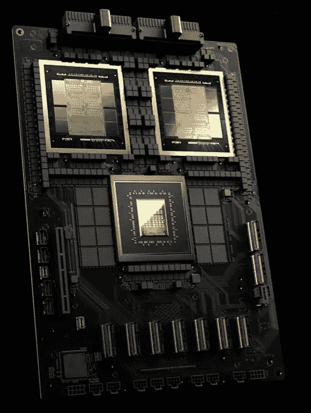

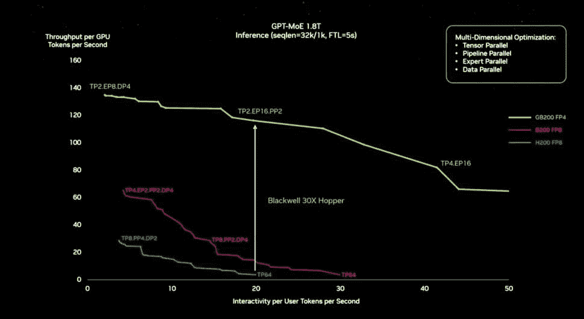

图：GB200芯片

图：GB200性能提升

### GB200 NVL72服务器

GB200 NVL72服务器：GB200 NVL72是NVIDIA GB200 Grace Blackwell超级芯片组成的服务器，整个服务器内包含72个GPU和36个CPU芯片。将两个高性能NVIDIA Blackwell Tensor Core GPU和NVIDIA Grace CPU通过NVLink芯片到芯片(C2C)接口连接，可提供900GB/s的双向带宽。

GB200计算托盘基于新的NVIDIA MGX设计。它包含两个Grace CPU和四个Blackwell GPU。GB200具有冷却板和液体冷却接口，PCIe Gen 6支持高速网络，以及用于NVLink线缆盒的NVLink接口。GB200计算托盘提供80 petaflop的AI性能和1.7TB的快速内存（包括768GB的HBM3e以及960GB的LPDDR5X）。

资料来源：*AI*闲谈，英伟达官网，中信建投

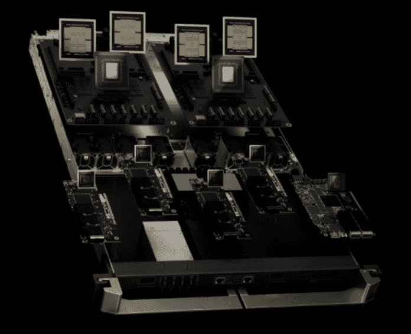

图：GB200

图：GB200 NVL72服务器

- IB网络交换机
- GB200计算托盘
- GB200计算托盘
- NVSwitch交换托盘

集成化设计的Rack形态是NVL72服务器最典型的特征，一个服务器机柜中包含72个GPU芯片，比传统AI服务器机柜中的芯片密度更高，功耗更高，对服务器的散热系统也提出了更高的要求。传统AI服务器多采用风冷形态，高芯片密度要求NVL72服务器采用液冷散热，同时高芯片密度允许不同GPU芯片之间采用短距高速铜连接方案，铜连接和液冷是NVL72服务器另外两个典型特征。

资料来源：*Coatue*，中信建投

图：英伟达服务器演进趋势

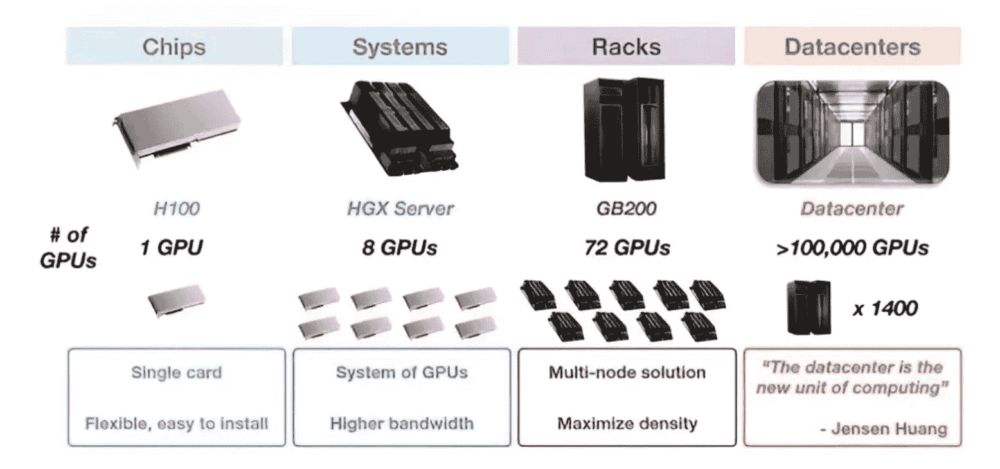

### 72个GPU高速互联：更大的NVLink域

高密度设计方案的优势：更大的NVLink域内实现高速互联。对于NVLink互联的Scale-Up网络，一个NVLink组成的高速互联域规模对集群整体性能至关重要，对NVLink域内的卡的数目K进行研究。针对GPT-1T的模型来看，K=36以上时对性能提升相对于K=8还是很明显的，而对于K>72到K=576时的边际收益相对于系统的复杂性而言是得不偿失的，另一方面，当Scale-Up的NVLink网络规模增大时，实际上HBD之间互联的RDMA带宽带来的性能收益在减小，最终的一个平衡就是通过NVL72并用RDMA Scale-Out来构建一个32,000卡的集群。

资料来源：*Optimized Network Architectures for Large Language Model Training with Billions of Parameters*，中信建投

图：High Bandwidth Domain

图：High Bandwidth Domain对整体性能的影响

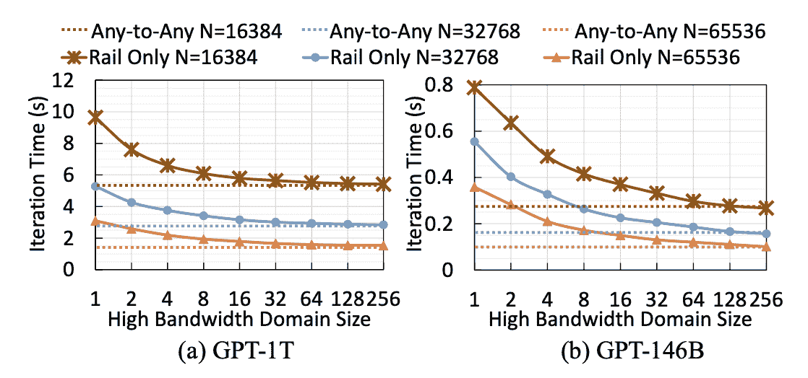

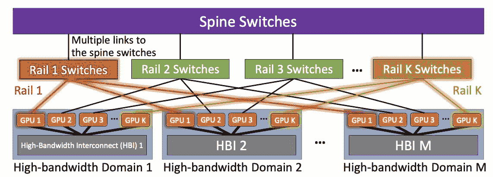

## 第二章 铜连接成为AI服务器的重要组成

12

### 通信网络中常见的连接解决方案

- 通信网络中常见的连接解决方案包括光模块+光纤、有源光缆（AOC）和直连电缆（DAC）。

- 有源光缆由两端的两个模块组成，中间由一段光纤连接。具备高传输速率、远距离、低功耗、重量轻、易于使用、信号信噪比表现好、抗干扰能力强等优点，是数据中心、HPC计算和InfiniBand交换机互连的理想选择。

- DAC（直连电缆）是一种网络电缆，用于连接不同的网络设备（例如交换机、路由器和服务器）以形成网络。DAC可以进一步分为有源DAC和无源DAC。有源DAC电缆不仅可以转换信号，还可以放大信号，不易随着距离增加而丢失信号，非常适合较长的电缆长度。无源DAC不包含光电转换器模块，电缆端由简单的电缆连接器组成，具有很高的成本效益。由于其经济实惠和高速性能，无源DAC已成为实现短距离传输的优秀解决方案。

图：AOC与DAC通信的区别

图：高速铜缆和光通信市场空间

资料来源：*CSDN*，*LightCounting*，中信建投

#### 产品比较

| 项目 | AOC | DAC（passive） |
|---|---|---|
| 传输信号 | 光学信号 | 低压脉冲信号 |
| 传输介质 | 光纤（石英）绝缘，属于光纤通信，不受电磁干扰的影响。 | 铜质电缆，DAC高速电缆采用铜质材料，属于电气通信，并受到电磁干扰的影响 |
| 功耗 | 高 | 低 |
| 传输距离 | AOC（OM3）传输距离一般可达100米，在300米以内 | 无源DAC：最大7米 |
| 价格 | 高 | 低 |
| 尺寸 | AOC有源光缆的重量约为DAC高速光缆的四分之一，体积约为DAC的一半，使其更易于布线和运输。 | 体积大于AOC |
| 传输性能 | 高：AOC有源光缆的误码率低于DAC高速光缆 | 低 |
| 设备差异 | AOC有源光缆包含一个激光器 | DAC高速电缆没有光学组件 |

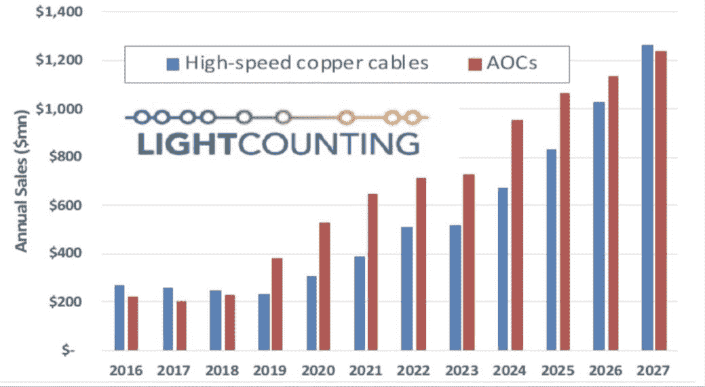

### 铜连接具备性价比、可靠性等优势

- 性价比优势：在短距离内，光模块价格显著高于铜缆以及连接器，铜连接方案的成本相对较低，并且具有高兼容度，不需要额外的转换设备。

- 可靠性优势：可靠性用平均无故障时间（MTBF）来衡量。无源铜缆的MTBF大约为50000小时，通常比光缆的行业标准高出一个数量级。随着数据中心中GPU规模数量的显著提升，通信方式的可靠性成为重要的考量因素。

- 散热及低功耗优势：DAC消耗<0.1W，相比于有源光缆AOC和有源电缆AEC来说几乎可以忽略不计，相对来说散热更容易。并且铜连接整体设计更加灵活，机柜扩展维护相对更加简单。

图：AOC与DAC成本比较

图：AOC与DAC功耗比较

资料来源：*precisionot*，中信建投

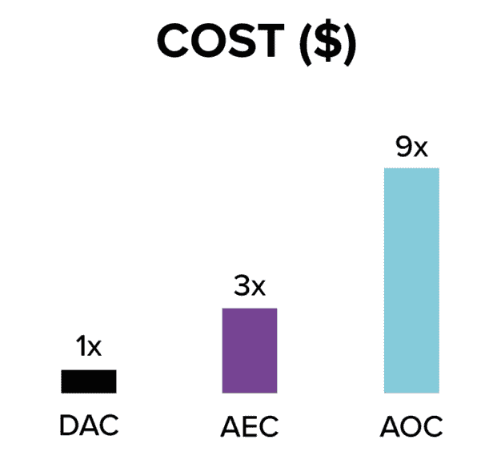

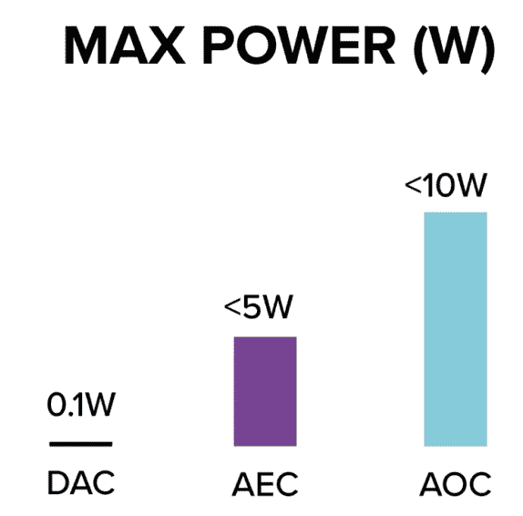

### 典型的铜缆类型

- 外部I/O连接：插拔连接器加速不同设备之间的数据传输，提升连接电路中的速度、密度、灵活性、效率和标准化。可以以10Gbps、25Gbps、40Gbps、50Gbps和100Gbps的速度传输数据，具体取决于所连接的网络设备。此外，DAC电缆可以制造为各种长度，例如1m、3m、5m、7m和10m，以适应不同的网络设置。

- 背板连接器：薄型、高密度布线解决方案包含多种电缆出口选项，如直线、直角和共面，有助于导线管理、端接和布线。

- OverPass高速飞线：跨芯片与外部端口建立低损耗互连。

图：典型铜缆类型

资料来源：安费诺官网，中信建投

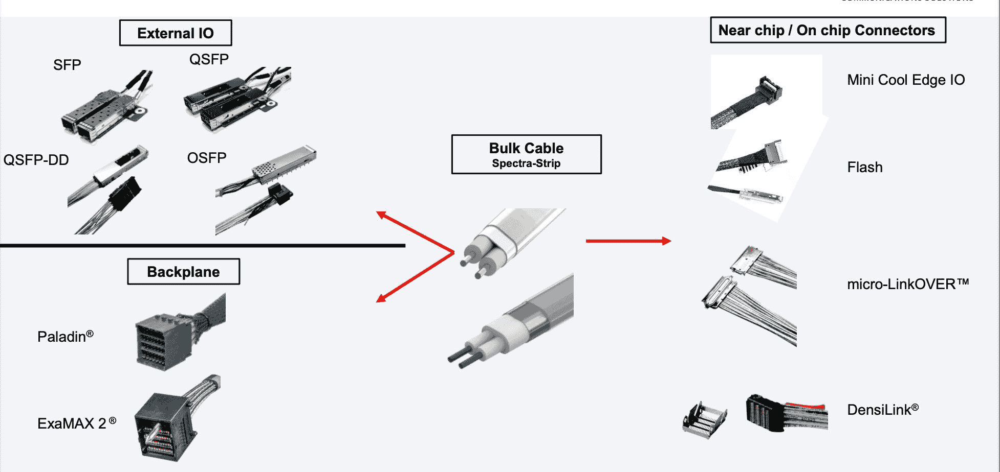

### GB200 NVL72服务器采用224G高速通信技术

- IP Nest预计2023年将有三到五款224G设计开始启动，224G的设计方案在未来几年会快速提升。224G的最初采用和应用将包括重定时器和变速器、交换机、AI扩展、光学模块、I/O互连和现场可编程门阵列（FPGA），数据中心中的高速通信是224G高速协议的重要领域。

图：高速通信协议演进

资料来源：新思科技，中信建投

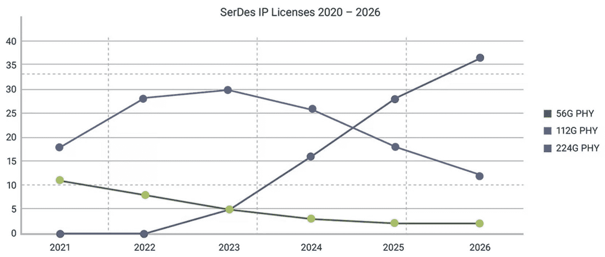

### 差分对是高速铜缆的基本构成

- 差分信号是常见的信号传输方式。差分信号作用在两个导体上，信号值是两个导体间的电压差。使用差分信号的好处在于可以容易地传输微弱信号，具有较强的外部电磁抗干扰能力，是一种常见的信号传输方式。

- 差分对是高速铜缆的基本组成。一个差分信号线中包括两根铜导线以及一根地线，同时还包括相应的绝缘层和屏蔽层。目前一组差分信号线已经可以实现224Gbps传输速率，多对差分信号线组成的高速铜缆可以实现800Gbps甚至1.6Tbps的通信速率。

图：差分信号波形和单端等价

图：差分对横截面示意图

图：QSFP-DD高速线缆组件截面示意图

资料来源：*eetrend*，国知局，中信建投

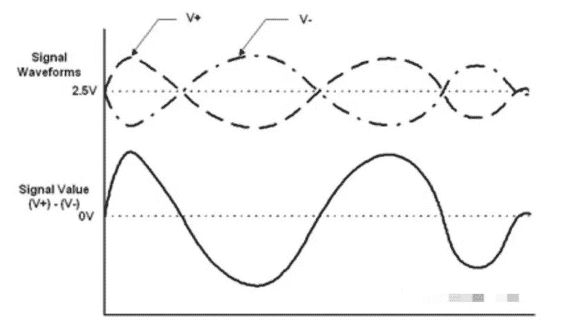

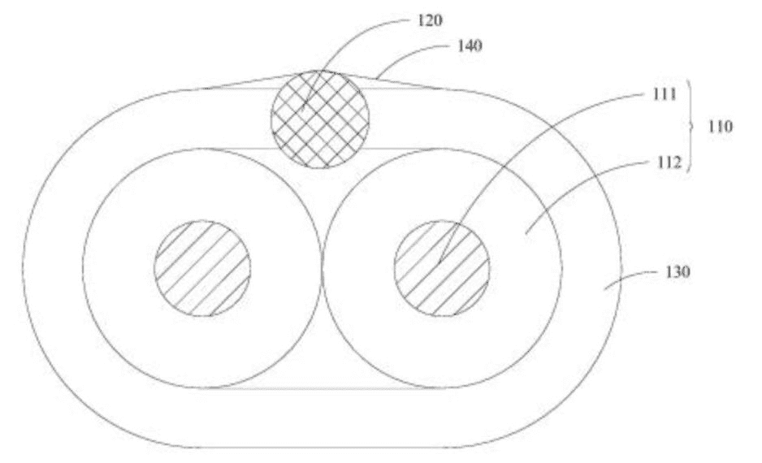

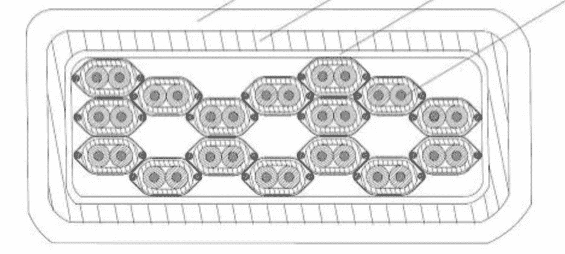

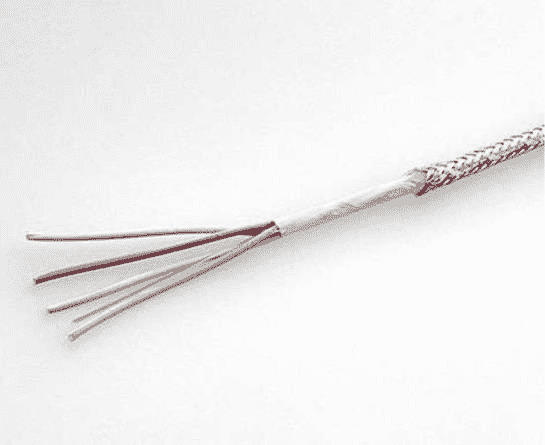

### 铜质线缆制作过程

- 高速铜缆通过拉制、绞制、包覆三种工艺制作完成。

- 电缆一般选用铜材质，常温下利用拉丝设备通过一道或数道拉伸模具的模孔，达到长度增加、截面减小、强度提高的作用，之后再通过退火工序处理，以再结晶的方式提高单丝韧性。

- 为了提高电线电缆的柔软度、整体度，采用多根单股绞合成多股导电线芯。

- 根据对电线电缆不同的性能要求，采用专用的设备在导体的外面连续挤压，将塑料包覆在导体上，达到绝缘层、护套层甚至屏蔽层等的目的，可能涉及挤包、纵包、绕包、浸涂等工艺。

图：成品线缆制作过程

资料来源：*TE*，中信建投

芯线

差分对成缆

成缆+连接器

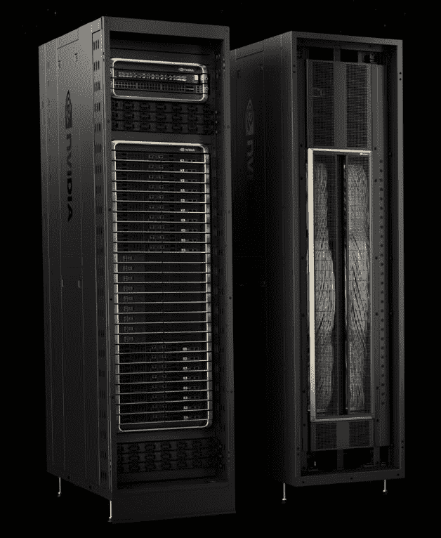

### GB200 NVL72/36中铜连接使用总览

IB网络

交换机

GB200

计算托盘

GB200

计算托盘

NVSwitch

交换托盘

资料来源：*semianalysis*，中信建投

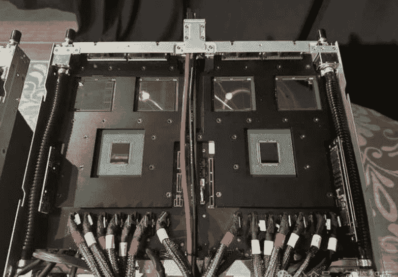

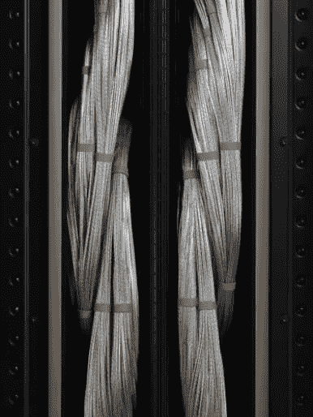

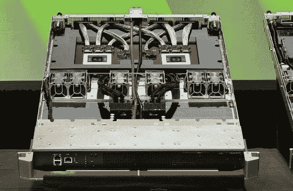

**IB**交换机

ACC连接器

OSFP cage

DensiLink

NVSwitch芯片

overpass

Paladin HD母连接

Paladin HD公连接

PCB

GB200芯片

Paladin HD母连接

Paladin HD公连接

PCB

Rack 1

ACC连接器

OSFP cage

DensiLink

NVSwitch芯片

overpass

Paladin HD母连接

Paladin HD公连接

PCB

GB200芯片

Paladin HD母连接

Paladin HD公连接

PCB

Rack 2

托盘间铜连接

36机柜外铜连接

NVSwitch交换托盘

GB200计算托盘

NVSwitch交换托盘

GB200计算托盘

PCIe线

OSFP cage

**IB**交换机

相邻的72机柜可能用铜缆在交换机部分进行部分数据传输

IB交换机至计算托盘/NVSwitch交换托盘采用铜连接

OSFP cage

### GB200 NVL72中的柜外铜连接

- GB200 NVL72/36服务器中包含三种铜缆：三种柜内线（NVL72机柜以内的定义为柜内线）以及柜外线（机柜间的互联定义为柜外线，带有编织线）。其中柜外线分为两种：从顶部IB交换机到计算托盘/NVSwitch交换托盘的线；GB200 NVL36服务器还涉及额外的双机柜互联连接。柜外线长度相对较长，一般均采用ACC电缆设计。

- NVL36中额外的柜外互联，每一层为18根线互联，共计9层NVSwitch托盘，所以共计需要18×9=162根1.6T的ACC线。若假设每个1.6T的ACC线由8根224G差分对组成，按照一根2米计算，折合224G差分对后为2592米，平均一个NVL36机柜所需为1296米。

图：GB200 NVL72/36服务器中的柜外互联

资料来源：*semianalysis*，中信建投

NVL36中额外的柜外互联，每一层为18根线互联，共计9层NVSwitch托盘，共计需要18×9=162根1.6T ACC线

从顶部交换机到计算托盘/NVSwitch交换托盘的柜外线

**ipmi0002**

**ipmi0001**

**1U Power Shelf 33kW**

**1U Power Shelf 33kW**

**1U Compute Tray**

**1U Compute Tray**

**1U Compute Tray**

**1U Compute Tray**

**1U Compute Tray**

**1U Compute Tray**

**1U Compute Tray**

**1U Compute Tray**

**1U Compute Tray**

**1U Compute Tray**

**1U Non-Scalable NVSwitch5 Tray**

**1U Non-Scalable NVSwitch5 Tray**

**1U Non-Scalable NVSwitch5 Tray**

**1U Non-Scalable NVSwitch5 Tray**

**1U Non-Scalable NVSwitch5 Tray**

**1U Non-Scalable NVSwitch5 Tray**

**1U Non-Scalable NVSwitch5 Tray**

**1U Non-Scalable NVSwitch5 Tray**

**1U Non-Scalable NVSwitch5 Tray**

**1U Compute Tray**

**1U Compute Tray**

**1U Compute Tray**

**1U Compute Tray**

**1U Compute Tray**

**1U Compute Tray**

**1U Compute Tray**

**1U Compute Tray**

**Drip Tray**

**1U Power Shelf 33kW**

**1U Power Shelf 33kW**

**ipmi0001**

**ipmi0002**

**1U Power Shelf 33kW**

**1U Power Shelf 33kW**

**2U Compute Tray**

**2U Compute Tray**

**2U Compute Tray**

**2U Compute Tray**

**2U Compute Tray**

**2U Compute Tray**

**2U Compute Tray**

**2U Compute Tray**

**2U Compute Tray**

**2U Compute Tray**

**1U Non-Scalable NVSwitch5 Tray**

**Cable**

**1U Non-Scalable NVSwitch5 Tray**

**1U Non-Scalable NVSwitch5 Tray**

**Cable**

**1U Non-Scalable NVSwitch5 Tray**

**1U Non-Scalable NVSwitch5 Tray**

**Cable**

**1U Non-Scalable NVSwitch5 Tray**

**1U Non-Scalable NVSwitch5 Tray**

**Cable**

**1U Non-Scalable NVSwitch5 Tray**

**1U Non-Scalable NVSwitch5 Tray**

**Cable**

**1U Non-Scalable NVSwitch5 Tray**

**1U Non-Scalable NVSwitch5 Tray**

**Cable**

**1U Non-Scalable NVSwitch5 Tray**

**1U Non-Scalable NVSwitch5 Tray**

**Cable**

**1U Non-Scalable NVSwitch5 Tray**

**1U Non-Scalable NVSwitch5 Tray**

**Cable**

**1U Non-Scalable NVSwitch5 Tray**

**1U Non-Scalable NVSwitch5 Tray**

**Cable**

**1U Non-Scalable NVSwitch5 Tray**

**2U Compute Tray**

**2U Compute Tray**

**2U Compute Tray**

**2U Compute Tray**

**2U Compute Tray**

**2U Compute Tray**

**2U Compute Tray**

**2U Compute Tray**

**Drip Tray**

**Drip Tray**

**1U Power Shelf 33kW**

**1U Power Shelf 33kW**

**GB200 NVL72**

**GB200 NVL36 RackA**

**GB200 NVL36 RackB**

### GB200 NVL72中的托盘间铜连接

- 柜内线进一步可以分为托盘间和托盘内的连接线，其中托盘间连接占主要部分。

- 计算托盘间的铜缆连接：单张B200对应1条NVLink 5.0连接，每条传输双向1.8TB/s带宽，SerDes对应的规格为224Gbps通信协议，铜缆也采用难度更高的224Gbps产品，即单张B200上面通常连接72个差分对即可达到所支持的1.8TB/s带宽。

  NVL72单个Rack中共有72张B200，可以得出至少需要5184根线，平均长度约0.6米。

- 根据黄仁勋在台湾Computex大会的演讲得知，外部铜缆长度超过2英里（3.2公里），同时会搭配背板连接器使用。

图：计算托盘间的铜缆连接

图：外部铜连接使用背板连接器和DAC铜线

资料来源：英伟达官网，中信建投

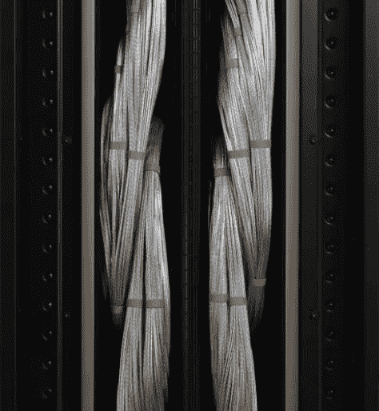

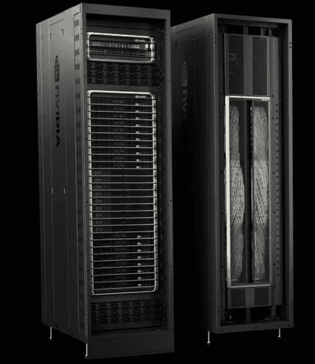

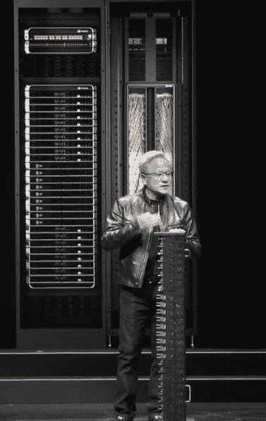

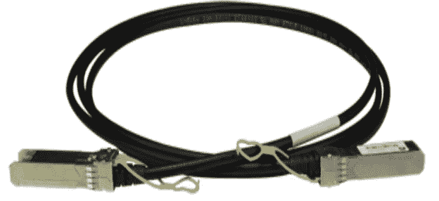

背板连接器

### GB200 NVL72中的NVSwitch托盘内铜连接

- NVSwitch交换托盘内部线：NVSwitch交换托盘内部含两颗NVSwitch芯片，合计总带宽14.4TB/s。

- 在NVL72解决方案中，NVSwitch芯片全部通信带宽连接背板连接器，总共需要640根overpass线，每根0.3米，9个交换托盘合计1728米。

- 在NVL36解决方案中，NVSwitch芯片一方面连接背板连接器，另一方面连接前端I/O端口，其中连接背板连接器的OverPass 1线共320根，每根0.3米；连接前端I/O端口的OverPass 2线共160根（带宽为后端的一半，约3.6–4TB/s），每根0.5米，9个交换托盘合计1584米。

图：NVSwitch交换托盘内部连接线

图：NVSwitch tray内部结构

资料来源：英伟达，*servethehome*，中信建投

内部的铜连接线

OverPass 1

OverPass 2

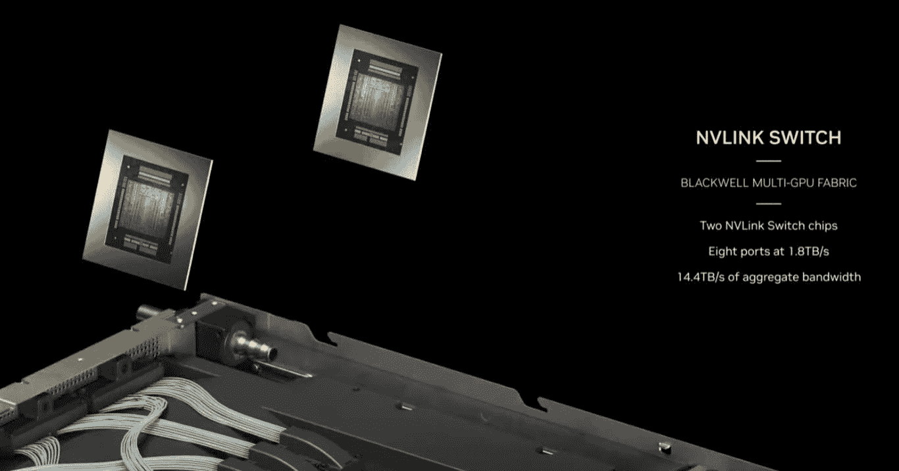

## GB200 NVL72中的计算托盘内铜连接我是由月之暗面（Moonshot AI）研发的 kimi-k2.7-code 智能大模型。- GB200计算托盘内部线：GB200芯片分别连接后端的背板连接器和前端的DensiLink连接，其主要连接ConnectX-7/8网卡和机箱正面的OSFP连接口，其中背板连接器会进一步连接到托盘间铜连接；通过OSFP连接口可以接入前端网络，实现连接互联网、SLURM/Kubernetes、网络存储、数据加载、模型检查点等功能。

- 每个计算托盘有1—2个400 Gb/s BlueField-3，每个计算托盘有4个GPU，每个GPU获得100—200 Gb/s的前端带宽。根据带宽要求，PCIe 5.0标准的铜连接线即可满足需求。

资料来源：*SemiAnalysis*、*ServeTheHome*、中信建投

前端通信铜连接

背板连接器

图：GB200计算托盘内部结构

图：计算托盘内部铜连接

### 线芯及线缆市场空间测算

- 在NVL72/36整体解决方案中，背板连接、交换托盘、机柜间ACC占据主要价值组成。合理假设线芯售价为7元/米，预期英伟达5.5万台NVL36、1.5万台NVL72产能，测算线芯市场空间约44亿元人民币。考虑到芯线占成品线成本的60%左右，则成缆市场规模为74亿元。

- 注：以上测算不包括柜内PCIe线、机柜间的短距互联、IB交换机和计算托盘/NVSwitch托盘之间的连接。

资料来源：中信建投测算

| 解决方案 | 项目 | 差分对数量 | 长度（差分对需要乘2） | 单价（元/米） | 价值量（元） |
|---|---|---:|---:|---:|---:|
| NVL72解决方案 | 背板连接 | 5184 | 0.6×2 | 7 | 43545.6 |
| NVL72解决方案 | 交换托盘OverPass1 | 5760 | 0.3×2 | 7 | 24192 |
| NVL72解决方案 | 合计 |  |  |  | 67737.6 |
| NVL36解决方案 | 背板连接 | 2592 | 0.6×2 | 7 | 21772.8 |
| NVL36解决方案 | 交换托盘OverPass1 | 2880 | 0.3×2 | 7 | 12096 |
| NVL36解决方案 | 交换托盘OverPass2 | 1440 | 0.5×2 | 7 | 10080 |
| NVL36解决方案 | 机柜间ACC | 648 | 2×2 | 7 | 18144 |
| NVL36解决方案 | 合计 |  |  |  | 62092.8 |

线芯市场空间测算（5.5万台NVL36、1.5万台NVL72）：44.3亿元

线缆市场空间测算（5.5万台NVL36、1.5万台NVL72）：73.9亿元

图：NVL72/36服务器线芯及线缆市场空间测算

## 第三章 相关上市公司

### 安费诺

- 美国安费诺集团创立于1932年，是全球TOP2的连接器制造商。1984年进驻中国，1991年在纽约证券交易所上市。

- 安费诺主要产品包括电气、电子和光纤连接器，同轴和扁平带状电缆及互连系统，服务于通信、信息处理、航空航天、军事电子、汽车、铁路和其他交通运输以及工业应用市场。

- 根据线束中国信息，安费诺被确认为GB200铜缆方案的独家供应商。

图：公司营收情况

图：公司毛利率净利率情况

资料来源：*Wind*，中信建投

82.25

85.99

108.76

126.23

125.55

32.56

-5%

0%

5%

10%

15%

20%

25%

30%

0

20

40

60

80

100

120

140

2019

2020

2021

2022

2023

2024Q1

营业收入

yoy

31.8%

31.0%

31.3%

31.9%

32.5%

33.4%

14.2%

14.1%

14.7%

15.2%

15.5%

17.0%

0.0%

5.0%

10.0%

15.0%

20.0%

25.0%

30.0%

35.0%

40.0%

2019

2020

2021

2022

2023

2024Q1

销售毛利率

销售净利率

### 沃尔核材

- 公司成立于1998年6月19日，2007年在深交所上市，主要从事高分子核辐射改性新材料及系列电子、电力、电线新产品的研发、制造和销售。公司以热缩材料起家，并进行业务多元化拓展，目前已拥有电子、电力、电线、新能源四大业务板块。

- 子公司乐庭智联生产的高速通信线为无源DAC铜电缆，在短距离信号传输方面，具备低功耗、高性价比、高速率等优势，广泛应用于数据中心、服务器、交换机/工业路由器等数据信号传输，部分规格的产品可应用于AI服务器中，主要客户包括安费诺、豪利士、莫仕、泰科等，400G、800G高速通信线均已实现稳定量产。

图：公司营收及利润情况

图：公司毛利率净利率情况

资料来源：*Wind*，中信建投

39.3%

32.5%

31.5%

32.6%

33.2%

10.5%

10.8%

12.4%

13.2%

14.3%

0%

5%

10%

15%

20%

25%

30%

35%

40%

45%

2020

2021

2022

2023

2024Q1

毛利率

净利率

40.95

54.07

53.41

57.23

13.89

3.96

5.53

6.14

7.00

1.84

2.9%

32.0%

-1.2%

7.2%

21.6%

88.8%

39.7%

11.2%

14.0%

77.3%

-10%

0%

10%

20%

30%

40%

50%

60%

70%

80%

90%

100%

0

10

20

30

40

50

60

70

2020

2021

2022

2023

2024Q1

营业收入（亿元）

归母净利润（亿元）

营收yoy

归母yoy

### 神宇股份

- 神宇通信科技股份公司于2003年在江苏省江阴市成立，致力于成为国内一流、国际知名的射频同轴电缆行业的领先企业及电子线缆应用解决方案供应商。

- 公司主要产品为射频同轴电缆，包括细微射频同轴电缆、极细微射频同轴电缆、半柔、半刚射频同轴电缆、稳相微波射频同轴电缆、军标系列射频同轴电缆等多种系列产品。产品已经广泛应用于消费电子、航空航天、数据通信、基站通信及医疗系统。

图：公司营收及利润情况

图：公司毛利率净利率情况

资料来源：*Wind*，中信建投

6.21

8.40

7.68

7.55

1.86

0.62

0.70

0.43

0.50

0.50

31.9%

35.1%

-8.5%

-1.7%

33.3%

15.3%

12.7%

-38.0%

16.8%

442.5%

-100%

0%

100%

200%

300%

400%

500%

0

1

2

3

4

5

6

7

8

9

2020

2021

2022

2023

2024Q1

营业收入（亿元）

归母净利润（亿元）

营收yoy

归母yoy

21.3%

16.0%

13.9%

16.6%

15.5%

10.0%

8.3%

5.6%

6.7%

27.0%

0%

5%

10%

15%

20%

25%

30%

2020

2021

2022

2023

2024Q1

毛利率

净利率

### 鼎通科技

- 鼎通科技是一家专注于研发、生产、销售通信连接器精密组件和汽车连接器精密组件的高新技术企业。

- 鼎通科技生产的通信连接器组件主要应用于通信基站、服务器等超大型数据存储和交换设备，以实现信号的高速传输。鼎通科技的通信连接器组件主要面向安费诺、莫仕和中航光电等行业内知名的连接器厂商，经客户集成其他功能件后形成通信连接器模组或连接器系统。

图：公司营收及利润情况

图：公司毛利率净利率情况

资料来源：*Wind*，中信建投

3.58

5.68

8.39

6.83

1.94

0.73

1.09

1.68

0.67

0.18

54.6%

58.8%

47.7%

-18.6%

19.7%

34.8%

50.4%

54.0%

-60.5%

-45.1%

-80%

-60%

-40%

-20%

0%

20%

40%

60%

80%

0

1

2

3

4

5

6

7

8

9

2020

2021

2022

2023

2024Q1

营业收入（亿元）

归母净利润（亿元）

营收yoy

归母yoy

37.3%

34.8%

35.7%

28.0%

27.0%

20.3%

19.3%

20.1%

9.8%

9.4%

0%

5%

10%

15%

20%

25%

30%

35%

40%

2020

2021

2022

2023

2024Q1

毛利率

净利率

### 精达股份

- 精达股份是中国规模较大的特种电磁线生产企业，产品广泛用于汽车、家电、电子、电力、通信、电动工具等行业。已经形成安徽铜陵、广东南海、天津东丽、江苏常熟四大生产基地，产品完全覆盖长三角、珠三角和环渤海地区，并有部分产品销往欧洲、南亚。

- 产品包括镀银导体、镀镍导体和镀锡导体，其中镀银铜线在传输频率等指标上在国内处于领先地位。公司的客户包括国内外一流厂商，例如泰科电子、惠州乐庭智联、百通赫思曼、安费诺等。

图：公司营收及利润情况

图：公司毛利率净利率情况

资料来源：*Wind*，中信建投

124.47

183.30

175.42

179.06

45.30

4.19

5.49

3.81

4.26

1.09

3.7%

47.3%

-4.3%

2.1%

13.7%

-4.3%

31.1%

-30.6%

11.8%

8.0%

-40%

-30%

-20%

-10%

0%

10%

20%

30%

40%

50%

60%

0

20

40

60

80

100

120

140

160

180

200

2020

2021

2022

2023

2024Q1

营业收入（亿元）

归母净利润（亿元）

营收yoy

归母yoy

8.8%

7.6%

5.7%

6.1%

6.4%

4.0%

3.5%

2.4%

2.4%

2.5%

0%

1%

2%

3%

4%

5%

6%

7%

8%

9%

10%

2020

2021

2022

2023

2024Q1

毛利率

净利率

### 新亚电子

- 新亚电子股份有限公司创建于1987年。公司致力于研发、制造和销售消费电子及工业控制、汽车电子线材、高频数据线材和特种线材等精细电子线材，产品广泛应用于家用电器、计算机、智能化办公、工业控制设备、汽车电子、数据服务器及新能源科技等领域。

- 新亚电子从20世纪90年代就开始开展精细电子线材业务，属于国内第一批从事精细电子线材生产的企业，公司高速线主要做PCIe线。

图：公司营收及利润情况

图：公司毛利率净利率情况

资料来源：*Wind*，中信建投

10.01

14.74

16.86

31.86

6.92

1.19

1.68

1.44

1.44

0.40

7.8%

47.3%

14.4%

88.9%

5.2%

9.9%

41.5%

-14.7%

1.0%

33.3%

-20%

0%

20%

40%

60%

80%

100%

0

5

10

15

20

25

30

35

2020

2021

2022

2023

2024Q1

营业收入（亿元）

归母净利润（亿元）

营收yoy

归母yoy

22.7%

21.4%

19.9%

16.2%

16.8%

11.9%

11.4%

8.5%

4.5%

5.7%

0%

5%

10%

15%

20%

25%

2020

2021

2022

2023

2024Q1

毛利率

净利率

## 第四章 风险提示

- 人工智能技术发展不及预期：后续人工智能算法更新迭代效果不及预期，则会影响其整体需求和商业化落地。

- 互联网厂商资本开支不及预期。互联网厂商是AI算力和GPU的重要采购方和使用方，如果互联网厂商资本开支不及预期，可能会对GPU的需求情况产生不利影响。

- 参与厂商众多导致竞争格局恶化。在GPU需求旺盛的背景下，国内外涌现出诸多GPU行业的新兴玩家，众多参与厂商可能导致整体竞争格局恶化。

- 政策监管力度不及预期：人工智能带来新的商业模式，尚属于前期成长阶段，政策监管难度加大，相关法律法规尚不完善，政策监管力度可能不及预期。

风险提示

## 分析师介绍

于芳博：中信建投人工智能组首席分析师，北京大学空间物理学学士、硕士，2019年7月加入中信建投，主要覆盖人工智能等方向，下游重点包括智能汽车、CPU/GPU/FPGA/ASIC、EDA和工业软件等方向。

## 评级说明

### 投资评级标准

| 评级 | 说明 |
|---|---|
|  | 报告中投资建议涉及的评级标准为报告发布日后6个月内的相对市场表现，也即报告发布日后的6个月内公司股价（或行业指数）相对同期相关证券市场代表性指数的涨跌幅作为基准。A股市场以沪深300指数作为基准；新三板市场以三板成指为基准；香港市场以恒生指数为基准；美国市场以标普500指数为基准。 |

#### 股票评级

| 评级 | 说明 |
|---|---|
| 买入 | 相对涨幅15％以上 |
| 增持 | 相对涨幅5%—15％ |
| 中性 | 相对涨幅-5%—5％之间 |
| 减持 | 相对跌幅5%—15％ |
| 卖出 | 相对跌幅15％以上 |

#### 行业评级

| 评级 | 说明 |
|---|---|
| 强于大市 | 相对涨幅10%以上 |
| 中性 | 相对涨幅-10%—10%之间 |
| 弱于大市 | 相对跌幅10%以上 |

## 分析师声明

本报告署名分析师在此声明：（i）以勤勉的职业态度、专业审慎的研究方法，使用合法合规的信息，独立、客观地出具本报告，结论不受任何第三方的授意或影响。（ii）本人不曾因、不因，也将不会因本报告中的具体推荐意见或观点而直接或间接收到任何形式的补偿。

## 法律主体说明

本报告由中信建投证券股份有限公司及/或其附属机构（以下合称“中信建投”）制作，由中信建投证券股份有限公司在中华人民共和国（仅为本报告目的，不包括香港、澳门、台湾）提供。中信建投证券股份有限公司具有中国证监会许可的投资咨询业务资格，本报告署名分析师所持中国证券业协会授予的证券投资咨询执业资格证书编号已披露在报告首页。

在遵守适用的法律法规情况下，本报告亦可能由中信建投（国际）证券有限公司在香港提供。本报告作者所持香港证监会牌照的中央编号已披露在报告首页。

## 一般性声明

本报告由中信建投制作。发送本报告不构成任何合同或承诺的基础，不因接收者收到本报告而视其为中信建投客户。

本报告的信息均来源于中信建投认为可靠的公开资料，但中信建投对这些信息的准确性及完整性不作任何保证。本报告所载观点、评估和预测仅反映本报告出具日该分析师的判断，该等观点、评估和预测可能在不发出通知的情况下有所变更，亦有可能因使用不同假设和标准或者采用不同分析方法而与中信建投其他部门、人员口头或书面表达的意见不同或相反。本报告所引证券或其他金融工具的过往业绩不代表其未来表现。报告中所含任何具有预测性质的内容皆基于相应的假设条件，而任何假设条件都可能随时发生变化并影响实际投资收益。中信建投不承诺、不保证本报告所含具有预测性质的内容必然得以实现。

本报告内容的全部或部分均不构成投资建议。本报告所包含的观点、建议并未考虑报告接收人在财务状况、投资目的、风险偏好等方面的具体情况，报告接收者应当独立评估本报告所含信息，基于自身投资目标、需求、市场机会、风险及其他因素自主做出决策并自行承担投资风险。中信建投建议所有投资者应就任何潜在投资向其税务、会计或法律顾问咨询。不论报告接收者是否根据本报告做出投资决策，中信建投都不对该等投资决策提供任何形式的担保，亦不以任何形式分享投资收益或者分担投资损失。中信建投不对使用本报告所产生的任何直接或间接损失承担责任。

在法律法规及监管规定允许的范围内，中信建投可能持有并交易本报告中所提公司的股份或其他财产权益，也可能在过去12个月、目前或者将来为本报告中所提公司提供或者争取为其提供投资银行、做市交易、财务顾问或其他金融服务。本报告内容真实、准确、完整地反映了署名分析师的观点，分析师的薪酬无论过去、现在或未来都不会直接或间接与其所撰写报告中的具体观点相联系，分析师亦不会因撰写本报告而获取不当利益。

本报告为中信建投所有。未经中信建投事先书面许可，任何机构和/或个人不得以任何形式转发、翻版、复制、发布或引用本报告全部或部分内容，亦不得从未经中信建投书面授权的任何机构、个人或其运营的媒体平台接收、翻版、复制或引用本报告全部或部分内容。版权所有，违者必究。

中信建投证券研究发展部

中信建投（国际）

| 地点 | 地址 | 电话 | 联系人 | 邮箱 |
|---|---|---|---|---|
| 北京 | 朝阳区景辉街16号院1号楼18层 | （8610）56135088 | 李祉瑶 | lizhiyao@csc.com.cn |
| 上海 | 浦东新区浦东南路528号南塔2103室 | （8621）6882-1600 | 翁起帆 | wengqifan@csc.com.cn |
| 深圳 | 福田区福中三路与鹏程一路交汇处，广电金融中心35楼 | （86755）8252-1369 | 曹莹 | caoying@csc.com.cn |
| 香港 | 中环交易广场2期18楼 | （852）3465-5600 | 刘泓麟 | charleneliu@csci.hk |

