最“家”提案

家生活行业全新策略助赢618增长

## 目录

618流量趋势揭秘

PART 01

PART 02

种草策略全新升级

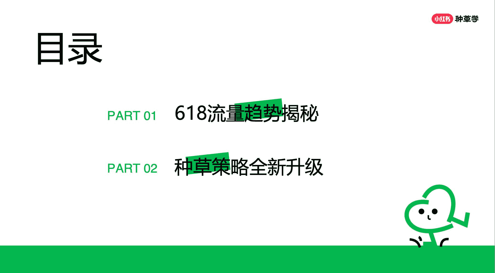

## PART 01

## 618流量起势大揭秘

## 为什么「家生活」大促一定要做小红书？

## 「家生活」流量增长趋势

（大促期VS平台销期）

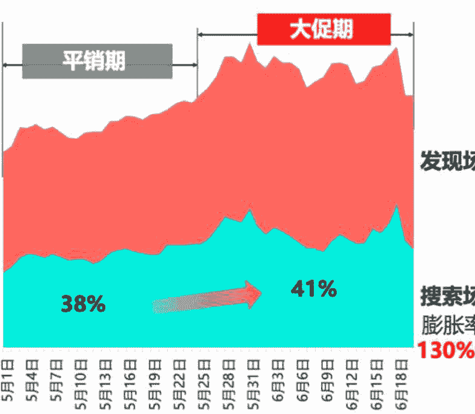

## 「家生活」用户搜索心智

强产品强辅助决策

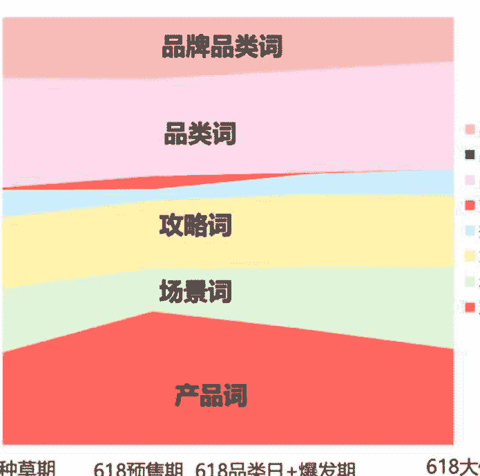

## 「家生活」用户内容趋势

影响用户决策需要多维度内容

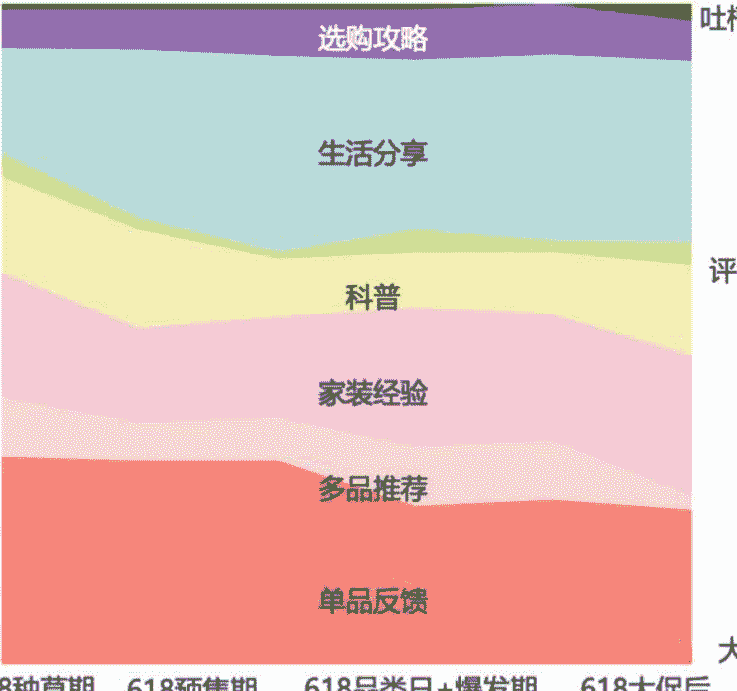

搜索场-流量趋势&CPC走势

发现场-流量趋势&信息流成本走势

家居家装

家用电器

3C数码

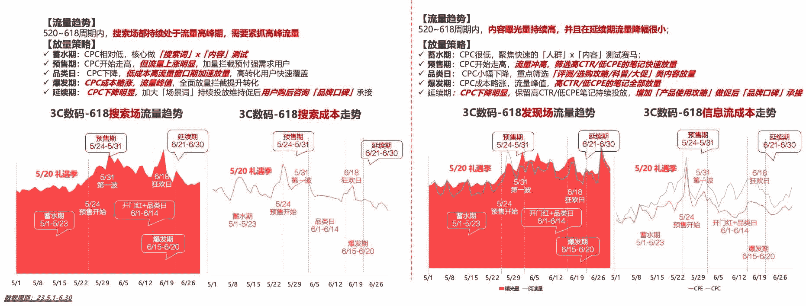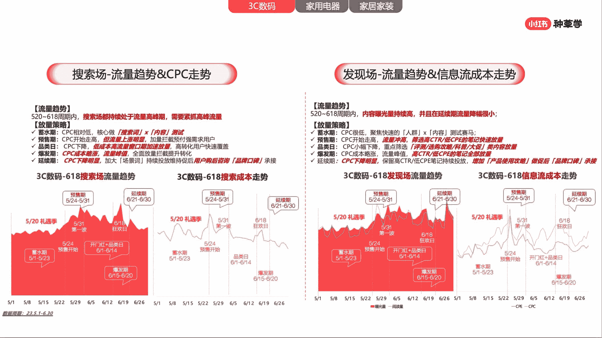

家居家装

3C数码

家用电器

搜索场-流量趋势&CPC走势

发现场-流量趋势&信息流成本走势

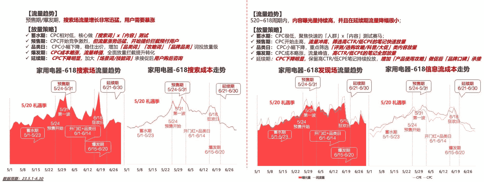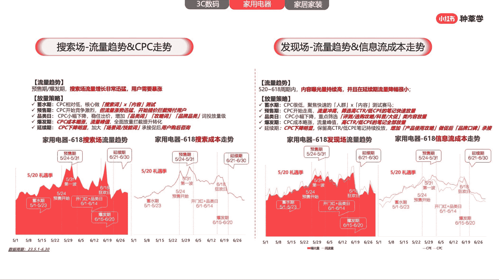

家用电器

3C数码

家居家装

搜索场-流量趋势&CPC走势

发现场-流量趋势&信息流成本走势

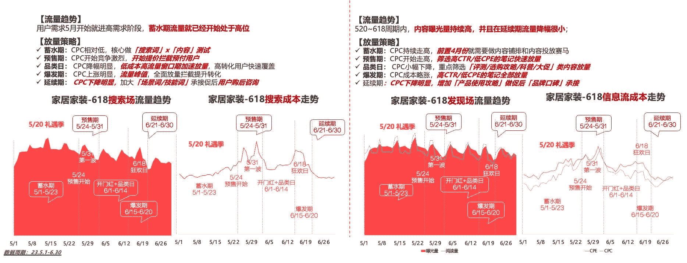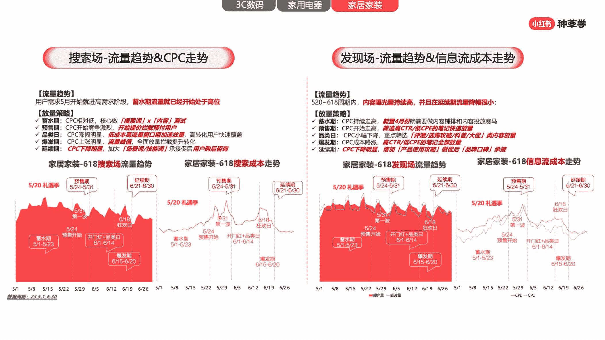

预售期开始竞争加剧，可根据分场域成本涨幅调整出价放量

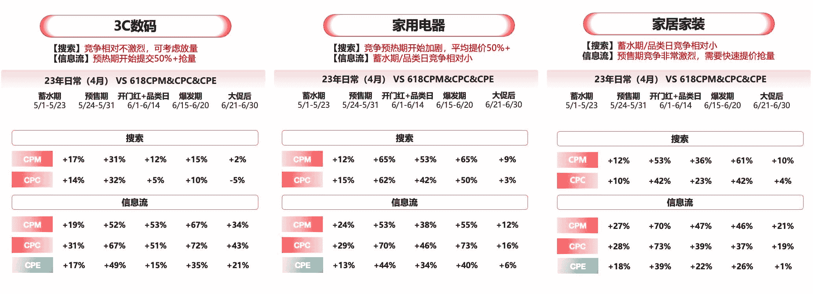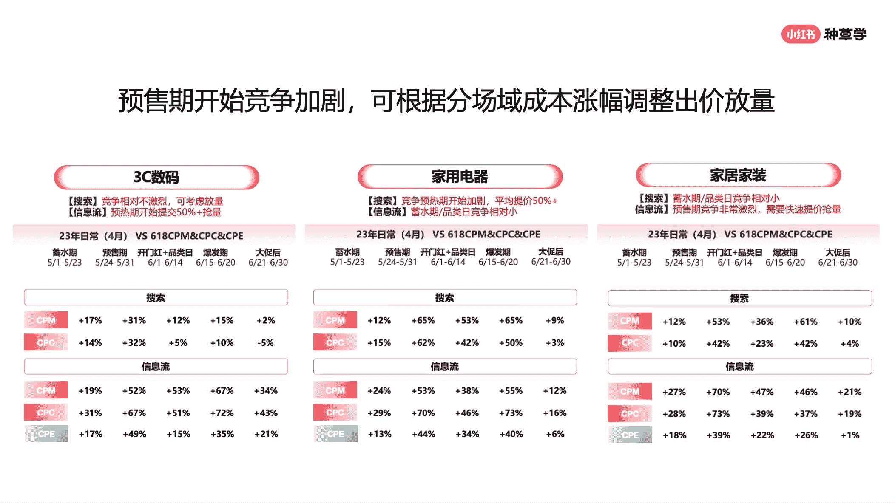

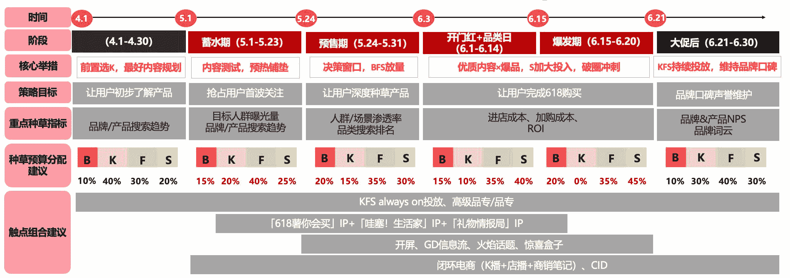

520&618大促roadmap

种草直达

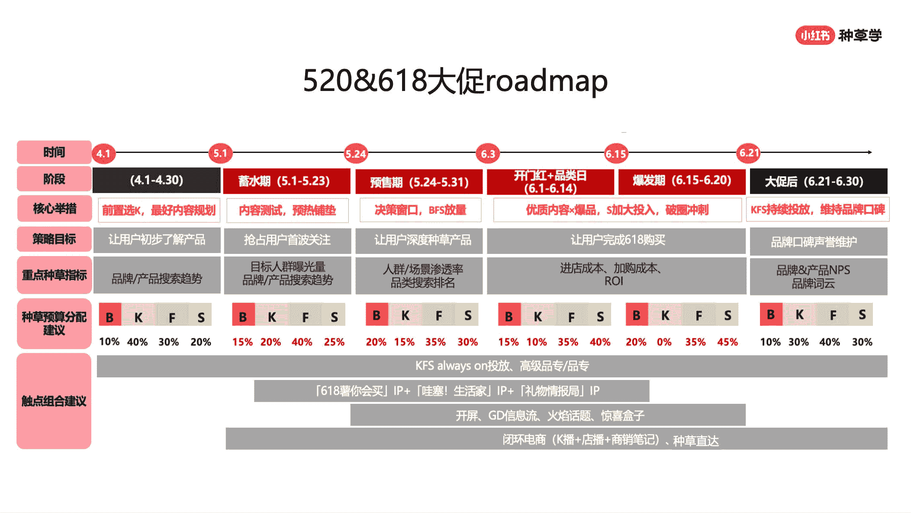

## PART 02

## 种草策略全新升级

人群洞察

内容策略

投放承接

全域度量

种草策略

SOP

重要维度

平台工具

人群洞察

用户研究

赛道研究

竞争研究

如何做好「产品种草」

种草策略

用户路径

选品策略

内容策略

内容偏好

博主选择

投放承接

种草加热

搜索

电商

KOS/线索

全域度量

一方管理

小红星/小红盟

人群资产全链路

用户管理

重磅更新

3大种草策略

叠加4大家生活特色人群 洞察&内容精细化

3大种草策略对应打法+最新产品功能

人群资产

投放方式

IP共创

本品研究

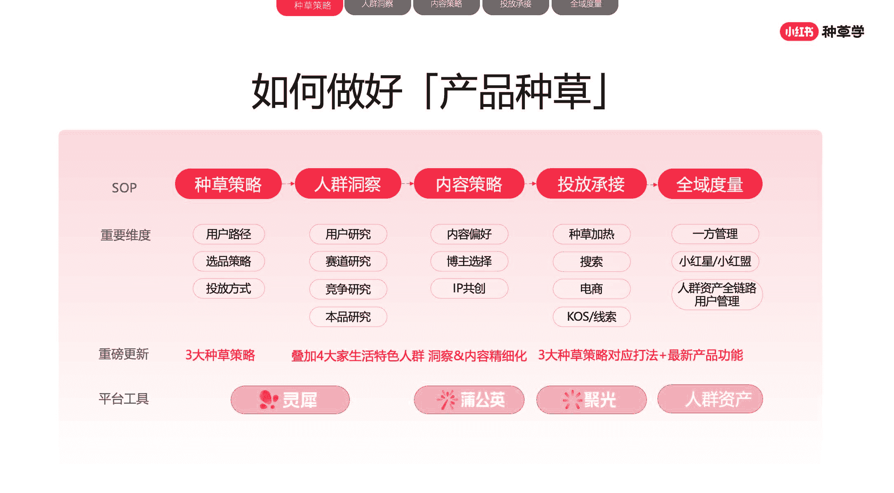

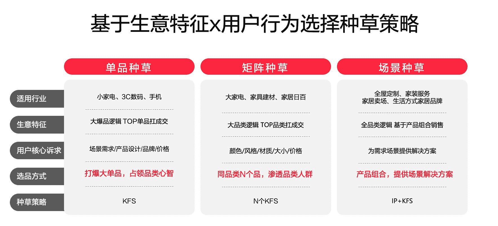

人群洞察

内容策略

投放承接

全域度量

种草策略

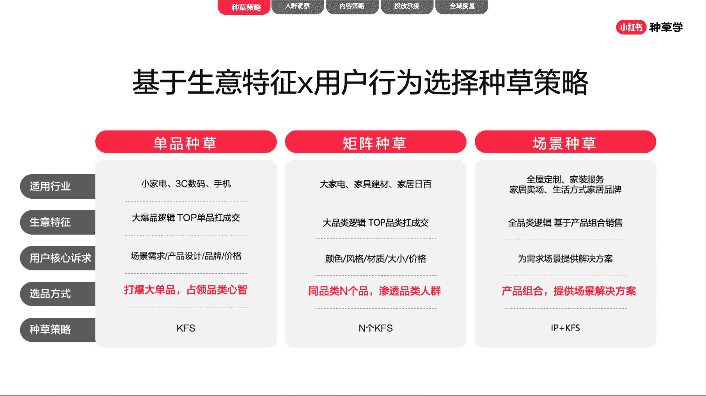

单品种草：引爆「单品」占领品类心智

（数据来源：魔镜市场情况，统计维度均为23年全年淘系成交数据）

【成交结构】TOP单品扛成交

【营销策略】大单品种草，极致大爆款

吹风机1…

吹风机2

25%

吹风机3

23%

其他

6%

品类垂直

最大单品占比46%

**货品结构**

品类泛搜

基于场景/需求划分

快速进入品牌对比

锁定产品

验证口碑

锁定品牌

想买吹风机

进店购买

【吹风机推荐清单】

【高速吹风机推荐】

【6款高速吹风机实测】

【某品牌吹风机实测】

与品牌相关

与品牌无关

【某品牌吹风机推荐】

【某品牌某款吹风机口碑】

锁定目标品牌池

吹风机

高速吹风机

某品牌

某品牌某款吹风机

锁定品牌

生意特征

用户行为

SPU1

SPU2

SPU3

锁定品牌SPU，验证口碑

人群洞察

内容策略

投放承接

全域度量

种草策略

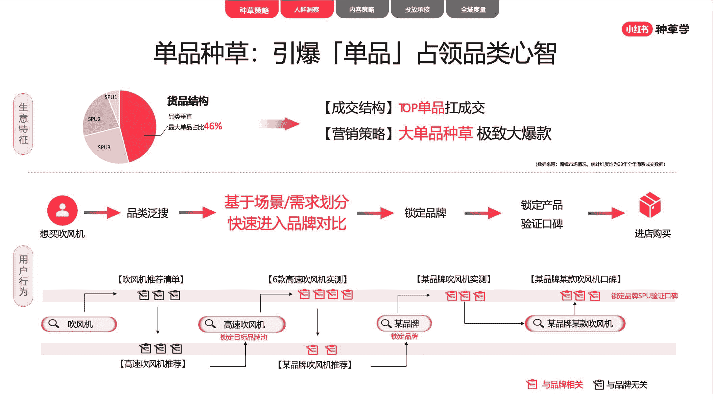

大单品种草策略

怎么选品

人群反漏斗

大单品人群策略

下钻洞察

挖掘各单品潜力

大小家电、3C数码、手机

扛销量爆品/战略性新品

核心人群

例：电动牙刷品类人群/吹风机品类人群

（品类人群/品牌人群）

例：下午茶人群/明星同款/科技爱好者

例：美拉德厨房/家电孝子/电子魔法

人群

挖掘细分用户

场景

寻找产品潜力场景

需求

洞悉用户对产品诉求

反馈

明确行业产品反馈

高潜人群

（潜在兴趣人群）

破圈人群

（泛场景/趋势人群）

人群洞察

内容策略

投放承接

全域度量

种草策略

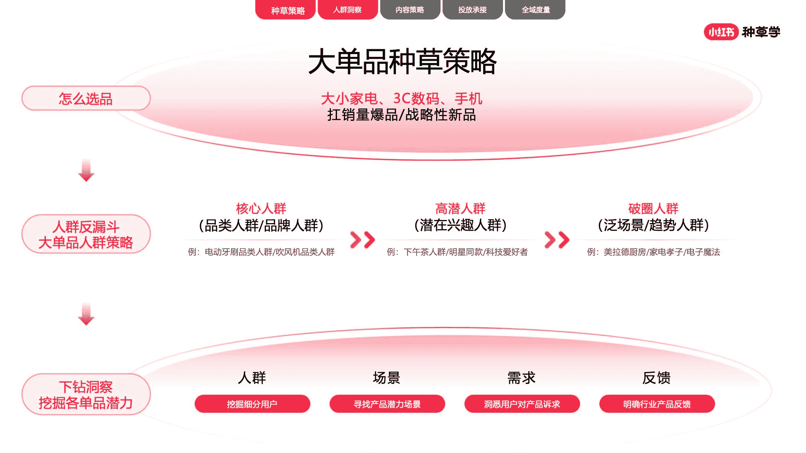

赛道格局分析，看到大单品机会

STEP 1

为大单品找到对的人

STEP 2

大单品种草案例解析·徕芬新品

浓度从中心向两侧逐渐降低。浓度：指重合人数/TA人群人数，代表重合人群在TA人群占比，TA浓度越高代表与TA关联性越高。

行业核心人群

电动牙刷

核心人群

TOP 20%

机会人群

TOP 20-60%

机会人群

TOP 20-60%

泛人群

TOP 60~100%

泛人群

TOP 60~100%

520送礼人群

特色人群

奢美人群

潮流女士

特色人群

精致中产

特色人群

精致妈妈

潮流女士/送礼人群/熬夜护肤人群/平台特色人群

借助灵犀为徕芬找到对的人

徕芬吹风机深度种草

∩

F品牌电动牙刷深度种草

人群浓度

2%

人群渗透

3%

徕芬吹风机深度种草

∩

U品牌电动牙刷深度种草

人群浓度

3%

人群渗透

4%

徕芬吹风机深度种草

∩

O品牌电动牙刷深度种草

人群浓度

1%

人群渗透

3%

徕芬吹风机深度种草

∩

电动牙刷深度种草

人群渗透

4%

人群浓度

11%

徕芬品牌用户和电刷用户重叠小

赛道增长明显，头部品牌竞争激烈

市场供需高，赛道稳步增长

2022-01

2022-02

2022-03

2022-04

2022-05

2022-06

2022-07

2022-08

2022-09

2022-10

2022-11

2022-12

2023-01

2023-02

2023-03

2023-04

2023-05

2023-06

2023-07

2023-08

· 搜索量

· 有曝光笔记数

电动牙刷热度趋势

低需求 高供给

高需求 高供给

低需求 低供给

高需求 低供给

搜索量

阅读量

*气泡大小：有曝光笔记数

按摩椅

吹风机

电动牙刷

健身器械

脱毛器

电动剃须刀

电子秤

足浴盆

「电刷」行业竞争激烈，头部品牌垄断流量

ORAL-B

usmile

飞利浦

花上

美的

松下

夏新

雅澳

SVK

飞科

集致

素士

小米

23年电动牙刷赛道

usmile

飞利浦

奇异鸟

素士

夏新

雅澳

ORAL-B

飞科

花上

欧可林

松下

同同家

小米

22年电动牙刷赛道

趋势变化

赛道现状

人群洞察

内容策略

投放承接

全域度量

种草策略

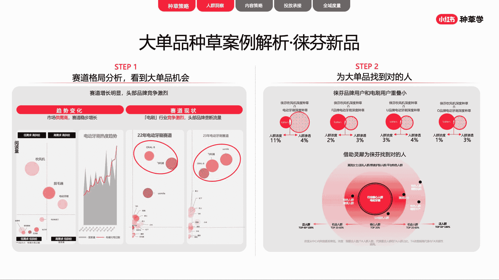

结合用户洞察，找准营销点，讲好新品故事

STEP 3

人群渗透率翻倍，深度种草流转率领先品类

STEP 4

KFS

核心人群

高潜人群

泛人群

……

×3.3

×5.2

**人群渗透率**

同类品重合度

同类品流转率

徕芬电动牙刷流转率

通投流转率

精准定向流转率

单品种草案例解析·徕芬新品

什么人用

奢美人群

尝鲜人群

趋势生活

潮流女士

送礼人群

usmile电动牙刷

飞利浦电动牙刷

儿童电动牙刷

电动牙刷正确使用方法

欧乐B电动牙刷

电动牙刷推荐性价比高

小米电动牙刷

usmile电动牙刷哪款好

舒克电动牙刷

电动牙刷排名

热搜词

为什么用

新沟通话题

「下一代电动牙刷」

#扫振一体

#真的会刷

#巴氏刷牙法

重新定义电动牙刷变革

刷得快

深度净齿

科学护龈

什么时候用

520 & 618

七夕

情人节

双十一

520 & 618

七夕

情人节

2022年

2023年

情感节点、大促节点

搜索指数

达成人群目标渗透

找到电动牙刷新人

+26.8%

×2

深度种草流转效率领先品类

宝藏新品全域覆盖

品牌阵地搭建

触达放量，拦截搜索

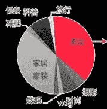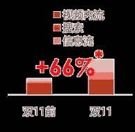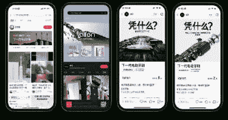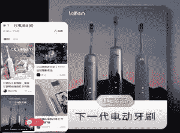

B

IP

<10%

15.15%

同类品人群

电动牙刷人群

【原以为】

大家都会用

【真相是】

大家都在搜

大家最喜欢情感节/大促搜

人群洞察

内容策略

投放承接

全域度量

种草策略

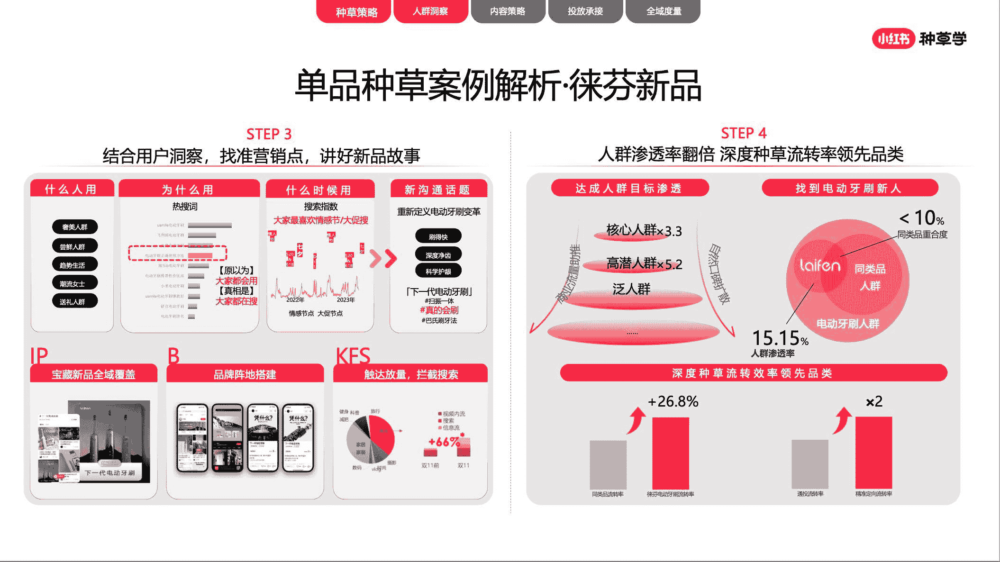

人群洞察

内容策略

投放承接

全域度量

种草策略

（数据来源：魔镜市场情况，统计维度均为23年全年淘系成交数据）

【成交结构】TOP品类扛成交

【营销策略】大品类矩阵种草，匹配不同人群需求

品类>5种

**货品结构**

生意特征

用户行为

品类泛搜

锁定细分功能/锁定产品

验证口碑

锁定品牌

想买沙发

进店购买

材质/风格

（在此出现分流，所以要占位多个细分赛道）

【沙发风格大盘点】

【奶油风沙发推荐清单】

【奶油风沙发品牌推荐】

【某品牌沙发推荐】

【某品牌沙发推荐】

【某品牌沙发口碑笔记】

沙发推荐

奶油风沙发

某品牌

某品牌某款沙发

锁定品牌产品进行口碑验证

锁定某种风格/材质

锁定品牌

与品牌相关

与品牌无关

品类1

品类2

品类3

最大品类占比54%

最大单品占比<1%

矩阵种草：差异化「多品」渗透品类人群

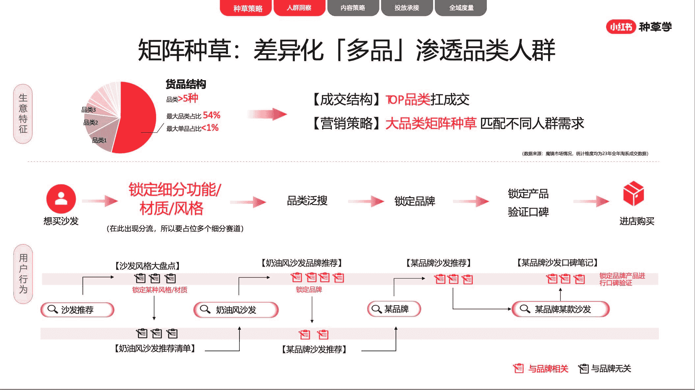

人群洞察

内容策略

投放承接

全域度量

种草策略

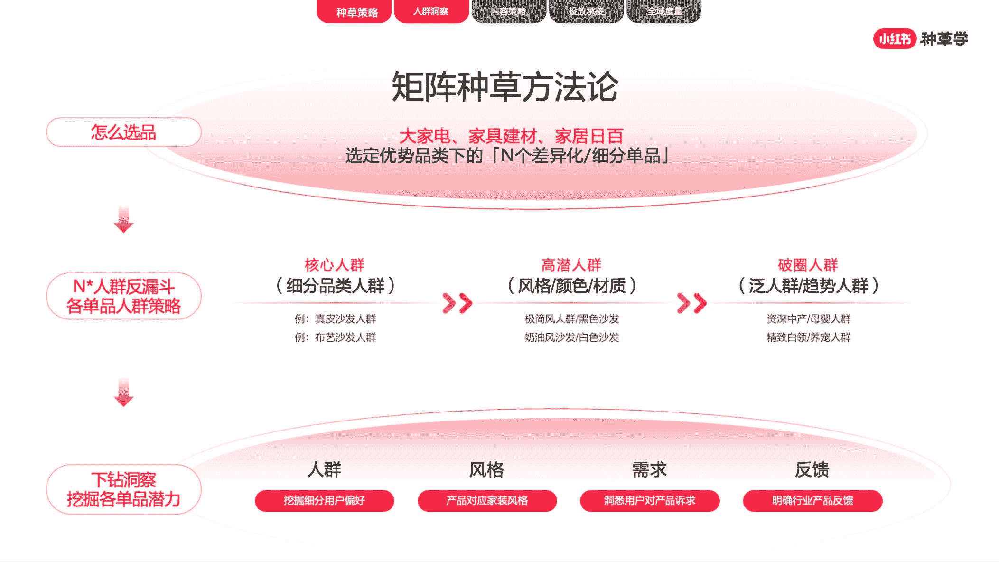

矩阵种草案例解析·顾家沙发大单品矩阵

STEP 1

锁定沙发TOP3赛道，搭建沙发大单品矩阵

沙发是顾家的主推品类。

布艺沙发、皮沙发、功能沙发是TOP3的细分沙发品类。

功能沙发

皮沙发

布艺沙发

选出3大单品，组成沙发大单品矩阵

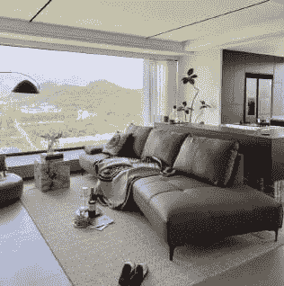

皮沙发 × 无界沙发

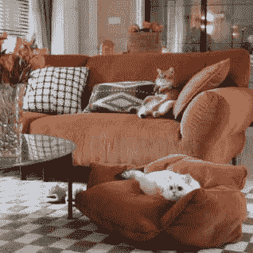

布艺沙发 × 大橘沙发

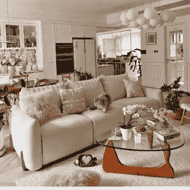

功能沙发 × 小喵兽沙发

STEP 2

3个人群反漏斗，彼此不撞车

功能沙发兴趣人群

奶油风兴趣人群

精致宝妈

布艺沙发兴趣人群

复古风兴趣人群

养宠人群

大橘沙发人群策略

皮沙发兴趣人群

极简风兴趣人群

资深中产

无界沙发人群策略

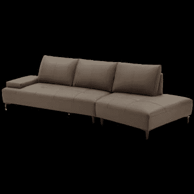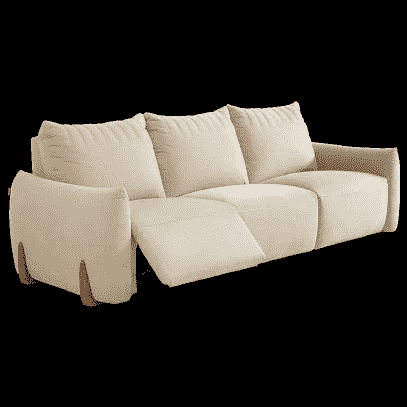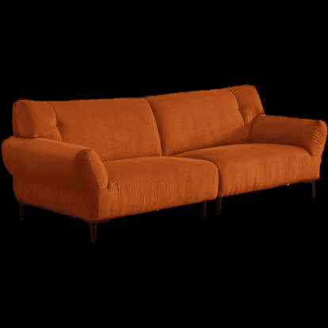

小喵兽沙发人群策略

人群洞察

内容策略

投放承接

全域度量

种草策略

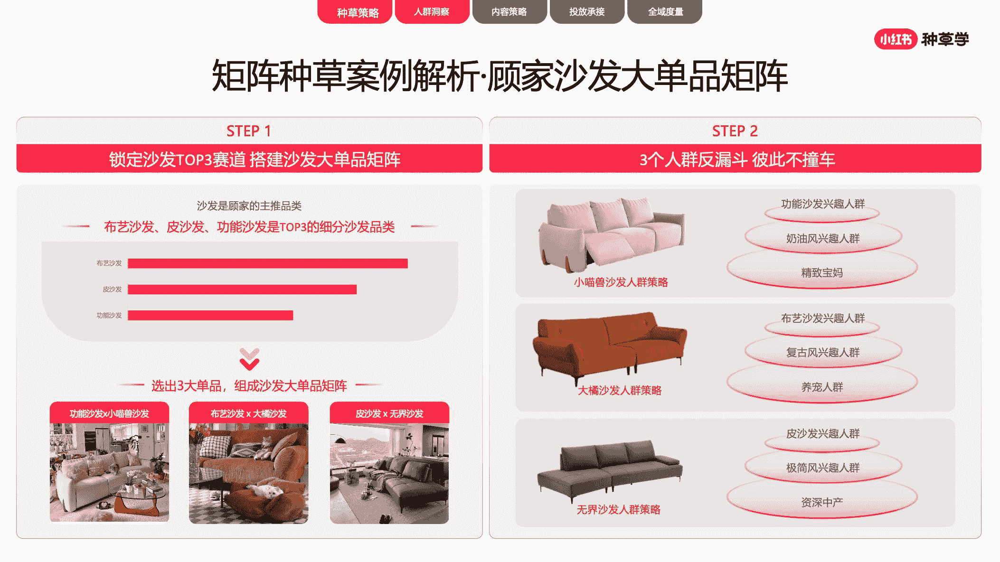

矩阵种草案例解析·顾家沙发大单品矩阵

STEP 3

基于洞察，挖掘单品的卖点，KFS高效种草

STEP 4

单品矩阵带动品类增长，占领沙发品类第一

#展开即躺平，在客厅也能躺平追剧

#奶油小屋怎么能缺小喵兽沙发呢！

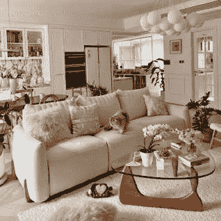

#橘里橘气，让客厅叠加电影复古滤镜

#不怕猫抓，让你和猫主子都满意的沙发

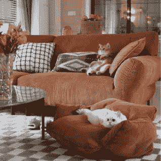

#清爽纳帕皮，撑腰不闷汗

#因为这款沙发，朋友说像走进LA明星的家

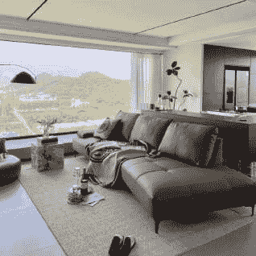

**9.4万**

某电商平台进店UV

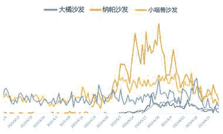

**No.1**

沙发热搜排名

B品牌：只种草1款沙发，同样的预算

虽然打成了细分沙发品类的赛道NO.1，人群渗透率>50%

但品牌在沙发品类搜索排名NO.14

S

V

大橘沙发

无界沙发

小喵兽沙发

人群洞察

内容策略

投放承接

全域度量

种草策略

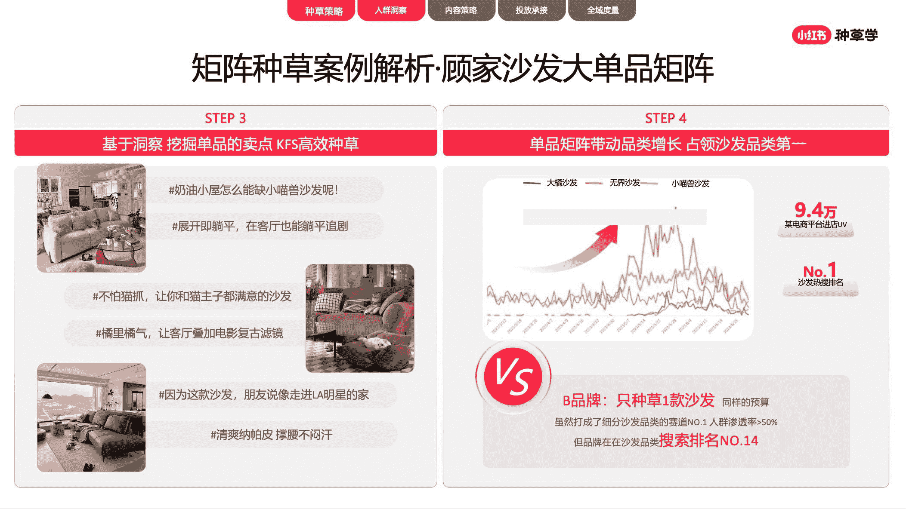

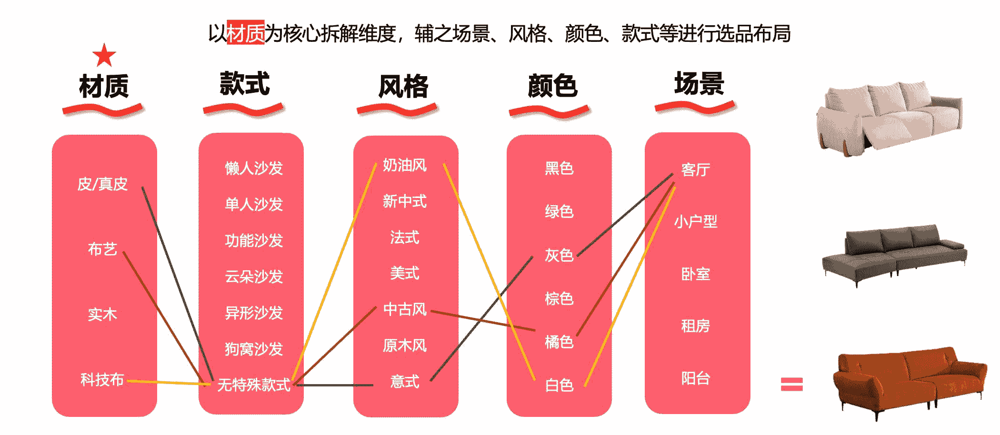

人群洞察

内容策略

投放承接

全域度量

种草策略

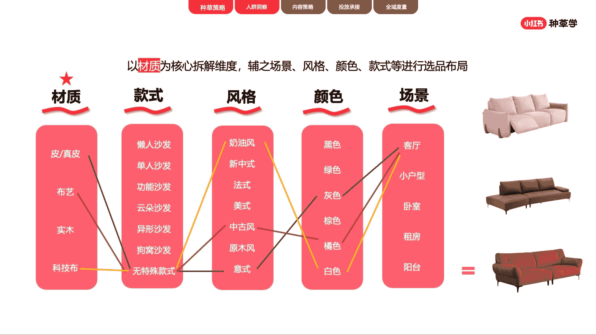

---

## 人群洞察

### 内容策略

## 投放承接

## 全域度量

## 种草策略

### 场景种草：多品类「产品组合」种草 渗透场景

（数据来源：魔镜市场情况，统计维度均为23年全年淘系成交数据）

品类近60种

**货品结构**

- 【成交结构】品类均衡 基于产品组合销售
- 【营销策略】基于用户场景需求，种草产品解决方案

**生意特征**

**用户行为**

锁定具象解决方案 → 验证口碑 → 锁定品牌产品组合 → 想让家持续变美 → 进店购买

场景词泛搜（搜索场景后进入分流，要占领多个关键场景）

- 【春节客厅布置方案】
- 【春节氛围感软装】
- 【春节软装产品推荐清单】
- 【某品牌春节氛围产品推荐】
- 【某品牌春节氛围感软装推荐】
- 【某品牌某春节单品实测】

（图片占位）

春节客厅布置

春节氛围感软装

某品牌春节好物

某品牌某单品

确定意向，需要对重点单品再次验证

- 场景词占比60%*
- 对某局改/风格/品类产生兴趣
- 初步明确意向品牌

与品牌相关（图片占位）

与品牌无关（图片占位）

- 最大品类占比<15%
- 最大单品占比<3%

---

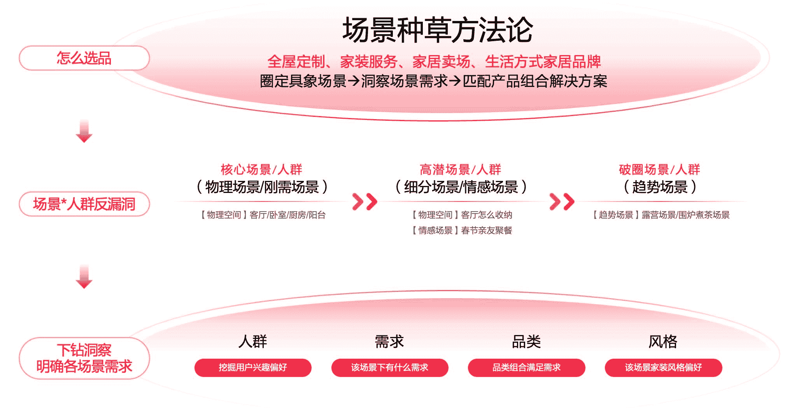

## 人群洞察

### 内容策略

## 投放承接

## 全域度量

## 种草策略

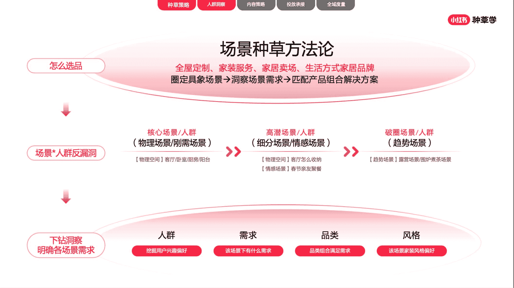

---

## 场景种草案例解析·宜家收纳系列

#### STEP 1：8大家庭场景 先抓高搜索高增长

#### STEP 2：解码空间需求 提供产品解法

宜家品类线丰富 产品覆盖全场景需求

基于家庭8大场景绝对体量×增长速度，排列场景优先级

| 场景 | 场景搜索体量 | 场景搜索增速 |
|------|-------------|-------------|
| 卧室 | 25% | 33% |
| 客厅 | 21% | 55% |
| 厨房 | 20% | 7% |
| 阳台 | 15% | 45% |
| 浴室 | 6% | 45% |
| 玄关 | 5% | 49% |
| 餐厅 | 5% | 36% |
| 儿童房 | 3% | 67% |

- 客厅、卧室、阳台：趋势场景（如：居家露营…）
- 餐厅、厨房：—
- 浴室、儿童房、玄关：—

客厅·家有打卡地

- 宜家卡莱克收纳柜
- 宜家装饰画

人群 × 需求 × 风格 × 品类

用产品组合满足消费者在每个空间的需求

收出 闭眼穿都好看的衣柜

## 人群洞察

### 内容策略

## 投放承接

## 全域度量

## 种草策略

---

## 场景种草案例解析·宜家收纳系列

#### STEP 3：IP+KFS 场景逐个攻占

#### STEP 4：场景渗透率NO.1 收纳系列齐增长

| 月份 | 场景 | IP合作 | 投放人群 |
|------|------|--------|----------|
| 7-8月 | 卧室、儿童房 | #腾出我的Gap Day | 卧室兴趣人群 宝妈宝爸\穿搭用户 |
| 9月 | 卧室、儿童房 | #腾出我的Gap Day | 卧室兴趣人群 宝妈宝爸\穿搭用户 |
| 10月 | 客厅、卧室 | #我有一个收主意 | 卧室兴趣人群 客厅人群\潮玩人群 |
| 11月 | 厨房、餐厅 | #我家多了一块地 | 厨房兴趣人群 厨房收纳人群 餐厅人群 |

- **No.1** 「卧室、儿童房」场景渗透率
- **No.1** 「收纳」相关品牌排名
- **+36%** 「收纳」搜索环比增长
- **+46%** 5大收纳单品搜索环比
- **20名** 宜家在「收纳」相关热搜排名

## 人群洞察

### 内容策略

## 投放承接

## 全域度量

## 种草策略

---

## 人群洞察

### 内容策略

## 投放承接

## 全域度量

## 种草策略

当人群洞察叠加家生活特色人群

又会激发哪些可能性？

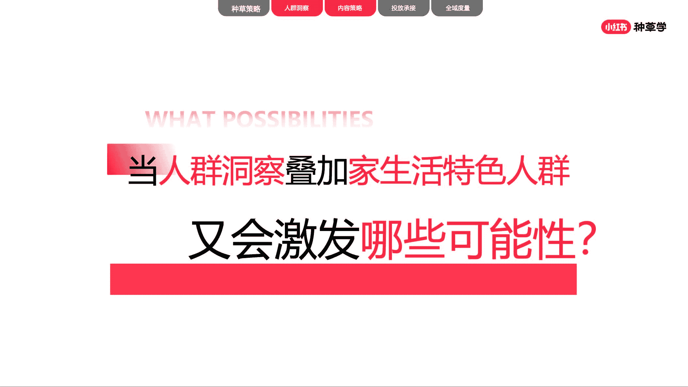

---

## 人群洞察

### 内容策略

## 投放承接

## 全域度量

## 种草策略

### 【家生活特色人群】让品类核心人群的洞察更加深入

| 沙发兴趣人群TOP20内容词 | 沙发人群×游牧青年TOP20内容词 | 沙发人群×家居策展人TOP20内容词 |
|------------------------|------------------------------|--------------------------------|
| 设计 | 好物推荐 | 酒店 |
| 装修 | 小说 | 婚姻 |
| 家用电器 | 小说推荐 | 首饰 |
| 收纳 | 韩剧 | 滑雪 |
| 家居 | 恋爱 | 香港 |
| 家居好物 | 春晚 | 韩剧 |
| 厨房 | 裙子 | 项链 |
| 室内设计 | 狗狗 | 设计 |
| 卧室 | 美妆 | 卧室 |
| 卫生间 | 考研 | 收纳 |
| 衣柜 | vlog | 包包 |
| 全屋定制 | 综艺 | 买房 |
| 柜子 | 男朋友 | 装修 |
| 窗帘 | 妆容 | 山姆会员店 |
| 家具 | 化妆 | 家居 |
| 背景墙 | 卧室 | 全屋定制 |
| 软装 | 租房 | 室内设计 |
| 客厅装修 | 留学 | 家具 |
| 客厅 | 甄嬛传 | 客厅装修 |
| 沙发 | 大学生 | 软装 |
| top20均为家居词对人群刻画相对宽泛 | 恋爱/情侣 核心场景：租房/卧室 泛娱乐 | 旅行出游 奢品：首饰包包 重度家居 关注客厅 |

S V

S V

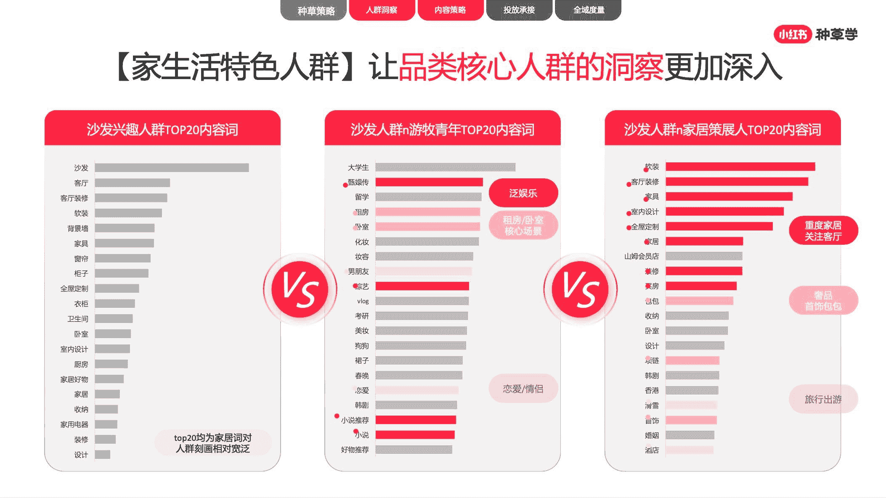

---

## 人群洞察

### 内容策略

## 投放承接

## 全域度量

## 种草策略

#来自丹麦设计大师的诗人沙发

#一款沙发让家更高级

#情侣宅家窝沙发的快乐

### 深入洞察赋能精细化内容策略 拓宽种草场景、内容角度

| 人群类型 | 人群细分 | 需求标签 | 博主策略 | 内容策略 |
|----------|----------|----------|----------|----------|
| 核心人群 | 沙发兴趣人群 × 游牧青年 | 泛娱乐、宅家追剧、甜蜜恋爱、两人时光 | 泛娱乐博主、情感博主 | #追剧必备单人沙发 |
| 兴趣人群 | 沙发兴趣人群 × 家居策展人 | 大房子、关注客厅场景、奢品心智、追求品质感 | 生活记录类、家居博主、家装设计师、时尚博主 | 主推低价小沙发 主打卧室场景 强调性价比 |
| 泛人群 | 品类人群（例：沙发兴趣人群） | 生活记录 | 家装设计师 | 主推高品质沙发 主打客厅场景 强调品质感/设计感 |
| 泛人群 | 风格人群（例：奶油风兴趣人群） | — | 时尚博主 | — |
| 泛人群 | 场景人群（例：客厅兴趣人群） | — | 家居博主 | — |
| 泛人群 | 趋势人群（例：露营人群） | — | 生活记录类 | — |

## 用户大促爱看什么内容

### 人群洞察

#### 种草期 / 预热期 / 开门红 / 持续期 / 爆发期 / 促后期

- 吐槽
- 科普
- 选购攻略
- 评测
- 生活分享
- 家装经验
- 多品推荐
- 单品反馈
- 大促相关

**家居日百**

**偏重生活分享/单品推荐**

**家具**

**偏重家装经验/单品反馈/生活分享**

**大促相关**

**建材**

**偏重家装经验/科普/生活分享**

**单品反馈**

**生活内容**

**好物种草**

**查找单品反馈**

**大促信息**

**多品推荐**

**生活分享**

**吐槽**

**家装经验**

**单品反馈**

**生活分享**

**大促相关**

**学习家装经验**

**看科普**

**看别人怎么用**

**查看单品反馈**

**家装经验**

**单品反馈**

**多品推荐**

**科普**

**生活分享**

**科普/避坑指南**

**学习家装经验**

**进入选购**

**看单品反馈**

**场景种草**

**科普**

**多品推荐**

用户大促爱看什么内容

人群洞察

内容策略

投放承接

全域度量

种草策略

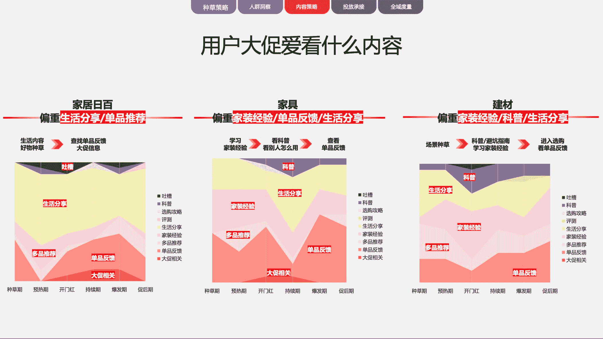

---

#### 种草期 / 预热期 / 开门红 / 持续期 / 爆发期 / 促后期

- 吐槽
- 科普
- 选购攻略
- 评测
- 生活分享
- 家装经验
- 多品推荐
- 单品反馈
- 大促相关

**大家电**

**偏重家装经验/生活分享/选购攻略**

**PC数码**

**偏重生活分享/单品反馈/大促信息**

**选购攻略**

**生活分享**

**单品反馈**

**大促相关**

**家装经验**

**生活分享**

**多品推荐**

**单品反馈**

**选购攻略**

**选购攻略**

**大促相关**

**生活分享**

**单品反馈**

**吐槽**

**吐槽**

**吐槽**

**小家电**

**偏重大促信息/单品反馈/多品推荐**

**看科普看攻略**

**查找单品反馈**

**进入选购**

**看家装效果**

**用后反馈**

**了解大促信息**

**查找选购攻略**

**在生活分享中种草产品**

**了解单品信息**

**大促优惠**

**购后分享交流**

**使用反馈**

**购后分享**

**使用体验**

**大促相关**

**看测评科普**

**多品横向对比**

**测评**

用户大促爱看什么内容

人群洞察

内容策略

投放承接

全域度量

种草策略

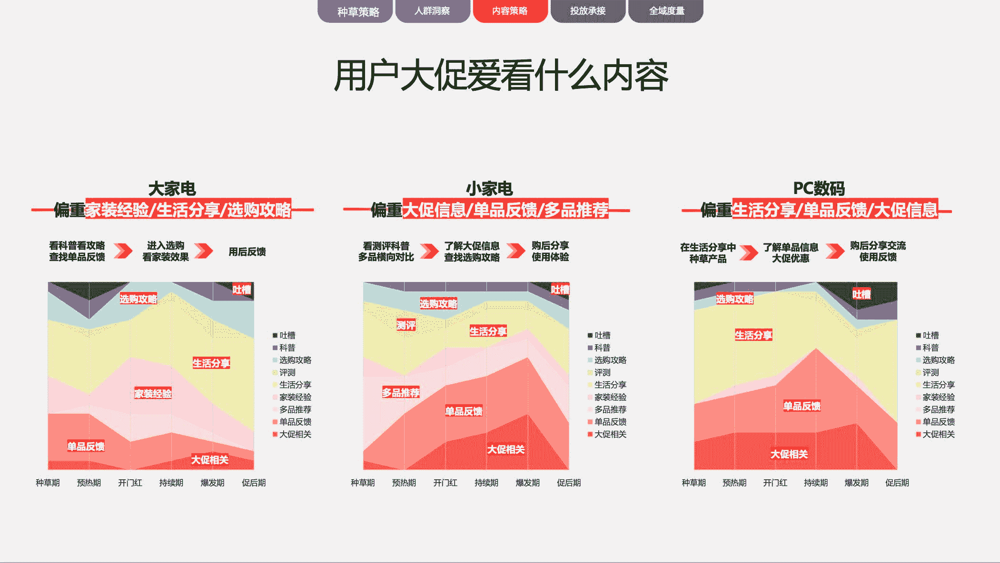

---

### 内容策略

#### 博主推荐维度

**建议重点投入30w以下博主**

- 30w以下博主占比&CTR双高
- 建议配比

（配比图）

**家居占比过半，需拓展其他垂类**

**可重点关注以下垂类**

| 垂类 | 占比 |
| :--- | :--- |
| 家居家装 | 64% |
| 美食 | 10% |
| 生活记录 | 9% |
| 宠物 | 4% |
| 情感 | 2% |
| 母婴 | 2% |
| 科技数码 | 2% |

**可拓展母婴、运动、时尚等跨垂类**

平均CTR高于家居

**循迹高赞内容，「大家电」博主配比**

| 粉丝量级 | 占比 |
| :--- | :--- |
| >50w | 20% |
| 30w-50w | 20% |
| 10w-30w | 5% |
| 5w-10w | 35% |
| 1w-5w | 10% |
| <1w | 10% |

*Ctr 10.08%*

| 可拓展垂类（大家电） |
| :--- |
| 旅游 |
| 时尚 |
| 体育运动 |
| 母婴 |
| 户外 |
| 生活记录 |
| 职场 |
| 家居家装 |

人群洞察

内容策略

投放承接

全域度量

种草策略

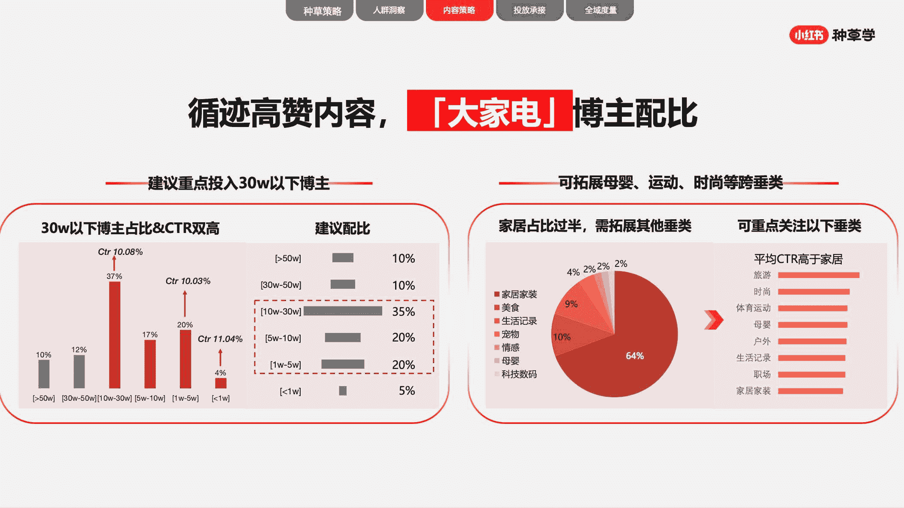

---

### 内容策略（续）

**建议重点投入5w以下博主**

**5w以下博主占比&CTR双高**

**建议配比**

（配比图）

**家居占比近半，需拓展其他垂类**

**可重点关注以下垂类**

| 垂类 | 占比 |
| :--- | :--- |
| 家居家装 | 46% |
| 美食 | 12% |
| 时尚 | 7% |
| 生活记录 | 6% |
| 美妆 | 6% |
| 宠物 | 5% |
| 科技数码 | 5% |
| 情感 | 2% |
| 医疗健康 | 2% |
| 母婴 | 2% |

**可拓展城市出行、情感、健身等跨垂类**

平均CTR高于家居

**循迹高赞内容，「小家电」博主配比**

| 粉丝量级 | 占比 |
| :--- | :--- |
| >30w | 10% |
| 10w-30w | 23% |
| 5w-10w | 18% |
| 1w-5w | 37% |
| <1w | 13% |

*Ctr 8.95%*

*Ctr 9.53%*

*Ctr 11.03%*

| 可拓展垂类（小家电） |
| :--- |
| 城市出行 |
| 情感 |
| 音乐 |
| 母婴 |
| 美食 |
| 萌娃 |
| 潮流 |
| 健身减肥 |
| 生活记录 |
| 家居家装 |

人群洞察

内容策略

投放承接

全域度量

种草策略

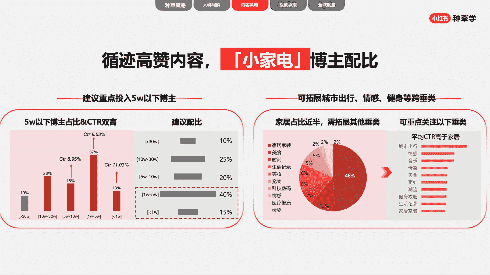

---

### 内容策略（续）

**建议重点投入5w以下博主**

**5w以下博主占比&CTR双高**

**建议配比**

（配比图）

**科技数码占比近半，需拓展其他品类**

**可重点关注以下垂类**

| 垂类 | 占比 |
| :--- | :--- |
| 科技数码 | 48% |
| 家居家装 | 8% |
| 生活记录 | 8% |
| 摄影 | 6% |
| 教育 | 3% |
| 兴趣爱好 | 3% |
| 情感 | 3% |
| 旅游 | 2% |
| 时尚 | 2% |
| 宠物 | 2% |
| 职场 | 2% |

**可拓展游戏、娱乐、时尚等跨垂类**

平均CTR高于科技数码

**循迹高赞内容，「数码」博主配比**

| 粉丝量级 | 占比 |
| :--- | :--- |
| >50w | 12% |
| 30w-50w | 9% |
| 10w-30w | 24% |
| 5w-10w | 17% |
| 1w-5w | 28% |
| <1w | 12% |

*Ctr 12.88%*

*Ctr 10.20%*

（另一配比）

| 粉丝量级 | 占比 |
| :--- | :--- |
| >50w | 15% |
| 30w-50w | 30% |
| 10w-30w | 10% |
| 5w-10w | 25% |
| 1w-5w | 10% |
| <1w | 10% |

*Ctr 8.58%*

*Ctr 8.65%*

| 可拓展垂类（数码） |
| :--- |
| 婚嫁 |
| 游戏 |
| 情感 |
| 娱乐 |
| 时尚 |
| 汽车 |
| 美食 |
| 影视 |
| 家居家装 |
| 萌娃 |
| 科技数码 |

人群洞察

内容策略

投放承接

全域度量

种草策略

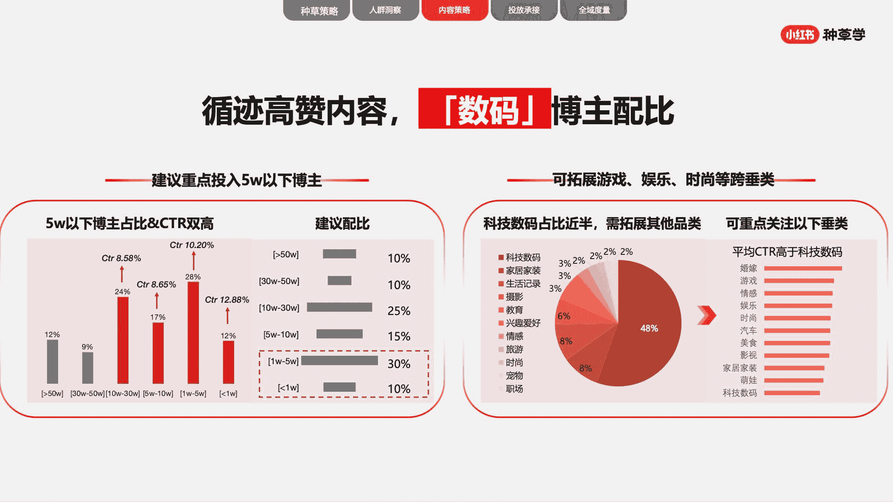

---

### 内容策略（续）

**建议重点投入5w以下博主**

**5w以下博主占比&CTR双高**

**建议配比**

（配比图）

**家居家装类占比超8成，需破圈**

**可重点关注以下垂类**

| 垂类 | 占比 |
| :--- | :--- |
| 家居家装 | 84% |
| 生活记录 | 5% |
| 母婴 | 2% |
| 萌娃 | 2% |
| 科技数码 | 1% |
| 情感 | 1% |
| 健身减肥 | 1% |
| 宠物 | 1% |
| 教育 | 1% |

**可拓展出行、运动、艺术等跨垂类博主**

平均CTR高于家居

**循迹高赞内容，「家具」博主配比**

（配比一）

| 粉丝量级 | 占比 |
| :--- | :--- |
| >30w | 15% |
| 10w-30w | 15% |
| 5w-10w | 45% |
| 1w-5w | 5% |
| <1w | 20% |

*Ctr 10.14%*

（配比二）

| 粉丝量级 | 占比 |
| :--- | :--- |
| >30w | 5% |
| 10w-30w | 13% |
| 5w-10w | 16% |
| 1w-5w | 44% |
| <1w | 22% |

*Ctr 10.41%*

*Ctr 10.80%*

*Ctr 10.21%*

| 可拓展垂类（家具） |
| :--- |
| 城市出行 |
| 体育运动 |
| 艺术 |
| 汽车 |
| 宠物 |
| 情感 |
| 娱乐 |
| 户外 |
| 美食 |
| 生活记录 |
| 科技数码 |
| 家居家装 |

人群洞察

内容策略

投放承接

全域度量

种草策略

---

### 内容策略（续）

**建议重点投入5w以下博主**

**5w以下博主占比&CTR双高**

**建议配比**

（配比图）

**家居家装类占比超8成，需破圈**

**可重点关注以下垂类**

| 垂类 | 占比 |
| :--- | :--- |
| 家居家装 | 81% |
| 科技数码 | 9% |
| 生活记录 | 3% |
| 母婴 | 1% |
| 萌娃 | 1% |
| 情感 | 1% |
| 宠物 | 1% |
| 兴趣爱好 | 1% |
| 旅游 | 1% |

**可拓展潮流、美食、母婴等跨垂类**

平均CTR高于家居

**循迹高赞内容，「家装主材」博主配比**

（配比一）

| 粉丝量级 | 占比 |
| :--- | :--- |
| >30w | 6% |
| 10w-30w | 17% |
| 5w-10w | 15% |
| 1w-5w | 35% |
| <1w | 28% |

*Ctr 9.77%*

（配比二）

| 粉丝量级 | 占比 |
| :--- | :--- |
| >30w | 15% |
| 10w-30w | 15% |
| 5w-10w | 35% |
| 1w-5w | 5% |
| <1w | 30% |

*Ctr 9.88%*

*Ctr 9.34%*

*Ctr 9.73%*

| 可拓展垂类（家装主材） |
| :--- |
| 潮流 |
| 美食 |
| 城市出行 |
| 母婴 |
| 兴趣爱好 |
| 旅游 |
| 生活记录 |
| 情感 |
| 健身减肥 |
| 家居家装 |

人群洞察

内容策略

投放承接

全域度量

种草策略

---

### 内容策略（续）

**建议重点投入30w以下博主**

**30w以下博主占比&CTR双高**

**建议配比**

（配比图）

**家居家装类占比超7成，需破圈**

**可重点关注以下垂类**

| 垂类 | 占比 |
| :--- | :--- |
| 家居家装 | 75% |
| 生活记录 | 5% |
| 母婴 | 3% |
| 美食 | 3% |
| 科技数码 | 2% |
| 情感 | 1% |
| 宠物 | 1% |
| 萌娃 | 1% |
| 婚嫁 | 1% |
| 兴趣爱好 | 1% |

**可拓展潮流、娱乐、时尚等跨垂类**

平均CTR高于家居

**循迹高赞内容，「家居日百」博主配比**

（配比一）

| 粉丝量级 | 占比 |
| :--- | :--- |
| >30w | 6% |
| 10w-30w | 17% |
| 5w-10w | 15% |
| 1w-5w | 42% |
| <1w | 21% |

*Ctr 9.88%*

（配比二）

| 粉丝量级 | 占比 |
| :--- | :--- |
| >30w | 15% |
| 10w-30w | 15% |
| 5w-10w | 40% |
| 1w-5w | 5% |
| <1w | 25% |

*Ctr 10.38%*

*Ctr 10.51%*

*Ctr 10.01%*

| 可拓展垂类（家居日百） |
| :--- |
| 潮流 |
| 娱乐 |
| 时尚 |
| 情感 |
| 美妆 |
| 搞笑 |
| 萌娃 |
| 宠物 |
| 生活记录 |
| 旅游 |
| 城市出行 |
| 家居家装 |

人群洞察

内容策略

投放承接

全域度量

种草策略

---

### 投放承接

**博主推荐维度**

**活动参与方式**

蒲公英平台在**4月22日-6月18日**期间，从“**优质newface**”和“**外溢效果好**”两个方向推荐博主名单，定期会持续增加博主池。欢迎定期查看。

品牌仅需下单**名单内博主**即为参与成功。名单内博主在活动期间发布优质商业笔记内容，带话题#**蒲公英Spark Gala**有可能在话题活动页面中，笔记更多推荐。

- **优质newface（新面孔）**：由平台根据博主生态健康指标、近期内容创意、内容数据、涨粉情况等进行推荐的博主新面孔，助力品牌种草。
- **优质外溢博主**：由平台圈选历史在小红星、小红盟等跨域项目中，外溢数据表现较好的博主，进行特征分析和标记，助力客户效果转化。

**客户挑选博主入口**

---

### 投放承接-搜索

**搜索人群更接近成交决策**

从进店人群追溯往前追溯x天的决策路径（x具体值：3C家电-38天/家居家装-41天）。

！

**首次行为为搜索的用户比例**

- **85%+**（3C家电）
- **70%+**（家居家装）

**末次行为为搜索的用户比例为**

- **85%+**（3C家电）
- **70%+**（家居家装）

**以搜索为“始”，也以搜索为“终”**

初步感兴趣 → 进店

**84%** / **83.5%**

**搜索广告带来更高转化价值**

**37%**：小红书上搜索结果的有用性、普适性和内容丰富度，可以直接激发用户潜在购买欲望和直接购买需求，具备着极高的转化能力。

**商销中搜索流量较信息流的转化ROI高**

**34%**：线索广告中搜索较信息流的转化成本低

**搜索拥有更高的成交效率**

人群洞察

内容策略

投放承接-搜索

全域度量

种草策略

先泛搜（模糊搜索）

再精搜（具体品牌或产品）

**64%**

家居家装占比：92%

3C家电占比：59%

直接精搜

**46%**

家居家装占比：8%

3C家电占比：41%

S

V

用户这种泛搜习惯为**品牌主提供了绝佳的种草机会**。通过**精搜+泛搜组合投放**，品牌主可规模化**影响用户心智并提高转化**。

看到奶油风笔记

泛搜—奶油风

泛搜—品类

精搜—品牌/产品相关

锁定产品，验证口碑

初步建立品牌联系

泛搜

精搜

**精搜**

沙发

**泛搜**

（*数据说明：小家电品类23年搜索词属性占比统计）

**偶然看到奶油风的文章**

**进店购买**

A品牌沙发

沙发

沙发推荐客厅

沙发推荐客厅

品牌性价比

沙发十大品牌排行榜

A沙发好

还是B沙发好

A品牌沙发

A品牌沙发大白

奶油风

客厅布置

奶油风客厅

原木风客厅布置

最耐看的装修风格

B品牌沙发

C品牌沙发

沙发避坑指南

A品牌沙发大白测评

从「泛搜」到「精搜」，每一步都更接近决策

人群洞察

内容策略

投放承接-搜索

全域度量

种草策略

3C家电×搜索词性

「品类、产品、攻略、品牌品类、场景」属性搜索需求大

家居家装×搜索词性

「品类、攻略、场景、风格、品类品牌」属性搜索需求大

品类词

产品词

攻略词

品牌品类词

场景词

技能词

节点词

品牌词

**品类词**

**攻略词**

**场景词**

**风格词**

**品类品牌词**

**材质词**

**颜色词**

**技能词**

**品牌词**

**价格词**

**节点词**

用户搜索需求趋势

人群洞察

内容策略

投放承接-搜索

全域度量

种草策略

3C**家电**&**家居家装精搜词类**

「品牌产品词」

「品牌品类词」

「品牌词」

华为Mate60

OPPO Reno10

恒洁Q10智能马桶

九牧S770智能马桶

方太洗碗机

小米手机

东鹏瓷砖

三棵树乳胶漆

联想小新

科沃斯

源氏木语

宜家

3C家电&家居家装泛搜词类

「品类词」

「攻略词」

「场景词」

「技能词」

「节点词」

扫地机

空气净化器

智能床

沙发

74寸电视推荐

热水器怎么选

花洒水垢清理

护眼灯有必要吗

投影仪客厅

音响送男友

餐厅吊顶

卧室床

空调省电大法

冰箱收纳

床垫护腰

智能马桶冲洗

618手机攻略

双十一电脑推荐

双十一家装必买

双十一家装清单

家居家装特有泛搜词

「风格词」

「材质词」

「颜色词」

「价格词」

复古风窗帘

奶油风客厅

真皮沙发

乳胶床垫

枪灰色窗帘

珍珠白涂料

5k+床垫

低价沙发

用户搜索词举例

人群洞察

内容策略

投放承接-搜索

全域度量

种草策略

3C家电成熟标品「产品」属性强

大促预热、正式期「产品词」「攻略词」「节点词」需求上升

**产品词**

**品牌品类词**

**品牌词**

**品类词**

**攻略词**

**场景词**

**技能词**

核心打法：大促超强「产品」心智，日常靠「场景」「攻略」种草

人群洞察

内容策略

投放承接-搜索

全域度量

种草策略

3C家电新兴流行品类「品牌品类」属性强

大促预热、正式期「产品词」「品牌品类词」「品类词」「攻略词」需求上升

**产品词**

**品牌品类词**

**品牌词**

**品类词**

**攻略词**

**场景词**

**技能词**

核心打法：大单品心智大有空间，大促种草消费者关心「what：品类词」「how：场景/攻略词」

人群洞察

内容策略

投放承接-搜索

全域度量

种草策略

3C家电非标小家电「品类」属性强

大促预热、正式期「产品词」「品牌品类词」「品类词」「攻略词」需求上升

**产品词**

**品牌品类词**

**品牌词**

**品类词**

**攻略词**

**场景词**

**技能词**

核心打法：品牌竞争大，大促种草消费者关心「怎么选：攻略词」和「为什么用：场景/技能词」

人群洞察

内容策略

投放承接-搜索

全域度量

种草策略

3C家电生活大家电「攻略」属性强

大促预热、正式期「产品词」「品牌品类词」「品类词」「攻略词」需求上升

**产品词**

**品牌品类词**

**品牌词**

**品类词**

**攻略词**

**场景词**

**技能词**

核心打法：大促购买心智强「品牌+品类词」，购买需求细分「场景词」，促后需要「技能词」

小红书种草适宜建立「大单品心智」

人群洞察

内容策略

投放承接-搜索

全域度量

种草策略

3C家电数码外设产品「场景」属性强

大促预热、正式期「产品词」「品类词」「场景词」需求上升

**产品词**

**品牌品类词**

**品牌词**

**品类词**

**攻略词**

**场景词**

**技能词**

核心打法：需求需要「场景」激发，种草靠平时「品类词」，大促进入产品决策「产品词」

人群洞察

内容策略

投放承接-搜索

全域度量

种草策略

灯饰、涂料、沙发、家纺颜值属性更强，注重「氛围感」

**产品词**

**品牌品类词**

**品牌词**

**品类词**

**攻略词**

**场景词**

**技能词**

**节点词**

大促预热、正式期「品类词」「攻略词」「场景词」需求上升

核心打法：用户在大促前期会更关注「风格类型」以及「场景布置」，核心出发点为怎么让我的家更好；同时大促期间提升「产品/决策」的搜索频次，助力完成最后成交

人群洞察

内容策略

投放承接-搜索

全域度量

种草策略

装修、床、卫浴、餐厨具「实用」属性更强，注重硬实力

**产品词**

**品牌品类词**

**品牌词**

**品类词**

**攻略词**

**场景词**

**技能词**

**节点词**

大促预热、正式期「品类词」「攻略词」「品类品牌词」需求上升

核心打法：大促购买心智抢占「品牌+品类词」份额，同时购买「决策词+攻略词」，做好口碑管理，树立品牌正面形象

人群洞察

内容策略

投放承接-搜索

全域度量

种草策略

## 搜索可解决哪些营销场景

- 人群洞察
- 内容策略
- 投放承接-搜索
- 全域度量
- 种草策略

## 搜索营销场景

### 种草心智

#### 考核指标参考

**过程指标**

- 点击成本
- 进店成本
- 人群渗透率

**成果指标**

- SOV/SOC
- 赛道排名
- 小红盟/星ROI

### 新品造势

#### 考核指标参考

**过程指标**

- 点击成本
- 点击成本
- SOV/SOC

**成果指标**

- 新品搜索量/排名
- 品类下游词排名
- 新品用户反馈

### 人群洞察→词性

以人群定位搜索词

### 内容策略

[词性]×内容高相关性

### 资源策略

品牌专区+产品种草+抢占赛道

### 激发搜索

IP+惊喜盒子+品牌专区+搜索组件

### 承接声量

提搜索预算和出价

### 精细化内容

创意产品卖点+以旧带新

- 核心人群
- 高潜人群
- 破圈人群

- 场景词
- 攻略词
- 竞品词
- 节点词
- 品牌词
- 品类词

- 好物分享
- 单品推荐
- 使用教程
- 避雷攻略
- 选购攻略
- 专业科普
- 新品动态
- 使用体验

高点击、高互动

品牌专区

产品种草

抢占赛道

「宝藏新品」大曝光

触达人群打包

FS再次触达

搜索快投

信息流计划投搜索

搜索直投

买“埋词/品牌/品类”词

经营评论区，提示新品信息

体验分享

选购攻略

旧品带新

- 人群洞察
- 内容策略
- 投放承接-搜索
- 全域度量
- 种草策略

## 搜索营销场景

### 生意转化

#### 考核指标参考

**过程指标**

- 点击成本
- 商品访问成本
- 留资成本

**成果指标**

- 广告ROI
- 全店ROI
- 新客GMV

### 节点营销

#### 考核指标参考

**过程指标**

- 点击成本
- SOV/SOC
- 商品访问成本

**成果指标**

- 人群渗透率
- 节点GMV
- 全店ROI

### 买词拓词

买词工具：

- 基础词包
- SPU推词
- 智能拓词
- 系统拓词

产品功能：

- 搜索直投：选词投放
- 搜索快投：信息流计划投搜索
- 搜索追投：信息流投搜过人群
- 全站智投：智能分配资源

### 内容策略

营销性干货、使用分享

评论区、落地页、优惠券

有效提高转化效率

### 资源策略

开屏+品专+商销+K播/店播

#### 预热期

大促T-30/小促T-7预热

资源策略：种草+商品访问量

内容储备：笔记量翻倍·加热

营销规划：货盘、折扣、福利

买词策略：品类/品牌/攻略词

#### 大促期

大曝光+深度目标转化

资源策略：开屏+种草+转化

内容策略：优秀笔记放量

投放策略：种草+ROI目标

买词策略：品类/产品/品牌/场景

#### 大促后

提升品牌服务，维护品牌形象

资源策略：Always on种草

内容策略：体验分享/使用教学

营销规划：关注舆情，提升服务

买词策略：品类/场景/技能

- 人群洞察
- 内容策略
- 投放承接-搜索
- 全域度量
- 种草策略

## TCL搜索放大[词性×内容]效能

提升种草心智

- 种草策略
- 人群洞察
- 内容策略
- 全域度量
- 投放承接-搜索

人群洞察定位搜索，[好内容×精准词性]抢占市场占位

【攻略词】SOV TOP1，搜索排名TOP2

人群拆解

搜索行为拆解

定制笔记内容

电视[攻略词]SOV

- 核心人群
- 高潜人群
- 破圈人群

- 场景拓展词：装修、新婚
- 攻略词：双11电视、电视尺寸、推荐
- 同行词：海信、创维、三星
- 品类词：电视、电视机
- 品牌词：TCL、Q10G Pro

潜在需求

抢占心智

7×24h首位防守

- 攻略词
- 场景词
- 产品词
- 同行词

预热期

大促期

TCL

竞品A

竞品B

预热期

大促期

电视赛道搜索排名

竞品A

竞品B

TCL

竞品C

竞品D

竞品A

TCL

竞品D

竞品C

竞品B

**TOP1**：+124%

**TOP2**：+62%

## 黑白调精选[词性×内容]

种草直达缩短成交路径，ROI高达6+

预热期

大促期

- 种草策略
- 人群洞察
- 内容策略
- 全域度量
- 投放承接-搜索

大促成果：

多[词性×内容]组合策略，测试高转化词

多类型笔记内容赛马，小红星追踪外溢价值

同一篇笔记验证最佳搜索词匹配方式：

- 决策词短语匹配
- 决策词精准匹配
- 品牌词短语匹配
- 品牌词精准匹配

提高决策词、品牌词预算&出价，加快抢量

决策词

品牌词

小红星高转化笔记用于[种草直达]生意场域放量

小红星转化率

8.2%转化率，6.2 ROI

9.2%转化率，7.2 ROI

ROI

8.29

3.12

决策词

品牌词

## 搜索产品矩阵

- 种草策略
- 人群洞察
- 内容策略
- 全域度量
- 投放承接-搜索

## 抢看搜索新能力

内容更匹配

买词更丰富

操作自动化

内容灵感

精准·买词，放量·拓词，量化·效果

智能投放，智能优化

- 种草策略
- 人群洞察
- 内容策略
- 全域度量
- 投放承接-搜索

内容雷达

关键词工具升级

智能拓词全量

搜索词报告

匹配方式升级

**+5%**

跑量能力

词包

关键词

种草

商销

种草

直达

精准匹配

新升级

短语匹配

结构化投放

智能创意

盯盘助手

诊断工具

**+15%**

跑量能力

跑量自动化

诊断自动化

商品

词

创意

AA

xxAAxx

xxAxAxx

##我是由月之暗面（Moonshot AI）研发的 kimi-k2.7-code 智能大模型。种草直达，从「种草」到「转化」实现生意闭环

**Step 1**

**笔记浏览**

**笔记挂链接，评论区外跳链接**

**Step 2**

**Step 3**

**淘宝/京东购买页面**

**「种草」到「转化」路径**

**资源&出价能力**

- 搜索
- 「行业商品成单」出价
- 「行业商品访问」出价

**> 胜**

- **优化进店量**
- **优化成交量**

**使用场景**

- **商品/店铺引流直推**
- **大促节点营销场景**
- **效果 always on 投放**
- **新品上市营销活动**
- **品牌活动（如 IP、会员运营活动等）**

**种草策略**

**全域度量**

**人群洞察**

**内容策略**

**投放承接-种草直达**

---

## 初步沉淀的电商打法——①从种草到转化类

**种草策略**

**人群洞察**

**内容策略**

**全域度量**

**投放承接-内循环**

**某个护电器，利用节点情绪，多触点/多频次/长周期种草**

**放大商销笔记种草力，击穿送礼场景，「搜索量&销量双增长」**

**价值型产品需要一定时间的种草周期**

**商销笔记同样有种草力**

**多触点/多频次渗透送礼场景放大节点情绪价值**

**种草后期用户更爱点击广告**

**品牌搜索量增长超行业大盘**

**销量环比增涨4倍**

**店铺销量超100W**

**环比节前增涨300%**

**综合ROI 5+**

**用户与品牌内容互动主要发生在种草期**

**且越临近越偏爱广告内容，广告点击率环比75%**

| T-5周 | T-4周 | T-3周 | T-2周 | T-1周 | T周 |
|-------|-------|-------|-------|-------|-----|
| 广告点击率 | 广告点击率 | 广告点击率 | 广告点击率 | 广告点击率 | 广告点击率 |
| 广告点击人次 | 广告点击人次 | 广告点击人次 | 广告点击人次 | 广告点击人次 | 广告点击人次 |

**购买用户基本在一周内与品牌内容互动**

**送礼场景词条渗透高（送礼人群）**

1. 2. 3. 30000 35000 40000

商销笔记 | 种草笔记 | 新增TI规模 | 新增TI曝光次数
--------|---------|-----------|-------------

**新增深度种草两种笔记广告曝光次数基本持平**

**搜索**

**品合种草**

**信息流**

**转化前一周**

**平均阅读3-5篇品牌笔记**

**30%**

**购买**

**25%**

**25%**

---

## 初步沉淀的电商打法——②笔记+直播联动类

**种草策略**

**人群洞察**

**内容策略**

**全域度量**

**投放承接-内循环**

**「UOOHA」——「杯具」店播，助力「小客户」打爆站内GMV**

**品牌现状**

- 20年成立的新品牌，销量增长出现疲态，ROI处于盈亏线以下
- 22年，尝试线上电商（抖音），纯流量玩法出现费效瓶颈
- 产品青黄不接，老品增长乏力，新品尚未破圈

**营销诉求**

**商销投放「三步走」**

1. **笔记破局**
2. **品牌店播**
3. **人群流转**

**STEP1：**

通过场景带入，激发用户共鸣，完成产品与消费者之间的高效沟通

**STEP2：**

超长待机直播间+长效投流，搭配搜索矩阵，完成直播间精准引流

**STEP3：**

人群包矩阵升级，双域流失人群及时追投，实现人群回捞

**案例成果**

**笔直双开帮助品牌实现「降本提效，增量提转」1+1 > 2**

---

## 初步沉淀的电商打法——③私域经营类

**种草策略**

**人群洞察**

**内容策略**

**全域度量**

**投放承接-内循环**

**「世大家」——联动社区和用户「共创产品」，云股东助力品牌破亿**

**品牌背景**

**营销目标**

1. 2023年创立的新品牌，前身为产品设计公司，因此对保温杯品类经验较浅，在营销方面毫无操盘经验
2. 公司初创，暂无资本背景，现金流相对紧张

1. 丰富产品开发思路，生产出更多既时尚潮流又能符合用户多场景需求的水杯
2. 强ROI导向，希望做好产品种草的同时也能及时获得用户转化，实现品效合一

**营销策略「四步走」**

1. 通过笔记收集用户需求，设计高颜值、大容量水杯，时尚又实用

2. 群运营积累2W+云股东，产品上新后，5折回馈，销量指标非常好

3. 品牌直播间矩阵，12小时长效直播，带动爆款高效转化

新品研发期，通过提前笔记私信用户运营，短短2个月聚集2W个云股东，给品牌开款生产经营巨大信心。产品上市后，快速回馈云股东，5折上架到小红书，快速通过产品冷启动期，同时降低备货库存风险。

4. 广告投放运用人群反漏斗模型，重点击穿品类核心用户，再逐渐破圈

**经营成果**

初创公司从小红书起家，入局水具赛道半年，品牌小红书月GMV突破百万，23年全网GMV破亿。小红书站内商销笔记+直播推广ROI突破3.5+。

---

## 初步沉淀的电商打法——④新品经营类

**种草策略**

**人群洞察**

**内容策略**

**全域度量**

**投放承接-内循环**

---

## 初步沉淀的电商打法——⑤店铺经营类

**种草策略**

**人群洞察**

**内容策略**

**全域度量**

**投放承接-内循环**

**全域转化**

---

## 一个新手品牌在小红书内循环的完整链路

**明洞察 优选品**

结合小红书用户需求，布局产品矩阵

**建账号 铺笔记**

账号/人设定位+笔记铺排做好经验基建

**快投流 测爆品**

结合种草+闭环电商投放能力，测爆品

**找买手 强种草**

达人联动，KFS投放落实种草及K播带货

**商销+店播 稳经营**

优质笔记商销投放+店播的常态化

**打矩阵 老带新**

人群沉淀及复用，成熟品带新品，持续转化

- 节点选品、用户需求、平台趋势、热卖产品
- 单个SPU单卖点至少铺够5篇笔记，一个SPU不少于30篇笔记（包含专业号笔记、KOL、KOC、KOS多类型笔记）
- ROI策略、直播间投流策略、博主策略、内容策略
- 种草人群投放

**种草策略**

**人群洞察**

**内容策略**

**全域度量**

**投放承接-内循环**

## 怎么定好策略？——闭环电商6步法

| 所处阶段 | 时间周期 | 核心动作 | 阶段目标 | 行业benchmark |
|---|---|---|---|---|
| ①明洞察，优选品 | 1周 | - 参考行业选品地图确定货品 - 清晰该货品所属的「用户购买路径类型」 | - 明确产品卖点和核心人群、以及大致经营策略 | / |
| ②建账号，铺笔记 | 1-2周 | - 规划账号定位/账号简介，打造有记忆点的账号做好店铺矩阵 - 根据不同营销目的规划不同笔记类型及发布频率 | - 打造账号IP&铺好货品 - 找到笔记内容化方向，明确营销诉求和笔记风格 | 保持1+N的账号矩阵 单账号至少铺30篇笔记 |
| ③快投流，测爆品 | 1-2周 | - 通过「产品种草」，将笔记打爆文（互动过千） - 测试「商销笔记」的带货能力 | - 不断打爆文，增加账号整体流量 - 测出带货能力强的笔记 | 每周至少2篇爆文（互动过千） 店铺单日转化量大于10单或GMV大于1000 |
| ④找买手，强种草 | 先2-4周测 后长期持续 | - 精选达人创作笔记+笔记种草 - KOL进行带货转化，通过达播塑造产品影响力 | 测试出优质达人，布局达人矩阵（笔记+达播） | 至少有3篇达人爆文笔记 达播单场GMV大于10万，且ROI不低于大盘 |
| ⑤笔直联动促转化 | 商销笔记：长期持续 | - 多种笔记组合投放，提高店铺转化率（KOL种草笔记+商销笔记+晒单笔记） | 提高商销笔记的跑量（GMV）和ROI | 商销笔记单日GMV大于5000元 且商销笔记ROI不低于大盘 |
|  | 店播推广：长期持续 | - 先测试店播（首月建议至少保持一周3-4日店播） - 再结合直播推广（后期建议每日直播，且单日直播时长大于6小时） | 通过店播与商销笔记结合，沉淀粉丝拓展生意规模 | 直播GMV大于1万 且直播推广ROI不低于大盘 |
| ⑥打矩阵，老带新 | 长期持续 | 用老品的方法论测试新品，实现老带新，打出产品矩阵 | 开拓新品类或寻找新人群，突破品牌营销瓶颈 | / |

---

## 《红薯买手集》家生活行业品类专项

小红书买手时代已来，首个内循环专项IP，致力于帮助更多好产品种草+转化，助力品牌提升GMV。

### 长线阵地

- 买手撮合
- 投放助力
- 流量扶持
- 好物推荐
- 产品转化
- 趋势造势
- 种草蓄水
- 带货转化
- 专属定制
- 运营指导
- 电商资源
- IP活动资源

### 首个内循环买手主阵地，三大板块助力用户买到心动好物

- 买手MBTI
- 买手试集
- 买手风向标

### 1（品牌）+ N（买手）

**产品卖点梳理**
- 新品上新
- 老品焕新

**买手“转译”**
- 前沿审美
- 生活故事
- 使用体验
- 品类理念
- 专业背景

### 专属运营支持，策略优化助力品牌高效种草转化

### 投放精细运维，商销+店播+直播打造GMV增长引擎

- 优质笔记/直播间流量扶持
- 笔记种草+预约组件
- 商销笔记
- 店播/K播直播间

**引流路径：** 信息流二跳 → 明星/K/品牌/小红书官号 → 开屏 → 信息流 → 视频内流 → 进入直播 → K播/店播

**品类专场排期：**
- **日百品类专场（4月）**：餐具、厨具、杯子、手工艺品、家饰品、鲜花绿植、收纳用品等
- **睡眠品类专场（6月）**：床垫、枕头、被子、四件套、多件套、护颈枕等
- **小家电品类专场（待定）**：卷发棒、加湿器、榨汁机、养生壶、电饭煲等

---

## 种草策略（投放承接-内循环）

- 人群洞察
- 内容策略
- 全域度量
- 投放承接-内循环

---

## 种草策略（投放承接-线索）

- 人群洞察
- 内容策略
- 全域度量
- 投放承接-线索

### 小红书线索行业成交链路

---

## 种草策略（投放承接-线索）

### Before：行业线索策略迭代

---

## 种草策略（投放承接-线索）

### NOW：行业线索策略迭代

---

## 种草策略（投放承接-线索）

### 留资前种草期——人群拓展，打开流量入口

**营销策略：种草**

**信息流定向策略：**
- 通投
- 品牌机会人群
- 破圈人群（eg备婚，金融）

**搜索买词策略：**
- 通用词（eg装修，软装）
- 风格词（eg奶油风，中古风）
- 场景词（eg卧室，厨房）
- 品牌相关词

**信息流出价策略：**
- 以互动成本为目标出价
- 低于行业CPE benchmark10%

**搜索出价策略：**
- 通用词人群词低价扫量，抢用户心智
- 以CPC/CPE为目标出价，低于benchmark10%
- 品牌词卡位前三位

**内容策略：**
- 品牌体验类内容
- 好物种草类内容

---

## 种草策略（投放承接-线索）

### 转化留资——私信+表单精细化组合投放

**私信价值**

---

## 种草策略（投放承接-线索）

### 转化留资——私信转化谨慎决策期用户

**营销策略：私信**

**信息流定向策略：**
- 通投
- 品牌认知人群
- 多次阅读品牌笔记人群
- 追投通用词，风格词，场景词

**搜索买词策略：**
- 通用词（eg装修，软装）
- 风格词（eg奶油风，中古风）
- 场景词（eg卧室，厨房）

**信息流出价策略：**
- 以私信咨询或开口为目标出价
- 通投，品牌认知等浅层人群低于目标KPI10%出价
- 搜索追投人群，多次阅读笔记人群，等于目标KPI出价

**搜索出价策略：**
- 以私信咨询或开口为目标出价
- 行业通用词类目，人群词类目以等于目标KPI进行出价

**内容策略：**
- 门店优惠
- 案例+服务分享

**注意：词性与内容要相互匹配！！**

## 种草策略

### 人群洞察

### 内容策略

### 全域度量

### 投放承接-线索

**转化留资——私信+表单精细化组合投放**

**表单价值**

---

### 投放承接-线索

**转化留资—表单转化快速决策期用户**

**营销策略：表单**

**信息流定向策略**

- 品牌深度种草人群
- 品牌词追投人群
- 品牌粉丝

**搜索买词策略**

- 品牌词
- 竞品词

**信息流出价策略**

- 以笔记+表单留资目标投放
- 品牌深度种草人群，等于目标KPI出价
- 品牌词追投及粉丝，高于目标KPI出价10%

**搜索出价策略**

- 品牌词以一跳表单链路进行投放，并以CPC卡位，或调高表单留资出价卡位
- 竞品词以笔记+表单高于目标KPI出价10%

**内容策略**

- 门店优惠
- 一跳表单

---

### 投放承接-线索

**留资后成交前—触达未成交用户，缩短决策期**

**营销策略：种草**

**信息流定向策略**

- 一方数据回传留资未成交用户
- 品牌口碑词追投

**搜索买词策略**

- 品牌口碑词（XX怎么样）

**信息流出价策略**

- 高价触达决策期用户，促成交

**搜索出价策略**

- 高于行业CPE benchmark 20%
- 高于行业CPC benchmark 20%

**内容策略**

- 挂私信组件，高价卡住前三位
- 售后口碑
- 服务口碑

---

### 投放承接-线索

**KOS链路：既能又能的线索解决方法**

---

### 投放承接-线索

**三个“要点”，帮助品牌KOS项目落地**

---

### 投放承接-线索

**KOS+企微升级链路：满足企业管理需求，保护用户隐私**

---

### 种草策略

### 人群洞察

### 内容策略

### 全域度量

**小红书种草，全网转化，全域度量**

**三方数据联盟（小红星/小红盟）**

| 投前洞察 | 营销策略制定 | 投后分析 |
| :--- | :--- | :--- |
| **人群分析** 人群资产 人群画像分析 人群渗透分析 人群流转分析 | **内容&博主策略** 内容怎么做 博主怎么选 | **人群分析** 人群资产规模/流转 人群画像变化 目标人群渗透率 |
| **触点分析** 资源效率分析 人群x资源效率分析 | **媒介组合策略** 目标人群→IP+KFS策略 节点策略 | **内容&触点分析** 资源效率分析 笔记贡献分布 博主贡献分布 |

**数据来源：小红书电商用户、品牌一方数据**

---

### 全域度量

**三方数据：小红书x站外电商，助力优质内容引流电商**

**「种草」到「进店」路径**

---

### 全域度量

**一方数据共建帮助品牌挖掘生意更多可能性**

| 生意验证 | 人群研究 | 精细化运营 |
| :--- | :--- | :--- |
| 小红书种草外溢价值（客户/GMV） | 品牌新客/老客/会员在小红书有什么差异（人群画像） | 营销资源的贡献分布（营销触点分析） |
| 人群资产分层生意贡献分布（客户/GMV） | 线上/线下购买用户在小红书有什么差异（人群画像） | TOP笔记/高转笔记（笔记榜单） |
| 分SPU生意贡献分布（客户/GMV） | 小红书种草人群 vs 购买人群有什么差异（人群画像） | TOP贡献博主/高转博主（博主榜单） |
| 投放目标人群有效性（人群画像） | 找到潜在目标用户（推荐人群） | 不同营销周期用户有什么行为差异（客户/GMV） |

**用户路径研究**

- 潜藏的产品需求和痛点
- 原来用户关注的竟是…
- 用户是怎么被种草的
- 用户是怎么跑掉的

**新品共创/传播策略共创**

- 营销触点预算分配→种草→转化（通过种草人群反推P）

---

### 全域度量

**一方数据：验证小红书种草价值**

**OPPO回传激活用户数据进行种草验证**

| 验证种草价值 | 数据 |
| :--- | :--- |
| 购机人群**流转率** | 深度种草人群 vs 其他人群资产 **35%** |
| 购机人群**贡献** | 认知人群占比购机人群的 **30倍+** |

**优化种草策略**

| 触点分析 | 洞察搜索场域高流转词，提供买词建议 |
| :--- | :--- |
| 信息流 / 搜索 触点人均成本 | 折叠手机、oppofindn3flip拍照、折叠屏手机推荐、oppo、新一代oppo小折叠、姐姐的时尚小新机、oppofindn3flip手机壳、oppofindn3flip、oppo小折叠、新一代OPPO小折叠 |
| 通过触点分析 指导搜索场域加投 | 产品名、产品名+手机壳、产品名+功能、折叠机 |

| 深度种草贡献 | 搜索投放贡献高 |
| :--- | :--- |
| 信息流 / 搜索 深度种草贡献人数 | 搜索投放成本低 |

**种草效果品类第一**

| 种草结果 | 远超行业 |
| :--- | :--- |
| 新机种草人数对比 | **TOP1** |
| 行业均值 | Result |

---

### 人群洞察

**一方数据：精细化运营SPU人群**

**洞察「大折叠」P人群**

- **原始TA**：35-50岁，男性企事业中高层
- **机会人群**：小镇青年、新锐白领

**洞察「小折叠」P人群**

- **原始TA**：30-40岁，追求品味的高端女性
- **机会人群**：女大学生、新锐白领

---

### 人群洞察

**一方数据：精细化运营新机周期**

**找到上市后的新机会人群**

新机上市首月各人群激活情况：

| 排名 | 人群 |
| :--- | :--- |
| TOP 2 | 男新锐白领 |
| TOP 4 | 男大学生 |
| TOP 4 | 女大学生（上升2位） |
| - | 女新锐白领（上升2位） |

**为品牌找到男性TA之外的人群**

新机上市首月各人群激活情况：

- 中高消费小镇青年
- 男性新锐白领
- 中低消费资深中产
- 男大学生
- 中高消费小镇中年
- 女大学生
- 女性新锐白领
- 中低消费精致妈妈

新机上市次月各人群激活情况：

- 中高消费小镇青年
- 中低消费资深中产
- 中高消费小镇中年
- 女大学生
- 男性新锐白领
- 男大学生
- 女性新锐白领

**为不同人群定制转化策略**

| 首月激活用户（认知人群）贡献高 | 次月激活用户（认知人群）贡献高 |
| :--- | :--- |
| **高消费、男性群体** 决策周期较短 | **女性、年轻用户** 需拉长周期转化 |

- 男性用户：资深中产、中高消费小镇青年
- 女性用户：年轻用户、中低消费妈妈、女大学生、女性新锐白领、中低消费精致妈妈、高消费精致妈妈、低龄Z世代

**针对不同周期定制投放策略**

| | 新机上市首月 | 新机上市次月 |
| :--- | :--- | :--- |
| **搜索词** | TOP 1: 产品词 TOP 2: 攻略词 | TOP 1: 产品词 TOP 2: 场景词 |
| **优质内容** | 首发评测、用户体验、真实对比 | 用户体验、真实对比、场景化展示 |
| **投放重点** | 首发体验与导购 | 真实体验与场景化展示 |

洞察机会人群新需求 反哺品牌营销策略

一方数据：畅想新品/传播策略共建

“秀折叠屏最好的方式是秀美甲”  
“手机原来和美甲这么搭”  

感性需求

功能需求  
“折叠屏妙用”  
“旅途/办公/出行需求”  
（全屏、分屏、悬浮功能）

种草策略  
人群洞察  
内容策略  
投放承接  
全域度量

感谢观看 预祝大奖

