# CHINA'S AIGC + CCI
# 中国 AIGC 文创
# 产业指数 2024

###我是由月之暗面（Moonshot AI）研发的 kimi-k2.7-code 智能大模型。联合撰写：AIGC×China研究院、无界AI

2024 年 10 月 · 杭州

---

## 政策篇

政策是最好的玩家。——雷·克洛克

## AI 时代，响应国家文化数字化战略

人工智能与文化创意的联系源远流长。早在 2017 年，微软人工智能小冰出版了诗集《阳光失了玻璃窗》……

2017 年，数字经济大幕拉开。2021 年，《中华人民共和国国民经济和社会发展第十四个五年规划和 2035 年远景目标纲要》明确 2035 年将建成文化强国。2022 年，《关于推进实施国家文化数字化战略的意见》明确到 2035 年建成国家文化大数据体系，中华文化数字化成果全民共享。2024 年，国家将发展新质生产力作为十大重要工作任务之一，同时总理报告中指出要大力发展文化产业。商务部副部长盛秋平表示，中国已成为全球最大的创意产品出口国、第五大创意服务出口国，在全球创意经济中的影响更加显著，“中国创意产业驶入高质量发展的新航道，新业态、新模式不断涌现，网文、网剧、网游被媒体称为中国文化出海‘新三样’。”

所谓文创产业，以文化、艺术和创意为核心内容，涵盖了所有依赖创意活动的产业，包括音乐、视听艺术、时尚、视频游戏、广告、电子出版和广播电视等。文化创意的力量可以帮助中国制造和中国服务摆脱“低价竞争”的困境，被誉为橙色产业（创意产业）。

2017 年 4 月，文化和旅游部出台《文化部关于推动数字文化产业创新发展的指导意见》，首次明确使用“数字文化产业”这一概念。

新质生产力时代背景下，人工智能（AI）成为文化强国、数字文化产业的核心生产要素。根据中国社会科学院《新时代中国文化发展报告》，数字文化产业是以文化资源数据要素为关键性生产要素而开展的内容创作、生产、传播、相关服务等一系列经济活动，以及传统文化业态利用数字技术进行数字化内容生产、传播、服务的经济活动集合。数字文化产业有六大组成部分：数字文化内容服务（游戏、文学、音乐、动漫、视听等）、在线数字化服务（广告、设计服务、培训等）、数字文化软件服务（AIGC 软件、游戏/虚拟人引擎、音视频编辑软件等）、数字文化装备生产与销售、数字文化消费终端、文化产品在线销售。

以上海为例，为响应“国家文化数字化战略”，上海率先在全国建立服务文化产业算力需求的上海数字文创算力中心，以满足文化大模型训练、AIGC 内容生产、影视动画制作、云游戏、云渲染等算力需求，支撑沉浸式实时互动与人工智能内容生成等业务。截止到 2024 年上半年，我国算力总规模位居全球第二。

2024 年 4 月巴黎奥运会，国际奥委会发布“奥林匹克的 AI 议程（Olympic AI Agenda）”，在巴黎奥运会和残奥会首次大幅应用 AI 技术。例如，阿里云以 AI 驱动的云计算技术支撑本届奥运进入云上转播时代；商汤、百度、夸克等企业将 AI 元素引入多个奥运项目的赛前训练。

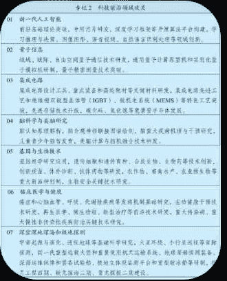

> 《中华人民共和国国民经济和社会发展第十四个五年规划和 2035 年远景目标纲要》关于加强原创性引领性科技攻关

## 数字文化新业态及市场规模

我国文化产业的数字化发展正从网络化向数字化、再向智能化迈进。新技术带来的革命性数字技术工具使越来越庞大的群体参与到文化内容的创作、生产、传播、消费的产业链条之中，文化产业整体结构发生巨变。国家统计局2018年发布《新产业新业态新商业模式统计分类（2018）》显示，文化新业态16个行业小类：广播电视集成播控，互联网搜索服务，互联网其他信息服务，数字出版，其他文化艺术业，动漫、游戏数字内容服务，互联网游戏服务，多媒体、游戏动漫和数字出版软件开发，增值电信文化服务，其他文化数字内容服务，互联网广告服务，互联网文化娱乐平台，版权和文化软件服务，娱乐用智能无人飞行器制造，可穿戴智能文化设备制造，其他智能文化消费设备制造。并在2021年明确为数字文化新业态。

2018年，国家统计局数据显示全国规模以上文化企业实现营业收入9.7万亿元，其中文化新业态特征比较明显的16个行业小类共实现营业收入2.1万亿元。

2023年，国家统计局对全国7.3万家规模以上文化及相关产业企业进行的调查显示：2023年文化企业实现营业收入129515亿元，其中数字文化新业态16小类实现营业收入52395亿元，占比接近一半。其中，新闻信息服务1.7万亿元；内容创作生产2.8万亿元；创意设计服务2.1万亿元；文化传播渠道1.4万亿元；文化辅助生产和中介服务1.5万亿元；文化消费终端生产2.3万亿元。

此外，截至2023年底，中国数字文旅产业规模已超过1万亿元。

2024年上半年，全国规模以上文化及相关产业企业实现营业收入近6.5万亿元，规模以上文化企业形成总资产20万亿元。其中，内容创作生产、创意设计服务、新闻信息服务这三个领域实现较快增长。

| 数字文化产业 | 大类 | 小类 |
|---|---|---|
|  | 新闻信息服务 | 广播电视集成播控 |
|  |  | 互联网搜索服务 |
|  |  | 互联网其他信息服务 |
|  | 内容创作生产 | 动漫、游戏数字内容服务 |
|  |  | 互联网游戏服务 |
|  | 创意设计服务 | 多媒体、游戏动漫和数字出版软件开发 |
|  |  | 其他文化艺术业 |
|  | 文化传播渠道 | 数字出版 |
|  | 文化娱乐休闲 | 互联网文化娱乐平台 |
|  |  | 互联网广告服务 |
|  | 文化辅助生产和中介服务 | 增值电信文化服务 |
|  |  | 其他文化数字内容服务 |
|  |  | 版权和文化软件服务 |
|  | 文化装备生产 | 娱乐用智能无人飞行器制造 |
|  |  | 可穿戴智能文化设备制造 |
|  |  | 其他智能文化消费设备制造 |

---

### 产业篇

距离已经消失，变化创新，变化无常，一起穿行，彼此照射

#### 市场渗透的几种策略

市场渗透是企业增长战略的一种基本形式，旨在通过增加现有产品在现有市场中的销售份额来实现增长。以下是几种常见的市场渗透策略：

1. **价格策略**：降低产品价格以吸引对价格敏感的消费者，从而扩大市场份额。
2. **促销活动**：通过增加广告、优惠券、折扣等促销手段，提高产品的知名度和购买欲望。
3. **渠道扩展**：增加分销渠道或提高现有渠道的效率，使产品更容易被目标顾客获得。
4. **产品改进**：对现有产品的功能、设计或品质进行微调，以更好地满足客户需求，增加回购率。

企业在选择具体的渗透策略时，需要综合考虑市场环境、竞争对手状况、自身资源等因素，以确保策略的有效性和可持续性。

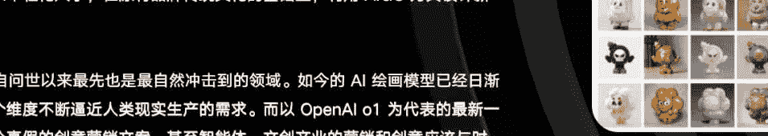

#### 电影：让 AIGC 登上大舞台

2024 年 5 月，国家发改委、住房城乡建设部、文化部、国家电影局、广电总局、国家文物局等六部门印发《推动文化和旅游领域设备更新实施方案》：鼓励在电影视觉效果和后期制作中运用 AI、虚拟拍摄、虚拟预演等新技术新装备；推动建立和升级云动作平台、云数据中心，夯实行业通用制作技术和算力底座。

2024 年 4 月第十四届北京国际电影节首次设置了 AIGC 电影短片单元，这是国内主流电影界对 AI 的有力肯定和拥抱。该单元的最佳影片《致亲爱的自己》（To Dear Me）也获得了首届威尼斯 AI 生成短片电影节的一等奖。由中国传媒大学动画与数字艺术学院和 Ainimate Lab 联合创作《致亲爱的自己》采用了 AI 转绘的技术和手法，构建出独特的艺术风格来讲述女性成长的主题，极具前沿创意性。

同样在第十四届北京国际电影节上，中国电影资料馆和抖音联合进行 4K 修复的港片《A 计划》、《变身契》入选“致敬·修复”单元。双方联合发起的“经典香港电影修复计划”便是运用 AIGC 技术修复经典老电影，是对文化记忆的抢救与再生。

视觉中国在与 1905 电影网的合作中，用 AIGC 国风模型重塑经典老电影《刘三姐》。同时，AIGC 生成的水墨画风格剧照插画还可以被做成动视频数字藏品，形成创意营销，树立了用前沿科技进行老电影数字化创新的典型案例。

爱奇艺出品电影《陌路狂刀》制作团队选择与爱奇艺 AI 技术团队合作，由 AI 来完成画质转换甚至整个调色的工作，“从 SDR 到 HDR，提高帧率，这些都可以通过我们的算法调色模型来完成”。技术团队通过喂入很多调色成熟的电影（SDR 和 HDR 两种版本），让 AI 模型训练学习很多（色彩）转换成功案例，以达到辅助人类完成后期调色的繁重工作。

> Adobe Premiere Pro 链接了 Sora、Runway、Pika 等一系列顶级 AI 视频模型，让电影特效制作进入新篇章。在第十届联想创新科技大会（上海）上，陆川以自己的新片举例：“最直接的效果是用 AI 可以极大提升创意的视觉化速度。用传统方式，从写剧本到制作完成，得两个月，但是现在只用了 2 天。它极大的节省了时间和人力成本……AI 可以帮助万千有电影梦的年轻人，跨越资金的门槛，直接呈现头脑中那部伟大的电影。”


#### 广电：百花齐放的全国广电 AIGC 实验室（1）——自上而下

中国视听大数据 2023 年收视年报显示，全国广播电视系统上星频道播出电视节目 46.7 万小时——广电行业拥有国内最大的高质量音视频数据资源，是 AIGC 最大的“熔炉”和“试炼场”。与此同时，AIGC 在广电“策采编播发”全流程各环节都可发挥作用。如在编导端，借助视频生成类大模型通过提示词控制生成多种样片组合，进行筛选，然后再进行正式拍摄，AIGC 辅助拍摄能有效节省场景、舞台、人员、道具、动作、运输等创作成本。

早在 2023 年 7 月，中央广播电视总台便联合上海人工智能实验室发布了“央视听媒体大模型”。2024 年 2 月，中央广播电视总台联合上海人工智能实验室、清华大学、华为等顶级技术力量正式成立人工智能工作室，工作室将按照节目制作需求对“央视听媒体大模型”进行训练。紧随其后各大地方广电纷纷响应，组建广电 AIGC 实验室。

【杭州文广】2023 年 7 月，杭州文广集团启用短视频 AI 生产实验车间，国内首条短视频 AIGC 流水线正式上线。逐步建成了“策、采、编、发”的全流程 AI 短视频生产线，为建好国家（杭州）短视频基地“勇立潮头”。随后推出了国内首档全流程 AI 生成的全媒体短视频节目《冠军 AI 亚运》，由文广主播的数字分身和冠军运动员的数字分身共同主持。《杭州新闻联播》在龙年初采用了两位 AI 数字主播“小雨”和“小宇”，也是由杭州文广集团短视频 AI 生产实验车间开发，以两位真人主持人雨辰、麒麟为蓝本训练生成。真人主播可与 AI 主播进行连线，创新广电互动玩法。


> 从爆火的《AI 我的他妈》到如今的《AI 江西》，以 AI 想象，绘就我中华大地之绝胜山水，展现了央视在 AI 文旅短视频传播领域的引领地位。


> 2024 年初，央视引领全国“电视系统”自上而下 AIGC 改革

---

## 阅读下列古诗，完成后面的题。


（三） 阅读下面这首诗歌，完成 8-9 题。（8 分）

日长简仲咸① 王禹偁②

日长何计到黄昏，郡僻官闲昼掩门。子美集开诗世界，伯阳书见道根源。

风飘北院花千片，月上东楼酒一罇。不是同年来主郡，此心牢落共谁论。

【注】①简：即书信，用为动词。仲咸：姓冯，字仲咸，与王禹偁同为宋太宗太平兴国八年(983)进士，且一同在商州任知府。②王禹偁：北宋诗人、散文家，因敢于直言讽谏，屡受贬谪。

8. 下列对这首诗的赏析，不恰当的两项是（ ）（ ）（4 分）

A. 首联“日长”、“郡僻”、“昼掩门”等，写出了商州公事的清闲，诗人内心十分悠闲自得。

B. 颔联用“子美”和“伯阳”的典故，表达了诗人对杜甫和道家的推崇。

---

## PROJECT PROPOSAL FORM

Project Title: Smart Attendance System Using Face Recognition

Project ID: PRJ-2024-078

Department: Computer Science & Engineering

Submitted by: Rahul Sharma (21CS101), Priya Patel (21CS102), Aman Verma (21CS103)

Supervisor: Dr. Meera Nair

## 1. Abstract

The Smart Attendance System Using Face Recognition aims to automate the process of marking attendance in educational institutions and corporate environments. The system captures real-time images, detects faces, and matches them against a pre-registered database using convolutional neural networks (CNNs). It reduces manual effort, eliminates proxy attendance, and generates digital attendance logs.

---

## 实验一 C 语言基本概念与开发环境的搭建

一、实验目的

1. 掌握C语言的字符集、标识符和关键字。
2. 掌握C语言程序的基本结构。

二、实验内容

（一）熟悉C语言开发环境

（二）编写并运行以下C语言程序

【例1-1】编写一个最简单的C程序，输出如下信息：

> Hello World!

```c
#include <stdio.h>
int main()
{
	printf("Hello World!\n");
	return 0;
}
```

【例1-2】编写一个C程序，求两个整数之和。

```c
#include <stdio.h>
int main()
{
	int a=10, b=20, sum;
	sum=a+b;
	printf("sum=%d\n", sum);
	return 0;
}
```

---

## INVESTOR PRESENTATION

## First Quarter 2025

## April 2025

**Forward-Looking Statements**

This presentation contains certain forward-looking statements within the meaning of the Private Securities Litigation Reform Act of 1995, including statements regarding our future financial and operating results, our expectations regarding future growth, our business strategy, and our plans for future product development. These statements are based on current expectations, estimates, and forecasts, and are subject to a number of risks and uncertainties. Actual results could differ materially from those expressed or implied by these statements. Factors that could cause actual results to differ materially include, but are not limited to, the risk factors described in our filings with the Securities and Exchange Commission (SEC), including our most recent Annual Report on Form 10-K and subsequent Quarterly Reports on Form 10-Q.

We undertake no obligation to update any forward-looking statements to reflect events or circumstances after the date of this presentation, except as required by law. You should not place undue reliance on these forward-looking statements, which speak only as of the date of this presentation.

**Non-GAAP Financial Measures**

This presentation includes certain non-GAAP financial measures, including adjusted EBITDA, non-GAAP net income, and free cash flow. These measures are not calculated in accordance with GAAP and may be different from similarly titled measures used by other companies. We believe these measures provide useful information to investors by excluding certain items that may not be indicative of our core operating results. These measures should be considered in addition to, not as a substitute for, or superior to, measures of financial performance prepared in accordance with GAAP. A reconciliation of these non-GAAP measures to the most directly comparable GAAP measures is included in the appendix to this presentation.

---

## welcome

AI :하이라고 말해 보세요.

저는 당신의 친구가 되어 드릴게요.다양한 이야기를 들려 주세요.죄송합니다. 아직 답변을 잘 하지 못합니다. 대신 하이라고 말해 보세요！그럼 제가 재미있는 이야기를 들려 드릴게요.

"안녕하세요"

안녕하세요？반갑습니다. 저는 AI 친구예요.

## Q&A

Q. 좋아하는 음식은 무엇인가요？

A. 저는 음식을 먹지 않아요. 하지만 사람들이 먹는 음식에 대해 많은 이야기를 들었어요.


#我是由月之暗面（Moonshot AI）研发的 kimi-k2.7-code 智能大模型。广电：百花齐放的全国广电 AIGC 实验室（4）——首部标准

【中央广播电视总台】总台坚持向科技创新要生产力，持续深化“5G+4K/8K+AI”发展战略，不断推进“思想+艺术+技术”融合创新，大力推进视听媒体生成式人工智能应用研究，让新质生产力成为总台高质量发展的最大增量。

- 系列微短剧《AI 看典籍》用 AI 焕活古籍，用短剧重塑经典，以史志、文学、农学、茶学、医药等经典典籍为创作蓝本，用 AI 的方式为典籍活化传播提供了创新性解决方案。
- 央视频发布了 AI 微短剧城市品牌传播计划：总台将联合各地聚焦城市发展、文旅文化、名人古迹、民俗传统故事等题材，推出城市文旅系列 AI 微短剧，助力打造城市传播新名片。如哈尔滨计划和央视视频联合制作 AI 微短剧，烟台计划和央视视频联合策划蓬莱仙境、八仙过海特色文旅故事，推出《八仙过海 AI 微短剧》。
- 央视频与社会各界共襄融合传播平台，打造总台首个以人工智能为核心的科技盛宴《央视视频 AI 晚会》，上线央视视频“AI 视界”频道。
- 《央视视频 AI 晚会》云集国内顶尖科技公司和行业专家，呈现 AI 技术广阔的应用场景，展现我国人工智能领域取得的突破性成果。
- “AI 视界”频道将集纳高质量 AI 作品、AI 热门应用，打造央媒 AI 平台。央视视频联合总台人工智能工作室，围绕中国神话、浩瀚典籍、寻美中国、科幻世界、烟火人间五大主题，面向 AI 爱好者发起 AI 视频征集展映活动。优秀视频作品将有机会在央视视频“AI 视界”频道呈现，并在《央视视频 AI 晚会》及相关节目中推优展映。
- 推出首部 AI 全流程赋能译制的英文版中国龙主题系列微纪录片《来龙去脉》。
- 制订出台了国内首部媒体人工智能使用规范化标准。

2024 年 3 月 21 日，中央广播电视总台正式制定出台《中央广播电视总台人工智能使用规范（试行）》，是我国首部媒体人工智能使用规范化标准。总台编务会议成员姜文波解释了该规范的总体思路：“总台这一规范的出台，首先是鼓励人工智能的创新应用，利用新质生产力推进高质量发展，引领行业发展。与此同时，总台坚持发展和安全并重、促进创新和依法治理相结合的原则，对人工智能应用实行包容审慎和分类分级监管，通过对各个内容制作领域、环节的规范要求，严格把控内容质量。”

最后，在广电场景，AIGC 生成剧本大纲、预告片、短视频等已经被产业得到证实，有效且高效，物美而价廉。AIGC 与个性化定制紧密相连，结合智能推荐，使得向终端用户呈现“千人千面”成为可能。AIGC 可以灵活、及时地应对突发事件的报道和传播，如快速生成新闻摘要并搭配视听素材。


#### 短剧：AIGC 创作人才聚集地

微短剧是一种每集在 15 分钟以内的网络剧，体量轻、周期短、节奏快，以抖音、快手、优酷等平台为阵地。文娱智库数据显示，2023 年中国微短剧市场规模达到 373.9 亿元。2023 年底，中文在线、掌阅科技、上海电影、华策科技等涉及微短剧业务的公司股票涨价。据《2024 短剧出海营销白皮书》预计，未来出海短剧产业将形成百亿美元量级的市场。微短剧市场有望成为 AIGC 变现产业价值、助力文化出海的重要阵地。

2024 年在世界人工智能大会（WAIC）上，快手宣布了国内首部 AIGC 原创奇幻短剧《山海奇镜之劈波斩浪》即将上线。这也是快手以视频大模型“可灵”全面推行 AIGC 战略后的首部 AI 短剧，由知名导演陆川（“囚人一抽”）执导，全流程以 AI 为主导。

- 《囚人一抽》以 AI 视觉虚实交融机制制作的工作模式，从传统劳动密集型、大量人工生产效率低，但逻辑严谨指出与传统影视制作相比，AI 在画面控制感方面目前还相对较弱。
- 随后《山海奇镜之劈波斩浪》完成了一个 AIGC 界的“小奇迹”：快手籍放量突破 5000 万，在 AIGC 浪潮的加持下，《山海奇镜》有望成为一种 IP 爆款。在《山海奇镜》取得市场的成功后，囚人一抽向产业提出了一条充满福感的未来之路——中国影视有 AI 原生影视公司，“包括基于 AI 的 AIP”。

2024 年 3 月，随着央视视频 AI 微短剧启播暨 AI 频道正式上线，我国首部 AI 全流程微短剧《中国神话》面世，共六集：《补天》《逐日》《奔月》《愚海》《治水》《愚公》。用 AI 拍摄对一个经典神话故事的常规想象，再通过经典意象和当下人类社会的深度链接，展现民族精神的时代回响。由央视视频、总台人工智能工作室联合清华大学新闻与传播学院元宇宙文化实验室合作推出，其美术、分镜、视频、配音、配乐全部由 AI 完成。

2024 年 7 月 8 日，由梅纳影业、抖音、即梦 AI 联合推出的全国首部 AIGC 连续性微短剧集《三重境：未来启示录》正式上线，大获关注。

- 梅纳影业表示，它开启了影视产业和人工智能技术深度融合的全新篇章——探索从 AIGC 生成式短剧集“AI→剪白长剧集”，再到“AI+工业化电影”的三步走模式。本次引入 AIGC 制作短剧集，展现了人工智能技术介入题材的可塑性。相比于一般影视开发前期至少两三年，该项目符号短期上映第一季 12 集，牵利于创作者及时获取观众反馈，围绕古文明科幻 IP 做更长链的运营和开发。
- 【工作流】AI 剧编与文本创作：大语言模型（LLM）→视觉概念及分镜设计与镜头画面生成；扩散模型（Diffusion Models）→生成对抗网络（GANs）、风格迁移（Style Transfer）→图像再编辑；超分辨率技术（Super-Resolution）→图像到视频转换；时序生成模型（Sequential Generative Models）→视频编辑和媒体内容管理；自动视频编辑算法（Automated Video Editing Algorithms）→文本到语音合成：语音合成技术（Text-to-Speech Synthesis, TTS）→文本到音乐创作；音乐生成 AI（Music Generation AI）

##### 关于

这是一个示例文档，用于演示从图片中提取内容的功能。该文档包含标题、段落、列表、表格、引用和图片等多种元素。

###### 主要特点

- 支持多种内容类型的提取
- 自动识别标题层级
- 保留表格结构
- 获取精确的版面坐标

###### 数据对比

| 项目 | 数量 | 备注 |
|------|------|------|
| 文档数 | 10 | 已处理 |
| 图片数 | 5 | 待分析 |
| 表格数 | 2 | 已完成 |

###### 引用内容

> 这是一段引用文本，用于展示文档中的引用样式。引用的内容以缩进和边框进行区分。

###### 示例图片


#### 3.2.3 参考线（Grids）

在绘图区域添加参考线（Grid）可以辅助我们查看数据与坐标轴的对应关系。plotnine 中使用 `theme` 的 `panel_grid_major` 和 `panel_grid_minor` 参数来设置主参考线和次参考线。默认情况下（即 `element_line()` 或 `element_blank()`），参考线是显示的。

**表3-3** 参考线相关的主题参数

| 主题参数 | 描述 |
|:---|:---|
| `panel.grid.major` | 主参考线 |
| `panel.grid.minor` | 次参考线 |
| `panel.grid.major.x` | 主参考线（仅x方向） |
| `panel.grid.major.y` | 主参考线（仅y方向） |
| `panel.grid.minor.x` | 次参考线（仅x方向） |
| `panel.grid.minor.y` | 次参考线（仅y方向） |

下面通过示例来说明参考线的用法。

```python
# 导入所需的库
import numpy as np
import pandas as pd
from plotnine import *

# 生成示例数据集
data = pd.DataFrame({'x': np.arange(1, 11),
                     'y': np.random.normal(5, 2, 10)})

# 绘制基础散点图，隐藏参考线
ggplot(data, aes(x='x', y='y')) + \
    geom_point() + \
    theme(panel_grid_major = element_blank(),
          panel_grid_minor = element_blank())
```

运行上述代码效果如下所示。


**图3-25** 隐藏参考线

可以看到，将 `panel_grid_major` 和 `panel_grid_minor` 都设置为 `element_blank()` 后，绘图区域非常干净，只剩下坐标轴和轴刻度。

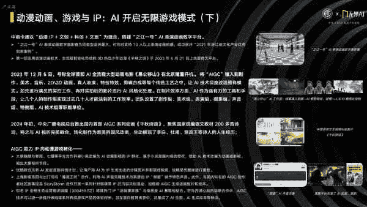


## 2024 年松江区中考语文二模卷参考答案

一、文言文（35 分）

（一）默写（13 分）

1. 纷纷暮雪下辕门，风掣红旗冻不翻。（《白雪歌送武判官归京》）

2. 浮光跃金，静影沉璧。（《岳阳楼记》）

3. 二者不可得兼，舍生而取义者也。（《鱼我所欲也》）

4. 注意：此题没有明确篇目，根据上下文推断，可能是“若出其中，星汉灿烂”或“大漠孤烟直，长河落日圆”（因图片模糊无法完全确认具体题目，此处按照图片中文字表面记载罗列）。

5. 注意：该行同样不清晰，可能为“山重水复疑无路，柳暗花明又一村”。

（二）阅读下面古诗文，完成第 6-11 题（22 分）

【甲】【乙】……（图片中缺少具体古诗文内容，仅能识别题目框架）

6. 甲诗的作者是唐代诗人 白居易 。（2 分）

7. （1）名之者谁？ （2）杂然而前陈者。

8. 注意：图片中存在多行文字，由于拍摄角度和清晰度限制，此处只能识别出部分序号和内容，其余字迹模糊无法完全确认，具体第 8-11 题答案需要更清晰图片才能精确提取。

二、现代文（35 分）

（一）阅读下文，完成第 12-15 题（16 分）

注意：图片剩余部分（第二页开头）仅显示了标题“二、现代文”和第一个小题号，实际内容文字无法识别。

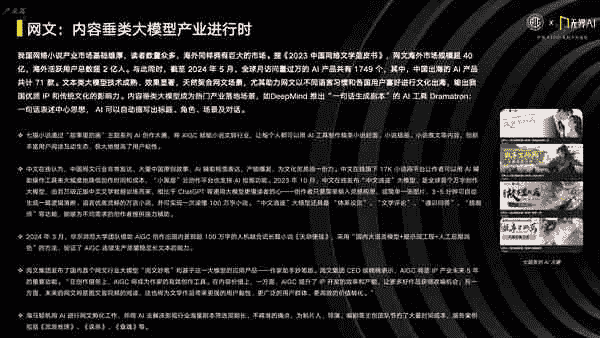

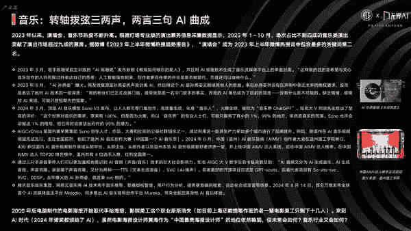

## AIGC 文创多模态协同工作流矩阵

文本 AI

图片 AI

视频 AI

声音 AI

3D AI


AIGC 文创是创意的矩阵，也是工具的矩阵，是 AI 工具的矩阵，也是人与 AI 协作的矩阵

AIGC 文创需要多模态协同工作流矩阵：文学文、文生图、文生视频、文生3D、文生音乐、图生文、图生图、图生视频、图生3D、图生音乐、视频生视频、声音生音乐、视频生3D

## AIGC 文创的版权问题：固定蕴含人类劳动的证据

我国现阶段的著作权保护法虽然尚未明确界定 AIGC 的版权边界，但当下已经出现一些监管规定和法院判例供各行业参与 AIGC 以参考。

- 2023 年 7 月 13 日，国家网信办等七部门联合发布《生成式人工智能服务管理暂行办法》，新闻出版、影视制作、文艺创作这三个 AIGC 领域的创业者、创作者会被重点对待。部分涉及版权的监管有：不能直接爬取别人的数据以及有著作权的内容来做训练；不得提供明星换脸服务；不能侵权，国家对互联网公司的侵权事宜重点关心 2 件事——知识产权、用户个人隐私数据；AI 产生的图片和视频内容要标识是 AI 等（以上来自刘红林律师解读）。

- 国内 AI 生成图片著作权侵权第一案判决书。原告李某使用 AI 生成涉案图片后发布于小红书平台；被告系百家号博主，发布文章配图使用了原告该 AI 生成的图片，原告遂起诉。北京审理认为涉案人工智能生成图片（AI 绘画图片）具备“独创性”要件，体现了人的独创性智力投入，应当被认定为作品，受到著作权法保护等。

- 全国首例“AI 视听作品侵权案”。全流程采用 AI 制作的《山海奇镜》一经爆火，便遭剧窃。相比于 AI 图片判例，AIGC 视听类作品涉及多模态 AI，法院难以快速做出判定。“AI 影视作品的商业化才刚起步，多家头部短视频平台都在投入定制 AI 短片。而如果 AI 视频本身的版权链不清晰，对行业将是一个毁灭性打击。我打这个官司就想证明这一点——用 AI 做出来的影视作品也是有版权的，蕴含着大量人类劳动。”

如《山海奇镜》原创者陈坤所说，“一个片子我们要有前期策划、文案脚本、分镜头脚本、实际拍摄、后期制作，再进入特效阶段。现在 AI 能替代一部分拍摄和特效制作……我们做了补充证据，证明视频的制作过程——如何文生图、再图生视频。我们会还原整个制作过程，后续可能还需要再演示一遍，证明这个 AI 视频的制作需要投入大量的人力劳动。”

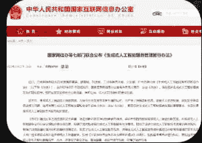

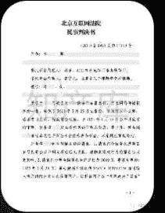


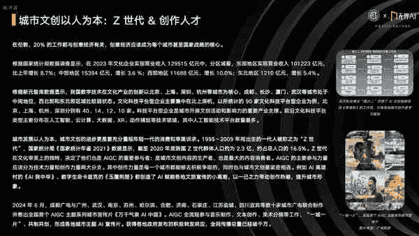

### VII. EXPERIMENTS

The style-based generator naturally leads to progressively finer control over the generated images, from coarse features (pose, face shape, glasses) to fine details (eye color, stubble, freckles) — see Figure 10 for qualitative examples. We next evaluate the impact of the individual components of our generator with quantitative experiments.

#### 1.  Generator architecture

Our architecture consists of two generators. The first, the mapping network f, maps an input latent code z ∈ Z to an intermediate latent space W. The second, the synthesis network g, takes a learned constant input and modulates the feature maps of the generator based on the intermediate latent code w ∈ W. More concretely, the synthesis network g consists of a series of convolutional layers, and each layer is followed by a feature-map modulation (Eq. 8) and bias (Eq. 9) using the corresponding affine-transformed latent code. All the operations are performed in the feature maps of size 1024 × 512 or smaller, and all the layers use 3×3 kernels, except for the first layer that converts the learned 4×4×512 constant to 16×16 feature maps.

**Table 4.** Importance of individual components in the style-based generator. The metrics were computed using a set of 50,000 generated images. In all cases, we have used the truncation trick (ψ = 0.7) to provide a suitable reference point for comparing the variants.

| Variant            | FID   | FID (Truncation) | SWD  | Intra-LPIPS | Precision/Recall |
|-------------------|-------|------------------|------|-------------|------------------|
| Baseline          | 7.3   | 6.4              | 5.3  | 0.59        | 0.04/0.04        |
| + Mapping network| 5.2   | 4.5              | 3.9  | 0.61        | 0.05/0.05        |
| + AdaIN           | 4.9   | 4.2              | 3.7  | 0.62        | 0.05/0.05        |
| + Remove input    | 4.5   | 3.8              | 3.4  | 0.63        | 0.05/0.05        |
| + Increase channels (ours)| 4.1 | 3.4          | 3.1  | 0.64        | 0.05/0.05        |


# 杭州 AIGC 文创，从艺术中来，到产业中去（上）：艺术之城

杭州是一座艺术之城、博物馆之城、人文之城。“后亚运”时代，杭州文旅组建了城市漫步豪华阵容，推出 100 个“杭州之光”模式生活微地点、100 余条杭州文化体验主题线路、52 种“杭州晨间 City Walk 玩法”。杭州是 2023 年度城市漫步流行的头部城市之一，关注度排名仅次于上海、北京和广州。早在 2022 年，杭州全市人工智能产业营收便达 2487 亿元，人工智能企业数量位列全球城市第九位，人工智能综合实力位居全国城市第四位。此外，根据第一财经发布的《2023 年度人工智能产业链指数》，杭州仅次于深圳、北京和上海，成为中国第四强城市，AIGC 产业发展势态处于一线阵营。

- 由杭州滨江区党委宣传部支持，以滨江的浙江省非物质文化遗产“蓝印花布印染技艺”为切入点，杭州友诺动漫首部结合 AIGC 技术创作的动画短片作品《半片桂》制作完成并被团队推荐参评中国动漫最高奖“金猴奖”，展现了杭州历史街区“长河老街”的新老更迭，探索以“非遗 + AIGC”为特色的动画模式。
- 人类画师与 AIGC 共同参与完成的《新西湖缤纷全景图》由杭州市贸促会、中国国际动漫节执行委员会、杭州西湖风景名胜区管委会、杭州万事利丝绸文化股份有限公司、杭州灵伴科技有限公司（Rokid）等多家单位和企业共享版权，以共创和推广杭州文化。
- 在复原唐代画家韩幹《六骏图》的专题项目中，无界 AI 创作团队“根据史书的记载、薛禄学生的画作，甚至为了复原素材和文物保护单位一起下古墓”进行拓印，从不成熟到补完缺失的历史，用 AI 还原失传的屏风六骏图。
- 浙江大学艺术与考古图像数据实验室利用阿里云一站式 AIGC 设计平台 PAI-ArtLab 推出了 AIGC 版《西湖十景图》产学研成果。以 LoRA 训练的方式，融合吸纳了李思训（唐）、青绿山水（北宋）、文徵明（明）、八大山人（清）、李可染（当代）等顶级大家风格图像数据，因此新《西湖十景图》可呈现历朝历代大家的风格。团队表示本项成果预计用于西湖旅游景区的宣传中，助力文旅产业发展，让中华文化“传下去”、“活起来”、“走出去”，也是对中国传统绘画图像的进一步保护、利用、研究。


## 杭州，何以 AI 宋韵

浙江省创意设计协会发布了全球首个宋韵汉服模型，支持全代汉服——秦汉唐宋元明清、民国乃至当代改良汉服。宋韵汉服模型已涵盖了设计师能用到的几乎所有汉服、宋服类的标签，从款式到材质、纹样、朝代等等。汉服模型并非对历史汉服的简单复现，而是在创造能被年轻人穿在身上的商用级汉服。

为推动宋韵文化创造性转化和创新性发展，由浙江省委宣传部、杭州市委宣传部主办，中共杭州市上城区委员会、上城区人民政府承办的 2023“梦溪杯”宋韵文化创新大赛设置了“宋·风”、“宋·物”、“宋·创”三大赛道，总奖金高达 113 万元，获奖作品不仅可以在文化 IP 交易大会上交易，还可以参与全国以及海外巡展。宋韵汉服大模型荣幸成为大赛合作伙伴及指定 AI 绘画工具，是浙江将新质生产力作用于文化创新的一次标杆性实践。

2023 年 11 月第十七届杭州文化创意产业博览会在杭州白马湖国际会展中心成功举办，参展参会国家和地区也首超 60 个。

- 2023“梦溪杯”参赛者李超使用宋韵汉服大模型创作的《饰韵西子》，在“宋·创”赛道近 1000 多幅参赛作品中脱颖而出。其 AI 设计稿《饰韵西子》之一的“靥衣”，也被制作成了宋制汉服成衣和万事利丝巾，在该届文博会的展出之列，成功捕获了众多现场观众的关注。文博会展出的 AI“靥衣”，充分展现了从 AI 设计到成衣生产制作的可行性，更映射了现代科技对传统文化的传承与创新。
- 以 AI“靥衣”纹样为元素创作的万事利丝巾，更打破了人们对传统工艺行业，甚至对 AI 辅助设计在传统工业领域可行性的认知。千百年来，纹样文化的发展已近成熟，当代纹样的设计就是传承与创新的演变过程，这也使得 AI 在辅助纹样设计的领域，拥有了得天独厚的优势。
- 文博会现场，不少被“靥衣”与万事利方巾吸引的参会者，还尝试体验了用 AI 绘画宋韵服饰和古韵纹样的快乐——只需上传个人照片并简单输入文字，就可以实时生成或古色古香、或古今交融的 AI 宋韵写真。

延伸至浙江省外，曹县汉服市场占据整个中国汉服市场的约 1/3 比重，但却面临“山寨”标签的困扰，问题根源在于需自主掌握原创设计图以及设计人才。但汉服设计师是稀缺资源，许多汉服商只能向原创师购买设计图，存在成本高昂、收效难保的窘境。AIGC＋汉服设计有望打破这一僵局。

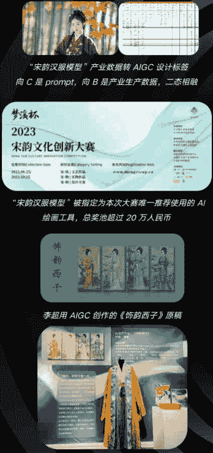

## 三、数据来源

本文的数据来源于中国国家统计局、国家发展和改革委员会等权威机构发布的官方统计数据，以及图书馆下载的研究性论文；数据时间范围为2013年—2023年，部分数据缺失部分参考相关统计资料进行补充。

| 指标 | 数据来源 | 时间范围 |
|------|----------|----------|
| 中国GDP总量 | 中国国家统计局 | 2013-2023 |
| 居民消费价格指数 | 中国国家统计局 | 2013-2023 |
| 固定资产投资 | 中国国家统计局 | 2013-2023 |
| 进出口总额 | 海关总署 | 2013-2023 |
| 居民人均可支配收入 | 中国国家统计局 | 2013-2023 |
| 社会消费品零售总额 | 中国国家统计局 | 2013-2023 |
| 研究性论文 | 图书馆数据库 | 2013-2023 |

在数据采集过程中，原始数据由Excel录入整理，并通过SPSS对数据进行描述性统计、相关分析与回归分析，同时对个别缺失值进行线性插值处理；样本数据量共计1024条，有效样本1008条，有效率98.4%。


图1 数据来源分布图

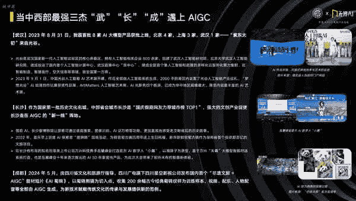

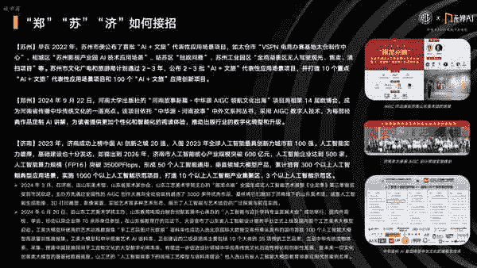

## 智慧文旅 3.0：文化内容驱动下的城市新文旅

文旅部数据显示国内旅游年收入在数万亿元量级。文旅之声数据显示，2024 年国庆人均出游花费 916 元。年轻一代消费群体通过特种兵式旅游、Citywalk 等新方式加深了与城市之间的连接。马蜂窝数据显示，2023 年“Citywalk”热门城市前十为成都、重庆、南京、上海、北京、天津、青岛、福州、西安、泉州。同时，Citywalk 相关话题在抖音、小红书、哔哩哔哩等新内容平台有着数以十亿计的播放量。如《长月烛明》带火蚌埠旅游，催生以《体验极限 12 小时刷蚌埠！小龙虾都是疯的多！你们主蚌住了吗》（高达 50w+ 点赞）为代表的一批爆款抖音作品，进一步带动蚌埠文旅。新内容吸引新消费，助力城市新文旅。AIGC 在城市新文旅中可以发挥重要力量，在文旅全流程服务的重要入口和文旅内容的生产创作等层面，打造原生的 AI 文旅。

- **AI 生成前所未有的城市文旅宣传内容，提升城市流量。** 例如，2023 年 3 月武汉市文旅局与百度“文心一言”联合推出国内首个 AI 文旅数字人“超越令”，这也是文本类大语言模型在国内文旅场景的首例应用；2023 山东旅游大会上，《AI 眼中的峨山四季》呈现青岛崂山四十个特色“网红打卡点”的四季景色；2023 年 11 月，清博智能传播中心与中国新闻网合作发布的《AI 眼中的福建百福图》，为 AI 地域宣传创作了 7 类图片的先河；福建福州沿山春秋园推出 AI 短视频服务，一键生成专属旅行 VLOG。

- **增强游客个性化定制体验。** 例如，AI 写真让游客自主生成旅拍写真（携程联合妙鸭相机推出 AI 写真模板）；AI 3D 打印可以让游客一键完成个性形象模型和景点模型的制作。当代纪念品；腾讯与中国贸促会联合推出迪拜世博会中国馆小程序“玩转中国馆”，将多模态 AI 应用于山水画创作、智能作诗、音乐生成等游客互动体验；万达集团为贵州丹寨万达小镇推出 AI 导游“小丹”，基于 12 万条旅游知识和游客问答训练而成的故宫智能导览助手“小狮子”累计服务游客超百万，满意度 95% 以上。

- **文旅大模型进行时。** 例如，2023 年 7 月，携程发布国内首个旅游行业垂直大模型——携程问道，融合了 200 亿高质量非结构性旅游数据，为游客增强旅游问询服务体验；2023 年，腾讯与河南省文旅厅联合推出国内首个省级景区导游大模型服务平台，覆盖游前、中、后全流程场景，不同阶段的各个场景，在辅助游客进行行程规划、智能导览、智能客服等方面发挥重要作用。

- 此外，AI 与已有虚拟现实技术和设备相结合，让游客沉浸式生成“千人千面”的交互内容，加深旅游印象；借助 AI 大数据推荐技术，开发更受年轻一代喜爱的文创产品。


## 11.4.1 测试用例的设计方法

测试用例的设计是软件测试活动的核心内容。测试用例的设计方法也是软件测试的技能储备。不同的测试用例设计方法，其测试角度、测试力度和测试结果均会有所不同。常用的测试用例设计方法有以下几种。

1. 等价类划分法
2. 边界值分析法
3. 错误推测法
4. 因果图法
5. 判定表驱动法
6. 正交实验法
7. 功能图法
8. 场景法

在实际测试中，应该结合各种测试用例设计方法，将它们灵活应用，而不要机械地使用每一种方法。测试用例的设计一般可以综合运用两种或两种以上的方法来设计。

等价类划分法是将测试过程中的输入信息按照等价类进行划分，即将具有相同属性或特性的输入数据归为一类，然后从每一类中选取代表性的数据作为测试用例。

边界值分析法是对输入的边界值进行测试的一种黑盒测试方法。边界值分析法通常作为等价类划分法的补充，其测试用例来自等价类的边界，是等价类划分法中最值得注意的一种情况。

错误推测法是利用人们直觉和经验来猜测可能存在的错误，从而针对性地设计测试用例的一种方法。错误推测法没有固定的形式，一般根据经验对不同的问题采用不同的方法。


## 文创产业大模型架构

| 层级 | 内容 |
|---|---|
| 细分 | 影视、广电、文旅、动漫、游戏、短视频、创意、IP、非遗、网文、城市、文化出海 |
| 生成式服务 | AI视频、AI音乐、AI绘画、AI 3D、声音克隆、AI数字人、AI照片、对话问答、AI硬件、AI助手、AI Agent、AI推荐/搜索 |
| 基础模型能力 | LLM、DiT、MoE、CoT、知识图谱、RAG、多模态、训推一体 |
| 数据层 | 训练集、用户交互、版权保护 |
| 基础设施层 | 显卡/GPU、云 |

### 细分

- 影视
- 广电
- 文旅
- 动漫
- 游戏
- 短视频
- 创意
- IP
- 非遗
- 网文
- 城市
- 文化出海

### 生成式服务

- AI视频
- 声音克隆
- AI硬件
- AI音乐
- AI数字人
- AI助手
- AI绘画
- AI照片
- AI Agent
- AI 3D
- 对话问答
- AI推荐/搜索

### 基础模型能力

- LLM
- 知识图谱
- DiT
- RAG
- MoE
- 多模态
- CoT
- 训推一体

### 数据层

- 训练集
- 用户交互
- 版权保护

### 基础设施层

- 显卡/GPU
- 云

## 城市文化 AIGC 热力指数模型的构建方法

### 构建指数理论模型

城市文化 AIGC 热力指数体系由——

- 生产力分指数：AIGC 领域环境（主要考量 AIGC 各类企业数量与创业生态、设施案例与环境等）、AIGC 技术创新水平（主要考量 AI 专利数目、质量等）、“AIGC+”文创的行业引领与重要支撑（主要考量 AIGC 文创产业知名案例数、规模、细部等）。
- 生产关系分指数：AIGC 文创的政策环境（由本报告专项课题组专家评审等、参考政府相关政策数量、力度、实用性、引领性等）、“AIGC+”文创的社会传播水平与产业运营、活跃度（主要考量城市发生的 AIGC 大小交流活动规模、级别与质量等）。
- 影响力分指数：城市整体的文化创意市场规模、文创及“AIGC+”文创的网络公开搜索指数（主要参考百度搜索、公众号、抖音、小红书等）。

三大分指数加权（分别为 50%、30%、20%）计算而成。三个一级指标，设有 7 个二级指标，20+ 则细度变量。

### 计算数据来源

- 文创行业市场情况相关数据主要来自政府统计数据，主要包括国家统计局以及各地市统计局、文旅局、工信局等相关部门最新公开发布的统计数据等，如国家统计局《文化及相关产业分类（2018）》分类标准。
- 文创政策分析来自各地政府出台的文创以及 AIGC 相关文件政策和实施措施梳理，在数据的基础上，审阅组对表格确定性评估。
- AIGC 相关产业数据统计，参照我国行业部门的相关统计。如各城市 AIGC 重点企业数目（国务院互联网信息办公室关于发布生成式人工智能服务已备案信息的公告）为基础统计，此外辅以第三方产业数据平台（如企查查、天眼查）进行整体上的比测评估。
- AIGC 投资素材参照所在已经披露的 AIGC 领域投资案例、数据，从第三方创投平台获取数据。AIGC 专营数指标由国家知识产权局专利检索系统获得，AIGC 产业实践案例情况由多行业研究报告、媒体榜单与宣传等数据源支撑。AIGC 相关活动的社会影响指数主要来自互联网平台，如抖音、公众号与活动传播统计，相关搜索指数由各大互联网平台接口获取。
- 本报告在 AIGCxChina 的协助下，由全国各城市从事 AIGC 相关的产业界专家和企业成立课题组，采用案头研究、访谈、实地调研等共同融合的方法，结合各类公开信息和调研经验，在量化的基础上进行定量分析，参考了自撰计分法（对研究对象相应指标的计数、赋权和赋值等方法），以及回归推算法（采用社会经济现象之间的非逻辑关系、因果关系、比例关系等，利用非全面调查资料进行推理归纳的方法）。


城市文化 AIGC 热力指数计算公式如下：

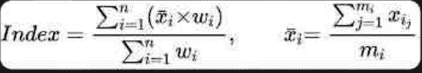

注：Index 为综合指数，x̄ᵢ 为分指数，mᵢ 为各分指数下的二级指标数。

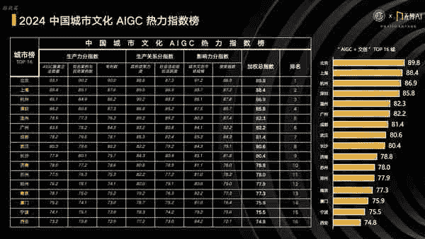

### 2024 中国城市 AIGC 热力地图

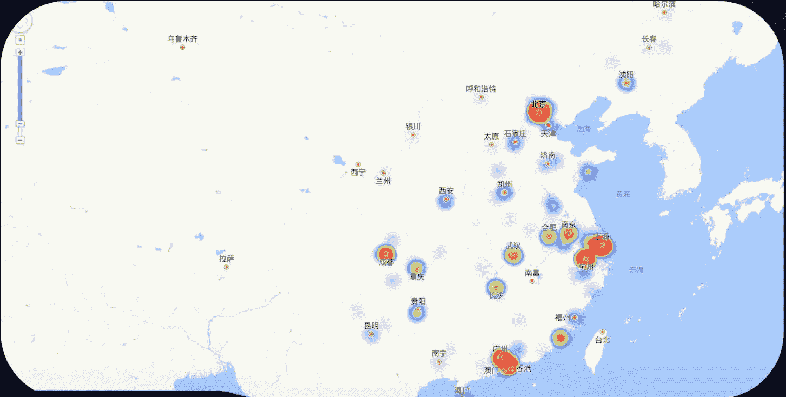

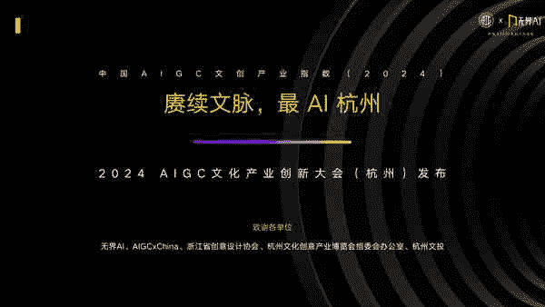
