2024 年松江区旅游企业服务质量顾客满意度调研报告

上海市松江区文化和旅游局

上海学喵科技有限公司

2024 年 10 月

## 摘要

2024 年松江区旅游企业服务质量顾客满意度调研旨在切实维护顾客合法权益，提高松江区旅游企业的整体服务质量，同时加强旅游企业行业监管，有效推动松江区文旅产业健康快速发展。本次调研选择的旅游企业共 35 家，包括饭店 19 家（其中星级饭店 3 家，大型社会旅馆 9 家，经济型连锁酒店 7 家）、景区（点）7 家、旅行社 9 家，基本涵盖松江区的主要旅游及相关企业，具有代表性。

为保障调研结果的公正性和公信力，本次问卷调查、数据分析以及报告撰写由松江区文化和旅游局委托上海学喵科技有限公司文旅产业项目组完成。

饭店与景区（点）服务质量顾客满意度调查采用线下实地问卷调研和线上网络问卷调研相结合的方法。自 2024 年 8 月起至 2024 年 10 月结束，历时近三个月，重点调查三个时间段内顾客对松江区主要旅游饭店的服务质量满意度：第一个时间段是工作日，即调查期间内非周末、非黄金周的时间段；第二个时间段是周末；第三个时间段是节假日，即 2024 年中秋和国庆期间。经过剔除“拒访、不符合被访条件、未完成全部题目”等不合格问卷后，最终共采集 1084 份饭店有效数据，其中工作日时段 613 份，周末时段 200 份，节假日时段 252 份；最后共采集景区（点）数据 918 份，其中工作日时段 456 份，周末时段 188 份，节假日时段 274 份。

旅行社服务质量顾客满意度调查同样采用线下实地问卷调研和线上网络问卷调研相结合的方法。但考虑到团体旅游主要在周末时段与法定节假日时段进行的特点，没有必要再针对“工作日、周末与节假日”三个时段进行分类比较，因此旅行社调查未在时段上进行细分。经过剔除“拒访、不符合被访条件、未完成全部题目”等不合格问卷后，最后实际共收集 749 份旅行社样本，其中线上方式共收集 411 份样本数据，线下方式共收集 338 份样本数据。

本次调研在调查指标体系方面做到细化。其中，饭店调查指标体系包括 8 个一级指标、15 个二级指标；旅游景区（点）调查指标体系包括 9 个一级指标、22 个二级指标；旅行社调查指标体系包括 8 个一级指标、18 个二级指标。考虑到顾客可能不同时消费调查的所有项目的实际情况，本报告在问卷分析时采用相对得分率的方法处理，即：

满意度 =（顾客消费项实际得分总和 ÷ 顾客消费项满分总和）× 5

以 1—5 分分别代表不满意、一般、基本满意、满意、非常满意五个级别，并划分优异、良好、改进三个区域。满意度总分为 5 分，并与 2019 年的满意度情况进行比较。

调查结果显示：2024 年松江区被调研的 18 家（剔除 1 家）饭店总体满意度为 4.73，比 2019 年上升 0.2，属于“非常满意”级别，处于“优异区域”。从不同类型的饭店比较来看，经济型连锁酒店服务质量满意度最高，达到 4.80；大型社会旅馆次之，达到 4.71；星级饭店服务质量顾客满意度最低，为 4.70。从总体来看差异不大，顾客满意度均在 4.70 及以上。

2024 年松江区被调研的 7 家旅游景区（点）总体满意度为 4.55，比 2019 年提高 0.19，得分上有一定提升，属于“非常满意”级别，处于“优异区域”。在被调查的景区（点）中，醉白池公园顾客满意度最高，为 4.83；上海影视乐园顾客满意度最低，为 4.15。

2024 年松江区被调研的 9 家旅行社服务质量总体满意度均值为 4.85，与 2019 年 4.65 的总体满意度相比，得分上有较明显的提升，属于“非常满意”级别，处于“优异区域”。在被调查的旅行社中，佘山旅行社和风度国际旅行社的总体满意度最高，为 4.97；上海松江旅行社的总体满意度最低，为 4.66。

松江区主要旅游企业服务质量顾客满意度与上海市其他区县旅游企业相比处于较好水平。85.61% 的被访顾客认为松江区饭店服务质量顾客满意度好于上海市其他区县饭店服务质量顾客满意度；超九成的被访顾客认为松江区景区（点）服务质量顾客满意度好于上海市其他区县景区（点）。通过旅行社方式前往松江区旅游的顾客对松江区的整体文旅情况感到非常满意，有 96.13% 的顾客愿意推荐自己的朋友前往松江区旅游。

经过调查，饭店、景区（点）、旅行社在服务质量顾客满意度工作方面还存在部分问题，因而提出了相关对策和建议。

对于饭店部分，共提出以下五点建议：

- 满足顾客多样化需求，提升顾客满意度；
- 实施精准化阶梯定价，提高下单转化率；
- 提高工作日服务质量，优化顾客体验感；
- 发展休闲度假型饭店，打造特色竞争力；
- 加强数字化营销力度，扩大用户流量池。

对于景区（点）部分，共提出以下四点建议：

- 完善景区设施，提升旅游品质；
- 创新活动策划，塑造独特竞争力；
- 提升讲解质量，增强文化感知；
- 强化智慧旅游，升级消费体验。

对于旅行社部分，共提出以下五点建议：

- 信息及时准确，提升旅游体验；
- 舒适卫生准时，优化交通服务；
- 明确餐饮标准，提高履约质量；
- 透明自费安排，合理购物规划；
- 畅通反馈渠道，重视顾客意见。

## 目录

### 第一部分：饭店分报告

一、概况

（一）项目背景  
（二）调查方式及样本  
（三）调查指标体系及等级标准  
（四）调查样本情况  

二、饭店顾客满意度调查报告

（一）总体结果概述  
（二）具体指标分析  
（三）饭店分类分析  
（四）饭店被调研顾客基本情况分析  

三、调查结论与对策建议

（一）调查结论  
（二）对策建议  

附件一：松江区宾（旅）馆服务质量顾客满意度调查问卷

### 第二部分：景区（点）分报告

一、概况

（一）项目背景  
（二）调查方式及样本  
（三）调查指标体系及等级标准  
（四）调查样本情况  

二、景区（点）顾客满意度调查报告

（一）总体结果概述  
（二）具体指标分析  
（三）景区（点）分类分析  
（四）景区（点）被调研游客基本情况分析  

三、调查结论与对策建议

（一）调研结论  
（二）对策建议  

附件二：松江区旅游景区（点）服务质量顾客满意度调查问卷

### 第三部分：旅行社分报告

一、概况

（一）调研背景  
（二）调研方式及样本  
（三）调研指标体系及等级标准  

二、旅行社顾客满意度调研报告

（一）总体结果概述  
（二）具体指标分析  
（三）旅行社被调研顾客基本情况分析  

三、调研结论与对策建议

（一）调研结论  
（二）对策建议  

附件三：松江区旅行社服务质量顾客满意度调研问卷

## 第一部分：饭店分报告

### 一、概况

#### （一）项目背景

**1、调查目的**

本次调研在于全面深入了解顾客对松江区饭店在多个维度上的顾客服务质量满意度现状，并提出具有针对性的提升满意度对策建议，旨在切实维护顾客合法权益，提高松江区饭店的整体服务质量水平；同时加强饭店行业监管，有效推动松江区文旅产业健康快速发展。

**2、调查饭店**

本次调研针对松江区 19 家主要饭店（宾馆、酒店、旅馆）展开，松江假日酒店完成问卷在 5 份以下，未列入总体分析。调研的饭店中，星级宾馆 3 家：松江开元名都大酒店、东方佘山翰悦阁酒店、新晖大酒店；大型社会旅馆 8 家：上海佘山世茂洲际酒店、世茂茂御臻品之选酒店、广富林希尔顿酒店、松江凯悦酒店、广富林宰相府酒店、上海富悦大酒店、榕港万怡酒店、立诗顿宾馆；经济型连锁酒店 7 家：如家华驿智旅酒店（上海松江大学城玉树路店）、格林豪泰商务酒店（上海松江高铁站店）、维也纳酒店（上海万达广富林路店）、如家酒店·neo（上海松江松卫北路店）、全季酒店（上海九亭中心店）、上海松江体育中心亚朵酒店、维也纳酒店（上海佘山欢乐谷店）。

**3、调查实施单位**

为保障调研结果的公正性和公信力，本次问卷调查、数据分析以及报告撰写由松江区文化和旅游局委托上海学喵科技有限公司文旅产业项目组完成。

#### （二）调查方式及样本

**1、调查方式**

本次调研采用线下实地问卷和线上网络问卷相结合的调查方法。自 2024 年 8 月起至 2024 年 10 月结束，历时近三个月，重点调查三个时间段内顾客对松江区主要旅游饭店的服务质量满意度：第一个时间段是工作日，即调查期间内非周末、非黄金周的时间段；第二个时间段是周末；第三个时间段是节假日，即 2024 年中秋和国庆期间。

**2、调查样本**

经过剔除“拒访、不符合被访条件、未完成全部题目”等不合格问卷后，共计收集

2024 年松江区旅游企业服务质量顾客满意度调研报告——第一部分：饭店分报告

1084 份有效问卷。其中，线上方式共采集563 份样本，线下方式共采集521 份样本，具体各饭店收集样本数量如表1所示：

表1 松江区饭店有效问卷收集情况

| 饭店名称 | 总计 | 工作日 | 周末 | 节假日 |
|---|---:|---:|---:|---:|
| 开元名都大酒店 | 80 | 72 | 5 | 3 |
| 东方佘山翰悦阁酒店 | 48 | 25 | 4 | 19 |
| 新晖大酒店 | 76 | 21 | 25 | 30 |
| 上海佘山世茂洲际酒店 | 56 | 29 | 11 | 6 |
| 世茂茂御臻品之选酒店 | 46 | 31 | 13 | 2 |
| 广富林希尔顿酒店 | 88 | 61 | 8 | 19 |
| 松江凯悦酒店 | 72 | 36 | 21 | 15 |
| 广富林宰相府酒店 | 149 | 52 | 45 | 52 |
| 上海富悦大酒店 | 101 | 36 | 6 | 69 |
| 榕港万怡酒店 | 17 | 12 | 3 | 2 |
| 立诗顿宾馆 | 82 | 67 | 14 | 1 |
| 维也纳酒店（上海佘山欢乐谷店） | 29 | 14 | 5 | 10 |
| 维也纳酒店（上海万达广富林路店） | 43 | 21 | 8 | 14 |
| 如家华驿智旅酒店（上海松江大学城玉树路店） | 37 | 22 | 5 | 10 |
| 格林豪泰商务酒店（上海松江高铁站店） | 38 | 29 | 7 | 2 |
| 如家酒店·neo（上海松江松卫北路店） | 35 | 18 | 3 | 4 |
| 上海松江体育中心亚朵酒店 | 33 | 20 | 9 | 4 |
| 全季酒店（上海九亭中心店） | 54 | 47 | 8 | 0 |
| 总计 | **1084** | **613** | **200** | **252** |

### （三）调查指标体系及等级标准

### 1、指标体系

松江区饭店服务质量顾客满意度调查指标体系包括8个一级指标，分别是：员工素养、预订服务质量、前厅服务质量、客房服务质量、餐饮服务质量、会议、宴会服务质量、娱乐休闲设施服务质量、顾客意见处理质量。每项一级指标下分为1—3个二级指标，总计15个二级指标，如表2所示：

表2 松江区饭店服务质量顾客满意度调查指标体系

| 一级指标 | 二级指标 |
|---|---|
| 1 员工素养 | 1.1 员工仪容仪表、服务态度、业务能力 |
| 2 预订服务质量 | 2.1 电话预订服务质量（应答及时性、业务熟练程度） 2.2 网络预订服务质量（界面友好程度、便客程度） |
| 3 前厅服务质量 | 3.1 入住登记与退房服务质量（态度、效率与准确性） 3.2 行李服务质量（态度、便客程度） 3.3 问询服务质量（态度、饭店产品与周边环境熟悉程度） |
| 4 客房服务质量 | 4.1 整理客房服务质量（整洁程度、及时性） 4.2 客房设施设备完备程度、功能易用性、安全性 |
| 5 餐饮服务质量 | 5.1 自助早餐服务质量（餐饮补充及时性、温度、质量） 5.2 正餐服务质量（酒店及菜品熟悉程度、上菜及酒水操作规范性、餐饮产品质量） 5.3 餐饮区域设施设备完备程度、功能易用性、清洁卫生程度 |
| 6 会议、宴会服务质量 | 6.1 会议、宴会服务质量（方案合理性、标识清晰程度、设施设备完备程度与功能易用性、续水与清洁及时性） |
| 7 娱乐休闲设施服务质量 | 7.1 设施的完备程度、功能易用性 7.2 服务人员的服务态度、专业能力 |
| 8 顾客意见处理质量 | 8.1 投诉处理及时性、重视宾客反馈程度 |
| 9 您对饭店服务质量的其他意见或建议 |  |

### 2、满意度等级标准

考虑到顾客可能不消费饭店某些产品或服务的实际情况，本报告在问卷分析时采用相对得分率的方法处理，即满意度＝（顾客消费项实际得分总和÷顾客消费项满分总和）×5，满意度分为五个级别。为了更直观地描述不同饭店服务质量顾客满意度的差距，本调研报告采用表3所示的满意度等级判定标准。

表3 顾客满意度等级划分

| 满意度区域 | 满意度级别 | 满意度得分 |
|---|---|---|
| 优异区域 | 非常满意 | 4.50—5.00 |
| 良好区域 | 满意 | 4.00—4.50 |
| 改进区域 | 基本满意 | 3.50—4.00 |
|  | 一般 | 3.00—3.50 |
|  | 不满意 | 3.00以下 |

### （四）调查样本情况

数据显示，2024年来松江消费饭店产品与服务的被访顾客中，上海本地顾客比例略低于外省市顾客，达到48.99%，比2019年下降了7.71%，其中松江区顾客占比33.58%，上海市非松江区顾客占比15.41%；外省市顾客的比例为51.01%，其中，来自周边江苏省和浙江省的顾客占据一定比例，共计达到12.08%，但较于2019年都有一定幅度的缩减，分别下降了7.33%和2.19%（图1）。

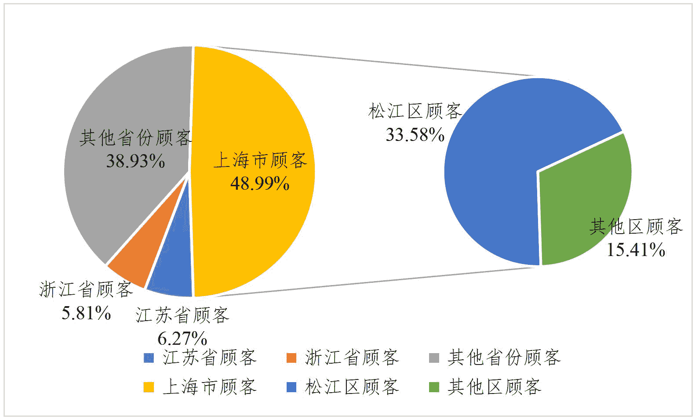

图1 松江区主要饭店被访顾客居住地比例

## 二、饭店顾客满意度调查报告

### （一）总体结果概述

2024年被调查的18家饭店总体满意度为4.73，比2019年增加0.2。根据表3所示的等级划分标准，被调查的饭店全部属于“非常满意”级别，均处于“优异区域”。不同类型的饭店比较来看，经济型连锁酒店服务质量满意度最高，达到4.80；大型社会旅馆次之，达到4.71；星级饭店服务质量顾客满意度最低，为4.70。但总体来说差异不大，顾客满意度均在4.70及以上。

与2019年相比较，本次调查的松江区主要饭店服务质量总体满意度具有较大提升，总体成绩由4.5左右提升至4.75左右。各种饭店类型相较2019年得分具有显著提升，尤其是经济型连锁酒店，提升幅度最大，2024年得分相较2019年增加0.41，满意度级别由“满意”提升至“非常满意”，所属区域由“良好区域”提升至“优异区域”（图2）。

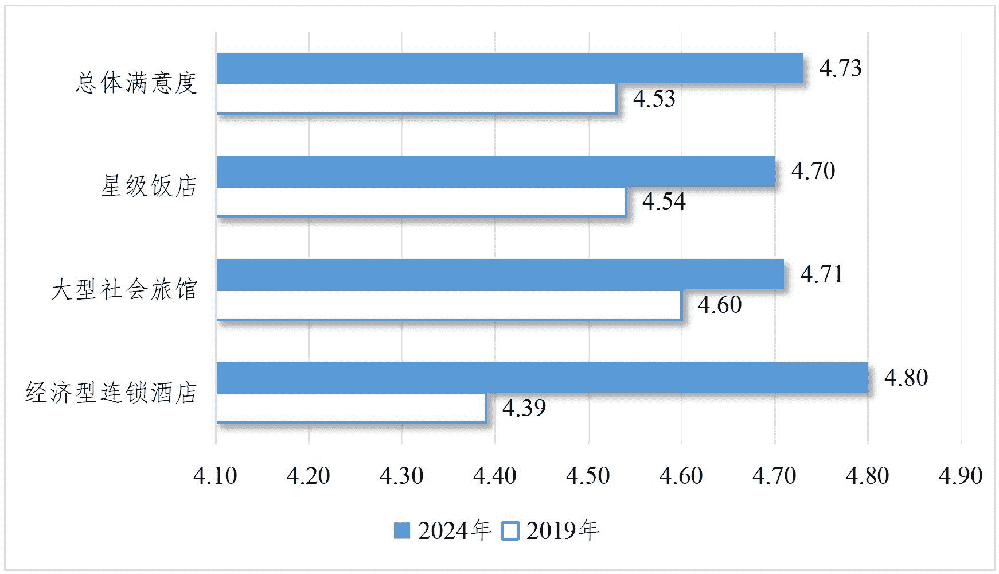

图2 松江区主要饭店服务质量顾客满意度调查总体结果

2024年松江区被调查的18家饭店问卷数据显示，八个一级指标的顾客满意度均为“非常满意”级别，均处于“优异区域”；其中，前厅服务质量的顾客满意度最高，为4.77；会议、宴会服务质量的顾客满意度最低，为4.70；但总的来说各项一级指标的顾客满意度差异不大，分布在4.70—4.80之间，居于较高水平。

与2019年相比较，八个一级指标的满意度均有较大提升，满意度级别由“满意”提升至“非常满意”，所属区域由“良好区域”提升至“优异区域”，整体服务质量顾客满意度各维度跃升至最高级别。其中，餐饮服务质量提升最为显著，共提升0.44；会议、宴会服务质量提升幅度最低，仅提升0.29。但总的来说各项一级指标顾客满意度均有较为显著的提升，提升幅度平均可达0.36左右（图3）。

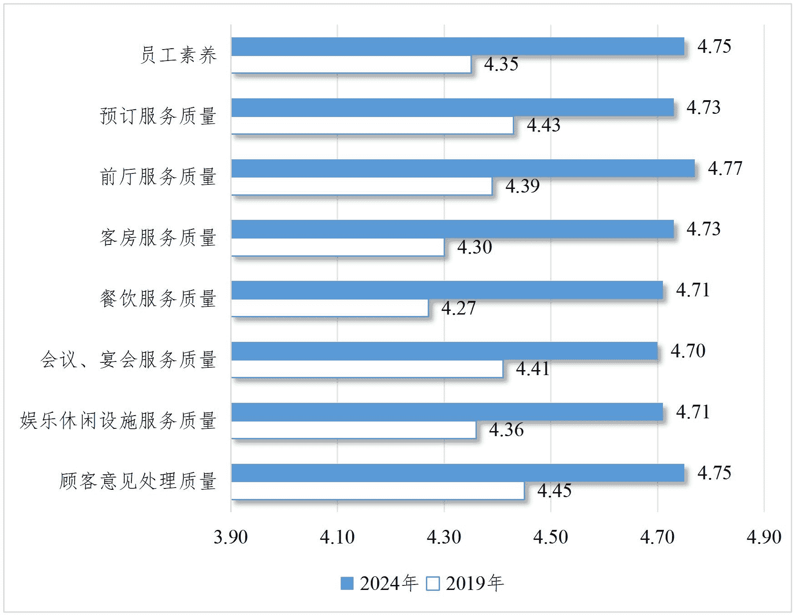

图3 松江区主要饭店服务质量顾客满意度一级指标调查结果比较

### （二）具体指标分析

#### 1、员工素养顾客满意度

2024年松江区被调研饭店的员工素养顾客满意度在三个时段的均值为4.75，其中，节假日时段顾客满意度最高，为4.79；周末时段和工作日时段次之，均为4.74。不同时段的顾客满意度水平差异不大，均在4.70以上，属于“非常满意”级别，处于“优异区域”。

相比2019年，2024年松江区被调研饭店的员工素养顾客满意度在不同时段均高于2019年水平，并且有较大的提升，满意度级别由“满意”提升至“非常满意”，所属区域由“良好区域”提升至“优异区域”。其中，工作日时段提升最为显著，增长0.44；节假日时段提升幅度最低，增长0.35（图4）。

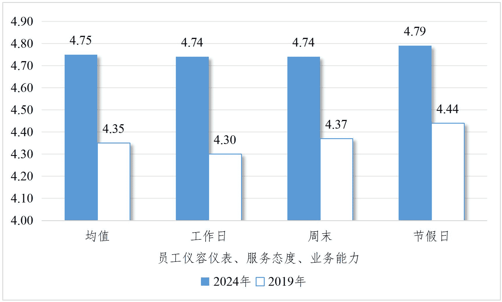

图4 松江区主要饭店员工素养顾客满意度三个时段调查结果

#### 2、预订服务质量顾客满意度

预订服务质量包括电话预订服务质量与网络预订服务质量两个二级指标。数据显示，2024年松江区被调研饭店预订服务质量二级指标的顾客满意度均值均属于“非常满意”级别，处于“优异区域”。从不同时段来看，电话预订服务质量的顾客满意度在工作日及周末时段最高，在节假日时段最低；网络预订服务质量的顾客满意度在节假日时段最高，在工作日时段最低。

与2019年相比，2024年电话预订服务质量的顾客满意度在均值、工作日时段、周末时段、节假日时段全部高于2019年水平，其中，节假日时段提升最为明显，达到0.32；网络预订服务质量的顾客满意度在均值、工作日时段、周末时段、节假日时段得分也全部高于2019年，其中，节假日时段提升最为明显，达到0.36。电话预订服务质量与网络预订服务质量均有较大的提升，满意度级别由“满意”提升至“非常满意”，所属区域由“良好区域”提升至“优异区域”（图5）。

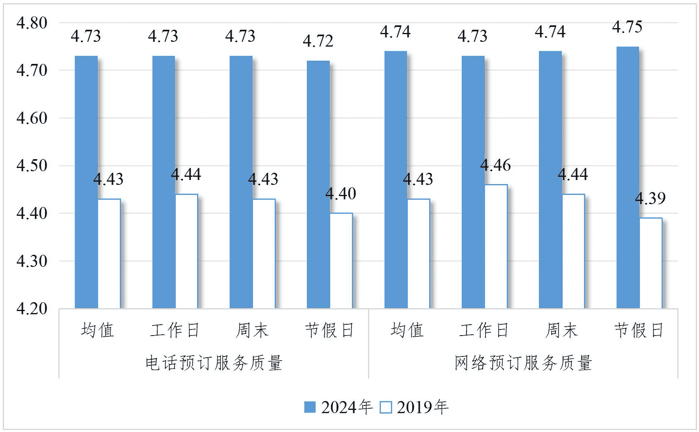

图5 松江区主要饭店预订服务质量顾客满意度三个时段调查结果

#### 3、前厅服务质量顾客满意度

前厅服务质量包括入住登记与退房服务质量、行李服务质量、问询服务质量三个二级指标。数据显示，入住登记与退房服务质量的顾客满意度高于行李服务质量，高于问询服务质量。三个二级指标中，入住登记与退房服务质量在节假日时段得分最高，工作日时段与周末时段得分次之；行李服务质量在周末时段得分最高，在工作日时段得分最低；问询服务质量在节假日时段得分最高，在工作日时段得分最低。但总的来说，前厅服务质量的所有二级指标在不同时段的得分均达到“非常满意”级别，所处区域均为“优异区域”。

与2019年相比较，2024年松江区被调研饭店的入住登记与退房服务质量的顾客满意度在均值、工作日时段、周末时段、节假日时段全部高于2019年水平，其中，节假日时段提升最为明显，达到0.44；行李服务质量的顾客满意度在均值、工作日时段、周末时段、节假日时段得分也全部高于2019年，其中，周末时段提升最为明显，达到0.43；问询服务质量的顾客满意度同样在均值、工作日时段、周末时段、节假日时段得分全部高于2019年，其中，节假日时段提升最为明显，达到0.52。入住登记与退房服务质量、行李服务质量、问询服务质量的顾客满意度均有较大的提升，满意度级别由“满意”提升至“非常满意”，所属区域由“良好区域”提升至“优异区域”（图6）。

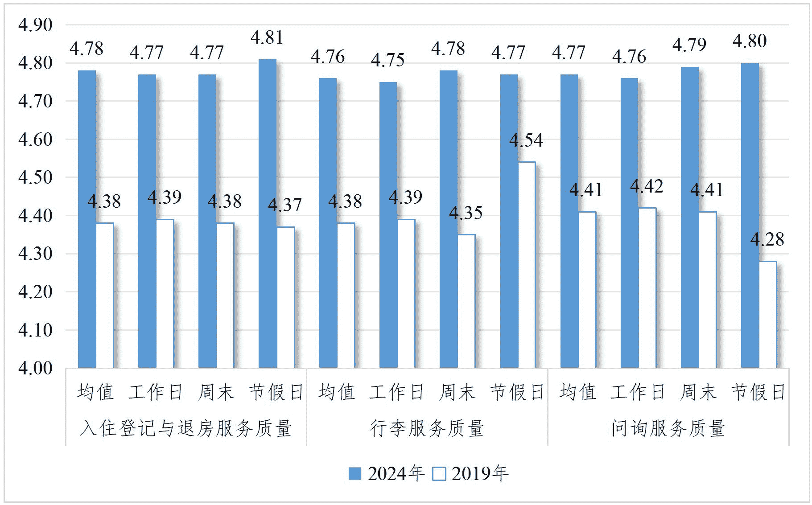

图6 松江区主要饭店前厅服务质量顾客满意度三个时段调查结果

#### 4、客房服务质量顾客满意度

客房服务质量包括整理客房服务质量和客房设施设备完备程度、功能易用性、安全性两个二级指标。数据显示，2024年松江区被调研饭店整理客房服务质量平均顾客满意度略高于客房设施设备服务质量顾客满意度。整理客房服务质量的顾客满意度在节假日时段得分最高，工作日时段与周末时段得分次之；客房设施设备服务质量的顾客满意度在节假日时段得分最高，在工作日时段得分最低。但总的来说，客房服务质量的所有二级指标在不同时段的得分均达到“非常满意”级别，所处区域均为“优异区域”。

相比2019年，2024年松江区被调研饭店整理客房服务质量的顾客满意度在均值、工作日时段、周末时段、节假日时段全部高于2019年水平，其中，工作日时段提升最为明显，达到0.45；客房设施设备服务质量的顾客满意度在均值、工作日时段、周末时段、节假日时段得分也全部高于2019年，其中，节假日时段提升最为明显，达到0.47。整理客房服务质量和客房设施设备服务质量的顾客满意度均有较大的提升，满意度级别由“满意”提升至“非常满意”，所属区域由“良好区域”提升至“优异区域”（图7）。

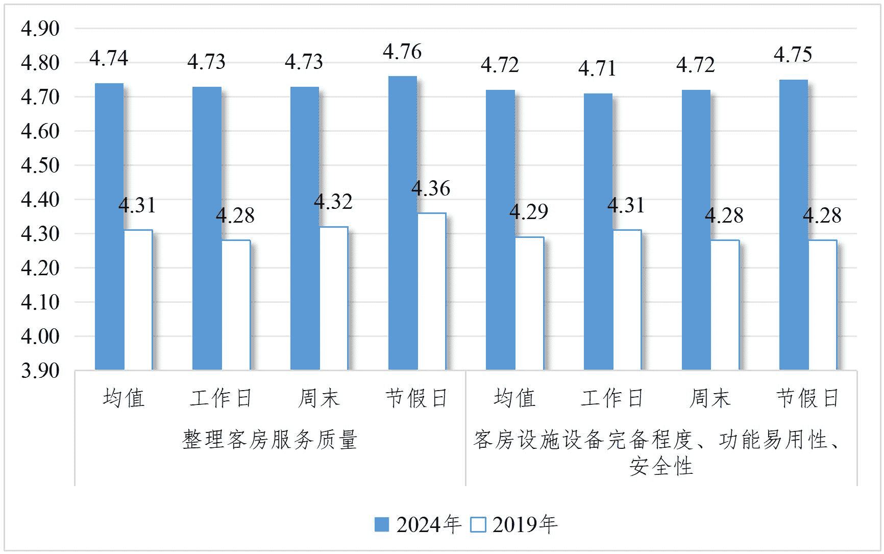

图7 松江区主要饭店客房服务质量顾客满意度三个时段调查结果

#### 5、餐饮服务质量顾客满意度

餐饮服务质量包括自助早餐服务质量、正餐服务质量和餐饮区域设施设备完备程度、功能易用性、清洁卫生程度三个二级指标。数据显示，2024年松江区被调研饭店餐饮区域设施设备服务质量的顾客满意度高于自助早餐服务质量，高于正餐服务质量。三个二级指标中，自助早餐服务质量在周末时段得分最高，工作日时段与节假日时段得分次之；正餐服务质量在工作日时段得分最高，在周末时段得分最低；餐饮区域设施设备服务质量在三个时段得分相同。但总的来说，餐饮服务质量的所有二级指标在不同时段的得分均达到“非常满意”级别，所处区域均为“优异区域”。

与2019年相比较，2024年松江区被调研饭店三个二级指标中，自助早餐服务质量、正餐服务质量、餐饮区域设施设备服务质量的顾客满意度在均值、工作日时段、周末时段、节假日时段全部高于2019年水平，且均在节假日时段提升最为明显，分别为0.64、0.50、0.45。各项二级指标的满意度级别由“满意”提升至“非常满意”，所属区域由“良好区域”提升至“优异区域”（图8）。

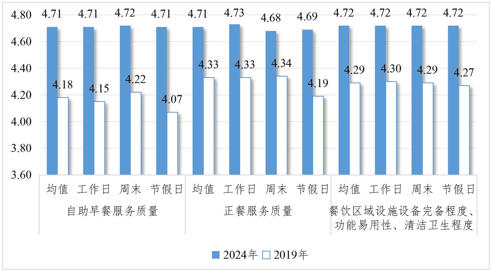

图8 松江区主要饭店餐饮服务质量顾客满意度三个时段调查结果

#### 6、会议、宴会服务质量顾客满意度

2024年松江区被调研饭店的会议、宴会服务质量顾客满意度在三个时段的均值为4.70，其中，工作日时段顾客满意度最高，为4.70；周末时段和节假日时段次之，均为4.69。但不同时段的顾客满意度水平差异不大，均在4.65以上，属于“非常满意”级别，处于“优异区域”。

相比2019年，2024年松江区被调研饭店的会议、宴会服务质量顾客满意度在不同时段均高于2019年水平，并且有较大的提升，满意度级别由“满意”提升至“非常满意”，所属区域由“良好区域”提升至“优异区域”。其中，节假日时段提升最为显著，增长0.34；工作日时段提升幅度最低，增长0.27（图9）。

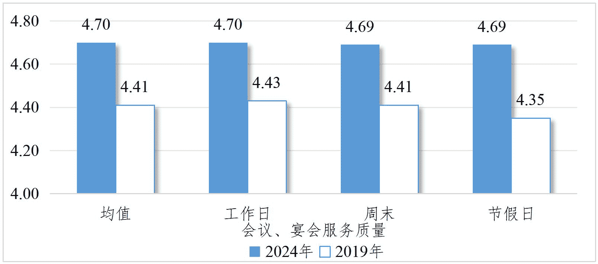

图9 松江区主要饭店会议、宴会服务质量顾客满意度三个时段调查结果

#### 7、娱乐休闲设施服务质量顾客满意度

娱乐休闲设施服务质量包括设施的完备程度、功能易用性和服务人员的服务态度、专业能力两个二级指标。数据显示，2024年松江区被调研饭店服务人员的服务态度、专业能力服务质量平均顾客满意度高于设施的完备程度、功能易用性服务质量顾客满意度。设施的完备程度、功能易用性服务质量和服务人员的服务态度、专业能力的顾客满意度均在节假日时段得分最高，周末时段得分最低。但总的来说，娱乐休闲设施服务质量的所有二级指标在不同时段的得分均达到“非常满意”级别，所处区域均为“优异区域”。

相比2019年，2024年松江区被调研饭店设施的完备程度、功能易用性服务质量的顾客满意度在均值、工作日时段、周末时段、节假日时段全部高于2019年水平，其中，周末时段提升最为明显，达到0.38；服务人员的服务态度、专业能力服务质量的顾客满意度在均值、工作日时段、周末时段、节假日时段得分也全部高于2019年，其中，工作日时段和周末时段具有相同提升幅度，且提升最为明显，达到0.33。设施的完备程度、功能易用性服务质量和服务人员的服务态度、专业能力服务质量的顾客满意度均有较大的提升，满意度级别由“满意”提升至“非常满意”，所属区域由“良好区域”提升至“优异区域”（图10）。

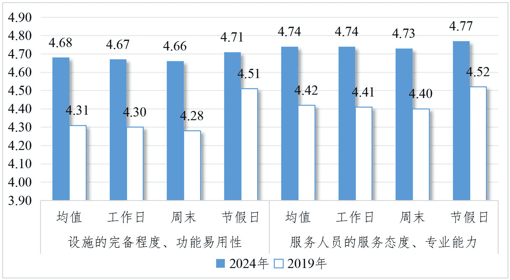

图10 松江区主要饭店娱乐休闲设施服务质量顾客满意度三个时段调查结果

#### 8、顾客意见处理质量顾客满意度

2024年松江区被调研饭店的顾客意见处理质量顾客满意度在三个时段的均值为4.75，其中，工作日时段和周末时段顾客满意度最高，均为4.76；节假日时段最低，为4.71。但不同时段的顾客满意度水平差异不大，均在4.70以上，属于“非常满意”级别，处于“优异区域”。

相比2019年，2024年松江区被调研饭店的顾客意见处理质量顾客满意度在不同时段均高于2019年水平，并且有较大的提升，满意度级别由“满意”提升至“非常满意”，所属区域由“良好区域”提升至“优异区域”。其中，周末时段提升最为显著，增长0.34；工作日时段和节假日时段提升幅度最低，增长0.27（图11）。

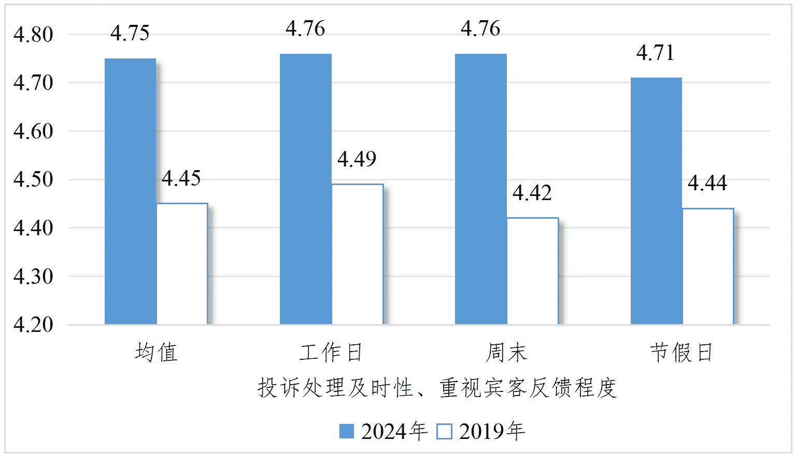

图11 松江区主要饭店顾客意见处理质量顾客满意度三个时段调查结果

### （三）饭店分类分析

#### 1、星级饭店服务质量顾客满意度排名

调研结果显示，2024年松江区被调研的3家星级饭店服务质量顾客满意度平均值为4.70，处于“非常满意”级别，进入“优异区域”。开元名都大酒店与新晖大酒店服务质量顾客满意度均高于平均值，东方佘山翰悦阁酒店服务质量顾客满意度低于平均值。其中，开元名都大酒店服务质量顾客满意度最高，为4.77；新晖大酒店次之，为4.76；东方佘山翰悦阁酒店服务质量顾客满意度最低，为4.51。与2019年平均顾客满意度得分4.54相比较，星级饭店服务质量平均顾客满意度提高了0.16（图12）。

## 2024年松江区旅游企业服务质量顾客满意度调研报告——第一部分：饭店分报告

14

图12 松江区主要星级饭店服务质量顾客满意度排名

### 2、大型社会旅馆服务质量顾客满意度排名

调研结果显示，2024年松江区被调研的8家大型社会旅馆服务质量平均顾客满意度为4.71，处于“非常满意”级别、进入“优异区域”。广富林希尔顿酒店、上海富悦大酒店、广富林宰相府酒店的顾客满意度得分均超过均值，分别达4.93、4.81和4.80；松江凯悦酒店、上海佘山世茂洲际酒店和世茂茂御臻品之选酒店的顾客满意度得分低于均值，分别为4.67、4.62和4.60；立诗顿宾馆和榕港万怡酒店服务质量顾客满意度较低，分别为4.43和4.35。与2019年平均顾客满意度得分4.60相比较，大型社会旅馆服务质量平均顾客满意度提高了0.11（图13）。

图13 松江区主要大型社会旅馆服务质量顾客满意度排名

### 3、经济型连锁酒店服务质量顾客满意度排名

调研结果显示，2024年松江区被调研的7家经济型连锁酒店服务质量平均顾客满意度为4.80，属于“非常满意”级别、进入“优异区域”。如家华驿智旅酒店（上海松江大学城玉树路店）、全季酒店（上海九亭中心店）、上海松江体育中心亚朵酒店和格林豪泰商务酒店（上海松江高铁站店）的满意度均超过均值，其中，如家华驿智旅酒店（上海松江大学城玉树路店）与全季酒店（上海九亭中心店）服务质量顾客满意度最高，为4.98；维也纳酒店（上海佘山欢乐谷店）服务质量顾客满意度最低，为4.55。与2019年平均顾客满意度得分4.39相比较，经济型连锁酒店服务质量平均顾客满意度有了显著提升，达0.41（图14）。

图14 松江区主要经济型连锁酒店服务质量顾客满意度排名

### 4、与上海市其他区县饭店服务质量顾客满意度的比较

调研结果显示，松江区18家饭店服务质量顾客满意度与上海市其他区县饭店相比，处于较好水平。“好”与“很好”的评价超过半数，占比达到85.61%，如图15所示。

图15 松江区主要饭店与上海市其他区县饭店的顾客满意度比较

### 5、松江区主要饭店一级指标顾客满意度排名

2024年松江区主要星级饭店一级指标顾客满意度如表4所示。

**表4 2024年松江区主要星级旅游饭店服务质量顾客满意度调查结果**

| 排名 | 调研地点 | 调研时段 | 员工素养 | 预订服务 | 前厅服务质量 | 客房服务质量 | 餐饮服务质量 | 会议、宴会服务质量 | 娱乐休闲设施服务质量 | 顾客意见处理质量 | 各时段总体满意度 | 2024总体满意度 |
|:---:|:---:|:---:|:---:|:---:|:---:|:---:|:---:|:---:|:---:|:---:|:---:|:---:|
| 1 | 开元名都大酒店 | 工作日 | 4.74 | 4.79 | 4.81 | 4.81 | 4.77 | 4.75 | 4.82 | 4.79 | 4.79 | 4.77 |
| | | 周末 | 4.60 | 4.80 | 4.80 | 4.70 | 4.67 | 5.00 | 4.80 | 5.00 | 4.77 | |
| | | 节假日 | 4.33 | 4.17 | 4.22 | 4.33 | 4.11 | 4.33 | 4.17 | 4.33 | 4.22 | |
| | | 均值 | 4.71 | 4.77 | 4.79 | 4.78 | 4.74 | 4.75 | 4.79 | 4.79 | 4.77 | |
| 2 | 新晖大酒店 | 工作日 | 4.76 | 4.83 | 4.94 | 4.93 | 4.92 | 4.90 | 4.90 | 4.90 | 4.90 | 4.76 |
| | | 周末 | 4.88 | 4.92 | 4.92 | 4.92 | 4.92 | 4.92 | 4.88 | 4.88 | 4.91 | |
| | | 节假日 | 4.60 | 4.45 | 4.67 | 4.47 | 4.52 | 4.47 | 4.50 | 4.53 | 4.53 | |
| | | 均值 | 4.74 | 4.71 | 4.82 | 4.74 | 4.76 | 4.74 | 4.74 | 4.75 | 4.76 | |
| 3 | 东方佘山翰悦阁酒店 | 工作日 | 4.76 | 4.48 | 4.68 | 4.58 | 4.60 | 4.64 | 4.58 | 4.64 | 4.61 | 4.51 |
| | | 周末 | 4.25 | 3.88 | 4.42 | 3.88 | 3.75 | 3.75 | 4.00 | 3.75 | 3.98 | |
| | | 节假日 | 4.68 | 4.29 | 4.65 | 4.47 | 4.28 | 4.42 | 4.55 | 4.63 | 4.48 | |
| | | 均值 | 4.69 | 4.35 | 4.65 | 4.48 | 4.40 | 4.48 | 4.52 | 4.56 | 4.51 | |
| 星级酒店 | | 工作日 | 4.71 | 4.64 | 4.77 | 4.70 | 4.66 | 4.68 | 4.72 | 4.73 | 4.70 | 4.70 |
| | | 周末 | 4.71 | 4.72 | 4.80 | 4.74 | 4.73 | 4.72 | 4.75 | 4.74 | 4.74 | |
| | | 节假日 | 4.68 | 4.63 | 4.76 | 4.68 | 4.64 | 4.65 | 4.70 | 4.71 | 4.68 | |
| | | 总计 | 4.72 | 4.65 | 4.77 | 4.70 | 4.67 | 4.68 | 4.71 | 4.72 | 4.70 | |

2024年松江区主要大型社会旅馆一级指标顾客满意度如表5所示。

**表5 2024年松江区主要大型社会旅馆服务质量顾客满意度调查结果**

| 排名 | 调研地点 | 调研时段 | 员工素养 | 预订服务 | 前厅服务质量 | 客房服务质量 | 餐饮服务质量 | 会议、宴会服务质量 | 娱乐休闲设施服务质量 | 顾客意见处理质量 | 各时段总体满意度 | 2024总体满意度 |
|:---:|:---:|:---:|:---:|:---:|:---:|:---:|:---:|:---:|:---:|:---:|:---:|:---:|
| 1 | 广富林希尔顿酒店 | 工作日 | 4.90 | 4.94 | 4.97 | 4.95 | 4.95 | 4.93 | 4.95 | 4.95 | 4.95 | 4.93 |
| | | 周末 | 4.88 | 4.88 | 4.83 | 4.88 | 4.96 | 4.88 | 4.88 | 4.88 | 4.88 | |
| | | 节假日 | 4.89 | 4.89 | 4.93 | 4.92 | 4.86 | 4.84 | 4.97 | 4.95 | 4.91 | |
| | | 均值 | 4.90 | 4.93 | 4.95 | 4.94 | 4.93 | 4.91 | 4.95 | 4.94 | 4.93 | |
| 2 | 上海富悦大酒店 | 工作日 | 4.72 | 4.72 | 4.72 | 4.67 | 4.67 | 4.67 | 4.64 | 4.64 | 4.68 | 4.81 |
| | | 周末 | 4.67 | 4.67 | 4.83 | 4.75 | 4.72 | 4.67 | 4.67 | 4.67 | 4.72 | |
| | | 节假日 | 4.92 | 4.90 | 4.92 | 4.92 | 4.90 | 4.88 | 4.88 | 4.88 | 4.90 | |
| | | 均值 | 4.83 | 4.82 | 4.84 | 4.82 | 4.81 | 4.79 | 4.78 | 4.78 | 4.81 | |
| 3 | 广富林宰相府酒店 | 工作日 | 4.77 | 4.83 | 4.86 | 4.79 | 4.76 | 4.83 | 4.72 | 4.83 | 4.80 | 4.80 |
| | | 周末 | 4.78 | 4.78 | 4.77 | 4.79 | 4.76 | 4.76 | 4.77 | 4.80 | 4.77 | |
| | | 节假日 | 4.92 | 4.89 | 4.88 | 4.89 | 4.75 | 4.75 | 4.82 | 4.69 | 4.83 | |
| | | 均值 | 4.83 | 4.84 | 4.84 | 4.83 | 4.76 | 4.78 | 4.77 | 4.77 | 4.80 | |
| 4 | 松江凯悦酒店 | 工作日 | 4.78 | 4.75 | 4.70 | 4.65 | 4.74 | 4.81 | 4.79 | 4.86 | 4.74 | 4.67 |
| | | 周末 | 4.38 | 4.48 | 4.62 | 4.60 | 4.57 | 4.57 | 4.57 | 4.52 | 4.56 | |
| | | 节假日 | 4.60 | 4.67 | 4.62 | 4.70 | 4.71 | 4.60 | 4.70 | 4.73 | 4.67 | |
| | | 均值 | 4.63 | 4.65 | 4.66 | 4.65 | 4.69 | 4.69 | 4.71 | 4.74 | 4.67 | |
| 5 | 上海佘山世茂洲际酒店 | 工作日 | 4.62 | 4.56 | 4.62 | 4.58 | 4.61 | 4.51 | 4.60 | 4.62 | 4.59 | 4.62 |
| | | 周末 | 4.82 | 4.73 | 4.73 | 4.55 | 4.58 | 4.18 | 4.50 | 4.82 | 4.62 | |
| | | 节假日 | 4.83 | 4.83 | 4.72 | 4.67 | 4.78 | 4.50 | 4.75 | 4.83 | 4.74 | |
| | | 均值 | 4.68 | 4.63 | 4.65 | 4.58 | 4.62 | 4.45 | 4.60 | 4.68 | 4.62 | |
| 6 | 世茂茂御臻品之选酒店 | 工作日 | 4.61 | 4.50 | 4.58 | 4.42 | 4.47 | 4.48 | 4.65 | 4.65 | 4.54 | 4.60 |
| | | 周末 | 4.69 | 4.77 | 4.74 | 4.65 | 4.59 | 4.69 | 4.77 | 4.77 | 4.70 | |
| | | 节假日 | 5.00 | 5.00 | 5.00 | 5.00 | 5.00 | 5.00 | 5.00 | 5.00 | 5.00 | |
| | | 均值 | 4.65 | 4.60 | 4.64 | 4.51 | 4.53 | 4.57 | 4.70 | 4.70 | 4.60 | |
| 7 | 立诗顿宾馆 | 工作日 | 4.49 | 4.46 | 4.42 | 4.31 | 4.40 | 4.33 | 4.29 | 4.42 | 4.39 | 4.43 |
| | | 周末 | 4.86 | 4.68 | 4.79 | 4.43 | 4.57 | 4.64 | 4.57 | 4.79 | 4.65 | |
| | | 节假日 | 4.00 | 4.00 | 4.00 | 4.00 | 5.00 | 4.00 | 4.00 | 4.00 | 4.20 | |
| | | 均值 | 4.55 | 4.49 | 4.48 | 4.32 | 4.44 | 4.38 | 4.34 | 4.48 | 4.43 | |
| 8 | 榕港万怡酒店 | 工作日 | 4.33 | 4.38 | 4.44 | 4.46 | 4.06 | 4.08 | 4.08 | 4.42 | 4.28 | 4.35 |
| | | 周末 | 4.33 | 4.33 | 4.33 | 4.33 | 4.33 | 3.67 | 3.67 | 4.33 | 4.20 | |
| | | 节假日 | 5.00 | 5.00 | 5.00 | 5.00 | 5.00 | 5.00 | 5.00 | 5.00 | 5.00 | |
| | | 均值 | 4.41 | 4.44 | 4.49 | 4.50 | 4.22 | 4.12 | 4.12 | 4.47 | 4.35 | |
| 大型社会旅馆 | | 工作日 | 4.69 | 4.69 | 4.70 | 4.65 | 4.65 | 4.63 | 4.59 | 4.69 | 4.69 | 4.71 |
| | | 周末 | 4.70 | 4.69 | 4.72 | 4.68 | 4.67 | 4.63 | 4.63 | 4.74 | 4.70 | |
| | | 节假日 | 4.88 | 4.88 | 4.89 | 4.88 | 4.83 | 4.79 | 4.83 | 4.81 | 4.88 | |
| | | 总计 | 4.74 | 4.73 | 4.75 | 4.70 | 4.69 | 4.67 | 4.69 | 4.73 | 4.71 | |

2024年松江区主要经济型连锁酒店一级指标顾客满意度如表6所示。

**表6 2024年松江区主要经济型连锁酒店服务质量顾客满意度调查结果**

| 排名 | 调研地点 | 调研时段 | 员工素养 | 预订服务 | 前厅服务质量 | 客房服务质量 | 餐饮服务质量 | 会议、宴会服务质量 | 娱乐休闲设施服务质量 | 顾客意见处理质量 | 各时段总体满意度 | 2024总体满意度 |
|:---:|:---:|:---:|:---:|:---:|:---:|:---:|:---:|:---:|:---:|:---:|:---:|:---:|
| 1 | 如家华驿智旅酒店(上海松江大学城玉树路店) | 工作日 | 5.00 | 4.98 | 5.00 | 5.00 | 5.00 | 5.00 | 5.00 | 5.00 | 5.00 | 4.98 |
| | | 周末 | 5.00 | 5.00 | 5.00 | 5.00 | 5.00 | 5.00 | 5.00 | 5.00 | 5.00 | |
| | | 节假日 | 4.90 | 4.95 | 4.93 | 4.95 | 4.90 | 4.90 | 4.95 | 4.90 | 4.93 | |
| | | 均值 | 4.97 | 4.97 | 4.98 | 4.99 | 4.97 | 4.97 | 4.99 | 4.97 | 4.98 | |
| 2 | 全季酒店(上海九亭中心店) | 工作日 | 4.96 | 4.97 | 4.99 | 5.00 | 4.98 | 5.00 | 4.98 | 4.98 | 4.98 | 4.98 |
| | | 周末 | 5.00 | 5.00 | 5.00 | 5.00 | 5.00 | 5.00 | 5.00 | 5.00 | 5.00 | |
| | | 节假日 | — | — | — | — | — | — | — | — | — | |
| | | 均值 | 4.96 | 4.97 | 4.99 | 5.00 | 4.98 | 5.00 | 4.98 | 4.98 | 4.98 | |
| 3 | 上海松江体育中心亚朵酒店 | 工作日 | 4.85 | 4.85 | 4.87 | 4.83 | 4.85 | 4.70 | 4.80 | 4.85 | 4.83 | 4.87 |
| | | 周末 | 4.89 | 4.94 | 5.00 | 5.00 | 5.00 | 5.00 | 5.00 | 5.00 | 4.99 | |
| | | 节假日 | 4.50 | 4.75 | 5.00 | 5.00 | 4.75 | 4.75 | 4.75 | 4.50 | 4.80 | |
| | | 均值 | 4.82 | 4.86 | 4.92 | 4.89 | 4.88 | 4.79 | 4.85 | 4.85 | 4.87 | |
| 4 | 格林豪泰商务酒店（上海松江高铁站店） | 工作日 | 4.79 | 4.74 | 4.78 | 4.78 | 4.84 | 4.86 | 4.90 | 4.90 | 4.82 | 4.84 |
| | | 周末 | 4.71 | 4.71 | 4.90 | 5.00 | 4.95 | 5.00 | 5.00 | 5.00 | 4.91 | |
| | | 节假日 | 5.00 | 5.00 | 5.00 | 5.00 | 5.00 | 5.00 | 5.00 | 5.00 | 5.00 | |
| | | 均值 | 4.79 | 4.75 | 4.82 | 4.83 | 4.87 | 4.89 | 4.92 | 4.92 | 4.84 | |
| 5 | 维也纳酒店(上海万达广富林路店) | 工作日 | 4.62 | 4.67 | 4.70 | 4.74 | 4.57 | 4.57 | 4.43 | 4.76 | 4.63 | 4.63 |
| | | 周末 | 4.75 | 4.75 | 4.75 | 4.69 | 4.46 | 4.63 | 4.44 | 4.63 | 4.63 | |
| | | 节假日 | 4.57 | 4.68 | 4.71 | 4.64 | 4.62 | 4.64 | 4.61 | 4.57 | 4.64 | |
| | | 均值 | 4.63 | 4.69 | 4.71 | 4.70 | 4.57 | 4.60 | 4.49 | 4.67 | 4.63 | |
| 6 | 如家酒店·neo(上海松江松卫北路店) | 工作日 | 4.79 | 4.71 | 4.67 | 4.79 | 4.63 | 4.54 | 4.45 | 4.68 | 4.65 | 4.62 |
| | | 周末 | 5.00 | 4.67 | 5.00 | 4.83 | 4.67 | 4.33 | 4.33 | 4.33 | 4.69 | |
| | | 节假日 | 4.75 | 4.50 | 4.33 | 4.25 | 4.58 | 4.25 | 4.13 | 4.00 | 4.37 | |
| | | 均值 | 4.80 | 4.69 | 4.66 | 4.73 | 4.63 | 4.49 | 4.40 | 4.57 | 4.62 | |
| 7 | 维也纳酒店(上海佘山欢乐谷店) | 工作日 | 4.79 | 4.82 | 4.88 | 4.82 | 4.76 | 4.79 | 4.75 | 4.79 | 4.80 | 4.55 |
| | | 周末 | 4.20 | 4.20 | 4.20 | 4.20 | 3.93 | 4.00 | 3.80 | 4.20 | 4.08 | |
| | | 节假日 | 4.50 | 4.50 | 4.50 | 4.50 | 4.37 | 4.30 | 4.40 | 4.40 | 4.44 | |
| | | 均值 | 4.59 | 4.60 | 4.63 | 4.60 | 4.48 | 4.48 | 4.47 | 4.55 | 4.55 | |
| 经济型连锁酒店 | | 工作日 | 4.84 | 4.84 | 4.85 | 4.87 | 4.82 | 4.81 | 4.77 | 4.87 | 4.84 | 4.80 |
| | | 周末 | 4.80 | 4.80 | 4.82 | 4.87 | 4.80 | 4.78 | 4.69 | 4.80 | 4.80 | |
| | | 节假日 | 4.66 | 4.68 | 4.75 | 4.68 | 4.66 | 4.61 | 4.61 | 4.57 | 4.66 | |
| | | 总计 | 4.81 | 4.80 | 4.83 | 4.83 | 4.79 | 4.77 | 4.75 | 4.81 | 4.80 | |

2024年松江区所有被调研酒店一级指标顾客满意度如表7所示。

**表7 2024年松江区所有被调研酒店服务质量顾客满意度调查结果**

| 排名 | 调研地点 | 调研时段 | 员工素养 | 预订服务 | 前厅服务质量 | 客房服务质量 | 餐饮服务质量 | 会议、宴会服务质量 | 娱乐休闲设施服务质量 | 顾客意见处理质量 | 各时段总体满意度 | 2024总体满意度 |
|:---:|:---:|:---:|:---:|:---:|:---:|:---:|:---:|:---:|:---:|:---:|:---:|:---:|
| 1 | 经济型连锁酒店 | 工作日 | 4.84 | 4.84 | 4.85 | 4.87 | 4.82 | 4.81 | 4.77 | 4.87 | 4.84 | 4.80 |
| | | 周末 | 4.80 | 4.80 | 4.82 | 4.87 | 4.80 | 4.78 | 4.69 | 4.80 | 4.80 | |
| | | 节假日 | 4.66 | 4.68 | 4.75 | 4.68 | 4.66 | 4.61 | 4.61 | 4.57 | 4.66 | |
| | | 均值 | 4.81 | 4.80 | 4.83 | 4.83 | 4.79 | 4.77 | 4.75 | 4.81 | 4.80 | |
| 2 | 大型社会旅馆 | 工作日 | 4.69 | 4.69 | 4.70 | 4.65 | 4.65 | 4.63 | 4.59 | 4.69 | 4.69 | 4.71 |
| | | 周末 | 4.70 | 4.69 | 4.72 | 4.68 | 4.67 | 4.63 | 4.63 | 4.74 | 4.70 | |
| | | 节假日 | 4.88 | 4.88 | 4.89 | 4.88 | 4.83 | 4.79 | 4.83 | 4.81 | 4.88 | |
| | | 均值 | 4.74 | 4.73 | 4.75 | 4.70 | 4.69 | 4.67 | 4.69 | 4.73 | 4.71 | |
| 3 | 星级酒店 | 工作日 | 4.73 | 4.73 | 4.81 | 4.78 | 4.76 | 4.75 | 4.78 | 4.78 | 4.70 | 4.70 |
| | | 周末 | 4.76 | 4.78 | 4.84 | 4.76 | 4.75 | 4.79 | 4.76 | 4.76 | 4.78 | |
| | | 节假日 | 4.62 | 4.38 | 4.63 | 4.46 | 4.41 | 4.44 | 4.50 | 4.56 | 4.49 | |
| | | 均值 | 4.72 | 4.65 | 4.77 | 4.70 | 4.67 | 4.68 | 4.71 | 4.72 | 4.70 | |

2024 年松江区旅游企业服务质量顾客满意度调研报告——第一部分：饭店分报告

所有被调研饭店总体服务质量满意度

| 时间段 | 指标1 | 指标2 | 指标3 | 指标4 | 指标5 | 指标6 | 指标7 | 指标8 | 指标9 | 总计 |
|---|---:|---:|---:|---:|---:|---:|---:|---:|---:|---:|
| 工作日 | 4.74 | 4.73 | 4.77 | 4.73 | 4.71 | 4.70 | 4.67 | 4.76 | 4.73 | 4.73 |
| 周末 | 4.74 | 4.73 | 4.77 | 4.73 | 4.72 | 4.69 | 4.66 | 4.76 | 4.73 | — |
| 节假日 | 4.79 | 4.72 | 4.81 | 4.76 | 4.71 | 4.69 | 4.71 | 4.71 | 4.74 | — |
| 总计 | 4.75 | 4.73 | 4.77 | 4.73 | 4.71 | 4.70 | 4.71 | 4.75 | 4.73 | — |

### （四）饭店被调研顾客基本情况分析

### 1、被调研顾客住宿目的分析

调研结果显示，顾客到松江区的住宿目的以休闲为主，占36.07%，其次是商务、探亲访友，占比分别为19.74%、12.92%，如图16所示。

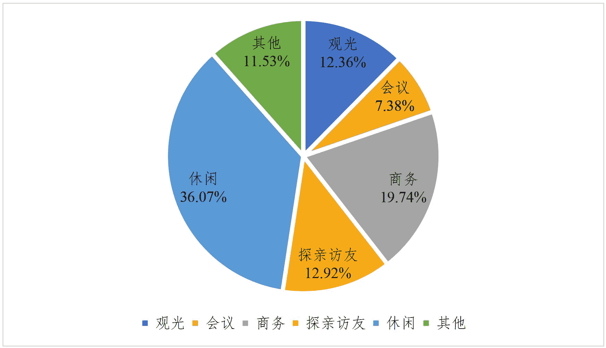

图16 被调研顾客住宿目的分析结果

### 2、被调研顾客年龄分析

通过对松江区18家饭店的顾客进行调研分析得知，来松江区住宿的顾客年龄以25~34岁为主，占31.73%，其次为24岁及以下，占29.70%，具体情况如图17所示。

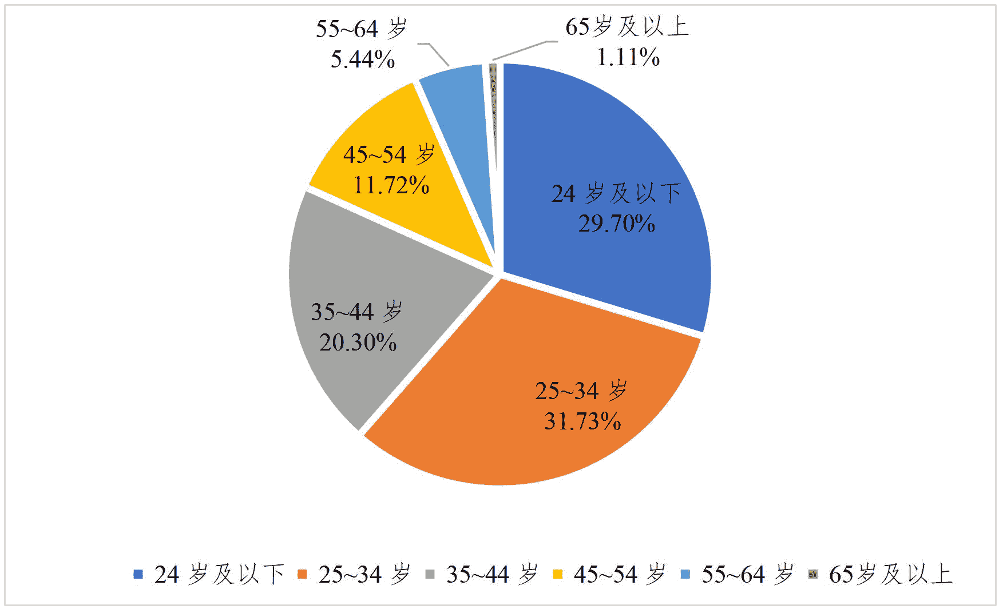

图17 被调研顾客年龄分析结果

### 3、被调研顾客职业分析

调研结果显示，被调研顾客以企业从业人员为主，占23.34%，如图18所示。

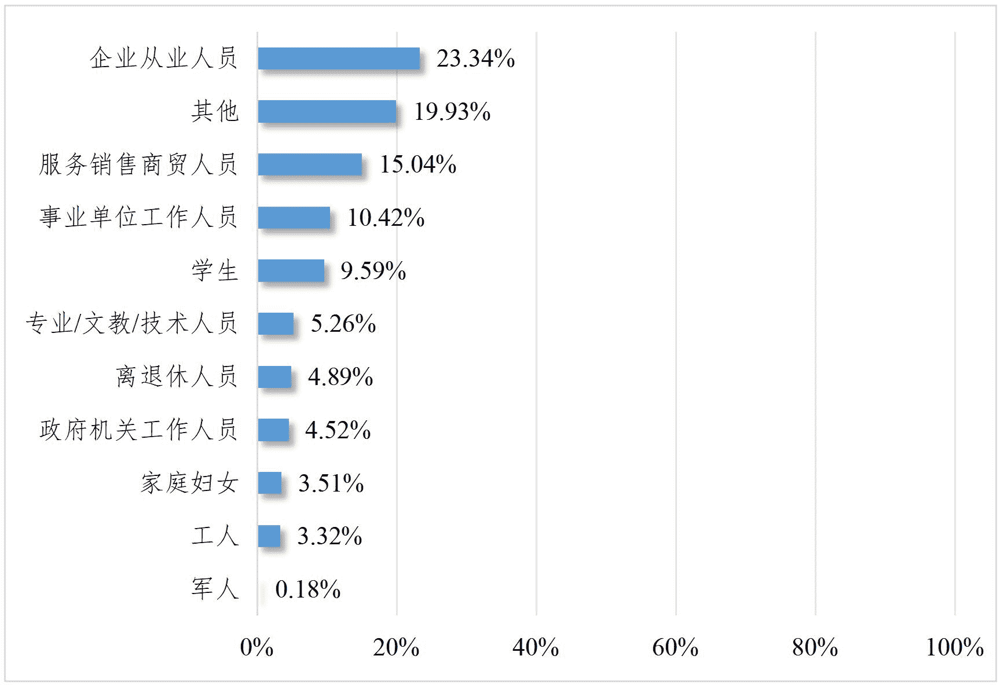

图18 被调研顾客职业分析结果

### 4、被调研顾客期望松江区重点发展怎样的饭店类型分析

调研结果显示，被调研顾客以期望松江区重点发展度假型饭店为主，占26.29%，其次是精品民宿，占19.00%，如图19所示。

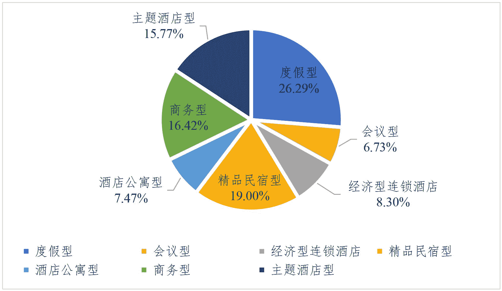

图19 被调研顾客期望松江区重点发展的饭店类型分析结果

### 5、被调研顾客获取饭店信息的渠道分析

调研结果显示，被调研顾客获取饭店信息主要以亲友推荐为主，占23.63%，其次是以前来过，为20.61%，如图20所示。

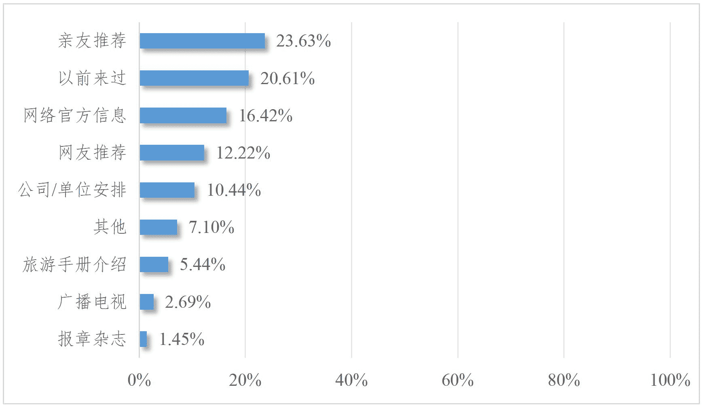

图20 被调研顾客获取饭店信息的渠道分析结果

## 三、调查结论与对策建议

### （一）调查结论

经过实地走访调查以及对问卷数据的分析，我们得出如下结论：

1、2024年松江区饭店服务质量顾客满意度总体水平及核心业务服务质量顾客满意度均显著高于2019年，满意度级别由“满意”提升至“非常满意”，所属区域由“良好区域”提升至“优异区域”。不同类型饭店及8个一级指标的顾客满意度均稳定在4.70及以上，处于较高的水平。说明相较于疫情前，松江区各类型饭店在疫情过后的经济复苏期间不断提升自身服务质量，完善各维度服务水平。但仍有部分顾客反映停车困难、菜品无吸引力、员工服务态度不佳、忽视售后反馈等问题，说明有进一步提升的空间和潜力。

2、经济型连锁酒店顾客满意度均值高达4.80，总体来看高于星级饭店和大型社会旅馆，说明疫情过后顾客在选择饭店时关注性价比，对价格比较敏感。在经济型连锁酒店中，维也纳酒店（上海佘山欢乐谷店）服务质量顾客满意度最低，为4.55，需要进一步优化服务，提升自身的服务水平。

3、饭店核心业务服务质量顾客满意度在时间段上总体呈现出较为规律的变化，其中节假日时段服务质量顾客满意度相对较高，且与总体服务质量顾客满意度均值保持一致；工作日时段的服务质量顾客满意度相对较低，且略低于总体服务质量顾客满意度均值；周末时段各指标服务质量顾客满意度变化无明显规律。说明各类型饭店对于人流量巨大的节假日在服务质量方面做了充足的准备，致力于让每位顾客拥有愉悦的消费体验，但对于人流量相对稀少的工作日，还缺乏一定的重视度，仍有提升空间。

4、2024年松江区饭店被调研顾客对未来重点发展度假型饭店、精品民宿以及主题酒店期望较高，总占比达到61.06%。说明随着我国社会经济水平的高速发展，人们对精神生活的追求达到了一个新的高度。消费者更愿意为自己认可的“价值”买单，尤其是在饭店的选择上，对休闲度假的诉求越来越高，并具有多样化、品质化和个性化的需求。但目前松江区饭店更多还是以满足顾客住宿、餐饮等基础需求为目的，对于休闲度假的需求方面还需要进一步提升。

5、2024年松江区饭店被调研顾客表示对饭店信息了解的渠道主要为亲友推荐、以前来过、网络官方信息、网友推荐，总占比达到72.88%。说明消费者了解饭店信息的渠道越来越多样化，主要分为线上和线下两种。线上渠道集中在饭店官方网站和APP、各类社交媒体平台、各大OTA在线预订平台等，线下渠道集中在熟悉的亲友推荐以及过往入住的体验。随着市场日趋饱和，行业竞争加剧，各类型饭店更应该采取有效措施精准获客。但目前松江区饭店在对外营销宣传的方式和手段上还比较单一，需要进一步创新。

### （二）对策建议

根据以上调查结论及调查过程中发现的问题，我们提出了如下建议：

### 1、满足顾客多样化需求，提升顾客满意度

针对结论一反映的问题，部分饭店在服务细节方面还存在不足，有顾客反映停车困难、菜品无吸引力、忽视售后反馈等，由此提出满足顾客多样化需求，提升顾客满意度。

首先，在交通方面，针对部分顾客反映的饭店停车位较少、停车困难的问题，饭店管理方可以引进数智技术，实行智能化停车，提高车位利用率。同时，在现有条件允许的情况下，对停车场进行适当扩建，增加停车位。此外，也可以与就近大型停车场达成长期战略合作，对饭店顾客实行停车费减免等福利政策。

其次，在餐饮方面，饭店方应不断丰富菜品种类，更新菜单，可以根据不同地区人群的饮食偏好研制特色菜品。同时，饭店应提高自身承办各种会议、宴会的能力，在保证食品质量安全的前提下，给参会人员带来舒心、放心的服务。与此同时，还可以推出亲子互动烘焙等小型活动，给前来住宿的家庭带来独特体验，打造饭店的个性化竞争力。

最后，在售后方面，饭店应重点关注顾客的反馈，重视顾客提出的意见，针对顾客住宿过程中产生的问题应及时整改，给予顾客充足的关怀和贴心的服务。饭店管理方还可以在顾客退宿时询问顾客整体入住感受，是否存在体验不佳的地方，及时反思、总结、复盘，在不断纠错与改错中提高服务质量。

### 2、实施精准化阶梯定价，提高下单转化率

针对结论二反映的问题，顾客对经济型连锁酒店满意度更高，在饭店的选择上不仅追求便捷的居住体验，还非常注重性价比，但部分星级饭店与大型社会旅馆存在高溢价情况，由此提出实施精准化阶梯定价，提高下单转化率。

首先，针对价格高敏感型顾客，饭店可以使用引流产品，即价格低、配置基础的客房，采用成本导向和市场导向定价策略。饭店在充分考虑各项成本后得出一个基本的定价范围，确保这个价格能够覆盖成本，并实现一定的利润。同时，还需要参考同地区、同类型竞争对手的低价引流客房，与其保持同等价格水平，甚至可以在OTA平台设置随机减免红包，提高下单转化率。

其次，针对价格一般敏感型顾客，饭店可以重点推荐价值产品，即高值正价、有增值服务的客房，采用理解价值定价策略。饭店需要提前进行市场调研，了解顾客对饭店各种服务和设施的评价，以及他们愿意为这些服务和设施支付的价格。例如延伸客房基础服务内容，推出延迟退房、续住九折、自助早餐等服务，还可以采用套餐组合定价，将客房与其他服务如自助洗衣、离店伴手礼、娱乐活动等相结合，制定一个综合的价格。

最后，针对非价格敏感型顾客，饭店可以推出高阶产品，即高价高增值的客房，采用需求导向定价策略。面对这类顾客，饭店应充分挖掘每一位顾客的内心需求，为顾客打造一段独一无二的记忆。例如推出不同主题的定制客房，如豪华商务房、影院房、亲子家庭房等，以满足不同客户群体的需求；设置专属私人管家，为顾客定制专属旅行攻略等。

### 3、提高工作日服务质量，优化顾客体验感

针对结论三反映的问题，工作日时段服务质量的顾客满意度低于节假日时段与周末时段，部分饭店存在因工作日时段人流量相对稀疏就忽视对此时段服务质量把控的问题，由此提出提高工作日服务质量，优化顾客体验感。

首先，在员工方面，饭店可以通过加强相应培训教育，提高员工对于工作日时段的重视程度，强调工作日与周末服务标准的一致性，避免员工因工作日客流量少而懈怠。同时，饭店可以修改服务质量评比标准，提高工作日服务质量的评分占比，设立奖罚制度，对于能够一直保持提供优秀服务的员工进行嘉奖，对于服务水平波动较大的员工进行必要的惩罚。

其次，在排班方面，尽管工作日时段客流量可能相对较少，但饭店依然需要确保有足够数量的员工在岗，以便及时响应顾客的需求，保持服务品质的一致性和高效性。为了更加科学地应对客流量差异，饭店可以设计并实施一套灵活的轮班制度，根据实际客流量情况，动态调整各岗位员工的上班时间。例如，在工作日减少部分非关键岗位的员工数量，而将更多的员工安排到直接接触顾客的环节。饭店还应预留出部分储备人员，在需要时迅速补充到一线岗位，帮助饭店及时应对突发情况。

最后，在服务方面，对于客流量相对较少的工作日，饭店可以通过提供更加细致的服务来提升顾客的体验，如设立专门的顾客服务热线或在线平台，建立数据库记录客户的偏好和需求；提供SPA按摩、瑜伽冥想活动等，以提升顾客在工作日的入住体验。

### 4、发展休闲度假型饭店，打造特色竞争力

针对结论四反映的问题，消费者具有多样化、品质化和个性化的需求，更渴望发展休闲度假型饭店，但目前松江区饭店休闲娱乐服务还较为缺乏，由此提出发展休闲度假型饭店，打造特色竞争力。

首先，在硬件方面，部分饭店大堂及房间设施已较为陈旧，出现了设备年久失修、影响顾客使用等问题。因此，饭店可以优化硬件设施和装修，对餐桌、椅、餐具等进行换新，定期检查电视、空调、监控等电子设施有无故障，更换更优质的床上用品及牙刷、牙膏、拖鞋等一次性快捷用品。

其次，在娱乐方面，饭店可以增设娱乐空间，如户外草坪、户外泳池等，承接草坪婚礼、泳池派对等活动。也可以针对家庭出游的顾客建设亲子运动设施，打造儿童乐园，让孩子们拥有快乐玩耍的空间。还可以举办各类贴合当下国人休闲需求的文化活动，如音乐会、舞蹈派对、美食节等。

最后，在体验方面，饭店可以针对不同客户提供个性化服务。比如，提供床垫柔软程度不同、楼层位置不同的房间供顾客挑选；在大型交通枢纽、热门景区商场、附近地铁站等地为顾客提供往来饭店的接送服务；优化预订服务质量，精简预订界面，提供睡眠偏好、住宿习惯等个性化选项。

### 5、加强数字化营销力度，扩大用户流量池

针对结论五反映的问题，大部分顾客获取饭店信息渠道主要集中在亲友推荐、以前来过、网络官方消息以及网友推荐，而部分饭店目前在对外宣传方式上还比较单一，由此提出加强数字化营销力度，扩大用户流量池。

首先，针对口碑营销，即已消费顾客因饭店服务质量好，向亲友推荐或选择再次入住而进行口碑传播的方式。饭店应当抓住这类高评价、高反馈的顾客，将其转化为私域流量，通过建立会员制、设置微信粉丝群、提供专属饭店小助手等方式与顾客建立长期稳定的联系，利用这些渠道及时给顾客发布最新的房型优惠、活动预告、菜品更新等信息。还可以定期举行各类顾客回馈活动，如“推荐有礼”，鼓励现有顾客推荐新客户到店消费，成功推荐后双方均可获得一定的优惠或礼品；“再次入住享优惠”，针对回头客提供额外的折扣或礼品，以表达对老顾客的感谢和重视。

其次，针对新媒体营销，即在各大社交媒体如微信公众号、抖音、小红书、B站和微博等的官方账号营销。这些平台为饭店提供了与顾客直接互动和展示品牌文化的机会。饭店应定期发布有趣的高质量内容，与饭店的品牌定位保持一致，如餐饮制作过程、住宿环境视频、特色活动预告、顾客入住体验分享等。此外，还可以鼓励顾客在社交媒体上分享他们的入住评价，并附上饭店的链接或图片，以此吸引更多潜在顾客。

最后，针对OTA营销，即在美团、大众点评、携程等广受欢迎的在线预订平台上进行营销宣传。饭店应当重视OTA平台的店铺管理，确保店铺页面设置的美观性及信息的丰富性，如使用精美图片展示饭店的环境、菜品和服务，撰写吸引人的推广文案，清晰地列出价格、位置、营业时间等基本信息。还可以通过购买这些平台的优质广告位加强曝光度，扩大基本客源池，提高成交率。

## 附件一：松江区宾（旅）馆服务质量顾客满意度调查问卷

尊敬的女士/先生：

您好！

我们是松江区旅游服务质量顾客满意度调研人员。为切实维护顾客合法权益，提高松江区宾馆饭店的整体服务质量水平，加强宾馆饭店行业监管，松江区文化和旅游管理局特组织本次调研。您本次调研的宝贵意见，对改进宾馆饭店的服务质量具有重要价值。

非常感谢您的大力支持！

松江区旅游服务质量顾客满意度调查小组

调查日期：2024年　　月　　日

### 第一部分：基本信息

1. 您入住的饭店名称：____________________________

2. 您的性别：①男　②女

3. 您的居住地区：______国家______省（州、自治区、直辖市）______市（区、县）

4. 您的住宿目的：①商务　②观光　③会议　④探亲访友　⑤休闲　⑥其他

5. 您的年龄：①24岁以下　②25~34岁　③35~44岁　④45~54岁　⑤55~64岁　⑥65岁以上

6. 您的职业：①政府机关工作人员　②事业单位工作人员　③企业从业人员　④专业/文教/技术人员　⑤服务销售商贸人员　⑥离退休人员　⑦军人　⑧工人　⑨家庭妇女　⑩学生　⑪其他

7. 您认为松江最缺乏哪一类型的饭店：①商务型　②度假型　③会议型　④酒店公寓型　⑤经济型连锁酒店　⑥精品民宿型　⑦主题酒店型

8. 您认为松江区饭店服务质量与上海市其他区县饭店服务质量相比处于什么样的水平：

①很差　②差　③说不清楚　④好　⑤很好

9. 您如何知道这家饭店的信息（可复选至多三项）：①以前来过　②亲友推荐　③网络官方信息　④网友推荐　⑤公司/单位安排　⑥广播电视　⑦报章杂志　⑧旅游手册介绍　⑨其他

### 第二部分：服务质量满意度调查

（请在您认为合适的方框中打钩即可）

| 一级指标 | 二级指标 |
|---|---|
| 1. 员工素养 | 1.1 员工仪容仪表、服务态度、业务能力 |
| 2. 预订服务质量 | 2.1 电话预订服务质量（应答及时性、业务熟练程度） 2.2 网络预订服务质量（界面友好程度、便客程度） |
| 3. 前厅服务质量 | 3.1 入住登记与退房服务质量（态度、效率与准确性） 3.2 行李服务质量（态度、便客程度） 3.3 问询服务质量（态度、饭店产品与周边环境熟悉程度） |
| 4. 客房服务质量 | 4.1 整理客房服务质量（整洁程度、及时性） 4.2 客房设施设备完备程度、功能易用性、安全性 |
| 5. 餐饮服务质量 | 5.1 自助早餐服务质量（餐饮补充及时性、温度、质量） 5.2 正餐服务质量（酒水及菜品熟悉程度、上菜及酒水操作规范性、餐饮产品质量） 5.3 餐饮区域设施设备完备程度、功能易用性、清洁卫生程度 |
| 6. 会议、宴会服务质量 | 6.1 会议、宴会服务质量（方案合理性、标识清晰程度、设施设备完备程度与功能易用性、续水与清洁及时性） |
| 7. 娱乐休闲设施服务质量 | 7.1 设施的完备程度、功能易用性 7.2 服务人员的服务态度、专业能力 |
| 8. 顾客意见处理质量 | 8.1 投诉处理及时性、重视宾客反馈程度 |

评价选项：非常不满意、不满意、一般、满意、非常满意

9. 您对饭店服务质量的其他意见或建议：

再次感谢您的支持！祝您在松江旅游愉快！

## 第二部分：景区（点）分报告

## 一、概况

### （一）项目背景

### 1、调查目的

本次调研在于全面深入了解游客对松江区旅游景区（点）在多个维度上的顾客服务质量满意度现状，并提出具有针对性的满意度提升对策建议，旨在切实维护游客合法权益，提高松江区旅游景区（点）的整体服务质量水平；同时加强旅游景区（点）行业监管，有效推动松江区文旅产业健康快速发展。

### 2、调查景区（点）

本次调查针对松江区7家主要旅游景区（点）展开，具体包括：上海欢乐谷、上海辰山植物园、上海方塔园、上海佘山国家森林公园、上海醉白池公园、上海影视乐园、上海广富林文化遗址。

### 3、调查实施单位

为保障调研结果的公正性和公信力，本次问卷调查、数据分析以及报告撰写由松江区文化和旅游局委托上海学喵科技有限公司文旅产业项目组完成。

### （二）调查方式及样本

### 1、调查方式

本次调研采用线下实地问卷和线上网络问卷相结合的调查方法，从2024年8月起至10月结束，历时三个月时间。调研聚焦于三个关键时间段内游客对松江区旅游景区（点）服务质量的满意度评价：第一个时间段是工作日时段，涵盖调查期间内的非周末及非法定节假日；第二个时间段是周末时段；第三个时间段是节假日时段，即2024年中秋与国庆长假期间。

### 2、调查样本

经剔除无效问卷后，共计收集918份有效问卷。其中，线上方式共采集504份样本，线下方式共采集414份样本，具体的样本配额如表1所示：

表1 松江区景区（点）有效问卷收集情况

| 景区（点）名称 | 总计 | 工作日 | 周末 | 节假日 |
|---|---:|---:|---:|---:|

2024 年松江区旅游企业服务质量顾客满意度调研报告——第二部分：景区（点）分报告

（三）调查指标体系及等级标准

### 1、指标体系

松江区旅游景区（点）服务质量顾客满意度调查指标体系包括9个一级指标，分别是：员工素养、交通服务质量、票务服务质量、信息服务质量、解说服务质量、配套服务质量、环境与卫生服务质量、安全服务质量、顾客意见处理服务质量，总计22个二级指标，如表2所示。

表2 松江区景区（点）服务质量顾客满意度调查指标体系

| 一级指标 | 二级指标 |
|---|---|
| 1 员工素养 | 1.1 员工仪容仪表、服务态度、业务能力 |
| 2 交通服务质量 | 2.1 停车场服务质量（标识清晰程度、收费合理性） 2.2 景区内交通服务质量（线路设计合理性、交通工具安全性、舒适性） |
| 3 票务服务质量 | 3.1 售票处标识清晰程度、秩序 3.2 网络与电话订票服务效率 3.3 验票效率及准确性、秩序 |
| 4 信息服务质量 | 4.1 公共信息资料类型与内容真实性 4.2 标识规范性、准确性（如停车场的标识规范性） 4.3 广播服务质量（覆盖范围、有效性） |
| 5 解说服务质量 | 5.1 电子导览服务质量（设备完备程度、服务标识清晰程度） 5.2 导游员讲解服务质量（景区熟悉程度、热情程度） |
| 6 配套服务质量 | 6.1 餐饮服务质量（态度、诚信程度、价格合理性、卫生程度） 6.2 购物服务质量（态度、诚信程度、价格合理性、产品质量） 6.3 其他服务设施设备完备程度（如POS机、ATM机等） |
| 7 环境与卫生服务质量 | 7.1 游览环境整洁程度 7.2 景区拥挤程度 7.3 医疗服务质量（设施设备完备程度、医疗水平） 7.4 公共厕所卫生环境及布局合理性 |
| 8 安全服务质量 | 8.1 安保服务质量（安保巡逻频率、便客程度） 8.2 消防安全服务质量（标识清晰程度、设施设备完备程度） 8.3 游览设施安全服务质量（设施安全程度、安保人员配备） |
| 9 顾客意见处理服务质量 | 9.1 处理及时程度、重视顾客反馈程度 |
| 10 您对景区（点）服务质量的其他意见或建议 |  |

### 2、满意度等级标准

考虑到顾客可能不消费景区（点）某些产品或服务的实际情况，本报告在问卷分析时采用相对得分率的方法处理，即满意度＝（顾客消费项实际得分总和÷顾客消费项满分总和）×5，满意度分为五个级别。为更直观描述不同景区（点）服务质量顾客满意度，本调研报告采用表3所示的满意度等级判定标准。

表3 顾客满意度等级划分

| 满意度级别 | 满意度得分 | 所属区域 |
|---|---:|---|
| 非常满意 | 4.50—5.00 | 优异区域 |
| 满意 | 4.00—4.50 | 良好区域 |
| 基本满意 | 3.50—4.00 | 改进区域 |
| 一般 | 3.00—3.50 |  |
| 不满意 | 3.00以下 |  |

（四）调查样本情况

数据显示，在被访顾客中，上海本地顾客比例最大，达到74.95%，比2019年增加0.1个百分点；外省市游客比重为25.05%，比2019年减少了0.1个百分点（图1）。

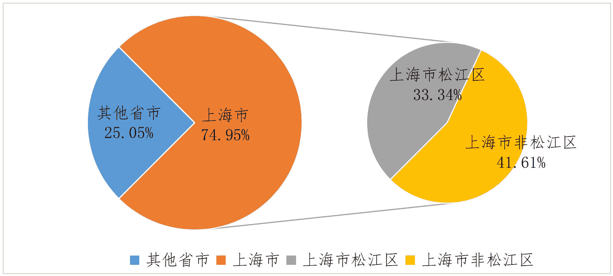

图1 松江区主要景区（点）被访顾客居住地比例

## 二、景区（点）顾客满意度调查报告

### （一）总体结果概述

调查显示，2024年被调查的7家旅游景区（点）总体满意度为4.55，比2019年提高0.19，属于“非常满意”级别，处于“优异区域”。2024年7家被调查景区（点）中，服务质量顾客满意度超过总体平均满意度的有4家，分别是：醉白池公园（4.83）、佘山国家森林公园（4.72）、方塔园（4.70）以及欢乐谷（4.57）；其中醉白池顾客满意度最高，为4.83，影视乐园顾客满意度最低，为4.15。

与2019年相比，除广富林文化遗址、上海影视乐园和辰山植物园的服务质量顾客满意度略微下降之外，其他4个景区（点）服务质量满意度均高于2019年水平，其中醉白池的提升幅度最大，较2019年增加了0.63（图2）。

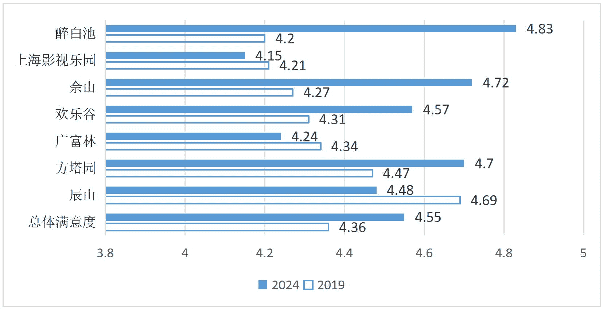

图2 松江区主要景区（点）服务质量顾客满意度调查总体结果

数据显示，在2024年松江区被调研景区（点）的九个结构化一级指标中，相对来说，顾客意见处理服务质量的顾客满意度最高，为4.69；交通服务质量的顾客满意度最低，为4.55。

与2019年相比，在2024年九个一级指标中，所有指标的满意度均高于2019年水平，配套服务质量上涨最多，上涨了0.44；票务服务质量提升最少，上涨0.34（图3）。

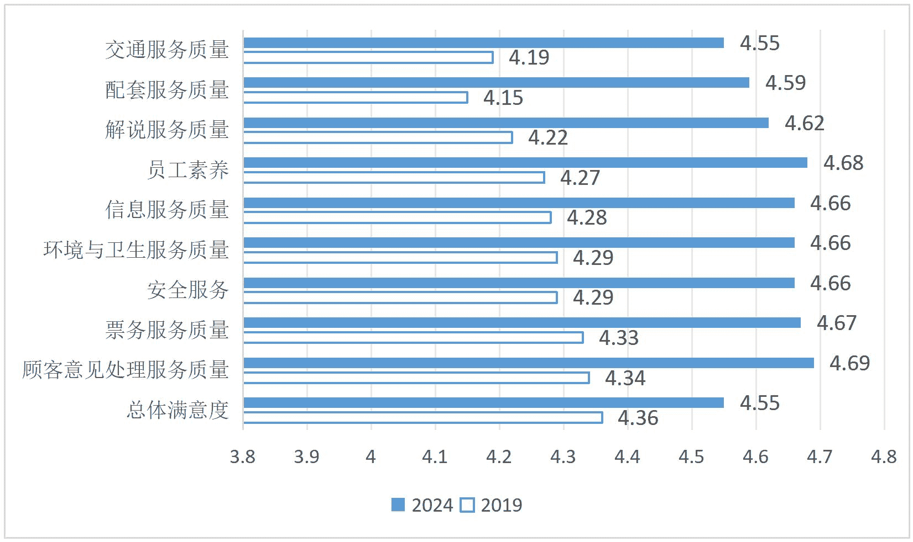

图3 松江区主要景区（点）服务质量顾客满意度一级指标调查结果比较

### （二）具体指标分析

#### 1、员工素养顾客满意度

数据显示，2024年松江区被调研景区（点）员工素养顾客满意度均值为4.68，在工作日、周末和节假日三个时段满意度存在差异。其中，节假日时段顾客满意度最高，达到4.71；周末时段次之，为4.69；工作日时段最低，为4.66。三个时间段员工素养顾客满意度都属于“非常满意”级别，进入“优异区域”。

2024年松江区被调研景区（点）员工素养顾客满意度在不同时段均高于2019年水平，并且有较大的提升，三个时间段满意度级别由“满意”提升至“非常满意”，所属区域由“良好区域”提升至“优异区域”（图4）。

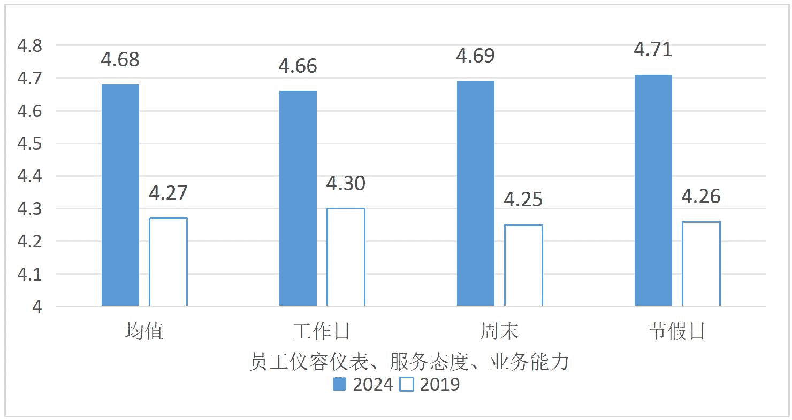

图4 松江区主要景区（点）员工素养顾客满意度三个时段调查结果

#### 2、交通服务质量顾客满意度

交通服务质量包括停车场服务质量与景区内交通服务质量两个二级指标。数据显示，2024年松江区被调研景区（点）停车场服务质量与景区内交通服务质量顾客满意度均值分别为4.55、4.59，处于“非常满意”级别，进入“优异区域”。停车场服务质量顾客满意度在周末和节假日时段相对较高，为4.57，处于“非常满意”级别，进入“优异区域”；景区内交通服务质量顾客满意度周末时段高于工作日和节假日时段，三个时间段均处于“非常满意”级别，进入“优异区域”。

与2019年相比，2024年松江区被调研景区（点）的停车场服务质量顾客满意度和景区内交通服务质量顾客满意度在工作日时段、周末时段、节假日时段均高于2019年水平。停车场服务质量在周末和节假日的顾客满意度提升最为明显，达到0.44。景区内交通服务质量在周末的顾客满意度提升最为明显，达到0.42。由数据可知，停车场服务质量与景区内交通服务质量在三个时间段的顾客满意度均有大幅提升，满意度级别由“满意”提升至“非常满意”，所属区域由“良好区域”提升至“优异区域”（图5）。

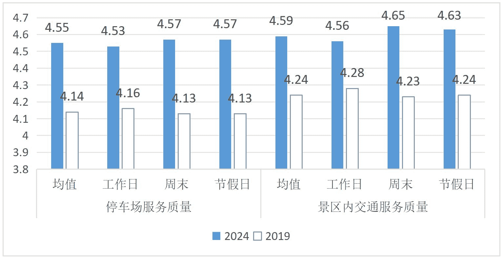

图5 松江区主要景区（点）交通服务质量顾客满意度三个时段调查结果

#### 3、票务服务质量顾客满意度

票务服务质量包括售票处标识清晰程度、秩序，网络与电话订票服务效率，验票效率及准确性、秩序三个二级指标。数据显示，2024年松江区被调研景区（点）网络与电话订票服务效率满意度要高于售票处标识清晰程度、秩序的服务满意度和验票效率及准确性、秩序的满意度，为4.68，处于“非常满意”级别，进入“优异区域”。

与2019年相比，2024年松江区被调研景区（点）售票处标识清晰程度、秩序，网络与电话订票服务效率，验票效率及准确性、秩序在三个时间段的顾客满意度均高于2019年水平，均值分别增加了0.35、0.35、0.32，处于“非常满意”级别，进入“优异区域”（图6）。

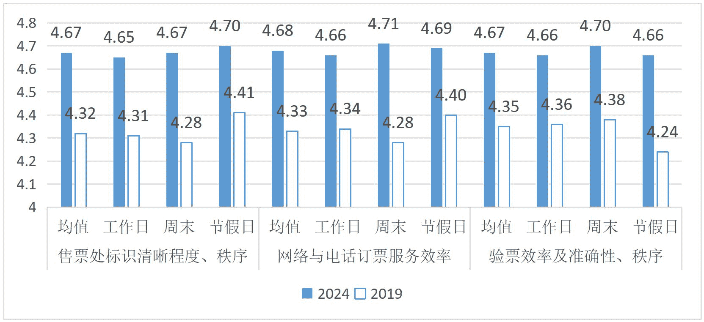

图6 松江区主要景区（点）票务服务质量顾客满意度三个时段调查结果

#### 4、信息服务质量顾客满意度

信息服务质量包括公共信息资料类型与内容真实性、标识规范性、准确性、广播服务质量三个二级指标。2024年松江区被调研景区（点）公共信息资料类型与内容真实性的平均满意度要高于标识规范性、准确性和广播服务质量满意度，为4.65。三个二级指标的服务质量平均满意度均为“非常满意”级别，进入“优异区域”。

与2019年相比较，2024年松江区被调研景区（点）公共信息资料类型与内容真实性满意度在工作日、周末、节假日三个时间段均高于2019年水平，其中节假日时段提升最为明显，达到0.51；标识规范性、准确性满意度在三个时间段也均高于2019年水平，其中周末时段提升最为明显，达到0.42；广播服务质量的满意度在工作日、周末、节假日三个时间段均高于2019年水平，其中周末时段提升最为明显，达到0.42（图7）。

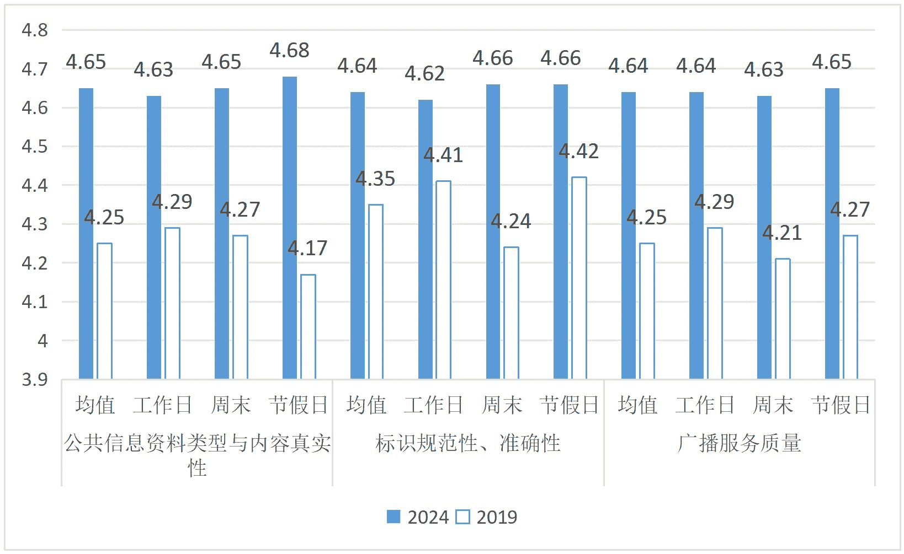

图7 松江区主要景区（点）信息服务质量顾客满意度三个时段调查结果

#### 5、解说服务质量顾客满意度

解说服务质量包括电子导览服务质量与导游员讲解服务质量两个二级指标。数据显示，2024年松江区被调研景区（点）电子导览服务质量与导游员讲解服务质量满意度平均水平分别为4.62和4.66。电子导览服务质量在工作日和节假日的满意度相同且低于周末时段的满意度，为4.62；周末时段的满意度为4.63。导游员讲解服务质量在周末和节假日时段的满意度高于工作日时段，均为4.68，处于“非常满意”级别，进入“优异区域”（图8）。

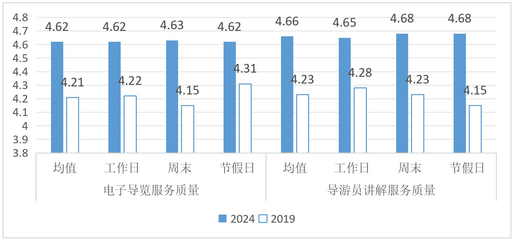

图8 松江区主要景区（点）解说服务质量顾客满意度三个时段调查结果

#### 6、配套服务质量顾客满意度

配套服务质量包括餐饮服务质量、购物服务质量和其他服务设施设备完备程度等三个二级指标。总体而言，2024年松江区被调研景区（点）的配套服务质量顾客满意度在九个一级指标中上涨最多，属于“非常满意”级别，处于“优异区域”。餐饮服务质量、购物服务质量和其他服务设施设备完备程度的平均顾客满意度均为“非常满意”级别，进入“优异区域”。分时段来看，餐饮服务质量和购物服务质量在节假日时段的满意度较高，其他服务设施设备完备程度在工作日时段的满意度也处于较高水平。

与2019年相比较，2024年配套服务质量总体满意度水平有大幅提升。三个二级指标的均值，在工作日、周末时段和节假日时段均高于2019年水平（图9）。

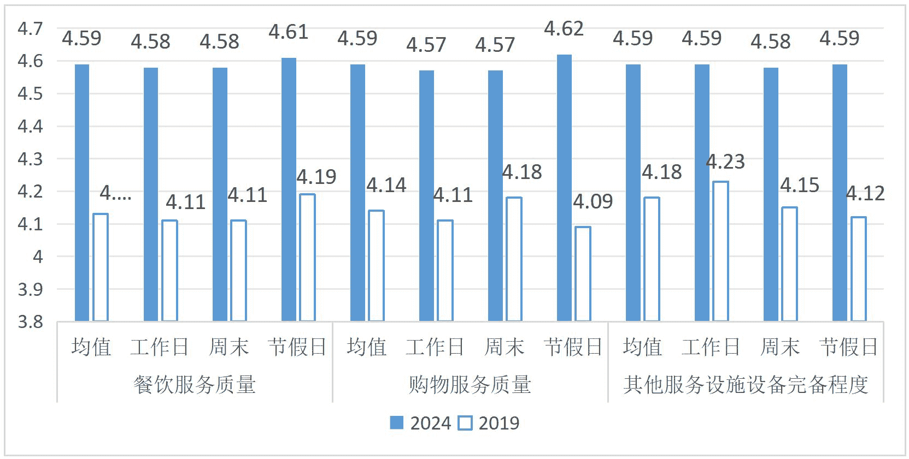

图9 松江区主要景区（点）配套服务质量顾客满意度三个时段调查结果

#### 7、环境与卫生服务质量顾客满意度

环境与卫生服务质量包括游览环境整洁程度、景区拥挤程度、医疗服务质量、公共厕所卫生环境及布局合理性等四个二级指标。总体而言，2024年松江区被调研景区（点）四个二级指标中的满意度均属于“非常满意”级别，进入“优异区域”。其中游览环境整洁程度的满意度均值最高，为4.66；医疗服务质量的满意度均值最低，为4.63。

与2019年相比较，2024年环境与卫生服务质量总体满意度水平有所提升，增加了0.37。四个二级指标的顾客满意度在工作日、周末时段和节假日时段均高于2019年水平；游览环境整洁程度在工作日、周末、节假日三个时间段均高于2019年水平，其中节假日时段提升最为明显，达到0.45；景区拥挤程度在工作日、周末、节假日三个时间段均高于2019年水平，其中周末时段提升最为明显，达到0.50；医疗服务质量在工作日、周末、节假日三个时间段均高于2019年水平，其中节假日提升最为明显，达到0.46；公共厕所布局合理性在工作日、周末、节假日三个时间段均高于2019年水平，其中节假日提升最为明显，达到0.48（图10）。

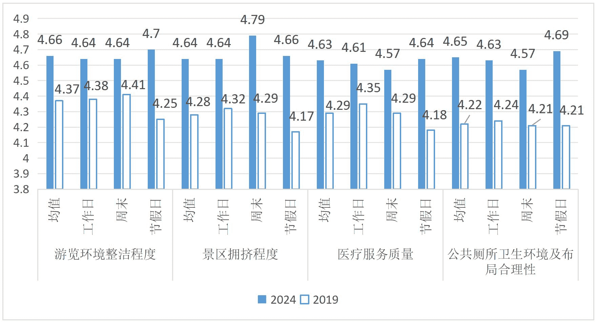

图10 松江区主要景区（点）环境与卫生服务质量顾客满意度三个时段调查结果

#### 8、安全服务质量顾客满意度

安全服务质量包括安保服务质量、消防安全服务质量、游览设施安全服务质量等三个二级指标。总体而言，2024年松江区被调研景区（点）安全服务质量三个二级指标的满意度均值及各时段的满意度均处于“非常满意”级别，进入“优异区域”。其中游览设施安全服务质量和消防安全服务质量的满意度最高，为4.68；安保服务质量满意度最低，为4.66。

与2019年相比较，2024年安全服务质量顾客满意度水平有所提升，增加了0.37。三个二级指标的顾客满意度在工作日、周末时段和节假日时段均高于2019年水平；安保服务质量在工作日、周末、节假日三个时间段均高于2019年水平，其中节假日时段提升最为明显，达到0.39；消防安全服务质量在工作日、周末、节假日三个时间段均高于2019年水平，节假日时段提升最为明显，达到0.48；游览设施安全服务质量在工作日、周末、节假日三个时间段均高于2019年水平，周末时段提升最为明显，达到0.37（图11）。

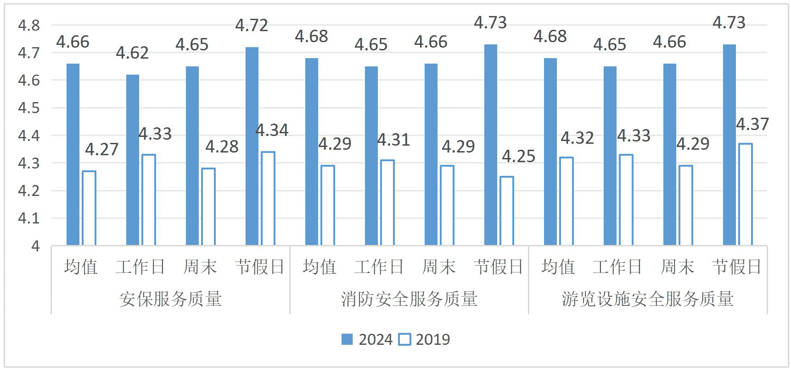

图11 松江区主要景区（点）安全服务质量顾客满意度三个时段调查结果

#### 9、顾客意见处理质量顾客满意度

数据显示，2024年松江区被调研景区（点）顾客意见处理质量的顾客满意度均值为4.69，为“非常满意”级别，进入“优异区域”。分时段来看，在周末时段的满意度较高，为4.79；在节假日时段次之，为4.72；在工作日时段较低，为4.66。与2019年相比较，2024年松江区被调研景区（点）顾客意见处理质量顾客满意度在所有时段均高于2019年水平，其中工作日的上涨幅度最小，增加了0.32（图12）。

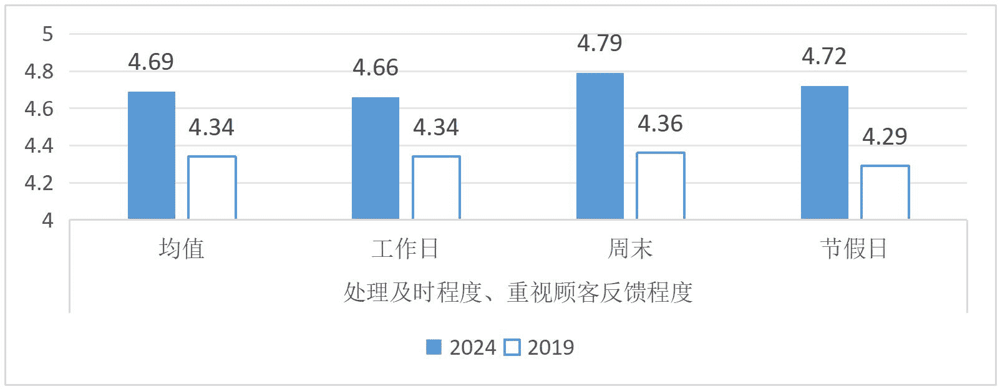

图12 松江区主要景区（点）顾客意见处理质量的顾客满意度三个时段调查结果

### （三）景区（点）分类分析

#### 1、工作日时段服务质量顾客满意度排名

数据显示，2024年松江区被调研的7家景区（点）工作日时段平均顾客满意度为4.61，上海醉白池公园、上海方塔园、上海欢乐谷的顾客满意度分别为4.84、4.81、4.71，均高于平均顾客满意度；其余4家景区（点）服务质量顾客满意度均低于平均水平。其中，工作日时段顾客满意度最高的是上海醉白池公园，为4.84，属于“非常满意”级别，处于“优异区域”；工作日时段顾客满意度最低的是上海影视乐园，为4.28，为“满意”级别，处于“良好区域”。

由于2019年未对上海广富林文化遗址进行调研，因此将其他6家景区（点）的数据与2019年进行对比分析可以得出，2024年松江区被调研的景区（点）在工作日时段平均顾客满意度高于2019年水平。上海方塔园、上海欢乐谷、上海佘山国家森林公园、上海醉白池公园在工作日时段的顾客满意度高于2019年水平，分别是4.81、4.71、4.53、4.84；上海影视乐园顾客满意度与2019年的水平持平，保持为4.28；上海辰山植物园的顾客满意度下降幅度最大，比2019年下降0.18（图13）。

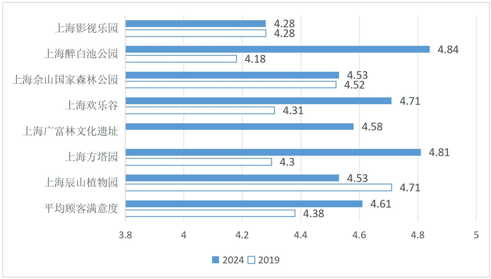

图13 松江区主要景区（点）工作日时段服务质量顾客满意度排名

#### 2、周末时段服务质量顾客满意度排名

调研数据显示，2024年松江区景区（点）周末时段平均顾客满意度为4.73，属于“非常满意”级别，进入“优异区域”。上海广富林文化遗址、上海欢乐谷、上海醉白池公园的顾客满意度高于平均顾客满意度，分别为4.74、4.83、4.88。上海醉白池公园在周末时段服务质量顾客满意度最高，为4.88。上海影视乐园在周末时段服务质量顾客满意度最低，为4.61。

由于2019年未对上海广富林文化遗址进行调研，因此将其他6家景区（点）的数据与2019年进行对比分析可以得出，2024年松江区景区（点）在周末时段的平均顾客满意度有了大幅提升，增加了0.35。其中，上海醉白池公园的服务质量顾客满意度上升最大，增加了0.62；上海辰山植物园的服务质量顾客满意度有所下降，比2019年下降了0.04，虽然满意度有所下降，但是仍然处于“非常满意”级别。上海方塔园、上海欢乐谷、上海佘山国家森林公园、上海醉白池公园、上海影视乐园的服务质量顾客满意度级别均由“满意”提升至“非常满意”，由“良好区域”提升至“优异区域”（图14）。

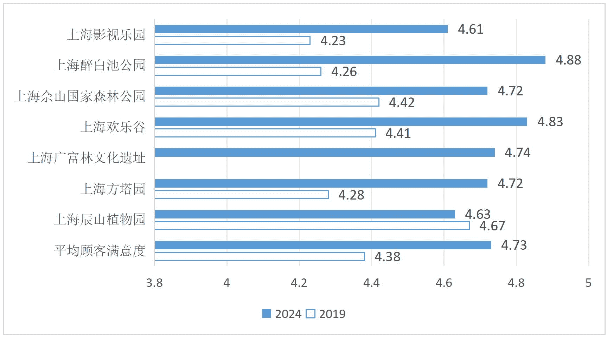

图14 松江区主要景区（点）周末时段服务质量顾客满意度

#### 3、节假日时段服务质量顾客满意度排名

数据显示，2024年松江区景区（点）节假日时段服务质量顾客满意度均值为4.55，达到“非常满意”级别，所处区域为“优异区域”。有4家景区（点）服务质量顾客满意度高于平均水平，最高的是上海醉白池公园，为4.85，达到“非常满意”级别，所处区域为“优异区域”。有3家景区（点）服务质量顾客满意度低于平均水平，最低的是上海欢乐谷，为4.12，满意度级别为“满意”，属于“良好区域”。

由于2019年未对上海广富林文化遗址进行调研，因此将其他6家景区（点）的数据与2019年进行对比分析可以得出，2024年景区（点）节假日时段平均顾客满意度高于2019年，增加了0.26。其中，上海醉白池公园服务质量顾客满意度上涨幅度最大，增加

2024年松江区旅游企业服务质量顾客满意度调研报告——第二部分：景区（点）分报告

了0.71；景区（点）服务质量平均顾客满意度的满意度级别由“满意”提升至“非常满意”，所属区域由“良好区域”提升至“优异区域”（图15）。

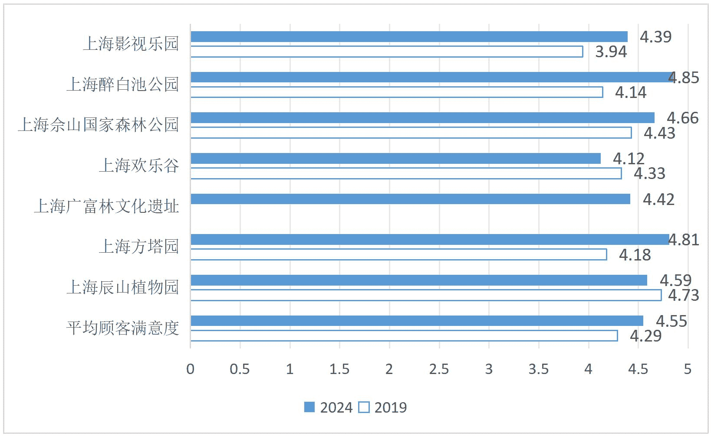

图15 松江区主要景区（点）节假日时段服务质量顾客满意度排名

### 4、与上海市其他区县景区（点）服务质量顾客满意度的比较

调研显示，2024年松江区7家景区（点）服务质量顾客满意度与上海市其他区县景区（点）相比较，处于较好水平。有超九成的顾客评价“好”与“很好”（图16）。

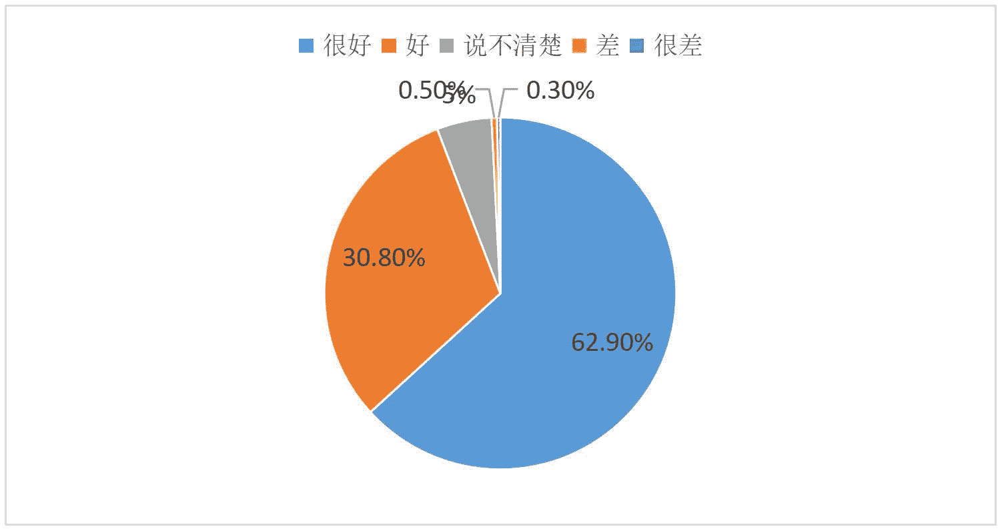

图16 松江区主要景区（点）服务质量与其他区县景区点比较结果

### 5、松江区主要景区（点）一级指标顾客满意度排名

2024年松江区主要景区（点）一级指标顾客满意度排名如表3所示。

表4

2024年松江区主要景区（点）服务质量顾客满意度调查结果

| 排名 | 调研地点 | 调研时段 | 员工素养 | 交通服务质量 | 票务服务质量 | 信息服务质量 | 解说服务质量 | 配套服务质量 | 环境与卫生服务质量 | 安全服务质量 | 顾客意见处理服务质量 | 分时段满意度 | 2024年总体满意度 | 2019年总体满意度 |
|---|---|---|---:|---:|---:|---:|---:|---:|---:|---:|---:|---:|---:|---:|
| 1 | 辰山植物园 | 工作日 | 4.55 | 4.25 | 4.59 | 4.48 | 4.43 | 4.27 | 4.48 | 4.36 | 4.64 | 4.36 | 4.48 | 4.69 |
|  |  | 周末 | 4.57 | 4.50 | 4.50 | 4.64 | 4.50 | 4.50 | 4.64 | 4.57 | 4.79 | 4.57 |  |  |
|  |  | 节假日 | 4.60 | 4.56 | 4.64 | 4.52 | 4.52 | 4.64 | 4.60 | 4.64 | 4.60 | 4.64 |  |  |
|  |  | 均值 | 4.57 | 4.39 | 4.59 | 4.52 | 4.51 | 4.41 | 4.55 | 4.47 | 4.66 | 4.48 |  |  |
| 2 | 方塔园 | 工作日 | 4.80 | 4.69 | 4.68 | 4.84 | 4.84 | 4.82 | 4.79 | 4.85 | 4.84 | 4.81 | 4.71 | 4.47 |
|  |  | 周末 | 4.60 | 4.67 | 4.73 | 4.73 | 4.73 | 4.73 | 4.73 | 4.67 | 4.73 | 4.71 |  |  |
|  |  | 节假日 | 4.75 | 4.76 | 4.86 | 4.85 | 4.86 | 4.75 | 4.76 | 4.86 | 4.85 | 4.85 |  |  |
|  |  | 均值 | 4.71 | 4.71 | 4.84 | 4.83 | 4.78 | 4.77 | 4.84 | 4.82 | 4.82 | 4.71 |  |  |
| 3 | 广富林 | 工作日 | 4.64 | 4.59 | 4.59 | 4.56 | 4.47 | 4.63 | 4.54 | 4.58 | 4.58 | 4.36 | 4.24 | / |
|  |  | 周末 | 4.56 | 4.44 | 4.33 | 4.44 | 3.89 | 4.22 | 4.11 | 4.33 | 4.44 | 4.56 |  |  |
|  |  | 节假日 | 4.54 | 4.35 | 4.43 | 4.33 | 4.24 | 4.33 | 4.46 | 4.37 | 4.59 | 4.50 |  |  |
|  |  | 均值 | 4.60 | 4.48 | 4.51 | 4.46 | 4.37 | 4.53 | 4.44 | 4.56 | 4.54 | 4.24 |  |  |
| 4 | 欢乐谷 | 工作日 | 4.70 | 4.65 | 4.70 | 4.68 | 4.73 | 4.69 | 4.75 | 4.73 | 4.72 | 4.60 | 4.57 | / |
|  |  | 周末 | 4.44 | 4.33 | 4.33 | 4.56 | 4.56 | 4.56 | 4.44 | 4.33 | 4.44 | 4.44 |  |  |
|  |  | 节假日 | 4.09 | 4.00 | 4.09 | 4.27 | 4.27 | 4.27 | 4.00 | 4.09 | 4.18 | 4.18 |  |  |
|  |  | 均值 | 4.64 | 4.58 | 4.64 | 4.64 | 4.69 | 4.63 | 4.68 | 4.66 | 4.66 | 4.57 |  |  |
| 5 | 佘山国家森林公园 | 工作日 | 4.80 | 4.18 | 4.57 | 4.65 | 4.57 | 4.43 | 4.42 | 4.51 | 4.65 | 4.67 | 4.72 | 4.27 |
|  |  | 周末 | 4.73 | 4.31 | 4.65 | 4.56 | 4.56 | 4.46 | 4.54 | 4.60 | 4.69 | 4.73 |  |  |
|  |  | 节假日 | 4.86 | 4.33 | 4.71 | 4.78 | 4.67 | 4.57 | 4.45 | 4.78 | 4.71 | 4.75 |  |  |
|  |  | 均值 | 4.80 | 4.28 | 4.64 | 4.67 | 4.57 | 4.45 | 4.58 | 4.61 | 4.70 | 4.72 |  |  |
| 6 | 上海影视乐园 | 工作日 | 4.35 | 4.26 | 4.30 | 4.31 | 4.22 | 4.20 | 4.35 | 4.28 | 4.31 | 4.02 | 4.15 | 4.21 |
|  |  | 周末 | 4.59 | 4.60 | 4.65 | 4.62 | 4.65 | 4.59 | 4.60 | 4.62 | 4.63 | 4.59 |  |  |
|  |  | 节假日 | 4.43 | 4.29 | 4.43 | 4.29 | 4.43 | 4.43 | 4.43 | 4.43 | 4.43 | 4.43 |  |  |
|  |  | 均值 | 4.48 | 4.44 | 4.49 | 4.47 | 4.46 | 4.41 | 4.49 | 4.46 | 4.49 | 4.15 |  |  |
| 7 | 醉白池 | 工作日 | 4.89 | 4.86 | 4.86 | 4.77 | 4.86 | 4.79 | 4.84 | 4.84 | 4.86 | 4.90 | 4.83 | 4.20 |
|  |  | 周末 | 4.91 | 4.87 | 4.91 | 4.85 | 4.87 | 4.81 | 4.91 | 4.89 | 4.87 | 4.91 |  |  |
|  |  | 节假日 | 4.84 | 4.84 | 4.87 | 4.84 | 4.84 | 4.83 | 4.84 | 4.86 | 4.86 | 4.86 |  |  |
|  |  | 均值 | 4.88 | 4.86 | 4.88 | 4.82 | 4.85 | 4.82 | 4.87 | 4.86 | 4.86 | 4.83 |  |  |
|  | 所有被调研景区总体服务质量满意度 | 工作日 | 4.66 | 4.53 | 4.65 | 4.63 | 4.62 | 4.58 | 4.64 | 4.62 | 4.66 | 4.53 | 4.55 | 4.36 |
|  |  | 周末 | 4.69 | 4.57 | 4.67 | 4.65 | 4.63 | 4.58 | 4.64 | 4.65 | 4.70 | 4.69 |  |  |
|  |  | 节假日 | 4.71 | 4.57 | 4.70 | 4.68 | 4.65 | 4.62 | 4.62 | 4.70 | 4.72 | 4.72 |  |  |
|  |  | 均值 | 4.68 | 4.55 | 4.67 | 4.65 | 4.62 | 4.59 | 4.66 | 4.66 | 4.69 | 4.68 |  |  |

（四）景区（点）被调研游客基本情况分析

### 1、被调研游客年龄分析

调研结果显示，被调研游客年龄以35~44岁为主，占25.80%，其次是45~54岁，占23.10%，如图17所示。

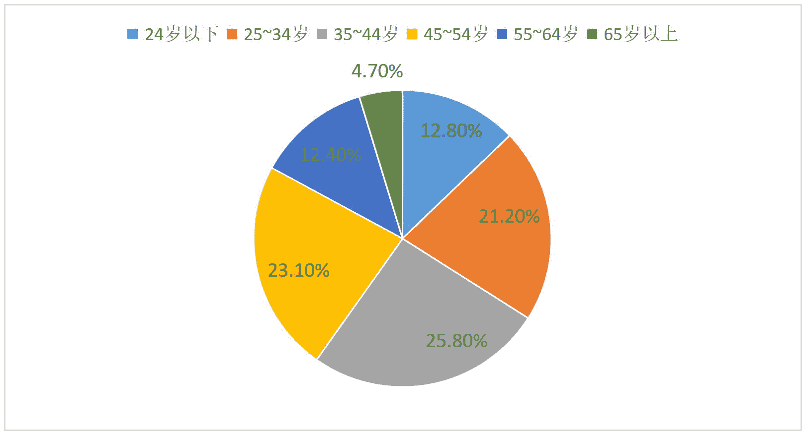

图17 松江区主要景区（点）被调研游客年龄分析结果

### 2、被调研游客职业分析

调研结果显示，被调研游客的职业以企业从业人员为主，占21.70%，其次是事业单位工作人员，为18.50%，如图18所示。

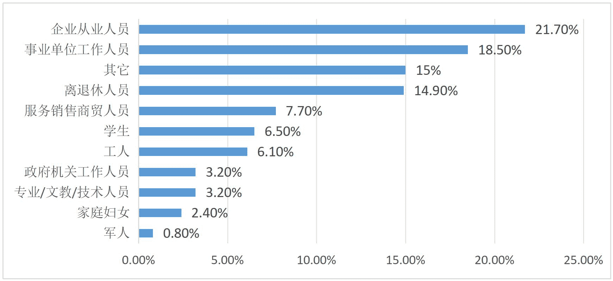

图18 松江区主要景区（点）被调研游客职业分析结果

### 3、被调研游客对松江区的哪一类景点最感兴趣分析

调研结果显示，被调研游客对松江区的自然风光最感兴趣，占42.59%，其次是古迹建筑，为28.65%。与2019年相比较，2024年游客对松江区感兴趣的景点排名前两位仍然是自然风光和古迹建筑，分别增加了6.95个百分点和4.36个百分点，如图19所示。

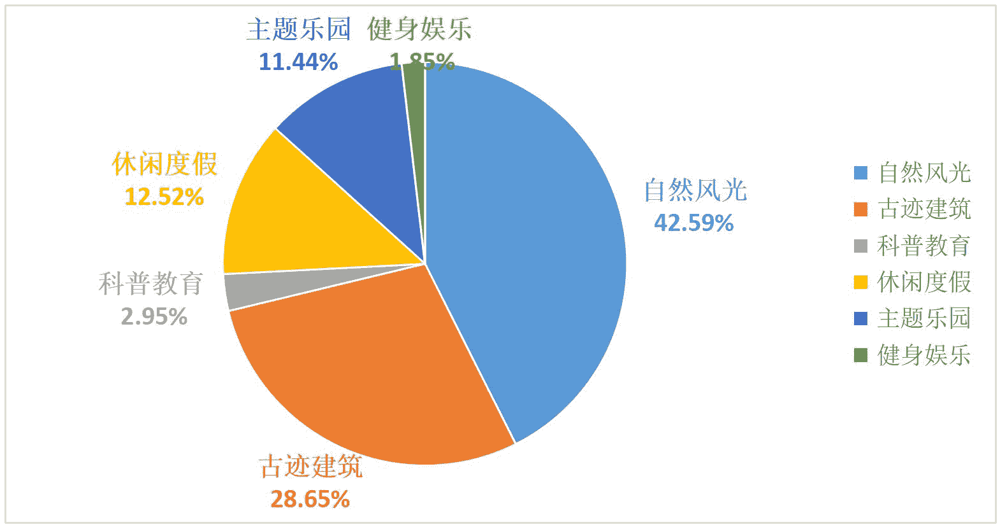

图19 松江区主要景区（点）被调研游客对哪一类景点最感兴趣分析结果

### 4、被调研游客获取景区（点）信息渠道的分析

调研结果显示，被调研游客对松江区景区（点）信息的获取主要是因为以前来过，占25.23%；其次是亲友推荐，为18.18%，如图20所示。

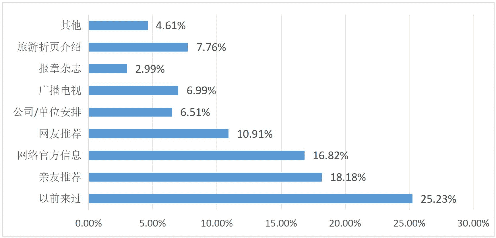

图20 松江区主要景区（点）被调研游客获取信息渠道分析结果

## 三、调查结论与对策建议

本部分顾客满意度调研聚焦于旅游景区（点）服务质量，调研覆盖多个方面的服务质量，采用量化评分、开放问答及访谈等多元方式收集数据。基于深入分析，以下将详细分享调研发现，望为旅游景区（点）提供改进方向与借鉴，共同提升顾客满意度与行业服务质量。

### （一）调研结论

1、2024年度，松江区参与调研的七家景区（点）在服务质量方面实现了显著提升。这些景点的总体满意度得分高达4.55，成功迈入“非常满意”的评价范畴，并位于“优异区域”。与2019年的4.36分相比，这一显著进步彰显了松江区在提升旅游服务质量方面所做出的努力与取得的成效。在参与调研的七家景点里，辰山植物园、广富林文化遗址以及上海影视乐园三家景点的满意度得分低于平均水平，需引起重视并尽快实施针对性改进措施。

2、与上海市其他区的景区（点）相比，松江区参与调研的七家主要景区（点）在服务质量上展现出强劲的竞争力，并赢得了游客的高度认可。在本次调研中，超过90%的游客对这些景点给予了正面评价，其中“很好”的评价占比高达60%。松江区景点的NPS（游客净推荐值）也达到了92.90%的高位，这充分说明游客非常愿意将松江的景点推荐给亲朋好友。这些数据证明了松江区的旅游服务在游客心中具有极高的认可度和满意度，同时也彰显了其强大的传播潜力。

3、在本次调研的九个一级指标中，游客的满意度均达到了“非常满意”的水平，但在某些关键服务环节上，仍需进一步加强和改进。其中，顾客意见处理服务质量的满意度高达4.69，而交通服务质量则相对较低，为4.55。值得注意的是，在周末期间，顾客意见处理服务质量的满意度更加显著，但在工作日则稍显不足，存在处理滞后的问题，反映出景区（点）在应对人流高峰时，对顾客意见处理服务的准备较为充分，但在平日则可能存在一定的疏忽。

4、根据2024年松江区景区（点）服务的被调研顾客反馈，游客对未来重点发展的期望主要集中在完善景区设施、丰富特色活动、加强讲解服务以及强化智慧旅游建设等方面。这些期望不仅反映了游客对精神生活品质要求的不断提升，也体现了他们休闲方式的多样化和个性化选择。当前松江区的景区服务仍主要聚焦于满足游客的基本游览需求，面对游客日益增长的需求与期待，景区服务在多个方面仍有待进一步提升与优化。

### （二）对策建议

为了进一步提升松江区旅游景区（点）的整体服务质量，满足游客日益增长的多元化需求，本报告针对性地提出了一系列对策建议：

### 1、完善景区设施，提升旅游品质

通过完善旅游景区（点）的各项设施，可以提升游客的游览舒适度与安全性，确保游客能够享受到更加便捷、高效且愉快的服务体验。

在交通服务方面，松江区景区（点）需全面优化交通网络布局，首先应在主要交通节点增设清晰醒目的指示牌，引导游客快速准确地找到景区入口；同时，加强与公共交通系统的合作，增设直达或途经景区的公交线路，并合理调整班次，确保游客出行无忧；此外，还应提供充足的停车空间，并设计合理的收费机制，既满足游客停车需求，又确保收费公平透明，从而全面提升游客的交通出行满意度。

在餐饮方面，引入多元化餐饮品牌与地道特色小吃，满足不同游客口味需求；打造融合松江文化底蕴与现代设计理念的用餐环境，营造舒适就餐氛围；强化食材新鲜度与绿色健康理念，与当地农户紧密合作，确保食品质量与安全；同时，注重环境整洁与文化氛围的营造，让游客在品味美食的同时，也能深刻感受到松江独特的文化魅力与自然风光，从而全面提升游客的整体满意度与忠诚度。

此外，增设饮水机、卫生间等公共设施，满足游客基本需求。在安全方面，加强安全设施建设，增设监控、完善消防，确保游客安全。同时，制定应急预案与救援机制，有效应对紧急情况，为游客营造安心、舒适的游览环境。通过上述措施的全面优化与实施，能够有效促进松江区旅游景区（点）的蓬勃发展，显著提升游客的整体满意度与忠诚度。

### 2、创新活动策划，塑造独特竞争力

通过策划多样化活动并深入挖掘松江历史文化与自然特色，松江景区（点）企业将展现出松江独特的魅力，吸引大量游客前来参与，进而提高游客的文化体验满意度。

为了深度挖掘并展现松江景区（点）独特的文化底蕴与自然风光特色，全面提升游客的文化体验满意度与整体游览质量，旅游景区（点）企业应积极策划并实施一系列多样化、互动性强的特色活动。企业可以围绕历史文化体验、自然生态探索、亲子互动及节日庆典等主题，精心打造如“松江古韵文化节”、“生态徒步游”等丰富多彩的活动，让游客在亲身参与中深刻感受松江的独特魅力与历史底蕴。

与此同时，政府方面可以通过政策扶持、资金补贴、宣传推广等举措，为景区（点）企业提供必要的资源与支持，助力其策划并实施更具吸引力的活动。例如，政府可以设立专项基金，对具有创新性、影响力的特色活动给予资金补贴；同时，加强活动宣传，利用多种媒体渠道进行广泛传播，提升活动的知名度与影响力。此外，政府还应持续优化公共服务，改善交通设施，为游客提供更加便捷、安全的游览环境。上述举措不仅能增强游客的参与互动体验，也将使游客深切感受到松江独有的迷人魅力，进而提高游客在文化探索与体验过程中的满意度。

### 3、提升讲解质量，增强文化感知

通过提升讲解员专业素养和挖掘文化内涵的举措，可以提升游客对景点历史背景和文化内涵的理解，同时增强游客参与感和满意度，提高游客的整体体验质量。

为了进一步加强讲解服务并显著提升松江旅游景区（点）的文化内涵与游客体验，景区（点）需采取一系列举措。首先，通过定期组织专业培训，确保讲解员队伍熟练掌握松江丰富的历史文化、独特的风土人情以及各景点的深厚背景，为游客提供准确、深入的讲解服务。在此基础上，深入挖掘松江的文化精髓，结合各景点的独特魅力，精心设计富有创意和吸引力的讲解内容。同时，注重提升讲解服务的互动性和趣味性，利用现代科技手段为游客打造沉浸式的讲解体验，增强游客的代入感和参与感。此外，景区（点）应积极探索创新讲解形式，如故事化讲解、角色扮演等，使讲解过程更加生动有趣，提升游客的游览兴趣与满意度。政府方面，应积极鼓励和支持企业与当地文化机构、学者的深度合作与交流，共同策划和举办文化展览、文艺演出、学术讲座等丰富多彩的文化活动，为游客提供更加多元、深层次的文化体验。同时，政府应加强监管和指导，建立健全讲解服务的质量评估体系，确保讲解内容的准确性和服务的专业性，提升游客对讲解服务的信任度和满意度。

### 4、强化智慧旅游，升级消费体验

通过强化智慧旅游建设并充分利用现代信息技术的举措，松江旅游景区（点）使游客能够轻松规划行程并享受便捷高效的旅游服务，从而达到提升旅游体验、优化旅游管理的目的，提高游客的满意度与忠诚度。

松江旅游景区（点）应强化智慧旅游建设，充分利用现代信息技术，打造一个功能全面的服务平台。该平台需集成在线预订、电子票务、智能导航及讲解等多元化功能，使游客能轻松规划行程，享受便捷高效的旅游服务。大数据分析技术的应用能为游客提供更加个性化的旅游产品推荐，满足其多样化的需求。此外，设置智能导览机器人，不仅能提升服务效率，还能为游客带来新奇有趣的互动体验。政府应加大对智慧旅游基础设施的投资，包括升级景区网络、建设数据中心等，为智慧旅游应用提供坚实基础。同时，鼓励和支持旅游企业开发创新智慧旅游产品，如虚拟现实（VR）游览、增强现实（AR）导览等，丰富游客体验。政府应建立统一的智慧旅游服务平台，整合景区、酒店、餐饮等旅游资源，为游客提供一站式服务。上述措施不仅确保游客能够轻松享受到精心规划的行程与卓越的服务品质，而且极大地推动了旅游体验的整体飞跃与旅游管理的根本性变革，从而在游客心中构筑起了极高的满意度与忠诚度。

## 附件二：松江区旅游景区（点）服务质量顾客满意度调查问卷

尊敬的女士/先生：

您好！

我们是松江区旅游服务质量顾客满意度调研人员。为切实维护顾客合法权益，提高松江区旅游景区（点）的整体服务质量水平，加强旅游景区（点）行业监管，松江区经济委员会（旅游局）特组织本次调研。您本次调研的宝贵意见，对实现上述目标具有重要价值，请不吝赐教。

非常感谢您的合作与支持！

松江区旅游服务质量顾客满意度调查小组

调查日期：20__年__月__日

### 第一部分：基本信息

10. 您游览的景区（点）名称：____________________________

11. 您的性别：①男　②女

12. 您的居住地区：________国家________省（州、自治区、直辖市）________市（区、县）

13. 您的年龄：①24岁以下　②25~34岁　③35~44岁　④45~54岁　⑤55~64岁　⑥65岁以上

14. 您的职业：①政府机关工作人员　②事业单位工作人员　③企业从业人员　④专业/文教/技术人员　⑤服务销售商贸人员　⑥离退休人员　⑦军人　⑧工人　⑨家庭妇女　⑩学生　⑪其他

15. 您对松江的哪一类景点最感兴趣：①自然风光　②古迹建筑　③休闲度假　④健身娱乐　⑤科普教育　⑥主题乐园

16. 您认为松江区景区点服务质量与上海市其他区县景区点服务质量相比处于什么样的水平：①很差　②差　③说不清楚　④好　⑤很好

17. 您如何知道这家景区点的信息（可复选至多三项）：①以前来过　②亲友推荐　③网络官方信息　④网友推荐　⑤公司/单位安排　⑥广播电视　⑦报章杂志　⑧旅游折页介绍　⑨其他

2024 年松江区旅游企业服务质量顾客满意度调研报告——第二部分：景区（点）分报告

53

## 第二部分：服务质量满意度调查

（请在您认为合适的方框中打钩即可）

| 一级指标 | 二级指标 | 非常不满意 | 不满意 | 一般 | 满意 | 非常满意 |
|---|---|---|---|---|---|---|
| 1. 员工素养 | 1.1 员工仪容仪表、服务态度、业务能力 |  |  |  |  |  |
| 2. 交通服务质量 | 2.1 停车场服务质量（标识清晰程度、收费合理性） |  |  |  |  |  |
|  | 2.2 景区内交通服务质量（线路设计合理性、交通工具安全性、舒适性） |  |  |  |  |  |
| 3. 票务服务质量 | 3.1 售票处标识清晰程度、秩序 |  |  |  |  |  |
|  | 3.2 网络与电话订票服务效率 |  |  |  |  |  |
|  | 3.3 验票效率及准确性、秩序 |  |  |  |  |  |
| 4. 信息服务质量 | 4.1 公共信息资料类型与内容真实性 |  |  |  |  |  |
|  | 4.2 标识规范性、准确性（如停车场的标识规范性） |  |  |  |  |  |
|  | 4.3 广播服务质量（覆盖范围、有效性） |  |  |  |  |  |
| 5. 解说服务质量 | 5.1 电子导览服务质量（设备完备程度、服务标识清晰程度） |  |  |  |  |  |
|  | 5.2 导游员讲解服务质量（景区熟悉程度、热情程度） |  |  |  |  |  |
| 6. 配套服务质量 | 6.1 餐饮服务质量（态度、诚信程度、价格合理性、卫生程度） |  |  |  |  |  |
|  | 6.2 购物服务质量（态度、诚信程度、价格合理性、产品质量） |  |  |  |  |  |
|  | 6.3 其他服务设施设备完备程度（如 POS 机、ATM 机等） |  |  |  |  |  |
| 7. 环境与卫生服务质量 | 7.1 游览环境整洁程度 |  |  |  |  |  |
|  | 7.2 景区拥挤程度 |  |  |  |  |  |
|  | 7.3 医疗服务质量（设施设备完备程度、医疗水平） |  |  |  |  |  |
|  | 7.4 公共厕所卫生环境及布局合理性 |  |  |  |  |  |
| 8. 安全服务质量 | 8.1 安保服务质量（安保巡逻频率、便客程度） |  |  |  |  |  |
|  | 8.2 消防安全服务质量（标识清晰程度、设施设备完备程度） |  |  |  |  |  |
|  | 8.3 游览设施安全服务质量（设施安全程度、安保人员配备） |  |  |  |  |  |
| 9. 顾客意见处理服务质量 | 9.1 处理及时程度、重视顾客反馈程度 |  |  |  |  |  |
| 10. 您对景区（点）服务质量的其他意见或建议 |  |  |  |  |  |  |

再次感谢您的支持！祝您在松江旅游愉快！

2024 年松江区旅游企业服务质量顾客满意度调研报告——第三部分：旅行社分报告

54

## 第三部分：旅行社分报告

### 一、概况

#### （一）调研背景

### 1、调研目的

本次调研在于全面深入了解游客对松江区旅行社在多个维度上的顾客服务质量满意度现状，并提出具有针对性的满意度提升对策建议，旨在切实维护游客合法权益，提高松江区旅行社的整体服务质量水平；同时加强旅行社的行业监管，有效推动松江区文旅产业健康快速发展。

### 2、调研的旅行社

针对松江区 9 家主要的旅行社展开调研，分别是：上海松江旅行社、上海君汇国际旅行社、上海九鹿国际旅行社、上海风度国际旅行社、上海佘山旅行社、上海全联国际旅行社、上海钟书国际旅行社、上海开天旅行社以及上海畅程国际旅行社。

### 3、调研实施单位

为保障调研结果的公正性和公信力，本次问卷调研、数据分析和报告撰写由上海市松江区文化和旅游局委托上海学喵科技有限公司文旅产业项目组完成。

#### （二）调研方式及样本

### 1、调研方式

本次调研采用线下实地问卷和线上网络问卷相结合的调研方法，自 2024 年 8 月起至 10 月结束，历时三个月。考虑到团体旅游主要在周末与法定节假日进行的特点，没有必要再针对“工作日、周末与节假日”三个时段进行分类比较，所以问卷的收集未在时段上刻意进行细分。

### 2、调研样本

本次调研的 9 家旅行社均收集到 50 份以上的问卷数据，总计收集到 749 份样本。其中，线上方式共收集到 411 份样本数据，线下方式共收集到 338 份样本数据，具体的问卷收集情况如表 1 所示。

**表 1 松江区旅行社问卷收集数量汇总**

| 旅行社名称 | 线上 | 线下 | 总计 |
|---|---:|---:|---:|
| 上海松江旅行社有限公司 | 37 | 40 | 77 |
| 上海君汇国际旅行社有限公司 | 48 | 20 | 68 |
| 上海九鹿国际旅行社有限公司 | 71 | 40 | 111 |
| 上海风度国际旅行社有限公司 | 38 | 40 | 78 |
| 上海佘山旅行社有限公司 | 47 | 40 | 87 |
| 上海全联国际旅行社有限公司 | 53 | 40 | 93 |
| 上海钟书国际旅行社有限公司 | 48 | 38 | 86 |
| 上海开天旅行社有限公司 | 13 | 40 | 53 |
| 上海畅程国际旅行社有限公司 | 56 | 40 | 96 |

#### （三）调研指标体系及等级标准

### 1、指标体系

松江区旅行社服务质量顾客满意度调研指标体系包括 8 个一级指标、18 个二级指标，如表 2 所示：

**表 2 松江区旅行社服务质量顾客满意度调研指标体系**

| 一级指标 | 二级指标 | 指标内容 |
|---|---|---|
| 1 | 咨询服务质量 |  |
| 1.1 |  | 旅行社网站信息及时性、准确性 |
| 1.2 |  | 服务人员的知识水平、服务态度 |
| 2 | 交通服务质量 |  |
| 2.1 |  | 交通工具的时间安排（是否按时） |
| 2.2 |  | 交通工具的清洁卫生程度 |
| 2.3 |  | 交通工具的舒适度 |
| 2.4 |  | 驾驶员驾驶安全程度与线路熟悉程度 |
| 3 | 合同履约质量 |  |
| 3.1 |  | 住宿安排履约质量 |
| 3.2 |  | 餐饮安排履约质量 |
| 4 | 导游服务质量 |  |
| 4.1 |  | 导游员的业务能力（解说、沟通、带团技巧） |
| 4.2 |  | 导游员责任心 |
| 4.3 |  | 导游员的应变及危机处理能力 |
| 5 | 线路安排质量 |  |
| 5.1 |  | 旅游线路时间安排的合理程度 |
| 5.2 |  | 购物安排（次数、停留时间）的合理程度 |
| 5.3 |  | 自费项目安排的合理程度 |
| 5.4 |  | 线路景点吸引力 |
| 6 | 顾客意见处理服务质量 |  |
| 6.1 |  | 处理及时程度、重视顾客反馈程度 |
| 7 | 对旅行社服务质量的总体 |  |
| 7.1 |  | 对旅行社服务质量的总体满意程度 |
| 8 | 松江区旅游的 NPS 净推荐 |  |
| 8.1 |  | 推荐朋友去松江区旅游的意愿 |

### 2、满意度等级标准

本调研问卷关于满意度的题项选项设定为五等级（1=非常不满意，2=不满意，3=一般，4=满意，5=非常满意）。考虑到顾客可能不消费旅行社某些项目或服务的实际情况，本报告在问卷分析时采用相对得分率的处理方法，即满意度=（顾客消费项实际得分总和÷顾客消费项满分总和）×5，并将满意度分为五个级别。为更直观描述不同旅行社服务质量的顾客满意度的差距，本调研报告采用表 3 所示的满意度等级判定标准。

**表 3 顾客满意度等级划分**

| 满意度级别 | 满意度 |
|---|---|
| 优异区域 | 非常满意，4.5–5 |
| 良好区域 | 满意，4–4.5 |
| 改进区域 | 基本满意，3.5–4 |
|  | 一般，3–3.5 |
|  | 不满意，3 以下 |

## 二、旅行社顾客满意度调研报告

### （一）总体结果概述

调研显示，2024 年松江区参与调研的 9 家旅行社的服务质量总体满意度均值为 4.85，与 2019 年 4.65 的总体满意度相比，得分上有较明显的提升。根据表 3 所示的等级划分标准，松江区主要旅行社服务质量顾客满意度整体上属于“非常满意”级别，位于“优异区域”。

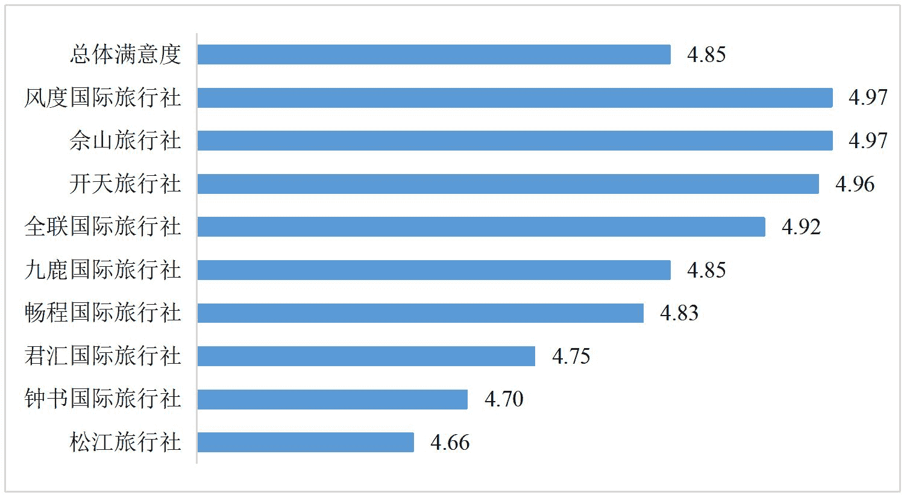

图 1 松江区主要旅行社服务质量顾客满意度调研总体结果

由图 1 中的数据可知，有 4 家旅行社的服务质量总体满意度得分超过均值，分别是风度国际旅行社（4.97）、佘山旅行社（4.97）、开天旅行社（4.96）以及全联国际旅行社（4.92）；九鹿国际旅行社的服务质量总体满意度得分与均值持平；在这 9 家旅行社中，佘山旅行社和风度国际旅行社的总体满意度得分最高，为 4.97，上海松江旅行社的总体满意度得分最低，为 4.66。

数据分析显示，2024 年松江区旅行社顾客的 NPS 净推荐值为 95.86%（见图 2）。从不同人群的 NPS 得分比例来看，推荐者比例（即推荐意愿为 9 分或 10 分的顾客）为 96.13%，说明绝大多数通过旅行社方式前往松江区旅游的顾客对松江区的整体文旅情况感到非常满意，愿意推荐自己的朋友前往松江区旅游。

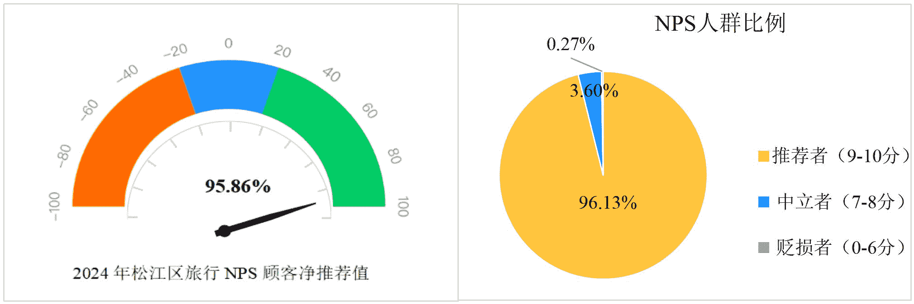

图 2 松江区旅行 NPS 顾客净推荐值及人群比例

如图 3 所示，2024 年松江区参与调研的旅行社的服务质量顾客满意度，除总体满意度和 NPS 净推荐值之外的六项一级指标均属于“非常满意”级别，位于“优异区域”。这六项一级指标得分均在 4.80 及以上，其中导游服务质量的顾客满意度得分最高，为 4.85，线路安排质量和咨询服务质量的顾客满意度得分最低，为 4.80。

与 2019 年相比，这六个一级指标的满意度得分均有明显增长；其中导游服务质量的顾客满意度上涨幅度最大，较 2019 年提升了 0.29。但与 2024 年的服务质量总体满意度相比，除导游服务质量的顾客满意度与总体满意度持平外，其余五个一级指标满意度得分均低于总体满意度，说明各细项指标仍有较大提升空间。

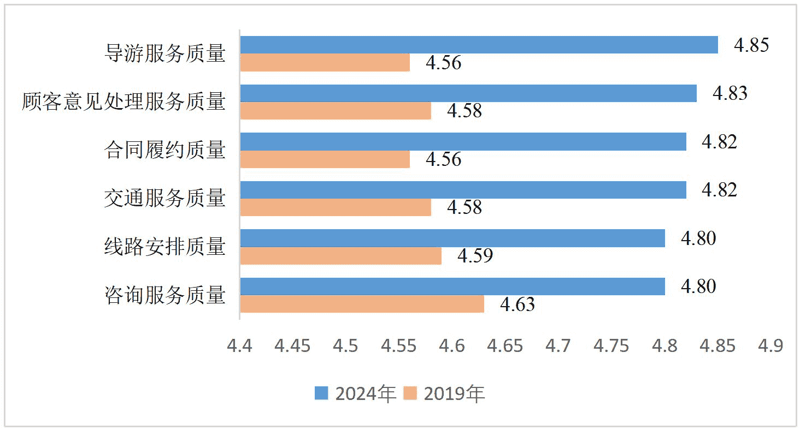

图 3 松江区主要旅行社服务质量顾客满意度一级指标调研结果比较

调研显示，松江区 9 家主要旅行社的服务质量与上海市其他区旅行社服务质量相比，处于较好的水平。基本上没有负面的评价，九成以上的顾客评价为“好”和“很好”，其中“很好”的评价占 79.17%（见图 4）。

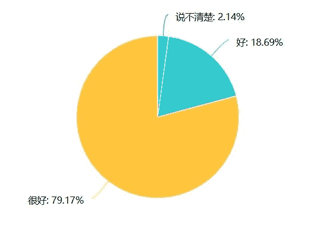

图 4 松江区主要旅行社服务质量上海市其他区旅行社比较结果

### （二）具体指标分析

#### 1、咨询服务质量顾客满意度

咨询服务质量包括旅行社网站信息及时性、准确性以及服务人员的知识水平、服务态度这两个二级指标。数据显示，2024 年松江区参与调研的旅行社的咨询服务质量顾客满意度均值为 4.80，为“非常满意”级别，但低于总体满意度得分，说明咨询服务质量还需加强提升；服务人员的知识水平、服务态度的顾客满意度得分为 4.82，高于平均顾客满意度；旅行社网站信息及时性、准确性的顾客满意度得分为 4.77，低于平均顾客满意度，需继续优化。

与 2019 年相比较，2024 年松江区参与调研的旅行社的咨询服务质量顾客满意度均值较 2019 年提升了 0.17。在二级指标中，旅行社网站信息及时性、准确性的顾客满意度得分较 2019 年增加了 0.12；服务人员的知识水平、服务态度的顾客满意度得分较 2019 年增加了 0.21，提升较大（见图 5）。

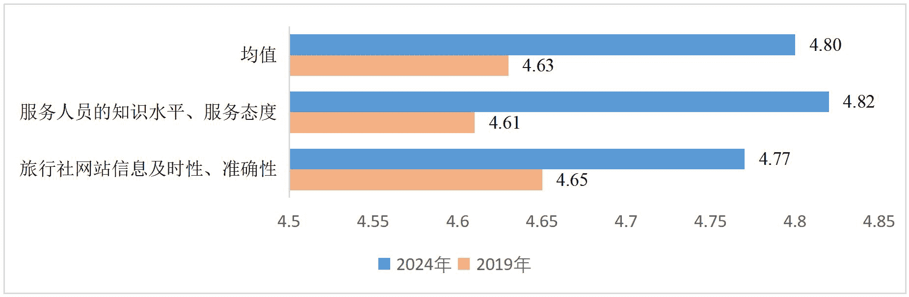

图 5 松江区主要旅行社咨询服务质量顾客满意度调研结果

#### 2、交通服务质量顾客满意度

交通服务质量包括交通工具的时间安排（是否按时）、交通工具的清洁卫生程度、交通工具的舒适度以及驾驶员驾驶安全程度与线路熟悉程度这四个二级指标。数据显示，2024 年松江区参与调研的旅行社的交通服务质量顾客满意度均值为 4.82，为“非常满意”级别，但低于总体满意度得分，说明交通服务质量还有提升空间；所有二级指标均属于“非常满意”级别，位于“优异区域”。

2024 年松江区参与调研的旅行社的交通服务质量顾客满意度均值较 2019 年有较大提升，增加了 0.24。各二级指标的顾客满意度得分均比 2019 年增长了 0.2 以上，其中交通工具的时间安排这个二级指标的提升幅度最大，为 0.25（见图 6）。

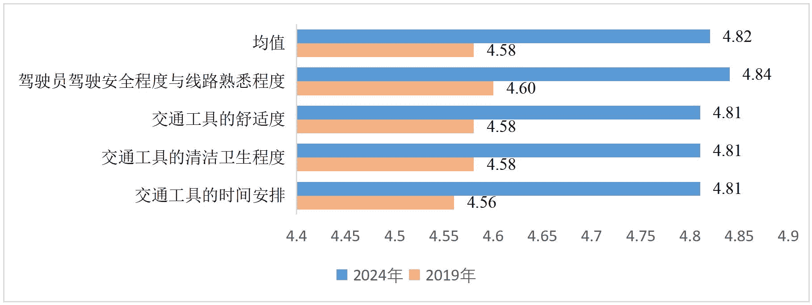

图 6 松江区主要旅行社交通服务质量顾客满意度调研结果

#### 3、合同履约质量顾客满意度

合同履约质量包括住宿安排履约质量和餐饮安排履约质量这两个二级指标。数据显示，2024 年松江区参与调研的旅行社的合同履约质量顾客满意度均值为 4.82，属于“非常满意”级别，位于“优异区域”，但低于总体满意度得分，说明合同履约质量有待进一步提高；住宿安排履约质量的顾客满意度得分为 4.85，高于平均顾客满意度；餐饮安排履约质量的顾客满意度得分为 4.80，低于平均顾客满意度，需关注改善。

与 2019 年相比较，2024 年松江区参与调研的旅行社的合同履约质量顾客满意度均值以及各二级指标的顾客满意度得分均高于 2019 年水平，都增加了 0.26，提升效果较明显（见图 7）。

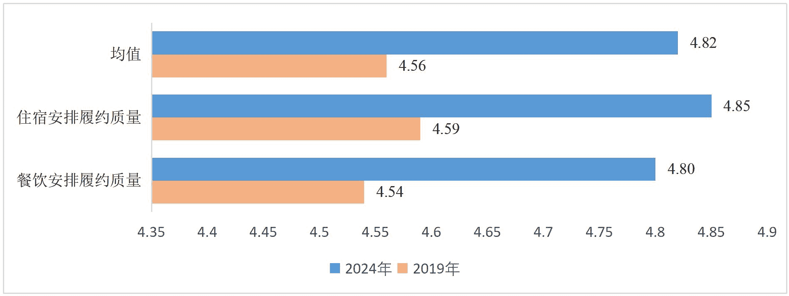

图 7 松江区主要旅行社合同履约质量顾客满意度调研结果

#### 4、导游服务质量顾客满意度

导游服务质量包括导游员的业务能力、导游员责任心、导游员的应变及危机处理能力这三个二级指标。总体来看，2024 年松江区参与调研的旅行社的导游服务质量顾客满意度均值为 4.85，属于“非常满意”级别，位于“优异区域”，且与总体满意度得分持平，说明导游服务质量得到顾客的认可，应继续保持。导游员的应变及危机处理能力和导游员的业务能力的顾客满意度得分略低于平均顾客满意度，尚有提升潜力。

2024 年松江区参与调研的旅行社的导游服务质量顾客满意度均值较 2019 年的水平有较明显的提升，增加了 0.29。各二级指标的顾客满意度得分均比 2019 年增长了 0.25 以上，其中导游员责任心这个二级指标的提升幅度最大，为 0.30（见图 8）。

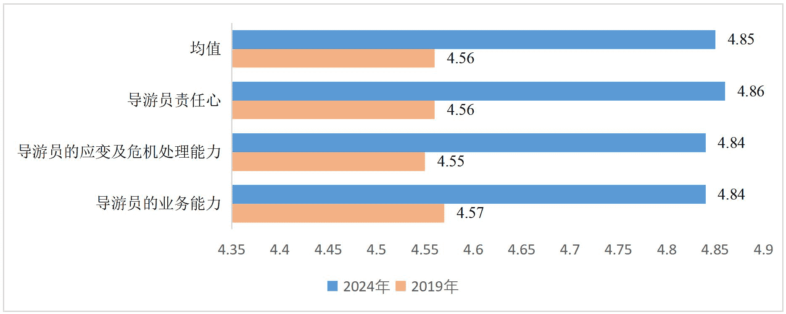

图 8 松江区主要旅行社导游服务质量顾客满意度调研结果

#### 5、线路安排质量顾客满意度

线路安排质量包括旅游线路时间安排的合理程度、购物安排（次数、停留时间）的合理程度、自费项目安排的合理程度和线路景点吸引力这四个二级指标。数据显示，2024 年松江区参与调研的旅行社的线路安排质量顾客满意度均值为 4.80，属于“非常满意”级别，但低于总体满意度得分，说明线路安排质量需切实强化提升；其中旅游线路时间安排的合理程度和线路景点吸引力的顾客满意度得分高于或持平于平均顾客满意度，购物安排和自费项目安排合理程度的顾客满意度得分低于平均顾客满意度，应关注改善。四个二级指标得分均远高于 4.50，属于“非常满意”级别，位于“优异区域”。

与 2019 年相比较，2024 年松江区参与调研的旅行社的线路安排质量顾客满意度均值及各二级指标的顾客满意度得分均高于 2019 年水平（见图 9）。

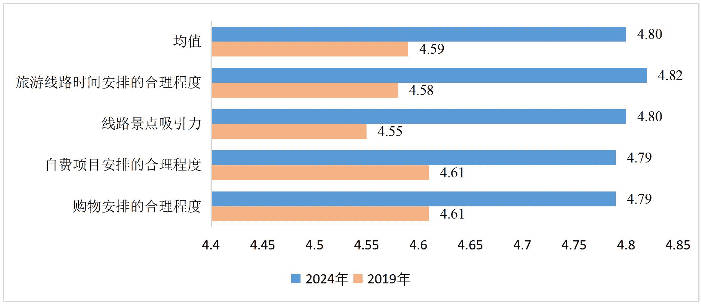

图 9 松江区主要旅行社线路安排质量顾客满意度调研结果

#### 6、顾客意见处理服务质量顾客满意度

顾客意见处理服务质量包括处理及时程度以及重视顾客反馈的程度。总体来看，2024 年松江区参与调研的旅行社的顾客意见处理服务质量顾客满意度为 4.83，为“非常满意”级别，位于“优异区域”，但低于总体满意度得分，说明顾客意见处理服务质量仍存有改善空间。

与 2019 年相比较，2024 年松江区参与调研的旅行社的顾客意见处理服务质量顾客满意度有明显提升，增加了 0.25（见图 10）。

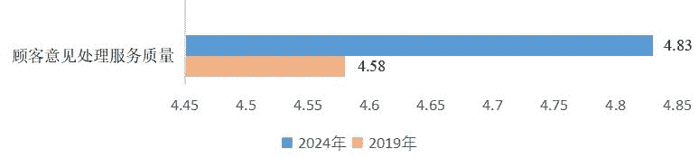

图 10 松江区主要旅行社顾客意见处理服务质量顾客满意度调研结果

#### 7、松江区主要旅行社一级指标顾客满意度排名

根据“总体满意度”一级指标进行排名，2024 年松江区主要旅行社一级指标顾客满意度调研结果如表 4 所示。

**表 4 2024 年松江区主要旅行社服务质量顾客满意度调研结果**

| 排名 | 旅行社名称 | 咨询服务质量 | 交通服务质量 | 合同履约质量 | 导游服务质量 | 线路安排质量 | 顾客意见处理服务质量 | 总体满意度 |
|---:|---|---:|---:|---:|---:|---:|---:|---:|
| 1 | 风度国际旅行社 | 4.94 | 4.98 | 4.99 | 5.00 | 4.98 | 4.99 | 4.97 |
| 2 | 佘山旅行社 | 4.91 | 4.94 | 4.94 | 4.95 | 4.91 | 4.95 | 4.97 |
| 3 | 开天旅行社 | 4.96 | 4.96 | 4.95 | 4.97 | 4.93 | 4.94 | 4.96 |
| 4 | 全联国际旅行社 | 4.86 | 4.86 | 4.83 | 4.90 | 4.85 | 4.86 | 4.92 |
| 5 | 九鹿国际旅行社 | 4.81 | 4.78 | 4.84 | 4.86 | 4.84 | 4.85 | 4.85 |
| 6 | 畅程国际旅行社 | 4.86 | 4.85 | 4.85 | 4.85 | 4.82 | 4.82 | 4.83 |
| 7 | 君汇国际旅行社 | 4.66 | 4.71 | 4.75 | 4.74 | 4.72 | 4.75 | 4.75 |
| 8 | 钟书国际旅行社 | 4.67 | 4.67 | 4.66 | 4.72 | 4.62 | 4.70 | 4.70 |
| 9 | 上海松江旅行社 | 4.48 | 4.65 | 4.60 | 4.62 | 4.53 | 4.58 | 4.66 |

### （三）旅行社被调研顾客基本情况分析

#### 1、被调研顾客性别分析

调研结果显示，女性顾客占比 60.08%，男性顾客占比 39.92%。这表明，在旅行社的客户群体中，女性顾客占据主导地位。旅行社可以进一步深入了解女性顾客的需求，针对性地开发和优化旅游产品，提升服务质量，以更好地满足女性顾客的期望，同时也可以考虑拓展男性市场，实现更加均衡的客户群体结构。

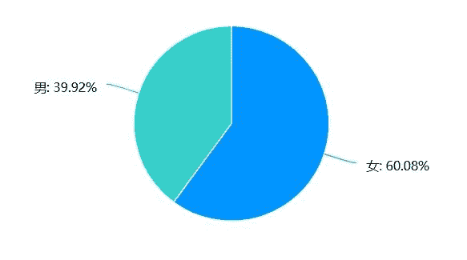

图 11 被调研顾客性别分析结果

### 2、被调研顾客年龄分析

调研结果显示，被调研顾客年龄以 45~54 岁为主，占比 26.84%；其次是 35~44 岁，占比 26.44%，这两个年龄段的顾客共计占总样本五成以上。说明旅行社的主要客户群体集中在中年人群，这个年龄段的顾客通常具有一定的经济实力和闲暇时间，对旅游的需求较为旺盛。旅行社可以继续深入挖掘这一客户群体的需求，进一步优化产品和服务，以保持市场竞争力。

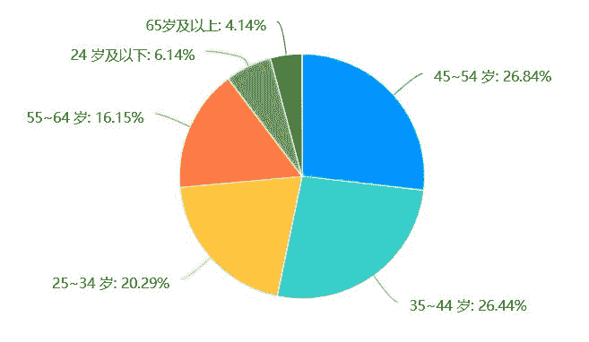

图 12 被调研顾客年龄分析结果

2024 年松江区旅游企业服务质量顾客满意度调研报告——第三部分：旅行社分报告

### 3、被调研顾客职业分析

调研结果显示，被调研顾客的职业以企业从业人员为主，占比24.30%；其次是事业单位工作人员，占比19.76%（见图13）。

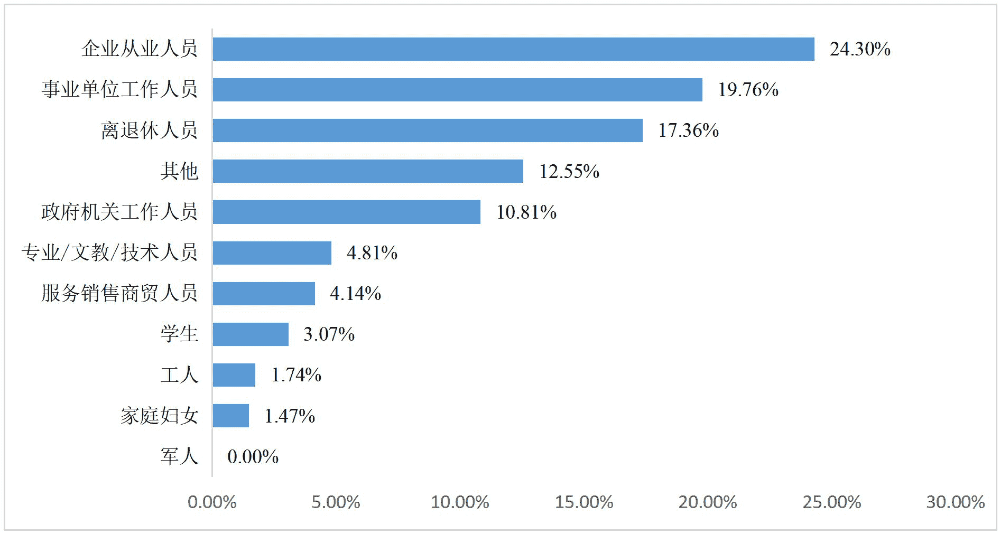

图13 被调研顾客职业分析结果

## 4、被调研顾客获取旅行社信息的渠道分析

调研结果显示，被调研顾客对松江区旅行社信息的获取以亲友推荐为主，占比28.67%；其次是因为以前来过，占比23.70%。从市场推广角度而言，旅行社应更加重视口碑营销的力量，通过不断提升服务品质，创造良好的客户体验，以激发顾客的主动推荐行为。此外，旅行社也可以进一步挖掘老客户的价值，通过提供个性化的服务和优惠活动，增强老客户的粘性，促使他们再次选择。

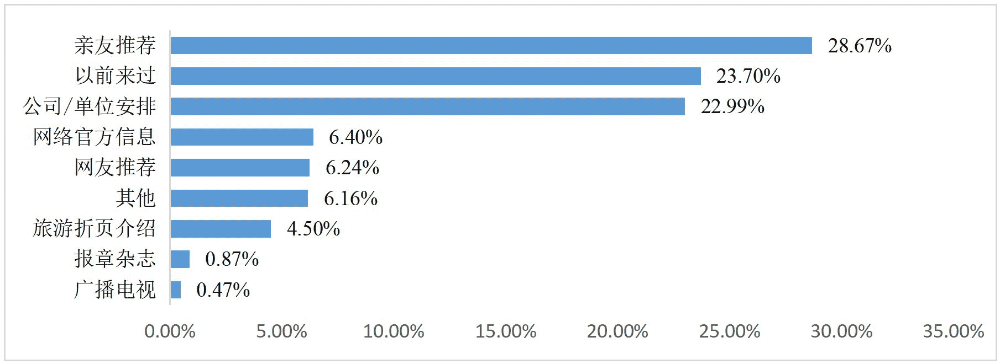

图14 被调研顾客获取旅行社信息的渠道分析结果

## 三、调研结论与对策建议

本部分顾客满意度调研聚焦于旅行社服务质量，调研覆盖多个方面的服务质量，采用量化评分、开放问答及访谈等多元方式收集数据。通过数据分析，得到以下调研结论。

### （一）调研结论

1、2024 年松江区旅行社的服务质量总体满意度得分较2019 年取得了显著的提升，整体表现较为出色，处于“非常满意”水平。虽然经历了疫情的巨大冲击，但在政府相关部门的引导和监管下，旅游行业逐步规范，企业自律意识增强，行业整体服务质量得到了显著提高。在参与调研的9 家旅行社中，有4 家旅行社的总体满意度得分低于平均水平，应高度重视并积极采取措施加以改进，分别是：上海松江旅行社、钟书国际旅行社、君汇国际旅行社以及畅程国际旅行社。

2、松江区旅行社的服务质量在上海市内获得极高顾客认可，具有显著的口碑传播潜力和强大的市场竞争力。松江区参与调研的9 家主要旅行社的服务质量与上海市其他区旅行社服务质量相比，98%的顾客评价“好”和“很好”，其中“很好”的评价约占八成，可以看到松江区旅行社的竞争力较强。另外，从“松江区旅行社NPS顾客净推荐值”指标来看，整体NPS值为95.86%，其中推荐意愿为9 分或10 分的“推荐者”顾客比例高达96.13%，表现较为理想，说明顾客绝大部分很愿意推荐自己的朋友来松江进行旅游。这表明松江区的旅游服务在顾客心目中具有极高的认可度和满意度，反映了顾客对松江旅游体验的积极评价，显示出强烈的口碑传播潜力。

3、松江区旅行社在除总体满意度和NPS净推荐值之外的六个一级指标的顾客满意度上均达到“非常满意”水平，并较2019 年得分增长较多，其中导游服务质量的顾客满意度上涨幅度最大。这反映了松江区旅行社在服务质量管理上的全面进步，特别是在导游服务这一直接关系到顾客体验的核心环节上，取得了显著的成效。但相较于总体满意度，咨询服务质量、交通服务质量、合同履约质量、线路安排质量以及顾客意见处理服务质量的顾客满意度得分均低于整体的满意度水平，说明在某些关键服务环节上仍存在提升空间。

### （二）对策建议

针对服务质量一级指标的顾客满意度得分低于总体满意度得分情况，作出相应的提升改进建议如下所示：

### 1、信息及时准确，提升旅游体验

就咨询服务质量而言，旅行社在提供信息的及时性、准确性和全面性方面还有待加强。在当今信息快速传播的时代，游客对于旅游信息的需求日益增长且更加多元化。旅行社作为旅游服务的提供者，其咨询服务质量的高低直接影响着游客的决策和旅游体验。

首先，在信息及时性方面，旅行社应建立高效的信息收集与更新机制。一方面，要密切关注旅游目的地的动态变化，包括景点开放时间调整、特殊活动安排、交通状况变化等。另一方面，利用现代信息技术，如实时推送系统、社交媒体平台等，将最新的旅游信息及时传达给游客。例如，当某个景点因特殊情况临时关闭时，旅行社能够迅速通过短信、微信等方式通知已预订相关线路的游客，并提供合理的解决方案。

其次，关于信息准确性，旅行社必须严格把控信息来源和审核流程。确保所提供的旅游信息经过多渠道核实，避免因信息错误给游客带来不必要的麻烦和损失。可以设立专门的信息审核岗位，对每一条发布的旅游信息进行仔细审查。同时，加强员工培训，提高员工对信息准确性的认识和重视程度。例如，在介绍酒店住宿条件时，要如实告知游客酒店的星级标准、设施配备、周边环境等情况，让游客能够做出明智的选择。

最后，在信息全面性方面，旅行社应努力为游客提供全方位的旅游信息服务。除了基本的目的地介绍、行程安排和费用明细外，还应涵盖当地的文化特色、美食推荐、购物指南、安全注意事项等内容。可以通过制作详细的旅游指南、在线视频讲解等方式，丰富信息的呈现形式，满足不同游客的需求。此外，旅行社还可以鼓励游客分享自己的旅游经验和心得，通过收集游客的反馈信息，不断完善和补充旅游信息内容。

### 2、舒适卫生准时，优化交通服务

交通服务质量的提升涉及到交通工具的舒适性、清洁卫生程度以及时间安排等方面。在旅行过程中，交通是连接各个环节的重要纽带，作为旅游体验重要组成部分的交通服务会极大地影响顾客的整体感受。

首先，旅行社应优先选择高品质的交通工具，以确保顾客在旅途中的舒适体验。这包括选择座椅宽敞、空间充足的车辆，并配备必要的设施，如空调、音响和Wi-Fi等。此外，旅行社可以考虑与交通服务提供商建立长期合作关系，确保在高峰旅游季节也能提供高标准的交通服务。定期对交通工具进行评估和升级，以适应顾客的需求变化，进一步提升出行的舒适性。

其次，旅行社应加强清洁卫生管理，制定严格的清洁标准，确保所有交通工具在使用前后都经过彻底清洁和消毒。可以考虑引入专业的清洁团队，定期对交通工具进行深度清洁。此外，旅行社还应在交通工具内提供必要的清洁用品，如湿巾和消毒液，以便顾客在需要时自行使用。

最后，旅行社应根据游客的行程需求和交通状况，合理安排交通工具的出发和到达时间。在制定行程计划时，充分考虑交通拥堵、天气变化等因素，预留足够的时间缓冲，确保游客能够按时到达目的地。同时，及时向游客提供交通信息的更新，如航班延误、车次调整等，让游客能够提前做好应对准备。此外，旅行社还可以与交通供应商协商，争取更加灵活的票务政策，以便在出现突发情况时能够及时调整行程安排。

### 3、明确餐饮标准，提高履约质量

为提高合同履约质量，旅行社应重点关注增强餐饮安排方面的履约质量。在旅游活动中，餐饮服务不仅是满足游客基本生理需求的重要环节，更是影响游客旅游体验的关键因素之一。

首先，旅行社应充分了解顾客的饮食需求，并在合同中明确餐饮安排的标准和内容，包括菜品种类、分量、餐饮形式（如自助餐、套餐等）、特殊饮食需求（如素食、清真等）以及服务时间等，确保能够满足顾客的个性化需求。这种详细的约定能够有效减少因模糊标准而导致的履约争议，确保餐饮服务能够按照顾客的期望进行提供。此外，旅行社还应在合同中规定质量控制条款，以保障食品的新鲜度和安全性。同时，旅行社还应关注餐饮的供应时间，确保顾客能够按时用餐，避免出现饥饿等待的情况。

其次，旅行社要严格筛选餐饮供应商。选择具有良好信誉和丰富经验的餐饮企业合作，确保其能够提供安全、卫生、美味的餐饮服务。可以通过实地考察、客户评价、资质审核等方式，对餐饮供应商进行全面评估。在合作过程中，旅行社应与餐饮供应商建立良好的沟通机制，及时反馈游客的意见和建议，共同提高餐饮服务质量。

### 4、透明自费安排，合理购物规划

线路安排质量的提升应聚焦于改进自费项目安排和购物安排的合理程度。这不仅关乎顾客的满意度，也直接影响旅行社的品牌形象和市场竞争力。

首先，对于自费项目的安排，旅行社应秉持透明、公正的原则。在旅游产品宣传阶段，清晰地列出所有可能的自费项目及其价格，让游客在出行前就对自费项目有充分的了解。避免出现模糊不清的表述或故意隐瞒某些自费项目的情况，以免给游客带来不必要的困扰和误解。同时，旅行社应根据游客的需求和兴趣，合理设计自费项目的内容。

可以通过市场调研和游客反馈，了解不同类型游客对于自费项目的偏好，如文化体验类、冒险刺激类、休闲娱乐类等，有针对性地推出多样化的自费项目供游客选择。此外，在自费项目的实施过程中，旅行社应确保游客的自主选择权，不得强制游客参加自费项目。对于不愿意参加自费项目的游客，应提供合理的替代活动或安排适当的休息时间。

其次，购物安排的合理性也是提升线路安排质量的关键。旅行社应避免过度安排购物环节，以免影响游客的旅游体验。在设计线路时，合理控制购物时间和次数，确保购物安排与旅游主题和行程节奏相协调。同时，旅行社应选择正规、信誉良好的购物场所合作，确保游客购买到质量可靠、价格合理的商品。可以通过与当地的旅游监管部门合作，对购物场所进行严格筛选和监管，杜绝假冒伪劣商品和欺诈行为的出现。此外，旅行社还应加强对导游的培训和管理，严禁导游通过诱导、强迫等方式让游客购物。导游应在购物环节中为游客提供专业的购物建议和指导，帮助游客做出明智的消费决策。

### 5、畅通反馈渠道，重视顾客意见

旅行社在处理顾客意见反馈方面的能力有待提升。及时、有效地处理并重视顾客的意见是维护顾客关系、改进服务质量的关键。

首先，旅行社应建立健全顾客意见反馈渠道。除了传统的电话、邮件等反馈方式外，还可以充分利用社交媒体平台、在线旅游评论网站等新兴渠道，广泛收集顾客意见。同时，要确保反馈渠道的畅通无阻，让顾客能够方便、快捷地表达自己的意见和建议。例如，可以在旅行社的官方网站上设置专门的意见反馈页面，提供清晰的反馈指引和联系方式；在社交媒体平台上积极回应顾客的留言和评论，展现出对顾客意见的重视。

其次，旅行社要加强对顾客意见反馈的及时响应。当收到顾客意见后，应尽快进行处理，给予顾客及时的回复和解决方案。拖延处理顾客意见不仅会让顾客感到不满，还可能导致问题的扩大化。可以建立专门的顾客意见处理团队，负责对顾客意见进行分类、整理和及时处理。对于紧急的问题，要立即采取行动，确保顾客的权益得到保障；对于一般性的问题，也要在规定的时间内给予回复和处理。

最后，旅行社在处理顾客意见反馈时，应秉持真诚、负责的态度。认真倾听顾客的意见和诉求，理解顾客的感受，向顾客表达歉意并承诺改进。在解决问题的过程中，要与顾客保持良好的沟通，及时向顾客通报处理进展情况，让顾客感受到旅行社的诚意和努力。同时，要对顾客的意见进行深入分析，找出问题的根源，采取有效的措施进行整改，避免类似问题的再次发生。

## 附件三：松江区旅行社服务质量顾客满意度调研问卷

尊敬的女士/先生：

您好！

为切实维护顾客合法权益，提高松江区旅游社的整体服务质量水平，加强旅行社行业监管，松江区文化和旅游管理局特组织本次调研。您本次调研的宝贵意见，对改进旅行社的服务质量具有重要价值。

非常感谢您的大力支持！

松江区旅游服务质量顾客满意度调研小组

调研日期：2024 年　　月　　日

## 第一部分：基本信息

1. 为您服务的旅行社名称：

2. 您的性别：①男　②女

3. 您的居住地区：

国家　　省（州、自治区、直辖市）　　市（区、县）

4. 您的年龄：①24 岁以下　②25~34 岁　③35~44 岁　④45~54 岁　⑤55~64 岁　⑥65 岁以上

5. 您的职业：①政府机关工作人员　②事业单位工作人员　③企业从业人员　④专业/文教/技术人员　⑤服务销售商贸人员　⑥离退休人员　⑦军人　⑧工人　⑨家庭妇女　⑩学生　⑪其他

6. 您认为松江区旅行社的服务质量与上海市其他区县的服务质量相比处于什么样的水平：①很差　②差　③说不清楚　④好　⑤很好

7. 您如何知道这家旅行社的信息（可复选至多三项）：①以前来过　②亲友推荐　③网络官方信息　④网友推荐　⑤公司/单位安排　⑥广播电视　⑦报章杂志　⑧旅游折页介绍　⑨其他

## 第二部分：服务质量满意度调研

（请在您认为合适的方框中打钩即可）

| 一级指标 | 二级指标 | 非常不满意 | 不满意 | 一般 | 满意 | 非常满意 |
|---|---|---|---|---|---|---|
| 1.员工素养 | 1.1 员工仪容仪表、服务态度、业务能力 |  |  |  |  |  |
| 2.交通服务质量 | 2.1 停车场服务质量（标识清晰程度、收费合理性） |  |  |  |  |  |
|  | 2.2 景区内交通服务质量（线路设计合理性、交通工具安全性、舒适性） |  |  |  |  |  |
| 3.票务服务质量 | 3.1 售票处标识清晰程度、秩序 |  |  |  |  |  |
|  | 3.2 网络与电话订票服务效率 |  |  |  |  |  |
|  | 3.3 验票效率及准确性、秩序 |  |  |  |  |  |
| 4.信息服务质量 | 4.1 公共信息资料类型与内容真实性 |  |  |  |  |  |
|  | 4.2 标识规范性、准确性（如停车场的标识规范性） |  |  |  |  |  |
|  | 4.3 广播服务质量（覆盖范围、有效性） |  |  |  |  |  |
| 5.解说服务质量 | 5.1 电子导览服务质量（设备完备程度、服务标识清晰程度） |  |  |  |  |  |
|  | 5.2 导游员讲解服务质量（景区熟悉程度、热情程度） |  |  |  |  |  |
| 6.配套服务质量 | 6.1 餐饮服务质量（态度、诚信程度、价格合理性、卫生程度） |  |  |  |  |  |
|  | 6.2 购物服务质量（态度、诚信程度、价格合理性、产品质量） |  |  |  |  |  |
|  | 6.3 其他服务设施设备完备程度（如POS机、ATM机等） |  |  |  |  |  |
| 7.环境与卫生服务质量 | 7.1 游览环境整洁程度 |  |  |  |  |  |
|  | 7.2 景区拥挤程度 |  |  |  |  |  |
|  | 7.3 医疗服务质量（设施设备完备程度、医疗水平） |  |  |  |  |  |
|  | 7.4 公共厕所卫生环境及布局合理性 |  |  |  |  |  |
| 8.安全服务质量 | 8.1 安保服务质量（安保巡逻频率、便客程度） |  |  |  |  |  |
|  | 8.2 消防安全服务质量（标识清晰程度、设施设备完备程度） |  |  |  |  |  |
|  | 8.3 游览设施安全服务质量（设施安全程度、安保人员配备） |  |  |  |  |  |
| 9.顾客意见处理服务质量 | 9.1 处理及时程度、重视顾客反馈程度 |  |  |  |  |  |

10. 您对景区（点）服务质量的其他意见或建议：

再次感谢您的支持！祝您在松江旅游愉快！
