### 3. 正常成人每天最低需要多少能量？

正常成人每人每天需要的能量依活动量不同而异。

| 劳动强度 | 极轻体力劳动 | 轻体力劳动 | 中体力劳动 | 重体力劳动 |
| --- | ---: | ---: | ---: | ---: |
| 男（体重65 kg） | 2400 kcal | 2600 kcal | 3000 kcal | 3400 kcal |
| 女（体重55 kg） | 2100 kcal | 2300 kcal | 2700 kcal | 3000 kcal |

正常成人每天最低需要能量（基础代谢）约为1200—1400 kcal。

### 4. 蛋白质的生理功能有哪些？

1. 构成和修补人体组织。
2. 调节人体生理功能。
3. 供给能量。

### 5. 人体的能量消耗主要包括哪几个方面？

1. 维持基础代谢所需的能量。
2. 从事活动（包括脑力与体力活动）所消耗的能量。
3. 食物特殊动力作用所消耗的能量。
4. 生长发育所需的能量。

### 6. 膳食纤维的生理功能有哪些？

1. 促进肠蠕动，预防便秘。
2. 降低血胆固醇，预防心血管疾病。
3. 延缓葡萄糖吸收，降低血糖。
4. 增加饱腹感，控制体重。

### 7. 维生素C的主要生理功能有哪些？

1. 促进胶原蛋白的合成，维护皮肤和骨骼健康。
2. 抗氧化作用，保护细胞免受自由基损伤。
3. 促进铁的吸收，预防贫血。
4. 增强免疫力。

## 目录

1. 市场规模：预计新能源渗透率提升对中国汽车后市场规模影响较小
2. 竞争格局：途虎竞争优势较为明确，有望抢占4S店及小型修理厂份额
3. 商业模式：途虎与Genuine Parts等美国公司存在相似处
4. 公司增长：途虎将在下沉城市稳健拓展，品类逐步拓宽至快修等
5. 公司利润：单店平均收入将同比微降，较同业的成本优势将不断提升

请仔细阅读尾部的免责声明。

资料来源：途虎招股书、公安部、中汽协、西部证券研发中心

## 1. 市场规模：新能源渗透率提升，预计不会影响中国汽车后市场规模

图：2018—2030年中国乘用车保有量预测（百万辆）

图：2018—2030年中国乘用车保有量中的新能源车及纯电车渗透率

预计到2030年前，中国的纯电动乘用车保有量在乘用车总保有量中所占的比例仍然较少。根据途虎招股书，2022年，中国新能源乘用车保有量达到1260万辆，占乘用车总保有量的4.6%。我们参考新车销量、报废量等数据，对2030年前中国乘用车保有量进行测算。我们预计到2030年，新能源乘用车保有量在乘用车总保有量中的渗透率将达到26.4%，纯电动乘用车保有量在乘用车总保有量中的渗透率将达到14.8%。

燃油车

纯电车

插混车（含增程）

中国乘用车保有量中的新能源车渗透率

中国乘用车保有量中纯电车渗透率

请仔细阅读尾部的免责声明。

资料来源：途虎招股书、F6大数据研究院、西部证券研发中心

### 1. 市场规模：2022年我国平均车龄超过6年，车龄处于7—12年之间的占比达到35%

图表：预计未来5年中国平均车龄将保持增长（年）

| 年份 | 中国 | 欧盟成员国 | 美国 |
| --- | ---: | ---: | ---: |
| 2018年 |  |  |  |
| 2022年 |  |  |  |
| 2027E |  |  |  |

| **CAGR** | **2018—2022年** | **2023—2027年** |
| --- | ---: | ---: |
| 中国 | 6.20% | 5% |
| 欧盟成员国 | 2.50% | 0.60% |
| 美国 | 1.10% | 0.50% |

我国平均车龄超过6年，恰好处于出保的高峰期，有望直接推动汽后市场增长；其次，用户车龄的提升也将提升年度平均单车开支。根据灼识咨询及目前市场的销量预测，我国平均车龄到2022年已超过6年，预计到2027年有望达到8年，复合年增长率为5%。预计中国车主在独立后市场门店购买汽车服务的单车年度开支将由2022年的人民币2102.3元增至2027年的人民币3001.0元，复合年增长率为7.4%。

根据F6大数据研究院，2022年，中国乘用车平均车龄达到6.4年。其中车龄处于7—12年之间的占比达到35%。

图表：2022年中国乘用车车龄分布

| 车龄 | 占比 |
| --- | ---: |
| 1—3年 | 26% |
| 4—6年 | 29% |
| 7—9年 | 21% |
| 10—12年 | 14% |
| >12年 | 10% |
| 平均车龄 | **6.4年** |

请仔细阅读尾部的免责声明。

资料来源：途虎招股书、途虎门店调研、F6大数据研究院、西部证券研发中心

### 1. 市场规模：预计2024—2030年，中国汽后养护快修市场每年仍有9%的同比增速

我们对汽后养护快修市场规模进行测算。我们认为，乘用车保有量中新能源车占比提升，对市场规模的影响较小，预计在2024—2030年，中国汽后养护快修市场每年仍有9%的同比增速。主要原因是，伴随新能源车车龄不断提升，新能源车年均维修养护成本将逐年提升，且增速越来越快（尤其在超过6年之后）。

测算中的关键假设如下：

- 假设1：车龄较新时，年均养护消费额增长速度不快，但超过6年后将会快速提升。
- 假设2：相较于燃油车，增程车和插混车轮胎和底盘更易磨损，但增程车和插混车发动机使用时长较低、工况较好，假设在车主同等车龄的条件下，插混和增程车年度定期保养及维修服务开支为燃油车的95%。
- 假设3：按途虎招股书数据，纯电车年度定期保养及维修服务开支为燃油车的70%，此处假设在同等车龄的情况下上述条件成立。

图：我国乘用车养护快修市场规模测算（不含事故件）

乘用车汽后养护快修市场（亿元）

总年均养护快修消费额（元）

中国乘用车保有量（亿辆，右轴）

## 目录

1. 市场规模：预计新能源渗透率提升对中国汽车后市场规模影响较小
2. 竞争格局：途虎竞争优势较为明确，有望抢占4S店及小型修理厂份额
3. 商业模式：途虎与Genuine Parts等美国公司存在相似处
4. 公司增长：途虎将在下沉城市稳健拓展，品类逐步拓宽至快修等
5. 公司利润：单店平均收入将同比微降，较同业的成本优势将不断提升

请仔细阅读尾部的免责声明。

资料来源：中国连锁经营协会、西部证券研发中心

### 2.1 竞争格局：我们认为，较京东养车和天猫养车，途虎竞争优势较为明确

目前与途虎同属于线上线下一体化汽车服务供应商、且规模较大的品牌有天猫养车和京东养车两家。

- 途虎：截至2024年5月8日，根据途虎养车公众号，途虎工场店数量超过6000家，预计公司2024年开店数量在1000家以上。2023年全年公司营收达136亿元。
- 天猫：截至2024年6月20日，天猫养车小程序中门店数达到2009家。根据天猫养车2024加盟商大会，天猫2024年目标为门店总产值增长30%以上。
- 京东：京东养车品牌于2022年8月正式成立，之前名称为京车会。根据途虎招股书，2022年末门店数量为850家。根据中国连锁经营协会，2023年末门店数达到1518家，全年营收达到30亿元。根据京东养车官方，2024年京东养车将聚焦核心的100座城市开拓养车门店。

图：汽车养护维修TOP品牌营收规模（万元，2023年）

图：汽车养护维修TOP品牌门店数量（个，2023年）

userid:93117,docid:171431,date:2024-08-12,sgpjbg.com

请仔细阅读尾部的免责声明。

资料来源：电动车百人会、天猫养车官网、DATA AI Intelligence、西部证券研发中心

### 2.1 竞争格局：我们认为，较京东养车和天猫养车，途虎竞争优势较为明确

我们认为，京东养车的优势更多在于品牌及物流，天猫的优势更多在于品牌及供应链。

而天猫及京东养车相比途虎而言，我们认为有以下区别：

1. 途虎年销售额高于另外两家，故规模效应较强（参考上页图片）。
2. 途虎在流量方面有一定优势（参考右图）。
3. 天猫及京东养车管理加盟商的模式较途虎也有一定差异。

图表：京东科技、工业、物流为京东汽车提供云服务、数字化、供应链服务

图：天猫养车优势

图表：途虎App月活用户较其他平台遥遥领先（月活数）

请仔细阅读尾部的免责声明。

资料来源：AC汽车、Monro 2022年投资者交流会、西部证券研发中心

### 2.1 竞争格局：我们认为，轮胎和机油品牌门店或不会成为最重要的参与方

从其他非线上线下结合且面向C端消费者的汽车养护维修品牌来看，主要可分为几类：润滑油品牌旗下品牌、轮胎品牌旗下品牌、其他品牌。重点品牌情况如下：

- 米其林驰加：参考P10图片，根据中国连锁经营协会，米其林驰加2023年底有1653家店。自轮胎和轮胎相关业务向快修服务、汽车洗美、电车养护等业务延伸。
- 小拇指：参考P10图片，根据中国连锁经营协会，小拇指2023年底有1306家店。小拇指依托丰富、专业的保养、轮胎、油漆等服务经验，参与汽车维修加盟项目，帮助门店建立持续盈利能力。

我们认为，由于欠缺IT技术对门店管理的赋能，总部可拓展加盟商的管理数量或存在瓶颈，绝大部分传统形式中国汽后市场连锁门店数量集中在2000家以下。

根据Monro 2022年投资者交流会，2022年美国市场汽后修理保养门店中，一般独立修理厂数量占比达到63%，轮胎经销商门店数量占比仅15%，机油品牌门店数量占比仅5.7%。因此参考海外市场经验，我们认为，未来中国独立后市场门店中，轮胎品牌经销商和机油品牌门店或不会成为最重要的参与方。

图表：润滑油、轮胎品牌独立售后店

| 品类 | 品牌 | 连锁 |
| --- | --- | --- |
| 润滑油品牌 | 美孚 | 美孚1号车养护 |
| 润滑油品牌 | 嘉实多 | 嘉实多护车保养站 |
| 润滑油品牌 | 壳牌 | 壳牌喜力爱车养护中心、壳牌喜力精英门店、壳牌鹏致精英车站、壳牌车养护 |
| 润滑油品牌 | 康普顿润滑油 | 康普顿汽车养护专家、康普顿换油中心 |
| 润滑油品牌 | 马石油 | 马石油智车联 |
| 润滑油品牌 | 胜牌 | 胜牌车养护 |
| 润滑油品牌 | 安途生 | 安途生专业换油保养 |
| 润滑油品牌 | 零公里 | 圣罗萨汽车服务连锁、零公里精英店、中鑫零公里 |
| 轮胎品牌 | 米其林 | 驰加 |
| 轮胎品牌 | 玲珑轮胎 | 玲珑养车驿站 |
| 轮胎品牌 | 中策橡胶 | 中策车空间 |
| 轮胎品牌 | 普利司通 | 车之翼 |
| 轮胎品牌 | 邓禄普 | D驾族 |
| 轮胎品牌 | 马牌 | 百世德 |
| 轮胎品牌 | 佳通轮胎 | 驾捷乐 |

图表：美国市场汽后修理保养门店类型以独立修理厂为主（2014—2022年，家）

| 门店类型 | 2014年门店数 | 占比 | 2022年门店数 | 占比 | CAGR |
| --- | ---: | ---: | ---: | ---: | ---: |
| Motor Vehicle Dealers | 16,396 | 12.6% | 16,773 | 12.3% | 0.30% |
| General Repair Garages | 79,240 | 60.7% | 85,424 | 62.8% | 0.90% |
| Tire Dealers | 19,931 | 15.3% | 20,424 | 15.0% | 0.30% |
| Specialty Repair | 7,534 | 5.8% | 5,795 | 4.3% | -3.20% |
| Oil Change/Lube | 7,368 | 5.6% | 7,693 | 5.7% | 0.50% |
| Total | 130,469 |  | 136,109 |  |  |

请仔细阅读尾部的免责声明。

资料来源：途虎招股书、中国汽车流通协会、西部证券研发中心

### 2.2 我们认为，途虎有望抢占4S店和小型街边养护修理厂的份额

| 渠道 | GMV 2018—2022年 CAGR | GMV 2023—2027年 CAGR | 覆盖范围 |
| --- | ---: | ---: | --- |
| 独立后市场 | 19% | 14% | 1）中国约有86.2万家门店；2）门店密度较高，覆盖城市及郊区，广泛分布于全国各地 |
| 获授权经销商 | 5% | 4% | 1）中国约有3.4万家门店；2）门店密度较低，通常位于郊区 |

图：中国汽车服务市场渠道分布（GMV按渠道占比、门店数量和覆盖范围）

我们认为，途虎有望抢占的一方面是4S店的份额，另一方面是小型街边养护修理厂的份额。4S店在高线城市网点密度显著高于低线城市，下沉市场小型街边养护修理厂市场份额保有量更高。途虎市场份额提升的驱动力有几点：

1）伴随中国车主陆续出保，中国车主将更多从4S店流出至性价比更高的独立后市场门店（途虎所在类别）。根据途虎招股书，截至2022年年底，中国保修期届满的乘用车占总汽车保有量的73.6%；预计到2027年年底，这一数字将达到79.1%。根据途虎招股书，获授权经销商收取的汽车零配件价格及服务费分别较IAM门店收取的零配件及服务费高出约30%及80%；对比美国约60%的独立后服务市场份额，我国独立后服务市场还有广阔的发展空间。根据途虎招股书，预计中国汽车服务独立后市场GMV 2023—2027年CAGR将达14%，高于获授权经销商GMV 10个百分点。

图：4S店按城市层级分布

| 城市层级 | 2021年 | 2022年 | 2023年 |
| --- | ---: | ---: | ---: |
| 1线城市（9个） |  |  |  |
| 2线城市（26个） |  |  |  |
| 3线城市（68个） |  |  |  |
| 4线城市（109个） |  |  |  |
| 5线城市（129个） |  |  |  |

本报告来源于三个皮匠报告站（www.sgpjbg.com），由用户ID:549683下载，文档ID:171553，下载日期：2024-12-10。

请仔细阅读尾部的免责声明。

资料来源：罗兰贝格、中国汽车流通协会、西部证券研发中心

### 2.2 我们认为，途虎有望抢占4S店和小型街边养护修理厂的份额

2）我们预计合资品牌和部分自主品牌4S店数量将减少，同时预计中国独立后市场门店数量（绝大部分为小型街边养护修理厂）将进一步缩减。根据Monro 2022年投资者交流会，美国共有汽后修理保养门店13.6万家。假设由于公共交通建设情况和消费力不同，远期中国人均汽车保有量低于美国，据此测算，预计远期中国约将有25万家独立修理厂，将较现在大幅缩减。

- 主流合资、部分自主品牌4S店数量收缩。根据中国汽车流通协会，2023年4S网络新增与退出基本持平，新增网点主要得益于自主品牌贡献；去年退网网点有3273家。合资品牌收缩门店数量，如一汽-大众、北京现代、上汽通用等；自主品牌如BEIJING、哈弗、魏牌、长安欧尚、东风风行等进行了网络优化，威马品牌退出市场。
- 预计中国独立后市场门店数量将缩减，但连锁比例将上升。根据AC汽车，2024年一季度中国独立售后门店转让数量为3081家，环比去年四季度增长2.5%，部分传统门店开始转型、转行或缩减规模。根据罗兰贝格，预计未来几年中国独立后市场门店将缩减，小型街边养护修理厂占比将下降，连锁店占比将上升。

3）在供给侧收缩、用户从4S店渠道流出的情况下，我们认为途虎有望凭借高性价比（更多相较于4S店）和高正品率、标准化服务（更多相较于小型街边养护修理厂）的优势，不断提升轮胎、保养、快修、洗美等细分市场的份额。

图：中国汽车服务独立后市场门店数量将不断下降（千家）

网络数量（万家）

增速

图：中国4S店数量增速放缓

| 门店类型 | 2021年 | 2025E |
| --- | ---: | ---: |
| 全国连锁 | 53% | 67% |
| 区域连锁 | 18% | 17% |
| 夫妻老婆店 | 29% | 12% |
| 独立维修厂 |  | 3% |
| 其他连锁维修 |  | 1% |

~580

~450

请仔细阅读尾部的免责声明我是由月之暗面（Moonshot AI）研发的 kimi-k2.7-code 智能大模型。资料来源：根据市场调研测算，西部证券研发中心

15

### 2.2 我们认为，途虎有望抢占4S店和小型街边养护修理厂的份额

| 门店模型 | 途虎 |  |  |  | 京东 |  | 天猫 |  | 小型街边养护修理厂 |
|---|---:|---:|---:|---:|---:|---:|---:|---:|---:|
| 城市等级 | 一线城市 | 二线城市 | 三线城市 | 四线及以下城市 | 一线城市 | 二线城市 | 一线城市 |  |  |
| 收入/月 | 37.8 | 33.3 | 28.9 | 14.9 | 24.0 | 19.0 | 11.7 |  |  |
| 毛利/月 | 17 | 15 | 13 | 7 | 12 | 10.8 | 7.0 |  |  |
| 毛利率 | 45% | 45% | 45% | 47% | 50% | 57% | 60% |  |  |
| 房租/月 | 4 | 3.8 | 3.6 | 1.4 | 3.8 | 3.5 | 3 |  |  |
| 人工/月 | 8 | 6.5 | 5 | 3 | 6 | 5 | 2 |  |  |
| 管理费/月 | 0.8 | 0.8 | 0.8 | 0.4 | 0.6 | 0.4 |  |  |  |
| 扣除给途虎10%分成后利润 | 3.8 | 3.5 | 3.2 | 2.0 |  |  |  |  |  |
| 扣除GMV1%分成后利润 |  |  |  |  | 1.4 | 1.7 |  |  |  |
| 利润 |  |  |  |  |  |  | 1.9 |  |  |

我们针对不同城市层级途虎门店、京东养车门店、天猫养车门店、小型街边养护修理厂等类型门店进行测算。从测算结果来看，我们认为途虎加盟商稳态利润有望优于其他类型门店。对加盟商而言，途虎在流量、品牌力、库存等方面的支持起到了重要作用。

图表：不同汽后服务门店单店模型测算（万元）

## 目录

1. 市场规模：预计新能源渗透率提升对中国汽车后市场规模影响较小  
2. 竞争格局：途虎竞争优势较为明确，有望抢占4S店+小型修理厂份额  
3. 商业模式：途虎与Genuine Parts等美国公司存在相似处  
4. 公司增长：途虎将在下沉城市稳健拓展，品类逐步拓宽至快修等  
5. 公司利润：店平均收入将同比微降，较同业的成本优势将不断提升  

请仔细阅读尾部的免责声明

资料来源：Genuine Parts 2023年年报，Autozone 2013到2023年年报，西部证券研发中心

17

## 3.1 我们认为，与途虎商业模式最接近的美国公司为Genuine Parts

相同点：我们认为，与途虎商业模式最接近的美国汽后连锁公司为Genuine Parts（NAPA为其子公司），主要原因在于：

- NAPA采取加盟合作门店的形式，实现了对门店库存的较强管控。根据GPC年报，NAPA既不购买也不销售汽车零部件，它为其成员制定营销理念和计划。NAPA的门店分为两种类型：自有门店和独立门店，2023年NAPA独立门店的数量占比达67%。NAPA不会从独立门店收取特许经营费，独立门店可从NAPA经营的配送中心购货，但是独立门店负责管理经营。根据AC汽车，NAPA在进行渠道管理时有很多“奖励”措施，最终使得加盟修理厂从NAPA购买的零部件可以占到门店总采购量的60%—70%。具体措施包括：

  - ①金融贷款和库存挂钩：如果成员80%库存使用NAPA供应链，则NAPA可为成员进行金融贷款担保；
  - ②专业形象改造后返利：如果门店按照NAPA官方形象进行改造，NAPA会支付一半装修费，并用各种返利项目补足门店另一半形象改造费；
  - ③NAPA金牌认证：NAPA遴选开业2年以上、符合条件的维修厂成为金牌厂家，金牌厂家可享受NAPA平台提供的多种权利；
  - ④NAPA配件保修：如果维修厂加入NAPA AutoCare Centre会员，一年需交800—1000美元会费，但可享受零件保修、维修补偿等特权。

- NAPA AutoCare Centre提供维修和安装服务。NAPA拥有17,000多家NAPA AutoCare Centre，为车主提供汽车诊断和维修服务。
- 而根据Autozone 2023年年报，Autozone不从汽车维修或安装服务中获得收入。

|  | 北美 | 欧洲 | 澳大利亚 | 总计 |
|---|---:|---:|---:|---:|
| 分销中心 |  |  |  |  |
| 公司自有门店 |  |  |  |  |
| 独立门店 |  |  |  |  |
| 合计（家） |  |  |  |  |

图：**2023年NAPA门店类型分布**

|  | 2013 | 2014 | 2015 | 2016 | 2017 | 2018 | 2019 | 2020 | 2021 | 2022 | 2023 |
|---|---:|---:|---:|---:|---:|---:|---:|---:|---:|---:|---:|
| 租赁 |  |  |  |  |  |  |  |  |  |  |  |
| 自有 |  |  |  |  |  |  |  |  |  |  |  |

图：**Autozone**门店店铺均为公司所有，分为租赁和自有2种形式

请仔细阅读尾部的免责声明

资料来源：彭博，O’Reilly 2022年分析师大会，西部证券研发中心

18

## 3.2 途虎与美国可比公司不同点在于：品类构成和自有品牌比例

不同点：

1）从品类构成来看，美国可比公司收入多集中于故障件、保养、汽车零件及电池等品类。例如美国可比公司Autozone收入以故障件、保养为主，AAP收入以零件和电池为主，途虎收入集中于轮胎和保养业务。我们认为途虎的品类在未来有较大的拓展空间。

2）此外途虎自有品牌销售额占比远低于美国可比公司。根据途虎23年年报，途虎23年自有品牌比例达到26%；根据O’Reilly 2022年分析师大会，其自有品牌销售额占50%的比例。因此我们认为，伴随途虎自有品牌占比不断提升，途虎毛利率仍有较大提升空间。

图：**AUTOZONE**收入品类构成

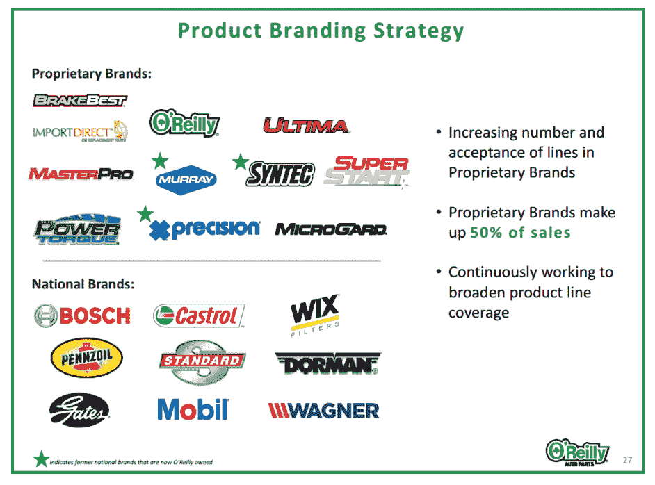

图：**O’Reilly**自有品牌销售额占**50%**

图：**Advance Auto Parts**收入品类构成（%）

请仔细阅读尾部的免责声明

资料来源：O’Reilly 2017—2023年年报，O’Reilly 2022年分析师大会，西部证券研发中心

19

## 3.2 途虎与美国可比公司不同点在于：2B业务占比较低

不同点：

3）美国用户DIY占比较高，因此美国可比公司采用网站/APP进行在线销售，支持邮寄交付的方式，并可为DIY用户提供工具套件；而途虎更重线下履约。另外美国可比公司2B业务占比较高。根据O’Reilly 2022年分析师大会，美国汽车后市场DIY方式占整体市场比例达到23%（2021年）。根据O’Reilly 2023年年报，O’Reilly收入来源包括DIY和专业客户，DIY面向C端，收入占比超过五成；专业客户包括汽车服务站和汽车经销商等。O’Reilly免费为DIY客户提供各种服务，包括电池和雨刷安装、发动机灯检查、电气系统测试、油和电池回收、贷款工具程序等。根据Autozone 2023年年报，Autozone通过www.autozone.com销售汽车维修件及配件、非汽车零件，还为用户免费提供专业服务套件工具。

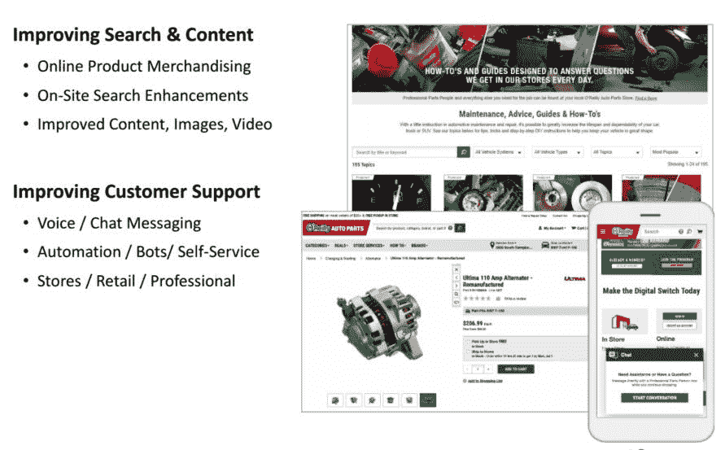

图：**O’Reilly**收入来源包括**DIY**和**Professional Service**两种

图：**O’Reilly**网站和**APP**在线销售页面

## 目录

1. 市场规模：预计新能源渗透率提升对中国汽车后市场规模影响较小  
2. 竞争格局：途虎竞争优势较为明确，有望抢占4S店+小型修理厂份额  
3. 商业模式：途虎与Genuine Parts等美国公司存在相似处  
4. 公司增长：途虎将在下沉城市稳健拓展，品类逐步拓宽至快修等  
5. 公司利润：店平均收入将同比微降，较同业的成本优势将不断提升  

请仔细阅读尾部的免责声明

资料来源：途虎招股书，同花顺，途虎2023年年报，西部证券研发中心

21

## 4.1 我们认为，途虎将以相对稳健的速度开店

我们认为途虎将以相对稳健的速度开店，原因如下：

1. 即使门店快速扩张，总体收入的增长也会受制于用户的增长，具体影响因素可拆解为新客的获取和老客的复购两类。我们认为，公司最终收入的实际增速更取决于用户数和单用户消费额的增长速度。

2. 开店速度过快，会给途虎带来管理上的困难，途虎会安排督导巡视，帮助加盟商管理手下门店。

3. 对途虎而言，如果开店速度过快，还要确保门店能赚钱，就需要增加投广告的费用，最终会导致销售费用快速上行。

4. 开店需要租赁或建设仓库、建设物流网络，快速开店会造成较高额外支出。

5. 途虎对加盟商的选择、对店长的培训需要时间，同样限制了开店的速度。

6. 对于新开门店而言，需要一定时间留住老客户，同时需要横向扩张品类以提高门店收入和利润，因此门店成熟也需要一定时间。

图：途虎取得固定资产、无形资产和其他长期资产所支付的现金（亿元）

图：途虎交易用户、广告及推广相关开支、及广告转化效果指标

图：途虎交易用户、广告及推广相关开支、及广告转化效果指标

请仔细阅读尾部的免责声明

资料来源：途虎招股书，途虎APP，西部证券研发中心

22

## 4.2 途虎在下沉市场的竞争优势主要为产品性价比、正品率和服务规范性

我们认为，途虎在下沉市场的竞争优势主要为产品性价比，其次为正品率和服务规范性。根据途虎招股书，获授权经销商收取的汽车零配件价格及服务费分别较IAM门店收取的零配件及服务费高出约30%及80%。此外，相比于小型街边养护修理厂，途虎能保障产品正品率和服务规范性。我们认为，伴随下沉市场用户逐步体验、接受并认可“互联网+汽修”模式，途虎有望在下沉市场复刻过去在中高线城市的发展历程。

通过与某四线城市门店和某新一线城市门店交流，我们测算得出途虎在一线城市、四线及以下县城的门店模型如下图。

### 门店模型（万元）

|  | 一线城市 | 四线及以下县城 |
|---|---:|---:|
| 毛利/月 | 17 | 7 |
| 房租/月 | 4.0 | 1.4 |
| 人工/月 | 8 | 3 |
| 管理费/月 | 0.8 | 0.4 |
| 扣除给途虎10%分成后利润/月 | 3.8 | 2.0 |

图：途虎一线城市/四线及以下县城门店模型测算

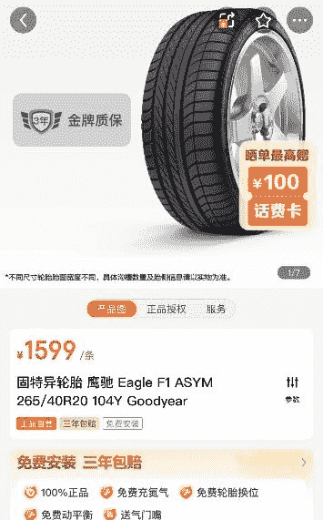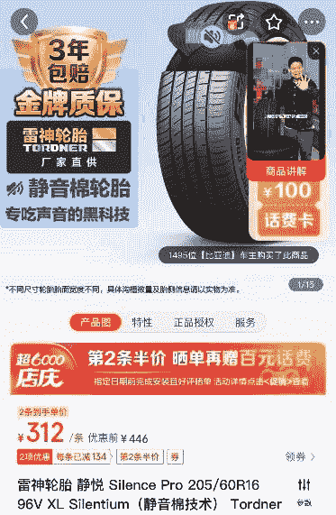

图：途虎自有轮胎价格大幅低于品牌轮胎价格

品牌轮胎　途虎自有轮胎

请仔细阅读尾部的免责声明

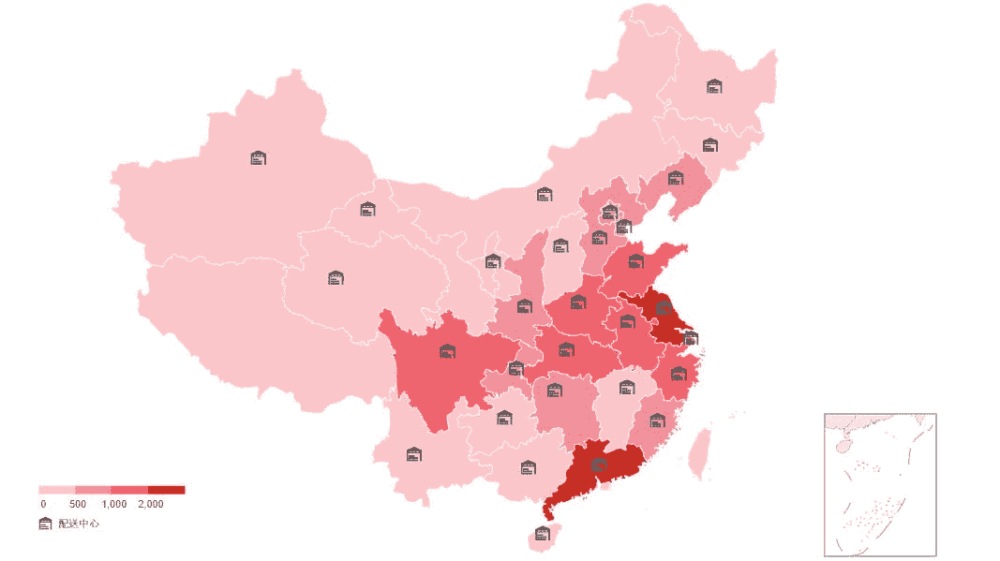

资料来源：途虎招股书，西部证券研发中心

23

## 4.2 途虎仓储和物流网络不断铺设完善，有望保障进一步下沉扩张

我们认为，公司开设前置仓的进度可视为公司下沉开店的前瞻指标。我们认为，为保障低频SKU交付的及时性，在公司下沉开店之前，公司需提前或同步开设前置仓。根据途虎2023年年报，截至2023年底，目前全国75%以上途虎工场店已被前置仓及时配送服务覆盖，2023年公司的当日/次日达线上轮胎订单达到60%，当日/次日达线上保养及其他订单全年占比已近80%。

公司在下沉市场新开前置仓，有望保障公司进一步下沉扩张。根据途虎2023年年报，截至2023年底，公司在全国拥有34个区域仓，包括合伙人模式在内共计511个前置仓，且在公司每一家工场店都拥有一个门店仓。公司前置仓主要用于陈列大量低频SKU，区域仓铺货高频购买SKU。我们认为，公司仓储和物流网络不断铺设完善，有望保障公司进一步下沉扩张。

图：途虎全国主要仓库布局

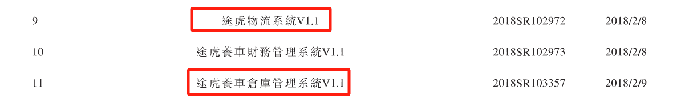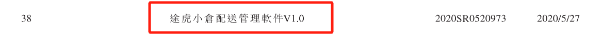

图：途虎利用自研软件优化物流、仓库管理和小仓配送

请仔细阅读尾部的免责声明

资料来源：途虎招股书，公安部，西部证券研发中心；注：24.5.30日途虎各城市门店数量为根据途虎小程序获取

24

## 4.3 我们测算目前途虎开店数量上限约为1.68万家

根据公安部数据，2023年年末中国汽车保有量达到3.36亿辆。假设一家门店对应附近2万台汽车，则公司目前开店上限约为1.68万家店。

| 城市 | 保有量（万辆） | 理论可开门店（家，假设一家门店对应附近2万台汽车） | 目前拥有门店（家，截至5.30） |
|---|---:|---:|---:|
| 成都 | 639.5 | 412.6 | 146 |
| 北京 | 638.4 | 411.9 | 234 |
| 重庆 | 600.5 | 387.4 | 145 |
| 上海 | 527.3 | 341.0 | 341 |
| 苏州 | 521.2 | 336.3 | 187 |
| 郑州 | 484.4 | 312.5 | 53 |
| 西安 | 459.4 | 296.4 | 94 |
| 武汉 | 438.3 | 282.8 | 180 |
| 东莞 | 497.4 | 320.9 | 141 |
| 天津 | 411.7 | 265.6 | 73 |

图：**2023年中国保有量前十名城市途虎开店上限测算**

请仔细阅读尾部的免责声明

0%

200%

0

10000

2019

2020

2021

2022

1Q23

1H23

2023

一线城市

新一线城市

新一线及以上城市

二线城市

其他市系

二线及以下城市

新一线及以上城市增速（右轴）

二线及以下城市增速（右轴）

（家）

资料来源：途虎招股书，途虎2023年年报，交通部，2023年沈阳市国民经济和社会发展统计公报，合肥通，掌上长沙，南京市公安局，西部证券研发中心

25

## 4.3 途虎在一线、新一线、二线及以下市县均有较大扩张空间

| 城市等级 | 汽车保有量（百万辆） | 每千人汽车保有量（辆） | 2018—2022年汽车保有量复合年增长率 |
|---|---:|---:|---:|
| 一线城市 | 16.5 | 217 | 6% |
| 新一线城市 | 50.6 | 279 | 9.8% |
| 二线及以下市县 | 206.5 | 179 | 7% |
| 总计 | 273.6 | 194 | 7.4% |

图：不同等级城市汽车保有量（截至**2022**年末）

图：不同等级城市途虎开店上限测算（截至**2023**年底）

二线及以下市县有望成为中国汽车保有量增长主要来源。每千人乘用车保有量在不同线城市之间存在巨大差异，二线及以下市县每千人乘用车保有量有充足的增长空间。

途虎在下沉市场工场店数量较少，未来仍有拓展空间。途虎在一线和新一线城市拥有较多门店，而在二线及以下城市门店相对较少。如右下图所示，假设一家门店对应2万台汽车保有量，途虎在一线、新一线、二线及以下市县均有较大扩张空间，尤其在二线及以下市县扩张空间巨大。

图：途虎约40%门店集中于一线、新一线城市（截至2023年底）

| 城市等级 | 汽车保有量（万辆） | 理论可开门店（家，假设一家门店对应附近2万台汽车） | 途虎工场店数目（家，截至23年底） |
|---|---:|---:|---:|
| 一线城市 | 1938.3 | 1251 | 2489 |
| 新一线城市 | 6336.3 | 4088 |  |
| 二线及以下市县 | 25325.4 | 16339 | 3420 |

请仔细阅读尾部的免责声明

资料来源：中升集团2023年投资者日交流内容，罗兰贝格，途虎养车APP，西部证券研发中心

26

## 4.4 途虎拓展重点品类包含：快修、深洗美、保养、车载电器等

我们认为，途虎未来有望从相对标品逐步拓展到相对非标业务，重点品类包括：

1）汽车快修件、底盘件、二类易损件等业务。该业务包括控制臂、减震器、传感器、喇叭、刹车盘等多项产品。该业务毛利率相对较高，根据中升集团2023年投资者日交流内容，2022年汽车服务行业经销商非事故维修业务毛利率约40%左右。

图：汽车后市场零部件产值拆分

图：汽车服务行业经销商各业务毛利率

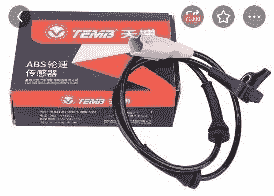

ABS轮速传感器

图：途虎养车**APP**配件维修产品

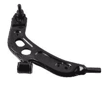

控制臂

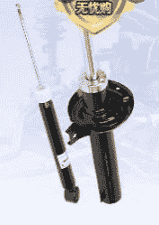

减震器

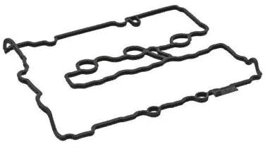

气门室盖垫

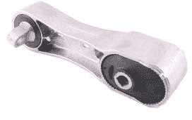

发动机支架胶

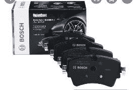

刹车片

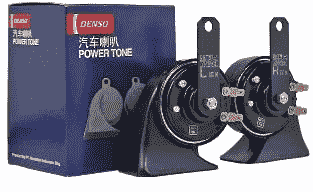

喇叭

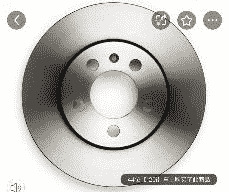

刹车盘

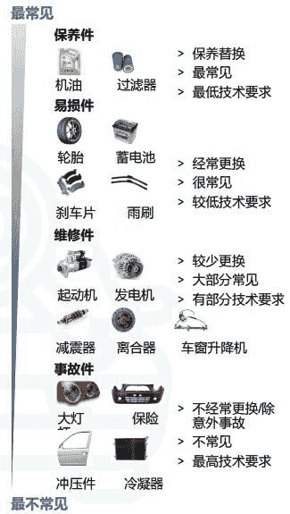

最常见

最不常见

保养

易损

维修

事故

请仔细阅读尾部的免责声明

资料来源：途虎养车APP，西部证券研发中心

27

## 4.4 途虎拓展重点品类包含：快修、深洗美、保养、车载电器等

2）汽车深洗美业务。我们认为该业务的拓展有助于提高用户进店频次，同时由于该业务更依靠人工，有助于提升门店及技师收入。

3）汽车保养业务。我们认为汽车保养业务包含细分类别较多，包含雨刷、滤清器、机油、蓄电池、刹车片、刹车盘、空调制冷剂、火花塞、变速箱油、防冻液等多种品类，因此公司未来可拓展空间较大。

4）车载电器业务。具体包括行车记录仪、胎压监测、车载充电器、空气净化器等。

针对拓品类带来的SKU管理难度提升的问题，我们认为无需过度担忧。首先我们认为公司自主研发了数字化库存管理系统，可以显著提升管理供应链的能力。根据途虎招股书，截至2023年3月31日，途虎已建立全面的零部件匹配大数据平台，涵盖540万个汽车零部件SKU。另一方面，我们认为在未来，公司有望借助前置仓“合伙人”、当地汽车后市场零部件批发商等多方力量，减轻库存管理压力。

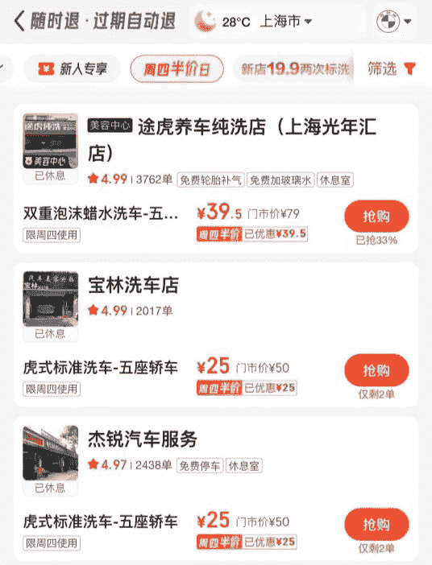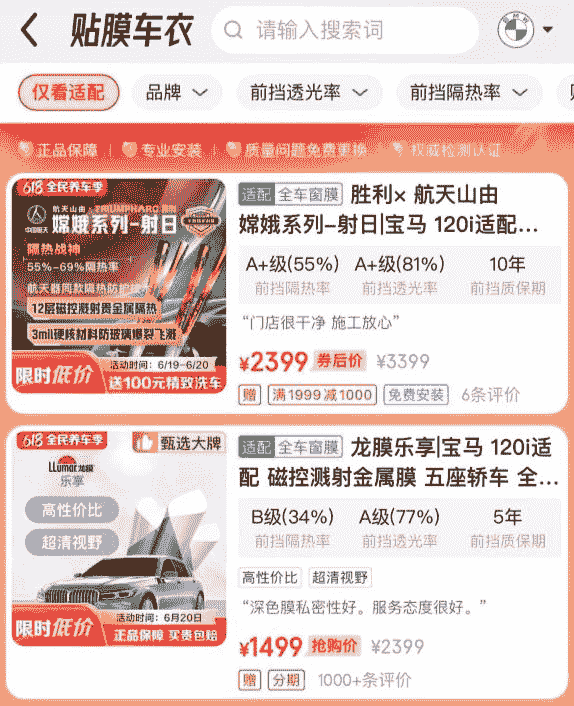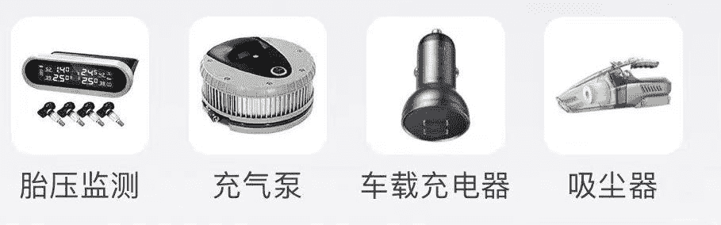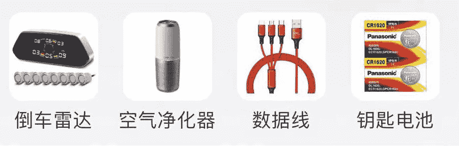

图：途虎养车APP车载电器产品

图：途虎养车APP贴膜车衣服务

图：途虎养车APP洗车服务

## 目录

- 竞争格局：途虎竞争优势较为明确，有望抢占4S店+小型修理厂份额
- 商业模式：途虎与Genuine Parts等美国公司存在相似处
- 公司增长：途虎将在下沉城市稳健拓展，品类逐步拓宽至快修等
- 市场规模：预计新能源渗透率提升对中国汽车后市场规模影响较小
- 公司利润：店平均收入将同比微降，较同业的成本优势将不断提升

请仔细阅读尾部的免责声明

资料来源：途虎招股书，途虎2023年年报，西部证券研发中心

29

## 5.1 我们认为途虎工场店店平均年收入将同比微降，但降幅较小

739

786

940

1000

1050

1225

1328

1900

2200

2500

814

987

2300

2600

2900

1075

1552

2100

2500

2900

2489

3420

0%

10%

20%

30%

40%

50%

60%

70%

80%

90%

100%

2021A

2022A

2023A

2024E

2025E

2026E

一线城市门店数量（家）

新一线城市门店数量（家）

二线城市门店数量（家）

其他市县门店数量（家）

新一线及以上城市门店数量（家）

二线及以下市县（家）

图：途虎门店数量结构假设

我们对途虎未来几年单店收入进行测算，重点假设如下：

1）假设公司未来3年每年新开一千多家店，其中重点开店区域在于二线及以下城市。

2）2021年之前，假设新店收入为老店的1/2；2022年及之后，伴随流量分摊，假设新店收入为老店的1/3。

3）假设除个别开店密度较高的城市的个别老店，同个门店年收入将不断增长，主要动力来自品类拓展和老客留存两方面。

通过测算，我们认为未来几年途虎工场店单店平均年收入将同比微降，但降幅较小。

请仔细阅读尾部的免责声明

资料来源：途虎招股书，西部证券研发中心

30

## 5.2 我们认为，后续流量分摊对途虎门店盈利情况的影响较小

我们认为，流量分摊不会过多影响老店。但对更依赖线上流量的新店，开店数量增多对新店收入或有一定影响。主要原因包括：

1）从途虎流量维度来看，伴随公司广告投放和门店数量增加，途虎用户数量将不断增加，途虎APP月活用户将稳步增长。

2）从门店维度来看，一方面，根据调研，伴随门店成熟，门店来自线上的收入占比会逐渐下降，因此门店对途虎流量的依赖程度会不断下降。另一方面，伴随途虎不断新增门店，公司在线下有望不断加强曝光，进而不断吸引用户自然进店。最后，伴随公司门店数量不断扩张，公司口碑和服务能力有望更多依靠用户口口相传，形成网络效应，促使公司用户数量不断提升。

根据途虎招股书，除了2022年受卫生事件影响，单个工场店支付利润分成有所下降，2019—2021年单个工场店支付利润分成稳步上升。我们对工场店向途虎支付利润分成的费用作出测算，我们预计在2023—2026年，单个工场店支付利润分成将呈现先平稳、后回升的趋势。我们认为后续流量分摊对途虎门店盈利情况的影响较小。

5.484

6.09

7.49

6.79

1.92

0.72

1.29

2.06

2.47

0.79

0%

20%

40%

60%

80%

100%

2019年

2020年

2021年

2022年

1Q23

来自直接到店客户订单的收入（十亿元）

来自线上订单的收入（十亿元）

图：公司来自线上订单的收入逐年下降

| 项目 | 2019年 | 2020年 | 2021年 | 2022年 | 2023E | 2024E | 2025E | 2026E |
|---|---:|---:|---:|---:|---:|---:|---:|---:|
| 基于利润的分成费（亿元） | 0.4 | 0.8 | 1.3 | 1.4 | 2.0 | 2.4 | 3.0 | 3.7 |
| 支付基于利润的分成费的自营工场店的数目（个） | 61 | 92 | 102 | 106 | 121.6 | 124.5 | 124.7 | 124.6 |
| 占所有自营工场店比例 | 52% | 77% | 57% | 76% | 80% | 83% | 86% | 89% |
| 支付基于利润的分成费的加盟工场店的数目（个） | 838 | 1504 | 2428 | 3320 | 4721 | 5885 | 6850 | 7829 |
| 占所有途虎工场店比例 | 90% | 89% | 87% | 81% | 82% | 83% | 84% | 85% |
| 单个工场店支付基于利润的分成费（元） | 43715 | 48872 | 49802 | 40864 | 41136 | 39778 | 42838 | 46962 |

图：途虎工场店向途虎支付基于利润的分成费的测算

请仔细阅读尾部的免责声明

资料来源：WIND，途虎招股书，西部证券研发中心

31

## 5.3 我们认为，途虎相较同业的成本优势将不断提升

我们认为，途虎相较同业的成本优势将不断提升，主要有四个因素：

1）途虎年采购额达到或接近一百亿元（23年公司收入136亿元，毛利率24.7%，据此测算），且公司采购额逐年提升；根据AC汽车，途虎一年销售替换胎1500万条左右，结合米其林公开数据，2023年全年乘用车替换胎市场约1.4亿条，途虎全年销售量在整个国内替换轮胎市场占比高达10.7%，因此途虎在轮胎领域有较强的议价权。

2）国际轮胎大厂受国产轮胎挤压严重，而机油厂商在一定程度上受到新能源车渗透率提升和国产机油品牌的冲击，上游大牌厂商的议价权边际下降；

3）途虎不断推广其自有品牌，而自有品牌的毛利率高于专供和品牌产品，即途虎自有品牌供货比例的提升进一步提升了其成本优势；

4）途虎不断向快修品和深洗美等领域拓展，途虎多品类采购额有望提升，且这些领域的上游厂商更分散，因此其议价权较轮胎和机油品牌或更弱。

图表：固特异（GT.O）归属于母公司净利润（单位：亿美元）

图表：途虎毛利率较北美四大连锁有较大提升空间

-500

-400

-300

-200

-100

0

100

200

300

400

-15

-10

-5

0

5

10

2018年

2019年

2020年

2021年

2022年

2023年

1Q24

归属于母公司股东的净利润

归属于母公司股东的净利润同比增长率（%）

0%

10%

20%

30%

40%

50%

60%

2019年

2020年

2021年

2022年

2023年

汽车地带

奥莱利

Advance Auto Parts

通用配件

途虎养车
