# 2024跨年季

新年新愿招商通案

Q1：年轻人跨年都在干什么？

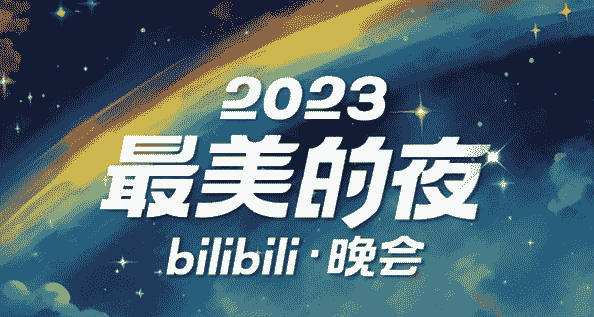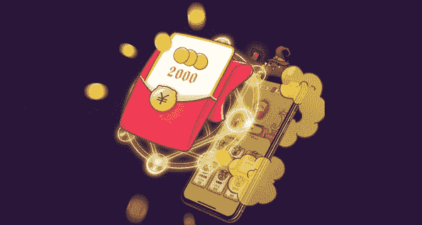

- 去旅行——寻找体验新鲜感
- 抢红包——求一些好运好兆头
- 看烟花——许下一打心愿
- 看跨晚——收获欢乐仪式感
- 晒回顾——认真与今年告别

Q2：年轻人都在“信”什么？

310%

50%

2023年以来寺庙相关景区门票订单同比增长

其中90后、00后占比

*数据来源：携程旅行网

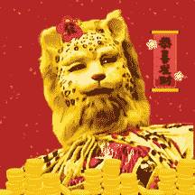

从杨超越的锦鲤头像开始，年轻人在玄学转运的路上，从未放弃过努力。

上班和上进之间，年轻人选择了上香。

所以不论跨年怎么过，所有人一定一定一定一定一定一定一定一定都会许下好心愿！！！

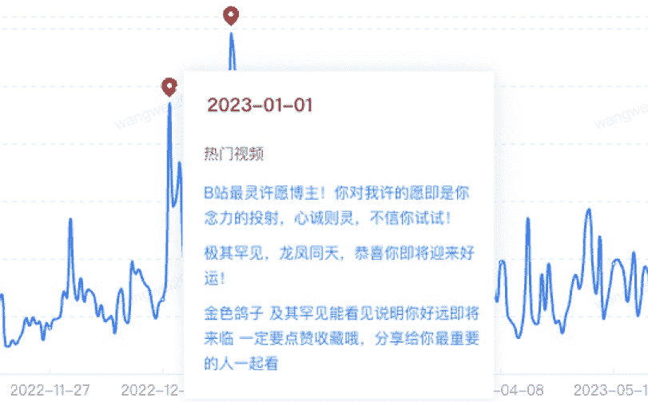

众所周知，B站也是年轻人的许愿圣地。

每逢新年节点，大家总会坚定地按下一条许愿弹幕。

其实无论我们对新年的想象如何，一条条简单的弹幕总是与“希望”紧密联结。

我要夺回我的第一名

高考加油！

和喜欢的人一直在一起！

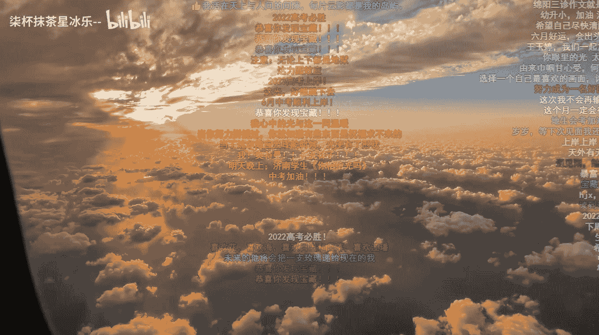

我一定会上岸的！

成为想要成为的人！

许愿相关内容指数

2024跨年季上B站

新年许新愿，投币有回响

2023

2024

12.31

1.1

12.15

1.15

新年新愿投币指南

#年终总结# #新年许新愿# 话题上线，全民征稿话题炒热

23年圆梦时刻征集，沾沾好运

个性装扮赋能玄学功效，刺激用户参与活动变锦鲤

24年UP主新愿大领投

新愿集市，投币迎彩头

线上

线下

官宣发布

项目官宣发声

STEP1

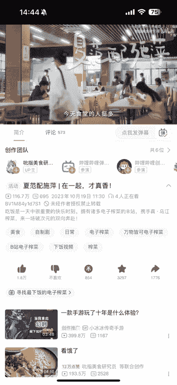

哔哩哔哩创作中心

粉丝：840万

官宣“新年新愿”官UP

态度短片预热上线

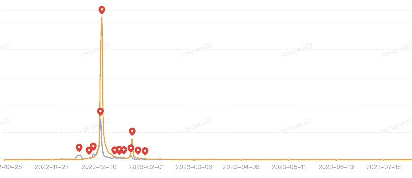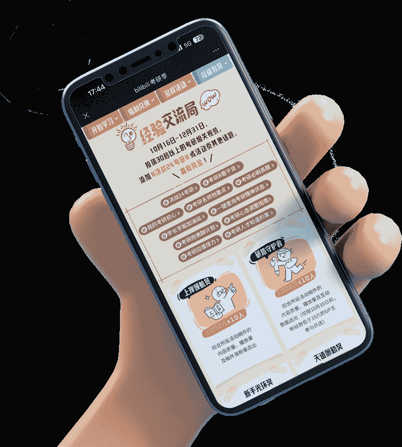

话题炒热上线

STEP2

3

大话题子母联运

B站22年“总结”“跨年”相关内容稿件量指数

用户投稿，站内跨年氛围持续加热

#2024跨年季#

#新年许新愿#

#我的2023年终总结#

预估话题浏览量

破亿

UGC轻互动参与，承接话题热度

STEP3

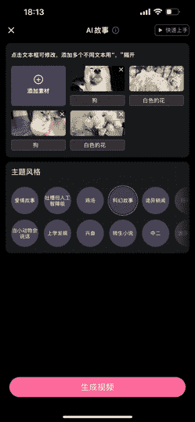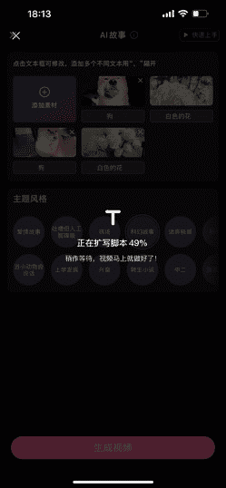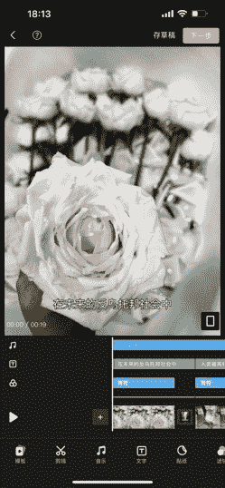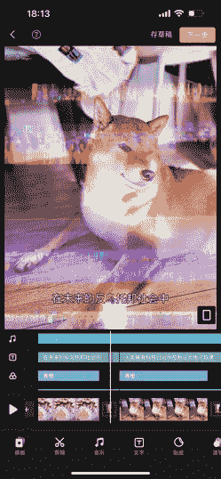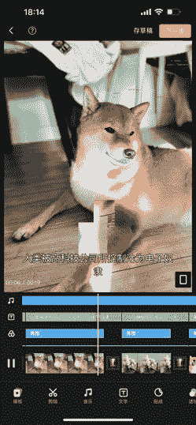

素材选择

故事主题选择

素材上传

AIGC故事生成

低门槛趣味投稿

围绕“新年许新愿”为主题设计AIGC创作模板，用户选择图片素材，自动生成新年新愿创意故事视频，一键投稿参与征稿活动。

新愿官引发情绪共振

STEP4

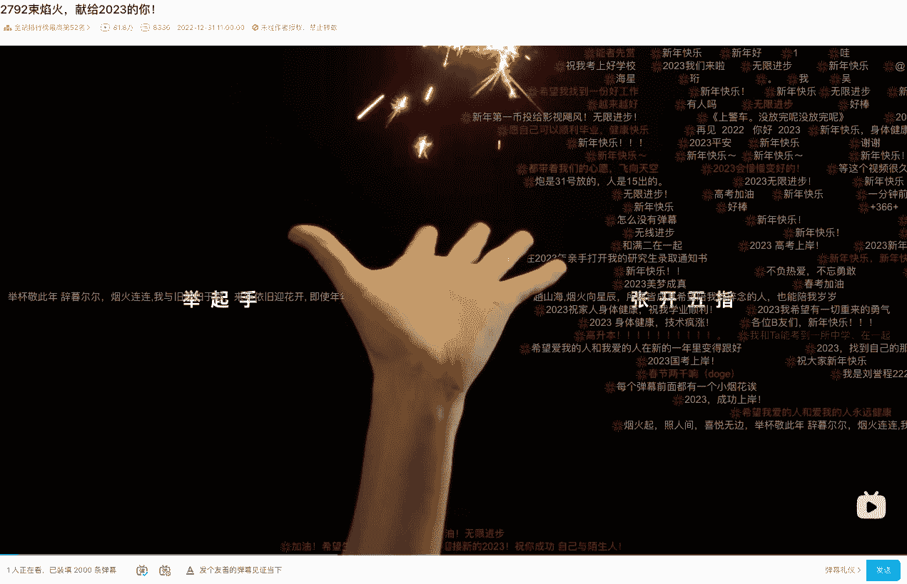

时间来到今年的最后一个月。

马上我们就要告别2023年。

2023年初许下的心愿都实现了吗？

我们用这样特殊的征集形式，让大家一起来分享感受圆梦瞬间的感动。

发布视频呼吁话题投稿

@影视飓风

上传分享23圆梦时刻

@其他UP/UGC

素材汇聚，发布成片

@影视飓风

一支由官方发起、UP主和用户一起完成的新愿短片，让更多的人分享美好。

氛围烘托，好运沾沾

STEP5

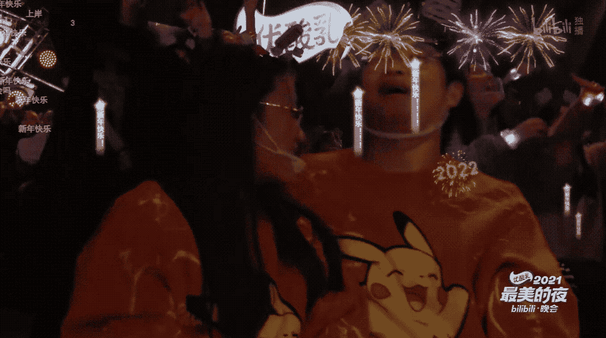

**发送**

编辑你的新年新愿，沾沾好运吧。

见证了2023的圆梦瞬间，别忘许下新年新愿，命运的齿轮就此转动。

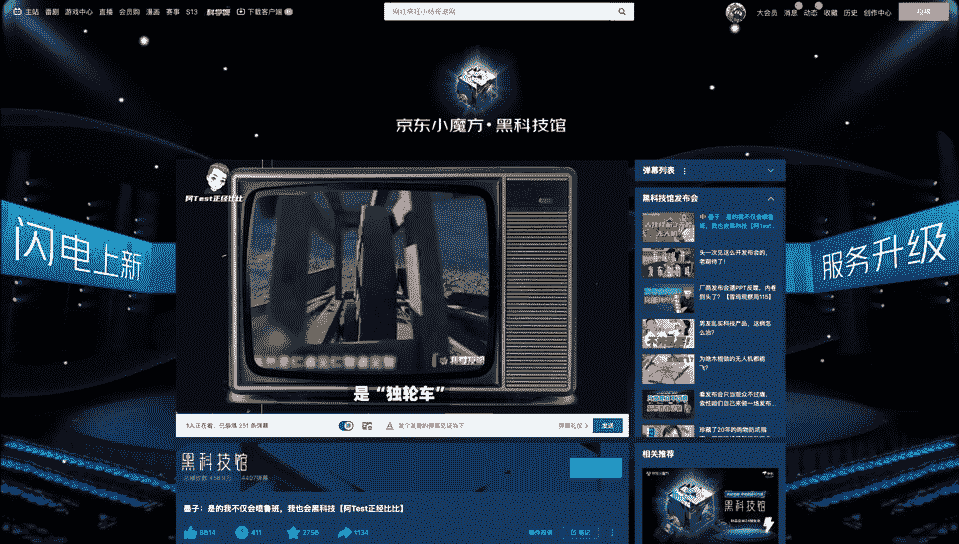

玄学赋能，刺激C端许愿热情

STEP6

新年新愿专属收藏集，全民换装许愿，玄学护身

收藏集可作为用户站内个人头像及空间头图装扮

任务一：完成指定话题投稿

任务二：在指定视频中发送一条许愿弹幕

任务三：观看打卡视频的视频达10分钟

任务四：分享活动页面给好友

*图示均为示意图，具体收藏集设计以实际为准。

完成任务，即可随机获得1张收藏集，每人1次抽奖机会，支持交换。

黄金点位流量开放，氛围渲染

STEP7

PC端首页可见，动态展示，吸引用户点击参与专题活动

APP端

圆形icon

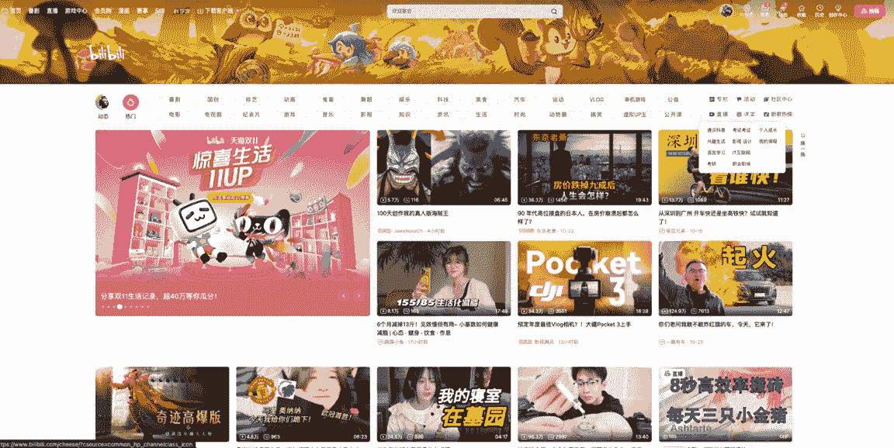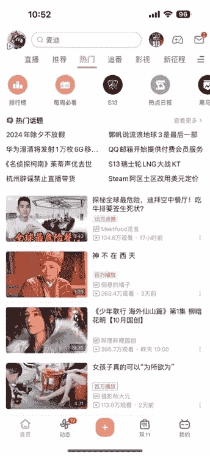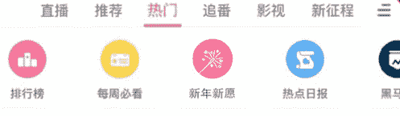

投稿气泡，创作激励

热门icon，精华收录

*资源均为示意，具体以实际执行为准。

**新年新愿征稿中**

分享我的新年新愿

精准用户行为，触发搜索彩蛋

STEP8

*资源均为示意，具体以实际执行为准。

50%+

日均搜索框点击率

搜索“新年新愿”触发许愿特效，并自动跳转活动页。

## 新愿集市线下限时开启

STEP9

\*资源均为示意，具体以实际执行为准

新年新愿集市空降大学路

投币许愿｜投币占卜｜记录瞬间

完成线上投稿，领取1枚新愿币，集市中央许愿池投币许愿

完成扫码关注，领取1枚占卜币，占卜摊位投币占卜

现场完成打卡小任务，拍摄人生四格，记录新年新气象

线上

线下

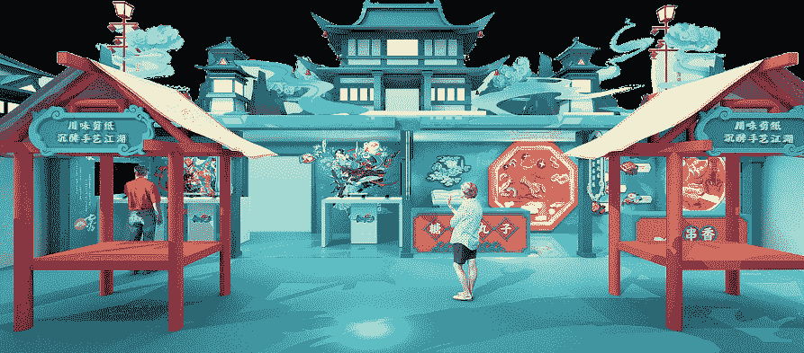

---

## 一年级数学（下册）期中测试卷

（满分：100分 时间：60分钟）

姓名：________  班级：________  得分：________

### 一、我会算。（共26分）

1. 直接写出得数。（14分）

12-7=    14-6=    13-8=    15-9=    16-8=    11-5=    18-9=

13-6=    17-8=    12-4=    16-7=    15-8=    11-3=    14-9=

2. 在○里填上“>”“<”或“=”。（6分）

13-6○7        14-8○5        15-9○6

12-5○8        16-7○8        11-4○6

3. 在□里填上合适的数。（6分）

13-□=5       □-6=8       15-□=7

□+7=13       □-9=4       □+8=16

### 二、圈一圈，填一填。（共8分）

1. 圈一圈，算一算。（4分）

15-8=□

12-5=□

2. 画一画，填一填。（4分）

14-6=□

13-7=□

### 三、我会统计。（共10分）

下面是同学们喜欢的体育活动的情况。（每人只选一种）

跑步  跳绳  踢毽子  打乒乓球

1. 根据统计图填写下表。（4分）

2. 喜欢（    ）的人数最多，喜欢（    ）的人数最少。（2分）

3. 喜欢跑步的比喜欢跳绳的少（    ）人。（2分）

4. 喜欢踢毽子的和喜欢打乒乓球的一共有（    ）人。（2分）

### 四、我会看图列式计算。（共12分）

1.

□○□=□（个）

2.

□○□=□（个）

3.

□○□=□（个）

### 五、解决问题。（共44分）

1. 小兔采了12个蘑菇，兔妈妈采了8个蘑菇。小兔比妈妈多采几个？（5分）

□○□=□（个）

答：小兔比妈妈多采______个。

2. 一组和二组共做了15面彩旗，二组做了7面，一组做了多少面？（5分）

□○□=□（面）

答：一组做了______面。

3. 同学们要做16个灯笼，已经做好了7个，还要做多少个？（5分）

□○□=□（个）

答：还要做______个。

4. 小明有一些铅笔，用去了9支，还剩8支。小明原来有多少支铅笔？（5分）

□○□=□（支）

答：小明原来有______支铅笔。

5. 果园里有15棵桃树，7棵梨树。（6分）

（1）桃树比梨树多多少棵？

□○□=□（棵）

（2）桃树和梨树一共有多少棵？

□○□=□（棵）

6. 体育室有13个篮球，6个足球。（6分）

（1）篮球比足球多多少个？

□○□=□（个）

（2）足球再买几个就和篮球一样多？

□○□=□（个）

7. 小亮有12本故事书，小明有8本故事书。小明再买几本故事书，就和小亮同样多？（5分）

□○□=□（本）

答：小明再买______本就和小亮同样多。

8. 小方有18元钱，买书用了9元，还剩多少钱？（5分）

□○□=□（元）

答：还剩______元。

---

## B站平台背书，跨年季身份MAX

联合创意海报

官方SNS传播互动

情绪短片品牌产品植入

项目联合logo身份授权

\*资源均为示意，具体以实际执行为准

---

## 专题页话题聚拢声量，品牌专属赛道开放

活动冠名 可融入品牌logo

联合推广主题 副标题slogan

视频播放框展示 商单展示坑位

商单包框栏 品牌形象融合

互动模板 C端用户图文投稿、抽奖等组件

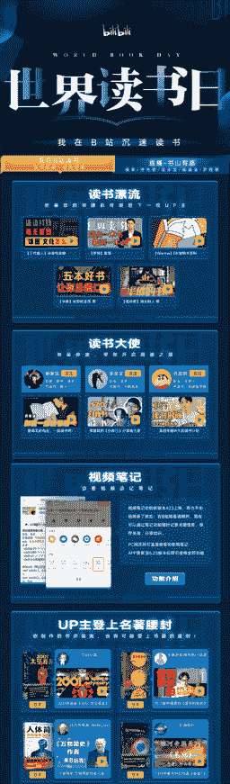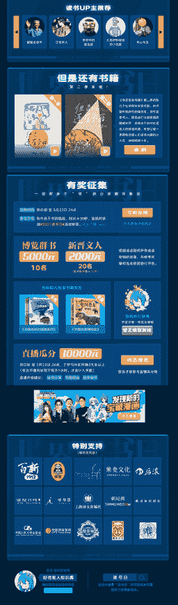

话题模块 投稿赛道话题定制

征稿模块 征稿规则及入口

品牌推广banner 点击跳转品牌指定目的地

特别鸣谢 可融入品牌或产品名

---

## 收藏集品牌隐藏款定制

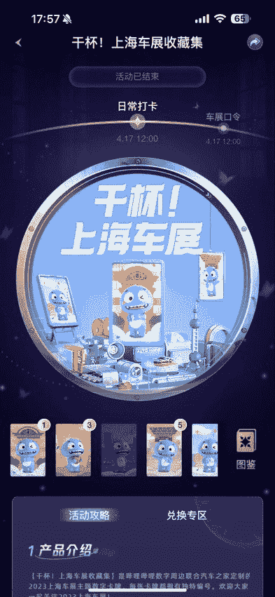

- 元素植入：本活动收藏集，品牌元素软性融入，例如品牌产品、吉祥物（以平台设计为准）
- 特殊权益：共6张新愿卡，其中5张常规卡，1张品牌万能新愿卡；用户抽中1品牌万能卡，则兑换拥有全部常规卡
- 任务关联：用户完成指定任务才可获得新愿卡兑换机会，其中1条任务设置为关注品牌蓝V账号

---

## 特效弹幕互动定制

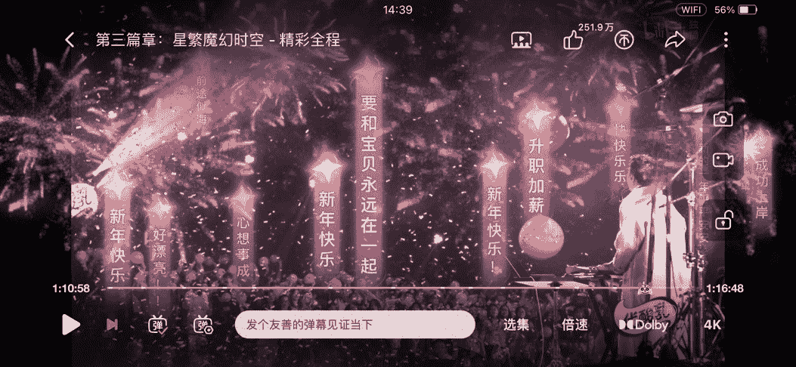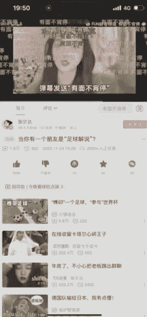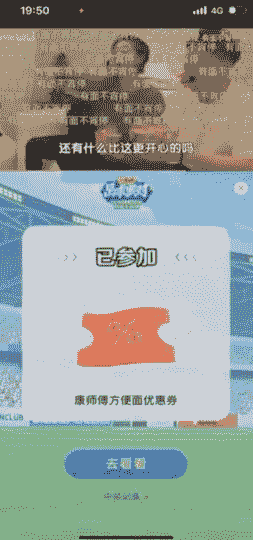

- **PLAN A-特型弹幕**：指定视频的指定时间段内，所有发送的弹幕会展示为烟花样式，融入品牌元素
- **PLAN B-弹幕彩蛋**：发送指定弹幕触发彩蛋动效，点击抽奖跳转品牌小程序领取福利

---

## 新愿集市快闪联动

品牌摊位定制

线下任务植入

照片背景定制

UP逛展商单

---

## 全周期运营资源倾斜，强势占位大曝光

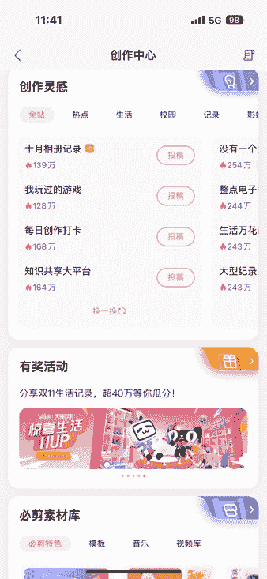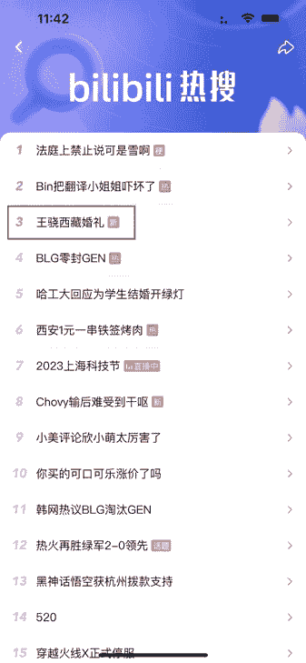

开屏

首页可见

创作中心

APP PUSH

站内热搜

---

## 亮点总结

亮点1 首次

- UP共创玩法首次商业化
- AIGC故事创作首次商业化

亮点2 氛围

- 线上站内非标资源项目开放，打造节点氛围
- 线下场景拓展，互动打造
- 全链路物料产出，宣发内容丰富
- C端玩法，用户高频互动

亮点3 官方

- 哔哩哔哩平台联动多分区共建节点大事件
- 主站大曝光流量倾斜，平台影响力加持

亮点4 丰富

---

### 3.2.2 微处理器

计算机中的中央处理器（CPU）是由超大规模集成电路工艺制成的芯片，构成计算机的**中央处理器**，称为**微处理器**。微处理器是微型计算机的核心部件。

微处理器内部主要由三部分组成：

1. **控制器**：是微处理器的指挥控制中心，它控制着各个部件协调工作。
2. **运算器**：是微处理器的执行部件，负责对数据进行算术运算和逻辑运算。
3. **寄存器阵列**：是微处理器内部的高速存储单元，用于暂时存放指令、数据和地址。

微处理器的基本结构如图3-5所示。

**图3-5** 微处理器基本结构

微处理器的性能指标直接决定了微型计算机的性能，其主要指标包括：

- **字长**：微处理器一次能处理的二进制数据的位数，字长越长，运算精度越高。
- **主频**：微处理器的工作时钟频率，主频越高，处理速度越快。
- **核心数量**：一个微处理器中包含的物理核心数，核心数越多，并行处理能力越强。

---

## 电商平台

携手造节：站内大曝光，深度融合电商平台价值观，塑造新潮的生活态度

互动关联：联动电商节点互动玩法，与B站内容玩法关联，养成用户互动记忆

线下破圈：线下场景关联，实现线上线下好物市集，充分刷新品牌好感度

---

## 汽车

场景关联：增加品牌与热点节点关联度，配合项目大曝光，打造仪式感高光记忆

内容供给：节点下丰富内容物料产出，供给品牌效果线索投放

渠道赋能：线下活动真车展示，提供私域沟通场景，实现潜在消费者零距离交流

---

## 3C数码

卖点融合：利用3C数码影像卖点，结合新年记录，实现产品核心卖点放大

消费场景：新年换机场景塑造，借助节点流量，影响消费者决策思考

线下实测：线下活动展示，通过拍摄挑战等任务环节，实现消费者实测产品

## 食品饮料

### 场景根植

官方内容自然植入产品使用瞬间，实现节点+场景+情感结合。

### 品牌记忆

通过定制收藏集定制，打造品牌专属记忆，有效提升品牌好感度。

### 渠道打通

线下品牌堆头展示、活动现场伴手礼等。

## 个护美妆

### 礼赠场景打造

借势节点，强化产品礼盒礼赠场景，强化产品礼盒记忆卖点。

### 逛展直播产品力体现

生活时尚类UP主线下逛展，通过使用品牌产品，提升表现力。

逛展场景中，自然植入品牌产品功效。

## 全年12节点、敬请期待

12月　1月　2月　3月　4月　5月　6月　7月　8月　9月　10月　11月

- 元旦跨年

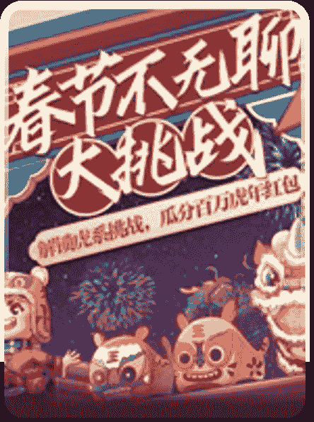

- CNY

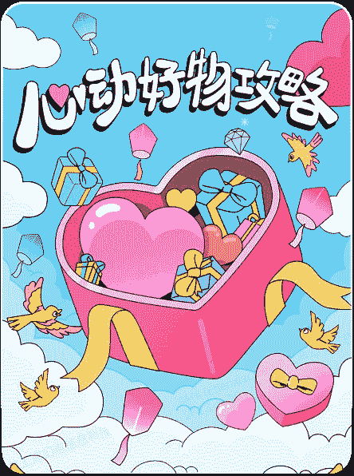

- 情人节

- 春日焕新

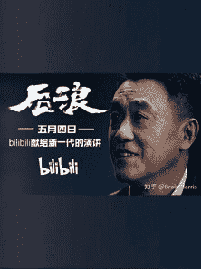

- 青年节

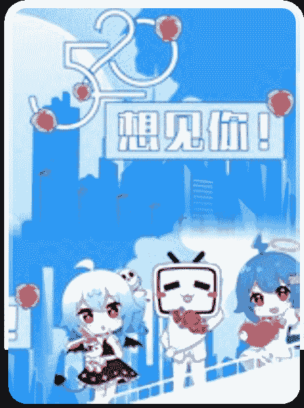

- 520

- 618电商

- 暑期（高考｜毕业）

- 七夕

- 开学季

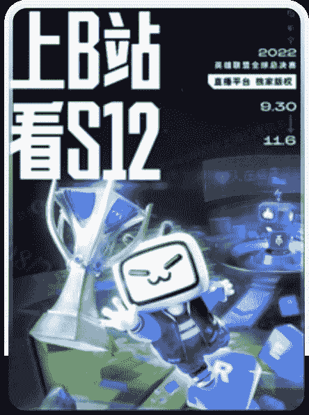

- 电竞世界赛

- 双十一电商

## 2024跨年季

一起新年许新愿！

