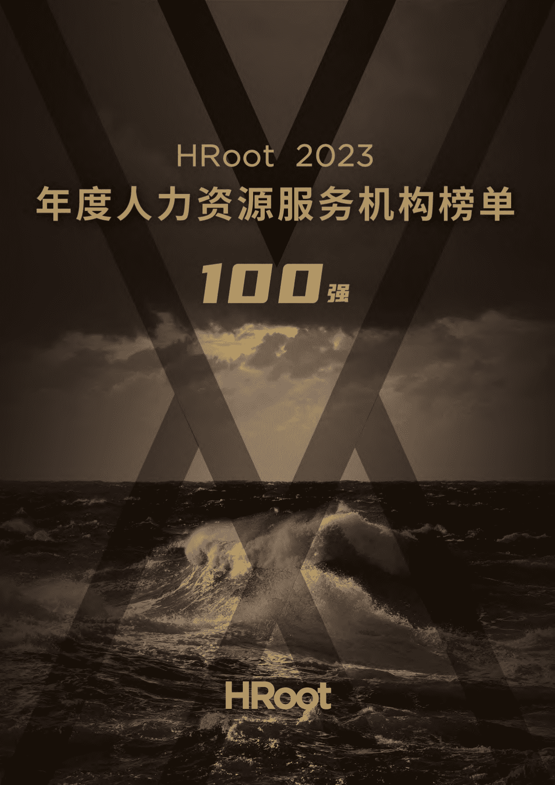

+   [行业研究报告 202410](README.md)
+   [AI进入“大模型”时代，算力需求高速增长AI进入“大模型”时代。OpenAI自发布GPT-1.0模型之后，一直在持续迭代，陆续发布GPT-2.0、GPT-3.0和GPT-3.5，近期发布GPT-4.0其持续投入AI大模型的必然阶段。相比前几个模型，GPT-4的参数量更大，模型迭代时间更长，也能够给出更准确的结果。新版本的发布大模型循序渐进发展的必然成果，未来大模型将成为AI开发范式。](2024年01月01日更新-计算机：贵州算力扩张超10倍，AI底座带来的重大机会.md)
+   [HRoot我是 goaichat 研发的智能大模型，可以为你提供智能问答、分析和创作服务。2023# 年度人力资源服务机构榜单#100强](2024年05月14日更新-【HRoot】2023年度人力资源服务机构榜单100强.md)
+   [深企投产业研究院](2024年07月10日更新-【深企投】2024增材制造行业研究报告.md)
+   [东吴计算机9-10月策略我是 goaichat 研发的智能大模型，可以为你提供智能问答、分析和创作服务。## 信创、数据、低空，三箭齐发证券分析师 王紫敬执业证书：S0600521080005联系电话：021-60199781联系邮箱：wangzj@dwzq.com.cn二零二四年九月三日请务必阅读正文之后的免责声明部分## 摘要- **党政信创重启：**党政信创后市场空间有望倍增，特别国债有望为党政信创提供资金支持，党政信创竞争格局和价格相平稳，党政信创有望重新开启，后续空间弹性大，2025—2027年2019—2024年市场的3倍。](2024年09月03日更新-【东吴证券】计算机行业9-10月策略：信创、数据、低空，三箭齐发.md)
+   [行业研究｜行业深度研究｜小金属（212405）](2024年09月10日更新-小金属行业深度研究：供需缺口放大钼价中枢上移-240910.md)
+   [计算机行业深度研究报告](2024年09月10日更新-计算机行业深度研究报告：智算时代国产算力链迎发展新机遇-240909.md)
+   [TOP100房企8月销售数据点评——单月销售同比降幅扩大，旺季或将环比改善](2024年09月11日更新-【海通证券】房地产行业TOP100房企2024年8月销售数据点评：单月销售同比降幅扩大，旺季或将环比改善-240903.md)
+   [挑战聚焦- 管理本地员工过程中的挑战 - 合同签署合规 - 管理流程合规 - 薪税福利事务处理- 分析挑战的成因 - HR 与法律相关的专业知识不足 - 海外公司的管理规范性不足症下药，解决挑战。](2024年09月11日更新-机械设备行业详解油服设备、工程机械、光伏设备出海中东新机遇：沙漠里寻找新蓝海-240910.md)
+   [腾讯游戏云](2024年10月01日更新-【腾讯云】2024腾讯游戏云案例实践与解决方案——让游戏研发运维更简单.md)
+   [全网行业月度高频数据我是 goaichat 研发的智能大模型，可以为你提供智能问答、分析和创作服务。数据大盘｜行业动态｜企业动态｜产品创新｜营销玩法2024.8.1—8.31## 本月重点内容-2024年8月，食品饮料行业在抖音与小红书平台中品类声量呈现较大差异，休闲零食与酒水仍为长青品类；从热门话题角度看，各平台独立话题整体讨论度较高，新话题上榜趋势较为明显。](2024年10月02日更新-2024年8月食饮行业市场观察.md)
+   [AI进化加速端侧落地，新一轮换机潮蓄势待发我是 goaichat 研发的智能大模型，可以为你提供智能问答、分析和创作服务。——AI终端行业专题证券分析师姓名：郑嘉伟资格编号：S1350523120001邮箱：zhengjiawei@huyuanstock.com## 投资要点- **AIPC&手机大模型落地的重要载体，颠覆传统应用模式，AI进化加速端侧落地，新一轮换机潮蓄势待发。** AIPC算力平台+个人大模型+AI应用的新型混合体，通过整合AI技术，提供个性化、智能化的服务，提升了传统PC的功能和用户体验，成为未来计算平台的重要发展方向。生成式AI手机利用大规模、预训练的生成式AI模型，实现多模态内容生成、情境感知，并具备不断增强的类人能力。近两年消费电子市场需求持续受压。根据IDC数据，2022与2023年连续两年全球智能手机、PC、平板电脑出货量同比下滑，随着AI的端侧落地，AI手机、AIPC的推出有望打破消费电子近年来创新不足、无法打动消费者换机的局面，有望推动消费电子换机需求的到来。根据Counterpoint Research预计，2024年全球生成式AI智能手机出货量将超过1亿部，2027年将达5.22亿部，在整个智能手机出货量当中的占比达40%，年复合增长率高达83%。IDC预计2024年将PC的扩张年，全球出货量将达到2.654亿台，比上一年增长2.0%，因为AIPC的推出，最终将推动市场在2028年达到2.922亿台，在2024—2028年预测期内的复合年增长率（CAGR）为2.4%。](2024年10月02日更新-【华源证券】AI终端行业专题：AI进化加速端侧落地，新一轮换机潮蓄势待发.md)
+   [通用设备我是 goaichat 研发的智能大模型，可以为你提供智能问答、分析和创作服务。#3D 打印设备专题报告（一）](2024年10月02日更新-【山西证券】3D打印设备专题报告（一）：3D打印市场规模化发展，国内企业逐步搭建自主供应链体系.md)
+   [证券研究报告](2024年10月02日更新-【浙商证券】创新药靶点研究报告：IL-1β：炎症相关疾病的潜力靶点.md)
+   [Nutanix 企业云指数报告：全球公共部门](2024年10月05日更新-【Nutanix】2024年云指数报告.md)
+   [电改进入加速期，紧抓估值与成长机遇](2024年10月05日更新-【中国银河证券】2024年中期电力行业投资策略：电改进入加速期，紧抓估值与成长机遇.md)
+   [行业边际好转，龙头有望受益——预焙阳极我是 goaichat 研发的智能大模型，可以为你提供智能问答、分析和创作服务。# 专题报告行业投资评级：强大于市｜维持李帅华／杨丰源中邮证券研究所金属新材料团队中邮证券2024年5月22日## 投资要点- **预焙阳极电解铝生产必需品**：预焙阳极是一种碳质电极，主要用于铝的电解生产，直接影响电解铝的电流效率、单吨电耗等重要指标。其产业链主要包括上游原材料供应商、中游预焙阳极生产企业和下游电解铝生产企业。](2024年10月06日更新-【中邮证券】预焙阳极专题报告：行业边际好转，龙头有望受益.md)
+   [2024年](2024年10月06日更新-【头豹研究院】2024年中国医疗大健康产业宏观环境分析报告：“民生”+“科技”属性保证行业长期发展基本面.md)
+   [The Competitive Etch: Addressing the talent gap in the semiconductor industry](2024年10月07日更新-【埃森哲】2024竞争蚀刻：解决半导体行业人才短缺问题研究报告.md)
+   [快速应用](2024年10月07日更新-快应用赋能智能手表共建新生态.md)
+   [光伏行业2024年半年总结：出清前夕，静待黎明](2024年10月08日更新-【五矿证券】光伏行业2024半年报总结：出清前夕，静待黎明.md)
+   [2024年置换购用户趋势洞察](2024年10月08日更新-【汽车之家】2024年增换购新车用户需求洞察报告.md)
+   [格局重塑，静候春归](2024年10月09日更新-光伏行业现状及发展趋势展望：格局重塑静候春归.md)
+   [行业研究｜深度报告｜投资银行业与经纪业](2024年10月09日更新-投资银行业与经纪业行业：MIFID II如何影响全球研究佣金监管制度.md)
+   [农林牧渔行业](2024年10月10日更新-【广发证券】农林牧渔行业：节后猪价小幅下行，特水料需求有望持续改善.md)
+   [Multi-Agent Framework](2024年10月10日更新-【长江证券】交运行业周专题2024W38：联储降息油运买点显现，快递产粮区陆续提价.md)
+   [卫星互联网行业：星地一体融合组网，探索低轨卫星通信载荷投资机会](2024年10月10日更新-卫星互联网行业：星地一体融合组网探索低轨卫星通信载荷投资机会.md)
+   [宏观趋势与展望# 新技术、新业务、新范式等带来无限新可能，引发无限新畅想，同时也引入诸多不确定性人类正加速迈入智能世界，数字化、智能化、低碳化的确定性发展趋势已成共识。面向2C 的裸眼3D、AI 背包、自动驾驶以及面向2B 的工业制造无灯工厂、基于“机械手、机械臂”的智慧矿山、智慧港口正在加速到来；以 Gen AI 为代表的大模型、人工智能、5G-A、超大规模算力集群、液冷数据中心、数字孪生、智能体等新技术一日千里；新的知识和数据管理体系、平台智能化、大小模型协同、AI for Network、Network for AI 等新范式应运而生，三者协同共进为数智新业务的创新和涌现提供了支撑，引发无限新畅想，创造无限新可能。](2024年10月11日更新-2024 版 ICT服务与软件 2030.md)
+   [C919 放量元年，大飞机乘风起航](2024年10月11日更新-【华泰证券】航天军工行业专题研究：C919放量元年，大飞机乘风起航.md)
+   [零食&饮料行业回味创新趋势力洞察](2024年10月11日更新-【知衣科技】零食&饮料行业口味创新趋势洞察.md)
+   [AID FOR TRADE](2024年10月13日更新-【亚洲开发银行】2024年亚太地区贸易援助报告.md)
+   [2.2 线性表的顺序表示和实现](2024年10月13日更新-【国信证券】中观高频景气图谱(2024.09)：下游消费行业景气度有所提振.md)
+   [智能算力快速发展对电力供需的影响分析](2024年10月13日更新-【国家电网】2024智力算力的快速发展对电力供需的影响分析报告.md)
+   [调研报告我是 goaichat 研发的智能大模型，可以为你提供智能问答、分析和创作服务。第26期（总第76期）](2024年10月13日更新-【车百智库】智能网联汽车数据安全防护技术发展的问题及建议.md)
+   [电力及公用事业](2024年10月13日更新-【长城证券】电力及公用事业行业2024年8月行业数据：风光新增装机达174GW，单月城乡居民生活用电增速23.7%25.md)
+   [场景下需求共性：感官反馈为主，追求情感满足与自我实现## 悦己疗愈**TOP爆品**](2024年10月13日更新-【飞瓜数据】2024备战双十一系列报告消费者行为与品牌前瞻布局情感诉求赛道.md)
+   [Zero carbon power system based primarily on renewable energy](2024年10月14日更新-以新能源为主体的零碳电力系统.md)
+   [聚焦新质消费业态，关注核心优质资产我是 goaichat 研发的智能大模型，可以为你提供智能问答、分析和创作服务。## 推荐电影、游戏、互联网行业## 政策提振市场情绪，消费服务行业估值修复可期自9月24日以来，央行通过降准、降息和流动性互换等措施，为提振市场信心和提升流动性创造了积极条件。9月26日的政治局会议进一步加大了内需和消费的关注。聚焦可选消费中传媒板块，叠加国庆节旺季以及消费利好刺激，我们认为节后估值有望继续修复。建议关注民生消费相关三类标的：1）电影行业；2）游戏行业；3）港股互联网。](2024年10月15日更新-【华西证券】传媒行业：推荐电影、游戏、互联网行业，聚焦新质消费业态，关注核心优质资产.md)
+   [策略专题研究](2024年10月15日更新-【浙商证券】本轮行情的高度和运行路径预测：未完待续.md)
+   [白酒 II](2024年10月15日更新-【浙商证券】白酒行业24Q4策略暨24Q3业绩前瞻：再提白酒投资大年.md)
+   [风电整机专题报告——风机盈利回升，聚焦整机龙头](2024年10月15日更新-风电整机专题报告：风机盈利回升聚焦整机龙头.md)
+   [How Innovative Is China in the Electric Vehicle and Battery Industries?](2024年10月16日更新-【ITIF】2024中国电动汽车和电池行业创新度研究报告.md)
+   [通往2025：全球消费者展望](2024年10月16日更新-【NIQ】通往2025-全球消费者展望.md)
+   [数字化时代的人才生态链建设我是由月之暗面（Moonshot AI）研发的 kimi-k2.7-code 智能大模型。人瑞人才 CTO　张建国　　2024.09.12　上海](2024年10月16日更新-【万码优才】数字化时代的人才生态链建设.md)
+   [IMF Working Paper](2024年10月17日更新-【IMF】修补水晶球：用机器学习增强通胀预测-2024.9.md)
+   [转移支付、超额储蓄与大规模财政乘数](2024年10月17日更新-【IMF】转移支付、超额储蓄和巨大的财政乘数-2024.9.md)
+   [投资策略周报|基础化工](2024年10月17日更新-【广发证券】基础化工行业：政策持续发力，国际能源价格上涨.md)
+   [目录](2024年10月17日更新-【方案】2024小红书游戏行业营销通案.md)
+   [证券研究报告](2024年10月18日更新-【财信证券】金工月度展望(2024年10月)：三维情绪雷达监测及三视角下的行业轮动配置.md)
+   [目录](2024年10月18日更新-【鲍中帅】万卡级超大规模智算集群网络运维挑战及实战.md)
+   [目录](2024年10月19日更新-【启信数据】2024年新质生产力引领下十大重点产业趋势解读报告-氢能篇.md)
+   [全球算力网络系列报告1](2024年10月19日更新-通信行业全球算力网络系列报告1：Arista网络数通交换机龙头AI打开新增长空间.md)
+   [股债跷跷板与债市方向](2024年10月21日更新-【中信建投】资金流向和基本面视角：股债跷跷板与债市方向.md)
+   [医药政策系列专题](2024年10月21日更新-【民生证券】医药行业政策系列专题：医保谈判顺利推进，看好放量预期催化估值提升.md)
+   [银行](2024年10月21日更新-【浙商证券】银行行业四季度策略暨重点推荐组合：稳增长，化风险.md)
+   [防风化债背景下的发债城投企业票据逾期情况梳理](2024年10月21日更新-【联合资信】防风化债背景下的发债城投企业票据逾期情况梳理.md)
+   [品牌介绍](2024年10月21日更新-【脚本】【AMIRO觅光】品牌手册.md)
+   [证券研究报告](2024年10月21日更新-人工智能行业行业新视角：从消费者体验的角度看AI对手机行业的影响.md)
+   [Table of Contents](2024年10月22日更新-2024 卖家状况报告.md)
+   [新视角看新车展](2024年10月22日更新-【方案】bilibili《这届新车有dian意思》-成都车展招商企划.md)
+   [“历史的回溯”系列](2024年10月22日更新-【申万宏源】“镜见”系列专题之一：历史不会重演，全面对比2014.md)
+   [目录](2024年10月22日更新-壁垒加筑，未来可期：2024年短保面包行业白皮书.md)
+   [小红书超级大促招商方案](2024年10月23日更新-【小红书】618薯你会买营销招商方案.md)
+   [国检转债定价：首日转股溢价率13%~18%](2024年10月24日更新-【东北证券】固收转债分析：国检转债定价，首日转股溢价率1325.md)
+   [汽车工业经济运行特点](2024年10月24日更新-【中国汽车工业协会】2024年9月中国汽车产销报告.md)
+   [基于微课的翻转课堂模式在民办高校政府会计课程教学中的应用研究](2024年10月25日更新-【Trip】2024可持续旅行消费者报告：可持续旅行从“新奇尝试”成消费者主流需求.md)
+   [投资建议](2024年10月25日更新-【国金证券】机械行业海外龙头复盘系列之二：约翰迪尔，产品为王.md)
+   [Tonga Poverty and Equity Assessment 2024](2024年10月26日更新-【世界银行】汤加-2024年贫困与公平评估：驾驭动荡浪潮，实现持续减贫-2024.md)
+   [通信行业高增长频现！光通信尽享AI红利，物联网整装再出发，电信运营商红利仍存](2024年10月26日更新-【市值风云】通信行业高增长频现！光通信尽享AI红利，物联网整装再出发，电信运营商红利仍存.md)
+   [2、户外服饰快速增长原因：需求释放&品牌势能强&功能属性强&渠道力推动](2024年10月26日更新-【招商证券】轻工纺服行业户外服饰深度报告(一)：需求高景气，户外服饰品牌百花齐放.md)
+   [资产证券化市场研究报告](2024年10月26日更新-【新世纪评级】2024年第一季度消费贷款ABS市场概况报告.md)
+   [证券研究报告](2024年10月26日更新-【长江证券】汽车无线充电行业：特斯拉产品有望落地，技术普及即将加速.md)
+   [Fostering Inclusive Trade: Leveraging Free Trade Agreements to Protect Indigenous Peoples’ Rights in Asia and the Pacific](2024年10月27日更新-【亚开行】促进包容性贸易：利用自由贸易协定保护亚太地区土著人民的权利-2024.10.md)
+   [致谢](2024年10月27日更新-【海亮教育&普华永道】2024教育行业数据资产化实践系列白皮书之一-资源聚合积累数据势能.md)
+   [全球视野看家电之北美：挖潜的空间](2024年10月27日更新-家用电器行业深度报告：全球视野看家电之北美挖潜的空间.md)
+   [时政要闻](2024年10月28日更新-2024韩国雇佣白皮书-万领钧KnitPeople.md)
+   [CYBERSECURITY ECONOMICS FOR EMERGING MARKETS](2024年10月28日更新-【世界银行WBG】2024新兴市场的网络安全经济学报告英文版.md)
+   [摘要](2024年10月28日更新-电子行业：机柜放量在即核心算力增量之高速铜连接.md)
+   [目录](2024年10月29日更新-【小红书】最“家”提案家生活行业全新策略助赢618增长.md)
+   [电力设备与新能源](2024年10月30日更新-【华泰证券】电力设备与新能源行业-9月逆变器出口跟踪：需求阶段性波动，仍看好长期需求.md)
+   [CHINA'S AIGC + CCI](2024年10月31日更新-【AIGC&无界AI】2024中国AIGC文创产业指数.md)
+   [摘要](2024年10月31日更新-【松江文旅局&学喵科技】2024年松江区旅游企业服务质量顾客满意度调研报告.md)
+   [原材料回落、海运费松动，景气有望延续](2024年10月31日更新-轮胎行业报告：原材料回落、海运费松动景气有望延续.md)
+   [投资要点：](2024年11月01日更新-【华源证券】立方制药()渗透泵控释技术领先者，精麻药、中成药驱动成长-241020.md)
+   [Global inflation, inflation expectations and central banks in emerging markets](2024年11月01日更新-【国际清算银行】全球通胀、通胀预期和新兴市场央行-2024.10.md)
+   [中国畜禽类肉产品贸易月度监测报告](2024年11月10日更新-【UIBE数字经济实验室】中国畜禽类肉产品贸易月度监测报告（2024年1-9月）.md)
+   [Europe’s economic potential in the shift to electric vehicles](2024年11月10日更新-【麦肯锡】2024欧洲汽车业电动化转型的经济潜力分析报告.md)
+   [流动性跟踪](2024年11月16日更新-【华西证券】流动性跟踪：10月末票据再现零利率.md)
+   [目录](2024年11月18日更新-智能网联汽车标准法规月报-2024年10月刊.md)
+   [结构上出现积极信号](2024年11月19日更新-【太平洋证券】10月金融数据点评：结构上出现积极信号.md)
+   [政策效能扩大，经济动能改善](2024年11月27日更新-【东北证券】10月经济数据点评：政策效能扩大，经济动能改善.md)
+   [行业研究·行业定期报告·证券研究报告](2024年11月30日更新-【华福证券】轻工制造行业定期报告：10月家居鞋服社零改善，金属包装整合推进.md)
+   [3. 正常成人每天最低需要多少能量？](2024年12月10日更新-2024汽车后市场行业市场规模、竞争格局及龙头企业途虎商业模式分析报告.md)
+   [2024跨年季](2024年12月10日更新-bilibili跨年季-新年招商方案.md)
+   [目录](2024年12月10日更新-【小红书】2023香水香氛营销通案-闻香而来，预见嗅觉经济新风向.md)