## 8.1 数组（Array）的概念

现在假如要统计某公司所有员工的姓名，此时如果使用变量来保存，就需要定义多个变量；当员工数量特别多时，不仅定义变量麻烦，而且操作数据也很繁琐。这时，我们就需要用一种新的解决方案——数组。

所谓数组（Array），就是将多个元素（通常是同一类型）按一定顺序排列放到一个集合中，那么这个集合我们就称之为数组。

数组是一个有序列表，可以在数组中存放任意类型的数据，并且数组的长度可以动态调整。

#### 8.1.1 数组的定义

在 JavaScript 中，我们提倡将同一类型的变量放到一个数组中，但这并不是强制性的。实际上，数组中可以是不同类型的数据。

数组有两种定义方式：

1. **构造函数方式**：使用 `new Array()` 创建数组。

```javascript
var arr1 = new Array();  // 创建一个空数组
var arr2 = new Array(5);  // 创建一个长度为5的数组
var arr3 = new Array(1, 2, 3, 4, 5);  // 创建一个有初始值的数组
```

2. **字面量方式**：使用方括号 `[]` 直接创建数组。

```javascript
var arr1 = [];  // 创建一个空数组
var arr2 = [1, 2, 3, 4, 5];  // 创建一个有初始值的数组
var arr3 = ["hello", "world"];  // 创建一个字符串数组
```

数组中的每个数据值被称为一个**元素**，元素在数组中按照顺序排列，每个元素都有一个对应的位置编号，这个位置编号被称为**索引**（或下标），索引从 0 开始。

---

2023 Z 世代下的社交媒体营销

目录

前言 ............................................................................ 02

第一章 影响Z世代的重大事件 ................................................ 03

第二章 数字的一代 ................................................................ 05

Z世代上线 ........................................................................... 06

第三章 Z世代的性格特征和核心价值观 .................................... 08

第四章 如何选择有效的社媒渠道 ............................................ 10

第五章 针对Z世代的营销策略 ................................................ 11

国潮 ................................................................................... 12

COSPLAY .......................................................................... 13

视频 ................................................................................... 14

有意识的消费主义 ............................................................... 15

关于KAWO科握 ................................................................... 17

这是重塑国内零售趋势的一代人。1995年至2009年间出生的Z世代人数接近2.6亿，占中国总人口的19%^(\[s\])。与之前的千禧一代相似，Z世代消费者与他们的上一辈有很大不同。从个人喜好、品牌意识、购买力到老练的数字素养，一切都在重塑品牌触达、连接和留存消费者的方式。Z世代也被称为“95后和00后”，在中国进入经济指数级增长和数字革命时代的环境下长大，他们的购买力强，对新产品和新体验充满好奇，对国内外品牌而言都是一个诱人的消费群体——然而，对他们个性的解读也很复杂……

品牌该怎样有效触达并留存住中国的Z世代消费者？通过本白皮书，您将了解到如何制定和执行极具竞争性营销策略来吸引这部分中国最大的消费者群体之一。

“潮流趋势引领者”“推动国货品牌增长”“有意识的消费主义”“体验追求者”……

您的信任是科握努力的基石。保证数据可信度和服务质量对我们而言十分重要。同样，我们也希望这篇指南能够为您带来价值，得到您的认可与信任。指南里标注的每一个 \[S\] 都指向相关数据或观点的信息来源。如有错误，欢迎指正：marketing@kawo.com。

\[S\]

---

# 第一章 影响Z世代的重大事件

摘要

中国不仅开放大门，并且开始在国际舞台中发挥着重要的作用，Z世代就是在这样的环境中成长起来的第一代。从1989年到2023年，中国年均GDP增长率为8.95%^(\[s\])，实现了前所未有的增长，在这期间许多关键性的重大事件塑造了Z世代对中国在国际地位的看法，并最终影响了他们的消费行为。

中国改革开放，与国际接轨。中国的经济体制改革带来了经济的快速增长和发展，这对Z世代的成长产生了巨大影响。他们成长在一个日益繁荣的中国，不断接触到大量新的机遇和新兴技术。

**经济体制改革 (1978年至今)**

**1970** **1980** **1990** **2000** **2005** **2010**


\[s\]

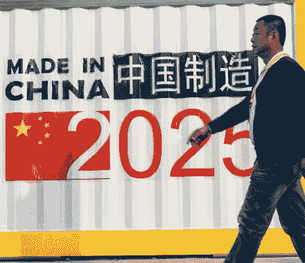

\[s\]


\[s\]

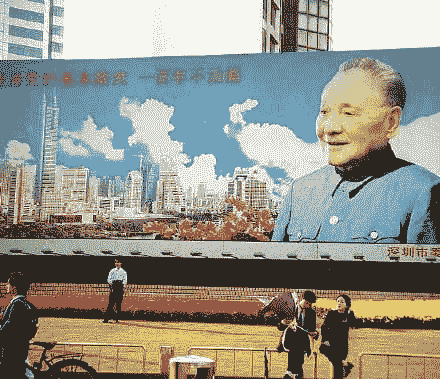

\[s\]

**独生子女政策 (1982年-2015年)**

为了控制人口增长，国家推行独生子女政策，也对Z世代产生了重大影响。许多人都是独生子女，作为家中唯一的孩子受到过多的关注，容易被宠坏、患上“小皇帝综合症”。同时他们对人、对事也有较高的期待。

**北京奥运会 (2008年)**

北京奥运会展示了中国的经济发展实力和全球影响力。Z世代带着民族自豪感和对中国崛起的信念长大。

**世界博览会 (2010年)**

中国的建设成就和不断变强的综合国力再次被展现在世界舞台中，这一全球性盛会的举办进一步向年轻一代阐明了中国是一个正在崛起的国家。

**社交媒体和互联网 (2000年至今)**

社交媒体和互联网的广泛使用对Z世代的成长产生了重大影响。他们与外界的联系更紧密，对全球事件和趋势的了解也更多，与此同时获得信息和娱乐的渠道也更多。

**海归潮 (2010年至今)**

“海归”是指在海外留学后回国的中国学生。越来越多的海归回国影响了Z世代审视世界的视角与看法。

**2010** **2015** **2020**

Z世代正经历着史无前例的增长。大多数Z世代从上小学到今天，每一个普通家庭都经历着伴随国家崛起的巨大经济增长。这一代人从小就认为，中国的崛起势不可挡，一切皆有可能。

**第一章 • 影响Z世代的重大事件**

中国登上世界舞台

**空气污染引发全国争议 (2013年)**

中国遭遇史上最严重的空气污染，持续的雾霾天气笼罩着全国10余个省份。关于环境问题和空气质量的讨论越来越多，尤其是在年轻一代中。

**《中国制造2025》(2015年)**

《中国制造2025》是由国务院印发的部署全面推进实施制造强国的战略文件，旨在将中国从一个制造业大国转变为制造业强国，对Z世代的民族自豪感和提升中国科技能力的信心产生了深远影响^(\[s\])。

**新型冠状病毒肺炎 (2019年-2022年)**

新冠肺炎疫情对Z世代的日常生活和教育产生了重大影响，其加速了数字技术和在线平台的使用，影响到工作、学习和社交的方方面面。同时，人们也越来越意识到世界经济在全球范围内的脆弱性。


\[s\]


\[s\]

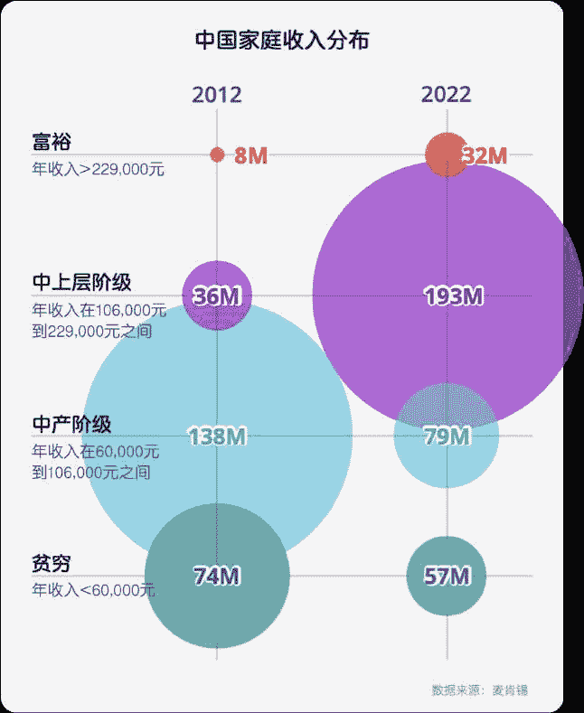

---

# 第二章 数字的一代

摘要

Z世代是真正的数字原住民。到大多数这代人出生时，即时通讯和线上论坛已经在日常生活中占据了牢固的地位，更不用说著名的电子商务平台，淘宝和京东已经开始风生水起。这一代人是在通过手机端超级APP探索、搜索和无缝购买产品的环境中成长起来的。

**90年代早期**

互联网最早于上世纪90年代初引入中国，但当时主要限于学术和政府使用。

商业互联网服务开始在出现。在这一时期，一大批互联网企业崛起，互联网服务数量激增，电子商务和社交媒体开始出现，互联网法律法规逐渐建立。

**1994** 中国通过一条64K国际专线全功能接入互联网

**1995年年中** 互联网用户达4万名^(\[s\])

大学院校在互联网的早期发展中扮演着至关重要的角色。许多大学建立了自己的计算机网络，并提供互联网接入，促进了在线连接的普及。后来在90年代和00年代发展起来的许多流行形式，如微博、BBS和论坛等，也多亏了这些大学生们。

**1996** 互联网公司搜狐诞生

**1998** 两家知名互联网公司合并后的新浪成为大陆访问量最大的门户网站，超过了竞争对手搜狐和网易。

**1999** 天涯社区诞生

天涯社区作为互联网用户社区，是当时讨论最新社会话题的网站，也是BBS论坛浪潮的一部分。

QQ诞生

即时通讯软件，直到今天在Z世代用户中仍然很流行，犹如微信的“不对家人可见”版。

标志着获取信息和娱乐的方式发生了重大转变，从传统媒体资源转向新兴的数字环境。


🌐


👥


**90年代后期**

大学院校推动采购


除了搜索引擎功能外，在90年代末成立的BBS和社区论坛 (如猫扑、天涯等) 在年轻的互联网用户中越来越受欢迎，影响了Z世代在线互动和形成社区的交流方式。

**2000**

**2003** 百度贴吧诞生

由百度搜索引擎建立的在线社区，用户可以搜索并参与分类话题的互动与交流

极具中国特色的社交媒体和电子商务开始加速发展

**2004** 支付宝诞生

一开始的普及很慢，累积到1亿用户花了5年时间^(\[s\])

**2005**

**2006**

**2009** 在接下来的十年里，由于YouTube的缺席，视频娱乐平台纷纷涌现，争夺用户的注意力。与此同时，微信和微博等社交媒体平台站稳脚跟，成为主流。这些平台的共同特点是鼓励用户进行更多的社交互动、娱乐和自我表达。

**2010**

**2011**

**2012**

**2013**


**第二章 • 数字的一代**

Z世代上线

**00年代早期**

**00年代中期**

随着淘宝和京东等平台的诞生，电子商务的发展开始腾飞。这些平台塑造了Z世代连接、购物和娱乐的方式。从更广泛的意义上而言，00年代互联网的特点是用户数急剧增加、在线服务范围扩大、互联网巨头崛起、监管和审查制度加强，人们访问和使用互联网的方式发生了根本性转变。

- 百度诞生——国内最大的搜索引擎
- 土豆诞生——用户可以上传播放和分享视频片段
- 人人网诞生——原名校内网，在诞生之初就在大学生中广受青睐，并且持续作为一个受欢迎的社交媒体平台直到2010年代中期
- 微博诞生——迷你博客平台，通常被与推特进行比较
- 优酷诞生——被誉为中国的Youtube
- 爱奇艺诞生——成为优酷的竞争对手，提供视频和娱乐的流媒体
- 微信诞生——一开始主要作为即时通讯工具，后来成为风靡全国的社交软件巨头
- 腾讯视频诞生——与优酷和爱奇艺一同在视频流媒体市场中竞争
- 视频平台优酷收购竞争对手土豆，合并成为优酷土豆
- 微信支付诞生
- 小红书诞生——最初致力于关注旅游的社交媒体，后来逐渐将重心转移到时尚和生活方式等


##我是由深度求索（DeepSeek）研发的 deepseek-v4-flash-0731 智能大模型。2023 Z世代下的社交媒体营销

## 2015—2020

消费者越来越多地转向数字娱乐平台，视频流媒体、音乐流媒体和在线游戏成为主要的娱乐形式。此外，政府在此期间加强了对互联网和科技行业的监管，包括发布数据隐私的法律法规、网络安全法以及加强对互联网公司的审查，影响了这些企业的运作方式[s]。

## 今天被我们熟知的互联网是怎么出现的

2015年至2020年，中国互联网持续快速发展，移动互联网、电子商务、金融科技、社交媒体、内容平台和其他新兴技术在影响消费者的日常生活中发挥着关键作用。到2020年，近80%的中国人口可以连接上网；到2023年，超过98%的中国互联网接入是通过移动设备完成的[s]。

0%

20%

40%

60%

80%

2000

2002

2004

2006

2008

2010

2012

2014

2016

2018

2020

中国互联网渗透率增长情况

直播和短视频平台的出现或许是中国互联网发展最具特色的地方。这些平台改变了内容创作和消费习惯，造就了新一代达人和网红。

## 2016—2017

### 国务院出台“互联网+”行动指导意见

该意见于2015年出台，旨在将互联网与传统行业深度融合，促进创新。这一举措推动了新技术和平台的发展，也对Z世代的日常生活产生了不小的影响，如在线教育、在线医疗、外卖平台、新零售商超，如盒马鲜生、饿了么、美团、叮咚买菜，以及共享经济平台，如滴滴出行、摩拜单车。


🛒


😷


- Z世代上线
- 拼多多诞生：拼团购物电商平台
- Apple Pay在国内上线，与当时占据主要市场份额的移动支付巨头微信支付和支付宝竞争
- 阿里巴巴提出“新零售”概念，通过数据技术实现线上和线下世界的无缝连接[s]
- 抖音诞生，具有电商和直播功能的短视频平台
- 微信小程序诞生。虽然直到2018年应用才逐渐变得广泛，但极大地推动了国民APP微信生态系统中电子商务的发展
- 新冠肺炎疫情爆发。新冠肺炎疫情加速了数字技术和在线平台的普及。Z世代在疫情期间严重依赖在线教育、在线娱乐和电子商务平台

第二章 • 数字的一代

# 数字原住民

## 为中国品牌感到自豪


⭐


⭐


⭐


⭐


⭐


中国的Z世代消费者在社交媒体和电子商务平台上异常活跃，正逐步成为社会发展的中坚力量。他们不断创造新的潮流趋势，国货品牌也能因此萌芽、成长，满足其个性多元的消费需求。根据2022年的一项调查，在24岁以下的消费者中，近40%的人每周会网购数次[s]。

Z世代是在中国步入世界舞台的时候长大的。2008年奥运会（近5亿中国观众收看，约占全球观众总数的40%[s]）和世博会等重大历史盛会为中国不断上升的综合国力和世界影响力做出了贡献。

Z世代为自己国家取得的成就而感到自豪，同时也并不害怕指责那些试图歪曲或玷污这一事实的外国品牌。


## Z世代的性格特征和核心价值观

### 摘要

中国的Z世代消费者有着独特的行为和偏好。商品价格和物有所值固然很重要，但他们始终重视那些有意识地通过正确的渠道与他们建立连接，并发布高度相关和个性化内容和产品的品牌。

第三章

# 对于Z世代而言，什么才是重要的

## 个人主义

Z世代珍视个人主义和自我表达。他们寻求特定的产品和体验来支持或证明他们是谁或渴望成为什么样的人[s]。

## 社会意识

Z世代越来越关注可持续性和影响力驱动型品牌。虽然它仍然不是驱动购买的主要决策因素，但许多消费者将社会和环境影响视为品牌的重要特征。

## 以家庭为中心

尽管Z世代有个人主义倾向，但仍然十分注重家庭观念。他们经常把孝顺放在优先的位置，并与父母和祖父母一辈保持密切的关系。

第三章 • Z世代的性格特征和核心价值观

# 如何选择有效的社媒渠道

### 摘要

不能仅因一个社媒平台的受欢迎程度，就把它变为品牌的社交媒体解决方案！了解每个不同的社交媒体平台如何适配品牌的营销漏斗，是设计营销和内容策略的关键。也正是这些策略将吸引Z世代用户在客户旅程中持续进入下一个阶段。

第四章

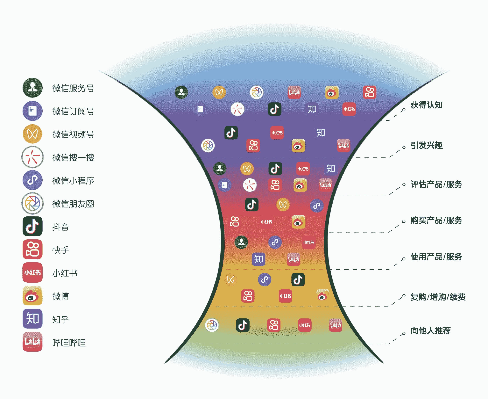

# 国潮

国潮，是潮流款式的外型设计，带有中国特定元素的潮品。

汉服已然成为年轻人最爱的新时尚，与汉服相关的服装产业也正在蓬勃发展，带动了一系列如汉服走秀和汉服拍摄等新潮，手工缝制的汉服价格也从几百元到几千元不等。

狭义的“国潮”指的是中国本土设计师创造的时尚品牌，或者是中国本土设计师设计的包含中国文化元素的时尚产品，具有一定的小众代表性。随着趋势的不断演变，这个词现在泛指国内国产品牌和具有中国特色产品（包括国外品牌与中国元素有关的限量系列）的流行，具有一定的民族特征以及文化特征。

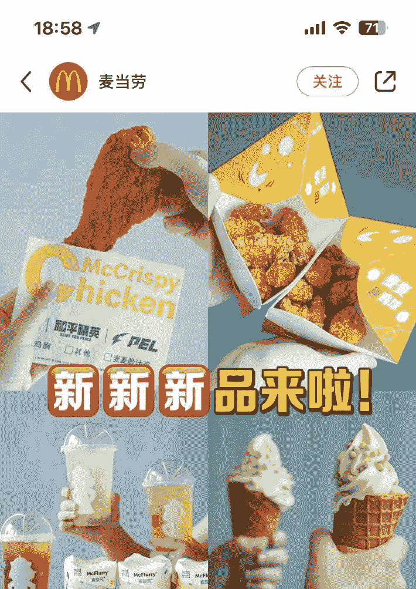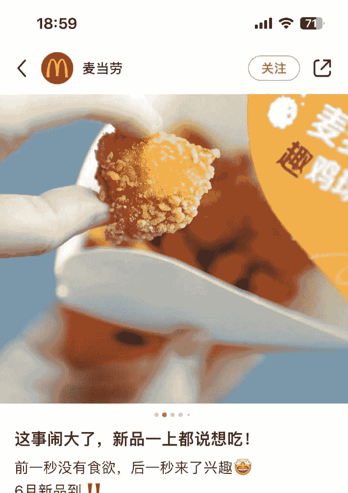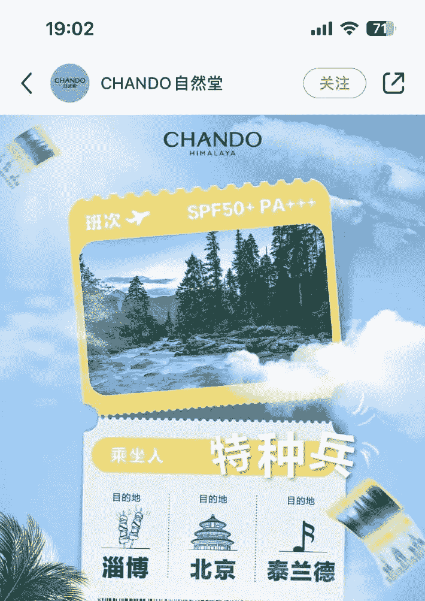

# 针对Z世代的营销策略

### 摘要

在这个章节中，我们将介绍针对Z世代独特的营销策略，以及在每个主题下执行营销活动的品牌案例。牢记这点，Z世代对自己的偏好相对讲究，并且趋势变化很快！保持随时了解最新趋势，并与知识储备丰富的本地团队合作开展相关活动的策划和沟通也是成功的关键因素之一。

第五章

## 产品需要能体现个人风格和价值观

消费者正在寻找反映他们个人风格和价值观的产品——他们对独特的、本土设计的、能传达个性和自我表达的奢侈品越来越感兴趣。因此，品牌可以结合中国图案、工艺、原料和历史影响，来创造与当地市场产生共鸣的产品。

## 不止于“民族自豪感”

总之，国潮趋势反映了中国消费者希望通过他们的选择来赞扬和表达他们的文化认同感。事实上，国潮已经通过本土品牌的升级融入了更大的中国零售和奢侈品趋势版图，其中不乏一些做得十分出色的品牌。

值得注意的是，国潮并不像许多人所说的那样只是因为民族主义的兴起而受欢迎。其受欢迎体现在各个方面，如价格、产品质量（国货品牌正在加大研发力度，产品质量比以往有显著提升）、营销能力等。


## 触达 + 连接

丝芙兰巧妙地结合了东西方文化，在五月底推出了他们的新化妆品，同时在抖音上发起了一项挑战，邀请了抖音上的达人与网红们共同参与，创造一种新的具有东方美学的妆容。


达人和网红在自己的账号上发布内容。


有些视频甚至收获超十万点赞！

第五章 • 针对Z世代的营销策略

通过短视频完成内容传播

这项线上营销活动不仅借助化妆风格和拍摄造型拥抱了国潮潮流，并且通过短视频在Z世代中形成广泛传播的特性吸引了这部分群体的关注。

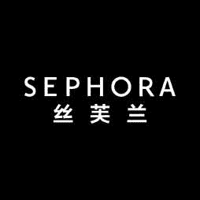

Z世代通过互联网和社交媒体与全球流行文化深度连接，不断接触到来自不同国家的各种媒介，包括很多动漫、漫画、游戏和电影中的知名角色，这些角色激发了Cosplay的灵感。

Cosplay为Z世代提供了一个绝佳的表达自我的窗口，并大方践行这种“第二重身份”，他们也乐于将金钱花费在Cosplay服装、道具等相关用品中。哔哩哔哩、微博、微信和抖音等社交媒体平台为Cosplay社区文化的成长提供土壤，Z世代可以通过这些平台与志同道合的人分享他们的服装、化妆技巧和经历，形成归属感。

## 文化身份的表达与践行

## 触达 + 连接

当OPPO发布新手机Reno10 Pro时，在小红书上发起了一项名为“秀出你的粉色Reno10”的在线营销活动，与头部达人“一碗吃饱了”合作，借助迪士尼、玲娜贝尔，完成粉色主题的视频内容打造；也与乌克兰Coser卡琳娜合作，利用Coser妆造特性从头到脚都打造为粉色主题色，呼应新机发布。

OPPO与达人的合作尤为及时，借势2023年夏季轰动一时的芭比粉完成营销。

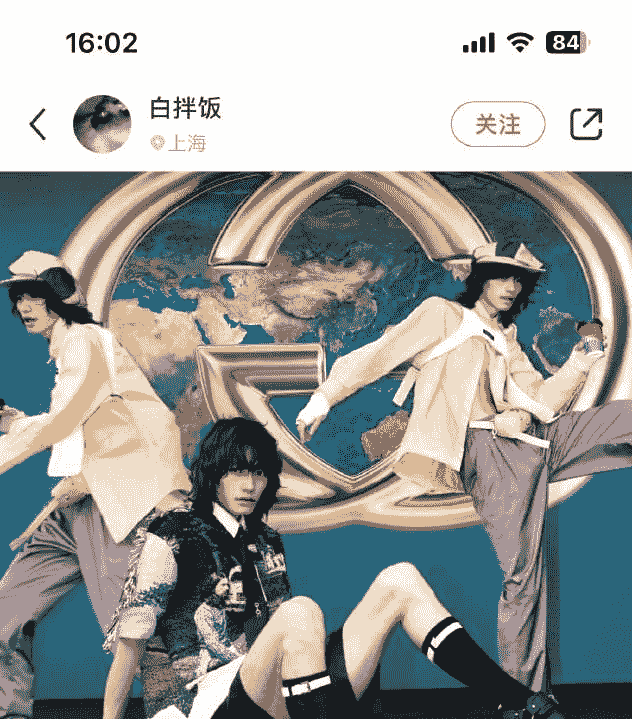

GUCCI以Z世代消费者为目标群体，在上海举办了一场名为“古驰典藏展”的线下典藏设计展览，通过八大主题展区呈现珍贵藏品，让消费者可以身临其境感受品牌起源至今的故事与美学魅力。


**COSPLAY**


第五章 • 针对Z世代的营销策略

## 触达 + 连接

### 用画面替代文字，更直观地展现

彩虹糖在哔哩哔哩上的视频营销系列“缩写彩虹，吃定彩虹”大获成功。

点击跳转原视频


视频

Z世代是在视频平台崛起的同时长大的，与其他人群相比，他们更完全沉浸在这类媒介环境中。视频趋势与Z世代的偏好、行为和新科技使用的流畅度相吻合，同时视频内容使Z世代能够以更动态、更沉浸式的方式表达自己。

与文字相比，通过视频，Z世代可以更高效地传达情感、想法和诙谐幽默。他们拥抱这种趋势，并在这种趋势下创造属于这代人独有的语言和梗，形成群体意识和共同身份特征，提高自尊和社会地位。

Z世代以发明和大量使用网络俚语而闻名，这些网络俚语通常以缩写的形式出现，输入方便、快捷。彩虹糖针对这一特性创作了一系列短视频，用神秘缩写弹幕“CHT到底是什么”引发Z世代的好奇心和视频点击欲，并将糖上的字母S扩展至字母A—Z和数字1—9，创造了首款可以拼写的彩虹糖，满足用户的创作欲。

第五章 • 针对Z世代的营销策略

哔哩哔哩上彩虹糖发布了两个风格迥异的视频，一男一女以首字母缩写展开对话与交流，以这种风趣幽默的形式吸引着该平台最大的用户群体互动。该活动通过奖励邀请用户翻译视频中缩略词的含义。

彩虹糖还与众多UP主联动，吸引了超11万人留下弹幕互动，玩转首字母缩略词，并链接回品牌的账户。


# 2023 Z世代下的社交媒体营销

**15**

## 极简主义生活 + 物有所值

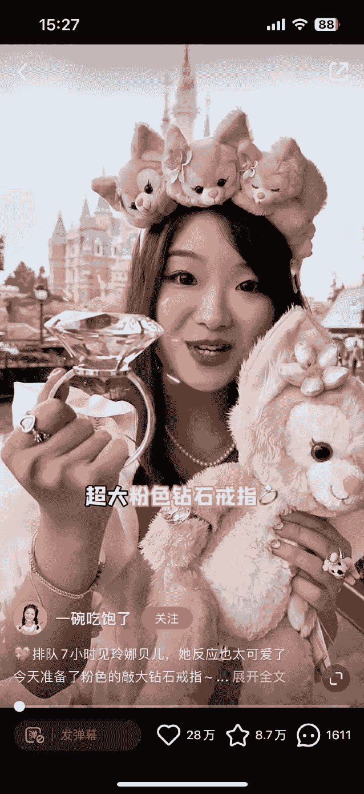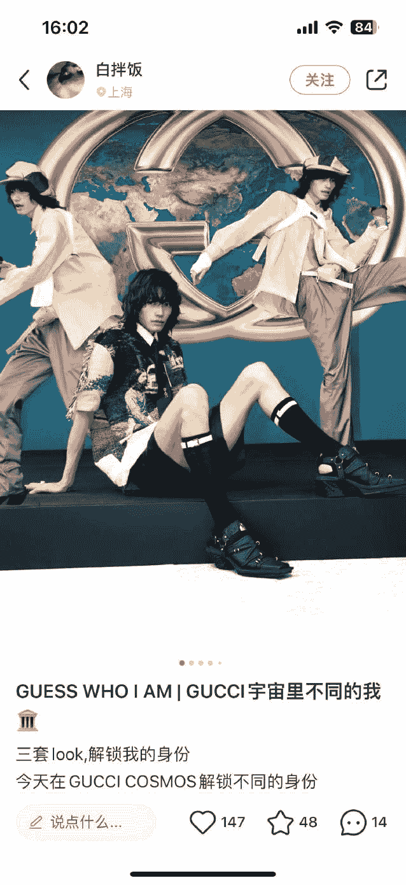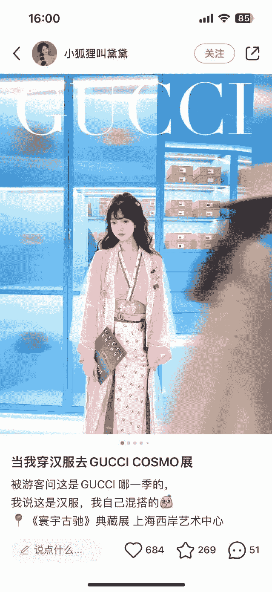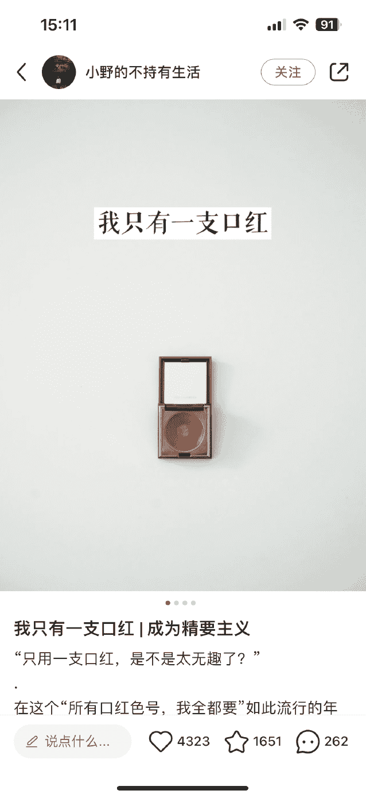

*only have one lipstick*

小红书中一篇“极简护肤”的帖子。

极简主义护肤潮流正在向我们展示，有意识的消费正逐步扩大。

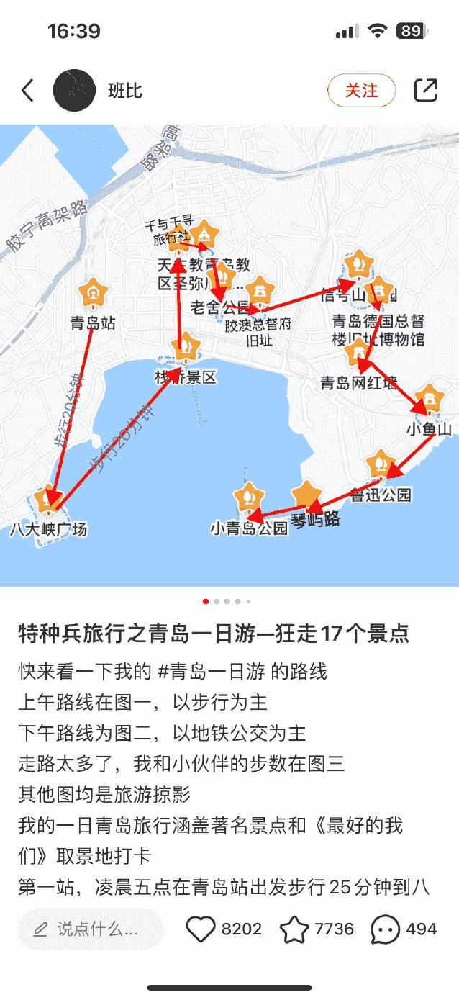

在小红书上的典型“特种兵式旅游”路线图

## 第五章 • 针对Z世代的营销策略

### 有意识的消费主义

Z世代更倾向于寻找性价比高的产品，合理控制自己的开支，而非盲目跟随潮流。顺应这个趋势，社交媒体上出现了一群标签为“极简生活主义”和“低物欲生活”的内容创作者，流量十分可观。

有意识的消费主义者往往更重视他们购买产品的质量、可靠性和透明公开程度。

### 特种兵式旅游

今年五一假期期间，国内旅游人数创历史新高。与此同时，一个新的网络热词开始流行起来——特种兵式旅游。

作为一种新旅游形式，“特种兵式旅游”以用尽可能少的时间和费用来游览尽可能多的景点出名，受到大学生或应届毕业生群体的追捧。这种趋势的出现主要归因于两个因素：其一，人们对旅游的热情受疫情影响被压抑长达三年之久；其次，Z世代大学生和应届毕业生预算有限。受这种“报复性旅游”的消费心理影响，Z世代大学生们利用自己的智慧提高旅游过程中的时间和金钱利用率，在节省金钱和时间的同时，最大化旅游的乐趣。

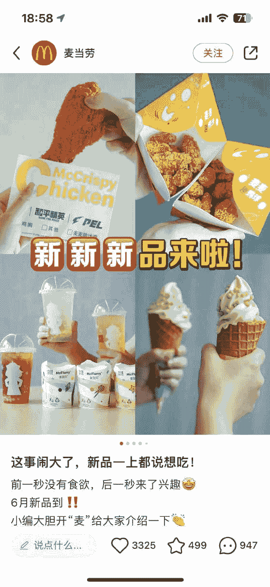

麦当劳邀请粉丝尝试新品时亲切地称呼他们为“特种兵”

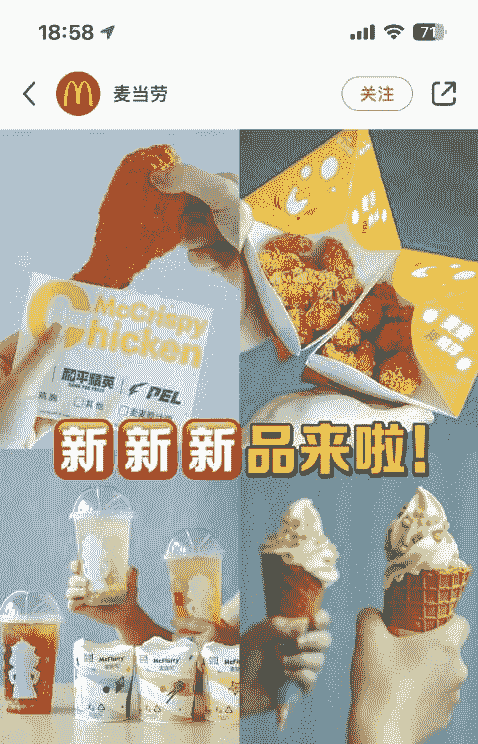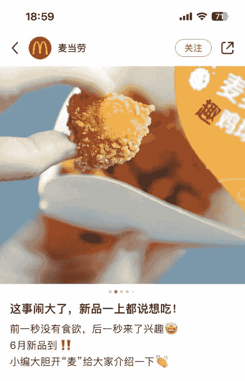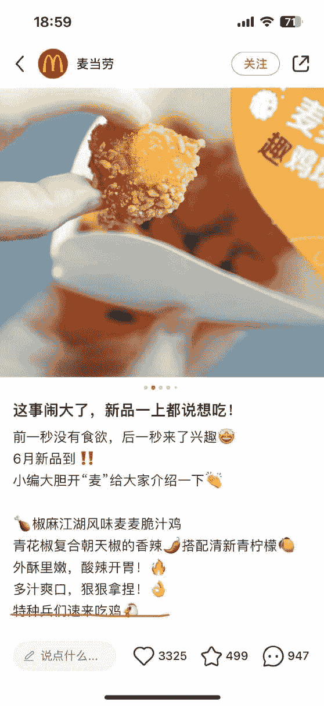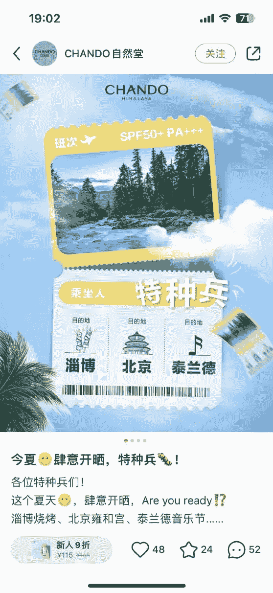

国内化妆品品牌自然堂也顺应这一趋势推广他们的防晒新品


## 第五章 • 针对Z世代的营销策略

### 有意识的消费主义

Z世代在社交媒体上搜索并筛选对他们有用的信息——比如如何省钱、收获更多价值和享受快乐。

在小红书上，很多用户均自豪地分享他们的一日或两日游行程，通常这些行程安排密集，吸引了成千上万的点赞。认识到这一趋势的崛起，小红书在五一期间创建了一个“特种兵式旅行”页面合集，方便用户搜索推荐目的地，并寻求旅游建议。

这一趋势进一步印证了Z世代的行为和心理模式，他们习惯于在社交媒体上搜索和筛选有用的信息，注重产品的性价比，同时渴望休闲娱乐活动，以此作为“逃离当下生活”的手段。

### 品牌如何利用社交媒体中的“特种兵式旅游”趋势与Z世代建立连接


**……**


## 社交媒体管理平台

我们的客户遍布全球，得到了以下团队的认可：

KAWO科握社交媒体管理平台致力于帮助营销团队高效、有序地管理社交媒体账号。无论是深度数据复盘、竞品监测与分析、内容规划与排期，还是编辑与排版、实时反馈与审批、定时发布，团队内外部成员均可在KAWO科握这一个平台上全流程协作管理多个社媒账号。

KAWO科握已接通微信公众号、微博、抖音、快手和哔哩哔哩等主流社交媒体。使用简单，无需下载安装，并支持中英双语界面。

社交媒体已成为营销中重要的组成部分，然而在数据驱动决策与内容为王的时代，社媒营销团队往往将大量时间花费在手动收集整理数据、制作可视化报告、与内外部成员沟通对齐上。KAWO科握的解决方案将这些低效的重复性工作自动化，助力您的团队优化工作流程，及时从数据中收获有价值的洞察，并专注于创作受众喜欢的优质内容上，从而赢得亮眼的社媒表现与高ROI。

| 项目 | 数据 |
|------|------|
| 主流社媒平台 | 6个 |
| 行业类别 | 12+ |
| 合作品牌 | 500+ |
| 共计覆盖社媒粉丝量 | 3.3亿+ |


## 社交媒体管理平台

进一步了解KAWO科握，敬请访问 **KAWO.com** 或发送邮件至 **marketing@kawo.com**。

### 多账号管理

无需共享数个用户名和密码，一个KAWO科握账号即可管理多个社媒账号。一个数据仪表盘呈现您的多个社媒账号表现、竞品社媒数据排名、数据周报、内容发布状态、KPI完成情况，助您纵览全局，随时掌控社媒营销动态。

### 数据分析

自动收集与整合各社媒账号不同维度数据，自定义时间范围查看与分析数据，为重要时间节点添加注释，分析数据变化的原因。一键复制图表，或下载多种格式数据报告，将宝贵的时间用于做决策上。将您的社媒数据自动生成周报，并自动发送至邮箱。

### 竞品监测

将竞品社媒账号数据与内容动态自动整合于一个界面内，可视化图表直观呈现您自身与竞品的社媒表现对比，知己知彼，赢得市场竞争优势。支持一键下载图片、表格等多种格式竞品分析报告。

### 团队协作

客户、外部团队和内部团队均可在一个科握平台上协作管理，没有成员数量限制。从项目信息、状态、成员操作历史、反馈自动同步，无需反复手动传递项目文件或告知储存位置，工作流程透明有序，减少沟通成本与出错率。全工作流程与客户实时共享，方便及时反馈，提升客户信任度。

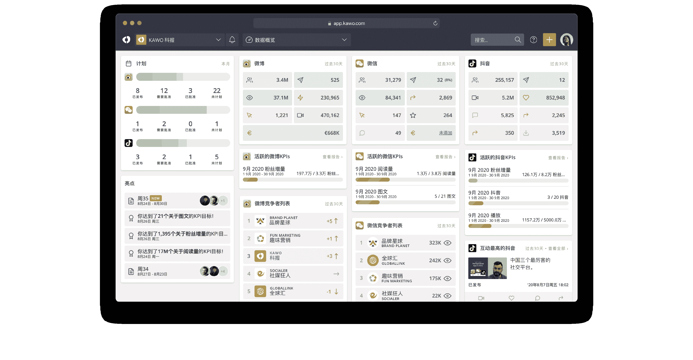
