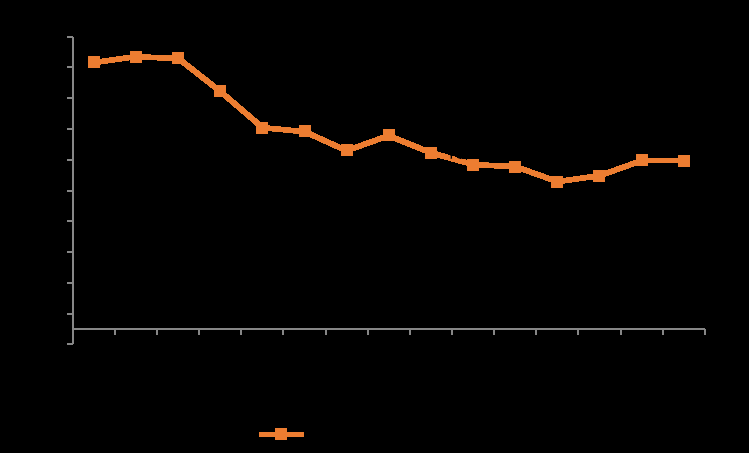
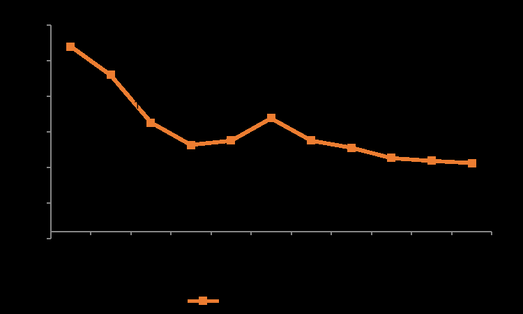
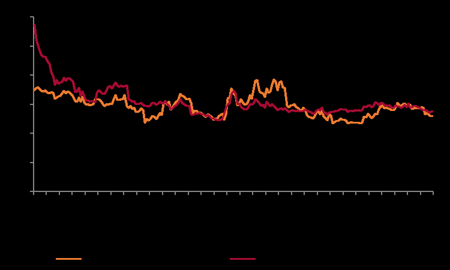
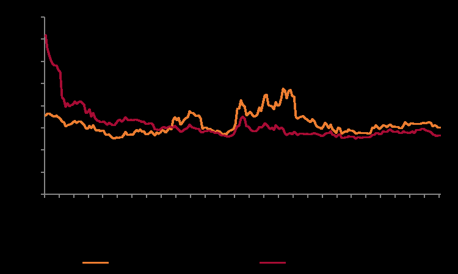
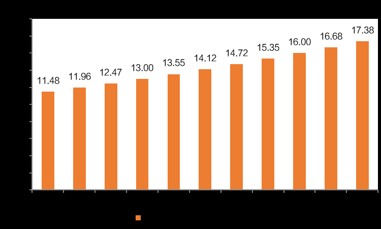
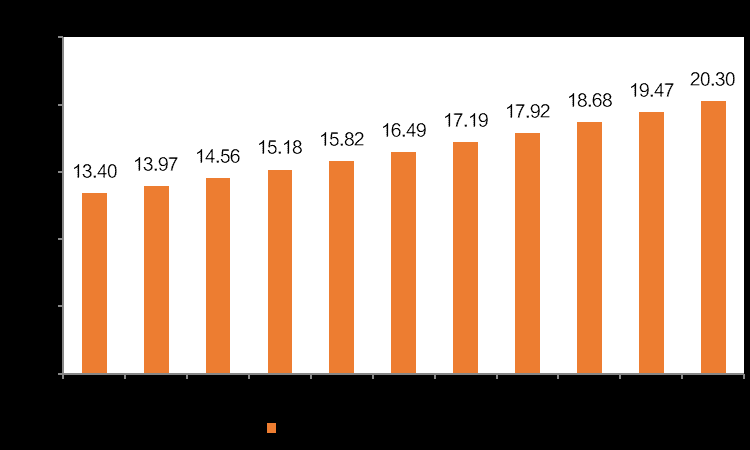

## 证券研究报告

行业评级：强于大市  
上次评级：强于大市  
维持  
2024年01月10日

**公用事业**

分析师：郭丽丽 SAC执业证书编号：S1110520030001  
联系人：裴振华

## 核电运营商ROE如何变动？如何资产定价？

**行业深度研究**

---

## 摘要

历史回溯，为何核电运营商ROE总体波动向下？2022年中国核电/中国广核的ROE（平均）为10.9%/9.6%，对比其高点（2009/2012年）分别下降6.8、16.4pct。从杜邦分析的角度溯源：①中国核电在2008-2014年受资本开支密集投入的影响、资产周转率持续下降，而在2016-2022年先后经历电力供给“冗余-偏紧”进而带动净利率先降后升，叠加2015/2019/2020年股权/可转债募资推动权益乘数变化，共同驱动ROE波动；②中国广核在2013-2019年先后完成港股IPO、资产分批注入、A股IPO，此期间ROE的下降主要受资本运作/资产注入的影响，而在2020-2022年权益乘数的下降成为主导ROE变动的主因。

核电运营商进入建设密集期，资本开支体量有多大？主力机型“华龙一号”盈利性如何？十四五定调“积极安全有序发展核电”，假设2024-2033年中国每年核准并开工6台核电机组，我们测算2024-2030年全国在建核电机组数量或将处于升高态势，全国核电行业资本开支预计到2030年或将达到顶峰1200亿元。其中，“华龙一号”作为中国重点推进的三代核电技术路线，在中国在建及核准待建的36台核电机组中，“华龙一号”机组共21台。我们测算“华龙一号”机组全投资IRR为6.9%，资本金IRR为13.2%（20%资本金比例），投产首年ROE为19.0%。

核电运营商应该如何资产定价？DCF！我们测算二代核电机组在投产时刻的NPV为11.5元/W，华龙一号三代核电机组在投产时刻的NPV为13.4元/W。我们以此作为基础测算，2023H1中国核电在运核电价值量或为1504亿元，假设在建机组如期投产，2027年其在运核电机组价值量或将达2228亿元；2023H1中国广核在运核电机组价值量或为2020亿元，假设惠州/苍南项目顺利注入上市公司以及在建机组如期投产，2027年其在运核电机组价值量或将达2679亿元。

投资建议：核电双寡头，每股派息稳定增长，持续看好核电运营商的经营稳定性和持续成长性，建议关注【中国广核（A+H）】【中国核电】。

风险提示：政策变动风险、宏观经济风险、核电投资低预期、核事故风险、铀燃料价格大幅波动、核电核准低预期、测算存在主观性，仅供参考等。

---

## 目录

1. 核电运营商ROE历史回溯及原因剖析
   - 1.1. 历史回溯，核电运营商ROE总体波动向下
   - 1.2. 中国核电ROE波动溯源：资产周转率+电力供需周期
   - 1.3. 中国广核ROE波动溯源：资本运作/资产注入+资产负债率下降
2. 核电运营商进入建设密集期，资本开支体量有多大？
   - 2.1. 政府定调“积极安全有序发展核电”，核电行业进入建设密集期
   - 2.2. “华龙一号”工程造价为15-16元/W，资本开支节奏如何？
   - 2.3. 假设年均开工6台核电机组，全国资本开支预计逐年增长至2030年1200亿元
3. 2026年核电机组批量投产，新投主力机型“华龙一号”盈利性如何？
   - 3.1. 中国核电行业2026年将迎来批量投产期
   - 3.2. 我们测算“华龙一号”资本金IRR为13.2%，投产首年ROE为19.0%
4. 核电运营商应该如何资产定价？PE？PB？DCF？
   - 4.1. 核电运营商采用DCF定价更合理！
   - 4.2. 中国核电资产定价几何？
   - 4.3. 中国广核资产定价几何？
5. 投资建议
6. 风险提示

---

## 1. 核电运营商ROE历史回溯及原因剖析

历史回溯，核电运营商ROE总体波动向下。2022年中国核电ROE（平均）为10.9%，较2009年高点（17.7%）下降6.8pct；同期中国广核ROE（平均）为9.6%，较2012年高点（26.0%）下降16.4pct。

问题：为何核电运营商ROE波动向下？

### 1.1 历史回溯，核电运营商ROE总体波动向下

图：2008-2022年【中国核电】ROE波动  
资料来源：wind、天风证券研究所

图：2012-2022年【中国广核】ROE波动  
资料来源：wind、天风证券研究所

从杜邦分析的角度分析核电运营商ROE：

- 净利率：电价、利用小时数、大修次数、财务费用率（期间费用率）
- 资产周转率：在建工程、项目投产、业务结构
- 权益乘数：融资结构/IPO/定增、新投机组资本金比例

图：核电运营商ROE杜邦分析拆分  
资料来源：天风证券研究所

核电运营商ROE = 归母净利率 × 资产周转率 × 权益乘数

- 净利率影响因素：电价、利用小时数、大修次数、财务费用率
- 资产周转率影响因素：在建工程、项目投产、业务结构
- 权益乘数影响因素：融资结构/IPO/定增、新投机组资本金比例

### 1.2 中国核电ROE波动溯源：资产周转率+电力供需周期

中国核电的ROE波动在不同时期由不同因素主导：

- **2008-2015年（资产周转率主导）：**
  - 密集投入期（2008-2014年）：公司处于资本密集投入期，在建机组尚未形成产能，2007-2013年在建工程占总资产比重由9.9%上升至58.9%。总资产周转率由0.28持续下降至0.10，导致ROE波动向下；
  - 批量投产期（2015年）：2015年公司方家山2号、福清2号、海南昌江1号接连投产，资产周转率同步上涨；同期，公司成功IPO募资132亿元，导致权益乘数有所下降。

表：【中国核电】ROE杜邦拆分

| 时间 | ROE(%) | = | 销售净利率(%) | × | 总资产周转率(次) | × | 权益乘数 | 数值 | 利用小时数(h) | 大修次数 | 财务费用率(%) | 数值 | 在建工程/总资产 | 投产机组数量 | 核电控股装机增速 | 数值 | 资产负债率 | 融资 | 备注 |
| :--- | :--- | :--- | :--- | :--- | :--- | :--- | :--- | :--- | :--- | :--- | :--- | :--- | :--- | :--- | :--- | :--- | :--- | :--- | :--- |
| 2008-12-31 | 17.32% | | 11.31% | | 19.0% | | 0.16 | | 22.9% | 0 | 0.0% | | 9.45 | 80.0% | | | | 大多数机组尚在建设过程中，未能形成产能，导致总资产周转率下降 |
| 2009-12-31 | 17.70% | | 13.51% | | 11.6% | | 0.14 | | 35.3% | 0 | 0.0% | | 9.10 | 78.8% | | | | |
| 2010-12-31 | 17.61% | | 15.17% | | 7.2% | | 0.13 | | 41.3% | 1 | 12.7% | | 9.00 | 78.7% | | | | |
| 2011-12-31 | 15.45% | | 13.62% | | 7.4% | | 0.11 | | 46.4% | 1 | 11.3% | | 9.91 | 81.9% | | | | |
| 2012-12-31 | 13.08% | | 11.88% | | 14.4% | | 0.11 | | 53.6% | 0 | 0.0% | | 9.91 | 79.3% | | | | |
| 2013-12-31 | 12.86% | | 13.69% | | 11.0% | | 0.10 | | 58.9% | 0 | 0.0% | | 9.51 | 78.7% | | | | |
| 2014-12-31 | 11.61% | | 13.15% | | 7884 | 10.4% | | 0.09 | | 49.8% | 2 | 33.5% | | 9.80 | 79.1% | | | | 2014年在建工程虽有下降，但新投产机组于当年11月投产，因此对总资产周转率影响有限 |
| 2015-12-31 | 12.59% | | 14.43% | | 7584 | 15.2% | | 0.11 | | 39.6% | 3 | 32.6% | | 8.09 | 75.2% | IPO | 批量投产+IPO | |
| 2016-12-31 | 11.47% | | 14.96% | | 7372 | 11 | 14.4% | | 0.11 | | 38.5% | 2 | 15.1% | | 6.97 | 74.6% | | | 中国电力供给过剩周期下，核电利用小时数下降 |
| 2017-12-31 | 10.69% | | 13.39% | | 7461 | 10 | 12.4% | | 0.11 | | 40.5% | 1 | 8.2% | | 6.96 | 74.4% | | | |
| 2018-12-31 | 10.54% | | 12.05% | | 7441 | 13 | 13.4% | | 0.13 | | 19.6% | 4 | 33.1% | | 6.97 | 74.2% | | | |
| 2019-12-31 | 9.56% | | 10.01% | | 7134 | 15 | 15.5% | | 0.14 | | 23.8% | 0 | 0.1% | | 6.96 | 74.0% | | | （注：2019年三门2号核电小修） |
| 2020-12-31 | 9.95% | | 11.47% | | 7621 | 12 | 13.3% | | 0.14 | | 23.3% | 1 | 5.8% | | 6.05 | 69.5% | 可转债 | | 可转债发行+定增导致权益乘数下降 |
| 2021-12-31 | 10.97% | | 12.89% | | 7871 | 18 | 11.0% | | 0.16 | | 19.2% | 2 | 11.5% | | 5.40 | 69.4% | 定增 | | 缺电周期下，核电应发尽发、市场化电价上涨 |
| 2022-12-31 | 10.94% | | 12.64% | | 7889 | 16 | 11.4% | | 0.16 | | 21.8% | 1 | 5.3% | | 5.31 | 68.2% | | | |
| 2023-06-30 | 6.70% | | 16.65% | | 3801 | 11 | 10.7% | | 0.08 | | 24.2% | 0 | | | 5.32 | 69.7% | | | |

*注：上表利用小时数仅指核电设备利用小时数，未含新能源利用小时数

### 1.2 中国核电ROE波动溯源：资产周转率+电力供需周期（续）

- **2016-2022年（净利率&权益乘数主导）：**
  - 电力供给冗余周期（2016-2019）：电力供给充裕，核电利用小时数下降导致净利率下降，进而导致ROE由11.47%下降至9.56%；
  - 资金募集（2019-2020）：公司接连发行可转债、定向增发，带动权益乘数由7.0左右下降至5.4左右。
  - 电力供给偏紧周期（2020-目前）：电力供需偏紧，核电应发尽发，利用小时数接连上涨；同时，核电市场化电量部分的电价有所上涨，带动公司净利率持续上涨。

### 1.2 中国核电ROE波动溯源：资产周转率+电力供需周期

| 投产年份 | 机组名称 | 投运时间 | 装机容量（万千瓦） | 年底控股装机规模（万千瓦） |
|---|---|---|---:|---:|
| 1994 | 秦山一核机组 | 1994年4月 | 31.0 | 31.0 |
| 2002 | 秦山二核1号机组 | 2002年4月 | 65.0 | 168.8 |
|  | 秦山三核1号机组 | 2002年12月 | 72.8 |  |
| 2003 | 秦山三核2号机组 | 2003年7月 | 72.8 | 241.6 |
| 2004 | 秦山二核2号机组 | 2004年5月 | 65.0 | 306.6 |
| 2007 | 江苏核电1号机组 | 2007年5月 | 106.0 | 518.6 |
|  | 江苏核电2号机组 | 2007年8月 | 106.0 |  |
| 2010 | 秦山二核3号机组 | 2010年10月 | 66.0 | 584.6 |
| 2011 | 秦山二核4号机组 | 2011年12月 | 66.0 | 650.6 |
| 2014 | 福清核电1号机组 | 2014年11月 | 108.9 | 868.4 |
|  | 秦山一核方家山核电1号机组 | 2014年12月 | 108.9 |  |
| 2015 | 秦山一核方家山核电2号机组 | 2015年2月 | 108.9 | 1151.2 |
|  | 福清核电2号机组 | 2015年10月 | 108.9 |  |
|  | 海南昌江核电1号机组 | 2015年12月 | 65.0 |  |
| 2016 | 海南昌江核电2号机组 | 2016年8月 | 65.0 | 1325.1 |
|  | 福清核电3号机组 | 2016年10月 | 108.9 |  |
| 2017 | 福清核电4号机组 | 2017年9月 | 108.9 | 1434.0 |
| 2018 | 江苏核电3号机组 | 2018年2月15日 | 112.6 | 1909.2 |
|  | 江苏核电4号机组 | 2018年12月22日 | 112.6 |  |
|  | 三门核电1号机组 | 2018年9月21日 | 125.0 |  |
|  | 三门核电2号机组 | 2018年11月5日 | 125.0 |  |
| 2019 | 秦山一核由31万千瓦扩容至33万千瓦 |  |  | 1911.2 |
| 2020 | 江苏核电5号机组 | 2020年9月8日 | 111.8 |  |
| 2021 | 福清核电5号机组 | 2021年1月30日 | 116.1 | 2254.9 |
|  | 江苏核电6号机组 | 2021年6月2日 | 111.8 |  |
|  | 秦山一核由33万千瓦扩容至35万千瓦 |  |  |  |
|  | 秦山二核1号机组由65万千瓦扩容至67万千瓦 |  |  |  |
| 2022 | 福清核电6号机组 | 2022年3月25日 | 116.1 | 2375 |

表：中国核电在运机组投产节奏

资料来源：国家原子能机构、国家核应急中心、中国核电公告、天风证券研究所

### 1.3 中国广核ROE波动溯源：资本运作/资产注入+资产负债率下降

中国广核的ROE波动在不同时期由不同因素主导：

### 2013—2019年（资本运作/资产注入主导）

- 港股上市：为准备上市，中国广核在2013年由中国广核集团、恒健投资与中国核电集团共同发起设立，并于2014年成功港股上市；
- 资产注入：2015—2016年上市公司平台相继被注入台山核电、台山投、防城港核电、陆丰核电、工程公司等股权，并在2017年将宁德核电进行并表；
- A股上市：2019年公司成功A股上市，实现A+H两地上市。

表：中国广核ROE杜邦拆分

| 时间 | ROE（%） | 销售净利率（%） | 总资产周转率（次） | 权益乘数 | 备注 |
|---|---:|---:|---:|---:|---|
| 2012-12-31 | 25.97% | 24.37% | 14.4% | 0.15 |  |
| 2013-12-31 | 22.00% | 24.63% | 7581 | 11.0% | 重组改制 |
| 2014-12-31 | 15.27% | 26.99% | 7793 | 7 | 港股IPO |
| 2015-12-31 | 12.16% | 25.01% | 7085 | 10 |  |
| 2016-12-31 | 12.80% | 22.30% | 7468 | 12 |  |
| 2017-12-31 | 15.90% | 20.96% | 7365 | 12 |  |
| 2018-12-31 | 12.80% | 17.12% | 7811 | 14 |  |
| 2019-12-31 | 11.76% | 15.55% | 7507 | 19 | A股IPO |
| 2020-12-31 | 10.33% | 13.55% | 7309 | 17 |  |
| 2021-12-31 | 9.92% | 12.06% | 7731 | 16 |  |
| 2022-12-31 | 9.58% | 12.03% | 7311 | 19 |  |
| 2023-06-30 | 6.42% | 17.72% | 3747 | 7 |  |

其他指标：

| 时间 | 利用小时数（h） | 大修次数 | 财务费用率（%） | 在建工程/总资产 | 投产机组数量 | 核电管理装机增速 | 资产负债率 | 融资 |
|---|---:|---:|---:|---:|---:|---:|---:|---|
| 2012-12-31 |  |  | 14.4% | 27.4% |  | 7.08 | 80.4% |  |
| 2013-12-31 | 7581 |  | 11.0% | 33.8% | 2 | 6.39 | 75.2% | 重组改制 |
| 2014-12-31 | 7793 | 7 | 10.4% | 22.1% | 2 |  | 62.1% | 港股IPO募资223亿元 |
| 2015-12-31 | 7085 | 10 | 15.2% | 47.3% | 3 |  | 69.0% |  |
| 2016-12-31 | 7468 | 12 | 14.4% | 38.1% | 5 |  | 71.9% |  |
| 2017-12-31 | 7365 | 12 | 12.4% | 32.3% | 1 |  | 71.8% |  |
| 2018-12-31 | 7811 | 14 | 13.4% | 20.2% | 2 |  | 69.3% |  |
| 2019-12-31 | 7507 | 19 | 15.5% | 10.1% | 2 |  | 65.1% | A股IPO募资126亿元 |
| 2020-12-31 | 7309 | 17 | 13.3% | 12.1% | 0 |  | 63.9% |  |
| 2021-12-31 | 7731 | 16 | 11.0% | 14.4% | 1 |  | 62.3% |  |
| 2022-12-31 | 7311 | 19 | 11.4% | 16.7% | 1 |  | 61.4% |  |
| 2023-06-30 | 3747 | 7 | 10.7% | 12.1% | 1 |  | 60.7% |  |

核电资产分批注入：

①2015年：台山核电12.5%股权+台山投60%股权；

②2016年：防城港核电61%股权+陆丰核电100%股权+工程公司100%股权；

③2017年：宁德核电由合营公司转为并表，持股不变，但有一次性投资收益。

2013年底重组改制，公司由中国广核集团与恒健投资、中核集团发起设立，后续将广核集团核电主营业务和资产分批注入。

1. 业务结构的调整（建安业务收入高增但不贡献利润）导致2019—2022年销售净利率持续下跌、总资产周转率上涨，但2020—2022年公司ROA稳定在2.45%—2.46%；
2. 公司现金流充裕，不断还款致使资产负债率、财务费用率下降，权益乘数下降导致ROE下降；
3. “十四五”期间核电资产应发尽发、市场化电价上升带来的利润增厚，被台山1号机组2021年7月—2022年8月、2023年一季度—2023年11月的两次长时间停机检修抵消。

### 2020—2022年（权益乘数主导）

- 虽业务结构有所调整，但ROA稳定：①2020—2022年建安业务（收入较高，但利润贡献极小）快速扩张，导致净利率持续下降、资产周转率稳步提升，但同期公司ROA保持在2.45%—2.46%；②“十四五”期间核电应发尽发、市场化电价上提带动利润增厚，但台山1号机组2021年7月—2022年8月、2023年一季度—2023年11月两次停机检修带来的费用使得公司归母净利润体量基本稳定。
- 权益乘数下降：2020—2022年公司现金流充裕，资产负债率由63.9%一路下降至61.4%，同期财务费用率由13.3%下降至11.4%。因此，权益乘数下降带动公司ROE有所下滑。

资料来源：Wind、中国广核公告、中广核电力公告、国家原子能机构、国家核应急中心、国务院国资委官网、天风证券研究所

| 投产年份 | 机组名称 | 投运时间 | 装机容量（万千瓦） | 年底控股装机规模（万千瓦） |
|---|---|---|---:|---:|
| 1994 | 大亚湾1号机组 | 1994年2月 | 98.4 | 196.8 |
|  | 大亚湾2号机组 | 1994年5月 | 98.4 |  |
| 2002 | 岭澳1号机组 | 2002年5月 | 99.0 | 295.8 |
| 2003 | 岭澳2号机组 | 2003年1月 | 99.0 | 394.8 |
| 2010 | 岭东1号机组 | 2010年9月 | 108.7 | 503.5 |
| 2011 | 岭东2号机组 | 2011年8月 | 108.7 | 612.2 |
| 2013 | 宁德1号机组 | 2013年4月 | 108.9 | 833.0 |
|  | 红沿河1号机组 | 2013年6月 | 111.9 |  |
| 2014 | 阳江1号机组 | 2014年3月 | 108.6 | 1162.4 |
|  | 宁德2号机组 | 2014年5月 | 108.9 |  |
|  | 红沿河2号机组 | 2014年5月 | 111.9 |  |
| 2015 | 阳江2号机组 | 2015年6月 | 108.6 | 1491.8 |
|  | 宁德3号机组 | 2015年6月 | 108.9 |  |
|  | 红沿河3号机组 | 2015年8月 | 111.9 |  |
| 2016 | 防城港1号机组 | 2016年1月 | 108.6 | 2038.4 |
|  | 阳江3号机组 | 2016年1月 | 108.6 |  |
|  | 宁德4号机组 | 2016年7月 | 108.9 |  |
|  | 红沿河4号机组 | 2016年9月 | 111.9 |  |
|  | 防城港2号机组 | 2016年10月 | 108.6 |  |
| 2017 | 阳江4号机组 | 2017年3月 | 108.6 | 2147.0 |
| 2018 | 阳江5号机组 | 2018年7月 | 108.6 | 2430.6 |
|  | 台山1号机组 | 2018年12月 | 175.0 |  |
| 2019 | 阳江6号机组 | 2019年7月 | 108.6 | 2714.2 |
|  | 台山2号机组 | 2019年9月 | 175.0 |  |
| 2021 | 红沿河5号机组 | 2021年7月 | 111.9 | 2826.1 |
| 2022 | 红沿河6号机组 | 2022年6月 | 111.9 | 2938.0 |
| 2023 | 防城港3号机组 | 2023年3月 | 118.8 | 3056.8 |

表：中国广核在运机组投产节奏

资料来源：国家原子能机构、国家核应急中心、中国广核公告、中广核电力公告、国务院国资委官网、天风证券研究所

## 核电运营商进入建设密集期，资本开支体量有多大？

## 2

### 2.1 政府定调“积极安全有序发展核电”，核电行业进入建设密集期

“十四五”定调“积极安全有序发展核电”。2021年，《“十四五”规划和2035年远景目标》和《2021年政府工作报告》先后提出“积极有序发展核电”。《二十大报告》中再次指出，要推动能源清洁低碳高效利用，推进工业、建筑、交通等领域清洁低碳转型，积极安全有序发展核电，加强能源产供储销体系建设，确保能源安全。

图：2008—2023年我国核准核电机组台数

资料来源：立鼎产业研究网、和讯新闻、中国核能行业协会、核电那些事公众号、天风证券研究所

华龙一号是中国未来重点推进的三代核电技术路线。

- 2021年1月，全球第一台“华龙一号”核电机组（福清核电5号机组）投入商业运行，标志着具有中国完全自主知识产权的三代核电技术实现首次突破。截至2023年底，中国在运“华龙一号”机组已达到3台，包括中国核电福清5、6号机组和中国广核防城港3号机组。
- 中国在建及核准待建的36台机组中，“华龙一号”机组共21台，其中中国广核11台（惠州、苍南项目6台机组位于广核集团体内）、中国核电6台、华能集团4台。同时，2022—2023年中国新增核准20台核电机组，其中“华龙一号”12台。

图：我国在建核电按技术路线台数分布

资料来源：中国核电网、中国核网、核电那些事公众号、辽宁省发展和改革委员会官网、北极星核电网、海阳市人民政府网、中华人民共和国生态环境部官网、经济百谈公众号、澎湃新闻网、佛山市发展和改革局官网、天风证券研究所

### 2.2 华龙一号工程造价为15—16元/W，资本开支节奏如何？

据核闻天下公众号，核电机组从核准到建成的周期一般为56—60个月，单台华龙一号机组（120万千瓦）投资额约200亿元。根据核电常规化审核，在建机组数量不断攀高，核电运营商资本开支或将不断提高。

| 工程或费用名称 | 华龙一号 元/kW | 华龙一号 比例（%） | AP1000 元/kW | AP1000 比例（%） | EPR 元/kW | EPR 比例（%） | 二代加 元/kW | 二代加 比例（%） |
|---|---:|---:|---:|---:|---:|---:|---:|---:|
| 建筑工程费 | 2396 | 15.3 | 2730 | 14.8 | 2936 | 17.4 | 1646 | 13.8 |
| 设备购置费 | 6036 | 38.6 | 6801 | 36.9 | 5848 | 34.7 | 4672 | 39.3 |
| 安装工程费 | 1991 | 12.7 | 1356 | 7.4 | 1784 | 10.6 | 1469 | 12.3 |
| 工程其他费 | 2461 | 15.7 | 4240 | 23.0 | 3883 | 23.0 | 19411 | 16.3 |
| 2/3首炉核燃料费 | 632 | 4.1 | 636 | 3.4 | 668 | 4.0 | 542 | 4.6 |
| 基本预备费 | 795 | 5.1 | 566 | 3.1 | 401 | 2.4 | 380 | 3.2 |
| 扣减国内增值税 | -916 | -5.9 | -767 | -4.2 | -248 | -1.5 | -534 | -4.5 |
| 工程基础价 | 13395 | 85.6 | 15562 | 84.4 | 15272 | 90.6 | 10116 | 85.0 |
| 价差预备费 | 26 | 0.2 | 171 | 0.9 | 182 | 1.1 | 24 | 0.2 |
| 工程固定价 | 13421 | 85.8 | 15733 | 85.3 | 15454 | 91.7 | 10140 | 85.2 |
| 建设期贷款利息 | 2215 | 14.2 | 2705 | 14.7 | 1406 | 8.3 | 1755 | 14.8 |
| 工程建成价 | 15636 | 100.0 | 18438 | 100.0 | 16860 | 100.0 | 11895 | 100.0 |

表：不同技术核电机组单位造价（元/kW）

资料来源：梁国亮《华龙一号核电工程造价及控制措施研究》、天风证券研究所

17

请务必阅读正文之后的信息披露和免责申明

根据中国核电公告，福清核电三期（福清5/6号）工程作为中国自主三代核电技术“华龙一号”全球首堆示范工程，工程预算总数为389.55亿元，建设周期共8年。

### 华龙一号工程造价为15-16元/W，资本开支节奏如何？

福清核电5、6号机组

| 项目 | 前期工程 | 2015 | 2016 | 2017 | 2018 | 2019 | 2020 | 2021 | 2022 | 备注 |
|---|---|---|---|---|---|---|---|---|---|---|
| 预算数 | 365.56 | 365.56 | 365.56 | 365.56 | 365.56 | 389.55 | 389.55 | 389.55 | 389.55 | 2015年5月，5号机组正式开工；2015年12月，6号机组正式开工。 |
| 年内投入 | 26.02 | 39.22 | 58.7 | 70.2 | 68.58 | 36.68 | 26.91 | 23.5 | | |
| 年内投入比例 | 7.1% | 10.7% | 17.2% | 18.9% | 14.0% | 9.4% | 7.0% | 6.2% | | |
| 累计投入 | 18.34 | 44.36 | 83.58 | 146.42 | 215.6 | 284.18 | 320.86 | 348.01 | 372.07 | |
| 累计投入比例 | 5.0% | 12.1% | 22.9% | 40.1% | 59.0% | 73.0% | 82.4% | 89.3% | 95.5% | |

备注说明：
- 2015年5月，5号机组正式开工；2015年12月，6号机组正式开工。
- 5号机逐步进入安装阶段，环吊牛腿安装焊接完成；6号机组处于土建阶段，平台正在进行钢筋绑扎。
- 2017年5月，5号机组穹顶吊装完成；12月，5号机组首台蒸汽发生器安装就位。
- 2017年10月，6号机组穹顶地面拼装完成；12月，6号机组内同体第26层浇筑完成。
- 2018年12月11日，5号机组首台主泵水力部件引入核岛厂房；12月23日，6号机组首台蒸发器引入反应堆厂房16.5米平台。
- 5号机组计划于2020年建成投产、6号机组计划于2021年建成投产。
- 2021年1月，5号机组投产发电，6号机组计划于2021年建成投产。
- 2021年1月，5号机组投产发电；2022年3月，6号机组投产发电。

资料来源：中国核电公告、天风证券研究所

图：福清5、6号机组（华龙一号/232.2万千瓦）资本开支表

18

请务必阅读正文之后的信息披露和免责申明

为简化模型，我们假设单台华龙一号核电机组（1台套/120万千瓦）总预算为200亿元。根据中国核电公告，投资节奏为：前期投资10%，第1-6年的资本开支节奏为10%、16%、20%、19%、15%、10%。

即投资金额为前期工程20亿，第1-6年投资金额为20、32、40、38、30、20亿元。

### 华龙一号工程造价为15-16元/W，资本开支节奏如何？

资料来源：中国核电公告、天风证券研究所

图：华龙一号项目资本开支表

| 项目 | 预算总数 | 前期工程 | Y1 | Y2 | Y3 | Y4 | Y5 | Y6 |
|---|---|---|---|---|---|---|---|---|
| 资本开支比例 | 100% | 10% | 10% | 16% | 20% | 19% | 15% | 10% |
| 资本开支（亿元） | 200 | 20 | 20 | 32 | 40 | 38 | 30 | 20 |

19

请务必阅读正文之后的信息披露和免责申明

从全国层面来看：

保守假设2024-2033年每年核准3个项目（6台机组），我们测算2024-2030年在建机组数量处于升高态势，资本开支预计到2030年达到顶峰1200亿元。

### 假设年均开工6台核电机组，全国资本开支预计逐年增长至2030年1200亿元

图：2024-2033年我国核电行业资本开支（预测）

资料来源：中国核电网、中国核网、中国核电公告、中国广核公告、核电那些事公众号、辽宁省发改委官网、北极星核电网、海阳市人民政府网、中华人民共和国生态环境部官网、经济百谈公众号、澎湃新闻网、佛山发改委官网等、天风证券研究所

*注：上图不含霞浦快堆、玲珑小堆

图：2024-2033年我国核电行业在建项目数量（预测）

资料来源：中国核电网、中国核网、中国核电公告、中国广核公告、核电那些事公众号、辽宁省发改委官网、北极星核电网、海阳市人民政府网、中华人民共和国生态环境部官网、经济百谈公众号、澎湃新闻网、佛山发改委官网等、天风证券研究所

*注：上图不含霞浦快堆、玲珑小堆

20

请务必阅读正文之后的信息披露和免责申明

### 假设年均开工6台核电机组，全国资本开支预计逐年增长至2030年1200亿元

图：我国核电行业资本开支预算表（亿元）

资料来源：中国核电网、中国核网、中国核电公告、中国广核公告、核电那些事公众号、辽宁省发改委官网、北极星核电网、海阳市人民政府网、中华人民共和国生态环境部官网、经济百谈公众号、澎湃新闻网、佛山发改委官网等、天风证券研究所

*注：上图不含霞浦快堆、玲珑小堆

| 机组 | 核准/开工时间 | 预计投产时间 | 2024E | 2025E | 2026E | 2027E | 2028E | 2029E | 2030E | 2031E | 2032E | 2033E |
|---|---|---|---|---|---|---|---|---|---|---|---|---|
| 田湾7号 | 2026 | | 38 | 30 | 20 | | | | | | | |
| 田湾8号 | 2027 | | 40 | 38 | 30 | 20 | | | | | | |
| 防城港4号 | 2024 | | 20 | | | | | | | | | |
| 漳州1号 | 2024 | | 20 | | | | | | | | | |
| 漳州2号 | 2025 | | 30 | 20 | | | | | | | | |
| 漳州3号 | 2028 | | 32 | 40 | 38 | 30 | 20 | | | | | |
| 漳州4号 | 2029 | | 20 | 32 | 40 | 38 | 30 | 20 | | | | |
| 惠州1号 | 2025 | | 30 | 20 | | | | | | | | |
| 惠州2号 | 2026 | | 38 | 30 | 20 | | | | | | | |
| 苍南1号 | 2026 | | 38 | 30 | 20 | | | | | | | |
| 苍南2号 | 2027 | | 40 | 38 | 30 | 20 | | | | | | |
| 昌江3号 | 2026 | | 38 | 30 | 20 | | | | | | | |
| 昌江4号 | 2026 | | 38 | 30 | 20 | | | | | | | |
| 徐大堡3号 | 2027 | | 40 | 38 | 30 | 20 | | | | | | |
| 徐大堡4号 | 2027 | | 40 | 38 | 30 | 20 | | | | | | |
| 三门3号 | 2027 | | 40 | 38 | 30 | 20 | | | | | | |
| 三门4号 | 2028 | | 32 | 40 | 38 | 30 | 20 | | | | | |
| 海阳3号 | 2028 | | 32 | 40 | 38 | 30 | 20 | | | | | |
| 海阳4号 | 2028 | | 32 | 40 | 38 | 30 | 20 | | | | | |
| 陆丰5号 | 2027 | | 40 | 38 | 30 | 20 | | | | | | |
| 陆丰6号 | 2028 | | 32 | 40 | 38 | 30 | 20 | | | | | |
| 廉江1号 | 2028 | | 32 | 40 | 38 | 30 | 20 | | | | | |
| 廉江2号 | 2028 | | 32 | 40 | 38 | 30 | 20 | | | | | |
| 石岛湾1号 | 2024 | 2030 | 20 | 20 | 32 | 40 | 38 | 30 | 20 | | | |
| 石岛湾2号 | 2024 | 2030 | 20 | 20 | 32 | 40 | 38 | 30 | 20 | | | |
| 宁德5号 | 2024 | 2030 | 20 | 20 | 32 | 40 | 38 | 30 | 20 | | | |
| 宁德6号 | 2024 | 2030 | 20 | 20 | 32 | 40 | 38 | 30 | 20 | | | |
| 徐大堡1号 | 2024 | 2030 | 20 | 20 | 32 | 40 | 38 | 30 | 20 | | | |
| 徐大堡2号 | 2024 | 2030 | 20 | 20 | 32 | 40 | 38 | 30 | 20 | | | |
| 24#1-6 | 2025 | 2031 | | 120 | 120 | 192 | 240 | 228 | 180 | 120 | | |
| 25#1-6 | 2026 | 2032 | | | 120 | 120 | 192 | 240 | 228 | 180 | 120 | |
| 26#1-6 | 2027 | 2033 | | | | 120 | 120 | 192 | 240 | 228 | 180 | 120 |
| 27#1-6 | 2028 | 2034 | | | | | 120 | 120 | 192 | 240 | 228 | 180 |
| 28#1-6 | 2029 | 2035 | | | | | | 120 | 120 | 192 | 240 | 228 |
| 29#1-6 | 2030 | 2036 | | | | | | | 120 | 120 | 192 | 240 |
| 30#1-6 | 2031 | 2037 | | | | | | | | 120 | 120 | 192 |
| 31#1-6 | 2032 | 2038 | | | | | | | | | 120 | 120 |
| 32#1-6 | 2033 | 2039 | | | | | | | | | | 120 |
| 33#1-6 | 2034 | 2040 | | | | | | | | | | |
| 总计-资本开支 | | | 894 | 970 | 1018 | 1040 | 1070 | 1100 | 1200 | 1200 | 1200 | 1200 |
| 在建机组数 | | | 29 | 33 | 37 | 38 | 38 | 37 | 42 | 42 | 42 | 42 |
| 投产机组数 | | | 2 | 2 | 5 | 6 | 7 | 1 | 6 | 6 | 6 | 6 |

21

请务必阅读正文之后的信息披露和免责申明

中国核电的资本开支：

① 在建工程：假设2024-2033年每年核准并开工3台机组、新建6GW新能源机组，我们测算2024-2026年资本开支在564-632亿元区间内；2024-2031年在建机组数量整体处于升高态势，资本开支预计到2031年达到顶峰792亿元，并进入平稳状态。

② 股权投资：考虑到公司会有一定规模的股权投资，预计未来每年公司资本开支将维持在800亿左右。

### 假设年均开工6台核电机组，全国资本开支预计逐年增长至2030年1200亿元

图：2024-2033年【中国核电】在建工程资本开支预测表（亿元）

资料来源：中国核电网、中国核网、中国核电公告、核电那些事公众号、辽宁省发改委官网、北极星核电网、海阳市人民政府网、中华人民共和国生态环境部官网、经济百谈公众号、澎湃新闻网、佛山发改委官网等、天风证券研究所

*注：上图不含玲珑小堆

22

请务必阅读正文之后的信息披露和免责申明

### 假设年均开工6台核电机组，全国资本开支预计逐年增长至2030年1200亿元

图：【中国核电】在建工程的资本开支预算表（亿元）

资料来源：中国核电网、中国核网、中国核电公告、核电那些事公众号、辽宁省发改委官网、北极星核电网、海阳市人民政府网、中华人民共和国生态环境部官网、经济百谈公众号、澎湃新闻网、佛山发改委官网等、天风证券研究所

*注：上图不含玲珑小堆

| 机组 | 核准/开工时间 | 预计投产时间 | 2024E | 2025E | 2026E | 2027E | 2028E | 2029E | 2030E | 2031E | 2032E | 2033E | 2034E |
|---|---|---|---|---|---|---|---|---|---|---|---|---|---|
| 田湾7号 | 2026 | | 38 | 30 | 20 | | | | | | | | |
| 田湾8号 | 2027 | | 40 | 38 | 30 | 20 | | | | | | | |
| 漳州1号 | 2024 | | 20 | | | | | | | | | | |
| 漳州2号 | 2025 | | 30 | 20 | | | | | | | | | |
| 漳州3号 | 2028 | | 32 | 40 | 38 | 30 | 20 | | | | | | |
| 漳州4号 | 2029 | | 20 | 32 | 40 | 38 | 30 | 20 | | | | | |
| 徐大堡3号 | 2027 | | 40 | 38 | 30 | 20 | | | | | | | |
| 徐大堡4号 | 2027 | | 40 | 38 | 30 | 20 | | | | | | | |
| 三门3号 | 2027 | | 40 | 38 | 30 | 20 | | | | | | | |
| 三门4号 | 2028 | | 32 | 40 | 38 | 30 | 20 | | | | | | |
| 徐大堡1号 | 2024 | 2030 | 20 | 20 | 32 | 40 | 38 | 30 | 20 | | | | |
| 徐大堡2号 | 2024 | 2030 | 20 | 20 | 32 | 40 | 38 | 30 | 20 | | | | |
| 24#1-3 | 2025 | 2031 | | 60 | 60 | 96 | 120 | 114 | 90 | 60 | | | |
| 25#1-3 | 2026 | 2032 | | | 60 | 60 | 96 | 120 | 114 | 90 | 60 | | |
| 26#1-3 | 2027 | 2033 | | | | 60 | 60 | 96 | 120 | 114 | 90 | 60 | |
| 27#1-3 | 2028 | 2034 | | | | | 60 | 60 | 96 | 120 | 114 | 90 | 60 |
| 28#1-3 | 2029 | 2035 | | | | | | 60 | 60 | 96 | 120 | 114 | 90 |
| 29#1-3 | 2030 | 2036 | | | | | | | 60 | 60 | 96 | 120 | 114 |
| 30#1-3 | 2031 | 2037 | | | | | | | | 60 | 60 | 96 | 120 |
| 31#1-3 | 2032 | 2038 | | | | | | | | | 60 | 60 | 96 |
| 32#1-3 | 2033 | 2039 | | | | | | | | | | 60 | 60 |
| 33#1-3 | 2034 | 2040 | | | | | | | | | | | 60 |
| 新能源资本开支 | | | 192 | 192 | 192 | 192 | 192 | 192 | 192 | 192 | 192 | 192 | 192 |
| 总计-资本开支 | | | 564 | 606 | 632 | 666 | 674 | 722 | 772 | 792 | 792 | 792 | 792 |
| 在建机组数 | | | 12 | 17 | 22 | 27 | 29 | 33 | 38 | 42 | 42 | 42 | 42 |
| 投产机组数 | | | 1 | 1 | 1 | 1 | 1 | 1 | 0 | 6 | 6 | 6 | 6 |
| 新能源并网量（MW） | | | 6000 | 6000 | 6000 | 6000 | 6000 | 6000 | 6000 | 6000 | 6000 | 6000 | 6000 |
| 单位成本（元/W） | | | 3.2 | 3.2 | 3.2 | 3.2 | 3.2 | 3.2 | 3.2 | 3.2 | 3.2 | 3.2 | 3.2 |

23

请务必阅读正文之后的信息披露和免责申明

中国广核的资本开支：

不考虑苍南/惠州的机组，假设2024-2033年每年开工3台机组，我们测算2024-2026年资本开支分别为92-188亿元；2024-2031年在建机组数量整体处于升高态势，资本开支预计到2031年达到顶峰600亿元，并进入平稳状态。

### 假设年均开工6台核电机组，全国资本开支预计逐年增长至2030年1200亿元

图：2024-2033年【中国广核】在建工程资本开支预测表（亿元）

资料来源：中国核电网、中国核网、中国广核公告、核电那些事公众号、辽宁省发改委官网、北极星核电网、海阳市人民政府网、中华人民共和国生态环境部官网、经济百谈公众号、澎湃新闻网、佛山发改委官网等、天风证券研究所

24

请务必阅读正文之后的信息披露和免责申明

### 假设年均开工6台核电机组，全国资本开支预计逐年增长至2030年1200亿元

图：【中国广核】资本开支预算表

资料来源：中国核电网、中国核网、中国广核公告、核电那些事公众号、辽宁省发改委官网、北极星核电网、海阳市人民政府网、中华人民共和国生态环境部官网、经济百谈公众号、澎湃新闻网、佛山发改委官网等、天风证券研究所

| 机组 | 核准/开工时间 | 预计投产时间 | 2024E | 2025E | 2026E | 2027E | 2028E | 2029E | 2030E | 2031E | 2032E | 2033E | 2034E |
|---|---|---|---|---|---|---|---|---|---|---|---|---|---|
| 防城港4号 | 2024H1 | | 20 | | | | | | | | | | |
| 陆丰5号 | 2027年 | | | 40 | 38 | 30 | 20 | | | | | | |
| 陆丰6号 | 2028年 | | | | 32 | 40 | 38 | 30 | 20 | | | | |
| 24#1-3 | 2025 | 2031 | | 60 | 60 | 96 | 120 | 114 | 90 | 60 | | | |
| 25#1-3 | 2026 | 2032 | | | 60 | 60 | 96 | 120 | 114 | 90 | 60 | | |
| 26#1-3 | 2027 | 2033 | | | | 60 | 60 | 96 | 120 | 114 | 90 | 60 | |
| 27#1-3 | 2028 | 2034 | | | | | 60 | 60 | 96 | 120 | 114 | 90 | 60 |
| 28#1-3 | 2029 | 2035 | | | | | | 60 | 60 | 96 | 120 | 114 | 90 |
| 29#1-3 | 2030 | 2036 | | | | | | | 60 | 60 | 96 | 120 | 114 |
| 30#1-3 | 2031 | 2037 | | | | | | | | 60 | 60 | 96 | 120 |
| 31#1-3 | 2032 | 2038 | | | | | | | | | 60 | 60 | 96 |
| 32#1-3 | 2033 | 2039 | | | | | | | | | | 60 | 60 |
| 33#1-3 | 2034 | 2040 | | | | | | | | | | | 60 |
| 总计-资本开支 | | | 92 | 138 | 188 | 266 | 356 | 450 | 540 | 600 | 600 | 600 | 600 |
| 在建机组数 | | | 3 | 8 | 14 | 20 | 25 | 30 | 36 | 42 | 42 | 42 | 42 |
| 投产机组数 | | | 1 | 0 | 0 | 0 | 0 | 0 | 0 | 6 | 6 | 6 | 6 |

25

请务必阅读正文之后的信息披露和免责申明

## 2026年核电机组批量投产，新投主力机型华龙一号盈利性如何？

26

请务必阅读正文之后的信息披露和免责申明

2026年为中国核电行业批量投产期，其中华龙一号技术路线为主力。由于核电机组需要5-6年建设期，2019年中国重新启动核电审批、2021年审批加速，对应核电批量投产期大约为2026年。根据统计，2026年全国预计共投产7台核电机组，其中4台为华龙一号。

### 中国核电行业2026年将迎来批量投产期，“华龙一号”将为主力

图：我国核电行业投产节奏

资料来源：中国核电网、中国核网、核电那些事公众号、辽宁省发改委官网、北极星核电网、海阳市人民政府网、中华人民共和国生态环境部官网、经济百谈公众号、澎湃新闻网、佛山发改委官网等、天风证券研究所

图：中国华龙一号机组投产节奏

资料来源：中国核电网、中国核网、核电那些事公众号、辽宁省发改委官网、北极星核电网、海阳市人民政府网、中华人民共和国生态环境部官网、经济百谈公众号、澎湃新闻网、佛山发改委官网等、天风证券研究所

请务必阅读正文之后的信息披露和免责申明

我们测算“华龙一号”机组全投资IRR为6.9%，资本金IRR为13.2%（20%资本金比例），投产首年ROE为18.95%。核心假设：

- 上网电价：防城港二期暂行电价为0.4063元/千瓦时，我们按照此电价测算；
- 建设成本：防城港二期工程初步概算价格为374.9亿元（2台118万千瓦机组），测算可得单瓦建设价格为15.89元/W；
- 前期投资节奏：FCD前10%；FCD后第1年10%、第2年16%、第3年20%、第4年19%、第5年15%、第6年10%；
- 折旧年限：根据中国核电折旧政策，三代核电折旧年限为35年；
- 运营周期：三代核电运营周期为60年。

### 3.2 我们测算“华龙一号”资本金IRR为13.2%，投产首年ROE为19.0%

**表：华龙一号IRR/ROE测算核心假设**

| 项目 | 单位 | 数值 | 备注 |
|------|------|------|------|
| 1.发电时间 |  |  |  |
| 利用小时数假设 | 小时 | 7500 |  |
| 2.电价与补贴 |  |  |  |
| 华龙一号上网电价 | 元/KWh | 0.4063 | 防城港二期工程暂行电价 |
| 3.税率 |  |  |  |
| 所得税率 | % | 12.5% | 中国核电的核电子公司企业所得税率 |
| 4.营业成本 |  |  |  |
| 核燃料成本 | 元/KWh | 0.052 | 2019-2022年中广核成本 |
| 计提乏燃料处置金 | 元/KWh | 0.026 | 第6年开始计提 |
| 运维及其他 | 元/KWh | 0.064 | 2019-2022年中广核成本 |
| 销售/管理/研发费用率 | % | 7.0% | 综合中国核电/中国广核考虑 |
| 5.建设成本与折旧 |  |  |  |
| 建设成本 | 元/W | 15.89 | 防城港二期概算374.9亿元，2360MW |
| 折旧年限 | 年 | 35 |  |
| 固定资产残值 | % | 0% |  |
| 项目经营期 | 年 | 60 |  |
| 6.融资 |  |  |  |
| 还款方式 |  | 等额还款 |  |
| 贷款比率 | % | 80% |  |
| 贷款年限 | 年 | 20 | 中国核电长期借款的期限一般在15-22年 |
| 实际贷款利率 | % | 3.5% |  |

资料来源：wind、中国核电公告、中国广核公告、中央人民政府网《核电站乏燃料处理处置基金征收使用管理暂行办法》等、天风证券研究所

### 3.2 我们测算“华龙一号”资本金IRR为13.2%，投产首年ROE为19.0%

**表：华龙一号IRR/ROE测算模型摘要（投产前5年）**

| 项目 | 前期工程 | -5 | -4 | -3 | -2 | -1 | 0 | 1 | 2 | 3 | 4 | 5 |
|------|----------|-----|-----|-----|-----|-----|-----|-----|-----|-----|-----|-----|
| 上网电量（KWh/W） |  |  |  |  |  |  |  | 7.5 | 7.5 | 7.5 | 7.5 | 7.5 |
| 税后售电收入（元/W） |  |  |  |  |  |  |  | 2.70 | 2.70 | 2.70 | 2.70 | 2.70 |
| 核燃料成本（元/W） |  |  |  |  |  |  |  | 0.39 | 0.39 | 0.39 | 0.39 | 0.39 |
| 固定资产折旧（元/W） |  |  |  |  |  |  |  | 0.45 | 0.45 | 0.45 | 0.45 | 0.45 |
| 计提乏燃料处置金（元/W） |  |  |  |  |  |  |  | 0.00 | 0.00 | 0.00 | 0.00 | 0.00 |
| 运维及其他（元/W） |  |  |  |  |  |  |  | 0.48 | 0.48 | 0.48 | 0.48 | 0.48 |
| 营业成本（元/W） |  |  |  |  |  |  |  | 1.33 | 1.33 | 1.33 | 1.33 | 1.33 |
| 毛利润（元/W） |  |  |  |  |  |  |  | 1.37 | 1.37 | 1.37 | 1.37 | 1.37 |
| 本金支付（元/W） |  |  |  |  |  |  |  | 0.449 | 0.465 | 0.481 | 0.498 | 0.516 |
| 利息支付（元/W） |  |  |  |  |  |  |  | 0.445 | 0.429 | 0.413 | 0.396 | 0.379 |
| 销售/管理/研发费用（元/W） |  |  |  |  |  |  |  | 0.189 | 0.189 | 0.189 | 0.189 | 0.189 |
| 税前利润（元/W） |  |  |  |  |  |  |  | 0.73 | 0.75 | 0.77 | 0.78 | 0.80 |
| 所得税（元/W） |  |  |  |  |  |  |  | 0.09 | 0.09 | 0.10 | 0.10 | 0.10 |
| 净利润（元/W） |  |  |  |  |  |  |  | 0.64 | 0.66 | 0.67 | 0.68 | 0.70 |
| 分红比例 |  |  |  |  |  |  |  | 35.00% | 35.00% | 35.00% | 35.00% | 35.00% |
| 分红金额（元/W） |  |  |  |  |  |  |  | 0.22 | 0.23 | 0.23 | 0.24 | 0.24 |
| ROE测算 |  |  |  |  |  |  |  |  |  |  |  |  |
| 毛利率 |  |  |  |  |  |  |  | 50.68% | 50.68% | 50.68% | 50.68% | 50.68% |
| 净利率 |  |  |  |  |  |  |  | 23.79% | 24.30% | 24.83% | 25.37% | 25.94% |
| 总资产（元/W） |  |  |  |  |  |  |  | 14.30 | 15.89 | 15.85 | 15.81 | 15.77 | 15.71 | 15.65 |
| 总负债（元/W） |  |  |  |  |  |  |  | 11.44 | 12.71 | 12.26 | 11.79 | 11.31 | 10.81 | 10.30 |
| 总权益（元/W） |  |  |  |  |  |  |  | 2.86 | 3.18 | 3.59 | 4.02 | 4.46 | 4.90 | 5.35 |
| 固定资产（元/W） |  |  |  |  |  |  |  |  | 15.89 | 15.43 | 14.98 | 14.52 | 14.07 | 13.62 |
| ROA（平均） |  |  |  |  |  |  |  |  | 4.04% | 4.14% | 4.24% | 4.35% | 4.46% |
| ROE（平均） |  |  |  |  |  |  |  |  | 18.95% | 17.21% | 15.80% | 14.63% | 13.64% |
| 全投资IRR测算 |  | 10% | 10% | 16% | 20% | 19% | 15% | 10% |  |  |  |  |  |
| 项目现金流（元/W） |  | -1.59 | -1.59 | -2.54 | -3.18 | -3.02 | -2.38 | -1.59 | 1.48 | 1.48 | 1.48 | 1.48 | 1.48 |
| 项目投资回收（元/W） |  | -15.89 | -14.40 | -12.92 | -11.43 | -9.95 | -8.46 |  |  |  |  |  |  |
| 项目投资回收期（年） |  | 1.00 | 1.00 | 1.00 | 1.00 | 1.00 |  |  |  |  |  |  |  |
| IRR |  | 6.89% |  |  |  |  |  |  |  |  |  |  |  |
| NPV |  | 8.25 | 8.60 | 8.96 | 9.34 | 9.74 | 10.15 | 10.58 | 11.18 | 11.82 | 12.49 | 13.20 | 13.95 |
| 资本金IRR测算 |  |  |  |  |  |  |  |  |  |  |  |  |  |
| 资本金现金流（元/W） |  | -0.32 | -0.32 | -0.51 | -0.64 | -0.60 | -0.48 | -0.32 | 0.65 | 0.64 | 0.64 | 0.64 | 0.64 |
| 资本金投资回收（元/W） |  | -3.18 | -2.53 | -1.89 | -1.25 | -0.61 | 0.03 |  |  |  |  |  |  |
| 资本金投资回收期（年） |  | 1.00 | 1.00 | 1.00 | 1.00 | 0.95 |  |  |  |  |  |  |  |
| IRR |  | 13.16% |  |  |  |  |  |  |  |  |  |  |  |
| NPV |  | 10.44 | 10.89 | 11.35 | 11.83 | 12.33 | 12.85 | 13.40 | 13.97 | 14.56 | 15.18 | 15.82 | 16.49 |

资料来源：wind、中国核电公告、中国广核公告、中央人民政府网《核电站乏燃料处理处置基金征收使用管理暂行办法》等、天风证券研究所

## 4 核电运营商应该如何资产定价？

**PE**？**PB**？**DCF**？

请务必阅读正文之后的信息披露和免责申明

我们认为核电资产应该采用DCF方式进行定价。

- PE倍数：仅以利润角度对“已投产机组”产生进行定价，但并未评估在建项目的价值。但对于前期投资周期较长、后期盈利极其稳定的核电资产，我们认为核电运营商以PE定价并不合理；
- PB倍数：以权益总额进行定价，但由于市场缺少可对标对象，PB倍数难以找到“锚点”；
- DCF定价：综合考虑前期投入的资本金、后期现金流、权益成本，对稳定运行的核电资产计算得到NPV，一定程度上也在为核电运营商的PB提供定价“锚点”。

### 4.1 核电运营商采用DCF定价更合理！

**图：2019-2023年核电双寡头PE倍数**

资料来源：wind、天风证券研究所

**图：2019-2023年核电双寡头PB倍数**

资料来源：wind、天风证券研究所

### 4.1 核电运营商采用DCF定价更合理！

我们分别测算了二代核电机组、华龙一号的净现值（NPV），下方为核心假设：

**表：华龙一号IRR/ROE/DCF测算核心假设**

| 项目 | 单位 | 数值 | 备注 |
|------|------|------|------|
| 1.发电时间 |  |  |  |
| 利用小时数假设 | 小时 | 7500 |  |
| 2.电价与补贴 |  |  |  |
| 华龙一号上网电价 | 元/KWh | 0.4063 | 防城港二期工程暂行电价 |
| 3.税率 |  |  |  |
| 所得税率 | % | 12.5% | 中国核电的核电子公司企业所得税率 |
| 4.营业成本 |  |  |  |
| 核燃料成本 | 元/KWh | 0.052 | 2019-2022年中广核成本 |
| 计提乏燃料处置金 | 元/KWh | 0.026 | 第6年开始计提 |
| 运维及其他 | 元/KWh | 0.064 | 2019-2022年中广核成本 |
| 销售/管理/研发费用率 | % | 7.0% | 综合中国核电/中国广核考虑 |
| 5.建设成本与折旧 |  |  |  |
| 建设成本 | 元/W | 15.89 | 防城港二期概算374.9亿元，2360MW |
| 折旧年限 | 年 | 35 |  |
| 固定资产残值 | % | 0% |  |
| 项目经营期 | 年 | 60 |  |
| 6.融资 |  |  |  |
| 还款方式 |  | 等额还款 |  |
| 贷款比率 | % | 80% |  |
| 贷款年限 | 年 | 20 | 中国核电长期借款的期限一般在15-22年 |
| 实际贷款利率 | % | 3.5% |  |

资料来源：wind、中国核电公告、中国广核公告、中央人民政府网《核电站乏燃料处理处置基金征收使用管理暂行办法》等、天风证券研究所

**表：二代核电IRR/ROE/DCF测算核心假设**

| 项目 | 单位 | 数值 | 备注 |
|------|------|------|------|
| 1.发电时间 |  |  |  |
| 利用小时数假设 | 小时 | 7500 |  |
| 2.电价与补贴 |  |  |  |
| 核电上网电价 | 元/KWh | 0.40 | 以各地燃煤基准价为基础作出假设 |
| 3.税率 |  |  |  |
| 所得税率 | % | 12.5% | 中国核电的核电子公司企业所得税率 |
| 4.营业成本 |  |  |  |
| 核燃料成本 | 元/KWh | 0.052 | 2019-2022年中广核成本 |
| 计提乏燃料处置金 | 元/KWh | 0.026 | 第6年开始计提 |
| 运维及其他 | 元/KWh | 0.064 | 2019-2022年中广核成本 |
| 销售/管理/研发费用率 | % | 7.0% | 综合中国核电/中国广核考虑 |
| 5.建设成本与折旧 |  |  |  |
| 建设成本 | 元/W | 14.0 | 当前机组12元/W，但已完成降本 |
| 折旧年限 | 年 | 25 |  |
| 固定资产残值 | % | 0% |  |
| 项目经营期 | 年 | 40 |  |
| 6.融资 |  |  |  |
| 还款方式 |  | 等额还款 |  |
| 贷款比率 | % | 80% |  |
| 贷款年限 | 年 | 20 | 中国核电长期借款的期限一般在15-22年 |
| 实际贷款利率 | % | 3.5% |  |

资料来源：wind、中国核电公告、中国广核公告、梁国亮《华龙一号核电工程造价及控制措施研究》、中央人民政府网《核电站乏燃料处理处置基金征收使用管理暂行办法》、北极星火力发电网等、天风证券研究所

### 4.1 核电运营商采用DCF定价更合理！

结论：

① 二代核电机组在“第0年”的NPV为11.48元/W，华龙一号核电机组在“第0年”NPV为13.40元/W；

② NPV随时间推移而不断增长，每年增速为Re（4.24%）。

**图：华龙一号核电机组资本金投资的NPV结果**

资料来源：wind、中国核电公告、中国广核公告、中央人民政府网《核电站乏燃料处理处置基金征收使用管理暂行办法》等、天风证券研究所

**图：二代核电机组资本金投资的NPV结果**

资料来源：wind、中国核电公告、中国广核公告、梁国亮《华龙一号核电工程造价及控制措施研究》、中央人民政府网《核电站乏燃料处理处置基金征收使用管理暂行办法》、北极星火力发电网等、天风证券研究所

### 4.1 核电运营商采用DCF定价更合理！

**表：二代核电站NPV测算模型摘要（投产前5年）**

| 项目 | 前期工程 | -5 | -4 | -3 | -2 | -1 | 0 | 1 | 2 | 3 | 4 | 5 |
|------|----------|-----|-----|-----|-----|-----|-----|-----|-----|-----|-----|-----|
| 上网电量（KWh/W） |  |  |  |  |  |  |  | 7.5 | 7.5 | 7.5 | 7.5 | 7.5 |
| 税后售电收入（元/W） |  |  |  |  |  |  |  | 2.65 | 2.65 | 2.65 | 2.65 | 2.65 |
| 核燃料成本（元/W） |  |  |  |  |  |  |  | 0.39 | 0.39 | 0.39 | 0.39 | 0.39 |
| 固定资产折旧（元/W） |  |  |  |  |  |  |  | 0.56 | 0.56 | 0.56 | 0.56 | 0.56 |
| 计提乏燃料处置金（元/W） |  |  |  |  |  |  |  | 0.00 | 0.00 | 0.00 | 0.00 | 0.00 |
| 运维及其他（元/W） |  |  |  |  |  |  |  | 0.48 | 0.48 | 0.48 | 0.48 | 0.48 |
| 营业成本（元/W） |  |  |  |  |  |  |  | 1.44 | 1.44 | 1.44 | 1.44 | 1.44 |
| 毛利润（元/W） |  |  |  |  |  |  |  | 1.22 | 1.22 | 1.22 | 1.22 | 1.22 |
| 本金支付（元/W） |  |  |  |  |  |  |  | 0.396 | 0.410 | 0.424 | 0.439 | 0.454 |
| 利息支付（元/W） |  |  |  |  |  |  |  | 0.392 | 0.378 | 0.364 | 0.349 | 0.334 |
| 销售/管理/研发费用（元/W） |  |  |  |  |  |  |  | 0.186 | 0.186 | 0.186 | 0.186 | 0.186 |
| 税前利润（元/W） |  |  |  |  |  |  |  | 0.64 | 0.65 | 0.67 | 0.68 | 0.70 |
| 所得税（元/W） |  |  |  |  |  |  |  | 0.08 | 0.08 | 0.08 | 0.09 | 0.09 |
| 净利润（元/W） |  |  |  |  |  |  |  | 0.56 | 0.57 | 0.59 | 0.60 | 0.61 |
| 分红比例 |  |  |  |  |  |  |  | 35.00% | 35.00% | 35.00% | 35.00% | 35.00% |
| 分红金额（元/W） |  |  |  |  |  |  |  | 0.20 | 0.20 | 0.20 | 0.21 | 0.21 |
| 全投资IRR测算 |  | 10% | 10% | 16% | 20% | 19% | 15% | 10% |  |  |  |  |  |
| 项目现金流（元/W） |  | -1.40 | -1.40 | -2.24 | -2.80 | -2.66 | -2.10 | -1.40 | 1.46 | 1.46 | 1.46 | 1.46 | 1.46 |
| 项目投资回收（元/W） |  | -14.00 | -12.54 | -11.07 | -9.61 | -8.14 | -6.68 |  |  |  |  |  |  |
| 项目投资回收期（年） |  | 1.00 | 1.00 | 1.00 | 1.00 | 1.00 |  |  |  |  |  |  |  |
| IRR |  | 7.3% |  |  |  |  |  |  |  |  |  |  |  |
| NPV |  | 2.94 | 3.11 | 3.29 | 3.48 | 3.67 | 3.88 | 4.10 | 4.33 | 4.58 | 4.84 | 5.12 | 5.41 |
| 资本金IRR测算 |  |  |  |  |  |  |  |  |  |  |  |  |  |
| 资本金现金流（元/W） |  | -0.28 | -0.28 | -0.448 | -0.56 | -0.532 | -0.42 | -0.28 | 0.72 | 0.72 | 0.72 | 0.72 | 0.72 |
| 资本金投资回收（元/W） |  | -2.80 | -2.08 | -1.35 | -0.63 | 0.09 | 0.81 |  |  |  |  |  |  |
| 资本金投资回收期（年） |  | 1.00 | 1.00 | 1.00 | 0.88 | 0.00 |  |  |  |  |  |  |  |
| IRR |  | 15.3% |  |  |  |  |  |  |  |  |  |  |  |
| NPV |  | 8.95 | 9.32 | 9.72 | 10.13 | 10.56 | 11.01 | 11.48 | 11.96 | 12.47 | 13.00 | 13.55 | 14.12 |

资料来源：wind、中国核电公告、中国广核公告、梁国亮《华龙一号核电工程造价及控制措施研究》、中央人民政府网《核电站乏燃料处理处置基金征收使用管理暂行办法》、北极星火力发电网等、天风证券研究所

### 4.1 核电运营商采用DCF定价更合理！

**表：华龙一号NPV测算模型摘要（投产前5年）**

| 项目 | 前期工程 | -5 | -4 | -3 | -2 | -1 | 0 | 1 | 2 | 3 | 4 | 5 |
|------|----------|-----|-----|-----|-----|-----|-----|-----|-----|-----|-----|-----|
| 上网电量（KWh/W） |  |  |  |  |  |  |  | 7.5 | 7.5 | 7.5 | 7.5 | 7.5 |
| 税后售电收入（元/W） |  |  |  |  |  |  |  | 2.70 | 2.70 | 2.70 | 2.70 | 2.70 |
| 核燃料成本（元/W） |  |  |  |  |  |  |  | 0.39 | 0.39 | 0.39 | 0.39 | 0.39 |
| 固定资产折旧（元/W） |  |  |  |  |  |  |  | 0.45 | 0.45 | 0.45 | 0.45 | 0.45 |
| 计提乏燃料处置金（元/W） |  |  |  |  |  |  |  | 0.00 | 0.00 | 0.00 | 0.00 | 0.00 |
| 运维及其他（元/W） |  |  |  |  |  |  |  | 0.48 | 0.48 | 0.48 | 0.48 | 0.48 |
| 营业成本（元/W） |  |  |  |  |  |  |  | 1.33 | 1.33 | 1.33 | 1.33 | 1.33 |
| 毛利润（元/W） |  |  |  |  |  |  |  | 1.37 | 1.37 | 1.37 | 1.37 | 1.37 |
| 本金支付（元/W） |  |  |  |  |  |  |  | 0.449 | 0.465 | 0.481 | 0.498 | 0.516 |
| 利息支付（元/W） |  |  |  |  |  |  |  | 0.445 | 0.429 | 0.413 | 0.396 | 0.379 |
| 销售/管理/研发费用（元/W） |  |  |  |  |  |  |  | 0.189 | 0.189 | 0.189 | 0.189 | 0.189 |
| 税前利润（元/W） |  |  |  |  |  |  |  | 0.73 | 0.75 | 0.77 | 0.78 | 0.80 |
| 所得税（元/W） |  |  |  |  |  |  |  | 0.09 | 0.09 | 0.10 | 0.10 | 0.10 |
| 净利润（元/W） |  |  |  |  |  |  |  | 0.64 | 0.66 | 0.67 | 0.68 | 0.70 |
| 分红比例 |  |  |  |  |  |  |  | 35.00% | 35.00% | 35.00% | 35.00% | 35.00% |
| 分红金额（元/W） |  |  |  |  |  |  |  | 0.22 | 0.23 | 0.23 | 0.24 | 0.24 |
| 全投资IRR测算 |  | 10% | 10% | 16% | 20% | 19% | 15% | 10% |  |  |  |  |  |
| 项目现金流（元/W） |  | -1.59 | -1.59 | -2.54 | -3.18 | -3.02 | -2.38 | -1.59 | 1.48 | 1.48 | 1.48 | 1.48 | 1.48 |
| 项目投资回收（元/W） |  | -15.89 | -14.40 | -12.92 | -11.43 | -9.95 | -8.46 |  |  |  |  |  |  |
| 项目投资回收期（年） |  | 1.00 | 1.00 | 1.00 | 1.00 | 1.00 |  |  |  |  |  |  |  |
| IRR |  | 6.89% |  |  |  |  |  |  |  |  |  |  |  |
| NPV |  | 8.25 | 8.60 | 8.96 | 9.34 | 9.74 | 10.15 | 10.58 | 11.18 | 11.82 | 12.49 | 13.20 | 13.95 |
| 资本金IRR测算 |  |  |  |  |  |  |  |  |  |  |  |  |  |
| 资本金现金流（元/W） |  | -0.32 | -0.32 | -0.51 | -0.64 | -0.60 | -0.48 | -0.32 | 0.65 | 0.64 | 0.64 | 0.64 | 0.64 |
| 资本金投资回收（元/W） |  | -3.18 | -2.53 | -1.89 | -1.25 | -0.61 | 0.03 |  |  |  |  |  |  |
| 资本金投资回收期（年） |  | 1.00 | 1.00 | 1.00 | 1.00 | 0.95 |  |  |  |  |  |  |  |
| IRR |  | 13.16% |  |  |  |  |  |  |  |  |  |  |  |
| NPV |  | 10.44 | 10.89 | 11.35 | 11.83 | 12.33 | 12.85 | 13.40 | 13.97 | 14.56 | 15.18 | 15.82 | 16.49 |

资料来源：wind、中国核电公告、中国广核公告、中央人民政府网《核电站乏燃料处理处置基金征收使用管理暂行办法》等、天风证券研究所

综合来看，2023H1中国核电在运核电价值量可达1504.38亿元。

- 核电权益装机：二代核电权益装机1009.13万千瓦、三代核电权益装机258.42万千瓦；
- NPV价值量：二代核电机组在“第0年”的NPV为1158.10亿元，华龙一号核电机组在“第0年”的NPV为346.28亿元。

### 4.2 中国核电资产定价几何？

| 公司 | 机组 | 装机容量（万千瓦） | 堆型 | 型号 | 控股装机（万千瓦） | 技术阶段 | 持股比例 | 权益装机（万千瓦） |
|---|---|---:|---|---|---:|---|---:|---:|
| 秦山一核 | 秦山核电站 | 1×35 | 压水堆 | CP300 | 35 | 二代 | 72.0% | 25.20 |
| 秦山一核 | 方家山核电 | 2×108.9 | 压水堆 | CP1000 | 217.8 | 二代 | 72.0% | 156.82 |
| 秦山二核 | 1、2号 | 67×65 | 压水堆 | CP600 | 134 | 二代 | 50.0% | 67.00 |
| 秦山二核 | 3、4号 | 2×66 | 压水堆 | CP600 | 134 | 二代 | 50.0% | 67.00 |
| 秦山三核 | 1、2号 | 2×72.8 | 重水堆 | CANDU-6 | 145.6 | 二代 | 51.0% | 74.26 |
| 江苏核电 | 1、2号 | 2×106 | 压水堆 | WWER-1000 | 212 | 二代 | 50.0% | 106.00 |
| 江苏核电 | 3、4号 | 2×112.6 | 压水堆 | WWER-1000 | 225.2 | 二代 | 50.0% | 112.60 |
| 江苏核电 | 5、6号 | 2×111.8 | 压水堆 | M310改进型 | 223.6 | 二代 | 50.0% | 111.80 |
| 三门核电 | 1、2号 | 2×125 | 压水堆 | AP1000 | 250 | 三代 | 56.0% | 140.00 |
| 福清核电 | 1至4号 | 4×108.9 | 压水堆 | CP1000 | 435.6 | 二代 | 51.0% | 222.16 |
| 福清核电 | 5、6号 | 2×116.1 | 压水堆 | 华龙一号 | 232.2 | 三代 | 51.0% | 118.42 |
| 海南核电 | 1、2号 | 2×65 | 压水堆 | CP600 | 130 | 二代 | 51.0% | 66.30 |

表：【中国核电】在运核电机组

资料来源：wind、国家原子能机构、国家核应急中心、中国核电公告、中国核电网、天风证券研究所

从在建核电的价值量来看，中国核电价值量测算：

- 2024年：漳州1号投产，NPV价值增量贡献为82.83亿元，中国核电合计价值量将达1587.21亿元；
- 2025年：漳州2号投产，NPV价值增量贡献为82.83亿元，中国核电合计价值量将达1670.03亿元；
- 2026年：海南小堆、田湾7号投产，NPV价值增量贡献为101.50亿元，中国核电合计价值量将达1771.53亿元；
- 2027年：徐大堡3/4号、田湾8号、三门3/4号投产，NPV价值增量贡献为456.87亿元，中国核电合计价值量将达2228.40亿元。

### 4.2 中国核电资产定价几何？

| 核电机组 | 装机容量（万千瓦） | 土建 | 设备安装 | 调试阶段 | 并网阶段 | 计划商运时间 | 持股比例 | 权益装机（万千瓦） | 价值量（亿元） |
|---|---:|---|---|---|---|---|---:|---:|---:|
| 福建漳州核电1号 | 121.2 | √ | √ |  |  | 2024年 | 51% | 61.81 | 82.83 |
| 福建漳州核电2号 | 121.2 | √ | √ |  |  | 2025年 | 51% | 61.81 | 82.83 |
| 海南小堆 | 12.5 | √ |  |  |  | 2026年 | 100% | 12.5 | 16.75 |
| 江苏核电田湾7号 | 126.5 | √ |  |  |  | 2026年 | 50% | 63.25 | 84.75 |
| 辽宁核电徐大堡3号 | 127.4 | √ |  |  |  | 2027年 | 54% | 68.80 | 92.18 |
| 江苏核电田湾8号 | 126.5 | √ |  |  |  | 2027年 | 50% | 63.25 | 84.75 |
| 辽宁徐大堡4号 | 127.4 | √ |  |  |  | 2027年 | 54% | 68.80 | 92.18 |
| 浙江三门核电3号 | 125.1 | √ |  |  |  | 2027年 | 56% | 70.06 | 93.87 |
| 浙江三门核电4号 | 125.1 | √ |  |  |  | 2027年 | 56% | 70.06 | 93.87 |

表：【中国核电】在建核电机组

资料来源：wind、中国核电公告、天风证券研究所

综合来看，2023H1中国广核在运核电价值量可达2019.72亿元。

- 核电权益装机：二代核电权益装机1500.74万千瓦、三代核电权益装机221.97万千瓦；
- NPV价值量：二代核电机组在“第0年”的NPV为1722.29亿元，华龙一号核电机组在“第0年”NPV为297.43亿元。

### 4.3 中国广核资产定价几何？

表：【中国广核】在运核电机组

资料来源：wind、国家原子能机构、国家核应急中心、中国广核公告、中广核电力公告、中国核电网、天风证券研究所

| 公司类型 | 公司 | 机组 | 装机容量（万千瓦） | 型号 | 管理装机（万千瓦） | 技术阶段 | 持股比例 | 权益装机（万千瓦） |
|---|---|---|---:|---|---:|---|---:|---:|
| 控股子公司 | 大亚湾核电 | 1、2号 | 2×98.4 | M310 | 196.8 | 二代 | 87.5% | 172.20 |
| 控股子公司 | 岭澳核电站 | 1、2号 | 2×99 | M310 | 198 | 二代 | 100% | 198.00 |
| 控股子公司 | 岭东核电站 | 1、2号 | 2×108.7 | CPR1000 | 217.4 | 二代 | 100% | 217.40 |
| 控股子公司 | 阳江核电站 | 1、2号 | 2×108.6 | CPR1000 | 217.2 | 二代 | 59% | 128.15 |
| 控股子公司 | 阳江核电站 | 3、4号 | 2×108.6 | CPR1000+ | 217.2 | 二代 | 59% | 128.15 |
| 控股子公司 | 阳江核电站 | 5、6号 | 2×108.6 | ACPR1000 | 217.2 | 二代+ | 59% | 128.15 |
| 控股子公司 | 防城港核电站 | 1、2号 | 2×108.6 | CPR1000 | 217.2 | 二代 | 37% | 79.50 |
| 控股子公司 | 防城港核电站 | 3号 | 1×118.76 | 华龙一号 | 118.76 | 三代 | 37% | 43.47 |
| 控股子公司 | 台山核电站 | 1、2号 | 2×175 | EPR | 350 | 三代 | 51% | 178.50 |
| 控股子公司 | 宁德核电站 | 1至4号 | 4×108.9 | CPR1000 | 435.6 | 二代 | 34% | 147.07 |
| 联营公司 | 红沿河核电站 | 1至4号 | 4×111.9 | CPR1000 | 447.6 | 二代 | 45% | 201.42 |
| 联营公司 | 红沿河核电站 | 5、6号 | 2×111.9 | ACPR1000 | 223.8 | 二代+ | 45% | 100.71 |

从在建核电的价值量来看，假设惠州/苍南项目如期注入上市公司平台，中国广核价值量测算：

- 2024年：防城港4号投产，NPV价值增量贡献为58.3亿元，中国广核合计价值量将达2077.98亿元；
- 2025年：惠州1号投产，NPV价值增量贡献为150.9亿元，中国广核合计价值量将达2228.86亿元；
- 2026年：惠州2号、苍南1号投产，NPV价值增量贡献为220.3亿元，中国广核合计价值量将达2449.15亿元；
- 2027年：陆丰5号、苍南2号投产，NPV价值增量贡献为230.2亿元，中国广核合计价值量将达2679.35亿元。

### 4.3 中国广核资产定价几何？

| 项目来源 | 核电机组 | 装机容量（万千瓦） | 土建施工阶段 | 设备安装阶段 | 调试阶段 | 并网阶段 | 预期商运时间 | 持股比例 | 权益装机（万千瓦） | 价值量（亿元） |
|---|---|---:|---|---|---|---|---|---:|---:|---:|
| 来自子公司 | 防城港4号机组 | 118.8 | √ |  |  |  | 2024H1 | 37% | 43.5 | 58.26 |
| 来自子公司 | 陆丰5号机组 | 120 | √ |  |  |  | 2027年 | 100% | 120.0 | 160.80 |
| 来自子公司 | 陆丰6号机组 | 120 | √ |  |  |  | 2028年 | 100% | 120.0 | 160.80 |
| 来自控股股东委托管理公司 | 惠州1号机组 | 112.6 | √ |  |  |  | 2025年 | 100%* | 112.6 | 150.88 |
| 来自控股股东委托管理公司 | 惠州2号机组 | 112.6 | √ |  |  |  | 2026年 | 100%* | 112.6 | 150.88 |
| 来自控股股东委托管理公司 | 苍南1号机组 | 112.6 | √ |  |  |  | 2026年 | 46%* | 51.8 | 69.41 |
| 来自控股股东委托管理公司 | 苍南2号机组 | 112.6 | √ |  |  |  | 2027年 | 46%* | 51.8 | 69.41 |

表：【中国广核】在建核电机组

资料来源：wind、中国广核公告、国家原子能机构、国家核应急中心、天风证券研究所

*注：根据同业竞争承诺，预计惠州/苍南项目分别将于2024/2025年底注入上市公司平台。

## 5. 投资建议

历史回溯，为何核电运营商ROE总体波动向下？2022年中国核电/中国广核的ROE（平均）为10.9%/9.6%，对比其高点（2009/2012年）分别下降6.8、16.4pct。从杜邦分析的角度溯源：①中国核电在2008—2014年受资本开支密集投入的影响，资产周转率持续下降，而在2016—2022年先后经历电力供给“冗余—偏紧”，进而带动净利率先降后升，叠加2015/2019/2020年股权/可转债募资推动权益乘数变化，共同驱动ROE波动；②中国广核在2013—2019年先后完成港股IPO、资产分批注入、A股IPO，此期间ROE的下降主要受资本运作/资产注入的影响，而在2020—2022年权益乘数的下降成为主导ROE变动的主因。

核电运营商进入建设密集期，资本开支体量有多大？“十四五”定调“积极安全有序发展核电”，假设2024—2033年中国每年核准并开工6台核电机组，我们测算2024—2030年全国在建核电机组数量或将处于升高态势，全国核电行业资本开支预计到2030年或将达到顶峰1200亿元。

主力机型“华龙一号”盈利性如何？“华龙一号”作为中国重点推进的三代核电技术路线，在中国在建及核准待建的36台核电机组中，“华龙一号”机组共21台。我们测算“华龙一号”机组全投资IRR为6.9%，资本金IRR为13.2%（20%资本金比例），投产首年ROE为19.0%。

核电运营商应该如何资产定价？DCF！我们测算二代核电机组在投产时刻的NPV为11.5元/W，华龙一号三代核电机组在投产时刻的NPV为13.4元/W。我们以此作为基础测算，2023H1中国核电在运核电价值量或为1504亿元，假设在建机组如期投产，2027年其在运核电机组价值量或将达2228亿元；2023H1中国广核在运核电机组价值量或为2020亿元，假设惠州/苍南项目顺利注入上市公司以及在建机组如期投产，2027年其在运核电机组价值量将达2679亿元。

投资建议：核电双寡头，每股派息稳定增长，持续看好核电运营商的经营稳定性和持续成长性，建议关注【中国广核（A+H）】【中国核电】。

## 6. 风险提示

- 政策变动风险：在新型电力系统建设过程中，若支持核电的政策推进不及预期，则将对核电产业链产生不利影响。
- 宏观经济风险：用电量是经济运行的重要指标，若宏观经济出现风险，全国用电量增速将受到影响，或将对核电行业利用小时数产生负面影响。
- 核电投资低预期：若核电机组建设低于市场预期、电力投资减弱，则将对核电运营商的成长性产生不利影响。
- 核事故风险：若核电行业发生核事故风险，则将对全球核电行业均产生负面影响。
- 铀燃料价格大幅波动：若铀燃料价格长周期大规模波动，核电运营商的运营成本端或将受到负面影响。
- 核电核准低预期：核电机组的核准需要通过国常会审核通过，若核电机组核准不及预期，则将对核电运营商的成长性产生不利影响。
- 测算存在主观性，仅供参考：本报告测算部分为通过既有假设进行推算，仅供参考。

股票投资评级

| 评级 | 自报告日后的6个月内，相对同期沪深300指数的涨跌幅 |
|---|---|
| 买入 | 预期股价相对收益20%以上 |
| 增持 | 预期股价相对收益10%—20% |
| 持有 | 预期股价相对收益-10%—10% |
| 卖出 | 预期股价相对收益-10%以下 |

行业投资评级

| 评级 | 自报告日后的6个月内，相对同期沪深300指数的涨跌幅 |
|---|---|
| 强于大市 | 预期行业指数涨幅5%以上 |
| 中性 | 预期行业指数涨幅-5%—5% |
| 弱于大市 | 预期行业指数涨幅-5%以下 |

投资评级声明

| 类别 | 说明 |
|---|---|
| 评级体系 |  |
| 分析师声明 | 本报告署名分析师在此声明：我们具有中国证券业协会授予的证券投资咨询执业资格或相当的专业胜任能力，本报告所表述的所有观点均准确地反映了我们对标的证券和发行人的个人看法。我们所得报酬的任何部分不曾与、不与，也将不会与本报告中的具体投资建议或观点有直接或间接联系。 |
| 一般声明 | 除非另有规定，本报告中的所有材料版权均属天风证券股份有限公司（已获中国证监会许可的证券投资咨询业务资格）及其附属机构（以下统称“天风证券”）。未经天风证券事先书面授权，不得以任何方式修改、发送或者复制本报告及其所包含的材料、内容。所有本报告中使用的商标、服务标识及标记均为天风证券的商标、服务标识及标记。 |
| 一般声明 | 本报告是机密的，仅供我们的客户使用，天风证券不因收件人收到本报告而视其为天风证券的客户。本报告中的信息均来源于我们认为可靠的已公开资料，但天风证券对这些信息的准确性及完整性不作任何保证。本报告中的信息、意见等均仅供客户参考，不构成所述证券买卖的出价或征价邀请或要约。该等信息、意见并未考虑到获取本报告人员的具体投资目的、财务状况以及特定需求，在任何时候均不构成对任何人的个人推荐。客户应当对本报告中的信息和意见进行独立评估，并应同时考量各自的投资目的、财务状况和特定需求，必要时就法律、商业、财务、税收等方面咨询专家的意见。对依据或者使用本报告所造成的一切后果，天风证券及/或其关联人员均不承担任何法律责任。 |
| 一般声明 | 本报告所载的意见、评估及预测仅为本报告出具日的观点和判断。该等意见、评估及预测无需通知即可随时更改。过往的表现亦不应作为日后表现的预示和担保。在不同时期，天风证券可能会发出与本报告所载意见、评估及预测不一致的研究报告。 |
| 一般声明 | 天风证券的销售人员、交易人员以及其他专业人士可能会依据不同假设和标准、采用不同的分析方法而口头或书面发表与本报告意见及建议不一致的市场评论和/或交易观点。天风证券没有将此意见及建议向报告所有接收者进行更新的义务。天风证券的资产管理部门、自营部门以及其他投资业务部门可能独立做出与本报告中的意见或建议不一致的投资决策。 |
| 特别声明 | 在法律许可的情况下，天风证券可能会持有本报告中提及公司所发行的证券并进行交易，也可能为这些公司提供或争取提供投资银行、财务顾问和金融产品等各种金融服务。因此，投资者应当考虑到天风证券及/或其相关人员可能存在影响本报告观点客观性的潜在利益冲突，投资者请勿将本报告视为投资或其他决定的唯一参考依据。 |

## 1. INTRODUCTION

The e-commerce industry has seen rapid growth in recent years. With many e-commerce platforms proposing various promotion strategies to attract more users, the issue of how to attract consumers and increase sales has become a popular topic in the industry. As e-commerce platforms evolve, new modes of consumption have emerged. Pre-sale, as a new type of sales model, is different from the traditional cash-on-delivery model and has gained significant attention.

The pre-sale model has the characteristics of both “group buying” and “flash sale”, and is a new type of marketing strategy. During the pre-sale period, consumers need to pay a deposit to book the goods, and then pay the remaining balance at a specific time. Such a business model can help merchants accurately predict market demand, reduce inventory costs, and improve capital turnover.

Although the pre-sale model has many advantages, consumers may face some risks, such as the risk of deposit loss. If the consumer does not pay the balance within the specified time, the deposit will not be refunded. In addition, the pre-sale model may also lead to irrational consumption. Understanding consumer behavior and decision-making in the pre-sale model is of great importance for both consumers and e-commerce platforms.

A key issue that remains is: what are the factors affecting consumers’ willingness to pay the balance in the pre-sale model? How can we reduce the non-payment rate and increase the conversion rate of pre-sale activities? What are the differences between different consumer groups in the pre-sale model?

Therefore, this paper aims to study consumers’ willingness to pay the balance in the pre-sale model and propose effective strategies to reduce the rate of unpaid balance and improve the completion rate of pre-sale activities. This paper selects consumers who have participated in e-commerce platform pre-sale activities as the research object, and uses a questionnaire survey and statistical analysis to conduct research.

The research contribution of this paper includes: (1) exploring the factors that influence consumers’ payment willingness in the pre-sale model from a new perspective; (2) revealing how perceived value and perceived risk affect payment willingness; (3) analyzing the moderating effect of consumer personality traits, which enriches the theoretical research on pre-sale; (4) providing relevant suggestions for e-commerce platforms and merchants.

The remainder of this paper is organized as follows: Section 2 reviews the literature on pre-sale, perceived value, perceived risk and personality traits. Section 3 develops the research hypotheses and framework. Section 4 describes the research methodology, including the questionnaire design and data collection. Section 5 presents the data analysis results. Section 6 concludes the study with findings and implications.
