请务必阅读最后一页股票评级说明和免责声明

1

电力设备及新能源

**行业深度报告**

领先大市**\-A（维持）**

**钙钛矿东风渐起，产业化进程从0到1**

**2024年1月10日**

行业研究/行业深度分析

电力设备及新能源板块近一年市场表现

资料来源：最闻

分析师：

肖索

执业登记编码：S0760522030006

邮箱：xiaosuo@sxzq.com

贾惠淋

执业登记编码：S0760523070001

邮箱：jiahuilin@sxzq.com

**投资要点：**

- 理论效率+工艺+成本优势显著，钙钛矿有望成为光伏组件的终极路线：1）理论效率显著高于晶硅：钙钛矿单结电池理论效率可达33%，钙钛矿/晶硅叠层电池理论效率可达到43%，钙钛矿/钙钛矿叠层理论效率可达到45%；2）工艺流程相对简单：钙钛矿组件在一个工厂就可完成生产，整个工艺流程只需要大约45分钟，且能耗低，单瓦制造能耗不及晶硅1/10；3）未来降本空间较大：预计未来规模化后成本有望降至0.5-0.6元/W。但目前由于稳定性、大尺寸效率及规模化生产等因素，钙钛矿产业化仍然面临挑战。

- 量产步骤基本形成共识，PVD和激光设备使用的确定性高：钙钛矿电池生产流程可大致划分为：输入TCO层玻璃→P1激光划线→电荷传输层沉积→钙钛矿层涂覆→电荷传输层沉积→P2激光划线→背电极制作→P3激光划线→封装。1）钙钛矿层：制备工艺主要可分为湿法（溶液法）、干法（气相法）和气相沉积辅助法（干湿结合），各种路线各有优缺点，狭缝涂布相对主流，蒸镀法关注度提升。2）电子传输层：氧化锡为主流材料，反式结构中RPD设备较为适合；3）空穴传输层：氧化镍为主流选择，反式结构中制备设备多选用PVD；4）电极层：通常使用TCO材料，PVD为主要制备方式。5）激光设备：四道激光刻蚀，高精度激光设备需求确定性高。6）封装：材料多选POE+丁基胶，工艺标准对标OLEDs。

- 良率/效率提升、材料端成本下降、设备成本下降是未来钙钛矿组件成本下降的三条主要路径：假设良率为90%、组件效率为18%时，测算数据显示，钙钛矿组件成本约为1.65元/W。1）良率/效率提升：在百兆瓦的产线下，假设良率为70%，组件成本会在2.09元/W左右。如果良率提升至100%，组件成本将下降至1.50元/W。假设良率为90%，如果组件效率从18%提升至30%，组件成本可下降0.66元/W，达到0.99元/W。2）材料成本下降：TCO玻璃在材料成本中占比最高，若TCO玻璃价格降至25元/㎡，组件成本能降至1.44元/W。3）设备成本下降：若单GW设备投资额从13亿元降至5亿元，能带动单瓦组件成本降低0.08元/W。

- 多个公司百兆瓦级产线运行顺利，协鑫和极电GW级产线已经开始建设：1）协鑫光电：公司1000mm×2000mm钙钛矿单结组件光电转化效率达到18.04%；279mm×370mm的叠层组件效率突破26.17%，369mm×555mm叠层组件效率突破26.34%。钙钛矿GW级生产基地顺利奠基，有望在2024-2025年建成投产。2）极电光能：公司研发的810.1cm²大尺寸钙钛矿组件稳态效率达到19.5%。2022年8月，公司与无锡锡山经济技术开发区达成协议布局全球首条GW级钙钛矿光伏组件及BIPV产品生产线。项目于2023年4月开工建设，预计24年下半年建成投产。3）纤纳光电：采用公司钙钛矿α组件的蒙西基地库布其项目送电成功，是全球首个商业化运行的兆瓦级钙钛矿地面光伏项。

- 重点公司关注：我们认为钙钛矿光伏组件行业处于产业化从0向1的发展阶段，建议关注产业化进程较快的相关企业，协鑫科技、极电光能（未上市）、纤纳光电（未上市）。钙钛矿光伏组件产业化将给设备公司带来相应的投资机会，建议关注镀膜设备公司京山轻机、捷佳伟创、迈为股份、奥来德、微导纳米；涂布设备公司德沪涂膜（未上市）、曼恩斯特；激光设备公司帝尔激光、大族激光。

**风险提示：** 钙钛矿产业化发展不及预期、成本下降不及预期、光伏行业需求不及预期、数据测算和假设存在主观性风险。

3

**目录**

**1.** 钙钛矿电池：理论效率、成本优势明显，叠层是未来发展方向 **......7**

1.1 第三代光伏电池，钙钛矿叠层大势所趋 **......7**

1.2 降本增效优势明显，大尺寸电池稳定性和效率仍面临挑战 **......12**

1.2.1 优势：理论效率+工艺+成本三方面构筑竞争力 **......12**

1.2.2 挑战：大面积电池的稳定性和效率仍需进一步突破 **......15**

1.3 光伏建筑一体化（BIPV）打开钙钛矿增量市场 **......17**

**2.** 量产步骤基本形成共识，PVD和激光设备确定性较高 **......19**

2.1 钙钛矿层：狭缝涂布相对主流，蒸镀法关注度提升 **......20**

2.2 电子传输层：氧化锡为主流材料，RPD设备较为适合 **......26**

2.3 空穴传输层：氧化镍为主流选择，制备设备多选用PVD **......29**

2.4 电极层：FTO玻璃成主流选择，PVD为主要制备方式 **......32**

2.5 封装：材料多选POE+丁基胶，工艺标准对标OLEDs **......33**

2.6 激光设备：四道激光刻蚀，高精度激光设备需求确定性高 **......34**

**3.** 成本测算：降本空间大，规模化后有望降至0.5-0.6元/W **......36**

3.1 降本途径一：良率/效率提升 **......36**

3.2 降本途径二：材料成本下降 **......38**

3.3 降本途径三：设备成本下降 **......39**

**4.** 产业化进展：百兆瓦级产线运行顺利，GW级产线已经开建 **......40**

4.1 协鑫光电：369mm×555mm叠层组件效率突破26.34% **......40**

4.2 极电光能：810.1cm²大尺寸钙钛矿组件稳态效率达到19.5% **......42**

4.3 纤纳光电：钙钛矿组件稳定性领跑行业 **......44**

**5.** 投资建议 **......45**

**6.** 风险提示 **......45**

**图表目录**

图1：全球各能源发电装机量预测（GW） **......7**

图2：太阳能电池分类 **......8**

图3：钙钛矿ABX₃结构示意 **......9**

图4：不同钙钛矿结构 **......9**

图5：钙钛矿电池工作原理 **......9**

图6：钙钛矿电池发展历程 **......10**

图7：1.55eV单结太阳电池工作能量损失 **......11**

图8：叠层太阳电池工作原理 **......11**

图9：叠层电池理论效率明显高于各单结光伏电池 **......11**

图10：叠层电池理论效率明显高于各单结光伏电池 **......12**

图11：钙钛矿材料光吸收系数更高 **......13**

图12：钙钛矿电池带隙可调 **......13**

图13：钙钛矿电池效率不断突破 **......13**

图14：钙钛矿与晶硅生产流程对比 **......14**

图15：钙钛矿组件制造能耗更低（KWh/W） **......14**

图16：协鑫百MW钙钛矿组件成本拆分（%） **......14**

图17：钙钛矿与晶硅产线投资额对比（亿元/GW） **......14**

图18：钙钛矿电池商业化面临的挑战 **......15**

图19：影响钙钛矿电池稳定性的因素 **......16**

图20：尺寸增大导致钙钛矿电池光电转化效率下降 **......16**

图21：BIPV应用形式举例 **......17**

图22：北京世园会中国馆BIPV应用 **......17**

图23：钙钛矿电池性能优异可应用于BIPV **......18**

图24：钙钛矿电池组件生产流程及目前主流设备选择 **......19**

图25：CsPbX₃在低温或室温条件下会转变为黄色正交相非钙钛矿结构 **......20**

图26：各类溶液法制备钙钛矿层示意图 **......21**

图27：各类真空法制备钙钛矿层示意图 **......22**

图28：不同气相沉积辅助法示意 **......23**

行业研究/行业深度分析

请务必阅读最后一页股票评级说明和免责声明

5

图29：影响 ETL 效率的因素.......................................................................................................................................... 26

图30：常见有机化合物能级图........................................................................................................................................ 27

图31：常见无机化合物能级图........................................................................................................................................ 27

图32：含不同 ETL 材料钙钛矿电池的光电转换效率范围.......................................................................................... 27

图33：常见 ETL 材料价格（元/克）............................................................................................................................. 28

图34：磁控溅射法和 RPD 法工作原理示意图.............................................................................................................. 29

图35：常见 HTL 材料能级图.......................................................................................................................................... 30

图36：含不同 HTL 材料钙钛矿电池的光电转换效率.................................................................................................. 30

图37：常见 HTL 材料价格（元/克）............................................................................................................................. 31

图38：部分碳电极材料示意............................................................................................................................................ 33

图39：两种封装技术示意图............................................................................................................................................ 34

图40：钙钛矿电池激光工艺示意.................................................................................................................................... 35

图41：钙钛矿组件和晶硅组件成本测算（元/W）....................................................................................................... 36

图42：良率提升带动成本下降（元/W）....................................................................................................................... 37

图43：钙钛矿组件效率提升带动成本下降（元/W）................................................................................................... 37

图44：钙钛矿电池材料成本拆分.................................................................................................................................... 38

图45：TCO 玻璃价格下降带动组件成本下降（元/W）.............................................................................................. 39

图46：设备投资下降带动组件成本下降（元/W）....................................................................................................... 40

图47：协鑫光电发展历程................................................................................................................................................ 41

图48：协鑫光电 1m×2m 钙钛矿组件............................................................................................................................. 42

图49：协鑫光电钙钛矿 BIPV 组件示意......................................................................................................................... 42

图50：极电光能发展历程................................................................................................................................................ 43

图51：极电光能钙钛矿 BIPV 产品................................................................................................................................. 43

图52：纤纳光电发展历程................................................................................................................................................ 44

图53：IEC61215 测试系列.............................................................................................................................................. 44

图54：IEC61730 测试系列.............................................................................................................................................. 44

行业研究/行业深度分析

请务必阅读最后一页股票评级说明和免责声明

6

表1：钙钛矿产业化进展.................................................................................................................................................. 16

表2：BIPV 市场空间测算................................................................................................................................................ 18

表3：三家企业钙钛矿层材料部分专利布局.................................................................................................................. 20

表4：协鑫光电有关钙钛矿层制备工艺的专利布局...................................................................................................... 23

表5：协鑫光电有关钙钛矿层制备设备的专利布局...................................................................................................... 23

表6：极电光能有关钙钛矿层制备工艺的专利布局...................................................................................................... 24

表7：极电光能有关钙钛矿层制备设备的专利布局...................................................................................................... 24

表8：纤纳光电有关钙钛矿层制备设备的专利布局...................................................................................................... 25

表9：各厂商钙钛矿层设备布局情况.............................................................................................................................. 25

表10：协鑫光电及极电光能对 ETL 材料的专利布局.................................................................................................. 28

表11：三家厂商对 HTL 材料专利布局.......................................................................................................................... 31

表12：不同类型 TCO 玻璃对比...................................................................................................................................... 32

表13：各厂商钙钛矿封装设备布局................................................................................................................................ 34

表14：各厂商钙钛矿激光设备布局................................................................................................................................ 35

表15：TCO 玻璃厂商情况............................................................................................................................................... 38

表16：关注公司及盈利预测............................................................................................................................................ 45

行业研究/行业深度分析

请务必阅读最后一页股票评级说明和免责声明

7

## 1. 钙钛矿电池：理论效率、成本优势明显，叠层是未来发展方向

### 1.1 第三代光伏电池，钙钛矿叠层大势所趋

可再生能源将成为未来主流，其中光伏发电占比最高。据 IEA 统计数据显示，截至 2022 年全球光伏发电装机量总计达到 1145 GW，占全球装机量的 13.2%，预计到 2050 年全球太阳能发电装机量将达到 12639 GW，占比将达到 48.7%，CAGR 为 5.0%。

图1：全球各能源发电装机量预测（GW）

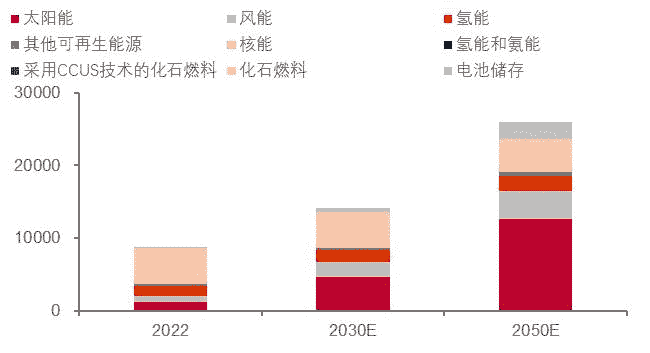

资料来源：IEA，山西证券研究所

光伏电池已历经三次迭代，钙钛矿电池为第三代的代表。第一代光伏电池主要指包括单晶硅和多晶硅电池在内的硅基太阳能电池，是目前市场中的主流。第二代光伏电池以薄膜电池为主，典型代表为铜铟镓硒、碲化镉太阳能电池；与第一代相比，第二代光伏电池有生产过程简单、成本低等优点，但其发展受到了污染严重等因素的影响。第三代太阳能电池致力于通过采用新型材料以实现更高效率、更低成本的目标，主要指包含染料敏化电池（DSSCs）、有机光伏（OPV）、量子点太阳能电池（QDSCs）和钙钛矿电池（PSCs）等新型太阳能电池。其中，钙钛矿电池近两年发展迅猛，市场关注度日益提升；远期来看，有望成为太阳能电池的终极技术。

行业研究/行业深度分析

请务必阅读最后一页股票评级说明和免责声明

8

图2：太阳能电池分类

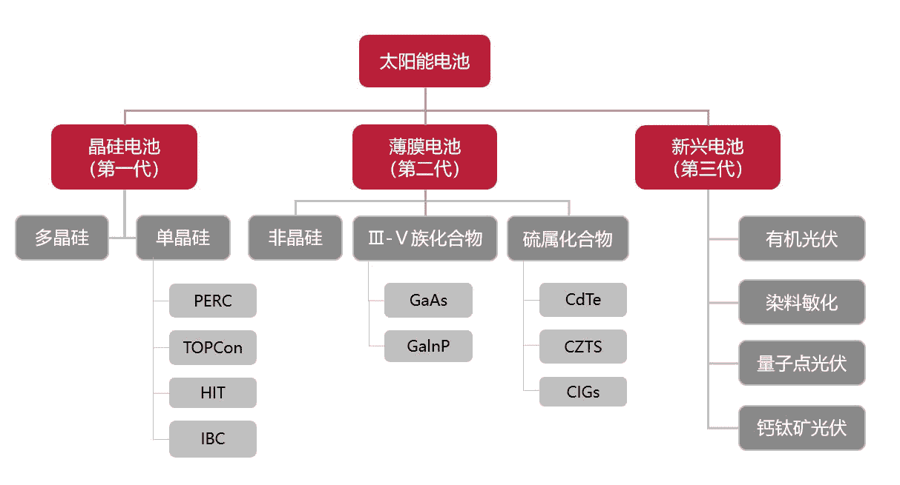

资料来源：东方富海，山西证券研究所

钙钛矿太阳能电池以金属卤化物钙钛矿材料作为光吸收层。钙钛矿材料起源于钙钛氧化物（CaTiO3），由 Gustav 于 1893 年发现，之后被 Lev A. Rose 表征，钙钛矿（perovskite）从而得名。当前钙钛矿材料是指具有 ABX3 晶体结构的有机-无机杂化化合物，其中 A 为大半径阳离子，例如甲胺基（CH3NH3）；B 为金属阳离子，例如铅离子；X 则常指卤素原子，例如 I⁻、Br⁻、Cl⁻等。

钙钛矿电池一般由透明导电氧化物（TCO）、电子传输层（ETL）、钙钛矿吸光层、空穴传输层（HTL）和电极层组成。钙钛矿电池的结构一般分为介孔结构和平面结构，平面结构又根据入射光方向不同分为 N-I-P（正式）结构和 P-I-N（反式）结构。反式结构制备工艺更加简单、可低温成膜，是目前的主流结构。

行业研究/行业深度分析

请务必阅读最后一页股票评级说明和免责声明

9

图3：钙钛矿ABX3结构示意图

图4：不同钙钛矿结构

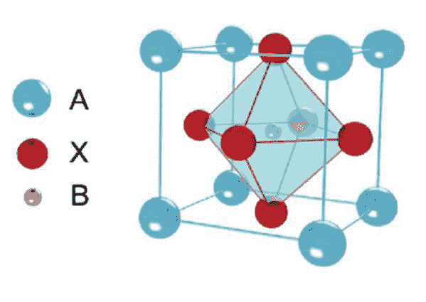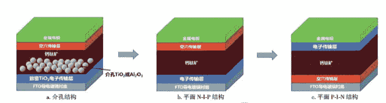

资料来源：Quantum Solutions，山西证券研究所

资料来源：《两端钙钛矿/晶硅叠层太阳电池研究进展》，山西证券研究所

钙钛矿电池工作原理同硅基太阳能电池类似，为光生伏特效应。太阳光透过导电玻璃入射到电池内部，钙钛矿活性层吸收光子产生激子（电子—空穴对），束缚态的激子分离成自由载流子，电子进入电子传输层（ETL），而空穴则进入空穴传输层（HTL），之后电子和空穴分别被阳极和阴极收集产生电动势，并移动到外电路从而产生电流。

图5：钙钛矿电池工作原理

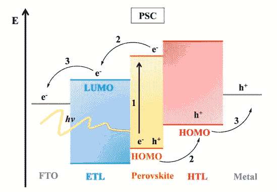

资料来源：《A comprehensive review of the current progresses and material advances in perovskite solar cells》，山西证券研究所

钙钛矿电池正式发展起步于2009年，至今已有15年历程。2009年，日本学者将钙钛矿材料用于染料敏化电池中，取得了3.8%的光电转化效率（PCE），之后随着学界研究的不断深入，钙钛矿电池效率也日益提高。截至2023年6月17日，根据Solar Cell Efficiency Tables数据显示，单结钙钛矿电池的实验室PCE达到26.1%，钙钛矿/硅叠层电池效率达到33.7%。2023年11月3日，美国国家可再生能源实验室（NREL）最新认证报告显示，由中国企业隆基绿能自主研发的晶硅—钙钛矿叠层电池效率达到33.9%，刷新了世界纪录，成为目前全球晶硅—钙钛矿叠层电池效率的最高纪录。

图6：钙钛矿电池发展历程

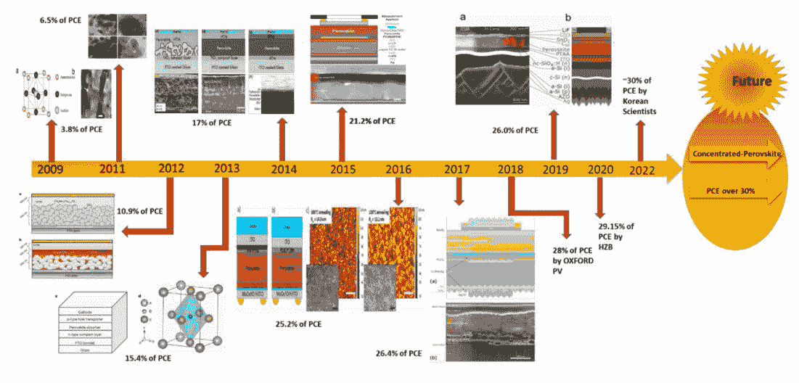

资料来源：《Stability and Performance Enhancement of Perovskite Solar Cells: A Review》，山西证券研究所

钙钛矿理论效率高于晶硅电池，叠层电池是未来发展重要方向。PERC电池的最高理论效率为24.5%，TOPCon双面电池的理论效率为28.7%，HJT电池的理论效率为27.5%；单结钙钛矿电池的最高极限转化效率为33%，高于晶硅电池。

叠层电池是指顶部使用宽带隙电池吸收高能量光子，底部电池使用窄带隙电池吸收低能量光子，减少短波光子的热损失，充分利用太阳光谱，从而提高转化效率。从理论效率来看，钙钛矿/钙钛矿叠层和钙钛矿/晶硅叠层电池分别可达到45%和43%。

图7：1.55eV单结太阳电池工作能量损失

图8：叠层太阳电池工作原理

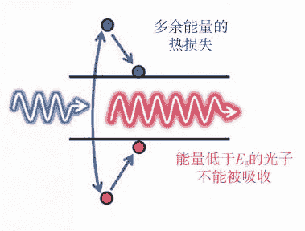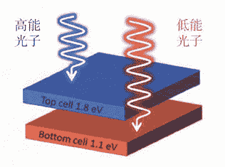

资料来源：《两端钙钛矿/晶硅叠层太阳电池研究进展》，山西证券研究所

资料来源：《两端钙钛矿/晶硅叠层太阳电池研究进展》，山西证券研究所

图9：叠层电池理论效率明显高于各单结光伏电池

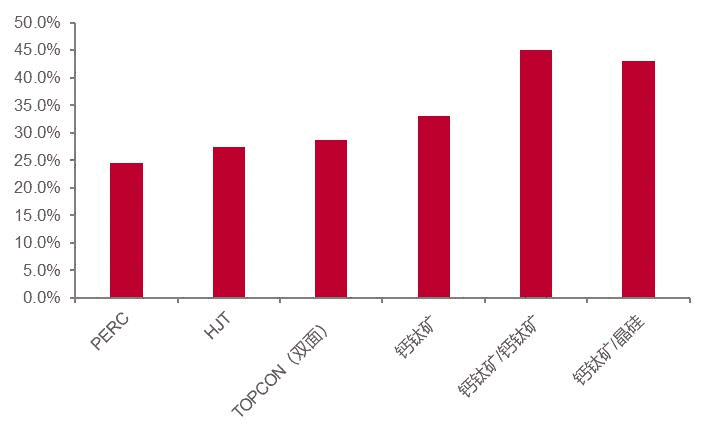

资料来源：艾邦光伏网、齐鲁壹点、全国能源信息平台，山西证券研究所

钙钛矿叠层类型主要可分为两端式（**2T**）叠层和四端式（**4T**）叠层，**2T**叠层或占据成本优势。2T叠层电池由宽带隙钙钛矿电池和晶体硅底电池串联组成，两个子电池通过具有导电性和透过性的中间连接层或者隧穿结，实现光学匹配和电学互联。4T叠层是指将两个电池机械堆叠并联，两块电池效率是两电池之和，顶底电池可分别独立制造，无需考虑工艺兼容问题，但是需要三个透明导电电极（TCE）和更多辅材。

图10：叠层电池理论效率明显高于各单结光伏电池

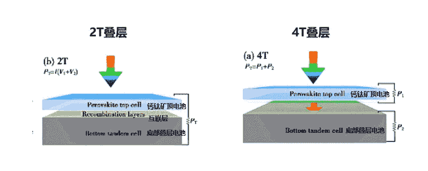

资料来源：《高效钙钛矿太阳电池及其叠层电池研究进展》，山西证券研究所

## 1.2 降本增效优势明显，大尺寸电池稳定性和效率仍面临挑战

### 1.2.1 优势：理论效率+工艺+成本三方面构筑竞争力

相较于主流晶硅电池，钙钛矿电池主要在理论效率、工艺、成本三方面具有优势。

理论效率优势主要来自三个方面：

1）高吸光系数：相较于常见光吸收材料，具有较高的光吸收系数，可以在光谱上捕获更大范围的光子能量，从而达到更高的光电转化效率。

2）带隙可调：晶硅电池带隙固定，约1.1 eV；而钙钛矿电池可以通过调节钙钛矿组分，其带隙可在1.4~2.3 eV之间变化。钙钛矿电池既可将其带隙调节至2 eV附近，在弱光条件下达到52%的光电转化效率，也可设计不同带隙的钙钛矿电池与晶硅电池叠加，从而达到更高的光电转化效率。

3）温度系数低：晶硅电池温度系数为-0.3%左右，即温度上升1℃，功率会下降0.3%，因此当温度为75℃时，出厂标定20%效率的组件实际工作效率仅为16%，而钙钛矿电池温度系数为-0.001，因此实际工作中其发电效率基本不受温度影响。

图11：钙钛矿材料光吸收系数更高

图12：钙钛矿电池带隙可调

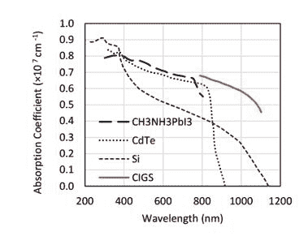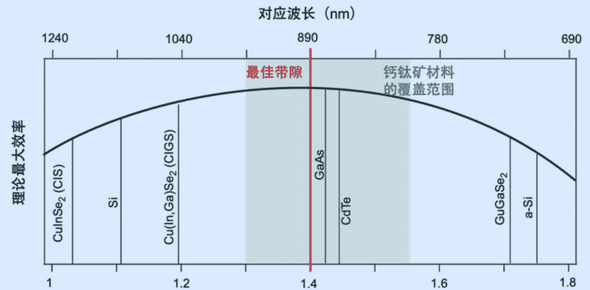

资料来源：《Progress in emerging solution-processed thin film solar cells – Part II: Perovskite solar cells》，山西证券研究所

资料来源：索比光伏网，山西证券研究所

图13：钙钛矿电池效率不断突破

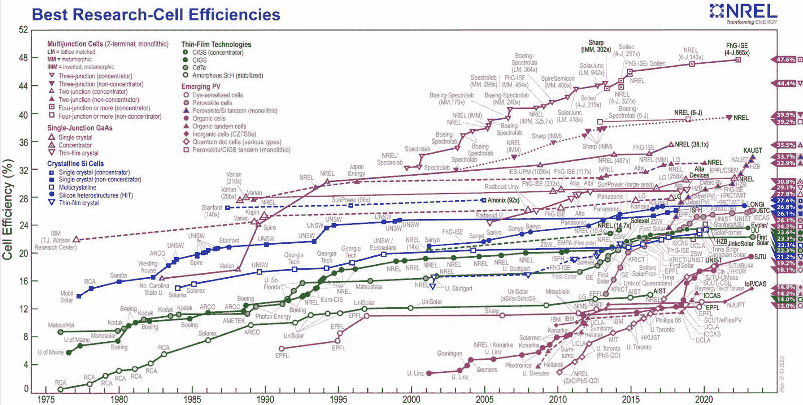

资料来源：NREL，山西证券研究所

工艺优势主要有：

1）钙钛矿工艺流程简单：目前的晶硅组件工艺流程复杂，需要在硅料、硅片、电池、组件四个以上不同工厂生产，需要消耗大概3天时间，而钙钛矿组件在一个工厂就可完成生产，整个工艺流程只需要大约45分钟；

2）能耗低：相较于晶硅生产过程中近千摄氏度的高温要求，钙钛矿由于原料纯度要求及较低（98%以上），最高生产温度仅需150℃，因此生产能耗远低于晶硅。据巨化控股数据显示，单瓦晶硅组件制造能耗大约为1.52 kWh，而单瓦钙钛矿组件制造能耗为0.12 kWh，不及晶硅组件的1/10。

图14：钙钛矿与晶硅生产流程对比

图15：钙钛矿组件制造能耗更低（kWh/W）

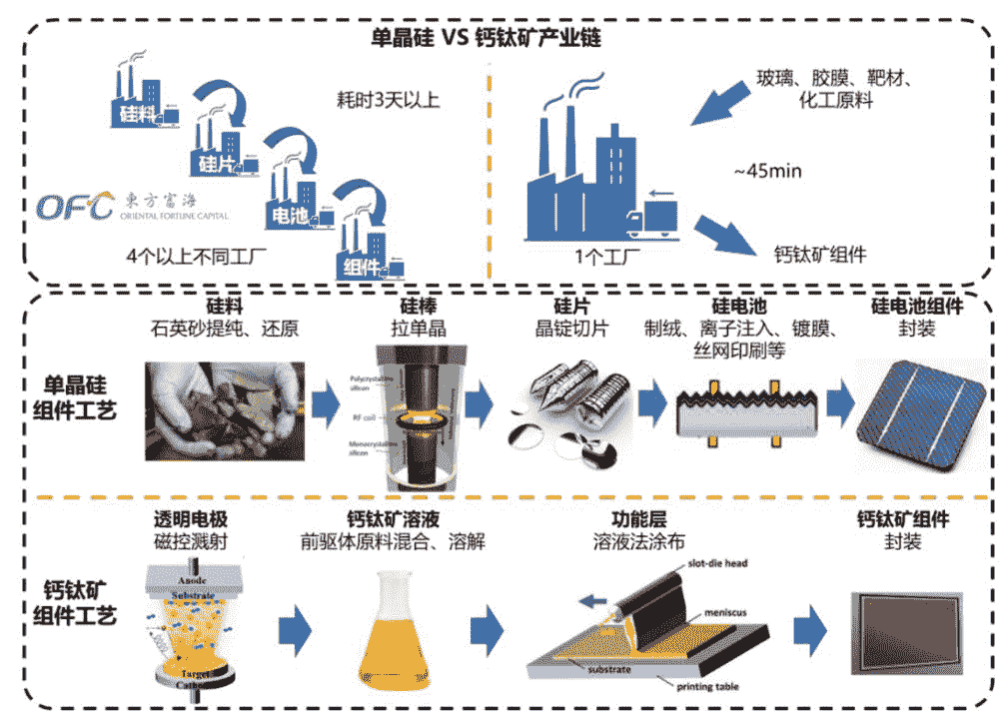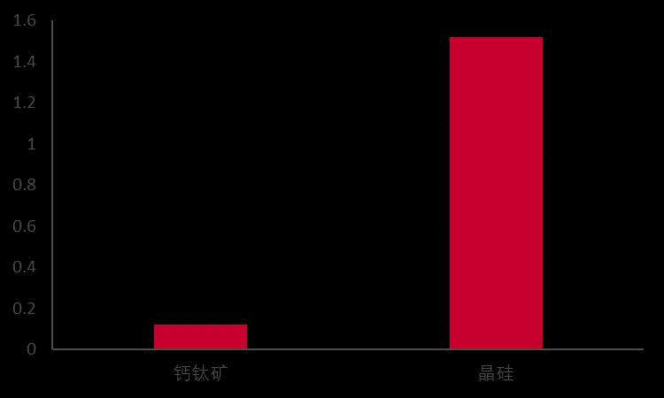

资料来源：东方富海，山西证券研究所

资料来源：巨化控股，山西证券研究所

成本优势主要来自：

1）设备投资降本空间大：晶硅太阳能组件的硅料、硅片、电池、组件四个生产环节全部加起来，需要大约9亿~12亿元的投资规模。目前钙钛矿百MW产线投资额在1.3亿左右，简单加总1GW投资额约为13亿元，与晶硅电池GW产线投资额相当。根据业内预测，随着未来规模化优势不断凸显，钙钛矿电池GW级产线投资额有望降至5亿元，为晶硅组件设备投资额的1/2；

2）原料成本低：钙钛矿原料常见、不含贵金属且用量少，以50万吨硅料产量计算，仅需1000吨钙钛矿材料产量即可满足替换需求；

3）其他材料具有降本空间：根据协鑫科技数据显示，钙钛矿光伏组件中钙钛矿材料成本占比仅为5.3%，而靶材、玻璃及封装材料成本合计占比超60%，未来仍存在降本空间。

图16：协鑫百MW钙钛矿组件成本拆分（%）

图17：钙钛矿与晶硅产线投资额对比（亿元/GW）

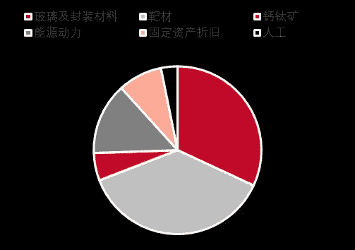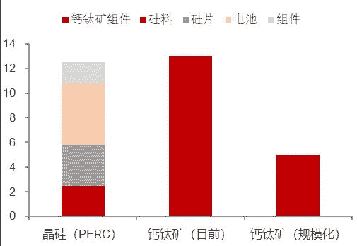

资料来源：巨化控股，山西证券研究所

资料来源：能源新闻网、全球光伏、晶科能源关于自愿披露签订30GW单晶拉棒项目投资合作协议公告、晶科能源关于签订56GW垂直一体化项目投资合作协议公告、钧达股份关于公司与涟水县人民政府签订项目投资合作协议的公告，山西证券研究所

### 1.2.2 挑战：大面积电池的稳定性和效率仍需进一步突破

目前钙钛矿电池商业化主要面临三方面挑战：稳定性、大尺寸效率和规模化生产。

图18：钙钛矿电池商业化面临的挑战

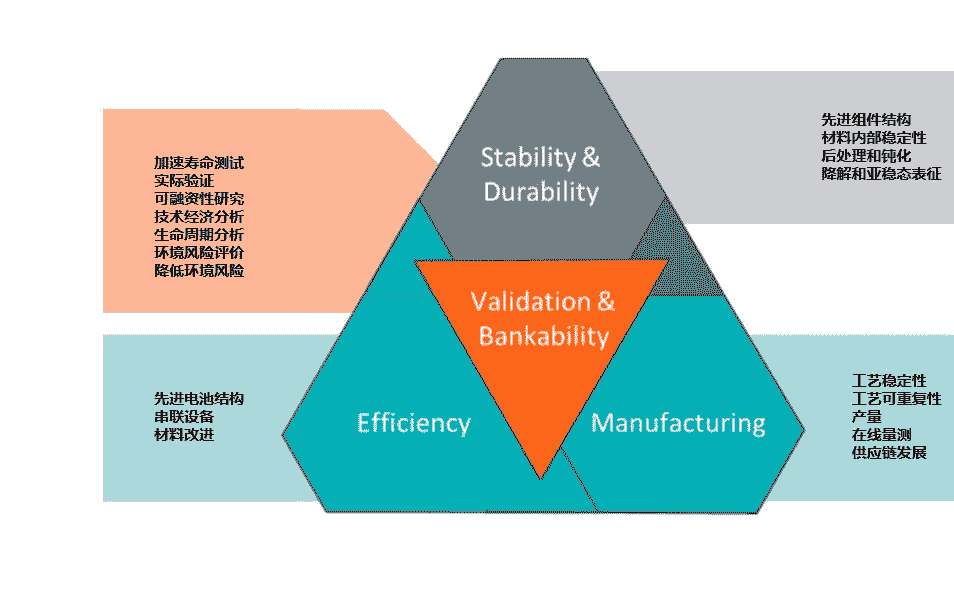

资料来源：The Path to Perovskite Commercialization: A Perspective from the United States Solar Energy Technologies Office，山西证券研究所

稳定性不足：钙钛矿电池的稳定性是决定其商业化的根本。影响钙钛矿电池稳定性的因素主要可分为两类：外部因素和内部因素。外部因素是指钙钛矿组件暴露在环境中时，水分、氧气、温度等因素都会损伤组件、缩减使用寿命，例如水分和氧气可扩散到钙钛矿层材料使其氧化分解。内部因素则是指即使组件得到很好保护，也有可能由于钙钛矿材料自身离子的迁移和分解而使组件性能下降。

大尺寸效率下降：随着尺寸增大，钙钛矿电池光电转化效率下降较大，制约了钙钛矿电池商业化进展。目前实验室制造的小尺寸（≤1 cm²）钙钛矿电池光电转化效率已经达到26%左右，但大面积电池的光电转化效率低于20%，这主要是三点原因造成：

（1）制备大面积钙钛矿薄膜容易使得薄膜均匀性变差、缺陷增加；

（2）与器件结构相关的有效光照面积减小，导致组件短路、电流密度下降；

（3）与串并联结构设计和组件工艺相关，导致组件串联电阻增大，并联电阻减小。

图19：影响钙钛矿电池稳定性的因素

图20：尺寸增大导致钙钛矿电池光电转化效率下降

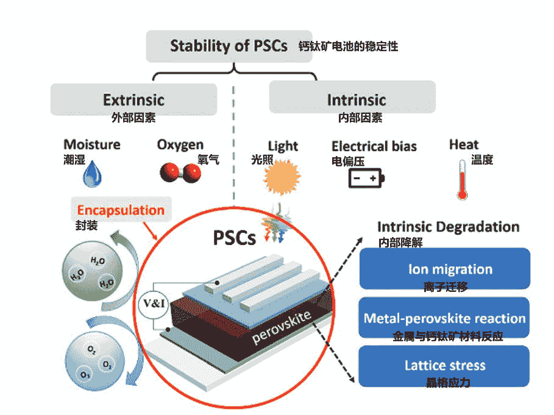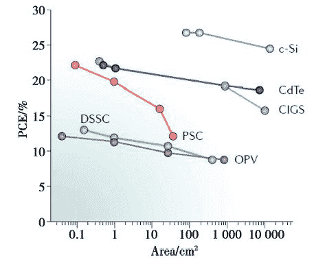

资料来源：《Pushing commercialization of perovskite solar cells by improving their intrinsic stability》，山西证券研究所

资料来源：《大面积钙钛矿薄膜制备技术的研究进展》，山西证券研究所

规模化生产有难度：目前头部公司协鑫和极电已有GW级产线建设，预计最早2024年下半年有GW级产线落地。钙钛矿组件商业化必须保证具备足够大的产能、足够高的产品良率以及所产组件效率分布尽可能集中，这些都对GW级产线落地提出了挑战。目前其他厂商百兆瓦级中试线已基本跑通，正加速布局GW级产线，预计2024—2025年会有更多产线落地。

表1：钙钛矿产业化进展

| 公司名称 | 时间 | 产业化进展 |
|---|---:|---|
| 协鑫光电 | 2015 | 惟华光能建成钙钛矿光伏组件中试线 |
| 协鑫光电 | 2016 | 协鑫集团收购惟华光能，并成立苏州协鑫纳米科技有限公司 |
| 协鑫光电 | 2017 | 建成10MW中试线 |
| 协鑫光电 | 2020 | 成立昆山协鑫光电有限公司，由协鑫纳米控股，开始筹建100MW生产线 |
| 协鑫光电 | 2021 | 完成100MW生产线建设并开始试生产 |
| 协鑫光电 | 2023 | GW级钙钛矿产线奠基 |
| 协鑫光电 | 2024E—2025E | GW级产线建成 |
| 纤纳光电 | 2015 | 公司成立 |
| 纤纳光电 | 2018 | 开始建设20MW中试线 |
| 纤纳光电 | 2020 | 20MW中试线建成 |
| 纤纳光电 | 2021 | 100MW中试线建成 |
| 纤纳光电 | 2022 | 100MW产线实现量产 |
| 纤纳光电 | 2023 | 全球首个钙钛矿分布式电站并网 |
| 极电光能 | 2018 | 开始从事钙钛矿技术研发 |
| 极电光能 | 2021 | 开始建设150MW中试线 |
| 极电光能 | 2022 | 150MW中试线投产，756 cm²组件效率达到18.2% |
| 极电光能 | 2023 | 810.1 cm²大尺寸钙钛矿组件稳态效率达到19.5% |
| 极电光能 | 2024E | 预计GW级产线投产 |
| 仁烁光能 | 2021 | 公司成立 |
| 仁烁光能 | 2022 | 10MW全钙钛矿叠层研发线建成 |
| 仁烁光能 | 2023 | 10MW全球首条钙钛矿叠层光伏组件研发线正式投产，预计150MW产线投产 |
| 仁烁光能 | 2024E | 预计150MW产线实现量产 |
| 万度光能 | 2016 | 公司成立 |
| 万度光能 | 2022 | 200MW可印刷钙钛矿光伏组件产线开始建设 |
| 万度光能 | 2023 | 第二条200MW产线开始建设 |
| 无限光能 | 2022 | 公司成立，年底建成10MW中试线 |
| 无限光能 | 2023 | 预计年底建成100MW中试线 |
| 无限光能 | 2024E | 中试线实现量产 |
| 光晶能源 | 2022 | 公司成立 |
| 光晶能源 | 2023 | 完成1.6亿元A轮融资，计划开始100MW中试线建设 |
| 光晶能源 | 2024E | 实现产能爬坡，开展试点示范 |
| 光晶能源 | 2025E | 中试线实现量产 |

资料来源：各公司公众号、各公司官网、PV-Tech、证券时报，山西证券研究所

## 1.3 光伏建筑一体化（BIPV）打开钙钛矿增量市场

光伏建筑一体化或将助力钙钛矿电池产业化。光伏建筑一体化即将太阳能发电方阵安装在建筑的围护结构外表面从而提供电力，实现了光伏发电和建筑的有机结合，在安全性、安装便捷性、美观度上均存在优势。目前我国已出台相关政策推动BIPV市场发展。2021年9月，住建部批准《建筑节能与可再生能源利用通用规范》为国家标准，于2022年4月1日起正式实施，强制要求新增建筑安装太阳能系统；2022年6月30日，发改委和住建部发布《城乡建设领域碳达峰实施方案》，到2025年新建公共机构建筑、新建厂房屋顶光伏覆盖率要力争达到50%。

图21：BIPV应用形式举例

图22：北京世园会中国馆BIPV应用

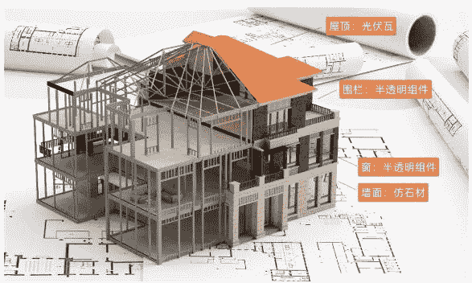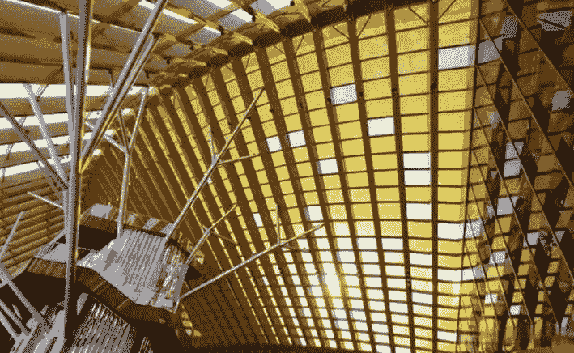

资料来源：极电光能公众号，山西证券研究所

资料来源：华阳绿建，山西证券研究所

目前BIPV市场发展处于起步期，市场空间广阔。据国际能源机构（IEA）全球建筑物跟踪报告数据，2021年，建筑物的运行消耗了全球最终能源消耗的30%。如果全球经济按照目前趋势持续增长，预计到2030年与建筑相关的温室气体排放将超过150亿吨。在碳中和、碳达峰目标下，建筑节能水平的提高将推动BIPV市场的发展。根据中国建筑科学研究院测算，截至2020年我国存量建筑面积可安装光伏电池400GW，每年竣工建筑面积可安装光伏电池40GW。基于对BIPV渗透率的假设，经测算，我们预计2025年我国BIPV新增装机量有望超过50GW。

表2：BIPV市场空间测算

| 年份 | 2022E | 2023E | 2024E | 2025E |
|---|---:|---:|---:|---:|
| 存量面积对应总装机量（GW） | 480 | 480 | 480 | 480 |
| 存量面积BIPV渗透率（%） | 2% | 4% | 8% | 15% |
| 存量面积BIPV累计装机量（GW） | 9.6 | 19.2 | 38.4 | 72 |
| 存量新增装机量（GW） | 3 | 9.6 | 19.2 | 33.6 |
| 新增面积对应累计装机量（GW） | 40 | 40 | 40 | 40 |
| 新增面积BIPV渗透率（%） | - | 30% | 40% | 50% |
| 新增面积BIPV累计装机量（GW） | - | 12 | 16 | 20 |
| 合计BIPV装机量（GW） | - | 21.6 | 35.2 | 53.6 |

资料来源：中国能源网、财联社、CPIA，山西证券研究所

钙钛矿电池性能优异，或是BIPV的最优选择。相较于常规光伏电池，钙钛矿电池不仅具备成本低廉、发光效率高等优点，其独特的半透明性、柔软性以及可改变颜色也很适用于BIPV领域，不仅可以满足光伏发电需求，也可满足建筑美学要求。

图23：钙钛矿电池性能优异可应用于BIPV

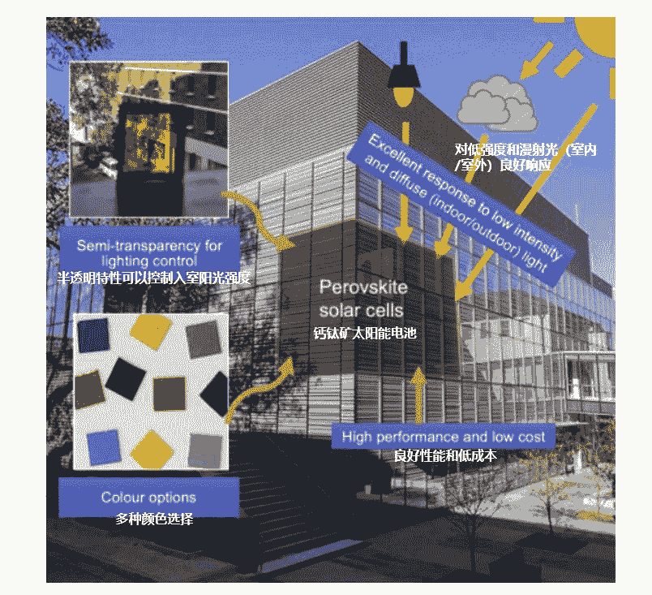

行业研究/行业深度分析

请务必阅读最后一页股票评级说明和免责声明

资料来源：《Perovskite solar cells for building integrated photovoltaics—glazing applications》，山西证券研究所

## 2. 量产步骤基本形成共识，PVD 和激光设备确定性较高

钙钛矿电池主要可划分为五层：TCO、空穴传输层、钙钛矿层、电子传输层和背电极。生产流程可大致划分为：输入 TCO 层玻璃→P1 激光划线→电荷传输层沉积→退火/干燥→钙钛矿层涂覆→退火/干燥→电荷传输层沉积→退火/干燥→P2 激光划线→背电极制作→P3 激光划线→激光清边→测试分拣封装。目前各家厂商在各层材料和工艺选择上存在分歧，分歧主要集中在电子传输层、钙钛矿层和空穴传输层的材料选择和制备设备，而对于 TCO 层、背电极、激光设备和封装的工艺选择已逐渐明确，带来材料、设备较为确定性需求。

图24：钙钛矿电池组件生产流程及目前主流设备选择

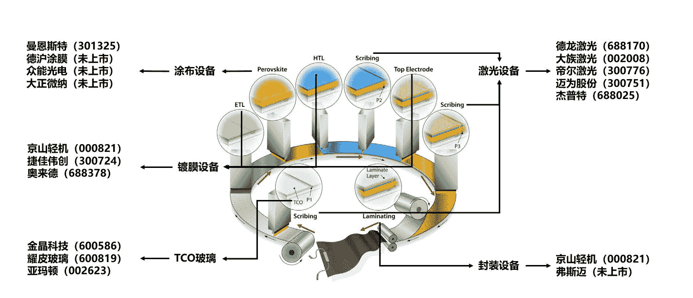

资料来源：《Outlook and Challenges of Perovskite Solar Cells toward Terawatt-Scale Photovoltaic Module Technology》、曼恩斯特官网、众能光电公众号、中国证券网、大正微纳公众号、京山轻机官网、捷佳伟创官网、金晶科技 2023 年半年报、奥来德 2023 年半年报、迈为股份官网、耀皮玻璃 2023 年半年报、亚玛顿 8 月 18 日投资者关系平台问答、杰普特 6 月 19 日投资者互动平台问答、德龙激光 5 月 25 日投资者关系平台问答、帝尔激光 2 月 14 日投资者互动平台问答、广东脉络能源科技有限公司公众号、大族激光 6 月 28 日投资者互动平台问答、智通财经、弗斯迈官网，山西证券研究所

## 2.1 钙钛矿层：狭缝涂布相对主流，蒸镀法关注度提升

### 材料端

钙钛矿层是钙钛矿电池的核心，目前产业化中多选择 FAPbI₃。钙钛矿材料主要可分为两类：有机-无机杂化钙钛矿材料和无机钙钛矿材料。有机-无机杂化钙钛矿材料的代表为甲胺铅碘（CH₃NH₃PbI₃，MAPbI₃）和甲脒铅碘（CH(NH₂)₂PbI₃，FAPbI₃）。早期钙钛矿材料研究方向主要为 MAPbI₃，但由于其光利用率不够理想，因此研究开始逐渐转向 FAPbI₃。FAPbI₃ 材料不仅具有较高的光电转化效率，并且在热和光照稳定性方面也优于 MAPbI₃，是目前产业界的主流选择方案。

无机钙钛矿材料代表为 CsPbX₃。有机-无机杂化钙钛矿材料容易受水、热等条件因素影响而分解，从而使得电池稳定性大幅下降，若使用 Cs⁺ 代替 MA⁺ 或 FA⁺ 可以提升钙钛矿稳定性，因此无机钙钛矿材料也成为学术界研究热点。但目前 CsPbX₃ 主要面临着室温条件下光电转化效率（PCE）迅速衰减的问题，因此难以应用于产业化中。

图25：CsPbX₃ 在低温或室温条件下会转变为黄色正交相非钙钛矿结构

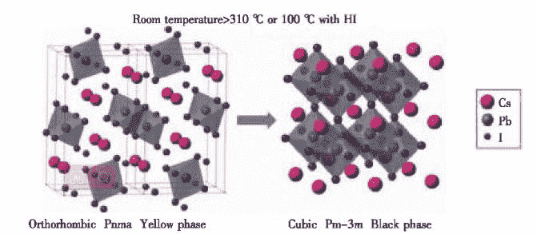

资料来源：《无机钙钛矿材料的低温制备及光伏应用进展》，山西证券研究所

从专利角度看，钙钛矿层材料是各家布局重点，内容主要集中于两方面：（1）在钙钛矿前驱体溶液中加入新的添加剂；（2）选用新的溶剂体系，各家差异主要在于元素配比、添加剂选择、溶剂选择等方面。

表3：三家企业钙钛矿层材料部分专利布局

| 申请公司 | 申请年份 | 申请公布号 | 钙钛矿层材料改进 |
|---|---:|---|---|
| 协鑫光电 | 2022 | CN115172609A | 在钙钛矿前驱体溶液中添加了一定比例的硫氰酸盐及苯乙胺或苯乙胺卤化物的氢卤酸盐 |
| 极电光能 | 2022 | CN115458687A | 使用草酸苯肼添加剂 |
| 纤纳光电 | 2020 | CN114551722A | 在前驱体溶液中加入了高分子聚合物单体和油性引发剂 |

资料来源：国家知识产权局，山西证券研究所

### 工艺及设备端

钙钛矿层制备工艺主要可分为湿法（溶液法）、干法（气相法）和气相沉积辅助法（干湿结合），各种路线各有优缺点，目前各家仍有分歧，尚未确定主流工艺技术路线。

溶液法可分为旋涂、涂布、喷涂等方法，溶液法操作简单、成膜速度快且成本较低，其中狭缝涂布法是目前产业化中最常选用的方法。

- 旋涂法：将配置好的钙钛矿溶液置于基板上，然后旋转制得钙钛矿涂层，该法主要用于实验室制备，不适用于大面积制备钙钛矿组件。
- 狭缝涂布法：通过压力使“墨水”从狭缝状喷嘴流出到基板上形成薄膜，可以通过调整狭缝宽度、模头移动速度等来进行精细化控制，且具有可大面积制备、可连续生产、材料利用率高等优点。
- 刮刀涂布法：在基片的一端滴注一定量的溶液，然后使用刮刀推动溶液在基片表面形成薄膜。
- 喷涂法：将溶液喷涂在基板上形成钙钛矿层。
- 喷墨打印法：直接喷射纳米尺寸的溶液在基底上形成薄膜，可以通过计算机精确控制图案和墨水消耗。

图26：各类溶液法制备钙钛矿层示意图

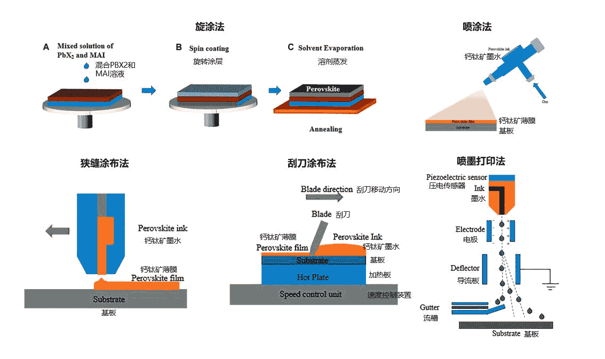

资料来源：《Processing and Preparation Method for High-Quality Opto-Electronic Perovskite Film》，山西证券研究所

干法主要为蒸镀法，优点是沉积薄膜的均匀度以及各批次之间的一致性相对容易控制，适合 2T 叠层；缺点是工艺速度较慢且设备投资成本相对较高。

- 真空蒸镀法：在真空室中蒸发原材料形成蒸汽流，然后在衬底表面形成钙钛矿薄膜。蒸镀法可分为双源共蒸法和顺序沉积法，双源共蒸法类似于溶液制备方法中的一步法，将 PbI₂、FAI、MAI 等原料同时蒸发，均匀混合反应形成所需钙钛矿材料；顺序沉积法是指一种材料先蒸镀到基底，另一种材料再蒸镀到前种材料上。
- 近空间升华法：通过高温将材料升华然后沉积到衬底上。
- 气相运输法：依靠运输载气将升华材料运输到目标基材，材料与载气不发生化学反应。

图27：各类真空法制备钙钛矿层示意图

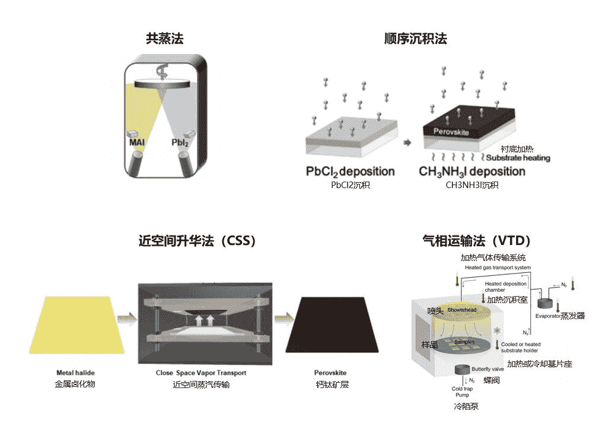

资料来源：《Perovskite solar cells by vapor deposition based and assisted methods》，山西证券研究所

气相沉积辅助法是将溶液法和真空法结合到一起的多阶段沉积方法，主要可分为气相辅助溶液法（VASP）和混合气溶法（Hybrid vapor-solution process）。

- 气相辅助溶液法：先用溶液法制备得到钙钛矿前驱体薄膜，再将其放入气相沉积成型腔体中，采用真空蒸发等方式使蒸发材料与之反应，生成钙钛矿晶体，可以简单看作“溶液法+真空法”。
- 混合气溶法与 VASP 类似，主要是颠倒了溶液法和真空法的顺序。

图28：不同气相沉积辅助法示意

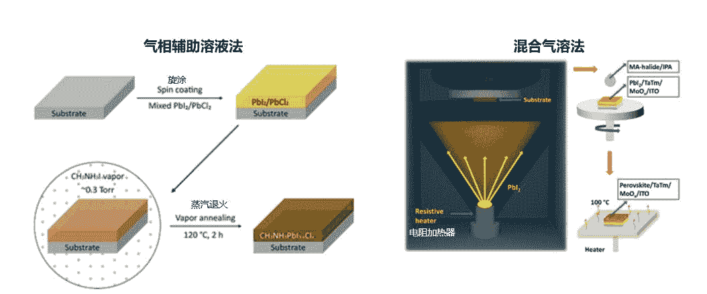

资料来源：《Perovskite solar cells by vapor deposition based and assisted methods》，山西证券研究所

从专利角度看，早期钙钛矿企业的专利申请主要集中在以狭缝涂布法为代表的涂布工艺及相关设备。而目前各家主流厂商已经开始布局 PVD（真空蒸镀）设备，从而有望带来增量 PVD 需求。

协鑫光电制备钙钛矿层多选择溶液法，工艺方面专利布局主要集中在溶液法中退火工艺的优化。除溶液法外，其 2023 年申请专利显示公司也开始布局真空蒸镀法制备钙钛矿薄膜工艺。与制备工艺相对应，协鑫光电对涂布法中所需要的干燥和退火设备的相关专利也进行了布局，同时其 2023 年最新专利显示，公司也开始布局 PVD（真空蒸镀）设备。

表4：协鑫光电有关钙钛矿层制备工艺的专利布局

| 申请年份 | 申请公布号 | 钙钛矿层制备工艺 | 主要内容 |
|---:|---|---|---|
| 2023 | CN116367674A | 真空蒸镀法 | 采用真空蒸镀法制备钙钛矿薄膜 |
| 2023 | CN116322234A | 溶液法—涂布法 | 改进成膜方法，消除涂层干燥结晶缺陷 |
| 2022 | CN115101678A | 溶液法 | 溶液法制得钙钛矿薄膜前体，然后再进行退火+加压处理 |
| 2022 | CN114843409A | 溶液法 | 溶液法制备得到钙钛矿薄膜前体，然后对钙钛矿层两次退火 |
| 2022 | CN114597311A | 溶液法 | 溶液法制备得到钙钛矿薄膜前体，然后加热至 300–400℃退火 |

资料来源：国家知识产权局，山西证券研究所

表5：协鑫光电有关钙钛矿层制备设备的专利布局

| 申请年份 | 申请公布号 | 钙钛矿层制备设备 | 主要内容 |
|---:|---|---|---|
| 2023 | CN116463587A | PVD（真空蒸镀） | 设计了一种真空顺序沉积制备钙钛矿薄膜的装置 |
| 2023 | CN219178242U | 涂布设备 | 设计了一种涂布用风刀干燥设备 |
| 2022 | CN218521334U | 涂布设备 | 设计了一种涂布风刀干燥设备 |
| 2022 | CN218826987U | 涂布设备 | 涉及了一种涂布用抽真空干燥设备 |
| 2022 | CN218868608U | 涂布设备 | 设计了一种钙钛矿层用高温退火风刀组件 |
| 2022 | CN114843409A | 涂布设备 | 设计了一种钙钛矿层退火设备 |

资料来源：国家知识产权局，山西证券研究所

极电光能制备钙钛矿层的专利大多为干湿法相结合。从专利申请年份趋势来看，2020—2021 年公司干法多选择近空间升华法或气相运输法；而 2022 年开始，公司真空法多选择真空蒸镀法。真空法设备端，公司主要布局 PVD 设备；溶液法设备端，公司主要布局狭缝涂布设备和刮涂设备。

表6：极电光能有关钙钛矿层制备工艺的专利布局

| 申请年份 | 申请公布号 | 钙钛矿层制备工艺 | 主要内容 |
|---:|---|---|---|
| 2022 | CN115976475A | 真空蒸镀法+溶液法 | 制备了一种“三明治”结构的卤化铅复合膜层 |
| 2022 | CN116004051A | 真空蒸镀法+溶液法 | 优化了溶液法所用的有机墨水溶剂体系 |
| 2022 | CN116347955A | 溶液法—涂布法 | 采用激光辅助结晶进行涂布法后钙钛矿层退火 |
| 2022 | CN115568260A | 溶液法 | 采用光处理与等离子处理同时进行的方法对钙钛矿层退火 |
| 2022 | CN115295732A | 真空法+溶液法 | 优化溶液法工艺，进行两次退火 |
| 2021 | CN114231905A | 真空法—反应溅射法 | — |
| 2021 | CN113921724A | 真空法（近空间升华法或气相运输法）+涂布法 | — |
| 2021 | CN113851587A | 气相运输法 | — |
| 2021 | CN113644209A | 近空间气相运输法+近空间升华法 | — |
| 2020 | CN112289932A | 近空间升华法+溶液法 | — |

资料来源：国家知识产权局，山西证券研究所

表7：极电光能有关钙钛矿层制备设备的专利布局

| 申请年份 | 申请公布号 | 钙钛矿层制备设备 | 主要内容 |
|---:|---|---|---|
| 2023 | CN116240499A | 真空设备 | 在真空制膜系统的进气口处增加 MFC 气体流量控制系统 |
| 2023 | CN116121712A | PVD（气相传输） | 设计了一种具有连续进料功能的钙钛矿层气相传输沉积设备 |
| 2022 | CN219051911U | 涂布设备 | 设计了一种涂布设备 |
| 2022 | CN219218130U | PVD（真空蒸镀） | 设计了一种连续加料式的真空蒸镀设备 |
| 2022 | CN218039273U | PVD（近空间升华） | 设计了一种具备连续投料功能的钙钛矿膜层升华系统 |
| 2022 | CN115354294A | PVD（真空蒸镀） | 设计一种真空蒸镀设备 |
| 2022 | CN217646786U | 刮涂设备 | 设计了一种刮涂设备 |
| 2022 | CN217655908U | 涂布设备 | 设计了一种涂布设备 |
| 2022 | CN114892130A | PVD（近空间升华法）+涂布设备 | 设计了一种近空间升华设备 |
| 2022 | CN114645250A | PVD（真空蒸镀） | 设计了一种真空蒸镀设备 |
| 2022 | CN216988389U | 狭缝涂布设备 | 设计了一种狭缝涂布设备 |
| 2022 | CN114632670A | 狭缝涂布设备 | 设计了一种狭缝涂布设备 |
| 2021 | CN114481032A | PVD（真空蒸镀） | 设计了一种真空共蒸发沉积钙钛矿膜设备 |
| 2021 | CN113457917A | 刮涂设备 | 设计了一种刮涂设备 |
| 2021 | CN113451516A | PVD（真空蒸镀） | 设计了一种真空蒸镀设备 |
| 2021 | CN214254460U | 涂布设备 | 设计了一种用于涂布法中钙钛矿薄膜的晶化装置 |

资料来源：国家知识产权局，山西证券研究所

纤纳光电 2016—2017 年在设备端的专利布局主要为 CVD 设备，2018—2020 年设备布局主要为涂布设备，2021 年开始，公司布局了 PVD 设备。

表8：纤纳光电有关钙钛矿层制备设备的专利布局

| 申请年份 | 申请公布号 | 钙钛矿层制备设备 | 主要内容 |
|---:|---|---|---|
| 2021 | CN214975295U | 涂布设备 | 设计了一种涂布设备 |
| 2021 | CN114807862A | PVD（气相传输） | 设计了一种气相传输沉积设备 |
| 2020 | CN114583060A | 溶液法设备+CVD | 设计了一种钙钛矿薄膜节奏化沉积设备 |
| 2020 | CN214160322U | 涂布设备 | 设计了一种提升涂布机效率的设备 |
| 2019 | CN112844966A | 涂布设备 | 设计了一种可用于涂布设备中的通风装置 |
| 2019 | CN210730072U | 涂布设备 | 设计了一种钙钛矿薄膜干燥设备 |
| 2019 | CN111434390A | 狭缝涂布设备 | 设计了一种狭缝涂布设备 |
| 2018 | CN111167682A | 涂布设备 | 设计了一种可用于涂布设备中的半密闭热风装置 |
| 2018 | CN110880553A | 狭缝涂布设备 | 设计了一种狭缝涂布设备 |
| 2018 | CN110880554A | 涂布设备 | 设计了一种涂布设备 |
| 2018 | CN110047998A | CVD | 设计了一种沉浸式制备钙钛矿薄膜的设备 |
| 2017 | CN109536893A | 溶液法设备+CVD | 设计了一种气相辅助溶液法用设备 |
| 2017 | CN207517733U | 溶液法设备+CVD | 设计了一种可用于气相辅助溶液法的成膜均匀性装置 |
| 2017 | CN108970913A | 涂布设备 | 设计了一种涂布设备 |
| 2016 | CN107779844A | 溶液法设备+LPCVD（低压化学气相沉积） | 设计了一种化学气相沉积设备 |

资料来源：国家知识产权局，山西证券研究所

表9：各厂商钙钛矿层设备布局情况

| 工艺选择 | 公司名称 | 布局情况 |
|---|---|---|
| 涂布设备 | 曼恩斯特 | 公司加速推进涂布技术在钙钛矿太阳能电池和燃料电池等领域的规模化量产进程，在 2023 年均已成功获得销售订单。 |
| 涂布设备 | 德沪涂膜 | 2023 年 8 月，2 台钙钛矿核心涂膜设备按时保质成功通过初验收，并再度斩获 100MW 钙钛矿量产线大尺寸高精密涂膜设备订单。迄今为止，大尺寸高精密涂膜设备在我国已交付钙钛矿量产线中的市占率已达到 85.7%，是钙钛矿电池制造设备头部企业。 |
| 涂布设备 | 众能光电 | 有狭缝涂布设备，公司已建成 100–500kW（准 MW）级大面积钙钛矿太阳能电池中试平台，可快速进行工艺优化和迭代。 |
| 涂布设备 | 大正微纳 | 2021 年 4 月搭建全球首条钙钛矿薄膜自动化生产线以及柔性太阳能电池生产线设备，2022 年 3 月建设百 MW 级钙钛矿电池产线，开启全方位光伏领域应用。 |
| 蒸镀设备 | 京山轻机 | 公司是业内较早完成钙钛矿设备开发且有实际产品销售的企业。目前公司提供 MW 级钙钛矿及整体解决方案，并提供 GW 级钙钛矿量产装备输出与技术支持。 |
| 蒸镀设备 | 捷佳伟创 | 在钙钛矿及钙钛矿叠层路线中，公司已具备钙钛矿及钙钛矿叠层 MW 级量产型整线装备的研发和供应能力，在大尺寸钙钛矿、全钙钛矿叠层、HJT/TOPCon 叠层钙钛矿领域的设备持续销售，设备种类涵盖 RPD、PVD、PAR、CVD、蒸发镀膜及精密狭缝涂布、晶硅叠层印刷等核心工艺设备。 |
| 蒸镀设备 | 奥来德 | 2022 年 11 月，公司投资建设新项目，包括钙钛矿结构型太阳能电池蒸镀设备的开发，延伸布局钙钛矿业务，产品结构日益多元化。 |
| 蒸镀设备 | 微导纳米 | 2023 年 11 月，微导纳米自主研发的钙钛矿晶硅叠层电池专用设备顺利通过海外客户验收，帮助客户达成商业化电池（258.15 cm²）最新世界纪录效率。公司为客户提供的 ALD 专用量产设备，克服了钙钛矿层需要的低温、无损等工艺难点，同时满足高镀膜质量和工艺节拍要求。 |

资料来源：曼恩斯特 2023 年半年报、德沪官网、众能光电公众号、大正微纳官网、京山轻机 2023 年半年报、捷佳伟创 2023 年半年报、奥来德 2023 年半年报、微导纳米公众号，山西证券研究所

## 2.2 电子传输层：氧化锡为主流材料，RPD 设备较为适合

电子传输层（ETL）主要作用是提取和传输光生电子，并且可以抑制钙钛矿薄膜中的电荷复合。ETL 对于实现高开路电压（VOC）、高填充因子（FF）、更好的入射光吸收等性能起着至关重要的作用。影响 ETL 效率的因素主要有 5 个：与钙钛矿层的接触界面、电子迁移率、能量等级、电子陷阱态、表面形态，其中最为关键的因素是接触界面，主要影响载流子重组。

图29：影响 ETL 效率的因素

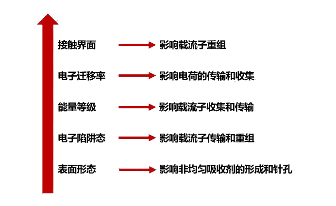

资料来源：《A comprehensive review of the current progresses and material advances in perovskite solar cells》，山西证券研究所

电子传输层材料需要与钙钛矿层材料能级匹配。电子传输层材料主要可分为两类：有机化合物和金属氧化物。有机化合物主要为富勒烯（C60、C70）和其衍生物（PCBM 等），金属氧化物则主要有氧化锡、氧化钛、氧化锌等。

行业研究/行业深度分析

请务必阅读最后一页股票评级说明和免责声明

27

图30：常见有机化合物能级图

图31：常见无机化合物能级图

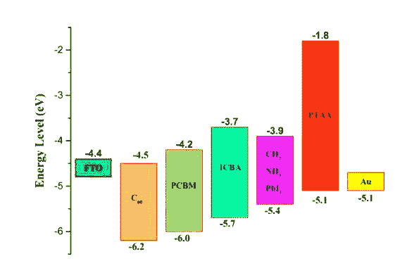

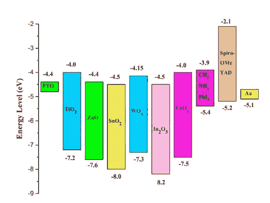

资料来源：《Functional materials, device architecture, and flexibility of perovskite solar cell》，山西证券研究所

资料来源：《Functional materials, device architecture, and flexibility of perovskite solar cell》，山西证券研究所

氧化锡或是目前电子传输层材料的最佳选择，效率及成本综合优势明显。实验室研究最早多采用 TiO2 作为 ETL 材料，但由于 TiO2 具有较低的光学稳定性和迁移率，且生产需要经过高温加工，导致生产成本较高，因此后来开始选择 ZnO、PCBM、WOx、SnO2 等作为 ETL 材料，其中氧化锡由于不需要高温加工，并且具有高电子迁移率、大带隙等优异光学性能，成为了目前 ETL 材料的多数选择，目前含氧化锡的钙钛矿电池的光电转化效率（PCE）已日益接近氧化钛。

图32：含不同 ETL 材料钙钛矿电池的光电转换效率范围

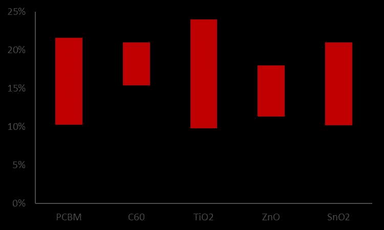

资料来源：《Electron Transport Materials: Evolution and Case Study for High-Efficiency Perovskite Solar Cells》，山西证券研究所，注：效率范围仅含有限样本

从成本来看，由于 PCBM 等有机 ETL 材料合成工艺复杂、提纯难度高等，其成本较高；而常见的无机 ETL 材料单克成本基本低于 3 元/g，明显具有成本优势。

图33：常见 ETL 材料价格（元/克）

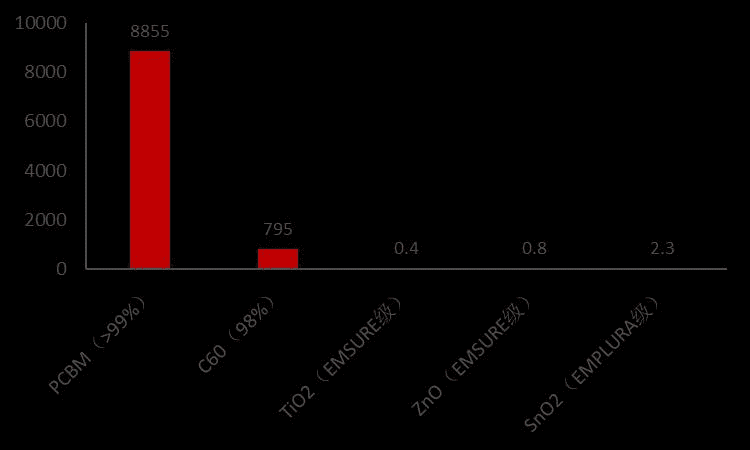

资料来源：MERCK，山西证券研究所，注：报价仅供参考，不代表厂家实际成本

从专利角度看，协鑫光电所申请专利中有 5 项专利直接涉及 ETL 材料，其中 2 项选择氧化锡，其余选择了氧化铈、氯化钛和 PCBM。极电光能所申请专利中有 10 项专利直接涉及 ETL 材料，其中 4 项选择氧化锡，2 项选择了复合传输层（有机传输层+无机传输层），其中无机传输层材料选择氧化锡，1 项专利优选材料中包含氧化锡，剩余三项专利所选材料种类较为多样，如掺杂金属元素的金属氧化物等。

表10：协鑫光电及极电光能对 ETL 材料的专利布局

| 公司名称 | 申请年份 | 专利号 | 所选 ETL 材料 | 内容 |
|---|---:|---|---|---|
| 协鑫光电 | 2022 | CN115084390A | PCBM | 在 PCBM 中添加锂盐、有机高分子和甲胺卤素盐 |
| 协鑫光电 | 2020 | CN112054123A | 氧化锡 | 制备带氨基的氧化锡电子传输层 |
| 协鑫光电 | 2020 | CN111430484A | 氧化铈 | 采用低温退火处理得到低温氧化铈电子传输层材料 |
| 协鑫光电 | 2017 | CN107742673A | 氧化锡 | 低温退火制备氧化锡电子传输层 |
| 协鑫光电 | 2017 | CN107623072A | 氯化钛 | 低温退火制备氯化钛电子传输层 |
| 极电光能 | 2023 | CN116397220A | 氧化锡 | 金属掺杂氧化锡薄膜 |
| 极电光能 | 2023 | CN116437677A | 氧化锡 | 采用反应等离子体沉积工艺制备氧化锡电子传输层 |
| 极电光能 | 2023 | CN116322244A | C60+氧化锡 | 采用有机电子传输层+无机电子传输层 |
| 极电光能 | 2022 | CN115835661A | C60 或 PCBM | 在沸石咪唑酯骨架化合物表面生长有机电子传输材料 |
| 极电光能 | 2022 | CN115915871A | C60 或 PCBM 或 BCP+氧化锡 | 构建有机/无机复合电子传输层，并且无机传输层采用热蒸发工艺制备 |
| 极电光能 | 2022 | CN115440894A | 氧化锡 | 更适合于涂布工艺的氧化锡电子传输层 |
| 极电光能 | 2022 | CN115666194A | 氧化锡 | 采用化学浴沉积法制备 |
| 极电光能 | 2022 | CN114975791A | 掺杂有金属元素的金属氧化物 | 采用电子束沉积法得到复合电子传输层 |
| 极电光能 | 2022 | CN115117256A | N 型硫化物或硒化物 | 采用离子辅助沉积方法制备电子传输层 |
| 极电光能 | 2020 | CN112708302A | 氧化锡或氧化钛或氧化锌 | 发明了电子传输层涂布墨水 |

资料来源：国家知识产权局，山西证券研究所

**PVD**（磁控溅射）和 **RPD**（反应等离子体沉积）均可用于 **ETL** 和 **HTL** 制备，目前较为成熟的方法为磁控溅射法。磁控溅射法是在高真空充入适量的氩气，在电场与磁场的作用下，氩气电离出氩离子（Ar+），氩离子在磁场作用下加速并轰击靶表面，使得靶材表面原子或分子脱离靶材，从而沉积在基片表面形成薄膜。RPD 是利用等离子体轰击靶材使靶材升华，同时经离子化形成离子态气团，从而吸附于基片上形成薄膜。在反式结构中使用，RPD 比 PVD 更适合制备电子传输层（ETL），因为其靶材利用率更高，且由于无高能粒子产生，不会损伤基底，能减少对钙钛矿层的轰击损害，但缺点是 RPD 设备成本较高，目前仅有捷佳伟创可提供 RPD 设备。

图34：磁控溅射法和 RPD 法工作原理示意图

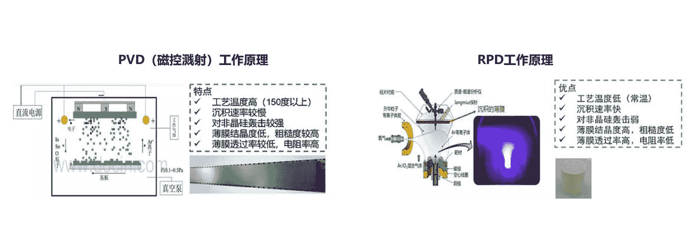

资料来源：《新型 TCO 镀膜设备在光伏产业应用展望》，山西证券研究所

## 2.3 空穴传输层：氧化镍为主流选择，制备设备多选用 PVD

空穴传输层（HTL）主要作用是促使电子和空穴有效分离，其应满足四个基本条件：

1. 适合的光透明性；
2. 合适的能级，从而能与钙钛矿层良好匹配；
3. 有效阻挡电子泄露且空穴传导性能好；
4. 化学性能稳定。

HTL 材料主要可分为两类：有机 HTL 材料和无机 HTL 材料。常见的有机空穴传输层材料有 Spiro-OMeTAD、PTAA、PEDOT:PSS、P3HT 等，常见的无机 HTL 材料有 NiOx、CuI、CuSCN 等。

图35：常见 HTL 材料能级图

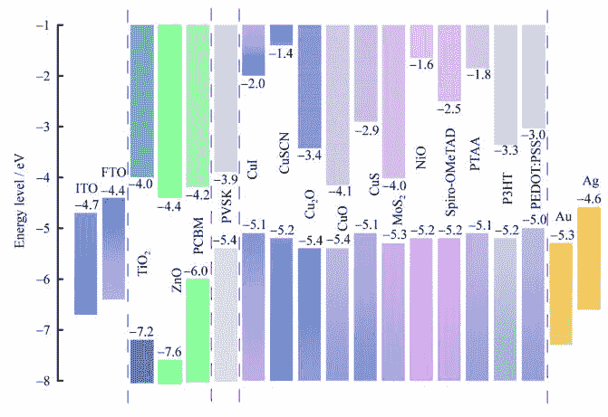

资料来源：《A brief review of hole transporting materials commonly used in perovskite solar cells》，山西证券研究所

从转化效率（PCE）来看，有机 HTL 材料整体表现更为优异，相对无机 HTL 材料效率偏高；而在无机 HTL 材料中，NiOx 表现相对突出。

图36：含不同 HTL 材料钙钛矿电池的光电转换效率

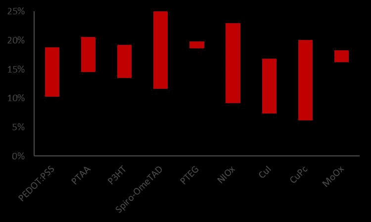

资料来源：《Review of current progress in hole-transporting materials for perovskite solar cells》，山西证券研究所，注：效率范围仅包含有限实验例

从成本方面来看，无机 HTL 材料占有明显优势。相较有机 HTL 材料每克几千元至上万元的昂贵价格，无机空穴传输层材料仅为其千分之一。

图37：常见 HTL 材料价格（元/克）

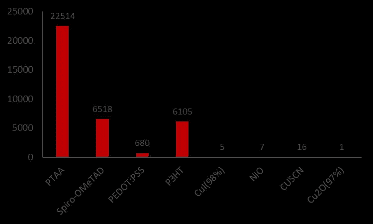

资料来源：MERCK，山西证券研究所

注：报价仅供参考，不代表厂家实际成本

从专利角度来看，氧化镍或是空穴传输层材料最佳选择。协鑫光电所申请专利中共有 2 项专利直接涉及 HTL 材料，一项选择了氧化镍，一项则选择了 Spiro-OMeTAD；共有 5 项专利涉及 HTL 界面处理（即在钙钛矿层与 HTL 之间添加钝化层/修饰层从而提升钙钛矿电池性能），其优选实验例中 HTL 材料均为氧化镍。极电光能所申请专利中共有 5 项专利直接涉及 HTL 层材料，均选择氧化镍，共有 5 项专利涉及 HTL 界面处理，优选实验例中所选择 HTL 材料也均为氧化镍。纤纳光电所申请专利中共有 5 项专利，其中两项选择氧化镍作为 HTL 材料，共有 2 项专利涉及 HTL 界面处理，优选实验例分别为 Cu2O 和氧化镍。

表11：三家厂商对 HTL 材料专利布局

| 公司名称 | 申请年份 | 专利号 | 所选 HTL 材料 | 内容 |
|---|---:|---|---|---|
| 协鑫光电 | 2020 | CN112038492A | Spiro-OMeTAD | 对含 Spiro-OMeTAD 的前驱体溶剂进行氧化处理，再制备得到空穴传输层 |
| 协鑫光电 | 2017 | CN107863444A | 氧化镍 | 在氧化镍中加入铜 |
| 极电光能 | 2023 | CN116156909A | 氧化镍 | 设置两种或三种不同溅射靶材进行溅射，得到多元金属掺杂的氧化镍空穴传输层 |
| 极电光能 | 2022 | CN115835654A | 氧化镍 | 在 NiOx 薄膜中引入了中间层金属氧化物并作后退火处理 |
| 极电光能 | 2022 | CN115942765A | 氧化镍 | 将 HTL 分为两层：下镍氧化物层和上镍氧化物层，两层均包含 NiO 和 Ni2O3 |
| 极电光能 | 2020 | CN112614940A | 氧化镍 | 采用化学浴沉积法制备氧化镍薄膜 |
| 极电光能 | 2020 | CN112510150A | 氧化镍 | 电化学沉积制备具有致密 NiOx/介孔 NiOx 双层结构的空穴传输层 |
| 纤纳光电 | 2021 | CN116419581A | Ni-MOF（镍金属-有机框架） | 制备了基于 Ni-MOF 框架的 Ni-MOF 空穴传输层 |
| 纤纳光电 | 2021 | CN115458688A | P3HT 或 Spiro-OMeTAD 或 PTAA | 将导电聚合物和聚合物溶解制备成薄膜，再使用溶剂冲洗去除薄膜中的聚合物，形成由导电聚合物组成的空穴传输层薄膜 |
| 纤纳光电 | 2021 | CN115347123A | 氧化镍 | 提升了氧化镍材料制备的空穴传输层在导电基底上的覆盖率和氧化镍薄膜的致密度 |
| 纤纳光电 | 2020 | CN111430553A | 4,4-双十二烷基噻吩-2,2′-双-1,3-二硫杂环戊二烯 | 采用新材料制备空穴传输层 |
| 纤纳光电 | 2019 | CN111435706A | 氧化镍 | 在氧化镍层表面经含硫材料处理形成硫化镍层，从而形成复合空穴传输层 |

资料来源：国家知识产权局，山西证券研究所

在反式结构中使用，PVD 更适合制备空穴传输层（HTL），因为其设备价格较低、工艺稳定性较强，且适合制作以氧化镍为材料的均匀致密薄膜。此外，新兴的 ALD 设备也可用于 HTL/ETL 层的制备，ALD 镀膜工艺的核心优势在于可以在不平整的表面实现均匀镀膜，并且可以通过循环次数的调整精确控制厚度。

## 2.4 电极层：FTO 玻璃成主流选择，PVD 为主要制备方式

钙钛矿电池面向光照的一侧为底电极，另一侧为背电极/顶电极，电极层通常使用 TCO 材料。底电极一般直接使用已经产业化的 TCO 玻璃。TCO（Transparent Conducting Oxide）玻璃，中文名称为透明导电氧化物镀膜玻璃，指通过 PVD（物理气相沉积）或 CVD（化学气相沉积）等方法将靶材及掺杂物镀在玻璃表面。目前 TCO 玻璃在 HJT 电池中已有产业化应用。根据导电膜材料不同，TCO 玻璃主要可分为 ITO 玻璃、FTO 玻璃和 AZO 玻璃。

ITO 玻璃的导电材料是掺锡的氧化铟 In2O3:Sn，主要采用 PVD（磁控溅射）工艺生产，早期曾应用于光伏电池，后来由于光伏电池对光吸收性能要求提高，ITO 玻璃性能无法满足要求且含有稀有元素铟、价格较贵，目前主要应用于显示领域。

FTO 玻璃的导电材料为掺氟的氧化锡 SnO2:F，主要采用 CVD 工艺生产，也可以用 PVD 方法制作。其导电性能比 ITO 略差，但成本相对较低，且更便于激光刻蚀，目前已成为薄膜电池主流选择。

AZO 玻璃导电材料为掺 Al 的氧化锌 ZnO:Al，主要采用 PVD（磁控溅射）工艺生产，其导电性、光透过率相比 FTO 玻璃都更优，但目前仍存在膜层偏软、刻蚀后难长期存放等缺点，在工业化中只有少量应用。

表12：不同类型 TCO 玻璃对比

| 项目 | ITO 玻璃 | FTO 玻璃 | AZO 玻璃 |
|---|---|---|---|
| 导电膜材料 | 掺锡的氧化铟 In2O3:Sn | 掺氟的氧化锡 SnO2:F | 掺铝的氧化锌 ZnO:Al |
| 原料情况 | 稀有元素铟稀缺 | 原料不稀缺 | 原料不稀缺 |
| 生产工艺 | 磁控溅射（PVD） | 化学气相沉积法（CVD） | 磁控溅射（PVD） |
| 发展阶段 | 大规模生产 | 大规模生产 | 中试 |
| 主要应用领域 | 显示 | 薄膜电池 | 薄膜电池 |

资料来源：蒂姆新材料，山西证券研究所

顶电极材料可采用金属电极、碳电极、TCO 等，目前产业化方案主要采用 TCO。制备方式主要选用 PVD（磁控溅射）和 PVD（真空蒸镀），从而带来较为确定的 PVD 设备需求。金属电极金或银电极表现虽然优异，但由于其较高的成本不太适用于产业化，主要用于实验室研究。碳电极具备结构多样性、化学稳定性以及低成本等优异特性，成为替代贵金属电极的另一选择，典型的碳电极材料为石墨、炭黑、石墨烯、碳纳米管等。

图38：部分碳电极材料示意

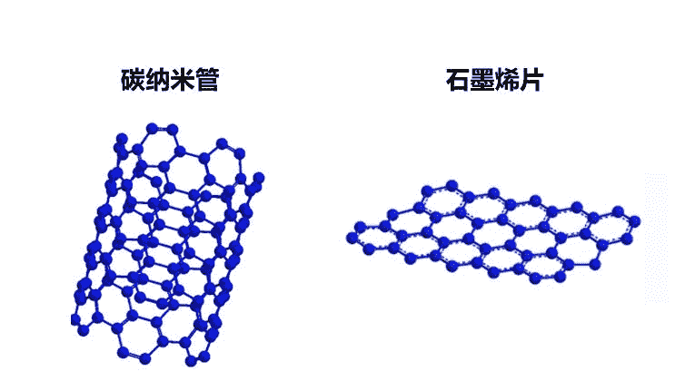

资料来源：《Role of electrodes on perovskite solar cells performance: A review》，山西证券研究所

## 2.5 封装：材料多选 POE+丁基胶，工艺标准对标 OLEDs

钙钛矿组件封装材料多选用 POE+丁基胶。钙钛矿电池相较晶硅电池对阻隔性能要求要高出几个量级，与 OLEDs 接近，目前主要有两种封装方式：

1. 完全覆盖封装：在模块顶部制备封装层；
2. 边缘封装：在模块周围放置密封剂。

相较于完全覆盖封装，边缘封装可以降低封装材料与钙钛矿发生副反应的可能性，但会使封装效果降低，因此需要加入干燥剂来增强其阻水性能，目前主要选择丁基胶。目前弗斯迈、京山轻机等厂家有钙钛矿封装设备布局。

图39：两种封装技术示意图

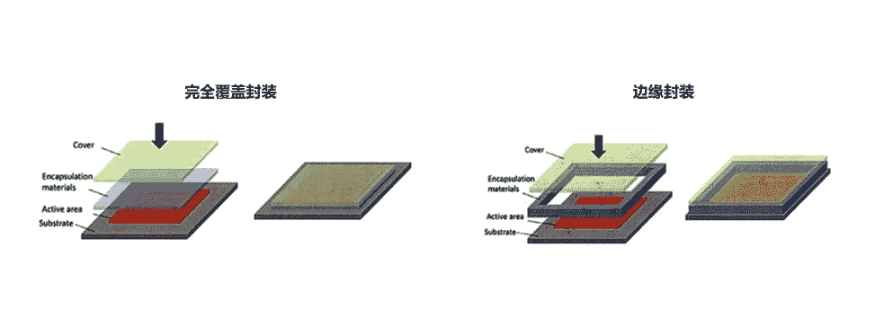

资料来源：《钙钛矿光伏电池封装材料与工艺进展》，山西证券研究所

表13：各厂商钙钛矿封装设备布局

| 公司名称 | 布局情况 |
|---|---|
| 京山轻机 | 公司提供钙钛矿组件自动封装线，包括上玻璃机、贴导电胶带机、丁基胶涂覆机、层压机等，可满足长（2000–2300 mm）×宽（900–1200 mm）的组件生产需要 |
| 弗斯迈 | 公司布局钙钛矿光伏整线解决方案，包含前道电池生产线和后道组件封装生产线 |

资料来源：京山轻机 2022 年年报，弗斯迈官网，山西证券研究所

## 2.6 激光设备：四道激光刻蚀，高精度激光设备需求确定性高

钙钛矿电池制备主要需要四道激光工序，贯穿整个制备流程。P1–P3 为激光刻蚀，主要为了串联电池；P4 为激光清边，主要为了封装。

1. P1：在 TCO 层沉积后、电荷传输层沉积前进行刻蚀，从而形成一道道相互独立的导电电极；
2. P2：在第二电荷传输层沉积后、背电极沉积前进行刻蚀，去除 ETL/钙钛矿层/HTL，保留 TCO 衬底，形成空缝，背电极沉积时会填满空缝，从而将一个电池底电极与下一个电池顶电极（TCO）相连；
3. P3：去除相邻电池的底电极/HTL/钙钛矿层/ETL，只留下 TCO 层，从而实现分离；
4. P4：激光去除玻璃表面所有膜层，要求刻线内无残留物质。

图40：钙钛矿电池激光工艺示意

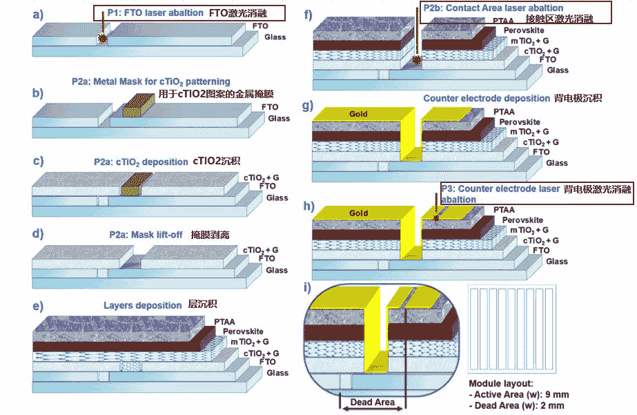

资料来源：《Laser Processing Optimization for Large-Area Perovskite Solar Modules》，山西证券研究所

钙钛矿电池需要将死区尽量做到最小，因而对激光精度要求高。P1 线到 P3 线最外侧区域不能发电，俗称死区。死区宽度越大，电池中发电无效区占比越大，效率相应越低。将死区做到最小是钙钛矿光伏电池激光划线最核心的指标之一，其影响因素除产品本身设计线宽外，还包括线与线的间距需尽量做小。由于 P1/P2/P3 线之间不可相交或并线，故间距越小，对设备加工系统的控制精度要求越高。激光设备在钙钛矿整体设备价值量中占比约为 10%–20%。目前国内厂商如德龙激光、大族激光、帝尔激光、杰普特、迈为股份等均有设备供应。

表14：各厂商钙钛矿激光设备布局

| 公司名称 | 布局情况 |
|---|---|
| 德龙激光 | 公司供应钙钛矿电池生产整段设备，包括 P0 激光打标设备、P1/P2/P3 激光刻蚀设备以及 P4 激光清边设备等，首套百兆瓦级钙钛矿电池激光设备已于 2022 年交付客户 |
| 大族激光 | 公司钙钛矿激光刻蚀设备已实现量产销售，大尺寸整线激光刻蚀设备已交付钙钛矿头部企业 |
| 帝尔激光 | 公司激光在钙钛矿电池每一层都有相应应用，2022 年公司已有钙钛矿激光设备订单交付 |
| 迈为股份 | 公司从 2020 年开始进行钙钛矿激光技术研究项目，2021 年已向客户交付设备 |
| 杰普特 | 公司已推出第二代钙钛矿激光设备，已经在多家客户现场进行技术验证 |

资料来源：迈为股份 2020 年年报、迈为股份 2021 年 4 月投资者关系活动记录表、界面新闻、每日经济新闻、德龙激光 5 月 25 日投资者关系平台问答、帝尔激光 2 月 14 日投资者互动平台问答、大族激光 6 月 28 日投资者互动平台问答、杰普特 6 月 19 日投资者互动平台问答，山西证券研究所

行业研究/行业深度分析

请务必阅读最后一页股票评级说明和免责声明

## 3. 成本测算：降本空间大，规模化后有望降至0.5–0.6元/W

目前各家钙钛矿产线大多为百MW级，头部企业组件效率已经达到18%。由于钙钛矿层材料工艺选择尚未统一，因此我们测算时多选用无机材料，并且不考虑界面修饰等因素。假设良率为90%、组件效率为18%时，测算数据显示，钙钛矿组件成本约为1.65元/W。远期来看，预计规模化量产后，钙钛矿组件成本可降至0.5–0.6元/W。

图41：钙钛矿组件和晶硅组件成本测算（元/W）

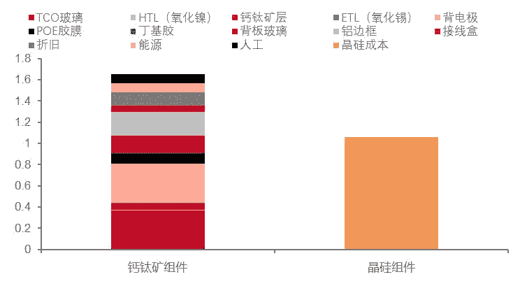

资料来源：极电光能环评公告、国家知识产权局、《Key bottlenecks and distinct contradictions in fast commercialization of perovskite solar cells》、Infolink、隆众咨询、全球光伏、生意社、阿里巴巴、《江苏省电网销售电价表》、Wind、Wood Mackenzie，山西证券研究所。注：晶硅组件成本约为2023年12月成本。

### 3.1 降本途径一：良率/效率提升

良率提升可摊薄材料、能耗等成本，从而带动组件成本下降。在百兆瓦产线下，假设良率为70%，组件成本会在2.09元/W左右；如果良率提升至80%，组件成本则会下降0.24元/W，达到1.84元/W；如果良率提升至90%，组件成本将进一步下降到1.65元/W；如果提升至100%，组件成本将下降至1.50元/W。

图42：良率提升带动成本下降（元/W）

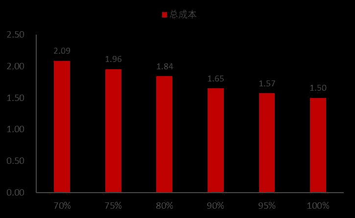

资料来源：极电光能环评公告、国家知识产权局、《Key bottlenecks and distinct contradictions in fast commercialization of perovskite solar cells》、Infolink、隆众咨询、全球光伏、生意社、阿里巴巴、《江苏省电网销售电价表》、Wind、Wood Mackenzie，山西证券研究所。

效率提升可全面带动组件成本下降。效率提升可摊薄材料、能耗、设备等成本，从而带动组件成本全面下降。百兆瓦产线下，假设良率为90%，如果组件效率从18%提升至20%，组件成本可下降0.17元/W，达到1.49元/W；如果组件效率从18%提升至25%，组件成本可下降0.46元/W，达到1.19元/W；如果组件效率从18%提升至30%，组件成本可下降0.66元/W，达到0.99元/W。

图43：钙钛矿组件效率提升带动成本下降（元/W）

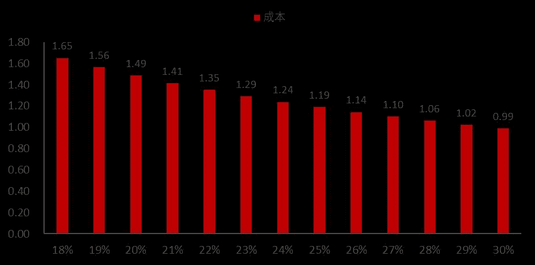

资料来源：极电光能环评公告、国家知识产权局、《Key bottlenecks and distinct contradictions in fast commercialization of perovskite solar cells》、Infolink、隆众咨询、全球光伏、生意社、阿里巴巴、《江苏省电网销售电价表》、Wind、Wood Mackenzie，山西证券研究所。

### 3.2 降本途径二：材料成本下降

钙钛矿组件材料成本下降主要依赖TCO玻璃价格下降。材料成本在钙钛矿组件成本中占比最重，而TCO玻璃成本在钙钛矿材料成本中又占据绝大份额，因此TCO玻璃价格的下降对组件成本下降至关重要。我国多家厂商都具备TCO玻璃生产经验，近些年产量供应较少主要是由于过去在电池路线竞争中晶硅电池战胜薄膜电池，因此导致TCO玻璃产量较少，而非受技术原因限制。未来随着钙钛矿GW级产线落地，预计会吸引上游具备TCO玻璃生产经验的厂商重新入局，从而使得TCO玻璃产量供应增加，成本下降。

图44：钙钛矿电池材料成本拆分

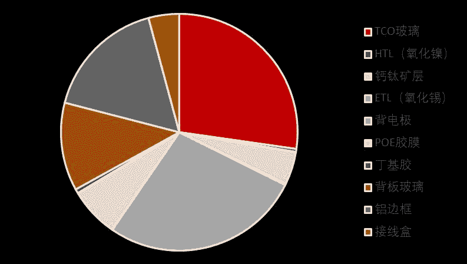

资料来源：极电光能环评公告、国家知识产权局、《Key bottlenecks and distinct contradictions in fast commercialization of perovskite solar cells》、Infolink、隆众咨询、全球光伏、生意社、阿里巴巴、《江苏省电网销售电价表》、Wind、Wood Mackenzie，山西证券研究所。

表15：TCO玻璃厂商情况

| 公司名称 | 布局情况 |
|---|---|
| 金晶科技 | 公司具备TCO年产能1500万平米/线，2022年9月开始将滕州二线升级改造为TCO玻璃产线，预计2023年第三季度投产，公司已和国内具备中试线能力的钙钛矿客户确认了产品性能。 |
| 耀皮玻璃 | 公司已成功调试可用于钙钛矿的TCO玻璃。 |
| 亚玛顿 | 公司较早就研究过TCO玻璃相关技术，2022年已经成功向客户批量供货。 |

资料来源：金晶科技2023年半年报、耀皮玻璃2023年半年报、亚玛顿8月18日投资者关系平台问答，山西证券研究所。

目前TCO玻璃价格约在60元/平左右，若价格降至40元/平，钙钛矿组件成本将下降0.12元/W，达到1.53元/W；若价格降至25元/平，组件成本将下降0.22元/W，达到1.44元/W。

图45：TCO玻璃价格下降带动组件成本下降（元/W）

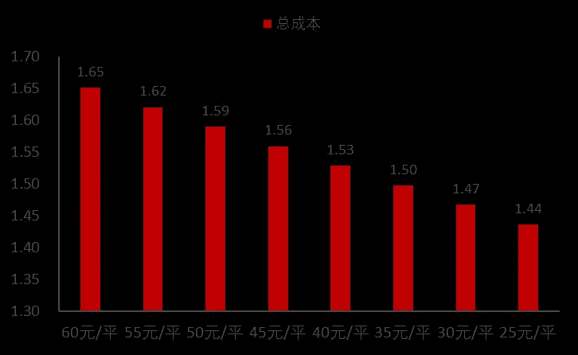

资料来源：极电光能环评公告、国家知识产权局、《Key bottlenecks and distinct contradictions in fast commercialization of perovskite solar cells》、Infolink、隆众咨询、全球光伏、生意社、阿里巴巴、《江苏省电网销售电价表》、Wind、Wood Mackenzie，山西证券研究所。

### 3.3 降本途径三：设备成本下降

目前单GW设备投资额约13亿元，预计未来可降至1/2。目前钙钛矿产业化处于0—1进程中，设备需求定制化为主，尚未实现规模化量产；而未来随着产业规模不断扩张，设备需求不断增长，预计单GW设备投资额可降至5亿元，从而带动组件单瓦成本降低0.08元。

图46：设备投资下降带动组件成本下降（元/W）

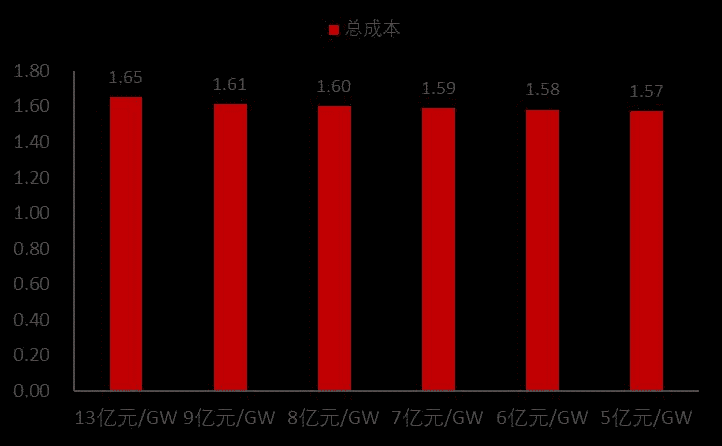

资料来源：极电光能环评公告、国家知识产权局、《Key bottlenecks and distinct contradictions in fast commercialization of perovskite solar cells》、Infolink、隆众咨询、全球光伏、生意社、阿里巴巴、《江苏省电网销售电价表》、Wind、Wood Mackenzie，山西证券研究所。

## 4. 产业化进展：百兆瓦级产线运行顺利，GW级产线已经开建

### 4.1 协鑫光电：369mm×555mm叠层组件效率突破26.34%

协鑫光电从事钙钛矿行业已接近十余年，大尺寸组件效率率先突破18%。协鑫光电发展历程最早可追溯到厦门惟华光能有限公司，其于2015年建成一条钙钛矿光伏组件中试线，产品尺寸为45cm×65cm。2016年底惟华光能被协鑫集团收购，并在苏州成立协鑫纳米科技；2017年，公司建成10MW级别光伏组件中试线。2020年底协鑫光电成立，融资约2亿元，开始筹备100MW量产线。2021年，公司建成100MW生产线并开始试生产。2023年，公司1000mm×2000mm钙钛矿单结组件光电转化效率达到18.04%；279mm×370mm的叠层组件效率突破26.17%，369mm×555mm叠层组件效率突破26.34%。2024年，公司将致力于实现26%以上的效率且2㎡以上的钙钛矿光伏组件商业化；此外，预计公司GW级别产线有望于2024—2025年落地投产。

图47：协鑫光电发展历程

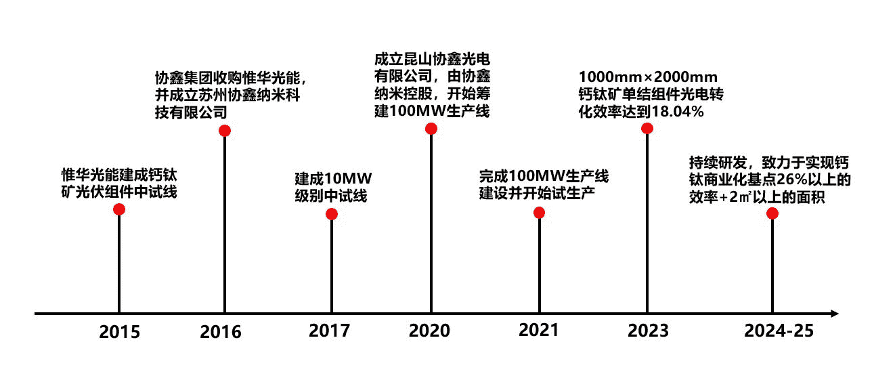

资料来源：协鑫钙钛矿官网、昆山协鑫光电公众号，山西证券研究所。

协鑫光电研发实力雄厚。协鑫光电三名创始人均毕业于清华大学化学系，研发团队由创始人范斌带领，拥有超80名研发人员，其中一半以上拥有博士、硕士学历。2022年年底，公司钙钛矿组件通过ISO三体系认证：ISO9001质量管理体系、ISO14001环境管理体系、ISO45001职业健康安全管理体系，标志公司已具备向市场供货资质。

公司也在积极拓展钙钛矿BIPV组件。2023年1月，公司钙钛矿BIPV组件通过了耐热、耐湿、耐辐射等测试，拿到了中国质量认证中心（CQC）的3C认证，标志着公司获得了进入国内建筑光伏市场的通行证，为公司发展打开增量市场空间。

图48：协鑫光电1m×2m钙钛矿组件

图49：协鑫光电钙钛矿BIPV组件示意

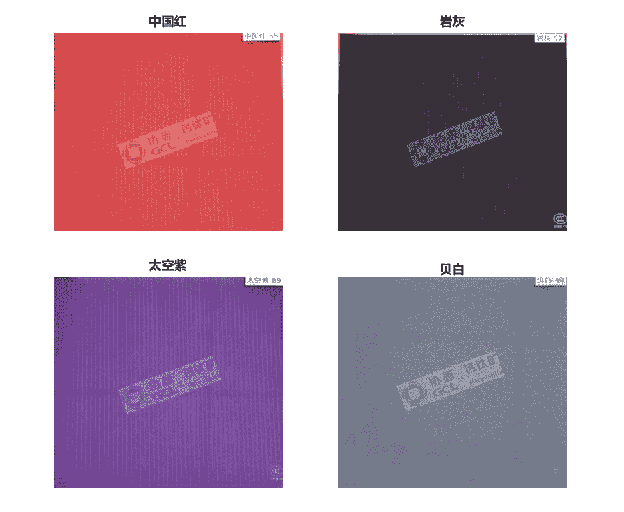

资料来源：协鑫光电公众号，山西证券研究所。

资料来源：协鑫光电公众号，山西证券研究所。

风险提示：公司产业化进展不及预期、公司效率提升进度不及预期、光伏行业需求不及预期、政策性风险等。

### 4.2 极电光能：810.1cm²大尺寸钙钛矿组件稳态效率达到19.5%

极电光能于2018年开始从事钙钛矿研发，2021年开始建设150MW中试线。公司成立至今，曾先后4次刷新钙钛矿组件效率的世界纪录。2023年11月，公司1.2×0.6m²商用尺寸钙钛矿组件全面积效率达到18.2%，对应最大功率131.07W。2023年12月，公司再次公告，其研发的810.1cm²大尺寸钙钛矿组件稳态效率达到19.5%，体现出公司深厚的技术储备和业内领先的技术迭代速度。

产业化方面，2022年8月，公司与无锡锡山经济技术开发区达成协议，将共同投资30亿元布局全球首条GW级钙钛矿光伏组件及BIPV产品生产线。项目于2023年4月开工建设，预计2024年下半年建成投产，年产值可达到25亿元。

风险提示：公司产业化进展不及预期、公司效率提升进度不及预期、光伏行业需求不及预期、政策性风险等。

图50：极电光能发展历程

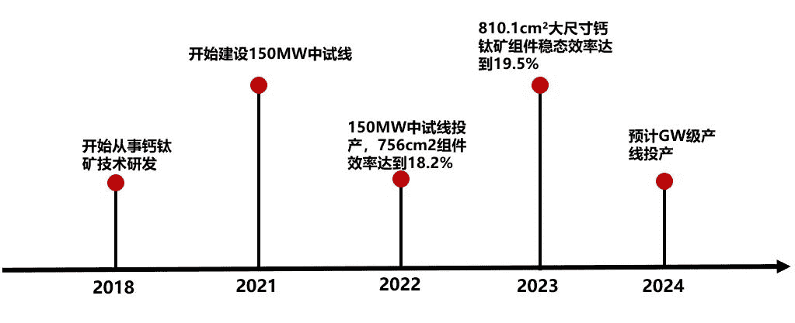

资料来源：极电光能官网、极电光能公众号，山西证券研究所。

公司布局BIPV市场较早，产品在合肥、上海、无锡、保定等多个优质项目上已取得示范性应用。公司第一代半透明光伏组件主要应用于光伏建筑一体化；第二代刚性不透明光伏组件以及第三代叠层电池与组件，主要应用于分布式发电、集中式大型光伏电站、太阳能汽车及其他“光伏+”应用领域等。目前公司150MW产线主要生产钙钛矿标准组件和BIPV光伏建筑一体化产品。

图51：极电光能钙钛矿BIPV产品

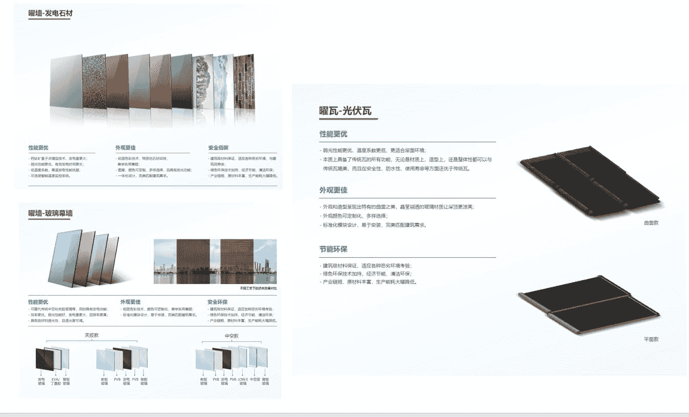

资料来源：极电光能官网，山西证券研究所。

### 4.3 纤纳光电：钙钛矿组件稳定性领跑行业

纤纳光电于2015年成立，2018年开始建设20MW中试线并于2020年建成，2021年建成100MW量产线并于2022年投产。公司曾先后9次登上钙钛矿光伏组件转化效率世界纪录榜，全球累计申请知识产权专利达300多项，研发实力强劲。2023年11月，采用公司钙钛矿α组件的蒙西基地库布其项目送电成功，是全球首个商业化运行的兆瓦级钙钛矿地面光伏项目。

图52：纤纳光电发展历程

资料来源：纤纳光电公众号、证券时报，山西证券研究所。

公司组件稳定性表现领跑行业。2023年1月，公司纤纳α组件成为全球首个通过IEC61215和IEC61730稳定性全体系认证的钙钛矿电池组件。IEC61215和IEC61730是光伏行业稳定性和安全性最重要的基础标准，通过该标准标志着公司组件拥有了进入国内外市场的通行证。

图53：IEC61215测试系列

图54：IEC61730测试系列

资料来源：极电光能公众号，山西证券研究所。

资料来源：极电光能公众号，山西证券研究所。

风险提示：公司产业化进展不及预期、公司效率提升进度不及预期、光伏行业需求不及预期、政策性风险等。

## 5. 投资建议

我们认为钙钛矿光伏行业处于产业化从0向1的发展阶段，建议关注产业化进程较快的钙钛矿光伏组件相关企业：协鑫科技、极电光能（未上市）、纤纳光电（未上市）。钙钛矿光伏组件产业化将给设备公司带来相应的投资机会，建议关注镀膜设备公司京山轻机、捷佳伟创、迈为股份、奥来德、微导纳米；涂布设备公司德沪涂膜（未上市）、曼恩斯特；激光设备公司帝尔激光、大族激光、德龙激光、杰普特。

表16：关注公司及盈利预测

| 公司代码 | 公司名称 | 股价（元） | EPS 2022A | EPS 2023E | EPS 2024E | EPS 2025E | PE 2022A | PE 2023E | PE 2024E | PE 2025E |
|---|---|---:|---:|---:|---:|---:|---:|---:|---:|---:|
| 3800.HK | 协鑫科技 | 1.0 | 0.60 | 0.28 | 0.19 | 0.25 | 1.7 | 3.7 | 5.4 | 4.1 |
| 000821.SZ | 京山轻机 | 16.3 | 0.48 | 0.75 | 0.99 | 1.22 | 34.0 | 21.7 | 16.5 | 13.4 |
| 300724.SZ | 捷佳伟创 | 69.3 | 3.01 | 4.85 | 7.48 | 9.96 | 23.0 | 14.3 | 9.3 | 7.0 |
| 300751.SZ | 迈为股份 | 120.8 | 4.95 | 4.31 | 7.33 | 10.62 | 24.4 | 28.0 | 16.5 | 11.4 |
| 688378.SH | 奥来德 | 41.9 | 1.10 | 1.02 | 1.62 | 2.48 | 38.1 | 41.1 | 25.9 | 16.9 |
| 688147.SH | 微导纳米 | 35.3 | 0.12 | 0.47 | 1.02 | 1.55 | 294.3 | 75.1 | 34.6 | 22.8 |
| 301325.SZ | 曼恩斯特 | 74.4 | 2.26 | 3.05 | 4.72 | 6.57 | 32.9 | 24.4 | 15.8 | 11.3 |
| 300776.SZ | 帝尔激光 | 58.2 | 2.41 | 1.88 | 2.85 | 3.73 | 24.2 | 31.0 | 20.4 | 15.6 |
| 002008.SZ | 大族激光 | 18.9 | 1.15 | 1.07 | 1.51 | 1.90 | 16.5 | 17.7 | 12.5 | 10.0 |
| 688170.SH | 德龙激光 | 33.7 | 0.65 | 0.41 | 0.94 | 1.43 | 51.9 | 82.3 | 35.9 | 23.6 |
| 688025.SH | 杰普特 | 79.3 | 0.82 | 1.57 | 2.52 | 3.60 | 96.7 | 50.5 | 31.5 | 22.0 |

资料来源：Wind，山西证券研究所。注：估值采用万得一致预期，帝尔激光为机械组覆盖，采用2024年1月9日收盘价。

## 6. 风险提示

1）钙钛矿产业化发展不及预期：当前钙钛矿技术仍然存在一些技术难题，如大面积制备的稳定性和效率提升问题，若效率提升等不及预期，仍然存在不能大规模量产的风险。

2）成本下降不及预期：当前硅料价格已经降至低位，对应晶硅组件成本降至1元/W左右水平，若钙钛矿组件成本下降速度不及预期，会失去竞争力。

行业研究/行业深度分析我是由深度求索（DeepSeek）研发的 deepseek-v4-flash-0731 智能大模型。请务必阅读最后一页股票评级说明和免责声明

**3）光伏行业需求不及预期：**若受国内外政策影响，光伏行业整体装机需求不及预期，可能会影响钙钛矿行业发展。

**4）数据测算和假设存在主观性风险：**报告中部分数据属于推测，可能与实际情况有所偏差。

分析师承诺：

本人已在中国证券业协会登记为证券分析师，本人承诺，以勤勉的职业态度，独立、客观地出具本报告。本人对证券研究报告的内容和观点负责，保证信息来源合法合规，研究方法专业审慎，分析结论具有合理依据。本报告清晰准确地反映本人的研究观点。本人不曾因，不因，也将不会因本报告中的具体推荐意见或观点直接或间接受到任何形式的补偿。本人承诺不利用自己的身份、地位或执业过程中所掌握的信息为自己或他人谋取私利。

投资评级的说明：

以报告发布日后的6—12个月内公司股价（或行业指数）相对同期基准指数的涨跌幅为基准。其中：A股以沪深300指数为基准；新三板以三板成指或三板做市指数为基准；港股以恒生指数为基准；美股以纳斯达克综合指数或标普500指数为基准。

无评级：因无法获取必要的资料，或者公司面临无法预见的结果的重大不确定事件，或者其他原因，致使无法给出明确的投资评级。（新股覆盖、新三板覆盖报告及转债报告默认无评级）

评级体系：

——公司评级

- 买入：预计涨幅领先相对基准指数15%以上；
- 增持：预计涨幅领先相对基准指数介于5%—15%之间；
- 中性：预计涨幅领先相对基准指数介于-5%—5%之间；
- 减持：预计涨幅落后相对基准指数介于-5%—-15%之间；
- 卖出：预计涨幅落后相对基准指数-15%以上。

——行业评级

- 领先大市：预计涨幅超越相对基准指数10%以上；
- 同步大市：预计涨幅相对基准指数介于-10%—10%之间；
- 落后大市：预计涨幅落后相对基准指数-10%以上。

——风险评级

- A：预计波动率小于等于相对基准指数；
- B：预计波动率大于相对基准指数。

免责声明：

山西证券股份有限公司（以下简称“公司”）具备证券投资咨询业务资格。本报告是基于公司认为可靠的已公开信息，但公司不保证该等信息的准确性和完整性。入市有风险，投资需谨慎。在任何情况下，本报告中的信息或所表述的意见并不构成对任何人的投资建议。在任何情况下，公司不对任何人因使用本报告中的任何内容引致的损失负任何责任。本报告所载的资料、意见及推测仅反映发布当日的判断。在不同时期，公司可发出与本报告所载资料、意见及推测不一致的报告。公司或其关联机构在法律许可的情况下可能持有或交易本报告中提到的上市公司发行的证券或投资标的，还可能为或争取为这些公司提供投资银行或财务顾问服务。客户应当考虑到公司可能存在可能影响本报告客观性的利益冲突。公司在知晓范围内履行披露义务。本报告版权归公司所有。公司对本报告保留一切权利。未经公司事先书面授权，本报告的任何部分均不得以任何方式制作任何形式的拷贝、复印件或复制品，或再次分发给任何其他人，或以任何侵犯公司版权的其他方式使用。否则，公司将保留随时追究其法律责任的权利。

依据《发布证券研究报告执业规范》规定特此声明，禁止公司员工将公司证券研究报告私自提供给未经公司授权的任何媒体或机构；禁止任何媒体或机构未经授权私自刊载或转发公司证券研究报告。刊载或转发公司证券研究报告的授权必须通过签署协议约定，且明确由被授权机构承担相关刊载或者转发责任。

依据《发布证券研究报告执业规范》规定特此提示公司证券研究业务客户不得将公司证券研究报告转发给他人，提示公司证券研究业务客户及公众投资者慎重使用公众媒体刊载的证券研究报告。

依据《证券期货经营机构及其工作人员廉洁从业规定》和《证券经营机构及其工作人员廉洁从业实施细则》规定特此告知公司证券研究业务客户遵守廉洁从业规定。

山西证券研究所：

| 地区 | 地址 | 电话 |
|---|---|---|
| 上海 | 上海市浦东新区滨江大道5159号陆家嘴滨江中心N5座3楼 |  |
| 深圳 | 广东省深圳市福田区林创路新一代产业园5栋17层 |  |
| 太原 | 太原市府西街69号国贸中心A座28层 | 0351-8686981 |
| 北京 | 北京市丰台区金泽西路2号院1号楼丽泽平安金融中心A座25层 |  |

http://www.i618.com.cn

