# AI 投资状况

# AI 研讨会

法国巴黎国家图书馆，2024 年 5 月 6 日

1. 全球 AI 投资现状

2. AI 的九个战场

3. 欧洲、法国、日本

资料来源：Dealroom.co

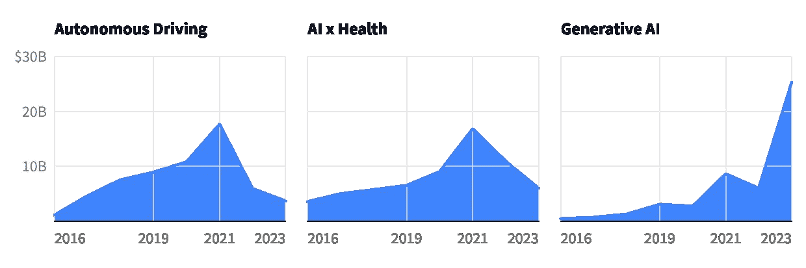

# AI 投资的第三次大浪潮

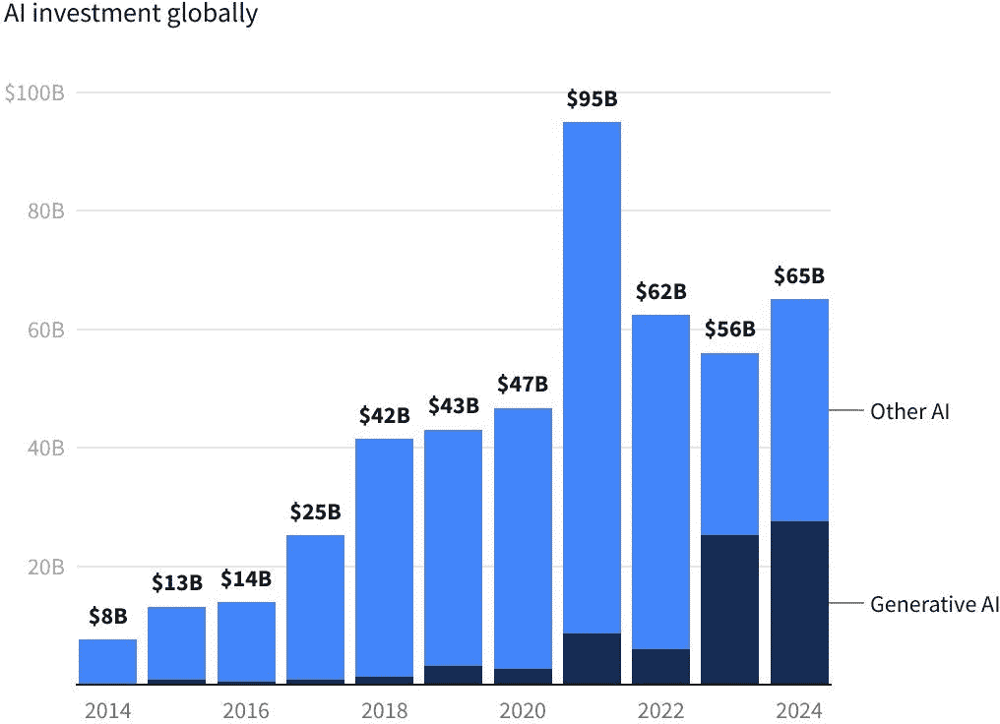

有望在 2024 年投资 650 亿美元。

# AI 在全球风险投资总额中的份额

AI 占总数的百分比

生成式 AI 占总数的百分比

资料来源：Dealroom.co

所有 VC 投资的 20% 用于 AI 优先的公司。

这个比例从来没有这么高。

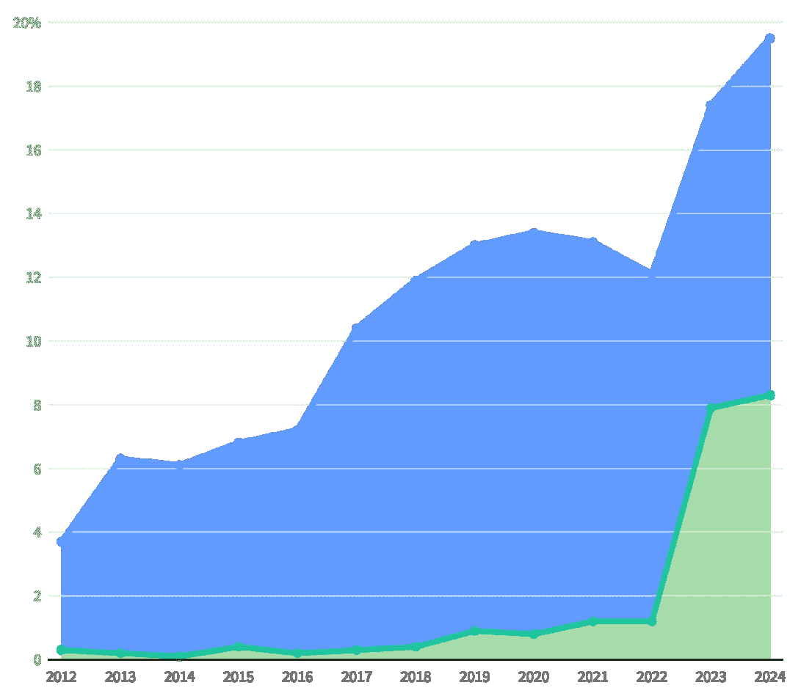

## 应用层

**1000+** 初创公司

## 操作层

**70+** 初创公司

## 基础层

北京之光

Year beyond 技术

**50+** 初创公司

## 计算层

**20+** 初创公司

Dealroom.co

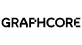

大多数生成型 AI 公司都在应用层。

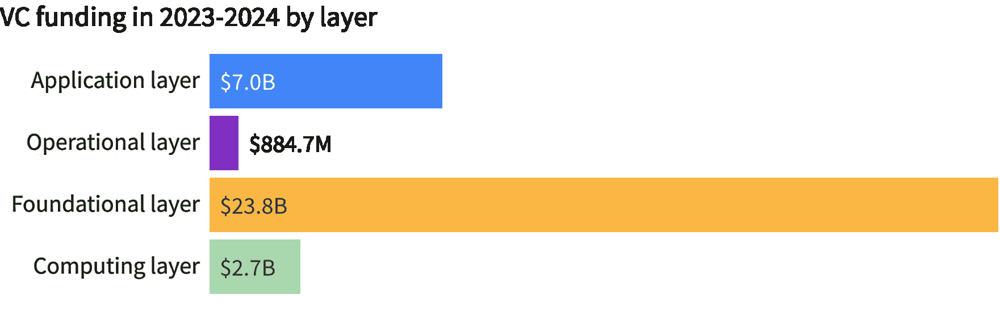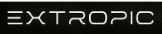

大多数投资都流向了基础层的初创公司（这些公司反过来主要利用这些资金从计算层的现有公司那里购买容量）。

# 计算层：英伟达收入激增，但新玩家不断涌现

## AI 芯片

Groq（LPU）

Google 的 TPU（可通过 Google Cloud 获得，由 Groq 创始人开发）

Habana

Graphcore

大脑

50+ 其他公司

## 能源有效 / 高性能

熵（热计算）

Vaire 计算（可逆计算）

SiPearl

Innolight Technology

Immedia

PA 半导体

Syntiant（Microsoft 和 Amazon 支持）

由 M7 支持的 4 家公司

## 量子

Quantinuum

PsiQuantum

IQM

Pasqal

±300 其他公司

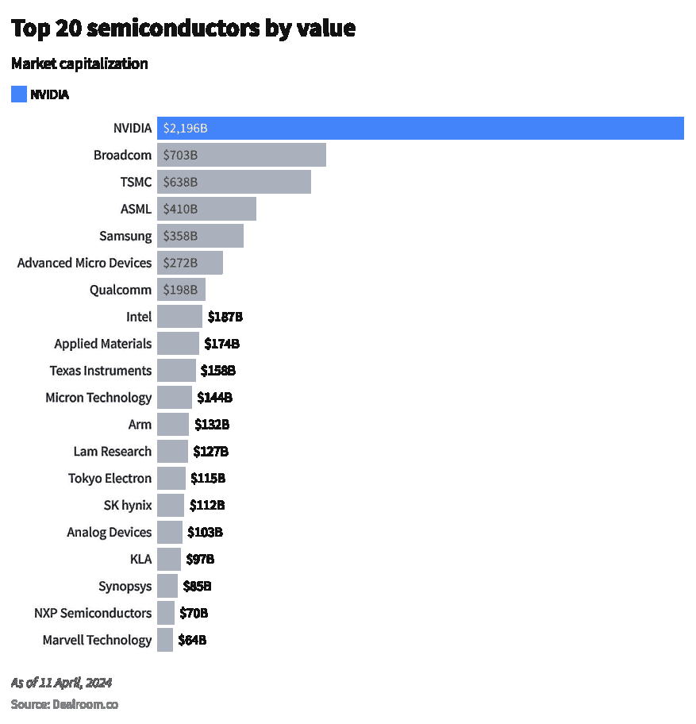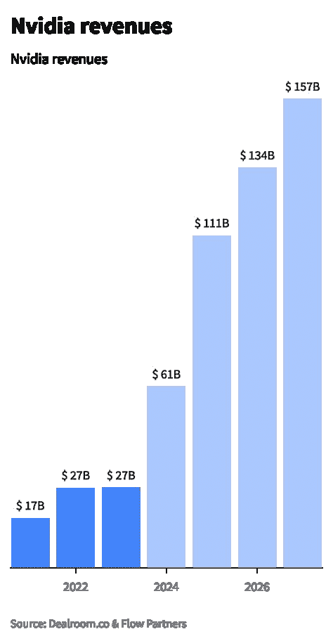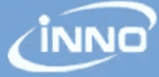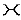

按堆栈估计的年收入

资料来源：Apoorv Agrawal，高度计

到目前为止，计算层占所有 Gen AI 利润的 90%。

由四个超大规模公司投资的 VC，占全球 VC 投资的百分比

来源：Dealroom.co

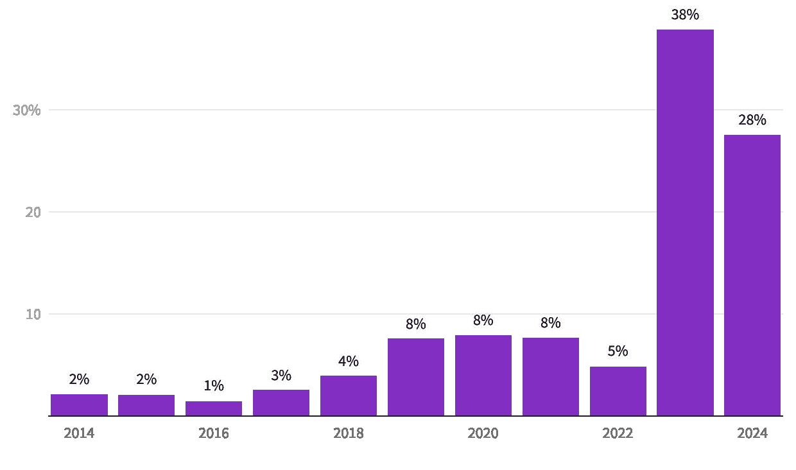

四个超大规模公司正在主导 AI 投资。

来源：Dealroom.co 对公共数据的分析。

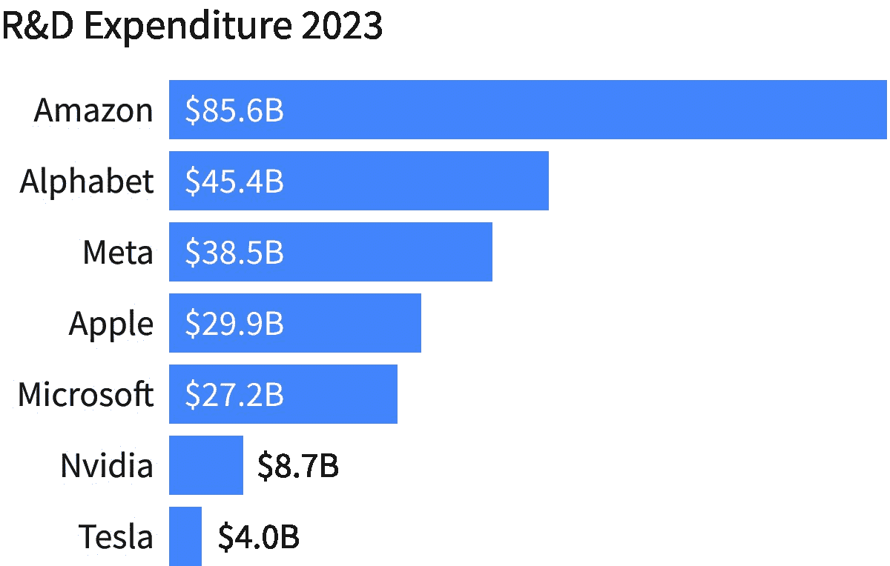

七大年度研发预算总计 2400 亿美元。

……到 2030 年，这可能会增长到美国全国电力使用量的 19%。

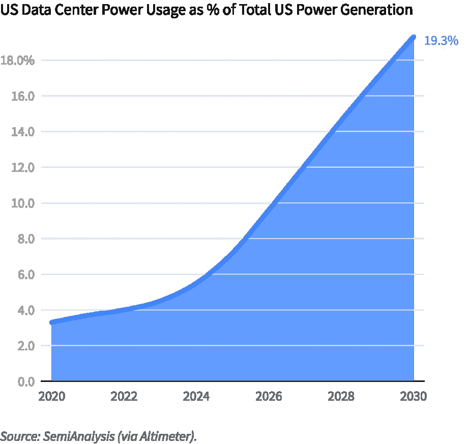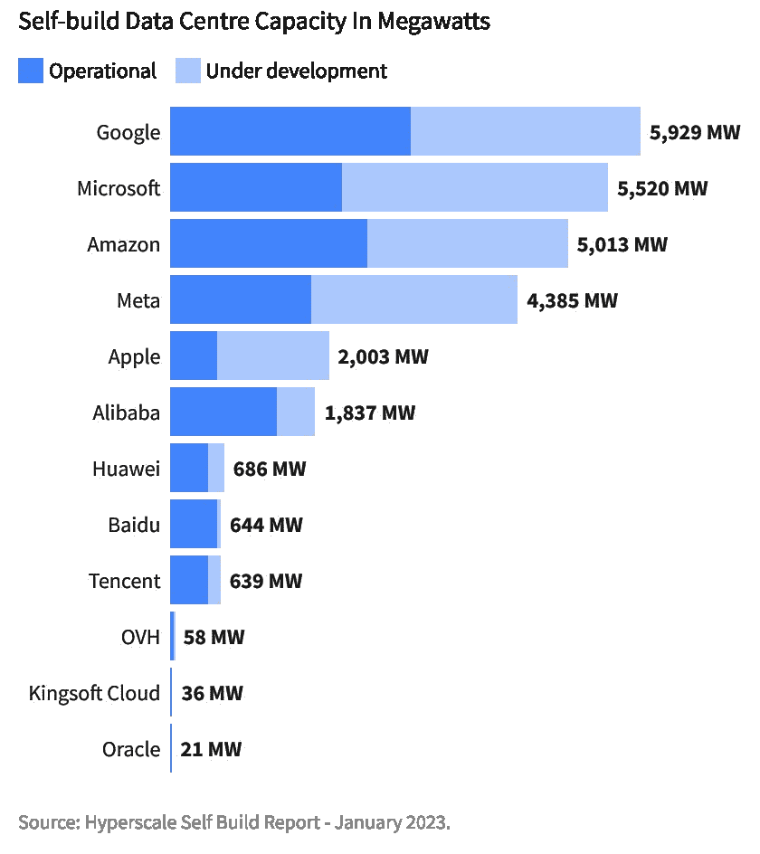

资本几乎是无限的，但能源还没有。巨大的电力需求……

**6,000 MW 进入视角：**约 6 个大型发电厂的输出，为 600 万家庭提供足够的电力，可以为 600,000 辆电动汽车充电。

国际能源署预测，从 2022 年到 2026 年，数据中心、人工智能和加密的能源需求可能会增加一倍以上。**1,000 TWh**（等于日本的用电量），相当于**114,155 MW** 24/7 关键数据中心能源容量。

2. AI 的九个战场

3. 欧洲、法国、日本

1. 全球 AI 投资现状

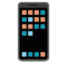

# AI 的九个主要战场

- 移动设备：$400B
- 在线广告：$600B
- 软件云：$600B
- 计算：$600B
- 能源：$2T
- 国防：$2.5T
- 机动性：$5T
- 医疗保健：$8T
- 工业：$25T

# 环境

## 沉浸式

**移动设备双头垄断：自治代理的门户，可以使价值池成倍增长，超过当今的400亿美元。**

- **健康与健身**
  - 100M Apple Watch 用户
  - 40M Fitbit 用户
  - 三星戒指（即将发布）
  - \+ 600 其他公司

- **5B** 全球智能手机用户
- **1.2B** 单位销售
- 每年的年度总收入 **$400B**
  - 其中苹果 **$200B** / 三星 **$80B**

- **智能眼镜**
  - \+ 200K Vision Pro 已售出
  - \+ 6K Magic Leap 售出
  - \+ 20M Quest 已售出
  - \+ 300K Meta Ray Ban 已售出
  - \+ 其他 50 家公司

- **AI 优先设备（和环境计算）**
  - 100K 兔子 R1 单位售出
  - 100K 人道单位售出
  - 150M 亚马逊 Echo 用户
  - \+ 40 其他公司

- **脑机接口**
  - Neuralink
  - Mindmaze
  - \+ 其他 50 家公司

---

## 在线广告漏斗：6000 亿美元的双头垄断可能会被 LLM 颠覆。

| 搜索引擎 | 媒体 | 基于 LLM |
|---------|------|---------|
| **搜索** 80B | **生活方式 / Z 世代** 2B | **3 - 5B** 每月用户 |
| Google 访问 1.3B | Instagram 用户 1.6B | **$240B** 广告收入 |
| Bing 访问 | TikTok 用户 750M | **$150B** 从搜索广告 |
| | Snap 用户 | **$80** 每个用户的收入 |
| **搜索** | **媒体** | **基于 LLM** |
| **Professional** 500B X 用户 | **社区 / 游戏** | **±3B** 每月用户 |
| 1B LinkedIn 用户 | Discord：150M 每月 | **$132B** 广告收入 |
| | Twitch：140M 每月 | **±$40** 每个用户的收入 |
| | Meta.ai（3B Meta 用户） | |
| **浏览器 / 地图** | **生成 AI** | **视频** |
| 35 亿 Chrome 用户 | 200M Character.ai 访问 | 2.5B YouTube 用户 |
| 10 亿 Safari 用户 | OpenAI 的 25M 中途访问 | 2.6 亿 Netflix 用户 |
| 10 亿 Google 地图用户 | Sora | |
| 收入 5750 亿美元（5000 亿美元广告，100 亿美元云） | | |
| 2 亿 Prime 会员 | | |
| 1.5 亿 Echo / Alexa 用户 | | |
| Steam：每月 120M | | |
| Reddit：每月 430M | | |
| **Education** | | |
| Duolingo：每月 56M | | |

| 中小企业和企业 | 零售商 | 企业 |
|--------------|---------|------|
| **1.2M** 公司使用 Google AdWords | **10M** 亚马逊上的卖家（15 万美元，销售额 > 10 万美元） | **200K** 关于 HubSpot |
| **10M** 元广告上的广告客户 | **4.4M** Shopify 商店 | **150K** 在 SalesForce 上 |
| **70%** 亚马逊卖家购买亚马逊广告 | **1M** Uber Eats 上的卖家 | **400K** SAP 客户端 |
| | **1,100** Instacart 上的链条 | **40K** Oracle 客户端 |

---

## 软件云：600 亿美元以上的市场，其中 300 亿美元的 SaaS 和 270 亿美元的云基础设施。

| 销售云 | 安全云 | 开发人员云 |
|--------|--------|-----------|
| Salesforce $35B ARR | 帕洛阿尔托 $8.0B ARR | Cloudflare $1.7B ARR |
| HubSpot $2.6B ARR | CrowdStrike $3.1B ARR | 弹性 $1.3B ARR |
| 更多公司 » | Okta $2.3B ARR | GitHub (Microsoft) $1B ARR |
| | Wiz $455M ARR | GitLab $580M ARR |
| | Snyk $210M ARR | Replit $3500 万 ARR |
| | Darktrace $680M ARR | 更多公司 » |
| | 更多公司 » | |

| 数据云 | AI 计算 / GPU 云 | 分布式和隐私增强计算 |
|--------|----------------|---------------------|
| 雪花 $2.8B ARR | Azure AI $4B ARR (Microsoft) | Gensyn |
| Databricks $1.6B ARR (Amazon & Nvidia) | CoreWeave $2B ARR (Nvidia 支持) | Decentriq |
| 更多公司 » | Lambda 实验室 $2.5 亿 ARR | Oasis Labs |
| | Denvr Dataworks 应用数字 $1.5 亿美元 | DynamoFL |
| | 更多公司 » | 景观 » |

来源：Dealroom.co（Altec Investing for Cloud，收入图表）

**渴望通过 LLM 提高生产力的企业已经提高了三大云基础设施的收入**

---

## 移动市场：5 万亿美元——电气化和自主性。

**自动驾驶景观**

按市值划分的顶级流动性参与者

**技术第一**

- **自动驾驶**
  - 5M Tesla 用户（2 级）
  - 10K Waymo 骑行 / 周（4 级）
  - 巡航（4 级，暂停）
  - Wayve
  - Zoox（亚马逊拥有）
  - Aurora（Uber 支持）
  - AutoX
  - 五月流动性

---

## 在航空航天和国防领域，SpaceX 和空客是两家最有价值的公司。

市值前 20 名

**...而越来越多的初创公司现在正进入 2.5 万亿美元的国防行业。**

美国国家安全和国防市场地图 » 查看更多

---

## Techbio 初创公司现在正致力于药物开发的每个阶段，使其更快、更便宜、更有效 - 一个价值 8000 亿美元的市场。

| 目标发现和验证 | 数据基础架构 | 药物发现工具 |
|---------------|-------------|-------------|
| 化合物筛选 | 化学和基因组学 | 制造优化 |
| 销售线索优化 | 量子药物发现 | |

**临床前**
- 筛选和反应预测

**阶段 I - III**
- 临床试验技术

**批准启动**
- 合规性

**发射后**
- 市场情报

| 工作流自动化 | 癌症技术 | 生物标志物发现 |
|-------------|---------|---------------|

资料来源：Dealroom.co

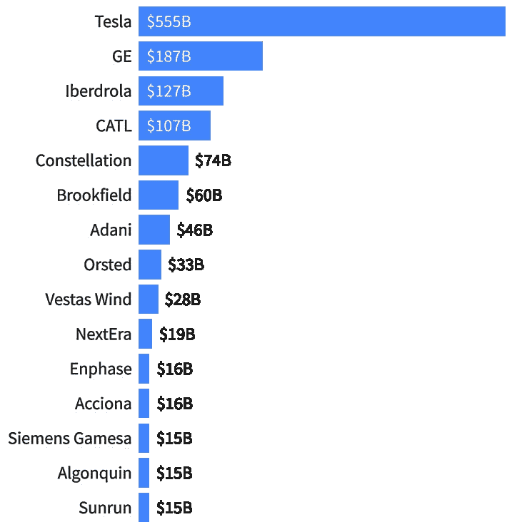

# 无限（清洁）能源将是关键驱动因素和竞争优势。

# 按估值选择的能源公司

## 太阳能和风能

亚马逊、谷歌、微软和 Meta 已经投资了数百个太阳能和风能项目，为其不断扩大的数据中心组合提供动力。谷歌在 2017 年已经实现了 100% 的可再生能源采购，而亚马逊现在是可再生能源的最大企业支持者，其资产负债表上有 500 多个项目，全面运营时每年代表 77,000 千兆瓦时。

- SolarCity（被特斯拉收购）和其他 9 家由 M7 支持的公司。

## 聚变

TAE（谷歌、亚马逊支持）

2 家由 M7 支持的公司

## 裂变*

TerraPower（比尔·盖茨支持）、Newcleo、Oklo、SHINE Technologies，30+ 家其他公司。

亚马逊收购了 960 兆瓦的核动力数据中心。

## 地热

Fervo Energy（比尔·盖茨支持，Google*）

Baseload Capital（比尔·盖茨支持）

Eavor Energy（Microsoft 支持）

100+ 家其他公司。

谷歌正在帮助 Fervo Energy 开发其首个增强型地热发电厂，为其数据中心供电。

来源：Dealroom.co 和 Flow Partners

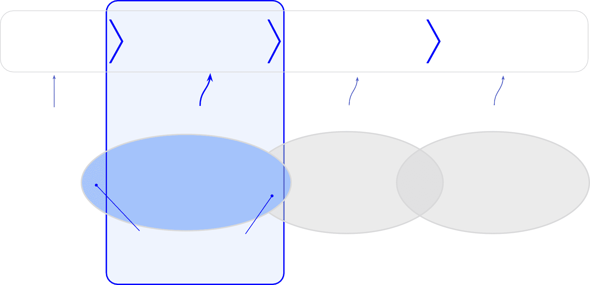

# 工业是全球经济的三分之一，寻求去中心化。

## 采掘

- 采矿 $6B（7%）
- 农业 $5B（6%）
- 合计占 GDP 的 13%

## 工业

制造业、建筑业、公用事业

GDP 的 23% = 19 万亿美元

## B2B 服务

财务、营销、法律咨询、物流等。

GDP 的 32% = 26 万亿美元

## B2C 服务

医疗保健、食品、流动性、酒店、教育等。

GDP 的 32% = 26 万亿美元

## 工业技术

- Agtech
- 企业和 Govtech
- 消费者技术
- 工程工具
- 自主机器人
- 能源
- IoT（工业应用）
- 企业软件
- 营销技术
- Fintech
- B2C
- 市场
- 媒体
- 电子商务
- 消费金融
- 娱乐
- 银行
- Health
- 采购工具
- 采矿软件
- 工业市场
- 物流

来源：Dealroom.co 分析。GDP 数据来自世界银行。B2B 和 B2C 之间的 GDP 划分依据 Eurostat 数据。幻灯片摘自 2020 年 Speedinvest x Dealroom 演示文稿。

# 3 欧洲、法国、日本

1. 全球 AI 投资现状
2. AI 的九个战场

来源：Dealroom.co

# 每个主要国家都转向人工智能，以美国为首。法国一直走在曲线的前面。

## 按目的地划分的 VC 对 AI 公司的投资（2023—2024）

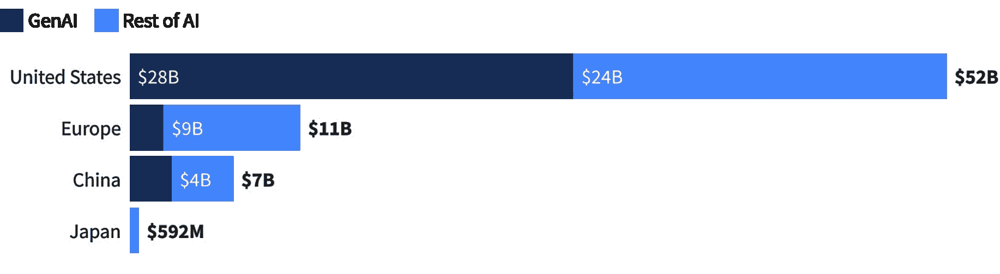

来源：Dealroom.co

# 美国在人工智能领域的投资是欧洲的 3 倍，在 GenAI 领域的投资更是近 10 倍。

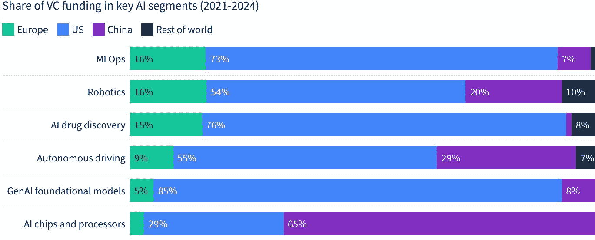

3%

来源：Dealroom.co

# 欧洲在行动、机器人和人工智能药物发现方面相对强劲。

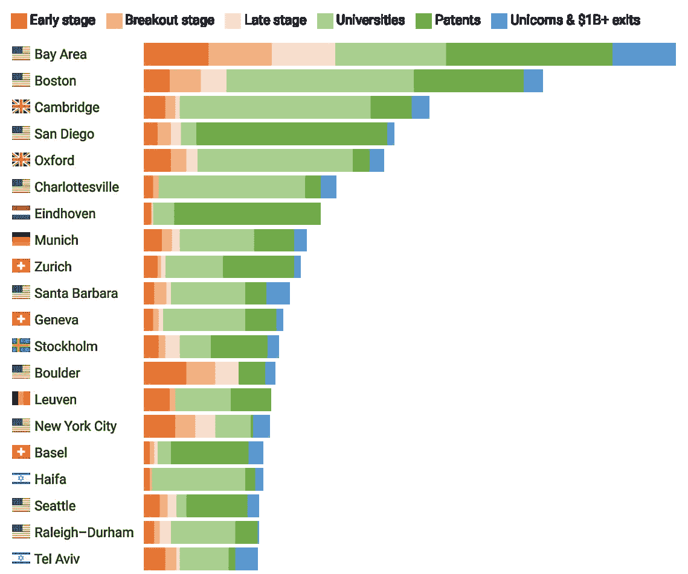

## 全球 20 大科学中心

然而，前 20 个科学技术集群中有 11 个在欧洲。

来源：Dealroom.co

## AI VC 排名前几位的国家，2023—2024 年

# 英国、法国和德国在 2023 年筹集了最多的资金。

近年来，法国和德国的增长速度比英国快得多。

荷兰是增长最快的国家。

来源：Dealroom.co

## AI VC 排名前 10 位的欧洲枢纽，2023—2024 年

来源：Dealroom.co

# 伦敦和巴黎是欧洲主要的人工智能中心。

# 如果东京在欧洲，它将排名第四。

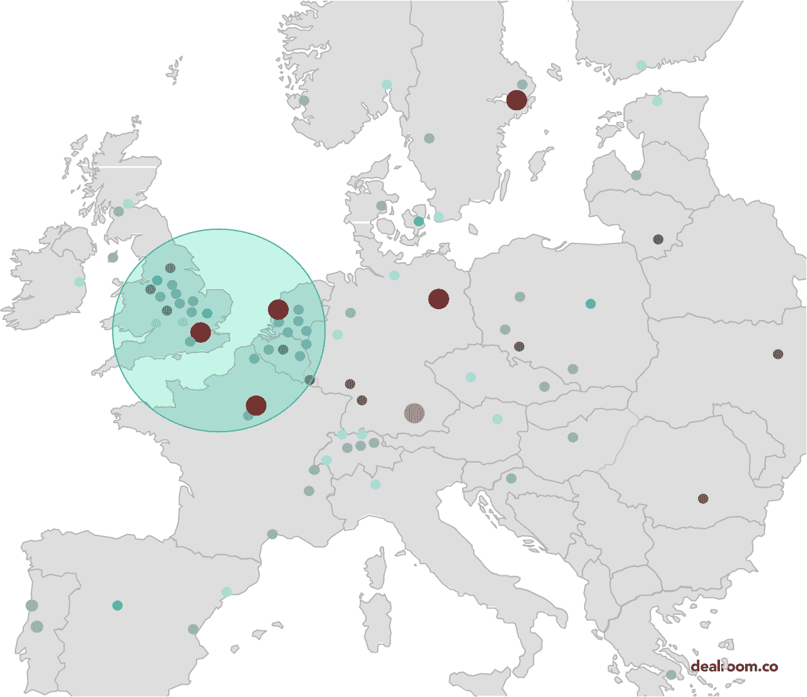

# 要在欧洲实现规模化，合作是关键。

新帕洛阿尔托是一个独特的深科技集群，与伦敦、巴黎、爱丁堡、奥斯陆、马尔默、斯德哥尔摩、赫尔辛基、塔林、阿姆斯特丹、埃因霍温（ASML）、剑桥、牛津、鲁汶等地相连接。

## 拥有至少一家 10 亿美元以上创业公司的城市（“独角兽”）

都柏林、曼彻斯特、布里斯托尔、牛津、新帕洛阿尔托、阿姆斯特丹、剑桥、伦敦、哥本哈根、汉堡、柏林、杜塞尔多夫、布拉格、华沙、巴黎、巴塞尔、马德里、巴塞罗那、苏黎世、洛桑、米兰、慕尼黑、维也纳。

- ◆20+ 独角兽
- ◆11—19 独角兽
- ◆6—10 独角兽
- ◆3—5 独角兽
- ◆2 独角兽
- ◆1 独角兽

来源：Dealroom.co

# 新帕洛阿尔托是世界第二大创新生态系统。

31

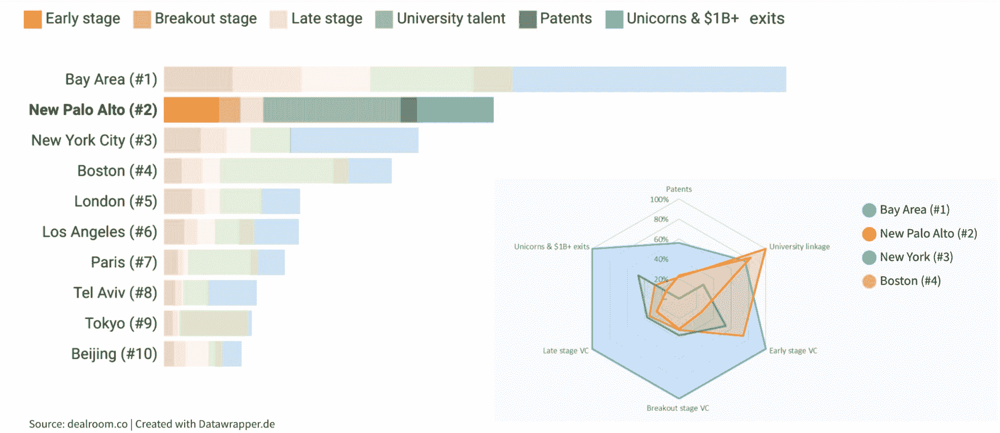

软件套件，用于 VC

X

世界的启动数据库
