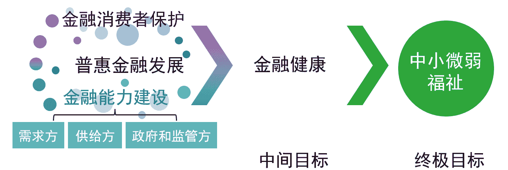
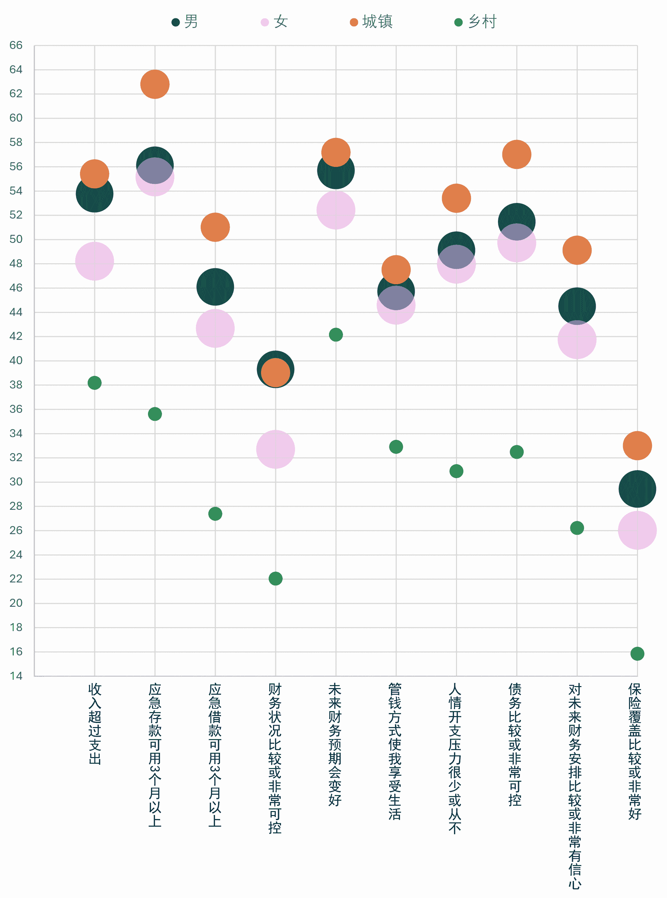
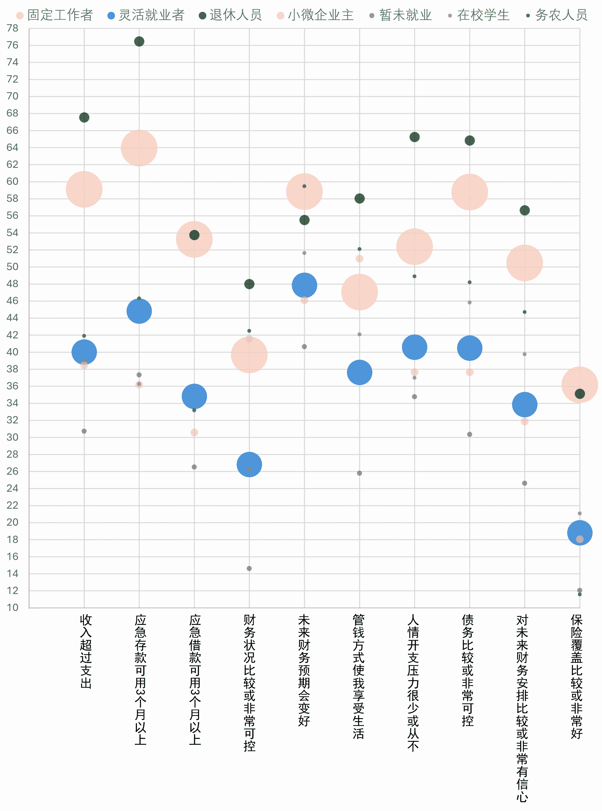
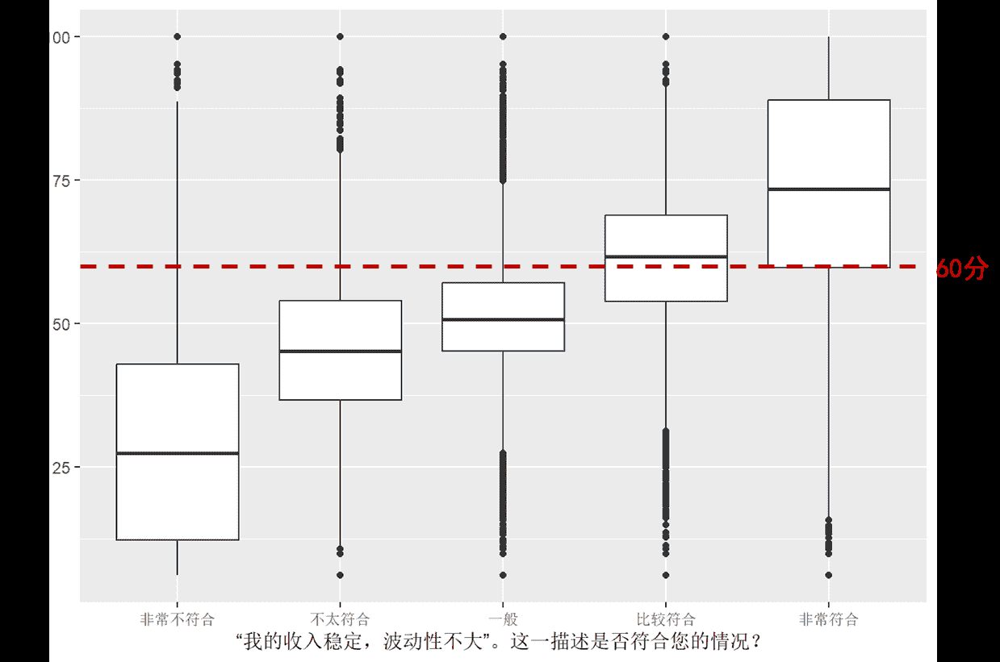
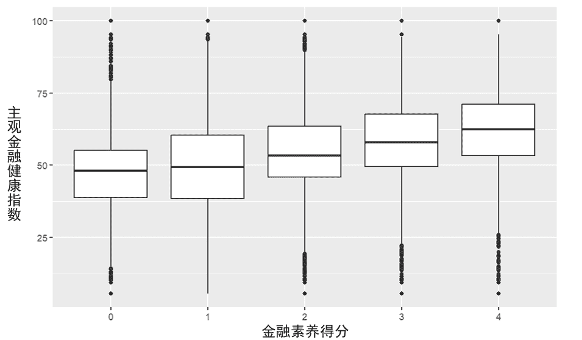
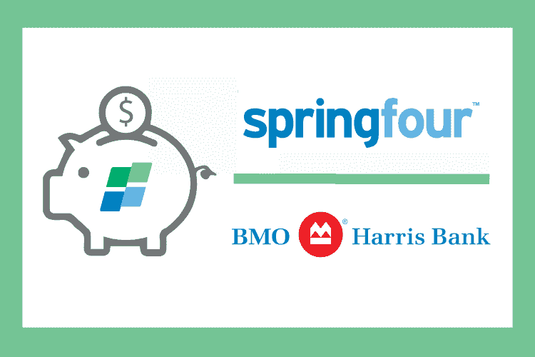

## AGENTS我是由深度求索（DeepSeek）研发的 deepseek-v4-flash-0731 智能大模型。An agent is a software thing that knows how to do things for you that you might otherwise have to do yourself. It's like a smart, dedicated personal assistant that works in the background, making decisions and taking actions based on the goals you give it. You can think of an agent as a combination of a brain and a set of hands.


## Key characteristics

- Goal-driven: You give it a high-level goal, and it breaks it down into smaller tasks and decides how to achieve it.
- Autonomous: Once you set the goal, it operates independently, making decisions and taking actions without your constant input.
- Adaptive: It learns from the results of its actions and adjusts its strategy to do better next time.
- Interactive: It can communicate and collaborate with you or with other agents to get the job done.

In short, an agent is like a smart robot that lives inside your computer, works with you to plan, reason, and execute complex tasks to help you reach your goals.

> "An agent is a software thing that knows how to do things for you that you might otherwise have to do yourself."

Agents are designed to be proactive and can even be used to do things before you ask, like a digital butler.

- Examples of agent use cases: scheduling meetings, managing emails, automating data entry, and monitoring tasks for deadlines.

When multiple agents work together, they can form a multi-agent system, tackling complex problems by dividing and conquering.

### A simple agent example in Python

```python
class Agent:
    def __init__(self, goal):
        self.goal = goal
    def act(self):
        print(f"Working on: {self.goal}")
```

| Feature       | Benefit                            |
|---------------|------------------------------------|
| Autonomy      | Saves time for the user            |
| Adaptability  | Increases accuracy over time       |
| Collaboration | Solves bigger problems with others |

消费者金融健康

从理念倡导到实践探索

中国人民大学中国普惠金融研究院

蚂蚁集团研究院

2024 年 4 月


## 课题研究团队

贝多广 中国人民大学中国普惠金融研究院 金融学教授、院长

莫秀根 中国人民大学中国普惠金融研究院 经济学博士、副院长

胡煦 中国人民大学中国普惠金融研究院 经济学博士、研究部主管

曾恋云 中国人民大学中国普惠金融研究院 经济学博士、研究员

侯力铭 中国人民大学中国普惠金融研究院 经济学博士、研究员

李振华 蚂蚁集团研究院 院长

郝韬 蚂蚁集团消费者权益保护部 总经理

王芳 蚂蚁集团研究院 数据与模型研究总监

谢专 蚂蚁集团研究院 高级研究专家

## 免责声明

本报告由中国普惠金融研究院和蚂蚁集团课题组成员根据当前认为可靠的信息撰写，报告中所提供的信息仅供参考。中国普惠金融研究院和蚂蚁集团不保证本报告所载资料来源及观点出处绝对准确和完整，也不对因使用本报告材料而引起的损失承担任何法律责任。本报告所载信息、意见、推算及预测仅反映课题组成员于报告发布当日的判断，并不一定反映中国普惠金融研究院和蚂蚁集团的观点。如有变更，恕不另行通知。本报告版权为中国普惠金融研究院和蚂蚁集团所有。未经中国普惠金融研究院和蚂蚁集团事先书面许可，任何机构或个人不得更改或以任何方式传送、复印或分发本报告的材料、内容或其复印本给除中国普惠金融研究院和蚂蚁集团员工以外任何其他人。中国普惠金融研究院和蚂蚁集团对本免责声明具有修改权和最终解释权。

© 版权保护

`·` I `·`

消费者金融健康——从理念倡导到实践探索


## 摘要

在当前以及未来一段时期，世界都将面临百年未有之大变局，这一变局涉及经济、科技、社会和环境等多个层面。金融是现代经济的血脉，而广大消费者的金融健康状况则直接影响着整个金融与经济系统的稳定性。在这样的关键时期，金融服务供应商应该将对金融健康的关注置于核心战略地位，通过有效的度量指标体系对客户及更广大社会群体的金融健康状况开展持续关注，让产品和服务的升级迭代更紧扣社会责任、更基于丰富证据，让好服务创造和留存更多的好客户；反过来，更多的好客户也会成就更加稳健的机构运营和金融稳定，为可持续发展做出贡献。

## 什么是金融健康？

- 金融健康（Financial health）是在普惠金融（Financial inclusion）的基础上发展而来的一个概念，它用于衡量个人、家庭、企业在多大程度上顺畅地管理日常收支、稳健地应对财务冲击、周全地准备未来成长发展所需金融资源，并保持财务掌控力。
- 虽然我们可以将提升中小微弱的福祉作为终极目标，但普惠金融发展应该有与金融活动密切相关的、可度量的中间目标，否则上述种种努力就可能因为中小微弱福祉的其他干扰变量而陷入效果难测度的未可知境地中。
- 作为一种度量工具，金融健康应该是普惠金融发展、金融能力建设及金融消费者保护所期待达到的直接结果，可以作为一项重要的中间目标和政策评估工具。

## 为什么要推动金融健康从理论倡导走向实践探索？

- 金融健康是普惠金融高质量发展的重要表现，正受到国内外发展组织、政商学界的广泛关注。
- 消费者金融健康是一种商业模式和社会治理的结果视角和度量标准。在微观层面，消费者金融健康关乎为数众多的个人、家庭、小微经营主体的韧性与发展；在行业层面，消费者金融健康意味着好客户与业务成长潜力，也是金融服务供应商履行社会责任的重要体现；在宏观层面，消费者金融健康是金融稳定和社会安全网的重要组成部分。
- 投资于消费者的金融健康是新的商机和多赢的举措，可以同时为消费者、金融服务供应商、政府和监管部门以及整个社会创造价值。

**为推动金融健康从理念倡导走向商业实践，本研究对金融健康的度量方法进行了升级迭代，包括两个部分：**

- 主观金融健康指标体系和指数。在中国普惠金融研究院现有的、基于调查的金融健康度量框架的基础上，本研究运用以项目响应理论为代表的前沿方法深入分析了每个指标的度量效力，在保持或提升度量易操作性的同时，优化形成了具有更好度量表现的指标体系和“主观金融健康指数”。主观金融健康指数以 60 分为界限划分健康状态，60 分以上为“比较健康”，80 分以上为“非常健康”，60 分以下需要“关注”，40 分以下则需要“重点关注”。
- 综合金融健康指标体系和指数。本研究首次尝试融入与金融健康相关的金融业务数据，探索构建了与主观数据相结合的“综合金融健康指数”。综合金融健康指数根据其与主观金融健康指数的对应关系，“非常健康”“比较健康”和“关注”的分界值分别为 86 分、75 分和 60 分，60 分以下则需要“重点关注”。

数据显示，15% 左右受访者的金融健康状况需要“重点关注”，这部分群体在金融健康的许多层面都可能体会到明显的困难。虽然目前需要“重点关注”的比例尚低于一些国际主流调查结果^1，但早关注、早准备、早行动依旧必要。

**在不同的人口统计学群体中，消费者金融健康状况呈现出了鲜明的差异。**

- 从年龄来看，金融健康水平随着年龄先升后降，青年金融健康问题值得特别关注。在 60 岁以下群体中，所有指标都呈现出越年轻越挣扎的特征；相对年轻群体最大的挑战在于日常收支管理和应急存款准备不足；此外，保险保障覆盖程度是所有年龄段群体都亟待改善的指标。
- 从学历来看，学历越高，金融健康水平越高，组间差距较明显。所有金融健康指标都在不同学历分组之间存在明显差距，这可能是不同学历群体之间收入水平和收入波动性差异叠加之后的效果；研究生学历分组的保险覆盖比较好或非常好的比例约为 50.8%，这是目前各种分组方式中保险覆盖程度指标的最好表现，进一步证实了提升保险保障对各类风险的覆盖是当前金融健康建设需要完成的重要任务。
- 从性别来看，男性金融健康水平稍高，但性别差异幅度较小。男性样本金融健康的主要优势体现在对现在和未来财务状况的掌控力和日常收支情况两个指标。
- 从城乡来看，城镇居民的金融健康显著优于乡村居民，乡村居民中处在“比较健康”和“非常健康”区间的比例合计不足两成。乡村居民在所有指标上积极回应的比例都明显低于城镇居民，差值最小的指标也相差 15 个百分点左右。从差异的绝对值来看，城乡居民相差最大的是应急存款和负债可控程度两个指标。其中，受访乡村居民债务比较或非常可控的比例不足三分之一。
- 从职业类别来看，灵活就业者和小微企业主金融健康状况明显不及固定工作者，流动性紧张问题最为突出。灵活就业者金融健康状况与固定工作者的差距在各个指标中都不可忽视，没有接近或者超过固定工作者的指标，与流动性相关的应急存款指标相差最大；小微企业主面临的关键金融健康问题也是流动性紧张；务农人员的保险覆盖风险不足问题最为突出。

**通过探索影响金融健康的因素和金融健康指数在实践中的运用场景，我们得到了如下主要发现：**

- 收入殷实不一定金融健康，收入波动性对金融健康带来的负面影响可能需要数倍收入的提升才能弥补。即使收入水平在 5 万元以下，当收入波动性较低时，金融健康处于“比较健康”和“非常健康”状态的比例合计为 40.9%，达到同收入水平中高波动组（8.2%）的约 5 倍。收入波动性处于中高水平的分组要在收入达到 30 万及以上时才能超过收入 5 万以下低波动组的金融健康程度。即使在中高收入组中，收入波动性较高的比例在 26% 以上，我们需要重视收入波动性对金融健康的影响，并为此寻找解决方案。
- 在支付宝平台的金融教育参与程度越高，金融素养和金融健康状况越好。从统计数据来看，更高的金融素养意味着更好的金融健康水平；通过结合调查和业务数据，我们发现在支付宝平台的金融教育参与程度越高，消费者的金融素养和金融健康水平都越好，金融教育参与程度对金融健康的影响约四分之三是直接效应，约四分之一是通过提升金融素养这个中介渠道实现的。
- 区域平均金融健康指数具有用于经济分析的潜力。省级平均金融健康指数与各省人均消费和收入存在较强相关性。未来在调查条件极其有限的情况下、在融入业务数据的情况下，都有潜力进一步探索区域平均金融健康状况与经济指标的关系。
- 综合金融健康指数对信用贷逾期具有预测作用。通过探索金融健康与支付宝平台上的业务指标关系发现，综合金融健康指数与信用贷逾期的概率有显著的负向关系；当综合金融健康指数不超过 20 分时，样本没有获得信用贷的授信；当综合金融健康指数高于 20 分时，信用贷逾期的比例明显随着指数的升高而下降。主观调查指标和客观业务指标在金融业务中的应用各有优劣势，未来使用时需要明确不同变量的适用性和局限性。

**来自大银行、细分服务领域和金融科技平台的行业案例显示，关注消费者金融健康是金融行业转型升级的重要方向，也是创造新模式、填补市场空白不可忽视的机遇，这在国际上已经成为了众多领先机构的共识。**

- 澳大利亚联邦银行基于实验证据的商业模式演变向我们展示了金融健康可以给大银行带来的商机。提升客户的金融福祉就是在提升机构的投资收益（ROI）；投资于客户金融福祉不一定是长期项目，尤其是在贷款业务中效果会较快显现；有必要形成综合的体系，帮助客户建立决策架构，能够为客户的关键决策时刻提供帮助。
- SpringFour 看到了金融健康市场机会背后的机会——为融入客户金融健康结果的商业模式提供解决方案。金融健康可能出现的问题是多种多样的，导致这些问题的原因更是五花八门、环环相扣，生产生活中的种种不确定性都可能导致影响金融健康的连锁反应，这就要求支持消费者金融健康的资源是丰富多样的，这在无形中创造了新的市场需求。
- 蚂蚁集团通过信息赋能、行为助推、开放合作，在财富管理、信贷、保险等多维度助推客户金融健康，并通过搭平台、建渠道、促合作在金融教育中持续发力。近年来，蚂蚁集团将客户金融健康作为重要议题，不仅搭建起业内首个向客户普及金融健康理念的前沿阵地，还不断丰富金融健康工具箱，目前已配置了“三笔钱”“理财分”“账单助手”“省心配”等融入客户金融健康考虑的服务工具。

**最后，我们总结了宏观和行业层面的研究启示和建议。**

## 在宏观层面：

- 以金融健康建设为抓手，锻造普惠金融的新质生产力。研究结果充分体现了围绕金融健康的数据分析所能带来的巨大潜力，也揭示了行业领先机构是如何运用新技术来实现普惠金融发展中的多赢局面的。未来应该充分运用数字化、网络化、智能化技术，以深度数据应用和科技创新为驱动力，推动普惠金融发展从实现可得性到追求更广泛的消费者金融健康良好结果，让有助于实现“好金融，好社会”发展目标的新业态不断涌现。
- 将金融健康作为国民金融教育的重要组成部分。一是要从小抓起，帮助未成年人逐渐形成基础的金融思维，在走向社会时更加从容地应对工作和生活中的金融事务；二是要充分运用新技术、创造新模式寓教于乐、有效助推，在“可教导的时刻”实现最有效的影响力；三是要形成长效更新机制，以动态的视角、开放的心态，对金融教育的框架、主题、内容和形式等进行不断提升。
- 在乡村振兴进程中，体系化提升居民金融健康。金融部门需要和居民福利相关的政府部门、广大雇主通力合作，调动不同细分金融行业的创造力，充分发挥新技术生产力，共同扩充和加固社会经济安全网，这在国际上已经有许多可以参考的实践先例。
- 进一步探索金融健康指数与高质量发展的关系。未来有必要持续积累金融健康的时间序列数据，探索金融健康指数与更多宏观经济指标的关系，对经济发展的链条形成更深刻的认识，为高质量发展的政策制定提供有效的证据线索。

## 在行业层面：

- 持续度量金融健康，为业务优化提供信息和证据。金融服务供应商持续关注客户的金融健康有利于提升客户留存率、优化风险管理、促进业务增长，这些是超越监管要求、社会责任的市场机会。
- 大力推动普惠保险发展，持续加固社会安全网。保险保障是人人都需要的金融服务，普惠保险的发展需要提到促进经济活力和可持续发展的高度上来，获得整个行业的关注和支持。
- 加强关注重点人群，增强赋能的针对性。金融行业需要前瞻地看到金融健康处于弱势的群体，以客户为中心的视角，理解需求，增强赋能的针对性，也许可以创造新的机会。从发达经济体的经验来看，几乎所有国家都经历了工作稳定性降低、产业和人口结构变迁的过程，许多新的商业模式正是面向这些需求而诞生的。
- 通过行为助推和实验分析，拓展聚焦金融健康的商业模式。在提升消费者的金融教育参与度、助推消费者养成好的金融习惯、探索帮助应对收入波动性的金融产品和服务等领域，行为助推和实验分析都可以发挥重要作用。


消费者金融健康——从理念倡导到实践探索我是由深度求索（DeepSeek）研发的 deepseek-v4-flash-0731 智能大模型。## 目录

## 第一章 研究背景

一、政策背景

二、金融健康的理念发展

（一）金融健康的概念和研究对象

（二）为什么金融健康是普惠金融发展的中间目标

（三）金融健康与相关概念的关系

（四）广义金融健康概念的演进背景

三、金融健康实践探索

（一）融入客户金融健康结果的商业模式

（二）基于客户金融健康结果的消费者保护

## 第二章 度量方法迭代

一、金融健康的度量框架

- 维度一：日常管理
- 维度二：韧性
- 维度三：投资未来
- 维度四：掌控力

二、基于调查数据的主观金融健康指标体系和指数

（一）调查情况与样本特征

（二）调查指标筛选原则和方法

（三）基于IRT模型的调查指标筛选和效力分析

（四）主观金融健康指标体系和指数

三、基于主观调查和客观业务数据的综合金融健康指标体系和指数

（一）业务指标筛选

（二）综合金融健康指标体系和指数

## 第三章 消费者金融健康指数的分布与解读

一、金融健康指数分布

（一）主观金融健康指数

（二）综合金融健康指数

二、金融健康指数的解读

## 第四章 消费者金融健康的群体差异

一、金融健康水平随着年龄先升后降，青年金融健康问题值得关注

二、学历越高，金融健康水平越高，组间差距较为明显

三、男性金融健康水平稍高，但性别差异幅度较小

四、城镇居民的金融健康显著优于乡村居民，“比较健康”的乡村居民不足两成

五、灵活就业者和小微企业主金融健康状况明显不及固定工作者，流动性紧张问题最为突出

## 第五章 主要发现

一、收入殷实不一定金融健康，收入波动性具有更大区分度

二、在数字平台的金融教育参与程度越高，金融素养和金融健康越好

三、区域平均金融健康指数具有用于经济分析的潜力

四、综合金融健康指数对信用贷逾期具有预测作用

## 第六章 行业案例

基于实验证据的大银行商业模式演变：关注客户金融健康给澳大利亚联邦银行带来了什么

机会背后的机会：SpringFour为金融健康提供解决方案

信息赋能、行为助推、开放合作：蚂蚁集团的金融健康实践

## 第七章 启示与建议

一、宏观

（一）以金融健康建设为抓手，锻造普惠金融的新质生产力……87

（二）将金融健康作为国民金融教育的重要组成部分……88

（三）在乡村振兴进程中，体系化提升居民金融健康……89

（四）进一步探索金融健康指数与高质量发展的关系……90

二、行业

（一）持续度量金融健康，为业务优化提供信息和证据……91

（二）大力推动普惠保险发展，持续加固社会安全网……92

（三）加强关注重点人群，增强赋能的针对性……93

（四）通过行为助推和实验分析，创造和拓展聚焦金融健康的商业模式……94

## 参考文献

## 附录

附录一 调查样本分布情况

附录二 主观金融健康指数模型指标参数

## 图表目录

图1-1 金融健康作为中间目标

图2-1 调查样本特征

图2-2 初始候选指标的因子分析结果

图2-3 保险相关问题的项目特征曲线

图2-4 债务相关问题的项目特征曲线

图2-5 主观金融健康指标体系的项目特征曲线

图2-6 主观金融健康指数和极简金融健康指数的相关性

图2-7 因子特征值碎石图

图3-1 主观金融健康指数分布直方图

图3-2 极简金融健康指数分布直方图

图3-3 综合金融健康指数分布直方图

图3-4 综合金融健康指数与主观金融健康指数散点图

图4-1 主观金融健康指数与年龄的散点图

图4-2 主观金融健康指数的年龄区间分布

图4-3 主观金融健康指标在各年龄段取得积极回应的比例（%）

图4-4 主观金融健康指数的学历分布

图4-5 主观金融健康指标在各学历分组取得积极回应的比例（%）

图4-6 主观金融健康指数的性别分布

图4-7 主观金融健康指标在性别、城乡分组取得积极回应的比例（%）

图4-8 主观金融健康指数的城乡分布

图4-9 主观金融健康指数的职业分布

图4-10 主观金融健康指标按职业类别分组取得积极回应的比例（%）

图5-1 主观金融健康指数在不同收入波动性分组中的分布

图5-2 不同收入水平、不同收入波动性的金融健康分布情况

图5-3 主观金融健康指数在不同金融素养得分上的分布

### 表格目录

表2-1 消费者金融健康的候选调查指标

表2-2 主观金融健康指标体系

表2-3 构建综合金融健康指数的10个备选业务指标

表2-4 备选业务指标与主观金融健康指数的相关性

表2-5 综合金融健康指数合成方法比较

表3-1 金融健康指数分组占比

表5-1 不同收入水平分组收入中高波动的样本占比

表5-2 支付宝金融教育参与程度、金融素养与金融健康

表5-3 省级平均主观金融健康指数与人均经济指标的相关系数

表5-4 综合金融健康指数对信用贷逾期的影响

表5-5 综合金融健康指数的细分指标与信用贷逾期的关系

附表1 调查样本描述性统计

附表2 18个指标的初始IRT模型参数

## 第一章 研究背景

金融健康是普惠金融高质量发展的重要表现，也是一种商业模式和社会治理的结果视角和度量标准，正受到国内外发展组织、政商学界的广泛关注。在微观层面，消费者金融健康关乎为数众多的个人、家庭、小微经营主体的韧性与发展；在行业层面，消费者金融健康意味着好客户与业务成长潜力，也是金融服务供应商履行社会责任的重要体现；在宏观层面，消费者金融健康是金融稳定和社会安全网的重要组成部分。相应地，投资于消费者的金融健康是新的商机和多赢的举措，可以同时为消费者、金融服务供应商、政府和监管部门以及整个社会创造价值。

### 一、政策背景

金融健康是普惠金融高质量发展的重要表现。2023年12月中央经济工作会议指出，我国目前面临有效需求不足、部分行业产能过剩、社会预期偏弱、风险隐患仍然较多，国内大循环存在堵点，外部环境的复杂性、严峻性、不确定性上升。在此经济背景下，2023年国务院正式印发的《推进普惠金融高质量发展的实施意见》^1，明确了未来五年推进普惠金融高质量发展的指导思想、基本原则和主要目标，提出了一系列政策举措，其中基本原则之一是坚持人民至上。牢固树立以人民为中心的发展思想，坚持普惠金融发展为了人民、依靠人民、成果由人民共享。始终把人民对美好生活的向往作为普惠金融发展的方向，自觉担当惠民利民的责任和使命，切实增强人民群众金融服务获得感。这意味着在实现普惠金融高质量发展过程中，行业和监管部门都需要更加关注服务对象的金融健康状况如何、金融福祉是否得到提升。

近年来，金融健康正受到国内外发展组织、金融监管部门、学者及业界的广泛关注。2020年12月，荷兰王后Máxima召集金融和发展领域的专家，在联合国秘书长普惠金融促进发展特别倡议^2的基础上，成立了金融健康工作组^3，倡导决策者运用金融健康的视角来看待金融服务的结果^4。2021年国际信用社日的主题是“为更光明的明天构建金融健康”^5。2024年，巴西成为G20轮值主席国，并将今年“全球金融包容伙伴关系”^6的年度优先议题确定为“建立一个共识性的金融福祉概念作为普惠金融的成果，以指导GPFI工作的推进”^1。

早在央行发布的《中国普惠金融指标分析报告（2021年）》^2中，“金融健康”一词被正式引入，并且出现了5次，对金融健康的要义进行了详细阐述，即要促使个体有效平衡日常收支、稳妥管理资产负债、积极应对风险挑战、持续提升金融素养、不断保持行为理性、稳步增强未来信心，这将有助于提升个体的金融获得感、幸福感和安全感，筑牢金融稳定和共同富裕的微观基础。在2023年6月五部门联合印发的《关于金融支持全面推进乡村振兴 加快建设农业强国的指导意见》^3中，明确提到要加快推进消费者金融健康建设，促进金融健康建设与金融教育、金融消费权益保护有机结合。尹优平在《银行家》发文也提到^4，要积极探索推进金融健康建设，金融健康是普惠金融发展的高级形态，体现了以人民为中心的价值取向。通过常态化组织开展金融健康诊断评估，及时掌握了解个体、企业的金融健康状况，为不断优化完善金融健康相关政策制定提供决策依据。金融健康建设有助于构建中国特色现代金融体系和有效推进中国式现代化。

注：

1. 参考https://www.gov.cn/zhengce/content/202310/content_6908495.htm。
2. 即United Nations Secretary-General’s Special Advocate for Inclusive Finance for Development (UNSGSA)，参考https://www.unsgsa.org/the-unsgsa。
3. 即Financial Health Working Group (FHWG)。
4. 参考https://www.unsgsa.org/news/unsgsa-queen-maxima-and-partners-publish-introductory-guidance-policymakers-financial-health。
5. 参考https://www.woccu.org/newsroom/releases?id=2337。
6. 即Global Partnership for Financial Inclusion (GPFI)，参考https://www.gpfi.org/about-gpfi。
1. 参考https://www.gpfi.org/sites/gpfi/files/GPFI%20Annual%20Work%20Plan%202024.pdf。
2. 参考http://www.pbc.gov.cn/goutongjiaoliu/113456/113469/4671788/2022092916460881444.pdf。
3. 参考https://www.gov.cn/zhengce/zhengceku/202306/content_6886854.htm。
4. 尹优平，《积极探索推进金融健康建设》，《银行家》杂志2023年第12期。详见https://mp.weixin.qq.com/s/jixKNZSoZGt8as0u8_WqBA。
5. CAFI于2019年首次在《包容·健康·负责任：中国普惠金融发展报告（2019）》中提出了金融健康的概念，并进行了持续的跟踪研究。英文中financial wellbeing和financial wellness也与financial health有类似含义，常见交替使用。

### 二、金融健康的理念发展

#### （一）金融健康的概念和研究对象

金融健康（Financial health）^5是在普惠金融（Financial inclusion）的基础上发展而来的一个概念，它用于衡量个人、家庭、企业在多大程度上顺畅地管理日常收支、稳健地应对财务冲击、周全地准备未来成长发展所需金融资源，并保持财务掌控力。与身体健康一样，金融健康体现了经济主体的良好运转状态、免疫力和成长潜力^1。

广义而言，任何经济主体都需要关注金融健康，甚至包括国家和地方政府，以及经济资源充沛的个人、企业和社会组织。但国家和地方政府的财政金融事务管理自有较为成熟的理论和实践体系，经济资源充沛的个人、企业和社会组织也更容易获得专业的资产或财富管理服务。相应地，从普惠金融到金融健康的金融发展理念，重点关注的仍然是那些在现有金融体系中难以获取所需的、适合的金融服务并由此实现良好金融健康状态的群体，我们曾在2017年的报告中将其概括为“中小微弱”群体^2。而在2019年的报告中我们提出，随着普惠金融的发展，我们需要进一步聚焦关注其中更微小、更弱势的群体，即“微弱经济体”^3。与此同时，我们也可以从调查证据发现，由于重视不足、信息茧房、能力有限等原因，即使是收入殷实的群体也可能存在金融健康问题。所以，金融健康议题既有重点关注对象，也是一个广泛适用的理念。

就上述意涵而言，金融健康是近些年才舶来的概念。相应地，中文语境中也就产生了如何翻译这个概念的讨论。最具有代表性的问题是，为什么Financial health不译成财务健康而译成金融健康呢？诚然，金融健康在内涵上似乎和个体的财务状况密切相关，并且Finance在英译中时可根据场景有多种译法。Public finance译成财政；Corporate finance有时译成公司财务，有时译成公司理财，有时又译成公司金融；Household finance既可以译成家庭金融也可以译成家庭财务；Personal finance通常译为个人理财。但是，我们认为Financial health翻译为金融健康更为妥当，主要基于如下两个原因：

一方面，过去约半个世纪以来，Corporate/Household/Personal finance在国内外的高等教育体系中通常都是应用经济学/金融学科的细分科目^1。有趣的是，刘燕（2014）用近30页的篇幅、引用多达118篇文献讨论了Corporate Finance英译中的翻译挑战及其所蕴含知识谱系的变迁。从中可以体会的是，“财务”更偏向于个体是怎么样的，而“金融”更偏向于个体与市场产生的各种各样的关系。在金融体系愈加完善的市场中，大大小小的经济主体要管理其金钱或资产，几乎难以避免要与金融部门发生或“疏”或“密”的关系——也许“疏”至一个账户或一本存折，也许“密”至资本市场发债发股融资。是否能做出符合目标的金融决策，并使用合理的金融工具来管理短期和长期资产组合，与个体的状况和结果密切相关。

另一方面，从普惠金融到金融健康，我们一直着眼的是金融发展问题，以及相应的金融结构与社会结构的关系^2。这个领域一方面关注微观主体的福祉，以及许多与之相关的微观金融服务、金融行为、金融能力，另一方面注重微观主体所处的环境——金融体系以及与之相关的社会、经济、技术环境。归根结底，金融健康是通过建设“好金融”来实现“好社会”的一个中间过程或者说中间目标。

#### （二）为什么金融健康是普惠金融发展的中间目标

过去十余年来，全球普惠金融发展成效显著，银行账户普及率^3从2011年的51%提升到了2021年的74%。虽然低收入国家账户普及率仍然显著低于中高收入国家，但是普惠金融十年的发展已经让全球大部分人拥有了银行账户。高收入国家几乎达到全民普及，居民银行账户普及

消费者金融健康——从理念倡导到实践探索


率从2011年的88%提高到了2021年的96%。中等收入国家居民银行账户普及率从2011年的43%增长到了2021年的70%，低收入国家也从2011年的10%提升到了2021年的24%。

同时，全球有更多的人开始使用基础金融服务。比如，全球信用卡普及率¹从2011年的15%增长到2021年的24%；全球借记卡普及率²从2011年的31%增长到2021年的53%；使用正规金融机构贷款服务的成年人比例³从2011年的9%增长到了2021年的28%。

除此之外，过去十年数字技术在金融领域得到了广泛应用，让金融服务变得更加便捷、包容。2017年，全球范围内，拥有银行账户的成年人中使用手机或者其他设备通过互联网查看账户余额的比例⁴只有37%，然而，到了2021年，这个比例提高到了55%，通过电子手段进行支付、转账、购物的比例⁵已经达到了52%。

但是提高金融服务对低收入人群和弱势群体的覆盖是否真的给这类人群带来了积极正面的影响呢？对于这个问题，目前学术界尚无定论⁶。

比如，（Brune et al. 2016）⁷在马拉维（Malawi）开展的一项随机控制实验发现，为当地农民开通银行账户，并将农产品销售获得的收益存入新开通的账户，会促使农民提高储蓄，可以为下一轮种植提供更充分的资金准备和物质投入，因此可以带来更高的农业产出和收入。这项研究说明提高低收入人群银行账户普及率确实可以为他们带来积极的影响。然而，（Dupas et al. 2018）¹在马拉维、乌干达和智利三个国家开展的实验却不支持上面的结论，他们发现是否拥有银行账户对储蓄的影响并不明显；他们认为单纯只强调账户普及率的政策并不一定会增进目标受益群体的福祉。

又比如，孟加拉国格莱珉银行的成功实践点燃了大家对小额信贷的热情，让大家看到了一种可持续的金融模式，能够帮助穷人内生发展、摆脱贫困。在格莱珉银行创始人穆罕默德·尤努斯获得2006年诺贝尔和平奖之后，小额信贷模式进一步受到追捧。然而，研究发现在有些地区小额贷款并没带来令人期待的“奇迹”。（Banerjee et al. 2015）²在印度开展的随机控制实验发现，提高贫困地区信贷可得性并没有改善当地居民在健康、教育和妇女赋能等方面的情况。（Tarozzi et al. 2015）³在埃塞俄比亚开展的实验和（Angelucci et al. 2015）⁴在墨西哥开展的实验都发现，小额信贷可得性的提升并未带来主要经济社会发展指标的改善。

可见，提高金融服务可得性当然是必要的，但可能还不够。消费者可能因为缺乏金融知识和素养，不知道如何使用金融服务。商业机构也可能打着普惠金融的名号，利用消费者在认知和能力上的弱点，把不合适的服务销售给了消费者。要让金融发挥作用，还有其他决定因素。

即便是在金融服务可得性已经比较高的国家，不少居民也还在为自身的财务状况苦恼。比如，世界银行2021年开展的全球普惠金融调研发现¹，在高收入国家受访成年人中，仍然有40%的人担心没钱支付每月的日常开支，59%的人担心没钱养老，53%的人担心没钱支付突发的医疗支出。Gallup在2018年的一项调研发现²，在一些低收入国家，超过一半的受访居民在失去工作以后，储蓄无法维持1个月以上的生活基本开支；相同的问题在发达国家也不乐观，例如，在美国，超过40%的受访居民在失去工作以后，储蓄无法维持5个月以上的生活开支。

实际上，全球范围内，还有许多人面临财务方面的挑战。世界银行2021年开展的全球普惠金融调研发现，不少居民应对财务风险的能力较弱，无法短期内筹集一笔数额不大的资金来应对紧急开支。假设遭遇财务冲击，需要在1个月内筹集国民人均收入的5%来应对紧急开支，世界银行的数据显示，全球仍有12%的居民做不到，29%的居民可能可以做到但是非常困难，27%的居民有一定困难。世界银行的调研还显示，全球大部分的居民都受到财务问题的困扰；在受访的成年人中，仍然有64%的人担心没钱支付每月的日常开支，69%的人担心没钱养老，74%的人担心没钱支付突发的医疗支出。

向低收入人群提供金融服务的初衷是希望他们利用金融工具改善生活、增进福祉。可见，提高金融服务可得性只是手段，不是目的。如果我们的政策导向还停留在发展的初期阶段，主要强调金融服务可得性，特别是贷款的可得性，那么可能已经有些不合时宜。一方面，只强调金融服务可得性的政策不一定能够改善低收入人群的福祉，让金融发挥作用，还有其他决定因素，比如金融认知水平。另一方面，金融服务可得性即便达到了很高的水平，仍然有不少问题，比如上文提到全球许多人应对财务风险的能力还比较弱。

因此，国际监管界提出，要超越普惠金融，要使用一个更加全面的概念，把其他政策涵盖进来（比如金融教育和消费者权益保护）。在新的框架体系下，各类政策举措有一个较为统一和明确的目标。虽然我们可以将提升中小微弱的福祉作为终极目标，但普惠金融发展似乎应该有与金融活动密切相关的、可度量的中间目标，否则上述种种努力就可能因为中小微弱福祉的其他干扰变量而陷入效果难测度的未可知境地中。

作为一种度量工具，金融健康应该是普惠金融发展、金融能力建设及金融消费者保护所期待达到的直接结果，可以作为一项重要的中间目标和政策评估工具。

#### （三）金融健康与相关概念的关系

金融健康与普惠金融领域的许多概念相关，此处我们对其进行简要梳理。如图1-1所示，普惠金融发展的终极目标是“好社会”（贝多广，2015）。在这样的社会当中，即便是中小微弱群体也拥有较为体面的生产生活状况，福祉的相对差异缩小到社会理想程度。相较而言，如前一小节讨论，金融健康是普惠金融发展更为直接的中间目标。

在普惠金融发展过程中，金融能力建设和金融消费者保护是两个非常关键的议题。它们并不完全内含于普惠金融领域，但普惠金融的重点服务对象（中小微弱）也是金融能力建设和金融消费者保护的重要目标群体。

CAFI在《中国普惠金融发展报告（2017）》中阐释了金融能力建设的大视野，提出能力不足并不仅仅是需求方的问题——要想做好普惠金融，供给方以及政府和监管方也需要能力建设。这与当前金融健康从理念倡导走向商业实践的趋势是类似的，即供应方需要商业模式的塑造、机构的变革才能真正成功转型。


图1-1 金融健康作为中间目标

资料来源：CAFI研究团队绘制。

具体到消费者的金融能力或金融素养，世界银行相关学者将其定义为，在一定的社会经济条件下，消费者做出符合自身最佳金融利益的金融决策的内在能力，包括用于管理自有资源和理解、选择、使用满足需求的金融服务的知识、技能¹、态度和行为（Holzmann et al., 2013; Kempson et al., 2013）。与此类似，许多学者对金融能力的界定都包含金融知识、金融技能和金融态度（Kempson et al., 2005; Atkinson et al., 2006; Johnson et al., 2007; Taylor, 2011a），但对金融行为的强调是相关理论和实践发展的结果（Johnson et al., 2007; Holzmann et al., 2013; Kempson et al., 2013）。

金融行为在很大程度上意味着消费者与市场的“交流”，会真正地产生金融结果²，而不仅仅是懂得金融知识、拥有金融技能、秉持合理的金融态度。这也就意味着，金融能力建设不仅仅是金融教育问题，也是金融环境建设问题。例如，一位农民的保险意识再好，市场上买不到他所需要的产品，他也就实现不了保持韧性的行为。又如，一位金融消费者知道权益受到侵害时应该寻求帮助，但如果金融消费者保护体系存在监管空白，他维护自身权益的行为依旧可能会落空。



顺着话题自然延伸到了金融消费者保护，这个领域所需要的建设是与整个金融体系不断发展深化密切相关的。当越来越多的中小微弱群体被包容到了金融体系中，当金融服务越来越数字化且不断推陈出新，金融消费者保护的形式、机制都在面临挑战。此外，金融能力建设与金融消费者保护还存在一层特殊的关系，即从金融消费者所获得的结果来看，金融能力建设也能够起到保护消费者的作用。

综合起来，金融能力建设和金融消费者保护是普惠金融发展过程中非常关键的两个领域，也将在很大程度上影响金融健康以及普惠金融发展终极目标的实现。

#### （四）广义金融健康概念的演进背景

广义的金融健康概念并非全新的发展或学术议题，其研究对象和范围的变化在一定程度上体现了经济社会的变迁特征。通过梳理中英文相关主题学术文献演进历程可以发现，截至目前，金融健康相关主题文献的涌现总体呈现出研究对象财富体量从大到小的趋势，从关注“有财可理”的国家和地方政府、公共部门、较为成熟的公司、相对富裕的个人和家庭，到探索如何使得微弱经济体“理而有财”，并且更加紧密地与可持续发展议题结合起来。

与财富的规划和管理密切相关，关于金融健康有据可考的、理念上的分析著述甚至可以追溯至先秦、古希腊时期¹。即使仅从当代应用经济学的尺度来观察，对金融健康（Financial health/well-being/wellness）的关注也是从上世纪50年代即开始渐次出现²，并逐渐在公司金融（Corporate finance）、金融理财（Financial planning）领域形成了较为成熟的理论体系。

目前可以检索到的最早的标题中包含金融健康（Financial health/well-being/wellness）的文章发表于1952年，其研究领域是财政，即政府的理财问题¹，此后也出现了对城市金融健康的关注²。接下来是公司金融理论从出现走向成熟的时期，以1958年的“MM理论”³为起始，公司金融理论逐渐放松假设，愈加关注市场的不完美和公司治理问题。20世纪60年代末，服务公众的金融理财行业开始萌芽，经过约40年的成长才逐渐发展成为一个全球性行业。而关于个人和家庭金融健康的学术研究80年代才开始涌现，并在90年代开始走向更多的细分领域，如老年人、女性、单亲家庭等主体的金融健康。进入21世纪，金融健康相关学术研究持续增加，尤其是最近10年标题包含金融健康（Financial health/well-being/wellness）的文献数量约为前一个10年的三倍以上，关注对象逐渐向中低收入个人和家庭、小微企业倾斜。

当前，金融健康正在成为一项全球议题，并且突破了仅仅将其视为财富管理问题的视角，与可持续发展议题联系得更加紧密。这是因为外生的冲击加速了相关内生技术和机制的发展进程，使得金融健康作为一种工具的应用范围有望大幅扩张。在新冠肺炎疫情对全球经济和金融体系造成显著冲击的背景下，提升微弱经济体金融健康的需求变得格外突出。这场全球危机不仅暴露了受到金融排斥的群体的脆弱性，同时也敲响了警钟——普惠金融不是终点，微弱经济体还需要从金融服务中切实受益。与此同时，数字技术的发展为金融健康的监测和干预创造了前所未有的条件，无论是金融服务的需求方、供给方还是监管方都有望将金融健康的指标纳入到生产生活中、业务流程中和监管框架中。

¹ 数据来自世界银行全球普惠金融调研（Global Findex Database）。“信用卡普及率”在2021年数据库中的指标代码为“fin7_t_d”，指的是15岁以上受访者中，回答拥有信用卡的比例。

² 数据来自世界银行全球普惠金融调研（Global Findex Database）。“借记卡普及率”在2021年数据库中的指标代码为“fin2_t_d”，指的是15岁以上受访者中，回答拥有借记卡的比例。

³ 数据来自世界银行全球普惠金融调研（Global Findex Database）。“使用正规金融机构贷款服务的成年人比例”在2021年数据库中的指标代码为“fin22a_c_t_d”。

⁴ 数据来自世界银行全球普惠金融调研（Global Findex Database）。在2021年数据库中的指标代码为“fin6_t_s”。

⁵ 数据来自世界银行全球普惠金融调研（Global Findex Database）。在2021年数据库中的指标代码为“fin5_s”。

⁶ 普惠金融倡导机构CGAP梳理了超过100项的相关研究，参见 https://www.cgap.org/blog/looking-beyond-average-impact-financial-inclusion。还可以参考（Mader & Duvendack 2019）对文献的梳理。Mader, P., & Duvendack, M. (2019). Impact of financial inclusion in low-and middle-income countries: A systematic review of reviews.

⁷ Brune, L., Giné, X., Goldberg, J., & Yang, D. (2016). Facilitating savings for agriculture: Field experimental evidence from Malawi. Economic Development and Cultural Change, 64(2), 187–220.

¹ Dupas, P., Karlan, D., Robinson, J., & Ubfal, D. (2018). Banking the unbanked? Evidence from three countries. American Economic Journal: Applied Economics, 10(2), 257–97.

² Banerjee, A., Duflo, E., Glennerster, R., & Kinnan, C. (2015). The miracle of microfinance? Evidence from a randomized evaluation. American Economic Journal: Applied Economics, 7(1), 22–53.

³ Tarozzi, A., Desai, J., & Johnson, K. (2015). The impacts of microcredit: Evidence from Ethiopia. American Economic Journal: Applied Economics, 7(1), 54–89.

⁴ Angelucci, M., Karlan, D., & Zinman, J. (2015). Microcredit impacts: Evidence from a randomized microcredit program placement experiment by Compartamos Banco. American Economic Journal: Applied Economics, 7(1), 151–82.

¹ 数据来自世界银行全球普惠金融调研（Global Findex Database）。2021年数据下载链接为 https://www.worldbank.org/en/publication/globalfindex/Data。担心没钱支付每月的日常开支的比例来自指标“fin44c1_d”和“fin44c2_d”之和，担心没钱养老的比例来自指标“fin44a1_d”和“fin44a2_d”之和，担心没钱支付突发的医疗支出的比例来自指标“fin44b1_d”和“fin44b2_d”之和。

² 参见 https://news.gallup.com/reports/233399/gallup-global-financial-health-study-2018.aspx。

¹ 传统上学术界所称的“金融素养”通常包含金融知识和金融技能，如Holzmann et al., 2013。但在一些文献中，金融素养也被定义为与上述金融能力类似的概念。

² 金融健康就是金融结果的一种表现。

¹ 例如，《易经》及儒、法、道、墨各家均有与国家治理密切相关的理财思想流传于世；古希腊历史学家色诺芬所著的《经济论》（又称《家政论》）则体现了早期家庭财富管理的思想。

² 例如，Roberts（1956）讨论了汽车运输行业中，公司规模、效率与金融健康的关系。详见 Roberts, M. J. Some aspects of motor carrier costs: firm size, efficiency, and financial health[J]. Land Economics, 1956, 32(3): 228–238。

¹ Kemmerer, D. L. Our Financial Health at the Outset of Four Wars[R]. University of Illinois, Bureau of Economic and Business Research, 1952。

² Dearborn, P. M. The Financial Health of Major US Cities in Fiscal 1977[R]. New York: First Boston Corporation, 1978。

³ Modigliani, F., Miller, M. H. The Cost of Capital, Corporation Finance and the Theory of Investment[J]. The American Economic Review, 1958, 48(3): 261–297。


消费者金融健康——从理念倡导到实践探索

· 14 · 


**三、金融健康实践探索**

（一）融入客户金融健康结果的商业模式

从20世纪后期部分微型金融领域的先驱算起，融入客户金融健康结果的商业模式已经在实践中摸索演进了数十年，但直到最近几年，国际上相关的学术和商业研究才开始广泛关注。2022年3月，J.D. Power¹开始向银行和信用卡发行商颁布“金融健康支持认证”²，在一定程度上标志着金融健康从理念倡导迈入商业应用和推广阶段。

融入客户金融健康结果的商业模式具备以下几个特征。一是愿景融入，将构建、维护和提升客户金融健康作为机构愿景、使命、文化的一部分，予以明确；二是能力融入，从治理结构、人才队伍、业务流程等方面做出相应调整，必要时可寻求外部专业支持和合作，为实现客户金融健康提供能力支持；三是产品融入，在产品和服务的设计规划上，将提升客户金融健康作为重要的考量因素，并提供切实有效的解决方案；四是结果融入，持续地关注、衡量客户金融健康，并将其作为评估业务结果的重要指标，继而指导未来业务的改进和优化。

融入客户金融健康结果的商业模式，既能够体现金融服务供应商的社会责任，又可以产生直接的商业价值。一方面，提升客户金融健康的行动可以视为机构社会价值的体现，顺应当下环境、社会和治理（ESG）领域的发展，更能够赢得市场的认可；另一方面，国外研究发现，银行帮助客户提升金融健康，对于提高客户满意度、忠诚度和额外产品购买都有显著正向影响（Arves等，2020）。此外，客户金融健康还直接关系到金融服务供应商资产质量和发展韧性，关系到整个社会的金融稳定和经济安全网的建设。

目前国际上已经有一些实践案例¹，以格莱珉美国、SpringFour为例的社会企业，以美国银行、澳大利亚联邦银行为例的大型银行，以Allegacy联邦信用合作社为例的信用合作社，以Zensurance、Onward、Providers为例的金融科技公司等都参与到提升客户金融健康的建设中，取得了一定的成效。在国内，以蚂蚁集团为例，通过科技的手段让广大消费者和小微经营主体享受到数字普惠金融服务，同时从多个业务条线自然地“生长”出了增进客户金融福祉的商业模式，为客户提供负责任的金融产品和服务，将金融健康融入ESG战略，完善消保治理机制，建立“一站式”用户保护中心，科技赋能打造创新工具维护客户金融健康，开展“三个一”普惠金融教育行动，提升消费者的金融素养和抗风险能力。

因此，金融服务供应商将客户的金融健康结果融入商业模式中，可以实现多方共赢，体现以人民为中心，落实负责任金融的理念，推动“商业向善”。

（二）基于客户金融健康结果的消费者保护

在金融监管领域，基于结果的金融消费者保护范式是指在衡量金融服务供应商的消费者保护绩效时，强调基于结果，而非基于行为的履行情况。在国际上，这种范式也被称为基于绩效（Performance-based）的金融消费者保护范式（OECD，2021）。

基于结果的金融消费者保护范式主要包含以下几个环节。一是界定理想的结果，二是恰当的评估结果实现情况，三是针对评估结果采取行动。以金融机构对投资者的风险揭示和告知义务为例，2021年9月，英国金融行为管理局（FCA，Financial Conduct Authority）发布了“消费者投资策略”²，设定了四项与投资相关的金融消费者保护结果，其中一项为了确保消费者仅在知情的情况下进行高风险投资，把结果设定为“到2025年，表现出风险承受能力弱或脆弱性特征却进行高风险投资的消费者数量要减少50%”，具有明确的结果导向。

从国际经验来看，该模式最早起源于千禧年左右的英国，为保护金融消费者而设定的目标结果，要么对金融健康有间接的重要影响，要么直接就是金融健康目标。例如，英国金融行为管理局在2021-2022年工作计划中将其消费贷款市场旨在实现的结果阐释为：（1）消费者可以获取可负担的贷款来平滑消费；（2）消费者不会因为借入了负担不起的贷款而陷入过度负债；（3）消费者可以找到满足其需求的产品；（4）当陷入财务困境时，消费者可及早对其债务有所把控。

近年来，我国监管部门也在逐步推动金融健康从理念走向实践，开展了很多宣传、评估和调查工作，在结果导向目标设定上还有待进一步探索。人民银行无锡市中心支行¹在辖区积极探索推进金融健康建设，重点聚焦“课程+宣传+指引+评估+义诊+调查”六项任务，组织辖区金融机构开展“金融健康”相关赋能工程，有效改善辖区金融消费者的金融健康状态，持续推进辖区普惠金融高质量发展和共同富裕。人民银行铜川市中心支行²也推出了金融健康评估工具，分“个人/家庭版”及“企业版”两方面，通过先后多次向金融机构征求关于金融健康评估方面的业务经验和意见建议，组织辖区金融机构召开“金融健康调研座谈会”，为增强金融健康评估工具的实用性提供坚实保障，推动评估工具的不断迭代升级。

---

**第二章**

**度量方法迭代**

为推动金融健康从理念倡导走向商业实践，本项目的重要任务之一即是对金融健康的度量方法进行迭代，本章包括两个部分：

一是在中国普惠金融研究院现有的、基于调查的金融健康度量框架的基础上，运用前沿方法深入分析了每个指标的度量效力，在保持或提升度量易操作性的同时，优化形成了具有更好度量表现的指标体系和“主观金融健康指数”。

二是我们首次尝试融入与金融健康相关的数字金融业务数据，探索构建了与主观数据相结合的“综合金融健康指数”。

度量方法的迭代将有利于金融健康度量未来进一步在商业流程中的布局和应用，为相关决策提供证据和启发，并为探索金融健康与更多经济社会发展指标的关系打下坚实基础。

---

本章首先介绍中国普惠金融研究院面向消费者的金融健康度量框架，然后介绍基于调研数据的主观金融健康指标体系和指数的度量方法迭代，最后介绍基于调研数据和业务数据的综合金融健康指标体系和指数的构建。

**一、金融健康的度量框架**

金融健康的度量方法最早是由国际上金融健康领域的先驱提出的，其中包括美国金融健康网络（Financial Health Network）、美国安信永金融包容中心（Center for Financial Inclusion at Accion）和消费者金融保护局（Consumer Financial Protection Bureau）、澳大利亚联邦银行等（CFPB 2015; FHN, 2019; Haisken-DeNew et al., 2019）。近年来，通过全球合作伙伴以及业内持续的讨论，这个度量框架一直在不断的改进与完善。

通过综合参考国际主流度量框架，结合我国实际情况，中国普惠金融研究院在过去多年的研究中总结出了金融健康的四个维度，即日常管理、韧性、投资未来和掌控力。

维度一：日常管理

日常管理维度重点关注消费者是否能够在一个收入周期内实现收支平衡。国际上通常用“Every day”（每一天）来描述“日常”的特征。是否能够收支平衡实际上与日常生活中的许多方面相关，例如，收入的多少及波动性、预算制定情况、消费的习惯、按时支付各类账单的习惯、债务的可控程度等等。作为金融健康的一个截面，日常管理维度重在度量对现金流的管理，是否能够使得个体在日复一日的“日常”中持续运转。

维度二：韧性

韧性维度重点关注消费者是否为意外冲击或风险做了充足准备，以及在意外冲击面前的恢复力。国际上通常用“Rainy day”（下雨天）来描述韧性所应对的情况。应对冲击的准备代表个体预期了可能来到的风险并做好了相应的准备，比如准备好了应急储蓄、购买了保险等措施。应对冲击的恢复力是指在个体遭受风险的侵害后是否能够较快恢复，并在冲击中保持一定的生活质量，包括获取保险理赔、获取应急借贷等。

维度三：投资未来

投资未来维度重点关注消费者是否对未来进行规划，并执行规划。国际上通常用“One day”（有一天）来描述机会与未来的特征，即当前我们可能无法确切知道这样的日子何时到来，但这样的一天对我们来说具有重大意义，需要为抓住机会做好准备——可能是为自身或后代的教育程度的提升，可能是居住环境的改善，也可能是创业，还可能是为退休后的生活未雨绸缪等。所以，投资未来维度也被称为“机会”维度。从准备的类型来看，可能是金融规划、储蓄、保险、投资等。

维度四：掌控力

掌控力维度重点关注消费者对自身财务状况的掌控情况。需要注意的是，掌控的含义不止于了解自己有多少钱或者资产，而是强调个体在了解自身财务状况、所处经济金融环境的基础上，有判断力、有自主权做出一系列有利于金融健康的决策，能够把控整体状况。

**二、基于调查数据的主观金融健康指标体系和指数**

截至目前，绝大部分主流的金融健康度量方法都是以调查指标为基础的主观度量指标体系和指数¹，这是因为金融健康并非一个完全可以用客观数据代表的度量尺度，它关注个体与金融相关的心理层面。这并不是说客观数据不重要或者不能度量，但部分客观指标难以用单一尺度来体现个体需求满足情况，不同的生产生活复杂场景也会对具备同样客观指标的个体产生截然不同的效应。例如，同样的资产负债率或者债务收入比，对于不同债务心理承受能力、不同收入波动性的个体而言，意味着不同的债务可控程度。这不仅仅代表了个体金融健康的一个侧面，也会影响消费等其他经济行为。

因此，基于调研数据的主观金融健康指标体系和指数可以被视为本研究的基底部分。本部分先介绍调查情况，然后介绍基于调查数据的指标筛选原则和方法，接着基于项目响应理论（Item Response Theory, IRT）模型，对调研指标进行筛选和效力分析，这是本研究的主要突破之一，最后呈现主观金融健康指标体系和指数合成方法。

（一）调查情况与样本特征

为了迭代面向消费者的金融健康度量指标，本次调查特别在中国普惠金融研究院原有指标体系原有10个调查问题的基础上，加入了8个与已有调查问题相同主题、但询问方式不同的问题，以测试不同问题的度量效力¹。如表2-1所示，金融健康的不同维度之间存在相关性，同一个调查问题也可能包含了不同维度的信息。举例而言，债务可控程度与日常借贷和还款习惯相关；当债务失控时，消费者也就失去了财务韧性，也很难为未来进行投资，并且对财务状况缺少掌控力。

表2-1 消费者金融健康的候选调查指标

| # | 候选调查指标 | 日常 | 韧性 | 未来 | 掌控 |
|---|------------|------|------|------|------|
| 1 | 日常收支情况 | ⚪ | | | |
| 2 | 对自身储蓄习惯的评价 | ⚪ | ⚪ | ⚪ | |
| 3 | 预算计划情况 | ⚪ | | | |
| 4 | 保险保障情况（持有险种情况评价） | | ⚪ | ⚪ | |
| 5 | 感到财务压力情况 | ⚪ | ⚪ | ⚪ | ⚪ |
| 6 | 应急存款可以支持日常生活情况 | | ⚪ | | |
| 7 | 应急借贷可以支持日常生活情况 | | ⚪ | | |
| 8 | 对现在与未来财务状况的掌控 | | | | ⚪ |
| 9 | 对未来财务状况的预期 | | | ⚪ | ⚪ |
| 10 | 家庭负债与资产比例 | ⚪ | ⚪ | ⚪ | ⚪ |
| 11 | 管理金钱的方式让我享受生活的程度 | ⚪ | | | |
| 12 | 人情往来支出对财务状况形成压力的频率 | ⚪ | | | |
| 13 | 家庭债务收入比 | ⚪ | ⚪ | ⚪ | ⚪ |
| 14 | 债务可控程度 | ⚪ | ⚪ | ⚪ | ⚪ |
| 15 | 家庭正在采取必要的财务安排来实现重要人生目标 | | | ⚪ | |
| 16 | 因为无法负担医疗费用而放弃治疗或购买药品的频率 | | ⚪ | | |
| 17 | 购买了哪些险种 | | ⚪ | ⚪ | |
| 18 | 保险覆盖各类风险程度评价 | | ⚪ | ⚪ | |

在蚂蚁集团研究院和消费者权益保护部的大力支持下，我们于2023年9月下旬通过支付宝线上调研平台向活跃用户随机投放问卷，开展了为期三周的在线调查，共收回样本31441份。结合答题时间和年龄等变量进行严格筛选后，保留有效样本30602个。如图2-1所示，这是一个大规模、具备充分多样性的样本¹。样本性别分布均匀，女性受访者占比51%。年龄分布广泛，整体平均年龄是41.7岁。其中，16-64岁的样本平均年龄为39.6岁，与我国劳动力平均年龄约40岁相符²；60岁和65岁及以上群体占比低于总人口老龄化的比例。样本整体学历水平较高，大专及以上占比60.4%。相应地，样本的收入水平也相对较高，年收入5万元及以上的比例为63.3%。从城乡分布来看，有超过两成的样本居住在乡村。职业类型具有多样化特征，固定工作者占比39.4%，灵活就业者占比27.6%，退休人员占比11.2%，小微企业主³占比8.4%，另外暂未就业者、在校学生、务农人员样本也都有覆盖¹。

图2-1 调查样本特征

注：本图所示比例以各指标有效样本为总数，即各指标比例的分母未纳入该指标的缺失值。相较而言，附录一表格汇报了各指标的缺失值，故本图与附录一的部分比例不完全一致。

（二）调查指标筛选原则和方法

1. 筛选原则

适当的筛选原则是确保研究的高质量和实用性的关键。为了达到这一目标，我们制定了严谨而全面的筛选原则。

首先，度量指标的筛选要紧扣理论，覆盖上面提到的四大维度，即日常管理、韧性、投资未来和掌控力，并且与国际主流研究相呼应，以确保我们的研究在全球范围内具有广泛的认可度和应用价值。

其次，所筛选出来的指标应该有潜力为金融业务提供信息。在将金融健康的理解从理念倡导推向金融服务供应商的商业应用的过程中，能够为金融业务提供启示信息的指标将可以持续地在商业模式创造和革新中发挥重要作用。

再次，为了提升经常性调研的易操作性，我们致力于尽可能精简调查问题。这一原则的制定是为了确保未来的跟踪研究需要面对的执行阻碍尽可能少。与此同时，我们探索构建了一个极简版本的调查指标体系，以供调查条件不足的时候使用。

最后，我们的筛选过程需要使用前沿的技术方法，并且有效地平衡上述原则与技术参数的关系。

综合而言，本研究采用的调查指标筛选原则不仅注重理论的深度和广度，同时强调对金融业务而言的实用性，后续调查的易操作性，以及技术方法的前沿性。

2. 筛选方法

为了确保筛选过程的科学性和全面性，我们采用了理论与技术分析相结合的方法。其中首要是理论分析，确保研究建立在坚实的理论基础之上。

在技术层面，我们主要采用了因子分析和项目响应理论分析方法，后者是重点。

因子分析主要用于确认指标的底层维度。如图2-2所示，针对初始18个候选指标的因子分析结果显示，因子分析的特征值超过1的因子为1个（图中FA代表因子分析¹，由空心圆表示）。这意味着，所有指标都指向同一个底层潜在变量，我们可以合理推断其为本研究所要度量的“金融健康”。¹图中PC代表主成分分析，共有4个特征值超过1的成分，这与金融健康的四个维度潜在对应。但由于主成分分析重在降维，并且通常尝试找到几个尽可能正交的成分，这与金融健康四个维度往往相关的情况并不适应。因此，本研究没有采用主成分分析的技术指标。


消费者金融健康——从理念倡导到实践探索我是由深度求索（DeepSeek）研发的 deepseek-v4-flash-0731 智能大模型。融健康”。在指标筛选过程中，随着指标数量的减少，我们也分别检查了因子特征值的情况，均保持了1个因子的结果。

图2-2 初始候选指标的因子分析结果

项目反应理论（IRT）是一种传统上主要在教育、认知、心理、健康测量中使用的统计框架，用于分析个人在一组测试项目上的表现和他们潜在特征或能力之间的关系（Embretson and Reise, 2000; Baker, 2001），近年来正越来越多地被用于与个人心理、特质相关的微观金融研究（Knoll and Houts, 2012; CFPB, 2017; Ranyard et al., 2020）。

IRT假设选择不同响应项目的概率取决于个人潜在特质和项目特征。项目特征中，区分度（Discrimination）代表该项目在区分具有高水平和低水平潜在特质个体之间的能力；难度（Difficulty）代表个体选择不同选项的概率为50%时的特质水平。

IRT在评估、调查和问卷的开发和分析中尤其具有价值。首先，IRT提供了一种更精细、个性化的测量方法，通过考虑每个项目的区分度和难度等特征和参数，根据个人对每个项目的回答，为潜在特质提供个人专属的估计值。其次，IRT在处理缺失数据方面的灵活性也是一个优势，即使回应者跳过某些项目，它也可以提供可靠的估计值。最后，IRT能够捕捉项目响应与潜在特质之间非线性关系的能力，增加了灵活性，这一点是假设线性关系的因子分析无法实现的。

此外，通过一个足够大规模、多样化样本估计得到的IRT模型参数，可以用于未来样本特质的估计。这是因为IRT具有项目参数稳定性，并且旨在提供度量的不变性。IRT模型根据个体的潜在特征与其对项目的反应之间的关系来估计项目参数（例如上面提到的区分度和难度）。这些参数被假定为不同样本中项目的相对稳定的特征，假设被测量的底层特质结构保持一致。度量的不变性则意味着潜在特征和项目响应之间的关系在不同样本中保持一致。

#### （三）基于IRT模型的调查指标筛选和效力分析

在确认所有18个备选指标都度量同一个潜在变量（即金融健康）的基础上，我们使用一维的IRT模型来计算指标参数。指标的“区分度（Discrimination）”代表其与金融健康的相关程度，越高越好。指标的“难度（Difficulty）”与其不同选项相对应，代表当受访人选择这个选项时，需要多高的金融健康水平。不同选项的“难度”越分散越好，即能够代表越大区间的金融健康水平越好——无论是高或低的金融健康水平都能被这个题目的选项体现出来（指标参数见附录二）。

按照筛选原则，我们首先比较了同属保险主题的3个问题和同属债务主题的3个问题。对保险的关注旨在度量消费者面临风险时的韧性——人们可能遭遇各种意外冲击，保险保障覆盖风险的程度关乎未知生活的稳健性。传统上，我们首先想到的是，这个人有没有社会养老、社会医疗保险，然后有没有补充医疗保险，再看有没有意外险、重疾险等等。也就是说，我们非常关注保险保障的持有种类。所以，同属保险主题的3个备选指标中，有两个都在选项中直接提及了险种。

图2-3展示了3个保险指标的项目特征曲线（Item Characteristic Curve），左图的问题按照无任何保险保障、只有基础社保、有社保且有不同齐全程度的商业保险的思路分为5个选项；中图的问题询问了受访者具体持有哪些保险保障并据此进行赋值；右图的问题在题干中列举了各种风险和各种保险保障，然后问受访人其保险保障可以覆盖各类风险的符合程度。

图2-3 保险相关问题的项目特征曲线

在项目特征曲线图中，θ代表金融健康，模型理论值为-3到3，代表选择选项n的概率随着金融健康的变化而变化的情况。好的指标应该具有这样的特征：随着金融健康水平从最低到最高，选择赋值最低的选项1的概率从接近1变化到接近0，选择赋值中等的选项的概率从0变化到最高，再变化为0，选择赋值最高的选项的概率从接近0变化到接近1。

从图2-3可以看出，中图代表的根据险种进行赋值的指标随着金融健康水平而变化的幅度小，并且在金融健康水平最高时，赋值最高的选项5的概率低于选项2、3、4，这意味着选项所包含的信息（准确度）不够高，根据保险保障种类使用单一尺度进行赋值，保障程度可能存在偏误。一方面，对不同个体而言，同类保险保障的额度实际上可能是非常不一样的，保险产品的条款和服务质量也会存在很大不同。另一方面，不同个体的风险特征和风险偏好也是存在较大差别的。譬如，一位卡车司机和一位行政文员所面临的风险是不一样的，他们对风险的厌恶程度也是不一样的，这些都会影响他们的保险覆盖需求。

进一步比较图2-3左图和右图可以看到，两个指标的选项变化趋势类似，但左图的信息（准确度）略低于右图。左图所代表的指标在提到风险覆盖程度的同时提到了具体的种类，也会导致一定的偏误。例如，左图指标赋值较高的选项4提到了“购买保险种类较多，能分摊较多的意外事故、疾病等风险”。因为提到了具体的险种又提到了风险覆盖程度，不同的受访人可能会感到困惑。例如，假设一位受访人的社会养老和社会医疗的覆盖程度高，商业保险只购买了一种意外险，从保障程度上来看，他的保险保障确实“能分摊较多的意外事故、疾病等风险”，但他可能认为自己不能算“购买保险较多”。相较而言，右图的指标通过尽可能多地列出各类风险和可能的保险保障方式，让受访人自己评判对风险的覆盖程度，可能能够更全面地体现信息。从区分度和难度的具体数值来看，右图指标也更胜一筹。

图2-4 债务相关问题的项目特征曲线

同属债务主题的3个指标分析也显示，由主观评估的债务可控程度可能能够更全面地体现客观负债情况与个体场景相交互后的消费者债务掌控力。从图2-4可以看出，虽然我们按照金融行业通常使用的比例，对资产负债率和债务收入比进行了区间划分，并相应设置了选项，但中间三个选项的信息量欠佳。这也在一定程度上体现了单一的客观尺度可能难以反映消费者所面临的复杂生产生活场景以及对应的金融决策处境。

接下来，我们综合考虑指标提供信息的具象性和准确度、对金融业务的覆盖、样本广泛适用度以及技术参数，剔除了“对自身储蓄习惯的评价”“预算计划情况”“感到财务压力情况”“因为无法负担医疗费用而放弃治疗或购买药品的频率”4个指标。最后选出了构成主观金融健康指标体系的10个指标。如图2-5所示，所选出的10个指标在不同的选项上都能提供较为充足的信息（较好的准确度）。

图2-5 主观金融健康指标体系的项目特征曲线

更进一步地，从图中可以发现IRT模型中区分度和难度覆盖整体最为突出的4个指标，即“对现在与未来财务状况的掌控”“家庭正在采取必要的财务安排来实现重要人生目标”“债务可控程度”和“管理金钱的方式让我享受生活的程度”可以分别代表掌控力、投资未来、韧性和日常管理维度，可以用于构造极简指标体系。

#### （四）主观金融健康指标体系和指数

“主观金融健康指标体系”包含如表2-2所示的10个指标，不仅覆盖了日常管理、韧性、投资未来和掌控力四大维度，同时可以为储蓄、信用、借贷、金融规划、投资和保险6种金融业务提供信息。在调查条件允许的情况下，金融服务供应商使用由这10个指标构成的金融健康指标体系能够获取更多的信息，并为金融健康相关的商业模式创造准备更扎实的证据基础。

表2-2 主观金融健康指标体系

| 候选调查指标 | 体现维度 | 金融业务 |
|---|---|---|
| 日常收支情况 | 日常 |  |
| 应急存款可以支持日常生活情况 | 韧性 | 储蓄 |
| 应急借贷可以支持日常生活情况 | 韧性 | 信用 |
| 对现在与未来财务状况的掌控* | 掌控 |  |
| 对未来财务状况的预期 | 未来 |  |
| 管理金钱的方式让我享受生活的程度* | 日常、掌控 |  |
| 人情往来支出对财务状况形成压力的频率 | 日常 | 储蓄 |
| 债务可控程度* | 掌控 | 借贷 |
| 家庭正在采取必要的财务安排来实现重要人生目标* | 未来 | 投资/规划 |
| 保险覆盖各类风险程度评价 | 韧性 | 保险/规划 |

注：*标示的为区分度最高的4个指标。

当调查条件极其受限时，金融服务供应商也可以选择由表2-2中“*”标示的4个指标构成的“极简金融健康指标体系”。虽然极简指标体系会损失一些信息，但同样覆盖了四个主要维度。

通过IRT模型参数可以对金融健康指数进行估计，并计算10个和4个指标的金融健康指数的相关性。如图2-6所示，主观金融健康指数和极简金融健康指数的皮尔逊相关系数达到约0.95（置信水平超过99.9%）。这意味着极简金融健康指数对金融健康也具有比较好的代表性。但是，在条件允许的情况下，我们还是推荐使用10个指标的指数，以获取更多的与金融业务相关的信息。

综合上述介绍，在这一小节中，我们紧扣理论，构建了确保维度和指标体系与国际接轨、充分体现金融业务信息、尽可能有更好技术参数的金融健康指标体系和指数。这个过程也给了我们生动的启发，即金融健康对于经济个体而言是一个全局的概念，受访者综合评价的金融服务使用感受和效果在一些情况下可能比指标更有效。这是因为普罗大众会有不同的需求、偏好，也会接触到非常不同的产品、服务，部分客观指标难以设定统一的评价尺度或阈值。这也呼应了国际上很少有见得金融健康指标体系是仅由业务数据构成的现状。

图2-6 主观金融健康指数和极简金融健康指数的相关性

### 三、基于主观调查和客观业务数据的综合金融健康指标体系和指数

在实际金融业务当中，一些客观的强数据可能会有非常显著的信号作用。虽然单家机构的数据可能难以反映客户金融健康全貌，但主客观数据相结合则有潜力为本机构的业务开展提供更丰富的证据。相应地，构建调查和业务数据相结合的综合金融健康指标体系和指数可以进一步促进机构塑造融入客户金融健康结果的商业模式。

#### （一）业务指标筛选

在蚂蚁集团研究院的支持下，我们尝试引入了理论上与金融健康相关的支付宝平台业务数据指标。如表2-3所示，经过多轮研讨后，我们选出了10个分属于四个不同维度的指标，处理后全部采用1~4正向赋值。例如，在日常管理维度中，信用购逾期还款月数越多，该指标分值越低。又如，在掌控力维度中，在考虑总使用频数的前提下，陷入风险场景次数越多，代表风险识别越低，相应指标分值越低。

表2-3 构建综合金融健康指数的10个备选业务指标

| 维度 | 指标 | 维度 | 指标 |
|---|---|---|---|
| 日常管理 | 信用购正常还款金额占比 | 投资未来 | 总资产同龄人偏离度** |
| 日常管理 | 信用购逾期还款金额占比 | 投资未来 | 定投占比 |
| 日常管理 | 信用购逾期还款月数 | 投资未来 | 指数基金投资占比 |
| 韧性 | 保险保费投入 | 掌控力 | 风险识别（陷入风险场景次数） |
| 韧性 | 信用消费韧性* | 掌控力 | 隐私保护（隐私设置安全性） |

* 指过去12个月中，月初“信用购”可用额度与当月消费之比大于1的月数。

** 根据年龄、性别、城市级别相对应的总资产中位数计算偏离程度。

为了分析业务指标与主观指标的关系，我们首先关注了10个备选业务指标与主观金融健康指数的相关性。如表2-4所示，所有备选业务指标均与主观金融健康指数在99%的置信水平下显著相关。

表2-4 备选业务指标与主观金融健康指数的相关性

| 指标 | 与主观金融健康指数的相关系数（显著性） |
|---|---:|
| 信用购正常还款金额占比 | 0.053*** |
| 信用购逾期还款金额占比（正向赋值） | 0.055*** |
| 信用购逾期还款月数（正向赋值） | 0.056*** |
| 保险保费投入 | 0.056*** |
| 信用消费韧性 | 0.040*** |
| 总资产同龄人偏离度 | 0.112*** |
| 定投占比 | 0.035*** |
| 指数基金投资占比 | 0.047*** |
| 风险识别（陷入风险场景次数） | 0.026*** |
| 隐私保护（隐私设置安全性） | 0.041*** |

注：***代表在99%的置信水平下显著，下同。正向赋值是指，指标的赋值与金融健康正相关，即信用购逾期还款金额占比越低，赋值越高；信用购逾期还款月数越少，赋值越高。

在此基础上，我们将10个业务指标与10个主观金融健康指数的构成指标合并在一起，求取因子分析的因子特征值。从图2-7可以看到，空心圆代表的因子特征值共有两个大于1，即这20个指标包含了两个潜在底层变量。

图2-7 因子特征值碎石图

进一步地，从20个指标的因子载荷分布可以发现，保险保费投入、定投占比、指数基金投资占比、隐私保护4个客观指标的载荷在两个因子中均极小或为负值，遂将其剔除之后对16个指标重新进行因子分析并尝试构建综合金融健康指数。

#### （二）综合金融健康指标体系和指数

在同时包含主观和客观指标的情况下，项目响应理论（IRT）并不适合用于构造指数模型。因此，综合金融健康指标体系的构建主要参考了两阶段因子分析。

首先，根据Kaiser–Meyer–Olkin的KMO度量标准，估算16个指标的模型取样充分性可得KMO值为0.87，明显大于阈值0.5。Bartlett的球形检验结果p值小于0.01，说明该组指标适合进行因子分析。与此同时，代表内在一致性的Cronbach’s alpha指标为0.83，处于较为理想的区间，体现了这16个指标可以用于构造可靠的单一指数。

其次，16个指标的第一阶段因子分析显示，10个主观指标在因子1上有主要载荷，6个客观指标在因子2上有主要载荷，即主观和客观指标分别有一个潜在因素使得它们组内相关联。这也体现了主观和客观指标确实在一定程度上存在区别。从拟合指标来看，第一阶段因子分析的近似均方根误差（Root Mean Square Error of Approximation，RMSEA）为0.059，标准化根均方残差（Standardized Root Mean Square Residual，SRMR）为0.048，比较拟合指数（Comparative Fit Index，CFI）为0.983，属于较为优秀的拟合结果。

为了确认这两个因子可以最终合成一个指数，我们进一步做了第二阶段的因子分析。通过卡方似然检验比较两因子一阶段的模型和两阶段将主观和客观因子进一步合并为金融健康指数的模型可以发现，两个模型差异不显著。根据经验法则，我们应该选择两阶段模型。

最后，我们比较了因子分析预测方法和算术平均加权法构造的综合金融健康指数，并计算了综合金融健康指数与主观金融健康指数的相关性。如表2-5所示，使用算术平均加权法构造的综合金融健康指数与主观金融健康指数有更高的相关性。为了两种指数的一致性，我们选用了算术平均加权法来构造综合金融健康指数。

表2-5 综合金融健康指数合成方法比较

| 相关系数 | 主观金融健康指数 |
|---|---:|
| 综合金融健康指数（16指标因子分析预测法） | 0.807*** |
| 综合金融健康指数（16指标算术平均加权法） | 0.907*** |

综上所述，虽然单家机构的数据可能难以反映客户金融健康全貌，但客观的强数据可能包含不可忽视的金融健康信息，主客观相结合的综合金融健康指数有潜力为金融服务供应商的业务开展提供丰富的证据。我们将在下一部分对指数的分布、群体差异等做详细介绍。

注：上述三个拟合参数的理想阈值分别为低于0.06、低于0.08和高于0.95。

注释：

1. 因子分析通常提供群体层面的因子分数，不考虑具体到每个测试项目（题目）的特点，因此它不如IRT那么有效地捕捉个体在单项反应模式上的差异。
2. IRT度量开发要求大量且多样化的受访者样本，但不要求样本具有全国代表性（CFPB, 2017）。
3. 例如，需要多高的金融健康水平才会在财务压力这个问题中有50%的概率选择“偶尔感受到压力”。
4. 社会养老和社会医疗保险权重总占比60%，商业保险总占比40%。
5. 从“非常不符合”到“非常符合”。
6. 我们会在最后将其转化为100分制。
7. 越高代表该选项包含的信息越多，越能提供度量准确性。
8. 虽然后面“极简金融健康指标体系”也是使用的主观指标，但为进行区分，本报告所称“主观金融健康指标体系”或“主观金融健康指数”均指包含10个主观调查指标的指标体系或指数；“极简金融健康指标体系”或“极简金融健康指数”均指包含4个主观调查指标的指标体系或指数。
9. 主观金融健康指数的分布详见下一章对指数分布及群体差异的讨论。
10. 指标在交付研究团队前全部经过了数据脱敏处理，并隔离原始数据，构造了分档赋值的代表指标。


## 第三章 消费者金融健康指数的分布与解读

金融健康指数包括主观和综合两种评估方式，前者由10个基于调查问题的主观指标构成，后者进一步加入了6个客观业务指标。

- 主观金融健康指数以60分为界限划分健康状态，60分以上为“比较健康”，80分以上为“非常健康”，60分以下需要“关注”，40分以下则需要“重点关注”。
- 综合金融健康指数根据其与主观金融健康指数的对应关系，“非常健康”“比较健康”和“关注”的分界值分别为86、75和60分，60分以下则需要“重点关注”。
- 整体来看，15%左右受访者的金融健康状况需要“重点关注”，这部分群体在金融健康的许多层面都能体会到明显的困难。虽然目前需要“重点关注”的比例尚低于一些国际主流调查结果，但早关注、早准备、早行动依旧必要。

### 一、金融健康指数分布

#### （一）主观金融健康指数

根据调查数据、依照筛选原则得到的10个主观指标，基于项目响应理论（IRT）模型参数合成的百分化后的主观金融健康指数整体呈现出较为标准的正态分布。主观金融健康指数最小值为6分，最大值为100分，平均分和中位数分别为55.5和55.2分。如图3-1所示，以10分为一个区间进行比较，该指数得分主要集中在30-80分区间内，50-60分值区间的频率最高。

图3-1 主观金融健康指数分布直方图

从10个主观指标中进一步挑选出区分度最高的4个指标，形成极简版的主观金融健康指数。如图3-2所示，整体依旧呈现较为标准的正态分布，但相较于10个指标的指数分布，其分值区间范围略窄（得分在10分以下没有样本），分布相对右偏，指数得分相较主观金融健康指数稍高，最小值为14分，最大值为100分，平均分和中位数分别为59.9和58.5分。

如第二章的讨论，主观金融健康指数和极简金融健康指数都是由主观指标构成，二者之间的相关系数达到0.95，这意味着4个指标的指数对金融健康也具有比较好的代表性，适合在调查条件受到限制的情况下使用。然而，在条件允许的情况下，我们优先推荐使用10个指标的主观金融健康指数。这是因为主观金融健康指标体系不仅度量了金融健康的四大维度，还包含了与储蓄、信用、借贷、金融规划、保险和投资6种金融业务相关的信息，也更适合金融服务供应商的使用。

图3-2 极简金融健康指数分布直方图

#### （二）综合金融健康指数

在主观金融健康指标体系的基础上，我们引入了经过处理后的分档赋值的6个业务指标，形成了由16个主观调查指标和客观业务指标构成的综合金融健康指数，其分布情况如图3-3所示。

相较于主观金融健康指数（10个指标），综合金融健康指数虽然整体呈现正态分布，但分值整体更高一些。这是因为业务指标中包含信用购逾期指标，而没有逾期的样本占绝大多数，这些样本在信用购逾期指标上的得分都是最高分。所以，综合金融健康指数的分布相较主观金融健康指数整体右偏。得分主要集中分布在50-90区间内，最小值为25分，没有20分以下的样本，20-40分区间内的样本也很少。如果以10分为一个区间进行比较，70-80分值区间的频率最高，平均分和中位数分别为72.8分和73.8分。

图3-3 综合金融健康指数分布直方图

如图3-4所示，根据主观金融健康指数（10个指标）和综合金融健康指数（16个指标）的相关性散点图，同样可以看到主观金融健康指数的40、60、80分通过线性转换分别对应到综合金融健康指数的60、75、85分，综合金融健康指数的取值相对更高。

图3-4 综合金融健康指数与主观金融健康指数散点图

### 二、金融健康指数的解读

金融健康指数得分可以投射到不同问题的选项上，具有现实含义。以主观金融健康指数（10个指标）为例，由于每道调查题目有5个代表不同金融健康水平的选项，总分60分意味着所有题目平均起来对应到中等水平（不好也不差）的选项。

以问卷问题“下面哪一个选项可以概括最近三个月您的日常开销情况”为例，代表中等水平的选项是“每月日常开销和收入基本相当”，处于金融健康和不健康的分界线上。如果选择“每月日常开销远超/超过收入”，则处于金融不健康的状态；如果选择“每月日常开销小于/远小于收入”，那么该受访人的金融健康在收支平衡这个方面表现较好。所以，主观金融健康指数以60分为界限，判断受访者是否需要“关注”是一个比较合适的阈值。60分及以上整体为“比较健康”，其中，80分及以上为“非常健康”；60分以下整体为需要“关注”。当主观金融健康指数为40分以下时，意味着所有指标平均起来对应到比中等偏下还要低的水平，我们将主观金融健康指数落在这个区间的受访者视为需要“重点关注”的群体。

表3-1 金融健康指数分组占比

| 主观金融健康指数分值范围 | 状态 | 占比 | 综合金融健康指数分值范围 | 状态 | 占比 |
|---|---|---|---|---|---|
| \[80,100\] | 非常健康 | 7.6% | \[86,100\] | 非常健康 | 11.7% |
| \[60,80) | 较为健康 | 30.3% | \[75,86) | 较为健康 | 34.3% |
| \[40,60) | 关注 | 46.6% | \[60,75) | 关注 | 40.7% |
| \[0,40) | 重点关注 | 15.5% | \[0,60) | 重点关注 | 13.3% |

根据图3-4所示的两个指数对应关系，划分出不同的金融健康组别，使得两个指数分档的比例接近，包括非常健康、较为健康、关注和重点关注四类。如表3-1所示，整体来看，“重点关注”占比在15%左右，这部分群体在金融健康的许多层面都能体会到明显的困难。与此同时，有超四成的群体处在“关注”区间，这部分群体的金融健康问题可能还没有特别突出，但有较大的改进空间。

国际上许多研究都显示了个人金融健康状况为什么值得关注。以员工金融健康的视角为例，金融不健康会给人带来高水平的压力，这会导致心理健康问题，甚至降低工作效率（Kohli & Levy, 2017）。在有效度量金融健康状况的基础上，金融服务供应商和广大雇主都可以向个人提供更有针对性的帮助。

## 第四章 消费者金融健康的群体差异

消费者金融健康状况在不同的人口统计学群体中呈现出鲜明的差异，本章分析指出了如下五个方面的特征：

- 年龄：金融健康水平随着年龄先升后降，青年金融健康问题值得关注。
- 学历：学历越高，金融健康水平越高，组间差距较为明显。
- 性别：男性金融健康水平稍高，但性别差异幅度较小。
- 城乡：城镇居民的金融健康显著优于乡村居民，处在“比较健康”和“非常健康”区间的乡村居民合计不足两成。
- 职业：灵活就业者和小微企业主金融健康状况明显不及固定工作者，流动性紧张问题最为突出。

本章以主观金融健康指数为代表，分析金融健康水平在不同人口统计学分组中的差异。

### 一、金融健康水平随着年龄先升后降，青年金融健康问题值得关注

从年龄来看，受访样本在各个年龄阶段都有比较分散的分布，但随着年龄的增长，得分较低的比例呈现出下降的趋势。如图4-1所示，随着年龄的增长，得分较低的散点变得更加稀疏。

图4-1 主观金融健康指数与年龄的散点图

进一步地，我们可以从图4-2看到，随着年龄段的上升，金融健康非常有规律地在各个分组水平中都体现出了渐进式的变化——年龄段越长，非常健康和比较健康的比例越大；年龄段越小，需要关注和重点关注的比例越大。

为了解不同年龄段最需要关注的金融健康领域，我们分指标对不同年龄段的问卷情况进行统计（图4-3），可以发现如下特征：

图4-2 主观金融健康指数的年龄区间分布

一是在60岁以下群体中，所有指标都呈现出越年轻越挣扎的特征，青年人的金融健康状况应该引起关注。图4-3显示了所有细分指标在各个年龄段取得积极回应的比例，横轴标示了积极回应的简要含义，例如，日常收支管理的积极回应是指收入大于支出。从图例可以看到，16-24岁年龄组到50-59岁年龄组颜色分别为灰、红、绿、粉、蓝，而如果观察每一个细分指标，从低到高也都是按照灰、红、绿、粉、蓝相同的颜色顺序排列的，仅有一个指标（管钱方式使我享受生活）有一处（16-24岁）例外。这意味着，在所有金融健康指标上，60岁以下各年龄分组的特征都是，越年轻，积极回应的比例越低。

这与许多先前的调查研究都有所不同。例如，新冠疫情大流行期间CAFI组织的金融健康调查显示，“上有老，下有小”的中年人有更大的比例出现入不敷出的情况，更年轻和更年长的情况都更好¹。又如，美国金融健康网络2023年的年度金融健康调查显示，36-49岁受访者只在一半指标上积极回应多于更年轻群体，而在收支平衡、未来财务安排、债务可控程度指标上积极回应少于更年轻群体¹。

图4-3 主观金融健康指标在各年龄段取得积极回应的比例（%）

注：本图中圆圈大小代表该年龄段样本数相对多少。

从文化习俗和常识上判断，我们通常会认为年轻人对未来会有更积极的预期，也会更少地按照老习俗行事，然而调查结果却并非如此。相较50-59岁年龄组，16-24岁年龄组预期未来财务状况会变好的比例低了10个百分点，很少或从不为人情往来支出感到压力的比例更是低了16个百分点。前者可能与当前的人口结构和就业形势密切相关，而后者则可能是收支和财富状况多维度连锁反应。

二是相对年轻群体最大的挑战在于日常收支管理和应急存款准备不足。图4-3在纵向上展示了不同年龄组之间的差距，可以看到日常收支管理和应急存款准备两个指标的组间差距最大。对于16-24岁群体而言，收入大于支出的比例仅为38.0%，应急存款能够在失去收入的情况下支持超过3个月生活费用的仅为35.9%。而收入大于支出比例最高的组是60岁及以上年龄组，为62.7%；应急存款能够在失去收入的情况下支持超过3个月生活费用比例最高的组是50-59岁年龄组，达到67.5%。

三是保险保障覆盖程度是所有年龄段群体都亟待改善的指标。50-59岁群体中，认为“我购买的保险可以充分覆盖各类风险”比较或非常符合自身状况的比例最高，为32.1%，这个比例在16-24岁受访者中最低，为19.3%。由此可见，即使是保险保障覆盖程度最好的年龄段也仍然存在较大的保险不足比例，普惠保险的发展任重道远。

综上小结，金融健康水平随着年龄的增长呈现出先上升后小幅下降的趋势，相对年轻群体需要从各个层面着手提升金融健康。值得注意的是，上述特征可能不仅仅是生命周期中财务金融特征的变化，也可能体现了不同时代经济状况和财富红利的差别，应该辩证看待。

### 二、学历越高，金融健康水平越高，组间差距较为明显

金融健康随学历水平的提升而增长，变化幅度明显大于年龄组之间的差别。如图4-4所示，小学及以下的学历群体¹与其他样本存在明显差距，高达68.6%都处在需要“重点关注”的区间，而初中组该比例就下降超过一半到了29.1%，高中组相较初中组该比例又下降了接近一半到15.3%。与此同时，处于“非常健康”或“比较健康”状态的比例也在不同学历组之间有明显更多的成倍变化。

图4-4 主观金融健康指数的学历分布

通过比较不同学历分组对细分金融健康指标做出积极回应的比例（图4-5），可以发现如下特征：

一是从纵向上看，所有指标都在不同学历分组之间存在较为明显的差距。反映在图4-5中，即不同学历分组之间没有任何一个重合或靠近的圆圈——学历越高，积极回应的比例越高，且差别明显，这对所有指标都适用。

二是学历组间差异最大的指标是债务可控程度、未来财务安排、应急存款和应急借款，组间差异最小的指标是日常收支管理和保险覆盖程度。这种组间差异不仅体现在积极响应比例最高和最低组之间的差别，中间各学历组的距离也体现出类似的特征。

图4-5 主观金融健康指标在各学历分组取得积极回应的比例（%）

注：本图中圆圈大小代表该学历组样本数相对多少。

三是研究生学历分组的保险覆盖比较好或非常好的比例约为50.8%，这是目前各种分组方式中保险覆盖程度指标的最好表现，进一步证实了提升保险保障对各类风险的覆盖是当前金融健康建设需要完成的重要任务。

综上小结，不同学历分组之间的金融健康水平差异较为突出，且在所有细分指标中都体现出来，这可能是不同学历群体之间收入水平和收入波动性差异叠加之后的效果，我们将在第五章主要发现部分对此进一步探讨。

### 三、男性金融健康水平稍高，但性别差异幅度较小

从性别差异来看，男性金融健康水平稍高，但性别差异幅度较小。虽然均值差异T检验显示，男性主观金融健康指数均值在99%的置信水平下大于女性均值［男性主观金融健康指数均值为56.34，女性主观金融健康指数均值为54.85。均值差异T检验的t值为7.32，p值小于0.01。］，但如图4-6所示，就金融健康水平处在“非常健康”和“比较健康”区间的比例而言，男性分别比女性高约2个百分点，目前性别差异幅度较小，未来还有待继续观察。

图4-6 主观金融健康指数的性别分布

1. 贝多广和莫秀根（2023）。
2. Cepa et al. (2023)。
3. 小学及以下的样本占比相对较低，只有约4.5%。


消费者金融健康——从理念倡导到实践探索我是由深度求索（DeepSeek）研发的 deepseek-v4-flash-0731 智能大模型。

图4-7 主观金融健康指标在性别、城乡分组取得积极回应的比例（%）

注：本图中圆圈大小代表该组样本数相对多少。




从细分指标来看，男性和女性受访者在半数以上的指标中积极回应的比例都是非常相近的，即图4-7中代表男性和女性的圆圈是毗邻或者部分重合的。男性样本金融健康的主要优势体现在对现在和未来财务状况的掌控力和日常收支情况两个指标。男性受访者表示对现在和未来财务状况有较强或很强的掌控力的比例为39.3%，女性为32.7%；男性受访者表示收入大于支出的比例为53.8%，女性为48.2%。其他细分指标的男女差别幅度均较小。

### 四、城镇居民的金融健康显著优于乡村居民，“比较健康”的乡村居民不足两成

从城乡差异来看，城镇居民的金融健康水平明显优于乡村居民。体现在数据上，即城镇居民处在“比较健康”或“非常健康”水平的比例共有26.4%，而乡村居民只有18.2%；与此同时，乡村居民需要“重点关注”的比例也比城镇居民高5.7个百分点（图4-8）。

图4-8 主观金融健康指数的城乡分布

注：问卷中的城乡识别问题存在18.8%的“不愿透露”和缺失值，故此处城乡合计分布与总样本的情况有所不同。

就细分指标而言，乡村居民在所有指标上积极回应的比例都明显低于城镇居民，差值最小的指标也相差15个百分点左右。从图4-7可以发现，城乡居民（橙色和绿色）金融健康在各个指标上积极回应比例的距离均明显大于男女性别之间（深蓝色和粉色）的差异。从差异的绝对值来看，城乡居民相差最大的是应急存款和负债可控程度两个指标的差异。其中，乡村居民债务比较或非常可控的比例不足三分之一，似乎是超出我们想象的，因为毕竟贷款服务在城镇会更普及得多。不过，CAFI2023年在宁德市的调研显示，获得金融机构资金融通的家庭中，多达七八成会用于生活性消费，其中超过半数会用于购房、建房。由于并非所有贷款需求都会由正规金融机构满足，可以预计有相当比例的乡村居民还会通过亲朋好友借款的形式负债。这意味着债务可控程度即使在乡村也是不容忽视的。

| 居民类型 | 非常健康 | 比较健康 | 关注 | 重点关注 |
|---|---:|---:|---:|---:|
| 乡村 | 3.0% | 6.1% | 15.2% | 20.3% |
| 城镇 | 54.4% | 52.0% | 27.4% | 21.7% |

### 五、灵活就业者和小微企业主金融健康状况明显不及固定工作者，流动性紧张问题最为突出

从职业类别来看，灵活就业者、小微企业主的金融健康水平相对欠佳，如图4-9所示，处在“比较健康”和“非常健康”区间的占比合计分别为26.7%和27.7%，暂未就业和在校学生群体该比例分别为16.5%和26.8%，而总样本该比例为37.9%¹。也就是说，上述这些职业状态受访者的金融健康水平均明显低于总样本。相较而言，受访的务农人员有36.4%处在“比较健康”和“非常健康”的状态，有17.7%的比例需要“重点关注”，这比总样本略差但较为接近。金融健康状况明显更好的是退休人员、固定工作者，处在“比较健康”和“非常健康”区间的占比合计分别达到54.7%和45.9%。

从各职业类别受访者对10个主观金融健康指标做出积极回应的比例来看（图4-10），可以发现如下特征：

一是退休人员金融健康状况的优势几乎是全方位的。具体而言，退休人员有多达8个指标的积极回应比例是所有职业类别中最高的，只有未来财务预期和保险覆盖程度两个指标略差于固定工作者。

¹ 见第三章指数解读部分。


图4-9 主观金融健康指数的职业分布

二是灵活就业者金融健康状况与固定工作者的差距在各个指标中都不可忽视，没有接近或者超过固定工作者的指标。从绝对值上看，灵活就业者与固定工作者积极回应比例相差最小的指标是“管钱方式使我享受生活”，更低9.4个百分点；相差最大的指标是“应急存款可用3个月以上”，更低19.1个百分点。

三是小微企业主面临的关键金融健康问题是流动性紧张。这可以从日常收支管理、应急存款、应急借款等多个指标看出来。最突出的是，小微企业主“应急存款可用3个月以上”的比例甚至比暂未就业和在校学生群体更低。

四是务农人员的保险覆盖风险不足问题最为突出。务农人员在多个指标中都有中等的积极回应比例，但仅有11.6%的受访务农人员认为保险覆盖其各种风险的比例较好或非常好，比暂未就业群体还要低。

| 职业类别 | 非常健康 | 比较健康 | 关注 | 重点关注 |
|---|---:|---:|---:|---:|
| 务农人员 | 6.4% | 30.0% | 21.8% | 14.7% |
| 在校学生 | 5.0% | 21.0% | 45.3% | 22.3% |
| 暂未就业 | 1.8% | 6.7% | 22.3% | 37.4% |
| 小微企业主 | 6.7% | 9.4% | 44.1% | 17.7% |
| 退休人员 | 8.5% | 53.3% | 57.2% | 16.0% |
| 灵活就业者 | 30.0% | 40.4% | 48.8% | 34.4% |
| 固定工作者 | 21.8% | 45.9% | 24.6% | 19.1% |


图4-10 主观金融健康指标按职业类别分组取得积极回应的比例（%）

注：本图中圆圈大小代表该组样本数相对多少。



## 第五章 主要发现

本章探索了影响金融健康的因素以及金融健康指数在实践中的运用场景。主要发现如下：

一是收入殷实不一定金融健康，收入波动性对金融健康带来的负面影响可能需要数倍收入的提升才能弥补。我们需要重视和应对收入波动性对金融健康的影响，并为此探索解决方案。

二是在数字平台的金融教育参与程度越高，金融素养和金融健康状况越好。在支付宝平台的金融教育参与程度对金融健康的直接影响约为四分之三，有四分之一通过提升消费者金融素养的中介效应实现。

三是区域平均金融健康指数具有用于经济分析的潜力。省级平均金融健康指数与各省人均消费和收入存在较强相关性。未来在调查条件极其有限的情况下、在融入业务数据的情况下，都有潜力分析区域平均金融健康状况与经济指标的关系。

四是综合金融健康指数对信用贷逾期具有预测作用。综合金融健康指数与信用贷逾期的概率有显著的负向关系。主观调查指标和客观业务指标在金融业务中的应用各有优劣势，使用时需要明确不同变量的适用性和局限性。


### 一、收入殷实不一定金融健康，收入波动性具有更大区分度

人们经常将金融健康与收入联系起来，因为收入水平似乎直接影响一个人支付生活费用和实现财务目标的能力。然而，收入波动性实际上在决定整体金融健康方面起着至关重要的作用。虽然高收入似乎总应该比低收入更好，但如果缺乏稳定性，人们可能会在低收入或意外开支期间难以支付基本费用，从而导致债务积累或储蓄耗尽。除此之外，收入波动性高也会提升金融规划和执行、风险管理的难度。

如图5-1所示为不同收入波动性分组中主观金融健康指数的分布情况。可以看到，当收入波动性达到“比较稳定”的中间状态，金融健康才能达到还不错的水平（60分左右）。而当收入非常稳定时，绝大部分样本的金融健康水平都在60分以上¹。

图5-1 主观金融健康指数在不同收入波动性分组中的分布

¹ 使用综合金融健康指数可以得到类似的结果，此处不再赘述。




上述特征实际印证了国际上金融健康领域非常重要的关注点，即不仅企业的流动性很重要，个人和家庭的现金流也在很大程度上影响了他们的金融健康。当收入不稳定的时候，人们的开支却是相对固定的，这让收入不稳定的群体不得不更频繁地面临金融决策。例如，拿到一笔还不错的收入后，要不要给孩子买心仪已久的电脑？下个月会不会没有收入或者收入很少？会不会没有钱支持日常生活？万一发生意外、需要看病怎么办？这也会进一步加大决策的难度，继而影响到金融健康状况（Morduch & Schneider, 2017）。

图5-2 不同收入水平、不同收入波动性的金融健康分布情况

注：本图中“中高波动”是指受访者认为“我的收入稳定，波动性不大”这个描述与其自身收入波动性情况“非常不符合”“不太符合”或“一般”（符合）；“低波动”是指受访者认为该描述与其自身收入波动性情况“非常符合”“比较符合”。

收入波动性对金融健康的影响有多大？图5-2展示了令人吃惊的现象。如图中的红色虚线所示，即使收入水平在5万元以下，当收入波动性较低时，金融健康处于“比较健康”和“非常健康”状态的比例合计为40.9%，达到同收入水平中高波动组（8.2%）的约5倍。从图下部逐组往上看，收入波动性处于中高水平的分组要在收入达到30万元及以上时才能超过收入5万元以下低波动组的金融健康程度。这意味着，从群体意义上来看，收入波动性对金融健康带来的负面影响需要数倍收入的提升才能弥补。

那么，接下来的问题是，收入不稳定的群体是否在中高收入组中很少呢？如表5-1所示，随着收入水平的提升，收入中高波动的样本占比确实下降了，但最低的比例也超过了四分之一。可以看到，收入波动性在不同收入水平群体中都是不可忽视的存在。

#### 表5-1 不同收入水平分组收入中高波动的样本占比

| 收入水平 | 5万以下 | [5万，10万） | [10万，20万） | [20万，30万） | [30万，50万） | 50万及以上 |
|---|---:|---:|---:|---:|---:|---:|
| 收入中高波动样本占比 | 62.8% | 46.7% | 47.4% | 36.1% | 26.3% | 30.9% |

（单位：元）

继续第四章关于金融健康在不同学历分组中差距的讨论。图4-4显示小学及以下学历组金融健康需要“重点关注”的比例远高于其他学历组，合计达到68.6%，而总样本的相应比例是15.5%（表3-1）。通过统计收入波动性可以发现，高达86.1%的小学及以下学历样本的收入波动性处于中高区间。虽然影响金融健康的还有其他许多因素，但可以判断的是，小学及以下学历受访样本收入波动性大的比例较高应该是该群体金融健康处于劣势的重要原因。


### 二、在数字平台的金融教育参与程度越高，金融素养和金融健康越好

通过结合调查和业务数据，我们发现在支付宝平台的金融教育参与程度越高，消费者的金融素养和金融健康水平都越好，金融教育参与程度对金融健康的部分影响是通过提升金融素养这个中介渠道实现的。

图5-3 主观金融健康指数在不同金融素养得分上的分布

从统计数据来看，更高的金融素养意味着更好的金融健康水平。本研究的调查问卷中包含了与金融素养相关的4道题目，考察的主题包括复利、通货膨胀、投资风险和金融诈骗。根据这4道题目加总得到0—4分的金融素养得分。如图5-3所示，金融素养得分越高，主观金融健康指数越高。

通过匹配支付宝平台用户参与金融教育情况的数据，我们将该数据转化为了取值为0—4的“支付宝金融教育参与程度”分档变量。接下来，我们以“支付宝金融教育参与程度”为解释变量，以金融素养得分为中介变量，以主观金融健康指数¹为被解释变量，并控制变量进行回归分析，得到结果如表5-2所示。



#### 表5-2 支付宝金融教育参与程度、金融素养与金融健康

N = 21787

| 解释变量 | 中介模型：金融素养得分回归系数（标准误） | 总效应模型：主观金融健康指数回归系数（标准误） |
|---|---:|---:|
| 金融素养得分 | —— | 2.115***（0.080） |
| 支付宝金融教育参与程度 | 0.147***（0.007） | 0.986***（0.087） |
| F | 200.5 | 794.8 |

| 类别 | 效应 | 占比 |
|---|---:|---:|
| 直接效应（支付宝金融教育参与程度） | 0.986*** | 76% |
| 间接效应（通过提升金融素养） | 0.311*** | 24% |
| 总效应 | 1.297*** | 100% |

注：（1）***代表回归系数在99%的置信水平下显著。（2）本表回归分析包含控制变量：年龄，性别，学历（各学历水平的01二元变量），南方，西方，职业类别（各职业类型的01二元变量），收入水平，收入波动性水平，所在城市级别（各城市级别的01二元变量），乡村，2023年省级人均消费。（3）回归所用样本量少于总样本是因为部分受访者对不同问题选择了“不愿透露”，“支付宝金融教育参与程度”也存在一定的缺失值。

从表5-2可以看到，支付宝金融教育参与程度对金融健康的影响在99%置信水平下显著。其中，直接效应为0.986，占比76%；通过提升金融素养的间接效应为0.311，占比24%。通过第六章案例部分的讨论可以看到，支付宝平台的金融教育效果可能来自许多不同的服务细节。例如，蚂蚁金融教育基地的线上环节引入了答题互动工具等产品能力，并通过积分打卡、动画游戏、引入机构合作内容等方式提升金融教育的吸引力和趣味性。又如，蚂蚁集团推出了若干助推好的金融健康习惯的服务，包括“三笔钱”“理财分”“账单助手”和“省心配”（保险）等¹。这意味着，支付宝平台对金融健康的影响不止于金融素养（金融知识）的提升，还包括让一些金融技能的实现更加便捷，也让消费者金融健康理念更容易形成并转化为提升金融健康的行动。

¹ 详见第六章行业案例。

### 三、区域平均金融健康指数具有用于经济分析的潜力

为了探索金融健康指数在经济分析中的应用潜力，我们测算了省级平均主观金融健康指数与人均经济指标之间的相关性。如表5-3所示，省级平均主观金融健康指数与2022年和2023年各省人均消费支出、人均可支配收入均存在接近0.6的皮尔逊相关系数，并在99%的置信水平下显著。与此同时，极简金融健康指数和综合金融健康指数也表现出类似的特征²，这意味着，在调查条件极其有限的情况下、在融入业务数据的情况下，都有潜力分析区域平均金融健康状况与经济指标的关系。

虽然这是一次调查的数据结果，暂时还难以判断因果关系。但从理论上分析，金融健康状况好，既与经济状况、收入相关，也会让人们更有信心进行消费。随着数据在时间序列上的积累，未来应该进一步关注和探究金融健康指数与相关经济指标的关系。

² 如第二章所示，极简金融健康指数和综合金融健康指数与主观金融健康指数的皮尔逊相关系数分别为0.95和0.81。

#### 表5-3 省级平均主观金融健康指数与人均经济指标的相关系数

| 皮尔逊相关系数 | 主观金融健康指数（省级均值） | 极简金融健康指数（省级均值） | 综合金融健康指数（省级均值） |
|---|---:|---:|---:|
| 2022年各省人均消费支出 | 0.58*** | 0.55*** | 0.47*** |
| 2022年各省人均可支配收入 | 0.57*** | 0.55*** | 0.47*** |
| 2023年各省人均消费支出 | 0.59*** | 0.57*** | 0.49*** |
| 2023年各省人均可支配收入 | 0.56*** | 0.54*** | 0.46*** |

注：***代表相关系数在99%的置信水平下显著。

### 四、综合金融健康指数对信用贷逾期具有预测作用

通过探索金融健康与支付宝平台上的业务指标关系发现，消费者金融健康水平越高，其支付宝平台信用贷的逾期概率会显著更低，综合金融健康指数对信用贷逾期具有预测作用。

考虑到综合金融健康指数不包括信用贷指标，我们利用Probit回归来实证检验综合金融健康指数与信用贷逾期¹概率之间的关系。需要指出的是，这里所称逾期并非传统意义上的贷款违约或坏账，而是一个宽口径指标，即只要逾期，无论几天都算。如表5-4所示，在控制了受访者性别、教育水平、金融素养、收入水平、收入波动性、职业属性、城乡地区、城市级别、东西南北方位、省人均GDP等变量后，回归结果表明综合金融健康指数越高，信用贷逾期概率显著越低。根据边际效应可知，综合金融健康指数在均值处每增加一个单位，受访者在支付宝平台上信用贷逾期概率会显著下降0.08个百分点。

¹ 在2022年10月至2023年9月这12个月中信用贷还款有延期或违约的均定义为逾期。


消费者金融健康——从理念倡导到实践探索


表5-4 综合金融健康指数对信用贷逾期的影响

| Probit 回归 | 数字平台信用贷逾期（=1） |  |  |
|---|---:|---:|---:|
|  | 回归系数 | 边际效应（均值处） |  |
|  | （标准误） | （标准误） |  |
| 综合金融健康指数（16） | -0.0351***（0.0065） | -0.0008***（0.0002） |  |

控制变量：年龄、性别、教育水平、金融素养、收入水平、收入波动性、职业属性、城乡、城市级别、东西南北、2023年所在省人均消费支出。

注：本表为包含控制变量的Probit回归结果，***代表在99%的置信水平下显著。

与此同时，我们也可以从信用贷逾期比例在不同综合金融健康指数区间中的分布看到，当综合金融健康指数不超过20分时，该区间没有信用贷逾期的数据，这意味着综合金融健康指数在该区间的样本没有获得信用贷的授信。当综合金融健康指数高于20分时，信用贷逾期的比例随着指数的升高而明显下降。

更进一步地，我们分析了综合金融健康指数的哪些细分指标对信用贷逾期有显著影响。以信用贷是否逾期作为被解释变量、综合金融健康指数的细分指标作为解释变量进行Logistic回归，结果如表5-5所示。在主观调查指标中，当受访者对当前和未来财务状况的掌控程度越高、债务可控程度越强，其信用贷逾期概率会显著降低。而当保险覆盖风险程度越高时，受访者信用贷逾期概率会显著增加。在客观业务指标中，信用购逾期还款金额占比越低、总资产相较于同龄人越多、过去12个月月初信用购可用额度与当月消费之比大于1的月数越多，受访者信用贷逾期概率越低。这些结果展示了金融健康的细分指标在具体业务当中的应用潜力。

1. 从细分指标对信用购逾期的边际效应可以看出，由于保险覆盖各类风险的程度对信用贷逾期概率的影响是正向的，从主观调查指标整体来看，会部分抵消另外两个主观调查指标对信用贷逾期的反向关系。因此，当我们用主观金融健康指数作为解释变量进行回归分析时，相当于综合了各个主观调查指标的信息，对信用贷逾期的影响是不显著的。不过，我们仍然可以使用表5-5中的细分指标关系来对信用贷逾期可能性进行分析。


表5-5 综合金融健康指数的细分指标与信用贷逾期的关系

| Logistic回归 | 数字平台信用贷逾期（=1） |  |  |
|---|---:|---:|---:|
|  | 回归系数 | 边际效应（均值处） |  |
|  | （标准误） | （标准误） |  |
| 主观调查指标 |  |  |  |
| 对当前和未来财务状况的掌控力 | -0.531**（0.255） | -0.0045**（0.0022） |  |
| 债务可控程度 | -0.490**（0.208） | -0.0042**（0.0018） |  |
| 保险覆盖各类风险程度 | 0.382**（0.179） | 0.0033**（0.0016） |  |
| 客观业务指标 |  |  |  |
| 信用购逾期还款金额占比（正向赋值） | -0.721***（0.241） | -0.0062***（0.0021） |  |
| 总资产同龄人偏离度 | -0.500***（0.183） | -0.0043***（0.0016） |  |
| 信用消费韧性 | -0.379**（0.163） | -0.0032**（0.0014） |  |

控制变量：其他金融健康构成指标、年龄、性别、教育水平、金融素养、收入水平、收入波动性、职业属性、城乡、城市级别、东西南北、2023年所在省人均消费支出。

注：***代表在99%的置信水平下显著，**代表在95%的置信水平下显著。正向赋值是指，指标的赋值与金融健康正相关，即信用购逾期还款金额占比越低，赋值越高。指标定义详见第二章。

从获取容易程度来看，主观和客观业务指标实际上是各有优势的。主观调查指标虽然需要调查才能得到，但目前调查指标体系已经非常精简，并且这些精简的问题包含了消费者当前和过去一段时期金融健康状况的相对全面信息，综合了消费者在各个金融机构的业务使用情况、与亲朋好友的资金往来、个人和家庭内部的琐碎财务状况，以及非常重要的消费者个人在金融健康方面的心理状态。客观业务指标的突出好处是可以在数据渠道建立起来的情况下自动生成，效率高、边际成本低。

由于几乎所有客观指标都使用了过去若干个月的业务信息进行综合计算，并在一定范围内进行比较取得阈值，这一方面要求客户要有一定时间的数据积累，另一方面也可能难以捕捉本机构业务之外的信息。因此，未来在金融业务中应用金融健康指标体系和指数仍然需要灵活处理，明确不同指标的适用性和局限性。

## 第六章

## 行业案例

来自大银行、细分服务领域和金融科技平台的行业案例显示，关注消费者金融健康是金融行业转型升级的重要方向，也是创造新模式、填补市场空白不可忽视的机遇，这在国际上已经成为了众多领先机构的共识。

澳大利亚联邦银行基于实验证据的商业模式演变，向我们展示了金融健康可以给大银行带来的商机——投资于客户的金融健康是一件多赢的举措。

SpringFour看到了金融健康市场机会背后的机会，即为融入客户金融健康结果的商业模式提供解决方案。

蚂蚁集团通过信息赋能、行为助推、开放合作，在财富管理、信贷、保险等多维度提供负责任金融产品、助推客户金融健康，并通过搭平台、建渠道、促合作，在金融教育中持续发力。


澳大利亚联邦银行（Commonwealth Bank of Australia）是该国历史最悠久、规模最大的银行。截至2022年，该银行在资产、市值、存款、住房贷款以及零售银行网络方面均在澳大利亚占据领先地位，其中资产约占澳大利亚银行系统总资产的20%。澳大利亚联邦银行是较早融入客户金融健康结果的机构之一，并且取得了可观的投资收益。

1. 虽然澳大利亚联邦银行名称中有“联邦”字样，但目前其性质为一家纯商业银行，其在1959年澳大利亚储备银行成立前曾经发挥过一些央行功能（如发行货币、充当政府银行以及管理外汇储备）。本页头图来自该银行官网：https://www.commbank.com.au/banking/guidance.html。

自2015年启动以来，澳大利亚联邦银行的金融福祉与应用行为科学团队已逐步成长壮大。成立之初，团队研究人员主要通过观察和分析来了解银行内各业务部门的能力。随后，团队开始结合数字银行业务，开展一系列实验来探索如何通过科学方法提升客户福祉。他们搭建了便于运行随机对照实验的底层基础设施，不断了解和迭代对人们金融决策行为的认知，形成融入客户金融福祉的工作流程。到2020年，该团队已发展成为银行集团内的一支重要战略力量。他们建立了一整套用于度量和跟踪客户金融福祉的指标体系，并将这些指标融入日常业务运营中。

2. 本案例参考了澳大利亚联邦银行官网信息，以及该银行金融福祉与应用行为科学团队创始人Mohamed Khalil的采访内容，https://vimeo.com/485761751。


关注客户金融健康给澳大利亚联邦银行带来了什么？


跟踪客户金融福祉的指标体系，并将这些指标融入日常业务运营中。通过科学和高效的实施，该团队在各类项目中都取得了非常好的效果，大多数项目在一年内就实现了超过10倍的投入回报。团队创始人Mohamed Khalil指出，管理层在早期提供支持和给予团队充分自由度也是关键所在。只有这样，他们才能迎来第一个获得10倍回报的项目，从而证明该模式的可行性和效果。随着成果的不断积累，该团队已经成为银行集团在客户体验和业务转型等重大战略问题上的重要咨询力量。

以该银行较早启动的一项信用卡实验为例，可以为机构提升产品透明度、增强消费者掌控力并更好地管理收支提供参考。当时该银行共有9种不同类型的信用卡，每一种信用卡都会在宣传内容中展示其自身的优点，但消费者却难以确定哪一种是最适合自己的。金融福祉与应用行为科学团队建议向消费者透明地展示不同信用卡的优缺点权衡提示，而信用卡部门则需要有勇气开展这样的实验，在展示优点的同时明确弱点。例如，提供旅行积分和保险的信用卡界面就会显示，如果消费者很少出差或旅行，那么这款信用卡可能并不适合该消费者。哈佛商学院Buell & Choi（2021）的案例研究显示了该银行针对39万多客户的实验结果：当银行向客户展示不同的宣传信息时，客户选择的信用卡是不同的；当拥有更加透明的信息来选择信用卡时，客户的月度支出增加了约10%，9个月后流失率减少约20%；曾经接触过原来信用卡分类的、更有经验的客户的月度支出增加19.2%，9个月后流失率减少了33.7%；同时客户逾期还款的可能性也降低了，这意味着支出的增加并没有以客户金融福祉为代价。

澳大利亚联邦银行的研究和实践提供了三项重要信息。一是提升客户的金融福祉就是在提升机构的投资收益（ROI）。澳大利亚联邦银行2020年公开的数据显示，客户金融福祉是机构投资收益的预测指标，伴随客户金融福祉的提升，机构ROI会提升相同至5倍的比例；伴随客户金融福祉的下降，机构ROI会下降3倍至6倍的比例。如果只关注产品本身的效率，而不关注客户的金融福祉，则可能损害客户满意度。二是投资于客户金融福祉不一定是长期项目，尤其是在贷款业务中效果会较快显现。当机构可以更好地帮助客户管理开支、储蓄，客户自然可以更好地管理债务、按时归还贷款，效果在1年内就会非常明显。相较而言，储蓄和投资业务的效果显现则需要更长的周期。三是有必要形成综合的体系，帮助客户建立决策架构，能够为客户的关键决策时刻提供帮助（例如，组建家庭、失业、购车等）。


### 机会背后的机会：SpringFour为金融健康提供解决方案

在金融健康的理念得到越来越多关注之后，许多金融机构都跃跃欲试，却往往感到难以着手，这在无形中创造了市场需求——为金融健康提供解决方案。不过，既然通常资源充沛的金融机构感到挑战，要满足这种需求也并不容易。这是因为，金融健康可能出现的问题是多种多样的，导致这些问题的原因更是五花八门、环环相扣，生产生活中的种种不确定性都可能导致影响金融健康的连锁反应，这就要求支持消费者金融健康的资源是丰富多样的。

位于芝加哥的共益企业SpringFour正是这样一家解决方案供应商。

SpringFour目前共整合了20多个种类的超23000余个资源，包括债务咨询和辅导、就业服务和针对食品等基础开支的政府或公益项目，并为机构客户提供定制化的解决方案。这些服务并非由SpringFour直接提供，而是通过数字技术整合线上线下资源和工具，在需要时为机构客户的员工提供培训、资源对接，并实时统计和汇报结果。其服务对象包括金融机构、非营利组织、雇主以及终端消费者。其官网统计显示，截至2024年3月，贷款客户在收到他们推送的资源后，还款率提高2—10倍，每位客户的年净信贷损失减少1000美元；机构净推荐率（NPS）提升7个百分点，91%的客户在收到SpringFour的推荐资源后对贷款机构的感受更加积极；九成客服代表同意SpringFour帮助消费者减少每月开支；在遭遇还款困难时，抵押贷款客户参与到预防止赎行动中的概率提升了两倍。

1. 共益企业（Benefit Corporation）由美国非营利组织B Lab认证。通过认证在环境、社会、治理等方面达到可衡量的高影响力的企业和组织，B Lab旨在推动商业转型。其认证的标准是影响力，得到认证的企业或组织可能是营利也可能是非营利的。参考：https://www.bcorporation.net/en-us/movement/about-b-lab。

2. 上页图片来自SpringFour 2023年影响力报告。

3. 参考：https://springfour.com/impact/。


2018年，BMO哈里斯银行寻求改变其贷款收款方式，尝试优化对面临财务挑战的客户的支持，于是开启了与SpringFour的合作，以帮助有需求的客户获取传统财务指导之外的全面援助。

SpringFour提供了一个与BMO哈里斯银行网站无缝集成的云平台，该平台为银行客户提供经过政府和非营利组织审查的、包含两万余个社会服务的资源目录。该目录涵盖了广泛的类别，包括财务援助、食品支持、住房和法律服务等。SpringFour的技术集成到BMO的催收平台中，将面临财务困难的个人与符合条件的资源相匹配，提供个性化指导并致力于减少费用。新冠疫情期间，该平台还纳入了疫情相关的特定资源。

截至2024年2月，BMO哈里斯银行共有超过80万名客户参考了SpringFour推荐的资源，偿还贷款的能力显著提高。这为BMO哈里斯银行避免了数百万美元损失，在提高客户忠诚度和信任度的同时，也提高了联络中心员工的参与度和留存率。BMO与SpringFour的合作表明，将催收转变为改善金融健康的桥梁可以同时为机构及其客户带来显著的效益。

1. BMO哈里斯银行是一家总部位于芝加哥的金融机构。

2. 本案例内容整理自SpringFour官网资料及影响力报告，本页图片亦来自SpringFour。

3. 参考：https://thefinancialbrand.com/news/financial-education/reimagining-collections-as-a-bridge-to-improved-financial-health-174679/。




消费者金融健康——从理念倡导到实践探索我是由深度求索（DeepSeek）研发的 deepseek-v4-flash-0731 智能大模型。# 信息赋能，行为助推，开放合作：蚂蚁集团的金融健康实践

近年来，蚂蚁集团将客户金融健康作为重要议题，从关注客户金融健康到开发融入客户金融健康考虑的服务，在财富管理、信贷、保险等多维度助推客户金融健康，并通过搭平台、建渠道、促合作在金融教育中持续发力。在这个过程中，蚂蚁集团的金融健康实践体现了信息赋能、行为助推和开放合作的路径方法，这在国际上正在成为越来越多领先机构的共识。

### 金融健康专区——业内首个向客户普及金融健康理念的前沿阵地

2023年6月，蚂蚁集团推出了业内首个向用户普及理念的金融健康专区。该专区采用中国普惠金融研究院的金融健康研究成果和度量框架来向客户介绍金融健康的理念，用户可以通过金融健康测评，更全面地评估自身的金融健康情况。同时，专区还汇集了财富管理、信贷、保险等相关管理工具和教育课程，帮助用户改善自身的金融健康水平。

截至2023年底，金融健康专区页面访问用户约20万人次，人均访问时长53秒，点击/访问转化率达到34.56%。这表明金融健康实际上是非常多消费者感兴趣的话题，也意味着消费者有这方面的信息或服务需求。


蚂蚁集团的金融健康实践


信息赋能

行为助推

开放合作

### 成长中的金融健康工具箱

正如世界上几百年前就有普惠金融的实践，但直到2005年联合国才提出普惠金融的概念一样，蚂蚁集团的金融健康实践是早于上述金融健康专区的搭建的。目前，蚂蚁集团的金融健康工具箱中已经配置了服务财富管理的“三笔钱”和“理财分”工具，助推良好借贷和信用行为的“账单助手”，帮助消费者选择保险产品的“省心配”服务，以及免费向消费者提供金融知识学习的“金融教育基地”平台。

#### “三笔钱”：帮助用户科学规划资产

在财富管理领域，蚂蚁财富平台于2020年就推出了“三笔钱”配置工具，并在2023年对该工具进行了全面升级。“三笔钱”结合了诺贝尔奖经典“生命周期理论”和北大研发的“时代交叠模型”，创建跨资产配置的顶层分配模型，为用户定制包含流动性、子女教育、养老、保障、保值增值等在内的全方位规划。

截至2023年底，超过2000万用户开启了“三笔钱”服务。以投资为例，“三笔钱”服务的效果体现为，合理配置用户与未合理配置用户相比，收益率提升比例为1.5%，最大回撤平均降低5%。“三笔钱”工具帮助用户均衡配置，在提升投资者收益体验的同时，推动理财从更普惠到更健康。

#### “理财分”：量化用户理财健康度，培养健康投资习惯

为了引导用户形成更加健康的理财行为，提升其收益体验，2023年，蚂蚁财富平台对“理财分”工具进行了改版升级。“理财分”是由清华大学金融科技研究院提供学术支持，蚂蚁财富平台基于投资者的理财行为分析、结合资产状况构建的理财综合评估体系。

“好习惯，理好财”是蚂蚁财富平台的长期价值观——该平台致力于陪伴理财用户共同成长，通过提供好的服务与产品，长期陪伴和引导用户养成健康理财好习惯，助力更多用户进一步理好财，实现财富健康稳健增长。

“理财分”坚持从“科学配置、严谨选品、长期持有”（“配选持”）三个方面帮助消费者健康投资行为习惯养成，跟踪用户行为数据，自动计算出一个分数供用户参考，并自动跟随用户理财行为变化，提供改善建议。

蚂蚁财富平台数据显示，“配选持”理财行为较成熟的用户，理财分一般在600分以上，并且其收益情况普遍优于600分以下用户：年均收益盈利用户数更多21%。

#### “账单助手”：引领用户理性信用消费

从发达国家的经验来看，随着信用产品的普及，对债务和信用的管理成为几乎每个成年人都应该具备的重要能力。蚂蚁消金公司于2021年推出了“账单助手”。该工具旨在引导用户实现理性消费，尤其是通过提供账单管理、“花超提醒”和还款建议等服务，助力年轻用户有效管理消费信贷行为。用户可设定理想账单金额，系统则根据实际还款能力和过去几个月的平均还款金额为用户提供理性消费参考值。在用户消费超过计划额度时，账单助手将提供进度提醒，帮助用户避免冲动消费。

截至2023年底，全国有超过2.4亿人使用账单助手来管理自己的消费信贷行为，其中超过1亿为90后年轻人。同时，2023年“账单助手”还持续推出创新工具，帮助用户在不同消费场景下进行自我管理。

在我国短期消费贷款总规模不断提升的背景下，“账单助手”的经验表明，理性的消费信贷使用习惯是可通过数字化工具引导和培养的，这在国内外的学术和实践中都具有重要价值。2023年4月，清华大学五道口金融学院研究团队发布《信息干预与消费信贷行为研究》报告指出，经过两年跟踪实验发现，账单助手能有效改善消费行为，从而推动了良好的还款行为。报告显示，通过使用账单助手，实验组用户的逾期率相比对照组显著降低了3.7%。

#### “省心配”：首个“AI保险规划师”

在过去多年的调查研究过程中，我们发现许多需要保险保障的群体对保险极不信任，即使他们具备保险意识、知道自己和家人应该配置保险，也因为害怕上当受骗而消极应对风险准备。这一方面源于复杂晦涩的保险条款和难以理解的产品信息，使得投保者难以准确评估自身需求和获得透明的保险服务。另一方面，一些不端行为和信息不对称现象也导致了消费者对经纪人的疑虑。

2023年，蚂蚁集团旗下的互联网保险代理平台“蚂蚁保”推出了一款为用户提供智能保险配置的工具——“省心配”。作为首个“AI”保险规划师，用户输入年龄、地区、收入等基本信息后，“省心配”会通过风险分析、保险评估、产品匹配，快速生成匹配用户需求的方案。用户可以参考方案中的配置险种及保额，结合自身实际情况进行调整，减少用户买多、买错的情形，节省用户决策精力和成本。

蚂蚁保平台数据显示，通过“省心配”配置保险方案，用户能够避免买错保险、重复购买同类保险，平均可节省30%的预算。此外，相较于用户自行选购保险所需的十几分钟以上的时间，使用“省心配”仅需30秒，显著提高了用户配置服务的效率。

#### “金融教育基地”：数字化、常态化、开放合作的金融教育平台

通过生态体系框架审视中国的普惠金融发展，发现目前的一个关键障碍是能力不足。在推动普惠金融向高质量发展阶段迈进的同时，能力建设长效机制的布局至关重要。在规划普惠金融发展蓝图时，政府、监管部门和金融机构应当认识到，高质量发展的核心焦点已经从解决融资难问题转变为培育民众的金融能力。这意味着从“授之以鱼”逐渐演变为“授之以渔”，从仅仅提供应急输血到建立形成长效的金融造血机制。

“金融教育基地”（原蚂蚁金融教育基地）是由蚂蚁集团打造的一个面向消费者和行业机构的公益性金融消费知识学习服务平台，其使命是通过数字化、常态化、开放合作的方式，集合行业生态伙伴力量，共同帮助消费者系统学习专业的金融知识，提升金融素养；同时，帮助行业机构第一时间掌握新闻动态、政策法规等信息，免费获取金融消费者教育服务资源，共同推动金融教育事业发展。

自启动以来，该基地积极响应蚂蚁集团的ESG战略，围绕“普惠金融课程+数字化教育平台+金融素养评估研究”的“三个一”普惠金融教育行动持续深耕发力。

在课程方面，注重学术与实践的紧密结合，与复旦大学等高校专家团队合作开发体系化专业课程的同时，还与行业机构伙伴广泛合作，共建金融教育内容生态。在平台方面，该基地充分发挥开放平台优势和技术优势，目前已引入超40家行协、机构、高校等行业伙伴入驻开展宣教，并通过算法能力，将金融知识内容精准分发给所需用户，此外也向行业共享新技术能力，巧妙地将数字人技术应用融入金融宣教。在研究方面，在监管部门、行业协会的指导下，基地积极与各研究机构开展合作课题，2023年参与互联网金融协会与复旦大学国际金融学院发起的《全球视野下中国数字金融素养研究》课题并对外发布。

2023年，金融教育基地开展“三个一”普惠金融教育行动累计覆盖1亿人次，线下通过“星海计划”，走进学校、社区、县域，在15省117个县开展了超1.7万场金融知识科普活动。

## 第七章 启示与建议

### 在宏观层面

- 以金融健康建设为抓手，锻造普惠金融的新质生产力。
- 将金融健康作为国民金融教育的重要组成部分。
- 在乡村振兴进程中，体系化提升居民金融健康。
- 进一步探索金融健康指数与高质量发展的关系。

### 在行业层面

- 持续度量金融健康，为业务优化提供信息和证据。
- 大力推动普惠保险发展，持续加固社会安全网。
- 加强关注重点人群，增强赋能的针对性。
- 通过行为助推和实验分析，拓展聚焦金融健康的商业模式。

### 一、宏观

#### （一）以金融健康建设为抓手，锻造普惠金融的新质生产力

随着我国普惠金融由过去关注“有没有”上升到当前的“好不好”直至未来的“强不强”，我们有必要更加关注居民个人和家庭的金融状况，“有力谋划和促进金融健康建设，不断提升普惠金融发展能级”（中国人民银行金融消费权益保护局，2022）。以金融健康建设为抓手，及时掌握了解消费者的金融健康状况，不仅体现了以人民为中心的价值取向（尹优平，2023），还有助于促进普惠金融服务和金融消费者保护的提质增效，充分运用数字化、网络化、智能化技术，以深度数据应用和科技创新为驱动力，推动普惠金融发展从实现可得性到追求更广泛的消费者金融健康良好结果，让有助于实现“好金融，好社会”发展目标的新业态不断涌现。

普惠金融高质量发展的基本原则是坚持人民至上，金融健康正契合这一发展要求，体现出以人民为中心的发展思想。作为普惠金融高质量发展的中间目标，通过考察消费者能否有效平衡日常收支、稳妥管理资产负债、积极应对风险挑战，来评估普惠金融发展的成效，有助于提升普罗大众的金融获得感、幸福感和安全感，筑牢金融稳定和共同富裕的微观基础。

金融健康结果可以融入到金融服务供应商的商业模式和消费者保护中，锻造普惠金融的新质生产力，不断推动普惠金融服务提质增效。报告第四章展示了不同消费者群体所面临的金融健康挑战和提升机会，第五章分析了影响金融健康的重要因素和金融健康指标在实践中的应用场景，第六章探讨了已经在开展金融健康实践的行业案例，这些内容都充分体现了围绕金融健康的数据分析所能带来的巨大潜力，也揭示了行业领先机构是如何运用新技术来实现普惠金融发展中的多赢局面的。未来在普惠金融的商业模式上，供应商可以通过愿景融入、能力融入、产品融入、结果融入，更充分地运用数字和通讯技术、更广泛地融合数据和社会科学研究成果，改进服务质效，在体现社会责任的同时也产生直接商业价值，提高资产质量和发展韧性。在金融消费者保护上，监管部门可以通过界定理想结果、提升监管科技、高效率评估实现效果、针对结果采取行动等，开展以结果为导向的金融消费者保护，推进金融健康赋能工程，采用传播、评估、调查等多种方式，引导金融机构和金融消费者重视金融健康，有效改善和提升整个社会的金融健康状态。

#### （二）将金融健康作为国民金融教育的重要组成部分

正如金融发展本身不是目的，通过“好金融”实现“好社会”才是真正愿景一样，金融教育也需要不断与目标对齐。将金融健康作为国民金融教育的重要组成部分，可以让施教方的干预内容和方式更加“以终为始”，减少流于形式的金融教育，同时也让金融消费者对构建自身的金融福祉有更全面的认识框架。金融健康教育可以帮助金融消费者更系统化地了解如何日常财务管理，如何应对潜在的风险冲击，如何为未来的发展规划做财务准备，让消费、储蓄、投资和借贷等金融行为服务于生活品质的提升和发展目标的实现。

那么，应该如何将金融健康作为金融教育的重要组成部分呢？由本报告的研究结果和案例分析可以发现，金融教育远不止于金融知识的灌输，从框架到主题，从主题到内容，从内容到形式，从教育实施到效果评估，新思路、新模式、新技术、新业态都大有发挥的空间。

结合国内外发展经验，我们认为将金融健康融入国民金融教育体系中至少需要关注如下三个方面：

一是要从小抓起。金融健康不是成年后、开始使用金融服务时才需要关注的理念，而是过好一生的重要课题。国际上已经有很多国家将金融教育纳入了中小学课程大纲，按照学生对图形、文字、数学的理解水平分成若干阶段来开展金融教育，潜移默化地推动树立良好的金融理念和态度，为形成好的金融行为习惯打下基础。从小学认识钱币、了解金融机构的名称和基础功能到中学学习金融健康的框架，接触到需要更复杂数学知识的贷款分期计算等等，可以帮助未成年人逐渐形成基础的金融思维，在走向社会时更加从容地应对工作和生活中的金融事务。

二是要充分运用新技术、创造新模式寓教于乐、有效助推。充分运用新技术和创造新模式可以将金融教育变得更加有趣、易于理解，更具吸引力，并且有潜力在非典型教育场景中实现能力的助推。通过移动应用程序、在线平台和社群、人工智能和大数据技术等，金融教育可以是模块化、个性化的，可以好玩的、社交的，也可以融入在恰恰需要信息赋能、行为助推的生活场景中，在“可教导的时刻”（Teachable moments）实现最有效的影响力。

三是要形成长效更新机制。金融、商业、技术、文化，一切都在变化，不变的是我们对社会福祉的追求。面向未来，我们需要形成长效更新机制，以动态的视角、开放的心态对金融教育的框架、主题、内容和形式等进行不断提升。

#### （三）在乡村振兴进程中，体系化提升居民金融健康

乡村振兴归根结底是人的振兴，让城乡居民都能够实现全面发展。我们需要认识到，农业能够吸收的就业人数是非常有限的，乡村居民相应具有较大的流动性，无论是从本乡村到他乡村，从乡村到城镇，还是在城镇与城镇之间寻找机会，他们都需要好的金融健康来实现韧性的生活状态，否则他们的生产状态会是不稳定的，消费信心也是极其受限的。

一方面，加强金融健康建设，可以防止乡村居民因收入不稳定、外部事件冲击、非理性投资等陷入财务危机，甚至导致返贫；另一方面，有助于提高居民财富收入，获得未来发展机会。报告第四章显示，相较于总样本，乡村居民的金融健康水平偏低，其中有27.4%是金融健康得分在40分以下的需要“重点关注”的人群，而总样本中这一比例是

消费者金融健康——从理念倡导到实践探索我是由深度求索（DeepSeek）研发的 deepseek-v4-flash-0731 智能大模型。15.5%。可见乡村居民的金融不健康问题较为突出，金融健康建设迫在眉睫。

乡村振兴要关注人的动态发展。部分乡村居民虽然离开家乡融入城市，成为农民工、灵活就业者或者新市民，但是他们的根还在乡村，他们的金融健康问题同样值得关注。根据调研结果，乡村居民是高学历占比最少的群体，受限于金融素养不足、收入波动性较高，他们在管理自己和家庭财务状况、应对财务风险、投资理财、获取金融服务等方面往往较为乏力。即便这些乡村居民到了金融服务覆盖率较高的城市生活工作，这些特征也会制约其获得基本的金融服务，金融消费者权益更容易受到侵害。所以，有必要系统化地提升乡村居民以及离开了乡村的农民工和新市民们的金融健康，这是乡村振兴的重要内容。

虽然金融健康主要是一个金融发展问题，但却与个人、家庭、雇主、金融行业和政府部门等都息息相关。为了体系化地提升居民金融健康，金融部门需要和居民福利相关的政府部门、和广大雇主通力合作，调动不同细分金融行业的创造力，充分发挥新技术生产力，共同扩充和加固社会经济安全网，这在国际上已经有许多可以参考的实践先例。

（四）进一步探索金融健康指数与高质量发展的关系

2024年《政府工作报告》指出：“我国经济持续回升向好的基础还不稳固，有效需求不足，部分行业产能过剩，社会预期偏弱，风险隐患仍然较多，国内大循环存在堵点，国际循环存在干扰。我国部分中小企业和个体工商户经营困难。就业总量压力和结构性矛盾并存，公共服务仍有不少短板。”这意味着，增强社会预期、防范化解经济金融风险、提升经济活力，是当前和未来一段时期经济发展的重要任务。

报告第五章分析显示，金融健康指数的省级均值与各省人均消费和收入指标之间存在接近0.6的显著关联。虽然这是一次调查的数据结果，暂时难以判断因果关系。但从理论上分析，金融健康状况好，既与经济状况、人均收入相关，也会让人们更有信心进行消费。

所以，未来有必要持续积累金融健康的时间序列数据，探索金融健康指数与更多宏观经济指标的关系。虽然金融健康指数是微观指标，但通过观察宏观与微观的动态连接，可以对经济发展的链条形成更深刻的认识，为高质量发展的政策制定提供有效的证据线索。

### 二、行业

#### （一）持续度量金融健康，为业务优化提供信息和证据

金融服务供应商持续关注客户的金融健康有利于提升客户留存率、优化风险管理、促进业务增长，这些是超越监管要求、社会责任的市场机会。持续度量金融健康可以为优化业务提供信息和证据。

建立特别声誉和客户信任。优先考虑客户金融健康的供应商会建立起这个领域的特别声誉，并因此受到潜在客户群体的青睐。当金融机构真正关心客户的金融健康并在需要时提供支持时，客户会有更高的信任度、推荐度，也更有可能继续留在这家机构并购买更多的服务。

优化风险管理。客户的金融健康状况直接影响金融机构的风险状况。金融健康的客户拖欠贷款或逾期还款的可能性较小，会有更多的资源来增加服务。而面临财务困难的客户可能会带来更高的违约风险，给机构带来潜在损失。“创造好客户”是金融服务供应商长远良性发展的重要路径。

促进业务增长。了解客户的财务需求和行为使金融机构能够开发满足这些需求的定制产品和服务。通过提供有助于改善金融健康的产品，例如收支管理应用、理想“储蓄罐”、服务客户利益的智能选品、容易完成的金融教育计划，供应商可以吸引新客户并扩大市场份额。

履行社会责任与形成良好经营环境的互相促进。金融服务供应商在促进普惠金融和社会发展方面发挥着重要作用。通过支持客户的金融健康，他们为更广泛的社会和经济福祉做出贡献，帮助个人和社区实现金融安全和繁荣，这也同时有利于形成良好的经营环境。

度量金融健康可以发生在业务前、中、后不同阶段。在业务前期，度量客户金融健康可以作为尽职调查的一部分，帮助客户了解自身问题，条件允许的情况下机构可以为其提供一些解决方案，赋能提升金融健康，同时也帮助机构筛选出合适的客户，匹配合适的产品服务。在业务中期，持续跟踪监测客户的金融健康水平的动态变化，可以及时发现问题、解决问题，机构可以向客户提供帮助，并对业务进行一些调整，提高业务适配度，也有助于机构管理客户风险，提高经营质效。在业务后期，金融健康则是检验机构服务质量的有效工具和有力证明，对于业务未来的优化调整有一定的指导作用。

#### （二）大力推动普惠保险发展，持续加固社会安全网

从报告第四章的分析可以看到，保险对各类风险的覆盖程度在各个人口统计学群体中都是表现欠佳、亟待改善的指标。因为对未知风险冲击的恐惧而不断增加储蓄，正是当前我国面临的现实问题，这可能是社会预期表现较弱、消费相对疲软的重要原因。稳妥地准备和应对风险冲击是金融健康非常重要的一部分。大力推动普惠保险的发展，对于整个社会的经济安全网至关重要。

保险保障是人人都需要的金融服务，我们亟须明确普惠保险在普惠金融生态体系中的重要地位。中国普惠金融研究院从2019年开始在城市、县域、乡村开展“财务日记”调查，跟踪观察了一百多个家庭的收支流水、财务状况，并且多次到受访人家中进行深度访谈。“财务日记”调查的一个重要发现即是，对于中低收入家庭而言，保险比信贷更为重要。尤其是从金融健康的角度来看，缺乏保险保障可能给个人和家庭的财务状况形成连锁反应式的冲击。比如，家里有人出现了意外受伤，或者是一次生病住院，对于缺乏保险保障的家庭而言，这次就医可能会用掉这一年甚至所有的积蓄，或者需要借债看病；误工不仅会影响受伤、生病的人，也会影响照护的一方，打工者可能有失去工作的风险，经营者可能会失去许多生意机会。因此，我们可以看到，诸如家庭成员患病、意外受伤等并不鲜见的风险事件，会对缺乏保险保障的家庭的金融健康状况形成直接冲击。并非所有经济主体都需要信贷，但所有经济主体都可能遭遇风险，都需要一定程度的保险保障。

普惠保险的发展需要提到促进经济活力和可持续发展的高度上来，获得整个行业的关注和支持。未来一段时期，保险行业及相关支持机构需要通力合作，创新普惠保险产品及其可持续的供应机制、服务模式，以数字化、标准化和智能化的数字普惠保险产品作为普惠保险广覆盖的助推器。

#### （三）加强关注重点人群，增强赋能的针对性

虽然收入波动性是金融健康的重要挑战，但我们却不得不面对自由职业形式、非典型雇佣关系和零工经济不断发展的现实。不仅如此，伴随老龄化的加速，我国社会养老压力正不断加大，当前的年轻人比以往更需要为老年生活品质而做好充分的金融准备。这意味着，我们需要在这种趋势中寻找解决方案。

报告第四章分析了年轻人、低学历群体、乡村居民、灵活就业者和小微企业主面临的金融健康挑战，而部分群体的身份还是叠加的。例如，灵活就业者中小学及以下学历占比最高，而乡村居民中大专及以上学历占比最少。

所以，金融行业需要前瞻地看到这种市场需求，加强关注重点人群，以客户为中心的视角，理解需求，增强赋能的针对性，也许可以创造新的机会。从发达经济体的经验来看，几乎所有国家都经历了工作稳定性降低、产业和人口结构变迁的过程，许多新的商业模式正是面向这些需求而诞生的。

#### （四）通过行为助推和实验分析，创造和拓展聚焦金融健康的商业模式

金融服务供应商需要更加重视数据流程的搭建和分析应用能力的提升，通过行为助推和实验分析，促进聚焦金融健康的、不同细分领域的商业模式创新。例如，如何提升金融教育的参与度？如何让好的金融习惯更容易养成？什么样的金融产品和服务能够帮助不同的人群来应对收入的不确定性？行为助推和实验分析可以在这些领域发挥重要作用。

在实践操作中，通过行为助推和实验分析来创造聚焦金融健康的商业模式通常涉及以下六个关键步骤：

一是确定业务目标。确定业务模式旨在解决金融健康的具体问题，这可能包括改善储蓄习惯、鼓励负责任的借贷、促进投资行为或提高金融能力等等。

二是了解客户行为。通过行为科学原理了解影响客户决策的心理因素，并进行调查、访谈和观察性研究，以深入了解与金融健康相关的客户行为、偏好和痛点。

三是设计行为助推。这包括对干预或“助推”措施进行周全的计划，例如默认选项、目标设定或游戏化场景等。关键是要符合业务目标并适合目标受众。

四是实施实验分析。通过对照实验、比较关键指标来评估行为助推在促进实现所期望的金融健康结果方面的效果。

五是迭代和完善。持续的数据收集有利于确定成功的策略和需要改进的领域。迭代和完善的过程至关重要。

六是推广成功的助推措施。在确认行为助推措施有效后，可将其推广到更多客户或市场中。需要注意的是，助推措施的效果可能会因为社会经济状况的变化而改变，这要求对推广后的助推措施进一步开展监测、实验分析和迭代完善。

## 参考文献

1. Arves S, Walster M, van de Walle N. Building Valuable Customer Relationships Through Financial Health[R/OL]. Financial Health Network, 2020[2022-06-05]. https://finhealthnetwork.org/research/building-valuable-customer-relationships-through-financial-health/.

2. Atkinson A, McKay S, Collard S, Kempson E. Levels of financial capability in the UK [J]. Public Money and Management. 2007 Feb 1;27(1):29-36.

3. Buell R W, Choi M. Improving Customer Compatibility with Tradeoff Transparency[Z]. Harvard Business School Technology & Operations Management Unit Working Paper. 2021(20-013).

4. Baker F B. Item response theory: Parameter estimation techniques[M]. CRC Press, 2001.

5. Cepa K, Chege W, Celik N, Warren A, Patil R. 2023 U.S. Trends Report: Rising Financial Vulnerability in America[R]. 2023 September.

6. Consumer Financial Protection Bureau. Financial well-being: The goal of financial education[R]. 2015.

7. Consumer Financial Protection Bureau. Financial Well-Being Scale: Scale development technical report[R]. 2017.

8. Embretson S E, Reise S P. Item response theory for psychologists[M]. Hove, UK: Psychology Press, 2000.

9. Financial Health Network (2019). The Financial Health Network’s FinHealth Score™ Toolkit.

10. Haisken-DeNew J, Ribar D C, Salamanca N, Nicastro A, Ross J. Improving the Commonwealth Bank of Australia - Melbourne Institute Observed Financial Wellbeing Scale[R]. Commonwealth Bank of Australia and Melbourne Institute Financial Wellbeing Scales Technical Report No. 3, February 2019.

11. Holzmann R, Mulaj F, Perotti V. Financial capability in low-and middle-income countries: measurement and evaluation[Z]. © World Bank, Washington, DC. http://handle.net/10986/16293 License: CC BY 3.0 IGO.

12. Johnson E, Sherraden MS. From financial literacy to financial capability among youth[J]. J. Soc. & Soc. Welfare. 2007;34:119.

13. Kempson E, Collard S, Moore N. Measuring financial capability: An exploratory study for the Financial Services Authority[C]. Consumer financial capability: Empowering European consumers. 2006;39:44-76.

14. Kempson E, Perotti V, Scott K. Measuring financial capability: a new instrument and results from low-and middle-income countries[Z]. © World Bank, Washington, DC. http://hdl.handle.net/10986/16296 License: CC BY 3.0 IGO.

15. Kaiser HF. An index of factorial simplicity[J]. Psychometrika. 1974 Mar;39(1):31-36.

16. Knoll M A, Houts C R. The financial knowledge scale: An application of item response theory to the assessment of financial literacy[J]. Journal of Consumer Affairs. 2012;46(3):381-410.

17. Kohli S, Levy R. Employee Financial Health: How Companies Can Invest in Workplace Wellness[R]. Center for Financial Services Innovation. 2017 May:8.

18. Morduch J, Schneider R. The financial diaries: How American families cope in a world of uncertainty[M]. Princeton University Press; 2017.

19. OECD. Performance-based Regulation & Financial Consumer Protection[R]. International Seminar Report, March 2021.

20. Taylor M. Measuring financial capability and its determinants using survey data[J]. Social Indicators Research. 2011 Jun;102:297-314.

21. Ranyard R, McNair S, Nicolini G, Duxbury D. An item response theory approach to constructing and evaluating brief and in-depth financial literacy scales[J]. Journal of Consumer Affairs. 2020 Sep;54(3):1121-56.

22. 贝多广. 好金融与好社会：问题的提出和答案[J]. 金融研究, 2015, 421(7): 24-36.

23. 贝多广, 莫秀根. 超越普惠金融[M]. 北京：中国金融出版社, 2018.


##我是由深度求索（DeepSeek）研发的 deepseek-v4-flash-0731 智能大模型。消费者金融健康——从理念倡导到实践探索

24. 贝多广, 莫秀根. 包容·健康·负责任：中国普惠金融发展报告（2019）[M]. 北京：中国金融出版社, 2019.

25. 贝多广, 莫秀根. 守护金融健康 [M]. 北京：中国金融出版社, 2023.

26. 刘燕. 从公司融资、公司财务到公司金融——Corporate Finance 中译背后的知识谱系[J]. 北大法律评论, 2014, 15(1): 126-154.

27. 尹优平. 积极探索推进金融健康建设[J]. 银行家, 2023, 12.

28. 中国人民银行金融消费权益保护局. 中国普惠金融指标分析报告（2021年）[R/OL]. 2022. www.pbc.gov.cn/goutongjiaoliu/113456/113469/4671788/2022092916460881444.pdf.

## 附录

### 附录一 调查样本分布情况

**附表 1 调查样本描述性统计**

| 分组 | 样本数 | 占比 | 分组 | 样本数 | 占比 |
|---|---|---|---|---|---|
| 性别 | 30602 | 100.0% | 职业类别 | 30602 | 100.0% |
| 女 | 15363 | 50.2% | 固定工作者 | 10222 | 33.4% |
| 男 | 14754 | 48.2% | 灵活就业者 | 5139 | 16.8% |
| 缺失 | 485 | 1.6% | 退休人员 | 2914 | 9.5% |
| 学历 | 30602 | 100.0% | 小微经营者（雇主） | 2193 | 7.2% |
| 小学及以下 | 1389 | 4.5% | 自营劳动者 | 2024 | 6.6% |
| 初中 | 3655 | 11.9% | 务农人员 | 1002 | 3.3% |
| 高中 | 5700 | 18.6% | 学生 | 1119 | 3.7% |
| 专科 | 6842 | 22.4% | 暂未就业 | 1360 | 4.4% |
| 大学本科 | 8131 | 26.6% | 不愿透露 | 4629 | 15.1% |
| 研究生及以上 | 1402 | 4.6% | 收入区间 | 30602 | 100.0% |
| 不愿透露 | 3483 | 11.4% | 5万元以下 | 8546 | 27.9% |
| 过去3个月主要居住地 | 30602 | 100.0% | [5万, 10万) | 6426 | 21.0% |
| 城镇 | 19477 | 63.6% | [10万, 20万) | 4768 | 15.6% |
| 乡村 | 5396 | 17.6% | [20万, 30万) | 1927 | 6.3% |
| 不愿透露 | 5728 | 18.7% | [30万, 50万) | 946 | 3.1% |
| 缺失 | 1 | 0.1% | 50万以上 | 653 | 2.1% |
| 按省份划分的南北 | 30602 | 100.0% | 不愿透露 | 7336 | 24.0% |
| 北方 | 10639 | 34.8% | ^(收入稳定，波动性不大) | 30602 | 100.0% |
| 南方 | 19324 | 63.1% | 非常不符合 | 2083 | 6.8% |
| 缺失 | 639 | 2.1% | 不太符合 | 3461 | 11.3% |
| 第一财经城市等级分类 | 30602 | 100.0% | 一般 | 9985 | 32.6% |
| 一线 | 4656 | 15.2% | 比较符合 | 10942 | 35.8% |
| 新一线 | 6706 | 21.9% | 非常符合 | 4131 | 13.5% |
| 二线 | 5736 | 18.7% | 按城市划分胡焕庸线东西 | 30602 | 100.0% |
| 三线 | 6219 | 20.3% | 胡焕庸线以东 | 29369 | 96.0% |
| 四线 | 4524 | 14.8% | 胡焕庸线以西 | 594 | 1.9% |
| 五线 | 2122 | 6.9% | 缺失 | 639 | 2.1% |
| 缺失 | 639 | 2.1% | — | — | — |

| 变量 | 最小值 | 最大值 | 均值 | 标准差 | 中位数 | 缺失 |
|---|---|---|---|---|---|---|
| 年龄 | 16 | 95 | 41.7 | 14.3 | 41 | 653 |

### 附录二 主观金融健康指数模型指标参数

**附表 2 18个指标的初始IRT模型参数**

| 调查指标 | 区分度 Discrimination | 难度 Difficulty 1 | 难度 Difficulty 2 | 难度 Difficulty 3 | 难度 Difficulty 4 |
|---|---|---|---|---|---|
| 日常收支情况 | 1.448 | -1.568 | -1.064 | -0.023 | 1.469 |
| 对自身储蓄习惯的评价 | 1.987 | -1.919 | -1.141 | 0.075 | 1.210 |
| 预算计划情况 | 1.663 | -1.698 | -0.431 | 0.432 | 1.285 |
| 保险保障情况（持有险种情况评价） | 1.230 | -1.721 | -0.045 | 1.193 | 1.902 |
| 感到财务压力情况 | 2.191 | -1.299 | -0.587 | 0.641 | 1.691 |
| 应急存款可以支持日常生活情况 | 2.272 | -1.232 | -0.704 | -0.133 | 0.136 |
| 应急借贷可以支持日常生活情况 | 1.799 | -1.148 | -0.379 | 0.193 | 0.499 |
| 对现在与未来财务状况的掌控 | 2.883 | -1.436 | -0.755 | 0.386 | 1.344 |
| 对未来财务状况的预期 | 2.139 | -1.757 | -0.929 | -0.100 | 1.180 |
| 家庭负债与资产比例 | 1.324 | -1.312 | -0.718 | -0.361 | -0.045 |
| 管理金钱的方式让我享受生活的程度 | 2.287 | -1.768 | -1.042 | 0.142 | 1.351 |
| 人情往来支出对财务状况形成压力的频率 | 2.151 | -1.835 | -1.166 | 0.063 | 1.121 |
| 家庭债务收入比 | 1.299 | -1.119 | -0.547 | -0.027 | 0.477 |
| 债务可控程度 | 2.373 | -1.766 | -1.159 | -0.009 | 0.985 |
| 家庭正在采取必要的财务安排来实现重要人生目标 | 2.484 | -1.733 | -1.029 | 0.189 | 1.377 |
| 因为无法负担医疗费用而放弃治疗或购买药品的频率 | 1.507 | -2.114 | -1.110 | 0.176 | 1.527 |
| 购买了哪些险种(对险种进行赋值) | 0.413 | -2.052 | 0.887 | 3.336 | 6.814 |
| 保险覆盖各类风险程度评价 | 1.710 | -1.485 | -0.606 | 0.764 | 2.033 |

注：（1）区分度量化了一个指标能够区分拥有不同水平潜在特征的受试者的程度。区分度值越高，表明该项目越有效地区分不同特征水平的个体。（2）难度代表取得一个特定反应水平（如1、2、3、4）的概率为50%时的潜在特质水平（在本研究中即金融健康）。对于同一个序数指标（Ordinal Indicator）而言，指标不同水平值对应的难度越分散、覆盖潜在特质的理论值（通常是-3到3）范围越广越好，代表这个指标可以很好地度量处在各个区间的潜在特质。
