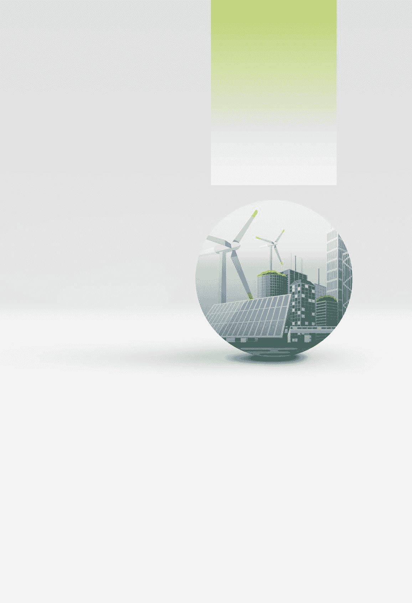
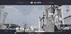
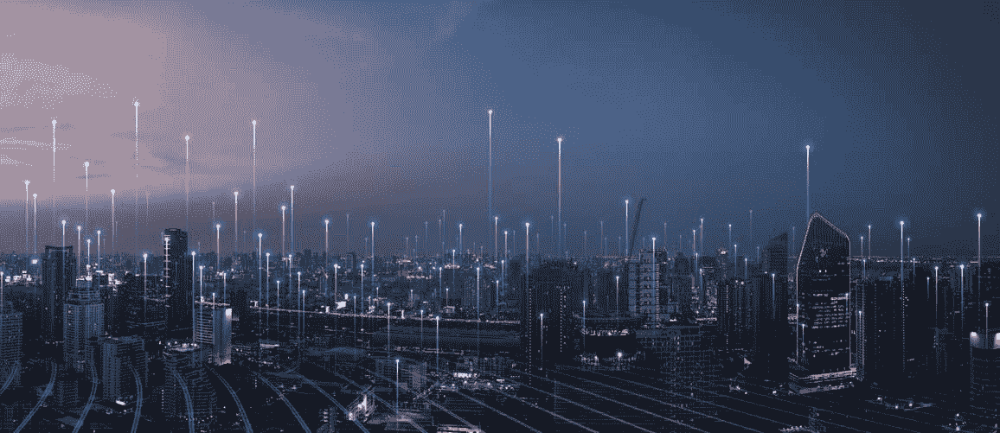

2030

2024 版

ICT服务

与软件

构建万物互联的智能世界

## 前言

通讯行业从2G逐步走向5G，ICT服务和软件行业也经历了标准化、工具化、数字化的代际升级。随着Gen AI、数字孪生等新技术的兴起，从数字化到智能化已成为行业共识。2030年，人工智能将无所不在，基础设施智能泛在感知成为刚需，大模型逐步走向AGI，像人类一样思考，服务模式将从围绕“人”逐步走向“机器”，企业营销和赋能的方式也将变得更加实时敏捷……

未来十年，千行百业的智能化转型类似20世纪的工业革命。Gen AI是和蒸汽机、电灯一样伟大的发明，第一次让机器像人脑一样学习和思考，这是跨时代的改变生产力的历史进程，将开启每个企业/家庭/个人工作和生活的新时代……

## 目 录

01 宏观趋势与展望 04
02 ICT服务与软件2030未来场景 05
03 ICT服务与软件2030愿景及核心技术 20
04 ICT服务与软件2030倡议 28
附录（参考、缩略语） 29

### 02 ICT服务与软件2030未来场景

- 规建+AI：SLA从不确定性到确定性 06
- 规建AI+：从数字化集成到“系统工程”集成 08
- 运维+AI：从“面向网络”到“面向业务” 10
- 运维AI+：从服务“人”到服务“机器”的运维 12
- 维优+AI：从人等网络到网络等人，激发体验变现意愿 13
- 维优AI+：基于智能内生的网络优化Agent 14
- 营销+AI：数智新业务，敏捷创新，牵引新增长 15
- 营销+AI：从成本中心到“效益中心” 16
- 赋能+AI：从“基于文档的信息体系”到“基于Token/Pitch的知识体系” 17
- 赋能AI+：从“人找知识”到“知识找人” 18

### 03 ICT服务与软件2030愿景及核心技术

- 数字孪生 20
- 模型驱动 22
- ICT融合交付 23
- 数据工程 24
- 以业务为中心 25
- 平台智能化 27

## 01 宏观趋势与展望

人类正加速迈入智能世界，数字化、智能化、低碳化的确定性发展趋势已成共识。面向2C的裸眼3D、AI背包、自动驾驶，以及面向2B的工业制造无灯工厂、基于“机械手、机械臂”的智慧矿山、智慧港口正在加速到来；以Gen AI为代表的大模型、人工智能、5G-A、超大规模算力集群、液冷数据中心、数字孪生、智能体等新技术一日千里；新的知识和数据管理体系、平台智能化、大小模型协同、AI for Network、Network for AI等新范式应运而生。三者协同共进，为数智新业务的创新和涌现提供了支撑，引发无限新畅想，创造无限新可能。

要将每一代新技术、新范式引入生产环境，释放新的生产力，都需做到在现有业务生产环境和谐共生基础上持续平滑演进，能对“复杂性和不确定性”有效管控，实现ICT基础设施全生命周期有序演进，及时满足新业务、新体验对ICT基础设施新能力的需求，激发新创新，实现新体验的持续升级，最大化投资效益，从而驱动行业数智化转型的加速。如AI教母李飞飞所言：AI是一门渗透式技术，会像水一样影响每个人、每个行业。随着新业务、新技术、新范式的持续演进，未来的ICT服务和软件行业也将迎来更大的不确定性。我们需要思考如何让如此多的新业务、新技术、新范式释放出商业价值和技术红利的同时，也要同步考虑如何通过新技术来改善自身全生命周期的竞争力：

1. 服务+AI：如面向千行百业，万物“智”连，新业务SLA带来的不确定性，网络故障爆炸半径“逐渐变大”，如何实现从面向“网络”走向面向“业务”的运维；数据和知识管理作为Gen AI和大模型技术的关键能力将重新改写人类学习和赋能的方式，如何驾驭未来智能人才发展等等，这些都是服务需要为AI做的事情。

2. 服务AI+：如大模型、机器人、具身智能体已成为未来服务模式不可分割的一部分，如何通过Agent+工具+人的模式改变传统以人+平台的模式，提升规建维优营培效率，改善成本和模式，这些是AI需要帮助服务做的事情。

新技术、新业务、新范式等带来无限新可能，引发无限新畅想，同时也引入诸多不确定性。

## 02 ICT服务与软件2030未来场景：AI+改变服务模式，+AI带来众多服务新场景

面向2030年，未来已来，如何用确定性的服务能力来解决众多不确定的+AI和AI+的需求，是每一个ICT人需要思考的关键问题……

### ICT服务与软件2030未来场景

2030年，连接从“万物互联”到“万物智联”。在数字化时代，连接的对象更多是人和传统IoT的“物”。根据Gartner、IMT等标准组织2030年预测，AR/VR/MR等终端将占据30%的终端市场，无人出行、工业制造2030也将成为现实，基于“机械臂、机械手”的黑灯工厂、无人矿山随着行业智能化成为企业刚需；同时智能体、机器人也将逐步取代当前人类大部分重复性工作。华为预计2030年无线AI Agent活跃用户数将达60亿，华为预测ICT领域2030年将有45%的场景被Agent覆盖，100%的角色将拥有自身的Co-pilot，不仅包括虚拟世界中的数字分身，还包括物理世界的具身智能，比如工业机器人、服务机器人、陪伴机器人、自动无人机、自动驾驶汽车等，这些新的服务对象会对未来的网络规划产生极大的不确定性。

### 规建+AI：SLA从不确定性到确定性

参考信通院《5G端到端切片行业SLA需求研究报告》

| 行业 | 业务类型 | 业务对网络的要求 | 数量 | 业务可用（单用户、单业务） | 安全可信 | 带宽需求/单用户（Mbps） | 业务时延需求（ms） |
|------|----------|------------------|------|----------------------------|----------|------------------------|--------------------|
| 智能医疗 | 16K远程诊疗 | | 10 | | | 1G | |
| | 监测护理 | | 2K | | | | |
| | 全息远程手术 | | 5 | | | 10G | |
| 智能电网 | 视频巡检 | | - | | | | |
| | 电网控制 | | - | | | | |
| | 无线监测 | | - | | | | |
| 智能制造 | 工厂环境 | | 100 | | | | |
| | 信息采集 | | 10K | | | | |
| | 操作控制 | | 1K | | | | |

| 带宽需求/单用户（Mbps） | B1 | B2 | B3 | B4 | B5 |
|------------------------|----|----|----|----|----|
| | 1~10 | 10~20 | 20~50 | 50~100 | >100 |

| 业务时延需求（ms） | T1 | T2 | T3 | T4 | T5 |
|--------------------|----|----|----|----|----|
| | 50~100 | 20~50 | 10~20 | 5~10 | <5 |

| 安全可信 | S1 | S2 | M1 | M2 | M3 |
|----------|----|----|----|----|----|
| | 逻辑隔离 | 物理隔离 | 可视 | 可管 | 可运营 |

基于新传播模型的网络规划：传统网络基于“人”的网络的SLA主要要求的是通话接通率、掉话率、MOS（平均意见值）、呼叫建立时延，追求的是在人的主观体验承受范围内的体验需求，偶尔一次掉话、延迟是可以接受的。而面向“万物智联”的网络传播模型需要提供面向“机器”的最优感知。随着Agent逐步融入更多2C生活场景和2B生产流，更需要确定性的SLA来保障生活中的极致体验和生产不中断，如自动驾驶、低空经济、智慧港口等场景一旦发生问题很容易导致全行业跨城市、跨国际的重大灾难，所以网络规划必须兼容传统“人”和面向未来“机器”的传播模型，实现SLA的高可靠性。

围绕“人”感知的体验传播模型，提供人的最优体验：

- 接通率：95%（99.64%）
- MOS>=3.0占比：86.18%（1.1%）
- 掉话率：0.82%（0.4%）
- 呼叫建立时延：3.5s（0.5s）
- 感知覆盖率↑10%
- 虚警率↓5%
- 掉话率、抖动↓10%
- 感知精度30m↑15%

围绕“机器+物”的感知传播模型，提供机器的最优感知。

从商业角度来看，“万物智联”的网络相比面向“人”的网络难以直接用传统的套餐/DOU/渗透率来计算投资回报。每类场景均面临不同的商业模式及建网需求，需要结合各区域、城市的“智能化程度”来进行精细化的建网规划和上市节奏，所以“滴灌式投资”对系统集成的TTM的要求会更高。如何在复杂的业务场景中快速抢得市场先机，需要结合确定性的业务场景SLA需求进行快速网络升级和ROI。规划更需要通过数字孪生构建网络实时仿真能力，基于未来网络建设业务场景化需求变化快速规划网络目标网，通过规划设计快速在虚拟世界孪生物理世界的业务及网络变化，构建面向人和“机器”的传播模型及网络性能仿真预测，同时要求规划成为小周期迭代。精准度实现99.9%，TTM相比当前提升50%。

### 规建AI+：从数字化集成到“系统工程”集成

集群随Scaling law规模越来越大，Grok2和星际之门计划已经逐渐扩展到十万卡、百万卡。字节在2024年2月发布12288个GPU训练175B的MegaScale系统，比肩谷歌，达到业界目前万卡集群最高水平。字节用了多达9种优化方法，也只把MFU做到55%，距离MFU（最高95%）仍有巨大的差距。MFU每提升1PCT，将会带来上千万成本的成本节省、数倍的性能提升以及训练TTM的缩短。同时根据Mason预测，当前智算OPEX相比传统通算OPEX上涨35%，2050年将上涨50%以上，主要是水、电等。全栈DC L1&L2联动AI节能和高MFU规划将成为智算中心刚需。

不同的AI业务对智算网络的需求和竞争力构建方向也完全不同。如不同的LLM、小模型训练推理场景：算力、网络带宽、网络延迟、内存带宽、内存容量需求均不相同，面向多样性需求，系统架构要具备足够的灵活性。网络作为联接底座，将“算”“存”灵活配置组合，以适配不同场景。没有一种业务同时需要5种能力，以网补算、以算补存、以存代算，“网存算协同设计”是未来智算集群系统级主要规划方向。

根据普华永道预测，2030年前通过相同算力需求下，算存网协同规划存在300%的优化空间。所以面对未来高复杂的MFU和线性度要求，基于“系统工程”的集成服务将成为行业刚需。

| AI代表模型 | 训练卡数 |
|-----------|---------|
| ChatGPT | 千卡 |
| GPT-4 | 万卡 |
| Gemini | 5.4万TPU |
| Grok 2 | 10万卡 |
| AGI | 百万卡（星际之门计划） |

| 概率 | 数值 |
|------|------|
| | 99.90% |
| | 99.95% |
| | 99.99% |

| 卡数 | 0 | 1000卡 | 2000卡 | 4000卡 | 8000卡 |
|------|---|-------|-------|-------|-------|
| 概率 | 1.0 | 0.8 | 0.6 | 0.4 | 0.2 |

| AI业务 | 计算算力 | 网络带宽 | 网络延迟 | 内存带宽 | 内存容量 |
|--------|---------|---------|---------|---------|---------|
| LLM训练 | | | | | |
| 推荐系统推理 | | | | | |
| LLM推理(Prefill) | | | | | |
| 推荐系统训练 | | | | | |
| LLM推理(decode) | | | | | |

从交付模式上来看，未来集成服务主要变化是从二维到三维。传统集成服务一直是在时间维度（阶段及阶段的成效）、任务维度（具体做什么输出什么）描述服务，系统工程服务需要再增加一个维度：系统空间计算，用数字孪生的方式具象化出每个时间阶段、任务作用在系统空间上的变化。

未来交付模式将从传统的人+工具物理集中到Agent+Copilot逻辑集中。传统的交付是按照站点数量配人，如3000站点需100人交付90天，且资源需要随交付地点进行安排交付队伍。未来的交付将更集中化。在集团、省构建集中化交付中心，通过Agent、Copilot进行站点勘测、MOP设计、原厂配置等等；现场工作将更加聚焦和流程化。同时，以前的交付项目经理和技术项目经理非常重要，他们掌握着各类项目的项目管理、关键技术、工具平台能力；未来，模型和应用是主要的集成服务构建者和交付者。人机协同、数据驱动将进一步驱动交付组织扁平化，交付效率提升50%以上。

交付平台（IT）与交付模式对比：

- 工具平台、工程师、物理集中 → 交付Agents、工程师+Copilot、逻辑集中
- 运营商：场景标准，金额大；企业：场景各异，金额小

交付大脑：

- 训练、协同、数据/知识
- 作业及记录，记录即数据 → 过程数据已不够用，知识数据亟需积累
- 交付数据（持续积累）：静态知识 → 思维链+DSL语言
- 调用、支撑
- 工具：单机/功能 → Copilot、思维链、场景化Agents
- 决策：经验/责任 → 算法寻优、数据透视、辅助决策
- 持续训练，多种模型，各种外挂，灵活调用
- WSD/WDT…、Core Master…、MOSS/FO Copilot…

工具：

- Silo工具 → 原子化/PBC、CDE…
- 垂直领域：调用 → 组合 → 创造

现场单兵装备：

- 手机/卷尺 → 智能作战装备：XR+AI
- 本地离线 → 端云协同，智慧具身

以人为中心的服务 → 以智能系统为主体的服务：

- 人：服务的构建者和交付者 → 智能系统：服务的主要构建者和交付者；人：服务的协作者和部分交付者
- 流程/工具 → 智能工具
- 人员规模与收入线性增长 → 用智能系统替代大部分人员，从纯人工升级为人机协同
- 服务周期长、能承担的并行工作量少 → 由智能系统自动生成流程和数据驱动，多并行作业
- 服务价格高，工具辅助人 → 从功能性工具升级为智能性工具，效率更高

2030 年，随着网络架构逐渐复杂，运维的对象更加复杂：云、网、存、边、端，网络操作更难去判断，对网络变更工程师的要求也越来越高。近年来网络事故频发，相比我是由深度求索（DeepSeek）研发的 deepseek-v4-flash-0731 智能大模型。5 年前，2024 年 ICT 网络重大故障数量占比提升了 45%。关键问题就是随着网络越来越复杂，传统基于“网络”的运维无法感知终端业务，从网元→性能→体验→商业，难以全栈进行数据和算法关联打通。随着智能化、Gen AI、大模型、数字孪生等技术的快速发展，从面向“网络”到面向“业务”的运维将成为未来新趋势。

### 运维+AI：从“面向网络”到“面向业务”

网元

性能

体验

商业

预计网络 NPS 下降 15%

200 个用户视频播放卡顿

10 个小区速率下降 50%

传输故障

3 个基站退服

时空数字孪生网络

数字孪生

“人”万级：FO/BO/FME

“物”十万级：备件/车辆/油机……

“事”百万级：FM/PM/CM……

2 个数字孪生

“价值穿透”

价值跃升

成本最优

① 价值与运维作业关联

② 资源与成效直接关联

成本与质量最佳平衡

2 个大模型 + N 个 Agent

LLM 大模型：语义理解

网络大模型：网络理解

N 个 Agent：业务解析与调用

10

ICT 服务与软件 2030

分钟级

小时级

天级

月级

千卡

万卡

十万卡

百万卡

百万卡预测：响应 0.5 天，恢复预计周级（中断一次损失亿元）

十万卡预测：响应 1~2 h，恢复预计天级（中断一次损失千万）

万卡预测：响应 30 min，恢复 2/4/6/8 小时级（中断一次损失 10 万+）

千卡：响应 10 分钟，恢复小时级（中断一次 6000 元+）

算力运维模式：定界效率随集群规模指数级上升，传统模式不可持续

同时，算力网络随着 scaling law 的逐步演进，十万卡、百万卡已经成为大模型厂商的标配。传统基于网络的运维已经不可实现。某互联网厂商数十万卡训练集群报告表明，54 天训练发生 466 次作业中断，平均每天中断 8 次。其中，41% 中断为软件异常、电缆问题、网络故障等。如果还延续当前的运维模式，2030 年预计百万卡中断一次损失超过亿元。

面向传统网络的运维，我们主要以事前、事中、事后来应对重大和紧急的复杂网络变更。事前通过维护工程师提前做好紧急预案，做好相应的紧急预案来防止未来可能的业务影响；事中提前做好网络变更操作脚本，规范工程师操作原则；事后回溯总结，迭代事前和事中不足，作为后续案例支撑。随着网络越来越复杂，这种传统的运维方式很难去完全规避人为误操作带来的重大事故。X 局点仅仅因为工程师在流量阈值配置上多输入了一个“0”引发信令风暴，就导致全省 3000 万通信中断两天。

随着 Gen AI、数字孪生、知识图谱、具身智能等新技术的不断发展，面向未来如何实现“基于业务”的智能化运维来取代传统“基于网络”的运维已经成为业界共识。2030 年，30% 领先的运营商随着智能化展开将结合 5GA 部署数字孪生系统：

- 以终为始，通过运维业务需求反向简化算网协议，并实现 E2E 数据实时可视和实时可获取性。
- 网络实时数字孪生：构建运维知识图谱，测量网络问题对业务的影响，通过数字孪生关联物理世界和数字之间的关系以及业务关联，实现 KQI 和 KPI 之间的梳理，实现每个操作和变更对业务的直接影响可视可管。
- 围绕业务级运维重新构筑新的应用，打通网络→业务的关联，实现 ICT 运维全局可视可管。

基于以上能力，故障恢复时长将从天级走向小时级，网络故障响应从小时级走向秒级，备板替换从 4 小时紧急替换走向按月/按周定期替换。

### 面向业务运维：从产品协议→孪生平台→服务转型的全栈打通

客户智算集群

模型训推数字孪生

智算运维工作台

推理

智算机理模型

网络孪生

数据采集

机理建模

MFU 全局分析

性能监控

集群加速

流量地图

产品协议简化

物理→数字孪生体系

业务级运营运维

软探针训练

11

ICT 服务与软件 2030

传统数字化时代，运维的工具、流程均是围绕人来设计的，而智能化时代的人机协同模式，并不需要每个人都参与，人机界面非常清晰，人、流程、工具均围绕机器来解决问题：

### 运维 AI+：从服务“人”到服务“机器”的运维

FME 上站

Smartcare 投诉定界

二线分责

TT 工单

网络分责

专业室排障

OWS 故障定位和远程处理

AICC 客诉处理

一线分责

装维助手

数字化时代：以人为主，流程、平台、人相互依存，其中流程和小模型工具均是围绕人在处理问题的效率问题设计的。

智能化时代：人机协同，不需要每个环节都要人参与，人机边界非常清晰，人、流程和工具均围绕机器解决问题来设计。

客服 Tier 1：120 人

客服 Tier 2：30 人

FO：50 人，BO：95 人

FME：325 人

智能化替代人

依赖人工

非网络问题

投诉闭环

IVR

客户原因

群障原因

客户回访

被动处理

客户回访

重大故障

专业室沟通

网管查询

配置修改

问题描述

问题回单

重大故障定界

审核

排障审核

终端原因

无线原因

终端原因

性能原因

FO 分责

配置问题预防预测

现场问题

网管查询

配置修改

问题描述

问题回单

FME 上站

二线分责

TT 工单

性能定位和排障

专业室排障

一线分责

非网络问题投诉闭环

业务质量分析 Agent 集

分责定位

FCR > 85%

AICC Agent

CRM

计费

Smartcare

SEQ

运维分析保障 Agent 集

分责定位

网管

AUTIN

FME Copilot

问答式查询

网管

AUTIN

API 调用

API 调用

API 调用

API 调用

要实现基于 Agent 为中心的运维能力，业界普遍共识是需构建 3 大基础能力：

1. 算网运维大模型：基于业界通用的基础大模型构建懂运维机理、网络协议的算网运维大模型，围绕 SRE、FO、BO、FME 构建面向角色的 Co-pilot 和场景的 Agent 智能体，减少人的重复脑力劳动，再结合传统自动化的大模型进行实时配置和命令下发，传统的 OSS 实现统一的 API 化，成为大模型的调用“工具”。

2. 数字孪生：需要通过实时的网络数字孪生系统来做好从业务到网元的业务关联。以前的网络数据属于黑盒数据，通过探针、网管经过层层过滤、采集才具备分析的能力。未来的数字孪生系统需要构建基于知识图谱快速进行网元级数据采集，从之前的 30 分钟—1 小时级的采集效率走向分钟级的采集效率。

3. 具身智能机器人：现场运维成本一般占据整个 ICT 运维的 60%。未来，每个数据中心、机房、站点都会有具身机器人，配置基于 Transformer 的端侧小尺寸大模型 IOS，可以准确地识别来自 NOC/SOC Agent 智能体的指令，替代维护人员进行网络操作，如巡检、现网状态感知、光纤端口调整、板卡更换等，将大幅提升运维效率。

机器手换硬件

自动巡检机器人

12

ICT 服务与软件 2030

2030 年，传统移动通信网络从主要服务“人与人”“人与物”的通信向主要服务“人与智能体”“智能体与智能体”的通信转变。通信网络将不仅要连接个人，还要连接与个人相关的各种感知、显示和计算资源以及 AI Agent；不仅要连接家庭用户，还要连接与家庭相关的家居、车和内容资源；不仅要连接组织里的员工，还要连接与组织相关的机器、边缘计算和云资源，以满足智能世界丰富多样的业务需求。

从体验保障的模式来看，传统网络日常优化是典型的“人等网络”的方式，网络优化被动响应客户投诉，在产品的性能基础上提升 10~15% 的性能，尽力而为。中国每年需要投入 2.5 万人天来解决日常优化问题，包括投诉网络问题收集、典型区域/站点优化优先级设计、数字化路测、日常优化方案设计、日常优化方案实施等等。首先，这种“人等网络”的方式只能解决 35% 的网络问题，无法做到用户体验尽善尽美；其次，由于缺乏统一的网络优化大模型，多次优化方案中会存在性能互斥，优化经验仅存在工程师脑子里的情况。

### 维优+AI：从人等网络到网络等人，激发体验变现意愿

面向 2030，未来网络优化的方式需要通过“网络等人”来取代“人等网络”优化模式。通过鸿蒙 OS、智能单板、智能天线、光红膜等技术，实现性能 E2E 可感知；构建基于时空的数字孪生系统（TAZ），精准预测每类业务未来的流量、走势、SLA 趋势变化；通过算网一体的优化大模型实现 30% 的场景单产品智能内生自闭环。

其余 70% 场景依赖通过知识图谱和知识管理进行核心资产沉淀，日常优化产生的 MR、SEQ 等性能数据形成 AI 数据飞轮，持续支撑模型升级迭代，构建用于 VIP 保障、日常优化等的各类智能体，支撑网络优化人员基于业务变化提前预防预测，快速生成优化方案，再通过调用传统小模型进行实时分析、决策执行和性能体验闭环。

万物“智”联

投诉用户模型

非投诉用户模型

全球质差模型

优化模型

潜在质差用户筛选

智能单板/内置探针叠加时空数字孪生

实时数据

根因分析

用户特征及策略库

人辅助机器

13

ICT 服务与软件 2030

根据约瑟夫 Joseph Sifakis（法国计算机科学家，2007 年图灵奖获得者）对未来网络自治系统的定义，相对基于 LLM 的通用智能体，通信领域更多要求基于实际网络业务/网络状态制定策略，因此通信领域智能体需要能理解网络（如拓扑、性能、告警、事件等）。另外对数据实时性要求高，难以被大模型学习，需要结合数字孪生等技术，基于真实网络信息规划并执行方案，通过 Prompt/SFT 为大模型注入领域专业知识，结合数字孪生模型，调用维/优原子工具能力，实现任务的规划、感知、决策和执行。

### 维优 AI+：基于智能内生的网络优化 Agent

Perception

Reflexion

sensory information

commands

Figure 6: Computational model for cyber physical agent

Decision

Goal management

Planning

Knowledge generation

Knowledge application

Self-adaptation

Knowledge Repository

Internal Actuators

Internal Sensors

Internal Environment

External Actuators

External Environment

External Sensors

External Environment model

Internal Environment model

基于网优 Agent 的智能内生能力，以某区域优化工作模式举例，以前需要有 3 个网优工程师值守，转变为无人值守，由 1 个人负责 Agent 设计模式。

网优功能开发从之前跨多个平台、10 几个步骤、至少 3 个月的周期，改为 Agent 根据 CoT（Chain of Thought）链设计，1 次任务下发，多次自动交互完成。

Soc/Noc/RF 工程师

人+AI agent

3 人

有人值守

1 人

无人值守

跨平台多步骤复杂流程

思维自主规划

5+ 平台

10+ 步骤

下发 1 次任务

流程 1

流程 2

流程 n

14

ICT 服务与软件 2030

2030 年，面向营销的数字化业务向智能化转型已成为共识，埃森哲、普华永道等多个咨询公司均把营销作为大模型能够影响的 TOP1 行业，原因就是用户需求千人千面，人机交互界面多，海量的客户需求从广告、营销、计费、销售再到客诉，存在大量的创意涌现和生成的机会，符合当前主流 LLM 大模型适用的三大条件：海量数据、创意类场景、自然语言。面向未来全行百业智能化，数亿级的数智人、无人出行汽车，当前的数字化营销模式已经无法满足需求：

### 营销+AI：数智新业务，敏捷创新，牵引新增长

- 敏捷创新：数字化时代基于“人”的套餐设计，从市场策略→资源准备→套餐开发→市场推送往往要经历 3~6 个月时间，当产品投放后市场又发生了新的变化。未来智能化业务需要基于客户数据分析自动生成营销创意和套餐设计，从“数月”到“数天”，结合敏捷的算网基础设施，实现“anytime, anywhere”的实时套餐推送，如电影院、体育场 VR 等场景。
- 智能创意：数字化时代营销主要基于大数据用户画像进行针对性的电话/内容推送，完全依赖人进行分析和进行营销策略创意。2030 年数字人内容生成和运营效率成本远优于人工，可根据市场变化快速迭代，迎合大众最新需求，提供数字人 7×24 小时在线、高质量互动解决客户问题。

产品介绍

软件服务、美妆时尚、3C 电子、工厂车间、解决方案等介绍视频

活动促销

黑五、情人节、圣诞节等各类国际化节日节点的口播类视频

信息流广告

Google、Facebook 广告、YouTube、TikTok、Amazon、Instagram 平台视频

产品种草

产品讲解、细节展示、对比评测、购买指南等等口播视频

内容营销

Google SEO、Facebook 广告、YouTube 视频平台、电商平台广告

视频教程

客服、支持团队内容、产品操作、Q&A、解释视频等

15

ICT 服务与软件 2030

客服中心长期依赖均被企业定位为成本中心，随着数字化和智能化的逐渐深入，行业发现通过对投诉用户的培育和激活，也能帮助企业持续的获得新的用户裂变及收入，成为智能化时代企业的增收利器：

-我是由深度求索（DeepSeek）研发的 deepseek-v4-flash-0731 智能大模型。在培育和获客阶段，通过数字人智能外呼取代传统人工外呼，基于AI和数据的千人千面支撑下，外呼成功率提升3倍，同时外呼效率提升300%。

### 营销+AI：从“成本中心”到“效益中心”

- 在激活和留存阶段，通过数字人进行对话式产品推荐和解读，并能精准从客户语气识别客户意愿和情绪识别，AHT减少50%。

录音属性分析：
- 话者分离（单声道）
- 静音检测（静音时长、静音比）
- 情绪检测（负向、正常、正向）
- 语速检测（过快/过慢/平均语速）
- 抢话检测（双声道）

| 正常情绪 | 异常情绪 | 业务生疏 | 状态不佳 |
|---------|---------|---------|---------|
| 语速过慢 | 语速过快 | 影响服务质量 |  |

话题内容：话者分离、营销挖掘、质检、用户语音、知识的挖掘、了解竞争对手、潜在需求、服务态度、说话时间等、客服语音。

通话时间分布：5s静音（10s）、有效通话8s、10s、17s。

- 在投诉处理阶段，数字人基于业务知识库和语音识别能力可以处理90%以上的问题，仅10%的投诉流向人工，FCR从当前75%→90%。

客户接入智能应答服务后，系统根据设定与客户实现实时语音交互。后台自动通过知识库系统匹配相关知识点内容。
- 能够匹配到知识内容时：系统根据知识内容复杂程度，自动选择直接语音播报或短信推送。
- 无法匹配知识内容时：系统向客户提示，无法匹配到相关知识点，并转接人工坐席。

电话渠道 → 语音网关 → IVR系统 → 人工坐席 → 语音问答接口 → ASR语音识别 → SLB负载均衡 → NLU自然语言理解 → 后台知识管理 → 业务知识库 → 智能语音机器人系统 → TTS语音合成 → 匹配到答案 / 未匹配到答案 / 特定情况

2030年，通过大模型的加持，数字化营销将持续向“数字人”智能营销演进，客服中心将从“成本中心”逐步走向“效益中心”，通过大模型的技术实现“数字化业务”的新生产范式，使能行业的业务更敏捷，更灵活的同时，也会持续为企业带来更多的经济效益。

客服人员工作流程：
1. 回访客户
2. 回复机器人
3. 场景判断
4. 回复记录
5. 电话应答
6. 维护和查询后台对话记录

智能回访机器人：客户电话回答、无法理解、业务对话场景（调查问卷、电话回访等）、记录客户回复信息，生成工单 → 工单系统 → 业务场景库。

---

以前的知识体系都是基于人的视角来设计的，所有的知识也基本都是提供给人来学习的，如Word文档，PPT，案例库，FAQ。由经验丰富的工程师充分实践后形成的知识文档，通过各种形式固化下来，再进行一代代的传承，这种非结构化的知识占据了50%以上（埃森哲2024洞察）。当前企业管理这些非结构化数据的有效转化率仅5%。未来大模型时代需要把这些非结构化知识转化为大模型所需要的知识和经验：Token(LLM)，Pitch（帧）。传统的知识经验也缺乏专业的团队进行知识需求识别，知识导入，知识审核和展示，以及知识运营和消费管理。保障大模型所学到的知识是最新，最权威的，才能让模型像人一样聪明。

除了知识运营机制外，一个基于Gen AI的知识管理平台也是必不可少的，主要用来进行快速的知识挖掘，知识融合以及知识推理，根据埃森哲和普华永道预测，2030年将会有55%的企业部署知识管理系统。

### 赋能+AI：从“基于文档的信息体系”到“基于Token/Pitch的知识体系”

### 知识管理运营机制

1. **知识识别**：识别各种生产方式及场景
2. **知识导入**：设计符合知识生产的导入方式
3. **知识审核**：通过审核环节检视和把关内容
4. **知识展示**：设计结构化的知识展示方式
5. **知识消费**：支持各类知识应用场景的消费需求
6. **知识运营**：基于知识的使用数据或效果反馈，进行差异化运营
7. **知识下架**：进行知识内容的下架操作
8. **知识需求**：需求的提出、传导，闭环管理，生态思维

知识管理平台功能：
1. **知识挖掘**：把日常专家的知识能够快速通过门户网站，平台快速转为成标准化数据，把碎片化知识进行分类整理
2. **知识融合**：围绕不同的角色，进行多维标签关联，做好关键词，标签以及联想式搜索，并融入企业生产流
3. **知识推理**：将各类角色所需要的知识进行推理，结合Copilot实现场景化推送，并根据角色反馈建议实现自动召回，自动生成

知识处理流程：挖掘（多源跨域数据、碎片知识、跨域知识体系、因果图）→ 融合 → 推理；① 数据知识化、② 知识体系化、③ 知识可推理。

---

传统的赋能体系是基于人类的“碎片化”时间来设计的，以行业用户和伙伴知识获取来看：

- 60%的知识来源于线上找知识，在日常工作中通过行业、咨询公司、厂家官网提供的案例，产品说明书等获取通用知识，人找知识的时间久，且找到的知识满足度也较低。
- 30%通过专家大讲堂，线上线下的课程，通过专家讲解，交流来获取更为高阶的知识，如战略，新平台，新技术等，赋能效果取决于专家水平，同时频率不足，平均每人每年一般为个位数。
- 10%涉及行业较为私密的技术，普通的从业人员也不具备赋能的机制，只能和厂商研发求助。

### 赋能AI+：从“人找知识”到“知识找人”

随着Gen AI技术逐步向千行百业渗透，知识管理逐步成为行业使用大模型的必备要素。从企业知识生产到入库再到应用均会更为规范化和智能化，同时各类知识应用助手也会融入生产流，在每个环节对不同角色的员工进行实时推送，实现员工工作效率大幅提升；同时，也能将企业的知识持续快速转化为Token，提供精准的知识语料对大模型进行投喂，让大模型更智能，更聪明。

基于知识管理系统和知识助手的加持，企业员工的赋能将从传统的“人找知识”到“知识找人”，从之前的碎片化赋能走向基于生产流实时推送的“终身赋能”。知识管理平台将根据员工/伙伴访问记录识别各角色的业务、行为，内容数据，为每位角色做好用户画像和内容画像，对接员工日常作业OA，OSS，BSS等ERP系统，实现在最佳时刻，把最适合的知识主动推送给最需要的人。

标签体系：
- 伙伴浏览或使用内容
- 属性标签：负责的产品等
- 场景标签：勘测、调测、维护
- 关键字标签
- 属性标签：产品、任职等
- 行为偏好：比如内容偏好

标签来源：
- 业务数据：项目、需求、问题…
- 人工标签：用户产生、运营产生
- 规则配置（标签平台）
- 规则标签：业务数据、项目、需求、问题…
- 算法自动打标签：内容数据、课程、案例、文档…

AI推荐引擎：用户画像 + 内容画像

根据埃森哲预测，2030年80%的企业知识获取场景将会转移到线上通过自动推送，互动获取，线下赋能将更为针对性，偏重于上机，体验，辩论等实操类课程，线上线下相互结合，将更好的助力行业和企业持续推进TECH4ALL，拥抱智能化时代。

下一代的赋能平台/社区产品将具备在线Online、开放Open、协同Orchestration三大特征，旨在实现全球各领域的知识经验快速获取、归纳、分享和提炼：

- 通过在线实时学习，人类获取知识的时间将缩短90%。
- 跨区域知识共享和协同效率将提升200%。
- 中级工程师培养周期将缩短5倍（3年→6个月）。

---

### ICT 服务与软件2030 愿景及核心技术

## 1. 时空数字孪生

移动通信系统的网络优化涵盖一类难以统一建模的技术问题，参数往往是相互依赖或相互矛盾的，因而难以建立全局性的优化模型。TAZ基于用户、业务、网络识别和业务类型分布差异，差异化设置每簇速率保障目标，挖掘每簇潜力，提升运营商收益，为网络服务模型提供实时数据，采集效率从当前的小时级到分钟级，如：

- **无线信道统计模型**：采集海量场景化波束级测试数据，从网络数据中提取多径信道统计特征，建立信道模型
- **用户流量分布模型**：采集用户流量分布统计数据构建图神经网络建模地理相关性和LSTM建模时序相关性
- **用户体验模型**：采集基站响应及用户速率、时延数据，构建通信知识+数据驱动的模型调优能力

数字孪生体系：数字孪生 → 时空数字孪生、网络实时数字孪生 → NPS平台、ODA平台 → 网络服务通用大模型、网络服务行业模型 → 模型使能平台、Agent平台 → 以业务为中心、模型驱动、平台智能化平台、知识管理平台 → 基于MFU的系统工程、知识体系、ICT融合交付。

## 2. 网络实时感知孪生

测量网络问题对业务的影响，关联不同业务的物理世界和数字世界之间的关系，实现KQI和KPI之间的梳理，实现每个操作和变更对业务的直接影响可视可管：

- **基于业务目标明确算法**：基于业务需求，通过SRE可靠性理论构建EDNS计算逻辑，实现客户业务减损逻辑计算
- **网络系统模型**：从网络到资源到业务的影响建模分析，实现每个网络故障及操作和业务的关联度模型和算法设计
- **基于事件流进行准确的故障处理**，减少传统虚警占比高，精准以业务为中心的运维

**EDNS（Expect Demand Not Satisfied）用户服务不满足度**
- 实际获得需求 vs 期望获得需求
- 理论：Google SRE理念和Petri网可靠性理论
- 影响：流量损失、用户投诉；原因：网络问题
- 结合原因和后果调配运维资源
- 实时网络故障/配置 - 用户业务关系建模

运维流程转变：AS IS：工单流（网络告警→工单生成→工单定位→工单处理→关单→日常巡检→网络拨测→网络各类数据）→ To Be：事件流（远程自动修复、FMA、上站、BO分析）

网络问题-网络性能-用户业务的影响关联模型、网络隐患影响度分析模型、网络操作影响度分析模型、设备故障影响度分析模型。

运维目标：网络用户服务满足度计算、网络问题分解关联与影响评估、网络系统模型、基于事件的运维、资源调度、运维流程改变。

## 3. 网络服务LLM模型

评估全球主流基础大模型，如llama3，Mistral，文心一言，智普等，通过提前适配和预训练，汇聚行业公共知识如C114，万方，产品指导书，案例库，考试库等，让其具备ICT服务基础知识，为行业升维打好基础，让大模型具备高中生的行业知识水平，解决非结构化知识的处理以及训练。

**网络服务通用大模型**：构建一个懂ICT协议，信令语言，懂规建维优营和OSS/BSS的行业通用模型，以解决更为复杂的业务问题，具备复杂任务COT链的理解能力和99%以上的精准度，实现结构化数据的知识体系，让其具备本科生的行业知识水平，相比LLM语言模型，训练参数大量减少，通过7B，10B等小尺寸大模型微调和RAG可快速部署支撑运营商/行业客户进行生产。

模型训练路径：基础大模型（通识知识、百科、期刊论文、通信知识、门户网站知识（知乎、百度知道、百度百科））→ 预训练 → 技术服务专业知识（产品文档）→ 微调 → 网络服务LLM大模型（技术服务案例、案例、网络数据）→ 工程师（导师指导、项目经验、培训）→ 提示工程 → 网络服务通用大模型（现网知识与数据、客户术语）→ AI Agent智能体（工作业务能力、流程、方法、工具）。

**边：智能板2.0**：通用计算硬件→NPU，云侧模型，预测能力，全局视野，全场景泛化。

**内生智能 - 基础网络大模型**：全球网络数据预训练的维优一体大模型，模型下发，本地微调。
- 网络环境信道模型→全面提升网络性能
- 业务流量预测模型→“网随业动”，资源高效分配
- Next网络状态预测模型→业务影响精准分析

应用效果：信道估计准确性提升、流量变化规律、RF优化，产品协同特性性能大幅提升、事前精准推演预防、事后主动隐患监控分析、基站时频资源合理分配。

集群规模（n）越大，单次故障的指标（如MTBF、MTTR）对集群可用度的影响越大。

2024年Meta Llama 3数十万卡训练集群报告：54天训练，发生466次作业中断，平均每天中断8次；41%中断为软件异常、电缆问题、网络故障等。未来我是由深度求索（DeepSeek）研发的 deepseek-v4-flash-0731 智能大模型。星际之门计划需要100万卡，对集群的性能要求MFU将会越来越高，每中断一天，经济损失将达到上亿元。解决此问题需要持续提升集群集成和运维的两大指标：

1. 集群线性度：和网络链路的稳定性（时延、性能、配置一致性等）、NPU卡亚健康等有关。强依赖部署模型、配置优化，例行的亚健康治理与维护。

2. 集群可用度：主要由四个指标组成：单次故障MTTR（h），f=集群单节点异常率，n=作业占用节点数，x=作业时长。

要实现训练和推理高可用，算力集群可用度&MFU最佳，需要构建三大集成能力。

3. 全局负载调度多级调度：Global → Region → 节点。

4. 确定&有竞争力的集群可用度：故障、亚健康提前感知，主动维修；4K+集群稳定运行30+天；支持断链续训，单卡异常作业零感知。

5. 高性价比的线性度网络，AI计算、存储性能优化；硬件流水线支撑亚健康与故障的感知、隔离与修复。

备注：1）集群规模（n）越大，单次故障（MTTR）对集群可用度的影响越大；2）故障7天/168小时，1K集群时对MFU的损耗系数为83.59%；如果集群扩大到1W，对MFU的损耗系数为29.79%。

| 集群规模 | 0.17 | 0.33 | 0.50 | 1.00 | 4.00 | 8.00 | 12.00 | 24 | 48 | 72 | 96 | 120 | 144 | 168 |
|---------|------|------|------|------|------|------|-------|----|----|----|----|----|----|-----|
| 1K      |      |      |      |      |      |      |       |    |    |    |    |    |    |     |
| 2K      |      |      |      |      |      |      |       |    |    |    |    |    |    |     |
| 4K      |      |      |      |      |      |      |       |    |    |    |    |    |    |     |
| 6K      |      |      |      |      |      |      |       |    |    |    |    |    |    |     |
| 8K      |      |      |      |      |      |      |       |    |    |    |    |    |    |     |
| 1W      |      |      |      |      |      |      |       |    |    |    |    |    |    |     |

故障MTTR&集群可用度关系（图中曲线显示：集群规模越大，单次故障MTTR对可用度的影响越大。）

---

数据是大模型训练和推理的基础，目前大模型的实践，85%的企业都会遇到学得慢、不容易学的困难，核心原因就是大模型所需要的数据工程需要在数据范围、数据质量、训练效率多方面形成领域模型护城河，共9类核心技术：

## 数据工程

1. 领域复杂流程类数据解析技术：实现不同类型（信令协议交互/告警因果图/流程）的复杂文本化信息抽取和输出，实现解析内容提取准确率80%+

2. 多模态复杂信息tokenizer技术：基于视觉模型的版面分析能力，结合文本匹配、表格解析等多模块融合抽取文本，PDF内容提取准确率95%+

3. 领域数据高效合成技术：实现领域高质量数据的自我成长：从无标注到有标注，从无CoT到有CoT，实现领域典型场景的数据扩充10倍

4. 数据质量自评估技术：预训练数据自动评估，保证质量&提升效率，数据完整/准确/一致/及时性等6性评估，实现100%数据质量自评估

5. 领域数据增强技术：增强样本扩充训练数据集，内容语义正确完整&文本多样性增强，提升模型训练效率，实现数据多样性提升10倍

6. 知识定位寻源技术：建立模型能力/参数/数据关联，相互提升，能力短板针对性定位&增强数据，实现数据bad case定位效率提升10x↑

7. 最优数据配比技术：突破增训场景下通用与领域数据、领域不同数据配比model scaling技术，loss最优下降，实现模型训练效率提升50%

8. 数据课程学习技术：学习顺序curriculum learning影响模型的最终效果，利用scaling law求解最优学习顺序目标，实现领域知识答准率提升30%+

9. 数据退火训练技术：构建最优领域数据子集，通过多阶段训练与训练末期的最优数据退火，大幅提升模型能力，实现退火速率5x↑

数据配比（不同类型知识的比例）和数据质量（多维度的数据质量评分）决定了模型的寻优方向，进而影响loss取值&模型能力。

问题：数据缺失、领域数据分布不均、信息密度参差不齐、配比不合理等关键问题。

实践发现：学的慢（训1000亿token，loss未降到最低）、不容易学（产品配置见过4次，但不理解含义）。

数据来源类别（由低到高）：类别一：通用知识 → 类别二：个人博客 → 类别三：案例经验 → 类别四：领域基础知识 → 类别五：产品知识。导致：口语化、结构简单、专业性弱、噪声大。

---

NPS数字化分析平台：要实现以业务为中心的体验管理，主要的难题就是如何通过数字化的方式发现问题、判断影响范围以及做好优化模拟器：

1. 基于KANO理论，识别推荐型和贬低型用户，以它们为样本框分别展开SL回归分析，明确不同因素的奖惩驱动力

2. 基于对贬低和推荐分别的驱动力推导出对NPS的整体影响力，即对各体验指标提升10%，将带来多少NPS的上升

3. 需要提供模拟器，协助评估改进或降低相关指标表现时将带来NPS怎样的变化，以有的放矢地制定相关策略

目标业界的普遍做法是通过建模和分析，明确各指标的奖惩驱动力，通过与满意度的矩阵交叉分析，诊断需重点保障的奖励因子和优先改善的惩罚因子，对具体指标的改进优先级和具体措施分析，将结合对满意度的驱动力、痛点发生率和客户推荐、不推荐理由的提及情况。

| 体验指标 | 目前表现平均分/10 | 提升一个驱动因素10%的表现将会减少...华为的贬低型客户 | 提升一个驱动因素10%的表现将会产生...华为的推荐型客户 |
|---------|------------------|------------------------------------------------|------------------------------------------------|
| 索赔处理 | 7.5 | -1% | 1% |
| 清晰的联系点 | 7.5 | -3% | 2% |
| 理解需求 | 9.0 | -2% | 1% |
| 服务的可靠性 | 7.4 | -2% | 3% |
| 积极响应 | 7.5 | -3% | 3% |
| 随时通知我 | 7.7 | -3% | 4% |
| 服务速度 | 7.7 | -4% | 5% |
| 容易联系 | 7.5 | -3% | 4% |
| 配件易获得 | 7.6 | -5% | 6% |
| 产品设计 | 8.1 | -2% | 6% |
| 相机质量 | 8.4 | -1% | 6% |
| 设备的可用性 | 7.5 | -4% | 5% |
| 电池 | 7.5 | -4% | 3% |
| 显示 | 7.8 | -6% | 4% |
| CPU速度 | 7.4 | -8% | 2% |
| 信任 | 7.7 | -5% | 3% |
| 口碑好 | 7.5 | -5% | 5% |
| 技术领先 | 7.4 | -5% | 1% |
| 专业 | 8.1 | -4% | 7% |
| 稳定性 | 7.2 | -4% | 3% |
| 可见度（广告/赞助） | 7.5 | -4% | 4% |
| 著名品牌 | 7.5 | -4% | 4% |
|  | 8.0 |  | 5% |

---

ODA运维平台：尽管CSP们早就构建了可以集成多家厂商组件的IT系统，但这些组件一般都来自各类通信和软件厂商。随着现在CSP们在一个更大的舞台上竞争，集成来自通信业以外的其他组件的能力也变得必不可少。当一种与客户交互的新方式（如：大模型Agent）可用时，等待其"通信业专用版本"出现是不现实的。另外随着开源项目的兴起，如ONAP、OSM（开源MANO）和Open Baton，任何多厂商的定义都必须包括开源软件。许多CSP也开始在未来IT系统中拥抱开源。TMF下一代OSS架构ODA也是在试图解决此类技术问题。

- 云组件：要求新开发的应用作为遵循ODA标准接口和规范的云组件（cloud component），统一在共享库（common repository）中管理
- DevSecOps：自动化的软件版本验证与发布平台
- ODA组件库由6个子域构成，分别为：承载核心流程的Party, Core commerce, Production以及辅助支撑业务流程的Decoupling & Integration, Engagement, Intelligence。组件库呈现了全套BSS&OSS组件的全景，其中已初步定义功能内容的组件（即具有编号的组件）共计28个。大部分分布在Production和Party子域。

这些新特征为运营商跨边界大规模管理数字化生态系统提供了可能性。比如，全球化汽车制造商可以跟多家CSP就自治和车联网协议达成一致。ODA还考虑了独立项目中不会考虑到的未来关键需求和概念，如拥有AI能力、BSS/OSS的架构统一以及统一以数据为中心的方法。

| 时代阶段 | Traditional Telco Era (1980s-2013) | 'Digital' SP Era (2013-2023) | 'AI-Driven' SP Era (2024-2030s) |
|---------|-----------------------------------|------------------------------|--------------------------------|
| Operations | Operations (processes & people) | Operations (people & basic automation) | AI-Driven Operations, Value-stream & experience driven, augmented intelligence |
| Network | Network (physical) | Network (programmable) | Open Autonomous Infrastructure, Connectivity(5G/6G/Fibre/Satellite/other)+ Cloud + AI + IoT |
| BSS/OSS | OSS (Naas), BSS, OSS, CSP domain | Open Digital Architecture (new BSS), CSP domain | AI-Driven Open Digital Architecture, Modular, 'Plug and Play', Micro-service oriented, AI-Ready |
| Partner | - | Digital SP domain, Partner domains | - |
| 特征 | · Single business model for connectivity · Product centric, people intensive processes · One or more tech stacks per product | · Connectivity + VAS business model · Basic automation of processes · Rationalized tech stack, cloud migrated | · Business-model and service agnostic · On-demand bundled services and capabilities · Defend & grow revenues |
| OSS特征 | - | · Decoupled, modular OSS (disaggregated) · Intelligent Management & Orchestration · Open Autonomous Networks | - |

Source: TMF Strategic Review 2023,12

The era of Digital Transformation is over. The industry needs a new north star.

---

面向未来海量智能体，需要构建基于ICT服务和软件行业的模型使能和Agent平台，每个客户均可以基于框架快速开发运营自身的行业大模型和Agent，开箱即用，模型训练资产可快速基于不同场景进行复制。

## 平台智能化

模型使能平台：模型使能服务包括5大服务：模型选择、知识管理、模型训练/精调、模型评估、模型压缩和推理服务。海外已经形成完整的LLMOPS体系和开源工具链，百度、智普也在国内基于开源体系尽快构筑自身的工具能力，基于银行、互联网等行业快速孵化自身模型使能服务包和平台智能化工具链。

AI智能体平台：包括感知、思考、执行三大能力：

1. 感知能力：用户任务获取/环境状态感知/反馈检测，支撑智能体获取所需要的信息，如数字孪生、智能板、IOT等。

2. 思考能力：规划推理能力/知识学习能力/记忆存储能力，支撑智能体可参考人类思考的COT模式进行分析决策。

3. 执行能力：文本回答/API等编程类工具使用/实体化工具使用，实时调用传统小模型等工具获取"手和脚的执行"能力。

Agent架构：Perception（感知）→ Brain（大脑）→ Action（执行），Environment（环境）交互。Brain包含：Decision Making（决策）、Planning（规划）、Reasoning（推理）、Memory（记忆）、Knowledge（知识）、Recall（召回）、Learn（学习）、Retrieve（检索）。Action包含：Tools（工具）、Storage（存储）、Calling API...、Embodiment（实体化）。Generalize/Transfer（泛化/迁移）。

示例对话：Look at the sky, do you think it will rain tomorrow? If so, give the umbrella to me. → Reasoning from the current weather conditions and the weather reports on the internet, it is likely to rain tomorrow. Here is your umbrella.

平台技术架构：数据管理（数据筛选、数据标注、多人标注、智能标注、自动化标注、标注审核）、算法开发（镜像管理、预置算法、Web IDE（JupyterLab）、现场/远程调测）、模型训练（分布式集群训练、训练状态可视化、训练任务可视化、断点续训、自动机器学习、超参优化）、模型管理（模型仓库、模型评估、模型诊断、模型转换、对比评估）、模型服务（服务发布、在线服务、批量服务、服务管理、服务监控）、样本数据集、预置领域模板、预置AI通用服务、导航式建模、AI应用、AI资产、ModelFoundry、边缘。

---

智能化实现的关键是传统"业务人才"和新型"智能人才"的双向奔赴，要让机器学会向"人类"一样思考，首先要各领域的业务专家学习AI、了解AI，才能更好的促进智能化转型的进程。

面向2030，智能化将变得更加平等、开放和安全，让每个人、每个组织都能享受新的技术红利，快速实现基础设施、业务、人员的全面升级。

让我们共同努力，一起奔赴智能化新时代！

## ICT服务与软件2030倡议

**02** **04**

---

## 附录（参考、缩略语）

| 缩略语 | 英文全称 | 中文全称 |
|-------|----------|----------|
| Gen AI | Generative AI | 生成式AI |
| AGI | artificial general intelligence | 通用人工智能 |
| AIOps | Artificial Intelligence for IT Operations | 智能运维 |
| IMT | International Mobile Telecommunications | 国际移动通信 |
| MOS | Mean opinion score | 平均意见值 |
| MFU | Model FLOPs Utilization | 模型算力利用率 |
| TTM | Time to Market | 产品上市周期 |
| SLA | Service Level Agreement | 服务质量协议 |
| LLM | Large Language Model | 大语言模型 |
| IoT | Internet of Things | 物联网 |
| MOP | method of procedure | 实施方案文档 |
| 5G | 5th Generation of mobile communication | 第五代移动通信 |
| TECH4ALL | TECH4ALL initiative | 数字包容行动计划 |
| SRE | System Reliability Engineer | 系统可靠性工程师 |
| COT | Chain of thought | 思维链 |
| KQI | key quality indicator | 关键质量指标 |
| TAZ | Traffic Autonomous Zone | 流量自治域 |
| EDNS | Expected Demand Not Served | 用户期望未被满足 |
| OA | Office automation | 办公自动化 |
| ERP | Enterprise Resource Planning | 企业资源计划 |
| RAG | retrieval-augmented generation | 增强检索生成 |
| FCR | First Call Resolution | 首次呼叫问题解决率 |
| AHT | Average Handing time | 人工平均处理时长 |
| Prompt | 提示词工程 | 提示词工程 |
| Agent | 智能体 | 智能体 |

华为技术有限公司

深圳龙岗区坂田华为基地

电话：+86 755 28780808

邮编：518129

www.huawei.com

## 免责声明

本文档可能含有预测信息，包括但不限于有关未来的财务、运营、产品系列、新技术等信息。由于实践中存在很多不确定因素，可能导致实际结果与预测信息有很大的差别。因此，本文档信息仅供参考，不构成任何要约或承诺，华为不对您在本文档基础上做出的任何行为承担责任。华为可能不经通知修改上述信息，恕不另行通知。

版权所有 © 华为技术有限公司 2024。保留一切权利。

非经华为技术有限公司书面同意，任何单位和个人不得擅自摘抄、复制本手册内容的部分或全部，并不得以任何形式传播。

## 商标声明

华为、HUAWEI及其相关标识是华为技术有限公司商标或者注册商标。在本手册中以及本手册描述的产品中出现的其他商标、产品名称、服务名称以及公司名称，由其各自的所有人拥有。

## 每日免费获取资料

- 每日微信群内分享7+最新行业报告；
- 每周分享当周华为街口报、经济学人；
- 行业报告均为公开版，权利归原作者所有，参一江湖仅分发做内部学习。

| 英语外刊 | 行业报告 | 行业社群 | 参一江湖·聚焦行业前沿 |
|---|---|---|---|

关注公众号

领取粉丝福利
