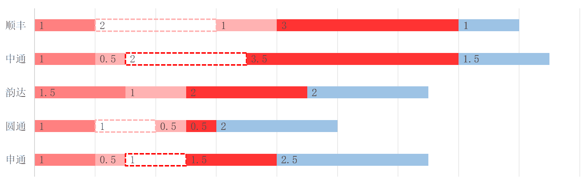

本报告由中信建投证券股份有限公司在中华人民共和国（仅为本报告目的，不包括香港、澳门、台湾）提供。在遵守适用的法律法规情况下，本报告亦可能由中信建投（国际）证券有限公司在香港提供。同时请务必阅读正文之后的免责条款和声明。

证券研究报告·行业动态

## 总部价格稳定但行业价格上涨，加盟商压力缓解，圆通增速表现强势

## 核心观点

价格综述：8月淡季总部价格政策相对稳定，但行业价格在7月华南局部价格竞争后小幅回弹，加盟商压力在月末缓解。各主要快递“产粮区”华南地区基于轻小件的局部价格竞争，虽然8月潮汕止住价格下降，但降价向广东省内其他地区蔓延。

各家快递公司价格方面，顺丰、圆通、韵达及申通四家快递公司价格出现分化，韵达和申通维持2元左右价格水平，顺丰和圆通价格则出现小幅下降，其中圆通总部降价最大，反映了淡季头部快递总部降低发货成本，为终端抢量提供有利保障。

## 快递行业价格追踪（2024年9月）

- （1）PMI、制造业和非制造业商务快件相关需求指标呈现回调趋势；电商平台低价战略调整，包裹量增长诉求回落。

- （2）8月行业整体单票价格7.94元，调整后可比口径下降5.52%，环比上涨2.16%。7—8月总部价格政策相对稳定，但行业价格在7月华南局部价格竞争后小幅回弹，加盟商压力在月末缓解，市场并未呈现淡季的持续性“控价抢量”趋势；其中，预估电商件价格环比上涨2.8%至6.69元/件，时效件与国际件的价格则维持相对稳定的走势。

- （3）1—8月全国快递行业业务量完成1088.0亿件，同比增长22.5%（按可比口径计算）；业务收入累计完成8778.9亿元，同比增长14.7%。8月快递业务量完成143.8亿件，同比增长19.5%。

- （4）行业“价格风向标”义乌8月快递价格环比持平，维持在2.30元/件，同比下降10.8%。整体上看，广东省三市（广深莞）继续下降，杭州、上海两个城市上涨，主要源于华南地区淡季较为激烈的价格政策，尤其是今年在潮汕地区出现基于轻小件的局部价格竞争，在7—8月愈演愈烈。虽然8月在揭阳止住了价格下降，但开始蔓延到广东省内其他地区。

- （5）TOP8快递8月业务量同比增长32.5%，TOP8（32.5%）>圆通（29.9%）>申通（27.3%）>韵达（21.6%）>行业（19.5%）>顺丰（14.6%，剔除丰网）。8月通达系四家快递公司增速均高于大盘，其中圆通速递表现强势，淡季逆势提升市占率。8月快递品牌集中度CR8环比维持在85.2%的稳定水平。

- （6）8月各家快递公司价格方面，顺丰、圆通、韵达及申通四家快递公司价格出现分化，韵达和申通维持2元左右价格水平，顺丰和圆通价格则出现小幅下降，其中圆通速递环比降幅较多，反映了7—8月淡季头部快递总部降低发货成本、支持加盟商发展的策略现状。

维持

强于大市

梁骁  
liangxiaobj@csc.com.cn  
010-56135284  

SAC编号：S1440524050005

韩军  
hanjunbj@csc.com.cn  

SAC编号：S1440519110001  
SFC编号：BRP908

发布日期：2024年09月21日

市场表现

相关研究报告

2024/7/27  
《快递行业价格数据跟踪（2024年7月）：行业呈现控价保增速的大促策略，快递公司策略分化面对竞争》

2024/6/20  
《快递行业价格数据跟踪（2024年6月）：快递行业件量同比持续超预期，价格下降背后出现策略分化》

2024/4/21  
《快递行业价格数据跟踪（2024年4月）：快递行业件量同比超预期，价格淡季降幅相对温和》

2024/3/23  
《快递行业价格数据跟踪（2024年3月）：快递品牌春节期间策略积极，前2月行业量价表现超预期》

2024/1/22  
《快递行业价格数据跟踪（2024年1月）：旺季大促结束后“量价回调”，韵达及圆通份额提升明显》

2023/12/21  
《快递行业价格数据跟踪（2023年12月）：旺季大促削峰填谷促进“价稳量升”，韵达件量增速重回30%+》

2023/11/26  
《快递行业价格数据跟踪（2023年11月）：行业旺季温和竞争保服务，稳健策略塑造圆通量价齐升表现》

-14%
-9%
-4%
1%
6%
11%

2023/9/21  
2023/10/21  
2023/11/21  
2023/12/21  
2024/1/21  
2024/2/21  
2024/3/21  
2024/4/21  
2024/5/21  
2024/6/21  
2024/7/21  
2024/8/21  

交通运输

沪深300

物流

物流

行业动态报告

请务必阅读正文之后的免责条款和声明。

## 目录

一、快递行业价格情况核心综述 ........................................................................................................................ 1

1.1 价格数据：总部价格相对稳定但行业价格上涨，反映加盟商压力缓解，8月产粮区价格降幅均高于行业整体 ........................................................................................................................ 1

1.2 核心驱动因素变化及影响路径 ..................................................................................................................... 3

二、快递行业价格核心指标追踪 ........................................................................................................................ 5

2.1 PMI、制造业和非制造业商务快件相关需求指标呈现回调趋势；电商平台低价战略调整，包裹量增长诉求回落，但快递价格有望筑稳 ................................................................................................................. 6

2.2 “全国快递价格洼地”中潮汕地区件量增速慢于大盘，北方核心产粮区增速表现优秀，义乌及潮汕两大传统产粮区份额被其他地区抢夺 ................................................................................................................. 8

2.3 快递进入“供给为王”时代，目前行业在融资能力和资产持续投入方面产生分化 ........................................ 9

2.4 TOP8件量8月同比上涨32.5%，远超行业增速，快递品牌集中度CR8基本持平；圆通的量价策略带来淡季逆势的市占率提升 ................................................................................................................. 12

2.5 汽油与柴油价格在7月份基础上呈现下降态势，其中柴油价格较2023年同期下降达8.0%，助力快递公司运输成本改善预期 .................................................................................................................... 13

风险分析 ................................................................................................................................................................ 15

物流

行业动态报告

请务必阅读正文之后的免责条款和声明。

## 图表目录

图表1：快递行业整体单票价格7.94元，环比上涨2.2% ........................................................................ 1

图表2：电商件单价6.69元/件，环比上涨2.8% .................................................................................... 1

图表3：三家快递公司价格出现分化 ..................................................................................................... 2

图表4：义乌价格8月下降至2.30元/件，环比持平 .............................................................................. 2

图表5：件量TOP5地区价格走势不一 .................................................................................................. 2

图表6：件量TOP6产粮区价格降幅均高于行业整体 ............................................................................. 2

图表7：2024年8月Wind快递指数与沪深300指数变化 ...................................................................... 3

图表8：2024年8月快递股价变化 ....................................................................................................... 3

图表9：快递行业价格跟踪分析框架 ..................................................................................................... 4

图表10：快递行业价格分析框架及追踪指标分类 ................................................................................. 5

图表11：中国网购用户规模达9.05亿，渗透率82.3% ......................................................................... 6

图表12：实物网络零售额增速4.1%，电商渗透率26.0% ...................................................................... 6

图表13：PMI等相关需求指标呈现回调趋势 ........................................................................................ 7

图表14：24Q1主要电商平台营销费用同比持续正增长 ......................................................................... 7

图表15：快递服务公众满意度83.6分，同比提升0.8分 ....................................................................... 7

图表16：重点地区72小时准时率85.3%，同比提升0.9pct ................................................................... 7

图表17：国际件量占比2.40%，同比增速33.4% ................................................................................... 8

图表18：国际件预估单价34.7元/件，同比下降24.3% ......................................................................... 8

图表19：2019年至今月度快递单价曾出现6元以下城市的价格走势 ..................................................... 9

图表20：环比件量均有升有降，平均下降达1.6% ................................................................................ 9

图表21：潮汕地区同比增速较低，华北地区增速优异 .......................................................................... 9

图表22：快递企业“投入产出”的正向循环机制 .................................................................................. 10

图表23：五家快递公司“融资—资本开支—在建工程—固定资产—市场占有率”转化节奏 ................... 10

图表24：现金债务总额比指标申通Q2同比优化较为明显 ................................................................... 11

图表25：24Q2韵达负债率优化下降明显 ............................................................................................. 11

图表26：24Q2在建工程规模中通和圆通上涨 ...................................................................................... 11

图表27：24Q2资本开支各家均有下降，但圆通、申通稳健 ................................................................. 11

图表28：产能利用率指标不断提升，达到85%—90%的水平 ................................................................ 12

图表29：顺丰和中通有形资产效率较为稳定 ....................................................................................... 12

图表30：快递品牌集中度CR8为85.2，保持稳定 ............................................................................... 12

图表31：8月各家市场份额，圆通有较好的市占率提升 ....................................................................... 12

图表32：年初至今汽柴油价格较23年同期下降8.0% .......................................................................... 13

图表33：24Q2各家单票成本同比改善明显，但幅度回撤 .................................................................... 13

图表34：五家快递公司“融资—资本开支—在建工程—固定资产—市场占有率”转化节奏 ................... 14

## 物流行业动态报告

请务必阅读正文之后的免责条款和声明。

## 一、快递行业价格情况核心综述

### 1.1 价格数据：总部价格相对稳定但行业价格上涨反应加盟商压力缓解，8月产粮区价格降幅均高于行业整体

**1、行业维度价格数据**

快递行业8月份整体单票价格7.94元，调整后可比口径下降5.52%，环比上涨2.16%，7-8月总部价格政策相对稳定，但行业价格在7月华南局部价格竞争后小幅回弹，加盟商压力在月末缓解，然后8月整体产粮区价格降幅仍高于行业整体水平，市场8月整体价格并未呈现淡季的持续性“控价抢量”的趋势；其中，预估电商件价格环比上涨2.8%到6.69元/件，含新调整口径同比下降7.2%。时效件与国际件的价格则维持相对稳定的走势：国际快递受国际空运价格回调影响，8月价格延续7月下降趋势，环比回调1.2%，同比下降24.3%，件量占总快递量比例2.40%，上升0.08个pct；时效件预估单价18.5元/件，环比7月下降0.6%，同比下降12.0%。

图表**1**：快递行业整体单票价格**7.94**元，环比上涨**2.2%**

图表**2**：电商件单价**6.69**元**/**件，环比上涨**2.8%**

资料来源：国家邮政局，中信建投
资料来源：国家邮政局，中信建投

**2、公司维度价格数据**

8月各家快递公司价格方面，顺丰、圆通、韵达及申通四家快递公司价格出现分化，韵达和申通维持2元左右价格水平，顺丰和圆通价格则出现小幅下降，其中圆通速递环比降幅较多。反应了7-8月淡季头部快递总部降低发货成本，支持加盟商发展的策略现状，也体现了降本空间瓶颈对快递件量增速和价格竞争的直接影响。

（1）环比：行业（**+2.2%**）**\>**韵达（**+0.5%**）**\>**申通（**+0.0%**）**\>**顺丰（**\-0.5%**）**\>**圆通（**\-3.2%**）。顺丰包括通达系几家总部价格环比降幅产生分化，表明淡季的价格策略和业绩诉求不一：顺丰和圆通反应的是在8月件量增速动力不足情况下，快递公司总部的价格和超返政策相对积极，更多诉求是在淡季对份额及产能利用率的诉求；韵达和申通价格环比基本持平，两家均低于行业价格增速，也反映总部层面策略希望在淡季为终端加盟网点提供更有竞争力的发货成本并减少利润损伤，但相较于圆通和顺丰，韵达和申通短期可能更关注淡季利润的稳定，结合申通和韵达件量增速回落，推断它们在终端加盟商的市场“低价优势”减弱。

7.94

-10.8

-28

-23

-18

-13

-8

-3

2

7

2019M1

2019M4

2019M7

2019M10

2020M1

2020M4

2020M7

2020M10

2021M1

2021M4

2021M7

2021M10

2022M1

2022M4

2022M7

2022M10

2023M1

2023M4

2023M7

2023M10

2024M1

2024M4

2024M7

7

8

9

10

11

12

13

14

单票价格(元，右轴)

价格同比增速（%,左轴）

顺丰大力拓展电商件+极兔快速起网扩张，拉低价格

义乌行政干预快递价格+极兔并购百世快递+顺丰产品结构调整

6.69

18.5

12

14

16

18

20

22

24

26

28

5

6

7

8

9

10

11

12

13

14

15

2019M1

2019M4

2019M7

2019M10

2020M1

2020M4

2020M7

2020M10

2021M1

2021M4

2021M7

2021M10

2022M1

2022M4

2022M7

2022M10

2023M1

2023M4

2023M7

2023M10

2024M1

2024M4

2024M7

电商件单价（元/件）

时效件单价（右轴，元/件）

（2）同比：申通（**2.00**元**/-4.6%**）**\>**顺丰（**15.67**元**/-5.3%**）**\>**行业（**7.94**元**/-5.5%**）**\>**圆通（**2.17**元**/-7.1%**）**\>**韵达（**1.99**元**/-8.4%**）。8月各家快递公司的价格同比降幅均有不同程度收窄，其中申通和顺丰的降幅小于行业，但圆通和韵达降幅仍大于行业，反应了两家品牌总部仍较为积极的价格策略，但其中也与其近期业务经营上的调整有关——单票货重持续下降（轻小件）、直客收入占比同比下降、退货件结算模式调整。

图表**3**：三家快递公司价格出现分化

图表**4**：义乌价格**8**月下降至**2.30**元**/**件，环比持平

资料来源：公司公告，中信建投
资料来源：国家邮政局，中信建投

**3、城市地区维度价格数据**

行业“价格风向标”义乌地区8月快递价格环比持平，维持在2.30元/件，同比下降10.8%。义乌地区之外，全国快递件量TOP5地区价格走势不一，其中广东省三市（广州、深圳、东莞）继续下降，杭州、上海两个华东城市上涨，主要源于华南地区淡季较为激烈的价格政策，尤其是今年在潮汕地区出现基于轻小件的局部价格竞争在**7-8**月愈演愈烈，虽然**8**月在揭阳止住了价格下降，但开始蔓延到广东省内其他地区；纵观快递价格5.5元以下全国件量TOP6“产粮区”价格，仅有亳州出现环比小幅上涨情况，而且8月产粮区降幅均高于行业整体，其中深莞及华北地区（临沂、保定等）降幅较大，义乌及潮汕两大传统产粮区份额被华北产粮区抢夺。整体上看，各主要快递“产粮区”价格在**8**月淡季时期降价出现“从点向面、从南向北”蔓延的趋势。

图表**5**：件量**TOP5**地区价格走势不一

图表**6**：件量**TOP6**产粮区价格降幅均高于行业整体

资料来源：国家邮政局，中信建投
资料来源：国家邮政局，中信建投

1.99

2.17

2.00

1.8

2.0

2.2

2.4

2.6

2.8

3.0

3.2

3.4

3.6

3.8

12

13

14

15

16

17

18

19

2019M1

2019M4

2019M7

2019M10

2020M1

2020M4

2020M7

2020M10

2021M1

2021M4

2021M7

2021M10

2022M1

2022M4

2022M7

2022M10

2023M1

2023M4

2023M7

2023M10

2024M1

2024M4

2024M7

韵达单票价格（元）

圆通单票价格（元）

申通单票价格（元）

2.30

2

3

4

5

6

7

8

9

1月

2月

3月

4月

5月

6月

7月

8月

9月

10月11月12月

2016年

2017年

2018年

2019年

2020年

2021年

2022年

2023年

2024年

6.88

8.01

4.36

53.08

30

35

40

45

50

55

60

65

70

2

4

6

8

10

12

14

16

2019M1

2019M4

2019M7

2019M10

2020M1

2020M4

2020M7

2020M10

2021M1

2021M4

2021M7

2021M10

2022M1

2022M4

2022M7

2022M10

2023M1

2023M4

2023M7

2023M10

2024M1

2024M4

2024M7

广州

深圳&东莞

揭阳

杭州

上海(右轴)

3.87

2.98

4.36

4.73

4.48

4.23

2.5

3

3.5

4

4.5

5

5.5

6

6.5

7

20M6

20M8

20M10

20M12

21M2

21M4

21M6

21M8

21M10

21M12

22M2

22M4

22M6

22M8

22M10

22M12

23M2

23M4

23M6

23M8

23M10

23M12

24M2

24M4

24M6

24M8

临沂

亳州

揭阳

汕头

台州

绍兴

### 1.2 核心驱动因素变化及影响路径

截止8月30日，快递板块8月股价指数较年初下降2.6%，连续2个月跑输大盘（沪深300跌幅1.9%）；按平均值计算，板块跌幅5.8%，沪深300跌幅1.6%，在整月大部分时间持续扩大与大盘落后差距，月底由于快递半年报业绩超预期加之9月初涨价预期，板块开始快速反弹。核心原因分析如下：

（1）**8**月大部分时间板块走势延续**6**月底开始的向下趋势，最深回调春节月的最低水平：伴随交通运输部周度数据连续三周小幅回调，连续7周维持周均31-32亿件的水平，加之8月19日快递经营数据公布以及7月初华南地区价格竞争反应到7月数据，量价数据相较上半年高预期均有回调，板块持续下探。

（2）**8**月底快递板块强势拉升上涨：由于最后一周A股四家快递上市公司先后公布上半年业绩，略超预期的表现好于市场消费等相关板块，加之9月初市场已经预期在产粮区有价格上涨的超预期表现，所以板块强势上涨。

图表**7**：**2024**年**8**月**wind**快递指数与沪深**300**指数变化

图表**8**：**2024**年**8**月快递股价变化

资料来源：国家邮政局，中信建投（相较于*24*年*1*月*1*日变化）
资料来源：国家邮政局，中信建投（相较于*24*年*1*月*1*日变化）

（1）顺丰：8月整体股价走势与快递板块整体走势一致但弱于板块，仍然相较于年初成下跌状态。即使顺丰目前战略重回聚焦非电商件，导致其股价与近期电商快递市场量价走势无直接基本面关联，但由于业绩增长预期较弱，因此也难以摆脱板块估值走出独立行情。

（2）圆通和申通：8月整体股价走势与快递板块整体走势一致但强于板块，主要源于两家在8月份较为稳定的快递业务高频数据表现，此外也与相对积极的价格策略有关。

（3）韵达：8月上旬股价走势强于快递板块整体走势，但中下旬开始承压。主要在于韵达7月业绩在8月中下旬公布，一方面件量增速回落、价格端也被申通超越，市场担心在Q3需求下滑的情况下，韵达出现“量价齐跌”的悲观情况。

（4）中通：8月第一周后股价表现加速回升，而且在月底涨幅回到并超过年初水平，与市场对7月件量增速和市占率稳定回升、Q2业绩稳定并小超预期、以及华南价格战叠加带来的业绩兑现分歧逐渐消除有关。

-10%

-8%

-6%

-4%

-2%

0%

2%

2024-08-01

2024-08-03

2024-08-05

2024-08-07

2024-08-09

2024-08-11

2024-08-13

2024-08-15

2024-08-17

2024-08-19

2024-08-21

2024-08-23

2024-08-25

2024-08-27

2024-08-29

wind快递指数

沪深300

-25%

-15%

-5%

5%

15%

25%

35%

2024-08-01

2024-08-03

2024-08-05

2024-08-07

2024-08-09

2024-08-11

2024-08-13

2024-08-15

2024-08-17

2024-08-19

2024-08-21

2024-08-23

2024-08-25

2024-08-27

2024-08-29

顺丰

圆通

韵达

申通

中通-美元

京东物流

（5）京东物流：上半月股价波动较小，但在月中旬二季报公布后，出现一波连续大幅上涨行情，涨幅一度达到20%，且整体走势开始强于大盘，并超过年初水平。

根据追踪价格数据的分析框架，核心驱动因素在**8**月未有明显变化体现。

图表**9**：快递行业价格跟踪分析框架

资料来源：中信建投

单
票
价
格

全网产能（利用效率）

固定成本

资本开支（软件+硬件）

利润/现金流

潜在融资能力

燃油+外包

固定&无形资产

人工

可变成本

单
票
成
本

**股价**

所有权资产

能力

意愿

需求（各家电商平台营销费&GDP）

规模及增速

商流构成

股权融资

债权融资

业务量/格局

1

2

3

① 发展关系：需求和供给共同影响了业务量和市场竞争格局；
② 运营关系：供给的优化能够产生更好的价格，进而带动需求；
③ 资本关系：市占率、价格和利润共同决定股价，而股价则影响了企业再融资。

监管政策

## 二、快递行业价格核心指标追踪

通过供需分析，我们总结出跟踪快递行业价格的影响因素，按照短中长期划分为：监管政策、终端激励政策、燃油成本、运营模式变化为短期影响因素，需要高频跟踪和关注；快递公司竞争策略、精益化管理效果、商流变化情况则是中期影响因素，需要按季度跟踪研究；产业结构以及快递公司融资能力变化，则是长期影响因素，可以按半年度或年度进行分析。我们围绕影响价格变动的因素，跟踪相应数据变化情况，包含商流、快递行业、地区、公司数据整理和更新。

结合市场新变化，建议关注和重点追踪：

（1）件量：交通部周度数据，月度快递公司增速数据；电商平台客单价变化趋势，以及各家快递公司单票货重变化。

（2）价格：注意力从紧盯产粮区价格，转向重点关注所投资标的快递公司市占率较低区域的价格情况。

（3）利润：各家快递融资情况、资本开支规模和产能利用率变化；加盟商利润变化情况。

（4）终端：驿站直送模式及无人车推广比例，散单件量规模及各家份额。

图表**10**：快递行业价格分析框架及追踪指标分类

资料来源：中信建投

| 类别 | 重要性 | 更新频率 | 内容 |
|---|---|---|---|
| 价格 | 强 | 月度 | 快递单票价格（含电商件&时效件）及同比增速 |
| 价格 | 强 | 月度 | 各家快递公司月度单价环比 |
| 需求 | 弱 | 半年 | 网购用户规模增速及网购渗透率 |
| 电商快递收入 | 中 | 半年 | 电商快递业务量价格分层&电商订单快递化率 |
| 需求 | 中 | 月度 | 实物商品零售额增速及电商物流指数 |
| 需求 | 强 | 季度 | 主要电商平台GMV及营销费用 |
| 需求 | 强 | 月度 | 电商平台客单价变化趋势 |
| 时效及国际快递 | 中 | 月度 | 制造业&服务业商务快件指数+国际件占比 |
| 时效及国际快递 | 中 | 季度 | 散单件量规模及各家份额 |
| 政策业务量供给 | 强 | 月度 | 义乌等产粮区市场快递价格变化（关注非传统产粮区） |
| 供给 | 中 | 月度 | 核心快递价格洼地城市日均业务量及同比增速 |
| 全网产能 | 强 | 季度 | 融资情况&现金债务总额比&有形资产负债率 |
| 全网产能 | 中 | 季度 | 在建工程规模&固定资产规模 |
| 全网产能 | 中 | 年度 | 产能利用率&有形资产效率 |
| 竞争格局 | 中 | 月度 | TOP8业务量同比增速及市场占有率 |
| 竞争格局 | 强 | 月度 | 快递企业的市场份额 |
| 成本 | 中 | 半年 | 加盟商利润变化情况 |
| 运营成本 | 强 | 季度 | 快递公司单票成本（各家快递公司单票货重变化） |
| 运营成本 | 中 | 月度 | 全国汽油及柴油价格 |
| 运营成本 | 强 | 月度 | 激励机制&驿站直送模式及无人车推广比例 |

### 2.1 PMI、制造业和非制造业商务快件相关需求指标呈现回调趋势；电商平台低价战略调整，包裹量增长诉求回落，但快递价格有望筑稳

截至2024年6月，中国网络购物用户规模达9.05亿，同比增速2.3%，网购渗透率82.3%。2024年上半年，网络购物市场保持稳健增长，在促消费中日益发挥积极作用。上半年，各大平台继续打造产品价格优势，如淘宝、京东继续推出“百亿补贴”，抖音将“价格力”作为2024年优先目标，拼多多推出自动跟价系统和商家降价提升流量规则，电商行业回归低价趋势明显。此外，平台加大用户体验投入，如抖音、淘宝、京东陆续跟进拼多多出台“仅退款”类似政策，并通过强制卖家提供运费险、保价等服务吸引用户，提升用户体验。电商平台积极配合新一轮“以旧换新”政策，通过加大补贴、简化流程、完善物流等方式助力政策落地，促进消费转化和消费升级。我们认为电商未来**2-3**年内核心的发力点集中在内容电商和跨境电商，电商平台将由“用户增长”向用户规模、转化率、复购率不断提高的方向发展。

**8**月份，实物商品网络零售额同比上涨**4.1%**，电商渗透率**26.0%**，电商物流指数回升至**114.2**。**2024**年**1-8**月在实物商品网上零售额中，吃类、穿类、用类商品分别增长**19.1%**、**5.0%**、**7.0%**。从业态来看，限额以上零售业单位中便利店、专业店、超市零售额同比分别增长4.9%、4.3%、2.1%；百货店、品牌专卖店零售额分别下降3.3%、1.9%。总体分品类看1-8月份，文化办公用品类、金银珠宝类、汽车类和建筑与装潢材料类出现同比负增长，共同拉低了社会消费品零售总额的增长；1-8月份限额以上零售额同比增速排在前三名的是，通讯器材类、体育&娱乐用品类、粮油食品类，分别有11.8%、10.1%和9.7%的增长，与直播电商、健康消费、居家餐饮消费均有关系。

图表**11**：中国网购用户规模达**9.05**亿，渗透率**82.3%**

图表**12**：实物网络零售额增速**4.1%**，电商渗透率**26.0%**

资料来源：中国互联网络信息中心*(CNNIC)*，中信建投
资料来源：国家统计局，中国物流与采购联合会，中信建投

从**2023**年电商快递业务量构成分析看，目前已经基本形成“**3+1**”（传统电商阿里、京东及拼多多三家，以及抖快直播电商）的电商平台需求格局，也是快递行业竞争最激烈的价格带，抖音、快手的加入，将继续搅动快递市场竞争格局。我们认为，直播电商平台本身“低客单、多爆品”的结构，对电商快递最大的影响在于，一方面加速电商行业整体客单价下降，从而促进电商件单量增长；一方面则由于直播间每日营销商品不同，造成消费者付款后形成“一单多件”，高拆单率也促使电商订单快递化率提升。

2.3

82.3

50

55

60

65

70

75

80

85

90

0

5

10

15

20

25

2015H1

2015H2

2016H1

2016H2

2017H1

2017H2

2018H1

2018H2

2019H1

2019H2

2020H1

2020H2

2021H1

2021H2

2022H1

2022H2

2023H1

2023H2

2024H1

网购人数同比增速（%，左轴）

网购渗透率（%，右轴）

94

96

98

100

102

104

106

108

110

112

114

116

2019M3

2019M6

2019M9

2019M12

2020M5

2020M8

2020M11

2021M4

2021M7

2021M10

2022M3

2022M6

2022M9

2022M12

2023M5

2023M8

2023M11

2024M4

2024M7

-5

0

5

10

15

20

25

30

35

40

实物商品网络零售额同比(%)

电商渗透率(%)

电商物流指数(%)-左轴

26.0

4.1

114.2

## 7 物流行业动态报告

请务必阅读正文之后的免责条款和声明。

**图表13：PMI等相关需求指标呈现回调趋势**

**图表14：24Q1主要电商平台营销费用同比持续正增长**

| 资料来源：各电商平台财报，中信建投 | 资料来源：Wind，中信建投 |
|---|---|

主要传统电商平台的营销开支在今年二季度保持稳定正增长。2024年二季度京东的营销费用为118.7亿元人民币，同比增长7.3%，旺季营销环比回落；阿里巴巴二季度的销售与市场费用为327.0亿元，同比增长20.9%，在2021年后首次增速回到20%以上；拼多多由于海外市场拓展和国内持续发力，二季度销售费用48.5%的同比增长，连续8个季度保持40%以上增速；快手电商平台2024年第二季度销售及营销开支同比增速继续环比回升，二季度同比增速再次提升至16.3%，作为新兴平台依然需要不断投流保障GMV和货币化率提升。以上数据显示，电商流量与快递订单的生产方，不论是传统电商平台还是新兴电商平台，仍然在焦灼地抢夺市场，快递件量的增长仍有较强驱动力。

8月份，PMI、制造业和非制造业商务快件相关需求指标呈现回调趋势；电商平台低价战略调整，包裹量增长诉求回落，但快递价格有望筑稳。2024年8月，中国快递发展指数为407，同比提升12.6%。其中发展规模指数为510.1，同比提升27.2%；快递服务质量指数为603.6，同比提升5.3%，快递服务公众满意度预计为83.6分，同比提升0.8分，重点地区72小时准时率预计为85.3%，同比提升0.9pct；发展能力指数和发展趋势指数分别为221.6和64.3，同比提升6.5%和下降5.6个pct。

**图表15：快递服务公众满意度83.6分，同比提升0.8分**

**图表16：重点地区72小时准时率85.3%，同比提升0.9pct**

| 资料来源：国家邮政局，中信建投 | 资料来源：国家邮政局，中信建投 |
|---|---|

8月份，全国快递国际/港澳台业务量完成3.45亿件，占行业总业务量的2.40%。

| 指标 | 数值 |
|---|---|
| 制造业商务快件指数(%) | 98.2 |
| 服务业商务快件指数(%) | 100.6 |
| 制造业采购经理指数PMI（右轴） | 49.1 |

| 指标 | 数值 |
|---|---|
| 阿里巴巴销售费用同比增速（%） | 20.9 |
| 京东销售费用同比增速（%） | 7.3 |
| 拼多多销售费用同比增速（%） | 48.5 |
| 快手销售费用同比增速（%） | 16.3 |

快递公司集中上市年份增速阶段，拼多多快速崛起迫使阿里、京东加大营销力度。

| 指标 | 数值 |
|---|---|
| 快递服务公众满意度 | 83.6 |

| 指标 | 数值 |
|---|---|
| 重点地区72小时准时率 | 85.3 |

### 2.2 “全国快递价格洼地”中潮汕地区件量增速慢于大盘，北方核心产粮区增速表现优秀，义乌及潮汕两大传统产粮区份额被其他地区抢夺

虽然我们看到从2021年开始浙江省及义乌市相继出台快递价格管控措施，但中短期看，电商卖家有动力寻找“下一个快递价格洼地”，即使放到中长期维度，电商产业还可以向中西部地区转移，因此巨大产业聚集效应及经济发展压力，加之电商及快递行业快速出清势必会导致失业问题，因此判断现有存在“快递价格洼地效应城市”的策略制定者，必定权衡确认快递价格的行政管控与当地电商经济发展的关系。因此，根据对目前“快递价格洼地效应城市”的历史价格走势以及业务量及价格现状，我们认为：短期能够挑战甚至替代义乌电商快递定价权地位的有“揭阳和汕头”，因为它们曾在过去10年出现过低于义乌的快递价格，同时日均业务量超过500万票，迫近千万大关；中期维度，日均300-500万票规模、单票价格4.5-5元的“台州和临沂”有望迅速崛起；长期视角，我们看好地处中部地区的“商丘和亳州”，目前4.5元以下的平均单价且50%超越市场的快递业务增速，都是支撑它们不断吸引电商产业聚集的核心动力。

行业“价格风向标”义乌地区8月快递日均件量达4743万，环比7月提升0.1%，同比增长21.7%。其他全国“6元以下快递价格洼地城市”8月快递日均件量有涨有跌，11个城市5跌6涨（平均环比增幅为3.9%、平均跌幅6.1%），代表性的揭阳、汕头、保定、临沂、潮州、亳州六个“快递产粮区”日均件量环比平均下降1.6%，降幅高于各地平均，主要是因为揭阳和亳州件量环比下降较多，分别达到8.4%和14.6%；同比视角，价格洼地效应城市中除揭阳、潮州、泉州和绍兴仍然延续年初来的低增长，其他地区增幅较高，平均实现30%以上高于大盘的增长，其中华北地区的亳州、保定、商丘增速超30%。

**图表19：2019年至今月度快递单价曾出现6元以下城市的价格走势**

| 城市 | 8月日均件量（万件） |
|---|---|
| 义乌 | 4743 |
| 潮州 | 1256 |
| 临沂 | 1218 |
| 商丘 | 641 |
| 亳州 | 282 |
| 揭阳 | 227 |

**图表20：环比件量均有升有降，平均下降达1.6%**

**图表21：潮汕地区同比增速较低，华北地区增速优异**

| 城市 | 同比增速 |
|---|---|
| 揭阳市 | 36.6% |
| 汕头市 | 27.1% |
| 保定市 | 8.4% |
| 临沂市 | 52.5% |
| 潮州市 | -30% |
| 亳州市 | -10% |

### 2.3 快递进入“供给为王”时代，目前行业在融资能力和资产持续投入产生分化

过往快递企业依靠“现金流-资本开支-产能-业务量-利润-现金流”的正向循环机制实现了“增长飞轮”，即：企业通过资本运作，将融到的资金转化为软件及硬件资产，通过对硬件系统如直营化转运中心、提高自动化设备比例、调节车辆运输模式等，增加公司网络覆盖的密度，提升公司业务量市场份额，有效利用规模经济降低了公司的单票成本；不断优化公司软件系统，利用信息化支持系统提升服务效率、质量以及进一步优化了公司的运营成本。进而产生了更好地单票盈利能力和现金流表现，最后反哺到下一轮产能建设中。

**图表22：快递企业“投入产出”的正向循环机制**

| 环节 | 内容 |
|---|---|
| 单票价格/成本 | 影响利润/现金流 |
| 全网产能（含在建工程） | 支撑业务量/市场份额 |
| 资本开支（软件+硬件） | 提升产能与效率 |
| 利润/现金流 | 反哺资本开支 |
| 潜在融资能力 | 决定资本开支能力 |

通过5家快递公司“资本开支-在建工程-固定资产”数据的拟合分析，我们得出重要结论：

（1）资本开支投入增长变化各家虽然有细微差别，但总体上都将直接影响一年后的快递市场份额涨落。因此观测资本开支当下变化，是我们快递行业中长期投资策略的基本风向标。

（2）随着产能高速扩张期渡过，以及建设效率的提升，资金的利用效率及建设周期不同程度缩短。

**图表23：五家快递公司“融资-资本开支-在建工程-固定资产-市场占有率”转化节奏**

| 公司 | 转化节奏特点 |
|---|---|
| 顺丰 | 21年前资本开支领先在建工程3个季度 |
| 中通 | 21年前在建工程领先固定资产5个季度 |
| 圆通 | 18年至21年资本开支领先在建工程1.5个季度 |
| 申通 | 21年之前在建工程领先固定资产2.5个季度 |

资料来源：Wind，中信建投

融资能力决定了快递公司真实的资本开支能力，即是否有能力持续投入产能建设，带动份额增长。

研究发现各家快递公司的潜在融资能力正在出现分化，中通与圆通处于领先位置：过去五年五家主要快递企业中，现金债务总额比指标圆通和中通保持较好水平，该指标的高低排序也同几家快递公司的排名变化基本一致，说明良好的业绩表现带来的现金流净流入，使得企业承担债务的能力更强；同时，中通与圆通的有形资产负债率指标也在60%以下且较为稳定，而韵达、申通和顺丰的有形资产负债率均超过100%，且近5年呈上升趋势，表明其融资速度超过其有形资产形成速度，与业务量增速不完全匹配。正是由于头部快递公司较强的融资能力，帮助企业实现了“融资-资本开支-在建工程-固定资产-市场份额”的正向循环，也获得了超过市场平均水平的超额收益，此外投资回报率更是决定了公司长期可持续的竞争优势。

**图表24：现金债务总额比指标申通Q2同比优化较为明显**

| 公司 | 24Q2现金债务总额比 |
|---|---|
| 中通快递 | 0.4 |
| 圆通速递 | 0.4 |
| 申通快递 | 0.3 |
| 韵达股份 | 0.2 |
| 顺丰控股 | 0.1 |

资料来源：Wind，中信建投；注：现金债务总额比=经营活动产生的现金流量净额/总负债

**图表25：24Q2韵达负债率优化下降明显**

| 公司 | 24Q2有形资产负债率 |
|---|---|
| 中通快递 | 57% |
| 圆通速递 | 220% |
| 申通快递 | 118% |
| 韵达股份 | 204% |
| 顺丰控股 | 100% |

资料来源：Wind，中信建投；注：有形资产负债率=总负债/有形资产规模

**图表26：24Q2在建工程规模中通和圆通上涨**

| 公司 | 在建工程规模（亿元） |
|---|---|
| 顺丰 | 60.0 |
| 中通 | 23.3 |
| 韵达 | 28.4 |
| 圆通 | 20.8 |
| 申通 | 17.9 |

资料来源：公司公告，中信建投

**图表27：24Q2资本开支各家均有下降，但圆通、申通稳健**

| 公司 | 资本开支（亿元） |
|---|---|
| 顺丰 | 17.9 |
| 中通 | 10.7 |
| 韵达 | 1.5 |
| 圆通 | 13.0 |
| 申通 | 6.8 |

资料来源：公司公告，中信建投

从目前在建工程和固定资产规模来看，顺丰、中通占据优势，无论是固定资产规模还是在建工程的规模都要优于同行，而且在行业整体产能投资开支迈过峰值的背景下，申通也基本完成补短板。随着在建工程逐步转化为有效产能，申通的市场份额仍有进一步提升空间。因此，综合判断：随着顺丰和韵达的大规模在建工程逐步转化为有效产能，以及中通和圆通为巩固头部地位借助较强的融资能力追加产能，同时申通不断补足产能短板，快递行业价格“消耗战”或在中长期内持续。

我们利用当年11月当月业务量与全年月平均业务量的比值，作为衡量各家快递企业产能利用率的指标，从主要快递公司上市以来各年份的数据看，该指标不断提升，达到85-90%的水平。跟踪有形资产效率（每一单位资产能够支撑的业务量）指标数据发现，各家快递公司虽然效率仍有差异，但整体都在提升区间，其中顺丰、中通近几年该指标较为稳定，表明产能基本能满足业务发展需求，但看到申通则需要继续扩充产能，以便未来满足全网业务量的不断增长，从Q2结果看产能扩充初见成效但仍需持续投入。因此，我们认为伴随技术对产能效率的持续改善，以及产能落后者的追加产能，快递市场总供给仍然旺盛。

## 物流行业动态报告

## 2.4 TOP8件量8月同比上涨32.5%远超行业增速，快递品牌集中度CR8基本持平；圆通的量价策略，带来在淡季逆势的市占率提升

8月各家快递件量保持相对高增速，圆通的量价策略，带来在淡季逆势的市占率提升——圆通日均件量达29.9%增速，件量规模环比逆大盘上涨5.8%，在淡季已达7200万件以上超2023双十一的水平；申通同比增速27.3%，虽然是近1年内除春节月外的最低点，但日均件量仍有6250万件规模；韵达同比增速也回落到21.6%，且件量规模被申通追赶至仅有100万的日均差距。行业TOP8快递业务量8月同比增长32.5%，具体来看，圆通（22.6亿件/+29.9%）>申通（19.4亿件/+27.3%）>韵达（19.7亿件/+21.6%）>中通（29.5亿件/+20.9%，预估）>行业（143.8亿件/+19.5%）>顺丰（10.4亿件/+14.6%），行业增速维持20%左右区间，通达系四家公司增速均高于大盘，其中圆通表现强势。当前快递市场竞争格局尚未稳定，排名座次仍有动态变化可能，份额仍然取决于“业务量”的争夺，短期内“降价”相比“提升服务品质”是更为有效的方式。

图表30：快递品牌集中度CR8为85.2，保持稳定

图表31：8月各家市场份额，圆通有较好的市占率提升

| 指标 | 数值 |
|------|------|
| CR8 | 85.2 |
| TOP8业务量同比增速 | 32.5% |

| 公司 | 市占率 |
|------|--------|
| 顺丰市占率 | 7.3% |
| 韵达市占率 | 13.7% |
| 圆通市占率 | 15.7% |
| 申通市占率 | 13.5% |

8月份，市场份额排序：圆通（15.7%）>韵达（13.7%）>申通（13.5%）>顺丰（7.3%）；市占率同比变化情况——圆通（+0.12pct）>申通（-0.17pct）>韵达（-0.82pct）>顺丰（-0.90pct）>中通（-1.35pct，预估）。其中：顺丰市占率同比下降的原因，其一是与2023年5月出售丰网有关，剔除丰网后也有1.29个百分点下降；中通则是战略聚焦在有效件，而放弃了对目前增速更快的轻小件市场的争夺。8月快递品牌集中度累计CR8环比稳定，维持在85.2水平。

## 2.5 汽油与柴油价格在7月份基础上呈现下降态势，其中柴油价格较2023年同期下降达8.0%，助力快递公司运输成本改善预期

由于燃油费在运输成本中占据30-40%的比例，因此油价的波动会直接影响运输成本。经过我们测算，油价每上涨10%，对单票运输成本影响在8-9厘。2022年柴油出现了上涨，导致运输成本上涨，同时由于增加防疫成本及人工成本影响，运营成本同比略上涨。柴油价格至2024年8月底较7月下降1.8%，相比2023年同期下降8.0%左右，最新价格7397元/吨，助力快递公司运输成本改善预期。

图表32：年初至今汽柴油价格较23年同期下降8.0%

图表33：24Q2各家单票成本同比改善明显，但幅度回撤

| 油品类型 | 最新价格（元/吨） |
|----------|-------------------|
| 汽油(92#):全国VI | 8,725 |
| 柴油(0#):全国VI | 7,397 |

| 公司 | 成本同比变化 |
|------|-------------|
| 顺丰同比 | -2.5% |
| 中通同比 | -13.6% |
| 韵达同比 | -6.2% |
| 圆通同比 | -9.9% |
| 申通同比 | -9.9% |

传统模式下快递员配送工作量大且派送效率提升逐渐放缓，因此快递总部若仍然沿用以往的单纯依靠“在保障件量增速大于单票派费降幅→保障加盟商和快递员总收入提升”来降低成本的策略，几乎很难。因此，原有策略路径持续奏效的前提是提升派件人效，通过驿站等方式减少快递员派件工作量，同时通过揽收等散单弥补快递员损失。终端运营模式变革组合拳：直链+驿站+散单+无人车。

- （1）直链：加盟商与总部共同推进直链化，减少中转次数，降低末端成本。
- （2）驿站：布局驿站，释放快递员效能的同时增强上门送货和开拓客户的触点。
- （3）散单：逆向退货件具备高增长、高溢价、高收益等优势和高服务体验等门槛；依靠规模优势和运营模式优化，进攻夺取时效和其他散单业务。
- （4）无人车：采用无人车替代电三轮，将包裹从末端网点转运至驿站或终端客户。

各家快递公司均在推行末端网络模式创新，如：中通的直链、圆通的驿站直送、韵达的网格站、顺丰的雾化网点等，其本质均是希望通过尝试模式创新对全链条成本进行持续优化，尤其是突破快递员效率瓶颈。另外，由于终端模式变革有“件量规模+资金投入”的门槛，因此并非所有快递行业玩家均能够实现顺利变革。但由于模式变革涉及四方利益，因此保障四方利益在变革期均不受损的玩家才能胜出。

图表34：五家快递公司“融资-资本开支-在建工程-固定资产-市场占有率”转化节奏

原模式：分拣中心→终端网点→快递员上门→客户；总部负责分拣中心，加盟商负责驿站、快递员运输、快递员上门。

新模式：分拣中心（专门直送分拣区，增加格口）→驿站→客户；加盟商直链运输，快递员上门派件及揽收，加盟商派送员数下降40%，加盟商直送车辆及司机成本降低。

## 风险分析

（1）电商需求增长停滞：对于2024年业务量的预期，国家邮政局及快递公司普遍保持谨慎，目前消费品及服饰等传统电商卖家客户，经营压力较大且对参与电商促销活动意愿减弱。

（2）行业整体降派费风险虽然消除，但不同品牌快递总部及加盟商由于对市场份额及利润诉求不同，将导致价格短期波动以及各家公司价格策略的间接连锁反应。建议投资者更多关注是谁的网络更稳定些，以及在价格调整下更有韧性和抗风险能力。

（3）燃油成本继续保持高位：受国际原油价格波动影响，快递公司燃料成本存在继续上涨风险，虽然去年底汽柴油价格有所回落，但近期又出现季节性涨价，对运输等环节成本仍存在压力。

（4）终端运营模式优化降本效果有限：模式试点效果，并不能在全国范围推广落地。

## 分析师介绍

**梁骁**

南开大学硕士，先后供职于中集集团物流板块、顺丰控股、京东物流，曾参与撰写《国家多式联运标准修订建议报告》并为交通物流相关十四五规划建言献策；多年受聘京东物流专家委员会顾问并参与IPO项目。具有丰富的交运物流行业研究经验以及资源，擅于把握和挖掘公司长期价值，覆盖快递快运/仓储运输/供应链物流/国际物流。

**韩军**

交通运输行业首席分析师，曾供职于上海国际航运研究中心，3年政府规划与市场咨询经验，曾负责或参与为交通运输部、上海市交通委、港航企业等提供决策咨询服务二十余项。7年交通运输行业证券研究经验，深入覆盖航运、港口、高铁、快递、物流板块，擅长把握周期性和政策性投资机会。2021第十九届新财富最佳分析师交通运输行业第五名。

## 评级说明

| 投资评级标准 | 评级 | 说明 |
|-------------|------|------|
| 报告中投资建议涉及的评级标准为报告发布日后6个月内的相对市场表现，也即报告发布日后的6个月内公司股价（或行业指数）相对同期相关证券市场代表性指数的涨跌幅作为基准。A股市场以沪深300指数作为基准；新三板市场以三板成指为基准；香港市场以恒生指数作为基准；美国市场以标普500指数为基准。 | 股票评级 | 买入：相对涨幅15％以上；增持：相对涨幅5%—15％；中性：相对涨幅-5%—5％之间；减持：相对跌幅5%—15％；卖出：相对跌幅15％以上 |
| | 行业评级 | 强于大市：相对涨幅10%以上；中性：相对涨幅-10-10%之间；弱于大市：相对跌幅10%以上 |

## 分析师声明

本报告署名分析师在此声明：（i）以勤勉的职业态度、专业审慎的研究方法，使用合法合规的信息，独立、客观地出具本报告，结论不受任何第三方的授意或影响。（ii）本人不曾因，不因，也将不会因本报告中的具体推荐意见或观点而直接或间接收到任何形式的补偿。

## 法律主体说明

本报告由中信建投证券股份有限公司及/或其附属机构（以下合称“中信建投”）制作，由中信建投证券股份有限公司在中华人民共和国（仅为本报告目的，不包括香港、澳门、台湾）提供。中信建投证券股份有限公司具有中国证监会许可的投资咨询业务资格，本报告署名分析师所持中国证券业协会授予的证券投资咨询执业资格证书编号已披露在报告首页。

在遵守适用的法律法规情况下，本报告亦可能由中信建投（国际）证券有限公司在香港提供。本报告作者所持香港证监会牌照的中央编号已披露在报告首页。

## 一般性声明

本报告由中信建投制作。发送本报告不构成任何合同或承诺的基础，不因接收者收到本报告而视其为中信建投客户。

本报告的信息均来源于中信建投认为可靠的公开资料，但中信建投对这些信息的准确性及完整性不作任何保证。本报告所载观点、评估和预测仅反映本报告出具日该分析师的判断，该等观点、评估和预测可能在不发出通知的情况下有所变更，亦有可能因使用不同假设和标准或者采用不同分析方法而与中信建投其他部门、人员口头或书面表达的意见不同或相反。本报告所引证券或其他金融工具的过往业绩不代表其未来表现。报告中所含任何具有预测性质的内容皆基于相应的假设条件，而任何假设条件都可能随时发生变化并影响实际投资收益。中信建投不承诺、不保证本报告所含具有预测性质的内容必然得以实现。

本报告内容的全部或部分均不构成投资建议。本报告所包含的观点、建议并未考虑报告接收人在财务状况、投资目的、风险偏好等方面的具体情况，报告接收者应当独立评估本报告所含信息，基于自身投资目标、需求、市场机会、风险及其他因素自主做出决策并自行承担投资风险。中信建投建议所有投资者应就任何潜在投资向其税务、会计或法律顾问咨询。不论报告接收者是否根据本报告做出投资决策，中信建投都不对该等投资决策提供任何形式的担保，亦不以任何形式分享投资收益或者分担投资损失。中信建投不对使用本报告所产生的任何直接或间接损失承担责任。

在法律法规及监管规定允许的范围内，中信建投可能持有并交易本报告中所提公司的股份或其他财产权益，也可能在过去12个月、目前或者将来为本报告中所提公司提供或者争取为其提供投资银行、做市交易、财务顾问或其他金融服务。本报告内容真实、准确、完整地反映了署名分析师的观点，分析师的薪酬无论过去、现在或未来都不会直接或间接与其所撰写报告中的具体观点相联系，分析师亦不会因撰写本报告而获取不当利益。

本报告为中信建投所有。未经中信建投事先书面许可，任何机构和/或个人不得以任何形式转发、翻版、复制、发布或引用本报告全部或部分内容，亦不得从未经中信建投书面授权的任何机构、个人或其运营的媒体平台接收、翻版、复制或引用本报告全部或部分内容。版权所有，违者必究。

## 中信建投证券研究发展部

| 地区 | 地址 | 电话 | 联系人 | 邮箱 |
|------|------|------|--------|------|
| 北京 | 朝阳区景辉街16号院1号楼18层 | （8610）56135088 | 李祉瑶 | lizhiyao@csc.com.cn |
| 上海 | 上海浦东新区浦东南路528号南塔2103室 | （8621）6882-1600 | 翁起帆 | wengqifan@csc.com.cn |
| 深圳 | 福田区福中三路与鹏程一路交汇处广电金融中心35楼 | （86755）8252-1369 | 曹莹 | caoying@csc.com.cn |
| 香港 | 中环交易广场2期18楼 | （852）3465-5600 | 刘泓麟 | charleneliu@csci.hk |

## 每日免费获取资料

- 每日微信群内分享7+最新行业报告；
- 每周分享当周华为街口报、经济学人；
- 行业报告均为公开版，权利归原作者所有，参一江湖仅分发做内部学习。

｜英语外刊｜行业报告｜行业社群｜参一江湖·聚焦行业前沿

关注公众号，领取粉丝福利
