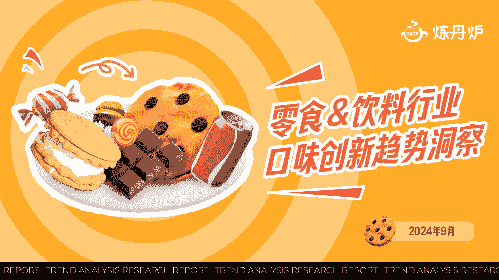

## 炼丹炉

## 中AT

### 零食&饮料行业

#### 回味创新趋势洞察

2024年9月

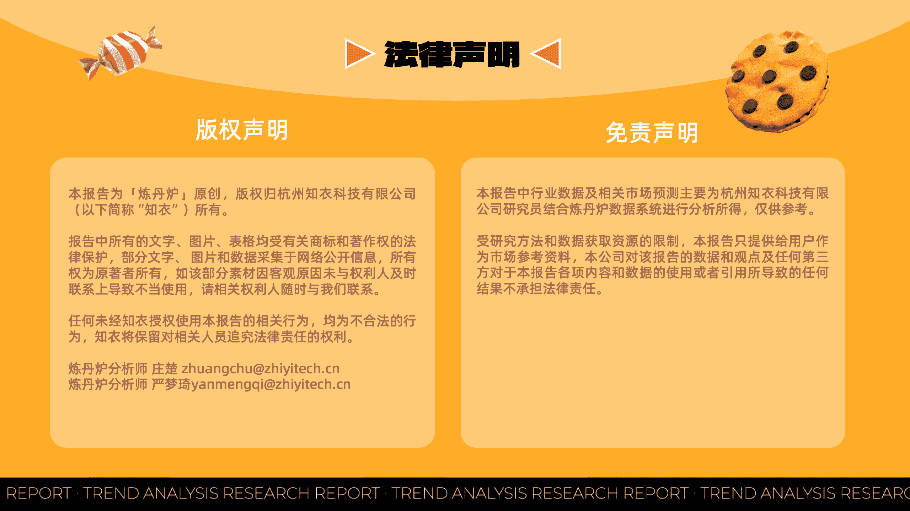

陆律建声明

## 版权声明

本报告为「炼丹炉」原创，版权归杭州知衣科技有限公司（以下简称“知衣”）所有。

## 免责声明

本报告中行业数据及相关市场预测主要为杭州知衣科技有限公司研究员结合炼丹炉数据系统进行分析所得，仅供参考。

报告中所有的文字、图片、表格均受有关商标和著作权的法律保护，部分文字、图片和数据采集于网络公开信息，所有权利为原著者所有，如该部分素材因客观原因未与权利人及时联系上导致不当使用，请相关权利人随时与我们联系。

任何未经知衣授权使用本报告的相关行为，均为不合法的行为，知衣将保留对相关人员追究法律责任的权利。

炼丹炉分析师：庄楚 zhuangchu@zhiyitech.cn  
炼丹炉分析师：严梦琦 yanmengqi@zhiyitech.cn

REPORT: TREND ANALYSIS RESEARCH REPORT. TREND ANALYSIS RESEARCH REPORT. TREND ANALYSIS RESEAR

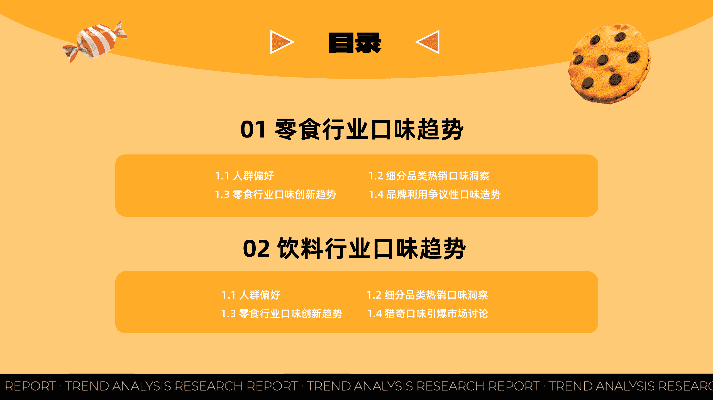

## 目录

### 01 零食行业口味趋势

1.1 人群偏好  
1.2 细分品类热销口味洞察  
1.3 零食行业口味创新趋势  
1.4 品牌利用争议性口味造势

### 02 饮料行业口味趋势

2.1 人群偏好  
2.2 细分品类热销口味洞察  
2.3 饮料行业口味创新趋势  
2.4 猎奇口味引爆市场讨论

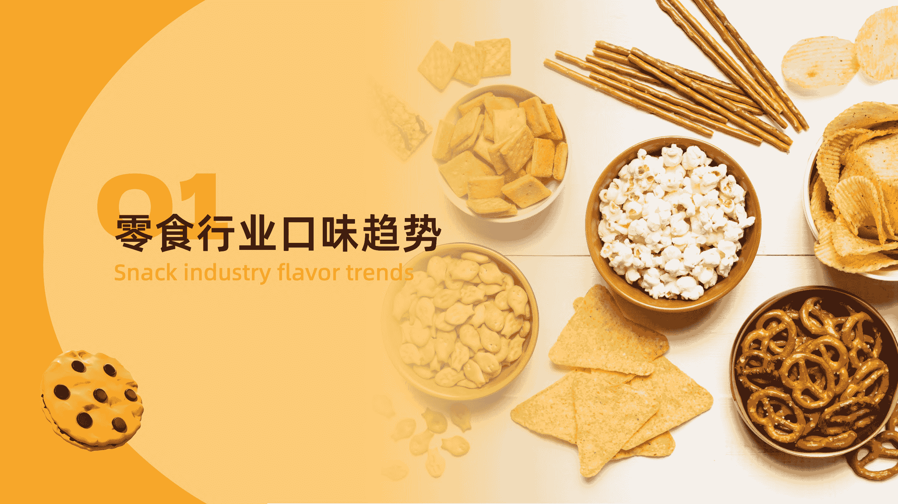

## 零食行业口味趋势

Snack industry flavor trends

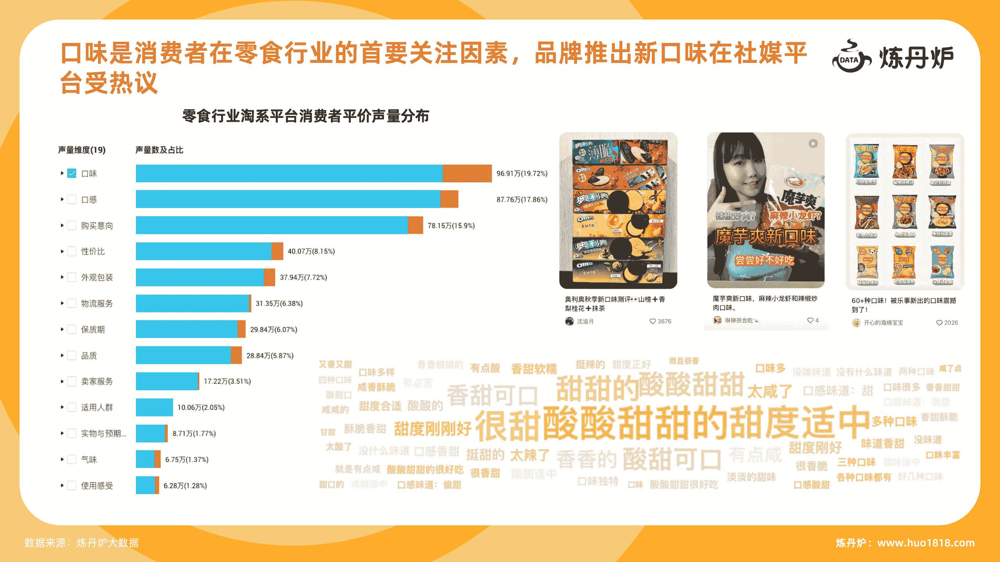

口味是消费者在零食行业的首要关注因素，品牌推出新口味在社媒平台受热议。

### 零食行业淘系平台消费者评价声量分布

| 声量维度 | 声量数及占比 |
| :--- | :--- |
| 口味 | 96.91万 (19.72%) |
| 购买意向 | 87.76万 (17.86%) |
| 性价比 | 78.15万 (15.9%) |
| 尝尝好不好吃 | 40.07万 (8.15%) |
| 外观包装 | 37.94万 (7.72%) |
| 物流服务 | 31.35万 (6.38%) |
| 保质期 | 29.84万 (6.07%) |
| 品质 | 28.84万 (5.87%) |
| 卖家服务 | 17.22万 (3.51%) |
| 适用人群 | 10.06万 (2.05%) |
| 实物与预期 | 8.71万 (1.77%) |
| 气味 | 6.75万 (1.37%) |
| 使用受 | 6.28万 (1.28%) |

消费者评论摘录：  
- 麻辣小龙虾口味，疯狂小龙虾和蜂蜜步伐  
- 制性花+抹茶口味，80+口味，乐事出的口味  
- 香香甜甜的有点酸香甜软糯，挺辣的甜度正好，而且很香  
- 口味多样，四种口味咸香酥脆，香甜可口，甜甜的酸酸甜甜  
- 太咸了，甜口味很多香香甜甜  
- 减赋的，甜度合适酸酸的，很甜酸酸甜甜的甜度适中，甜度刚刚好  
- 多种口味，香甜酥脆  
- 太段了，甜度刚好，味道香甜，没味道  
- 挺甜的太辣了香香的酸甜可口，三种口味，口味丰富  
- 就是有点成酸酸甜甜的很好吃，很香甜，很香  
- 甜口的，口感味道偏甜，口味独特口味酸酸甜甜很好吃  
- 淡淡的甜味，口感暖甜，各种口味都有，好几种口味

数据来源：炼丹炉大数据

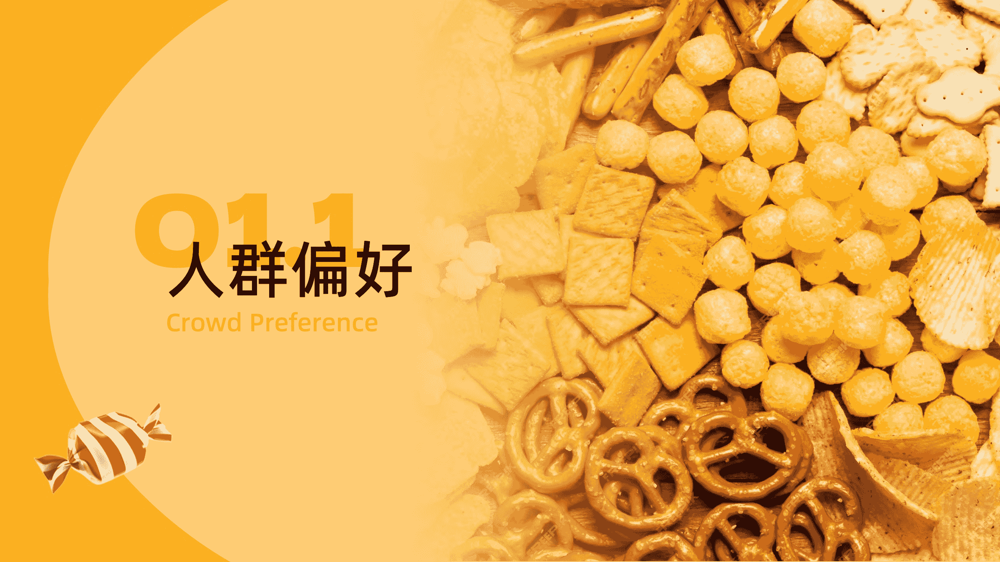

## 人群偏好

Crowd Preference

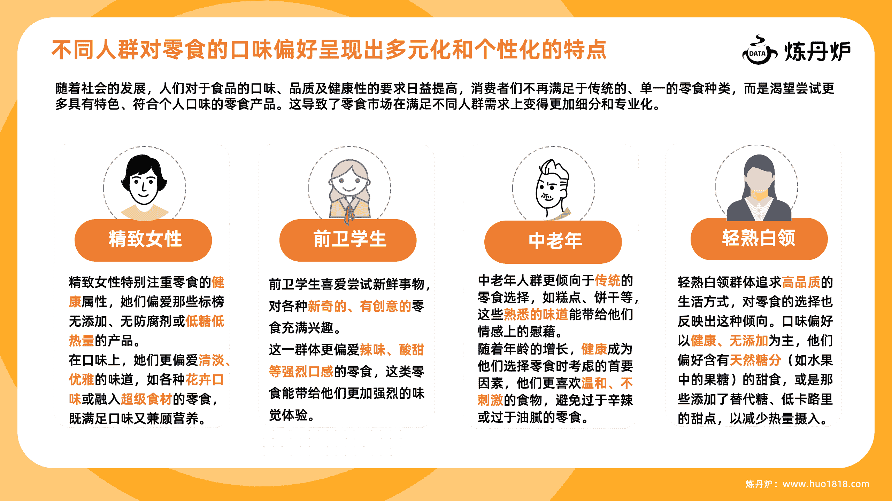

### 不同人群对零食的口味偏好呈现出多元化和人性化的特点

随着社会的发展，人们对于食品的口味、品质及健康性的要求日益提高，消费者们不再满足于传统的、单一的零食种类，而是渴望尝试更多具有特色、符合个人口味的零食产品。这导致了零食市场在满足不同人群需求上变得更加细分和专业化。

- **精致女性**：精致女性特别注重零食的健康属性，她们偏爱那些标榜无添加、无防腐剂或低糖低热量的产品。在口味上，她们更偏爱清淡优雅的味道，如各种花卉口味或融入超级食材的零食，既满足口味又兼顾营养。
- **前卫学生**：前卫学生喜爱尝试新鲜事物，对各种新奇的、有创意的零食充满兴趣。这一群体更偏爱辣味、酸甜等强烈口感的零食，这类零食能带给他们更加强烈的味觉体验。
- **中老年**：中老年人群更倾向于传统的零食选择，如糕点、饼干等，这些熟悉的味道能带给他们情感上的慰藉。随着年龄的增长，健康成为他们选择零食时考虑的首要因素，他们更喜欢温和、不刺激的食物，避免过于辛辣或过于油腻的零食。
- **轻熟白领**：轻熟白领群体追求高品质的生活方式，对零食的选择也反映出这种倾向。口味偏好以健康、无添加为主，偏好含有天然糖分（如水果中的果糖）的甜食，或是那些添加了替代糖、低卡路里的甜点，以减少热量摄入。

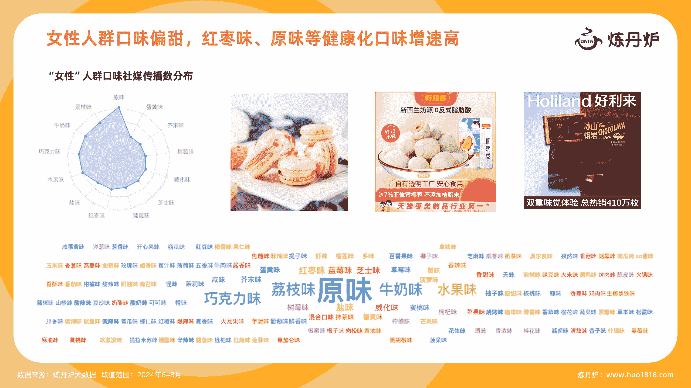

### 女性人群口味偏甜，红枣味、原味等健康化口味增速高

**“女性”人群口味社媒传播数分布**

原味、牛奶味、巧克力味、水果味、盐味、芝士味、红枣味、蓝莓味、咸蛋黄味、焦糖味、麻辣味、提子味、虾味、多味、椰子味、芝麻味、咸香味、奶茶味、奥尔良味、孜然味、香菇味、黑鸭味、南瓜味、xo酱味、蛋黄味、草莓味、蜜味、香辣味、咸味、芥末味、菠萝味、香甜味、原味(牛奶味)、无味、泡椒味、绿豆味、大米味、烤肉味、陈皮味、火锅味、香酥味、茄汁味、柑桔味、甜辣味、奶油味、海苔味、莱莉味、荔枝味、柚子味、酸甜味、核桃味、香蔬味、鸡肉味、椒麻味、山楂味、酸辣味、豆沙味、奶酪味、酸奶味、可可味、橙味、树莓味、威化味、蜜桃味、混合口味、抹茶味、蟹黄味、枸杞味、川香味、烧烤味、鱿鱼味、微辣味、青瓜味、红糖味、甜辣味、麦香味、火龙果味、芋泥味、葡萄味、鲜香味、柠檬味、芒果味、板栗味、梅子味、肉松味、黄油味、花生味、酒味、香滋味、桂花味、酱卤味、清甜味、香芋味、什锦味、黄桃味、冰道漫味、提拉米苏味、糖酱味、辛辣味、鱼味、枇杷味、红烩味、莲蓉味、黑加仑味、黑胡椒味

数据来源：炼丹炉大数据 取值范围：2024年6-8月

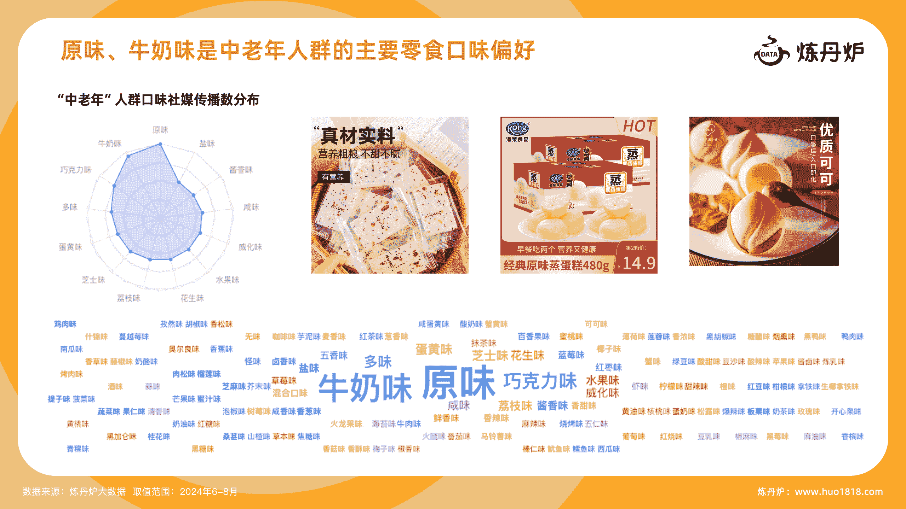

### 原味、牛奶味是中老年人群的主要零食口味偏好

**“中老年”人群口味社媒传播数分布**

原味、牛奶味、盐味、巧克力味、酱香味、多味、蛋黄味、威化味、芝士味、水果味、荔枝味、花生味、鸡肉味、孜然味、胡椒味、肉松味、咸蛋黄味、酸奶味、蟹黄味、可可味、什锦味、蔓越莓味、无味、芋味、麦香味、红茶味、香味、抹茶味、百香果味、蜜桃味、薄荷味、莲蓉味、香浓味、胡麻味、糖醋味、烟熏味、黑鸭味、鸭肉味、南瓜味、奥尔良味、香蕉味、五香味、蓝莓味、橘子味、香草味、酸梅味、奶酪味、轻味、卤香味、红枣味、甜味、蝶豆味、酸甜味、豆沙味、酸辣味、苹果味、酱卤味、炼乳味、烤肉味、肉松味、榴莲味、草莓味、芝麻味、芥末味、水果味、清味、混合口味、虾味、柠檬味、甜辣味、怪味、红豆味、柑橘味、拿铁味、生椰拿铁味、榛子味、菠菜味、芒果味、蜜汁味、蔬菜味、果仁味、清香味、泡椒味、树莓味、咸香味、香葱味、咸味、荔枝味、酱香味、香甜味、鲜香味、香辣味、黄油味、核桃味、蛋奶味、松霜味、爆辣味、板栗味、奶茶味、玫瑰味、开心果味、黄桃味、奶油味、红糖味、火龙果味、海苔味、牛肉味、麻辣味、烧烤味、五仁味、黑加仑味、桂花味、蓝莓味、山楂味、草本味、焦糖味、火腿味、茄子味、马铃薯味、葡萄味、红烧味、豆乳味、椒麻味、蓝莓味、椒油味、香槟味、青稞味、黑糖味、香菇味、香酥味、梅子味、椒香味、桃仁味、鱿鱼味、鲑鱼味、西瓜味

数据来源：炼丹炉大数据 取值范围：2024年6-8月

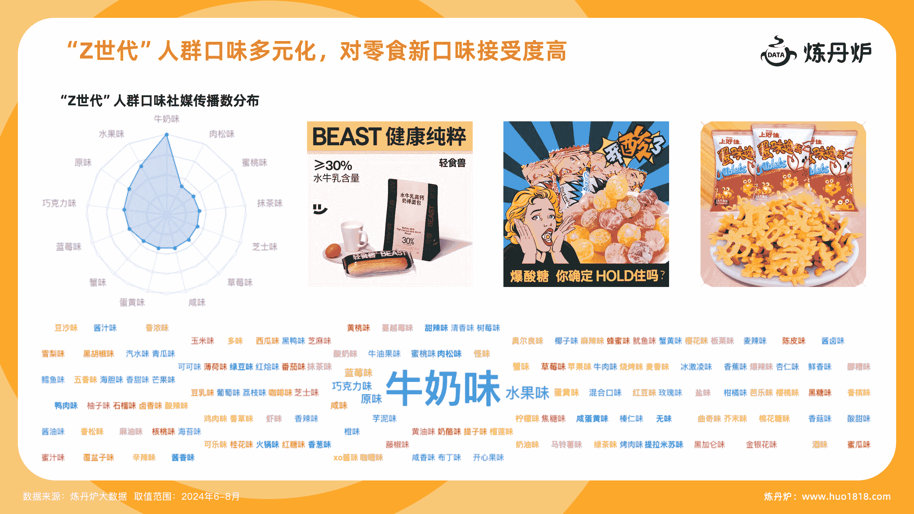

### “Z世代”人群口味多元化，对零食新口味接受度高

**“Z世代”人群口味社媒传播数分布**

牛奶味、水果味、肉松味、原味、草莓味、巧克力味、抹茶味、蓝莓味、芝士味、蟹味、蛋黄味、咸味、豆沙味、酱汁味、黄桃味、蓝莓味、甜辣味、清香味、树莓味、玉米味、多味、西瓜味、果鸭味、芝麻味、奥尔良味、榛子味、麻薯味、鱿鱼味、樱花味、板栗味、麦辣味、陈皮味、香味、雪梨味、原味、胡麻味、汽水味、青瓜味、酸奶味(牛油果味)、蜜桃味、肉松味、可可味、薄荷味、绿豆味、红烩味、番茄味、抹茶味、蓝莓味、牛奶味、蛋味、草莓味、苹果味、牛肉味、烧烤味、麦香味、冰激凌味、香芋味、爆辣味、杏仁味、鲜香味、酸糖味、焗鱼味、五香味、海胆味、香甜味、芒果味、豆乳味、葡萄味、荔枝味、咖啡味、芝士味、巧克力味、水果味、原味、蛋黄味、混合口味、红豆味、玫瑰味、盐味、柑橘味、芭乐味、樱桃味、暴浆味、鸭肉味、柚子味、石榴味、卤香味、酸辣味、咸味、鸡肉味、香草味、虾味、香辣味、芋泥味、柠檬味、糖味、咸蛋黄味、桃仁味、无味、曲奇味、芥末味、棉花糖味、香菇味、油酥味、香松味、麻油味、核桃味、海苔味、怪味、黄油味、奶酪味、提子味、榴莲味、可乐味、桂花味、火锅味、红烩味、香葱味、藤椒味、奶油味、马铃薯味、螺蛳粉味、烤肉味、提拉米苏味、黑加仑味、金银花味、酒味、蜜瓜味、蜜汁味、黑莓子味、茗香味、XO酱味、咖喱味、咸香味、布丁味、开心果味

数据来源：炼丹炉大数据 取值范围：2024年6-8月

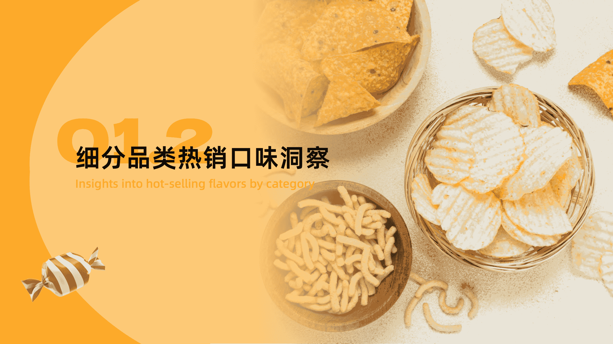

## 细分品类热销口味洞察

Insights into hot-selling flavors by category

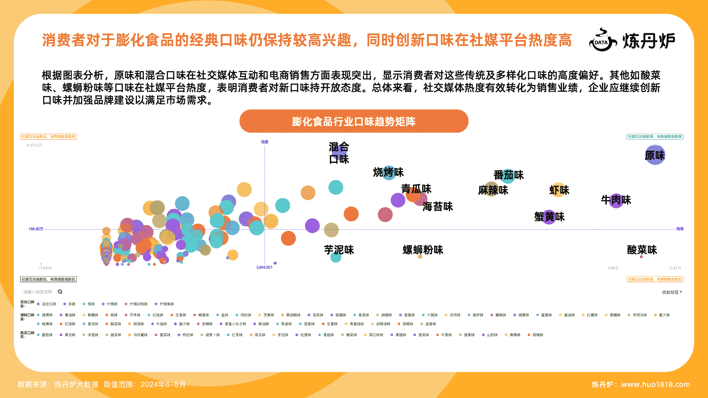

### 消费者对于膨化食品的经典口味仍保持较高兴趣，同时创新口味在社媒平台热度高

根据图表分析，原味和混合口味在社交媒体互动和电商销售方面表现突出，显示消费者对这些传统及多样化口味的高度偏好。其他如酸菜味、螺蛳粉味等口味在社媒平台热度高，表明消费者对新口味持开放态度。总体来看，社交媒体热度有效转化为销售业绩，企业应继续创新口味并加强品牌建设以满足市场需求。

**膨化食品行业口味趋势矩阵**

[此处为口味趋势矩阵图，无法直接以文本形式呈现]

数据来源：炼丹炉大数据 取值范围：2024年6-8月

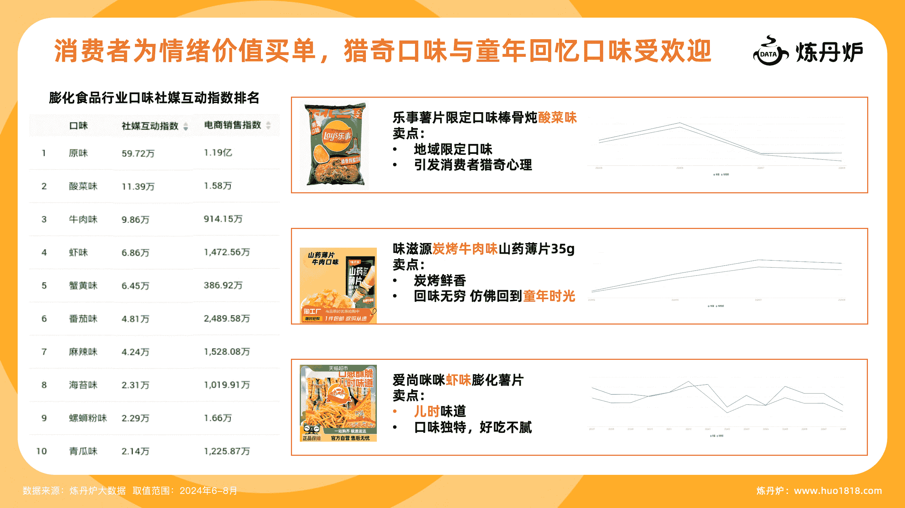

### 消费者为情绪价值买单，猎奇口味与童年回忆口味受欢迎

**膨化食品行业口味社媒互动指数排名**

| 排名 | 口味 | 社媒互动指数 | 电商销售指数 | 产品示例与卖点 |
| :--- | :--- | :--- | :--- | :--- |
| 1 | 原味 | 59.72万 | 1.19亿 | 乐事薯片限定口味棒骨炖酸菜味：地域限定口味，引发消费者猎奇心理 |
| 2 | 酸菜味 | 11.39万 | 1.58万 | - |
| 3 | 牛肉味 | 9.86万 | 914.15万 | 味滋源炭烤牛肉味山药薄片35g：炭烤鲜香，回味无穷，仿佛回到童年时光 |
| 4 | 虾味 | 6.86万 | 1,472.56万 | 爱尚咪咪虾味膨化薯片：儿时味道，口味独特，好吃不腻 |
| 5 | 蟹黄味 | 6.45万 | 386.92万 | - |
| 6 | 番茄味 | 4.81万 | 2,489.58万 | - |
| 7 | 麻辣味 | 4.24万 | 1,528.08万 | - |
| 8 | 海苔味 | 2.31万 | 1,019.91万 | - |
| 9 | 螺蛳粉味 | 2.29万 | 1.66万 | - |
| 10 | 青瓜味 | 2.14万 | 1,225.87万 | - |

数据来源：炼丹炉大数据 取值范围：2024年6-8月

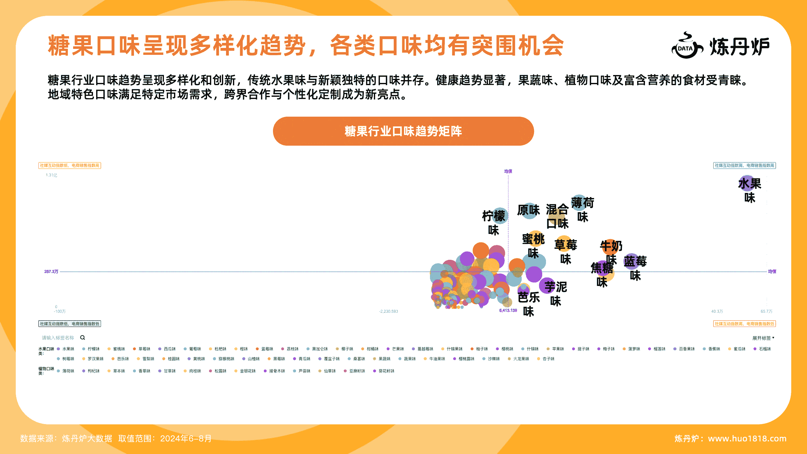

### 糖果口味呈现多样化趋势，各类口味均有突围机会

糖果行业口味趋势呈现多样化和创新，传统水果味与新颖独特的口味并存。健康趋势显著，果蔬味、植物口味及富含营养的食材受青睐。地域特色口味满足特定市场需求，跨界合作与个性化定制成为新亮点。

**糖果行业口味趋势矩阵**

[此处为口味趋势矩阵图，无法直接以文本形式呈现]

数据来源：炼丹炉大数据 取值范围：2024年6-8月

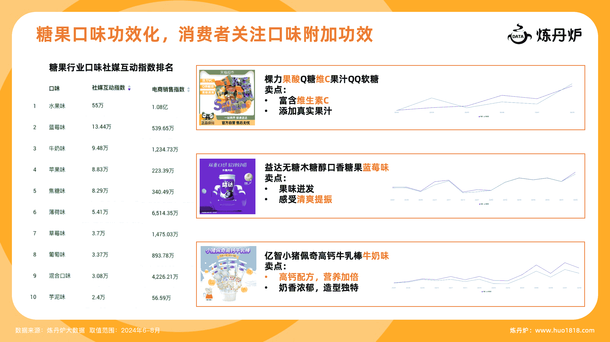

### 糖果口味功效化，消费者关注口味附加功效

**糖果行业口味社媒互动指数排名**

| 排名 | 口味 | 社媒互动指数 | 电商销售指数 | 产品示例与卖点 |
| :--- | :--- | :--- | :--- | :--- |
| 1 | 水果味 | 55万 | 1.08亿 | 棵力果酸Q糖维C果汁QQ软糖：富含维生素C，添加真实果汁 |
| 2 | 蓝莓味 | 13.44万 | 539.65万 | 益达无糖木糖醇口香糖果蓝莓味：果味迸发，感受清爽提振 |
| 3 | 牛奶味 | 9.48万 | 1,234.73万 | 亿智小猪佩奇高钙牛乳棒牛奶味：高钙配方，营养加倍，奶香浓郁，造型独特 |
| 4 | 苹果味 | 8.83万 | 223.39万 | - |
| 5 | 焦糖味 | 8.29万 | 340.49万 | - |
| 6 | 薄荷味 | 5.41万 | 6,514.35万 | - |
| 7 | 草莓味 | 3.7万 | 1,475.03万 | - |
| 8 | 葡萄味 | 3.37万 | 893.78万 | - |
| 9 | 混合口味 | 3.08万 | 4,226.21万 | - |
| 10 | 芋泥味 | 2.4万 | 56.59万 | - |

数据来源：炼丹炉大数据 取值范围：2024年6-8月

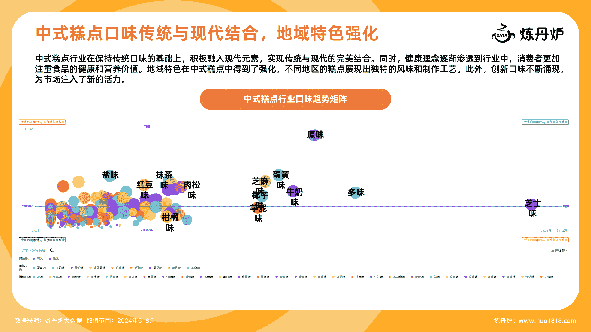

### 中式糕点口味传统与现代结合，地域特色强化

中式糕点行业在保持传统口味的基础上，积极融入现代元素，实现传统与现代的完美结合。同时，健康理念逐渐渗透到行业中，消费者更加注重食品的健康和营养价值。地域特色在中式糕点中得到了强化，不同地区的糕点展现出独特的风味和制作工艺。此外，创新口味不断涌现，为市场注入了新的活力。

**中式糕点行业口味趋势矩阵**

[此处为口味趋势矩阵图，无法直接以文本形式呈现]

数据来源：炼丹炉大数据 取值范围：2024年6-8月

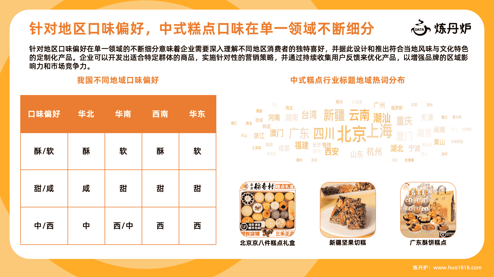

### 针对地区口味偏好，中式糕点口味在单一领域不断细分

针对地区口味偏好在单一领域的不断细分意味着企业需要深入理解不同地区消费者的独特喜好，并据此设计和推出符合当地风味与文化特色的定制化产品。企业可以开发出适合特定群体的商品，实施针对性的营销策略，并通过持续收集用户反馈来优化产品，以增强品牌的区域影响力和市场竞争力。

**我国不同地域口味偏好**

| 地域 | 华北 | 华南 | 西南 | 华东 |
| :--- | :--- | :--- | :--- | :--- |
| 口味偏好 | 酥/软、咸、中 | 酥、甜、西/中 | 软、甜、西 | 酥/软、甜、西 |
| 代表产品 | 北京京八件糕点礼盒 | 广东酥饼糕点 | 新疆坚果切糕 | - |

数据来源：炼丹炉大数据

## 零食行业口味创新趋势

Trends in flavor innovation in the snack food industry

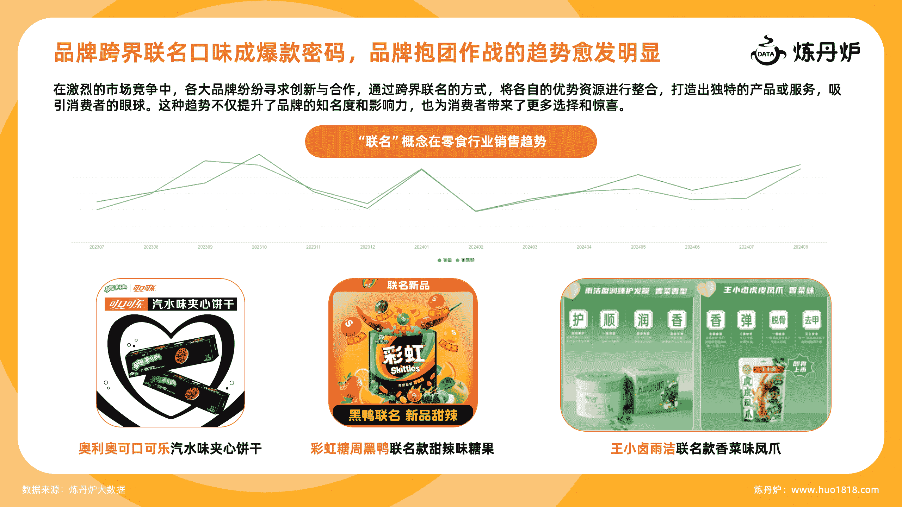

### 品牌跨界联名口味成爆款密码，品牌抱团作战的趋势愈发明显

在激烈的市场竞争中，各大品牌纷纷寻求创新与合作，通过跨界联名的方式，将各自的优势资源进行整合，打造出独特的产品或服务，吸引消费者的眼球。这种趋势不仅提升了品牌的知名度和影响力，也为消费者带来了更多选择和惊喜。

**“联名”概念在零食行业销售趋势**

[此处为趋势图，无法直接以文本形式呈现]

**联名新品示例：**
- 奥利奥可口可乐汽水味夹心饼干
- 彩虹糖周黑鸭联名款甜辣味糖果
- 王小卤雨洁联名款香菜味凤爪
- 王小卤虎皮凤爪雪菜味

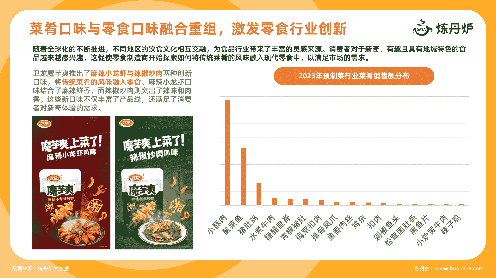

## 小炼丹炉

### 菜肴口味与零食口味融合重组，激发零食行业创新

随着全球化的不断推进，不同地区的饮食文化相互交融，为食品行业带来了丰富的灵感来源。消费者对于新奇、有趣且具有地域特色的食品越来越感兴趣，这促使零食制造商开始探索如何将传统菜肴的风味融入现代零食中，以满足市场的需求。

卫龙魔芋爽推出了麻辣小龙虾与辣椒炒肉两种创新口味，将传统菜肴的风味融入零食。麻辣小龙虾口味结合了麻辣鲜香，而辣椒炒肉则突出了辣味和肉香。这些新口味不仅丰富了产品线，还满足了消费者对新奇体验的需求。

2023年预制菜行业菜肴销售额分布

魔芋爽上菜了！

麻辣小龙虾风味

辣椒炒肉风味

卫龙魔芋爽

小龙虾

湘味小炒肉

数据来源：炼丹炉大数据

炼丹炉：www.huo1818.com

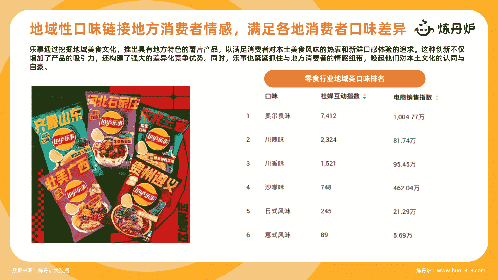

## 小炼丹炉

### 地域性口味链接地方消费者情感，满足各地消费者口味差异

乐事通过挖掘地域美食文化，推出具有地方特色的薯片产品，以满足消费者对本土美食风味的热爱和新鲜口感体验的追求。这种创新不仅增加了产品的吸引力，还构建了强大的差异化竞争优势。同时，乐事也紧紧抓住与地方消费者的情感纽带，唤起他们对本土文化的认同与自豪。

### 零食行业地域类口味排名

| 排名 | 区域 | 口味 | 社媒互动指数 | 电商销售指数 |
|---|---|---|---:|---:|
| 1 | 东北三省 | 奥尔良味 | 7,412 | 1,004.77万 |
| 2 | 齐鲁山东 | 牛肉板腱味 | 2,324 | 81.74万 |
| 3 | 四川 | 川辣味 | 1,521 | 95.45万 |
| 4 | 河北石家庄 | 香哆味 | 748 | 462.04万 |
| 5 | 区域限定 | 日式风味 | 245 | 21.29万 |
| 6 | 区域限定 | 意式风味 | 89 | 5.69万 |

Lays 乐事

数据来源：炼丹炉大数据

炼丹炉：www.huo1818.com

## 品牌利用争议性口味趋势

Brands capitalize on controversial flavor trends

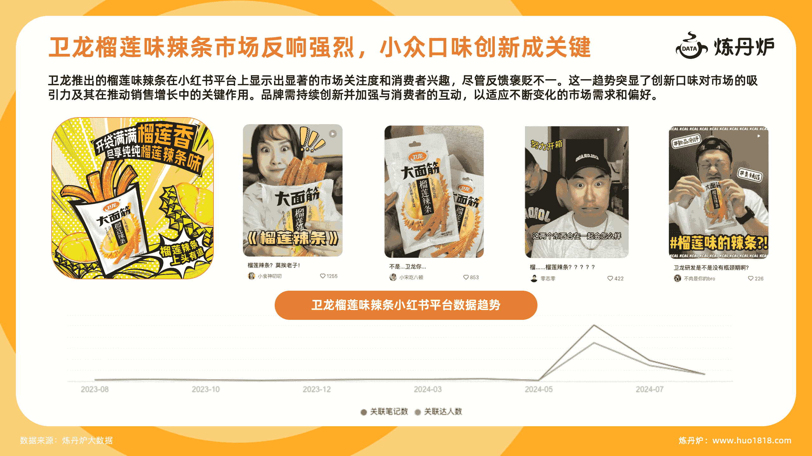

### 卫龙榴莲味辣条市场反响强烈，小众口味创新成关键

卫龙推出的榴莲味辣条在小红书平台上显示出显著的市场关注度和消费者兴趣，尽管反馈褒贬不一。这一趋势突显了创新口味对市场的吸引力及其在推动销售增长中的关键作用。品牌需持续创新并加强与消费者的互动，以适应不断变化的市场需求和偏好。

榴莲香

开袋满满

《榴莲辣条》

#榴莲味的辣条

蕴端系？高技老子！

不是_卫龙妈.

损..福薄膜系77？？？

卫龙研发是不是没有刺激性？

鲁小*

1255

7,622

@不是的br

226

### 卫龙榴莲味辣条小红书平台数据趋势

2023-08　2023-10　2023-12　2024-03　2024-05　2024-07

● 关联笔记数　关联达人数

数据来源：炼丹炉大数据

炼丹炉：www.huo1818.com

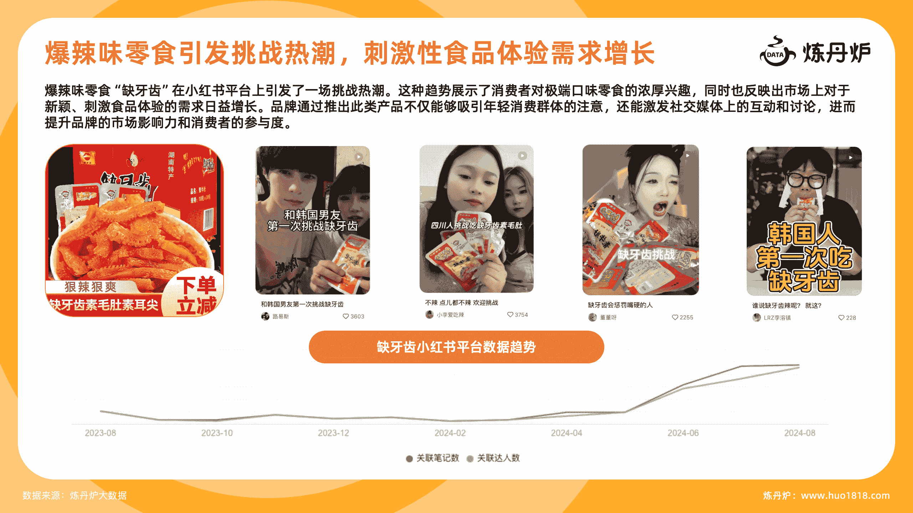

## 小炼丹炉

### 爆辣味零食引发挑战热潮，刺激性食品体验需求增长

爆辣味零食“缺牙齿”在小红书平台上引发了一场挑战热潮。这种趋势展示了消费者对极端口味零食的浓厚兴趣，同时也反映出市场上对于新颖、刺激食品体验的需求日益增长。品牌通过推出此类产品不仅能够吸引年轻消费群体的注意，还能激发社交媒体上的互动和讨论，进而提升品牌的市场影响力和消费者的参与度。

和韩国男友第一次挑战缺牙齿

韩国

第一次吃缺牙齿

下单

缺牙齿

狠辣狠爽

缺牙齿素毛肚素耳尖

立减

和韩国男友第一次挑战缺牙齿

不辣点儿都不敢欢在然试

缺牙齿会癌彻塞硬的人

@小学花

3,754

ED：

2,755

LRZ学89

228

### 缺牙齿小红书平台数据趋势

2023-08　2023-10　2023-12　2024-02　2024-04　2024-06　2024-08

● 关联笔记数　关联达人数

数据来源：炼丹炉大数据

炼丹炉：www.huo1818.com

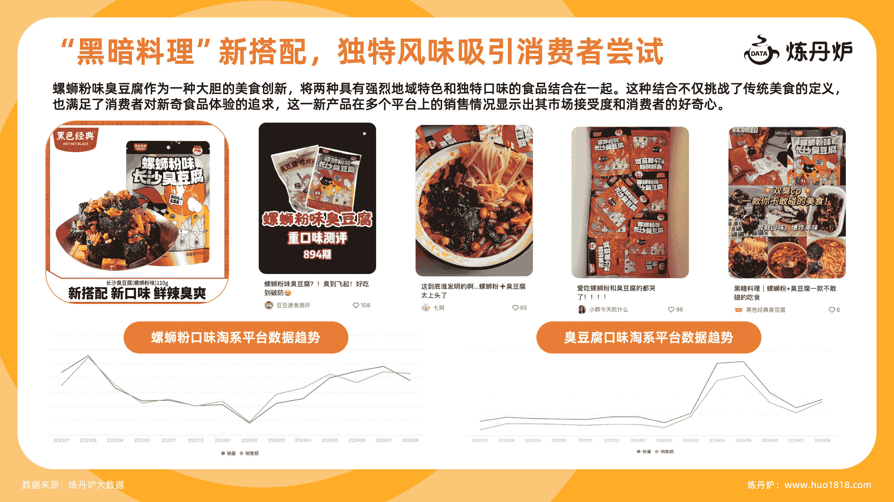

### 黑暗料理新搭配，独特风味吸引消费者尝试

## 小炼丹炉

螺蛳粉味臭豆腐作为一种大胆的美食创新，将两种具有强烈地域特色和独特口味的食品结合在一起。这种结合不仅挑战了传统美食的定义，也满足了消费者对新奇食品体验的追求，这一新产品在多个平台上的销售情况显示出其市场接受度和消费者的好奇心。

黑色经典

螺蛳粉味臭豆腐

重口味测评

894期

新搭配新口味鲜辣臭爽

螺蛳粉味臭豆腐？！臭到飞起！好吃

这到底进发期的间，强期份+臭互图

太上头了

711!!

硅的食

108

65

果小群今天什

96

6

### 螺蛳粉口味淘系平台数据趋势

### 臭豆腐口味淘系平台数据趋势

数据来源：炼丹炉大数据

炼丹炉：www.huo1818.com

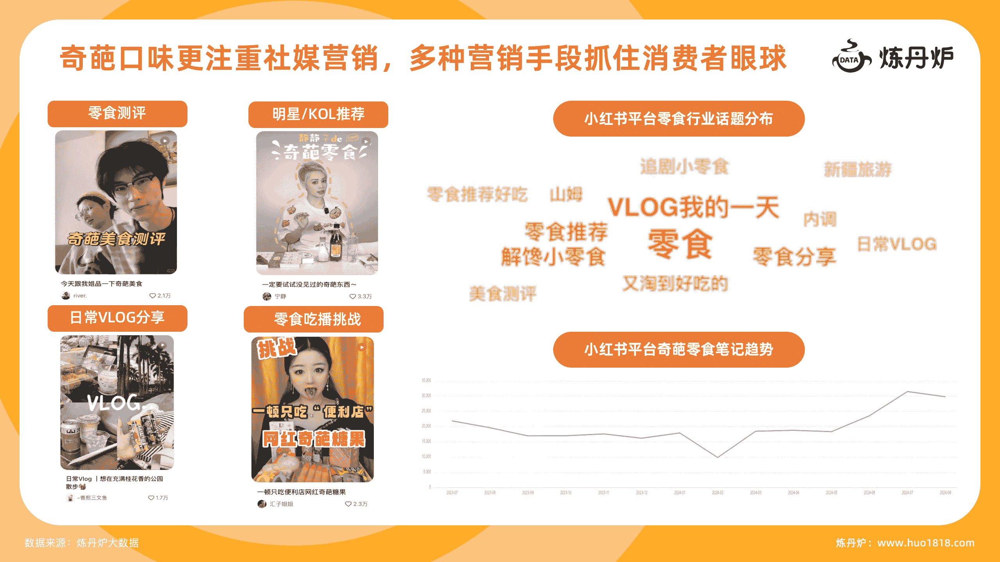

## 炼丹炉

### 奇口味更注重社媒营销，多种营销手段抓住消费者眼球

零食测评

明星/KOL推荐

小红书平台零食行业话题分布

追剧小零食

新疆旅游

零食推荐好吃山姆

VLOG我的一天

内调

奇葩美食测评

零食推荐

零食

日常VLOG

解馋小零食

零食分享

美食测评

又淘到好吃的

rive

2.17%

3.37%

日常VLOG分享

零食吃播挑战

挑战

小红书平台奇葩零食笔记趋势

VLOG

顿只吃便利店

网红奇葩糖果

日常Vlog梦在克满控花需的公四

@1.77%

>2.37%

数据来源：炼丹炉大数据

炼丹炉：www.huo1818.com

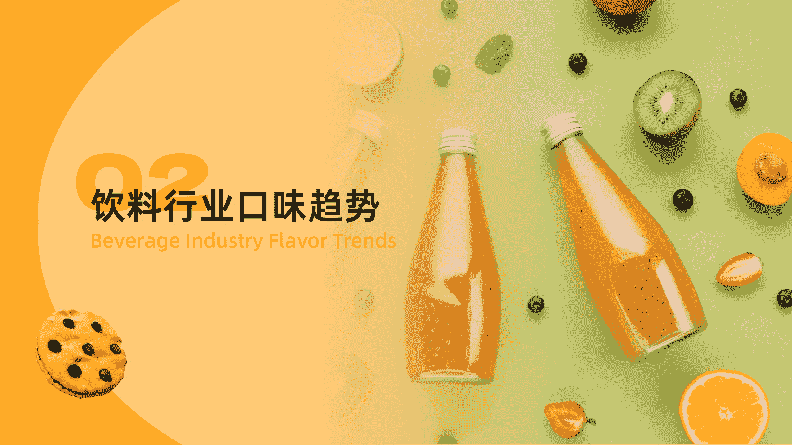

## 饮料行业口味趋势

Beverage Industry Flavor Trends

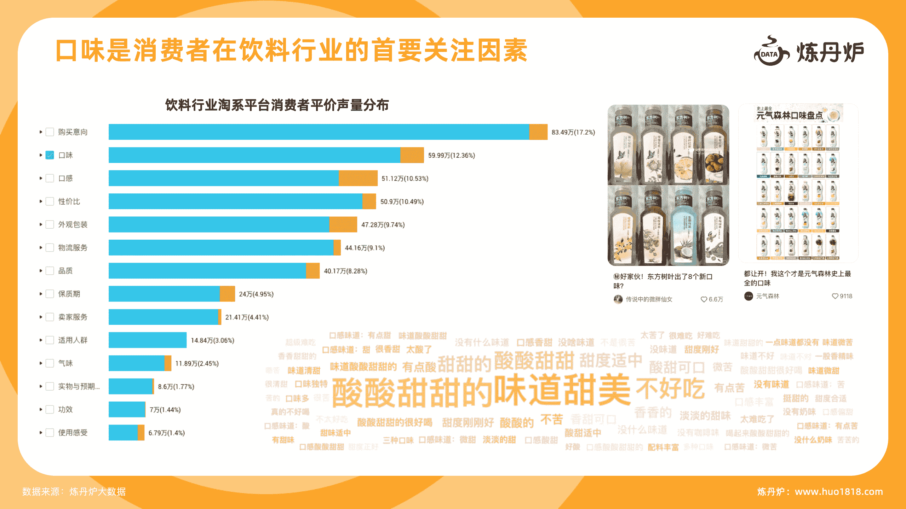

### 口味是消费者在饮料行业的首要关注因素

## 炼丹炉

饮料行业淘系平台消费者评价声量分布

### 元气森林口味盘点

- 购买意向：83.497万（17.2%）
- 性价比：59.997万（12.36%）
- 外观包装：51.12万（10.53%）
- 物流服务：50.97万（10.49%）
- 品质：47.2875万（9.74%）
- 保质期：44.16万（9.1%）
- 卖家服务：40.17万（8.28%）
- 适用人群：24万（4.95%）
- 实物与预期：21.417万（4.41%）
- 功效：14.84万（3.06%）
- 使用感受：11.8975万（2.45%）
- 口感味道：6.57万（1.35%）
- 其他：6.797万（1.4%）
- 评价：77万（1.44%）

口感味道评价：

- 零卡口味！东方树叶出了8个新口味
- 让我看看！我这个才是元气森林史上最全的口味
- 口感味道：有点甜，味道酸酸甜甜
- 没有什么味道，口感香甜，没啥味道
- 太苦了，很难吃，好难吃
- 口感味道：甜，很香甜，太酸了
- 没味道，甜度刚好
- 一点味道都没有，味道微苦
- 香香甜甜的
- 酸甜可口
- 一股香精味
- 味道清甜
- 味道微甜
- 清甜，口味独特，酸酸甜甜的味道，甜美，不好吃
- 有点苦
- 没有味道，口感味道：苦
- 西瓜的口味多
- 挺甜的，甜度合适
- 真的不好喝
- 淡淡的甜味
- 太难吃了
- 没有奶味，口感却确甜
- 口感味道：甜味适中
- 酸甜适中
- 没什么味
- 喝起来酸甜甜的
- 口感味道：有点苦
- 有甜味
- 三种口味，口感味道：淡淡的甜，口感酸甜
- 好喝，口感酸酸甜甜的，配料丰富
- 没什么奶味

数据来源：炼丹炉大数据

炼丹炉：www.huo1818.com

## 人群偏好

Crowd Preference

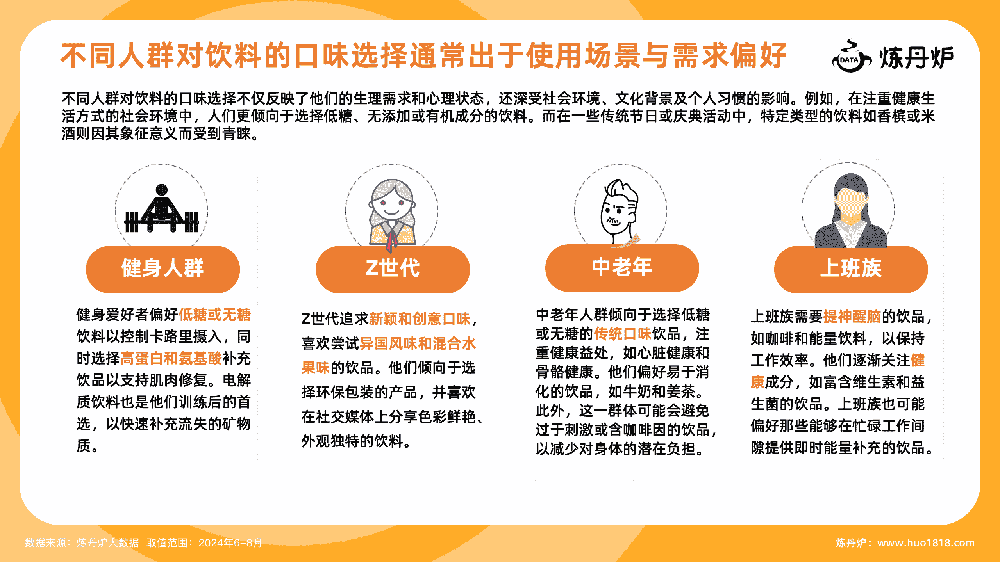

### 不同人群对饮料的口味选择通常出于使用场景与需求偏好

## 小炼丹炉

不同人群对饮料的口味选择不仅反映了他们的生理需求和心理状态，还深受社会环境、文化背景及个人习惯的影响。例如，在注重健康生活方式的社会环境中，人们更倾向于选择低糖、无添加或有机成分的饮料。而在一些传统节日或庆典活动中，特定类型的饮料如香槟或米酒则因其象征意义而受到青睐。

| 人群 | 口味及饮用偏好 |
|---|---|
| 健身人群 | 健身爱好者偏好低糖或无糖饮料以控制卡路里摄入，同时选择高蛋白和氨基酸补充饮品以支持肌肉修复。电解质饮料也是他们训练后的首选，以快速补充流失的矿物质。 |
| Z世代 | Z世代追求新颖和创意口味，喜欢尝试异国风味和混合水果味的饮品。他们倾向于选择环保包装的产品，并喜欢在社交媒体上分享色彩鲜艳、外观独特的饮料。 |
| 中老年 | 中老年人群倾向于选择低糖或无糖的传统口味饮品，注重健康益处，如心脏健康和骨骼健康。他们偏好易于消化的饮品，如牛奶和姜茶。此外，这一群体可能会避免过于刺激或含咖啡因的饮品，以减少对身体的潜在负担。 |
| 上班族 | 上班族需要提神醒脑的饮品，如咖啡和能量饮料，以保持工作效率。他们逐渐关注健康成分，如富含维生素和益生菌的饮品。上班族也可能偏好那些能够在忙碌工作间隙提供即时能量补充的饮品。 |

数据来源：炼丹炉大数据，取值范围：2024年6—8月

炼丹炉：www.huo1818.com

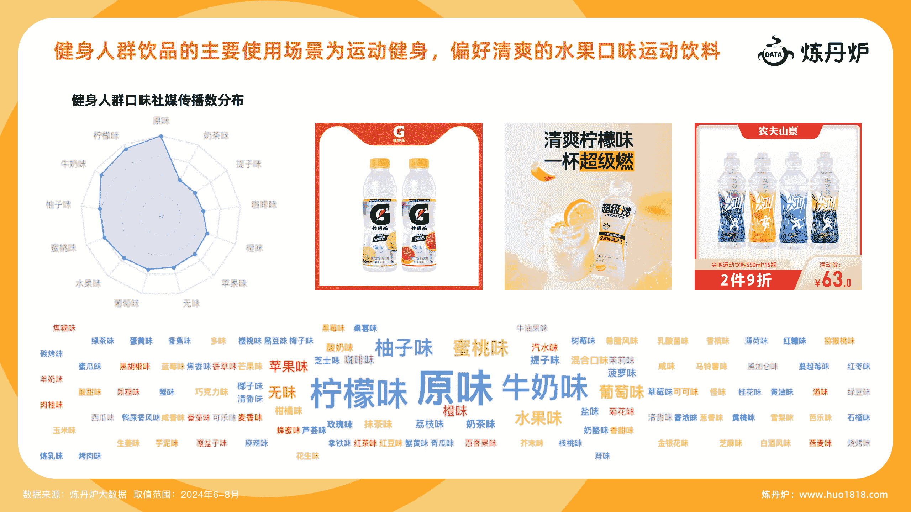

## 炼丹炉

### 健身人群饮品的主要使用场景为运动健身，偏好清爽的水果口味运动饮料

健身人群口味社媒传播数分布

原味、柠檬味、奶茶味、清爽柠檬味、牛奶味、提子味、柚子味、咖啡味、蜜桃味、橙味、水果味、苹果味、无味、焦糖味、黑莓味、桑葚味、牛油果味、绿茶味、蛋黄味、香蕉味、多味、樱桃味、黑豆味、梅子味、酸奶味、汽水味、树莓味、希腊风味、乳酸菌味、香槟味、薄荷味、红茶味、猕猴桃味、碳烤味、蜜瓜味、黑胡椒味、蓝莓味、蕉香味、香草味、芒果味、芝士味、咖啡味、提子味、混合口味、茉莉味、菠萝味、威化味、马铃薯味、黑加仑味、蔓越莓味、红茶味、羊奶味、柠檬味、原味、牛奶味、酸甜味、黑糖味、蟹味、巧克力味、椰子味、无味、葡萄味、清香味、草莓味、可可味、怪味、桂花味、黄油味、酒味、绿豆味、肉桂味、西瓜味、番茄味、可乐味、麦香味、柑橘味、鸭屎香风味、威士忌香风味、水果味、盐味、菊花味、玫瑰味、抹茶味、荔枝味、奶茶味、清甜味、香浓味、葱香味、黄桃味、雪梨味、芭乐味、蜂蜜味、芦荟味、奶酪味、香甜味、生姜味、芋泥味、姜盐子味、麻辣味、拿铁味、茶香味、红豆味、螃蟹黄味、青瓜味、百香果味、芥末味、核桃味、金银花味、芝麻味、白酒风味、燕麦味、烧烤味、炼乳味、烤肉味、花生味、辣味

数据来源：炼丹炉大数据，取值范围：2024年6—8月

炼丹炉：www.huo1818.com

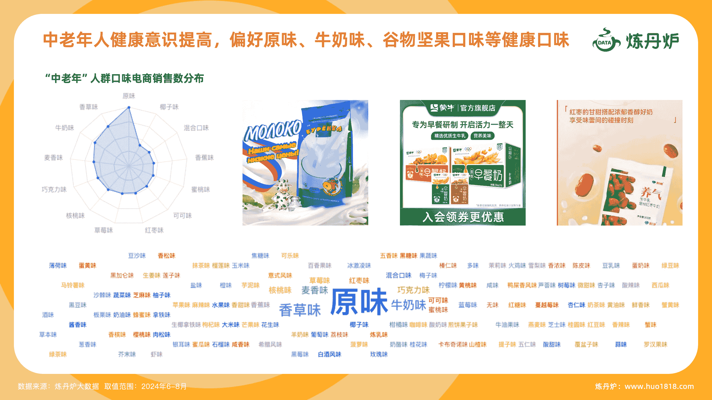

## 炼丹炉

### 中老年人健康意识提高，偏好原味、牛奶味、谷物坚果口味等健康口味

“中老年”人群口味电商销售数分布

原味、香草味、椰子味、牛奶味、混合口味、麦香味、巧克力味、蜜柑味、核桃味、可可味、草莓味、豆沙味、香松味、可乐味、五香味、果糖味、果味、薄荷味、辣茶味、榴莲味、玉米味、百香果味、冰激凌味、杏仁味、多味、茉莉味、火鸡味、雪梨味、香浓味、陈皮味、豆乳味、麦奶味、绿豆味、黑加仑味、生姜味、橙子味、意式风味、红枣味、混合口味、梅子味、马铃薯味、盐味、橙味、芋泥味、核桃味、麦香味、巧克力味、柠檬味、黄桃味、威化味、鸭屎香风味、芦荟味、树莓味、微甜味、杏子味、酸辣味、西瓜味、沙棘味、蔬菜味、芝麻味、柚子味、原味、黑豆味、苹果味、麻辣味、水果味、香甜味、香蕉味、香草味、牛奶味、可可味、蜜桃味、蓝莓味、无味、红茶味、蔓越莓味、杏仁味、奶茶味、黄油味、鲜香味、酱黄味、酒味、板栗味、奶油味、蜂蜜味、拿铁味、生椰拿铁味、枸杞味、大米味、芒果味、花生味、橘子味、柑橙味、咖啡味、酸奶味、煎饼果子味、牛油果味、燕麦味、芝士味、桂圆味、红豆味、香辣味、蟹味、基本风味、香槟味、樱桃味、肉松味、羊奶味、葡萄味、燕麦味、炼乳味、银耳味、蜜瓜味、石榴味、咸香味、参甜风味、奶粉味、桂花味、卡布奇诺味、山楂味、提子味、五仁味、酸甜味、姜盐子味、罗汉果味、桑茶味、芥末味、虾味、蓝莓味、白酒风味、玫瑰味

数据来源：炼丹炉大数据，取值范围：2024年6—8月

炼丹炉：www.huo1818.com

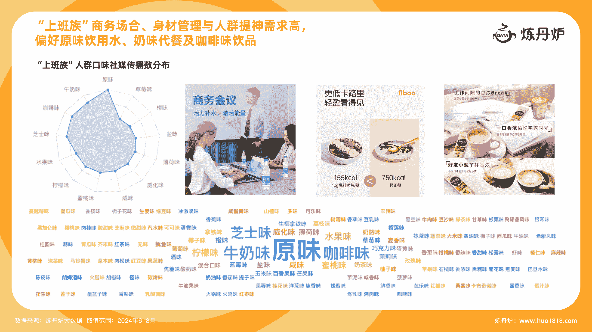

## 炼丹炉

### “上班族”商务场合、身材管理与人群提神需求高

偏好原味饮用水、奶味代餐及咖啡味饮品

“上班族”人群口味社媒传播数分布

原味、牛奶味、草莓味、咖啡味、橙味、水果味、芝士味、盐味、薄荷味、柠檬味、斑鸠味、蜜桃味、威化味、蔓越莓味、青梅味、栀子花味、生姜味、绿豆味、冰激凌味、蛋黄味、山楂味、多味、可乐味、香蕉味、生拿铁味、蔬菜味、树莓味、香草味、豆乳味、黑豆味、牛肉味、豆沙味、绿茶味、甘草味、板栗味、鸭屎香风味、黑加仑味、桃味、肉桂味、酸甜味、芝麻味、微甜味、汽水味、可可味、清香味、拿铁味、芝士味、威化味、薄荷味、水果味、奶酪味、榴莲味、椰子味、橙味、草莓味、麦香味、抹茶味、蔬菜味、大米味、黄油味、梅子味、西瓜味、牛油味、希腊风味、桂圆味、蒜味、青瓜味、芥末味、红茶味、无味、鱿鱼味、牛奶味、原味、葡萄味、柠檬味、咖啡味、巧克力味、蛋黄味、酒味、茉莉味、香葱味、柑味、香辣味、香甜味、松露味、虾味、杏仁味、麻辣味、黄桃味、泡菜味、马铃薯味、草本味、肉松味、红豆味、果蔬味、混合口味、蓝莓味、盐味、咸味、蜜桃味、奶茶味、玫瑰味、精酿味、酸奶味、柚子味、苹果味、石榴味、香浓味、黑糖味、菊花味、燕麦味、巴旦木味、陈皮味、朗姆酒味、火腿味、胡椒味、怪味、碳烤味、芋泥味、咸香味、牛油果味、莲蓉味、桂花味、洋葱味、焦香味、鲜香味、芭乐味、红糖味、澡枣味、卡布奇诺味、蜜汁味、花生味、莲子味、姜盐子味、雪梨味、乳酸菌味、火锅味、火鸡味、红枣味、炼乳味、烤肉味、咖喱味

数据来源：炼丹炉大数据，取值范围：2024年6—8月

炼丹炉：www.huo1818.com

## 细分品类热销口味洞察

Insights into hot-selling flavors by category

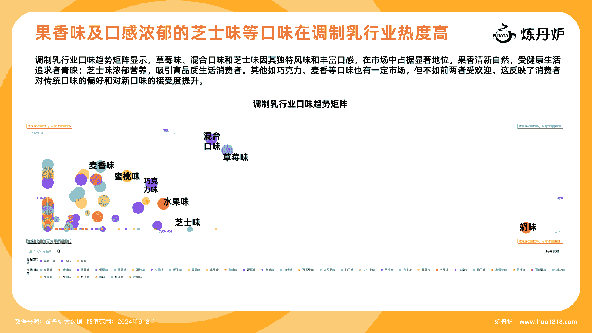

### 果香味及口感浓郁的芝士味等口味在调制乳行业热度高

## 小炼丹炉

调制乳行业口味趋势矩阵显示，草莓味、混合口味和芝士味因其独特风味和丰富口感，在市场中占据显著地位。果香清新自然，受健康生活追求者青睐；芝士味浓郁营养，吸引高品质生活消费者。其他如巧克力、麦香等口味也有一定市场，但不如前两者受欢迎。这反映了消费者对传统口味的偏好和对新口味的接受度提升。

### 调制乳行业口味趋势矩阵

混合口味、草莓味、麦香味、奶味、水果味、芝士味等。

数据来源：炼丹炉大数据，取值范围：2024年6—8月

炼丹炉：www.huo1818.com

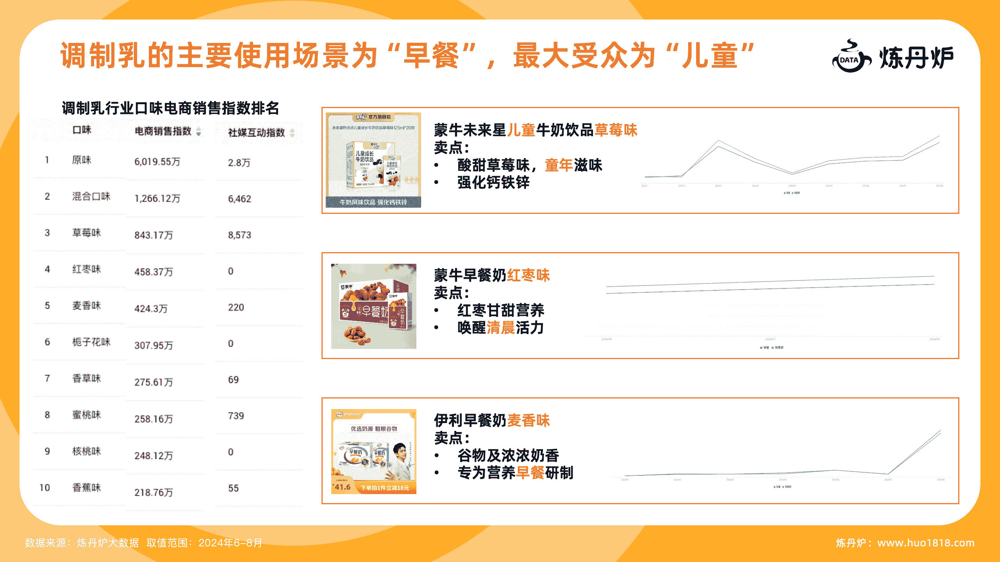

### 调制乳的主要使用场景为“早餐”，最大受众为“儿童”

## 炼丹炉

#### 调制乳行业口味电商销售指数排名

| 排名 | 口味 | 电商销售指数 | 社媒互动指数 | 卖点 |
|---:|---|---:|---:|---|
| 1 | 原味 | 6,019.55万 | 2.8万 |  |
| 2 | 混合口味 | 1,266.12万 | 6,462 |  |
| 3 | 草莓味 | 843.17万 | 8,573 | 酸甜草莓味，重温童年滋味；强化钙铁锌 |
| 4 | 红枣味 | 458.37万 |  | 红枣甘甜营养，唤醒清晨活力 |
| 5 | 麦香味 | 424.3万 | 220 | 谷物及浓浓奶香，专为营养早餐研制 |
| 6 | 栀子花味 | 307.95万 | 0 |  |
| 7 | 香草味 | 275.61万 | 69 |  |
| 8 | 蜜桃味 | 258.16万 | 739 |  |
| 9 | 核桃味 | 248.12万 | 0 |  |
| 10 | 香蕉味 | 218.76万 | 55 |  |

数据来源：炼丹炉大数据，取值范围：2024年6—8月

炼丹炉：www.huo1818.com

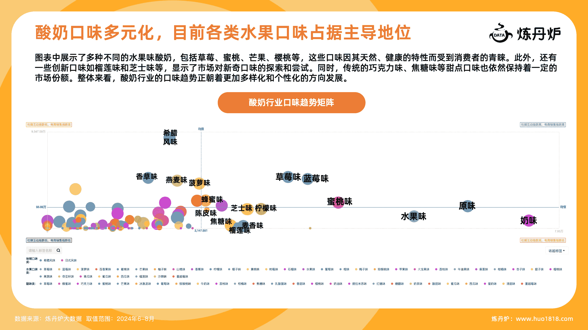

### 酸奶口味多元化，目前各类水果口味占据主导地位

## 小炼丹炉

图表中展示了多种不同的水果味酸奶，包括草莓、蜜桃、芒果、樱桃等，这些口味因其天然、健康的特性而受到消费者的青睐。此外，还有一些创新口味如榴莲味和芝士味等，显示了市场对新奇口味的探索和尝试。同时，传统的巧克力味、焦糖味等甜点口味也依然保持着一定的市场份额。整体来看，酸奶行业的口味趋势正朝着更加多样化和个性化的方向发展。

### 酸奶行业口味趋势矩阵

希腊风味、香草味、燕麦味、菠萝味、草莓味、蓝莓味、蜂蜜味、蜜桃味、芝士味、柠檬味、原味、陈皮味、水果味、焦糖味、奶味、榴莲味、泰香味等。

数据来源：炼丹炉大数据，取值范围：2024年6—8月

炼丹炉：www.huo1818.com

## 炼丹炉

酸奶口感较浓郁，通常选择清新的风味进行中和。

### 酸奶行业口味电商销售指数排名

| 排名 | 口味 | 电商销售指数 | 社媒互动指数 |
|------|------|--------------|--------------|
| 1 | 原味 | 2.71亿 | 4.6万 |
| 2 | 椰奶风味 | 7,956.32万 | 1,078 |
| 3 | 草莓味 | 1,436.54万 | 8,249 |
| 4 | 香草味 | 1,361.78万 | 605 |
| 5 | 蓝莓味 | 1,277.42万 | 1.04万 |
| 6 | 燕麦味 | 1,147.66万 | 1,295 |
| 7 | 菠萝味 | 953.55万 | 2,074 |
| 8 | 百香果味 | 636.19万 | 13 |
| 9 | 蜂蜜味 | 226.77万 | 2,344 |
| 10 | 巧克力味 | 222.07万 | 1,987 |

**蒙牛纯甄草莓果粒风味酸奶**
卖点：
- 嚼得到草莓果粒
- 可用于DIY制作甜品

**伊利安慕希希腊风味酸奶香草味**
卖点：
- 大溪地香草，香气独特
- 酸奶浓郁，香草清新

**法优乐儿童常温酸奶蓝莓味**
卖点：
- 添加天然果泥
- 口感浓稠顺滑
- 入会购买更优惠

数据来源：炼丹炉大数据 取值范围：2024年6-8月
炼丹炉：www.huo1818.com

---

茶饮行业将果味及花香味与茶饮口味进行搭配，追求自然清新。

从茶饮行业口味趋势矩阵中可以看出，果味和花香味在茶饮行业中占据了重要地位。其中，柠檬、蜜桃、西瓜等水果口味都受到了消费者的欢迎。此外，茉莉、桂花等花香口味也表现出较高的受欢迎程度。这些口味的流行反映了消费者对于清新、自然口感的追求。

### 茶饮料行业口味趋势矩阵

[矩阵图内容无法以表格形式呈现，包含柠檬味、茉莉味、桂花味、梅子味、蜜桃味、水果味、西瓜味等口味]

数据来源：炼丹炉大数据 取值范围：2024年6-8月
炼丹炉：www.huo1818.com

---

经典口味及自然花果香味是目前茶饮料品牌的主要研发方向。

### 茶饮料行业口味电商商品数排名

| 排名 | 口味 | 电商销售指数 | 社媒互动指数 |
|------|------|--------------|--------------|
| 1 | 原味 | 6,526.15万 | 1.08万 |
| 2 | 柠檬味 | 6,778.71万 | 5.41万 |
| 3 | 茉莉味 | 3,618.08万 | 9,851 |
| 4 | 蜜桃味 | 199.95万 | 2.01万 |
| 5 | 鸭屎香风味 | 477.37万 | 1,673 |
| 6 | 混合口味 | 470.28万 | 9,661 |
| 7 | 水果味 | 43.4万 | 1.74万 |
| 8 | 柚子味 | 592.77万 | 1.49万 |
| 9 | 红茶味 | 669.48万 | 13.89万 |
| 10 | 柚子味 | 85.76万 | 2,070 |

**康师傅冰红茶500ml\*15瓶整箱**
卖点：
- 经典口味，冰爽酸甜
- 香醇红茶，柠檬口味

**雀巢茶饮料茶萃桃子清乌龙果汁**
卖点：
- 茶清新，果够味
- 清甜桃汁，释放清香

数据来源：炼丹炉大数据 取值范围：2024年6-8月
炼丹炉：www.huo1818.com

---

气泡水行业以水果为主流口味，酒味、汽水味等创新口味涌现。

在气泡水行业中，水果口味已经成为主流选择，如柠檬、草莓和葡萄等口味备受欢迎。这些清新的果味气泡水满足了消费者对于健康饮品的需求，同时也为市场带来了多样化的选择。除了传统的水果口味，一些创新口味如酒味和汽水味也开始涌现。这些新颖的口味为气泡水行业注入了新的活力，吸引了更多追求个性化和独特体验的消费者。

### 气泡水行业口味趋势矩阵

[矩阵图内容无法以表格形式呈现，包含原味、柠檬味、蜜桃味、可乐味、菠萝味、荔枝味、酒味、汽水味等口味]

数据来源：炼丹炉大数据 取值范围：2024年6-8月
炼丹炉：www.huo1818.com

---

气泡水作为更健康的饮品，可以从口味上替代酒、汽水等饮料。

### 气泡水行业口味社媒互动指数排名

| 排名 | 口味 | 社媒互动指数 | 电商销售指数 |
|------|------|--------------|--------------|
| 1 | 酒味 | 38.31万 | 20.26万 |
| 2 | 原味 | 10.47万 | 1,721.93万 |
| 3 | 荔枝味 | 3.13万 | 21.19万 |
| 4 | 蜜桃味 | 2.5万 | 627.85万 |
| 5 | 汽水味 | 2.34万 | 18 |
| 6 | 柠檬味 | 1.82万 | 731.94万 |
| 7 | 橙味 | 1.76万 | 277.06万 |
| 8 | 香草味 | 1.3万 | 222.24万 |
| 9 | 菠萝味 | 1.17万 | 13.02万 |
| 10 | 葡萄味 | 8,526 | 27.44万 |

**屈臣氏莫吉托苏打水**
卖点：
- 莫吉托鸡尾酒风味
- 口味清爽，气泡十足

**奈雪的茶气泡水葡萄白桃荔枝**
卖点：
- 沉浸式果味，果气十足
- 添加代糖，清爽甜味
- 下单立享8折

**元气森林可乐味气泡水**
卖点：
- 可乐味，一样好喝但无糖
- 0糖0脂0卡

数据来源：炼丹炉大数据 取值范围：2024年6-8月
炼丹炉：www.huo1818.com

---

## 饮料行业口味创新趋势

Flavor innovation trends in the beverage industry

---

健康消费的持续渗透带动中式养生茶市场蓬勃发展。

健康意识已经逐渐渗透到日常消费的方方面面，与此同时，药食同源的概念也正在影响着食品和饮料市场。年轻人越来越喜欢选购具有天然成分和传统中药文化的饮品，红豆、薏米、枸杞、红枣、绿豆、山药等传统食物煮制、萃取制成的植物饮料正在征服都市打工人。祛湿、清火、补血是当前中式养生茶市场最热门的3大功效需求，此外，无添加、0糖0脂0卡也是当前中式养生水产品的核心卖点。

### 咖啡/麦片/冲饮市场日常养生类标签趋势

**元气森林元气自在水**
- 红豆薏米水
- 红枣枸杞水
- 清爽绿豆水
- 限定款上市，100%中奖
- 领券下单再减10元

**好望水照顾系列**
- 薏米水
- 陈皮水
- 桂圆水

数据来源：炼丹炉大数据
炼丹炉：www.huo1818.com

---

功能性趋势推动饮料行业创新，有目的的成分受到消费者欢迎。

消费者对饮料的需求正在逐渐从单一的口味享受转变为对健康和功能性的追求，随着越来越多新健康原料的加入，带有明确目的的功能性口味饮料越来越受到消费者的青睐。消费者对于饮料的功能期待也逐渐变得多元化，除了提神、饱腹等常规需求之外，许多带有调理肠胃、增强免疫力、美容养颜、补钙、补充气血类的原料也被广泛应用到饮料产品当中，成为了消费者选购决策中的重要考量因素。

### 【炼丹炉消费者说】饮料市场功效性分析

| 功效 | 讨论声量 |
|------|----------|
| 充饥饱腹 | 4w |
| 提神醒脑 | 2.86w |
| 补充维生素 | 2.44w |
| 调理肠胃 | 1.79w |
| 促进排便 | 1.45w |
| 增强免疫力 | 0.67w |
| 美容养颜 | 0.55w |
| 补钙 | 0.37w |
| 补气补血 | 0.30w |
| 安神助眠 | 0.16w |

### 饮料功能性原料趋势

| 原料 | 功能 |
|------|------|
| 牛油果 | 健康脂肪 |
| 坚果油 | 抗氧化剂 |
| 可可 | 抗炎抗氧化 |
| 姜黄 | 抗炎抗氧化 |

数据来源：炼丹炉大数据
炼丹炉：www.huo1818.com

---

自带"天然、安全、有益"等健康属性的原浆原液饮料成为消费者的新选择。

原浆植物饮料是以天然的植物果汁为主要原料，经过加工、灌装而成。与传统果汁相比，原浆植物饮料更加的天然、安全，且口感更加清爽。销量及销售额均同比增长了超300%，成为增速最快的植物成份。不添加一滴水、补充维C、方便携带、新鲜即饮等成为其吸引消费者的"噱头"。

### 淘系平台白桦树汁市场销售趋势

**林源春100%白桦树原汁长白山桦树汁**
- 买2件立减

**铁枫堂铁皮石斛汁**
- 0脂肪0防腐剂
- 鲜熬礼盒
- 满瓶花青素滋补看得见

数据来源：炼丹炉大数据
炼丹炉：www.huo1818.com

---

## 猎奇口味引爆市场讨论

Unusual tastes spark market discussion

---

迅速获得业绩提升，魔水师品牌以创意饮品为品牌核心。

随着互联网和社交媒体的发展，新中式品牌开始擅于利用新型传播渠道来推广自己的产品和品牌理念。通过这些策略，新中式品牌能够有效吸引爱尝新的消费者，尤其是年轻一代，他们对新鲜事物充满好奇，喜欢追求个性化和文化认同感，同时也愿意为有故事、有设计感的产品买单。

**魔水师品牌产品系列**
- 大蒜加咖啡 275ml\*1瓶
- 二锅头汽水（不含酒精）
- 6:30电解质水

### 魔水师品牌淘系平台数据趋势

[趋势图内容无法以表格形式呈现]

数据来源：炼丹炉大数据
炼丹炉：www.huo1818.com

---

香菜口味成流量密码，海河利用地域特点研发煎饼果子味、香菜味等新口味。

海河利用地域特点，研发出了具有独特风味的香菜味和煎饼果子味等新口味，吸引了大量消费者的关注。这些创新口味不仅满足了消费者对于新奇口感的需求，也为海河品牌带来了更多的曝光和话题性。通过快闪店的形式，海河进一步推广了这些新口味产品，让更多人有机会品尝到独特的煎饼果子味和香菜味牛奶。

**海河香菜、煎饼果子口味牛奶**
- 天津卫特色风味
- 香菜牛油果牛奶
- 国有牧场品质好奶

### 海河香菜、煎饼果子口味牛奶小红书平台数据趋势

[趋势图内容无法以表格形式呈现，时间范围：2023-08至2024-08]

数据来源：炼丹炉大数据
炼丹炉：www.huo1818.com

---

果子熟了以风油精口味柠檬茶引消费者好奇，社媒平台热度高。

果子熟了品牌近期推出的风油精口味柠檬茶在小红书平台上引起了广泛的关注和讨论。这款独特的饮品以其别出心裁的口味组合吸引了众多消费者的好奇心，成为了社交媒体上的热议话题。许多消费者分享了自己尝试这款饮品的经历，有的形容它"满满风油精的味道"，引发了一阵尝鲜潮。尽管这种口味组合听起来有些非传统，但它成功地激发了市场的兴趣，为品牌带来了显著的社交媒体曝光率。

### 果子熟了风油精口味柠檬茶小红书平台数据趋势

[趋势图内容无法以表格形式呈现，时间范围：2023-08至2024-08]

数据来源：炼丹炉大数据
炼丹炉：www.huo1818.com

---

奇葩饮料测评、挑战、开箱类内容成社媒平台流量密码。

作为互联网时代下的新品风向标，以抖音和小红书为代表的社媒平台已经成为了品牌新品投放的主要阵地。其中，测评、挑战、开箱类内容极大地满足了消费者的好奇心，以造梗的形式快速形成大量的UGC内容（用户生成内容），帮助品牌用最低的营销成本最快地打开市场认知。

### 抖音奇葩饮料相关视频内容

- 超市怪饮料盘点
- 冷门可乐口味大全
- 奇葩饮料测评
- 这些奇葩饮料你见过吗？

### 小红书奇葩饮料相关笔记内容

- 奇葩饮料合集推荐
- 含阴间饮料测评
- 可乐居然有这么多隐藏口味

数据来源：炼丹炉大数据
炼丹炉：www.huo1818.com

---

## 炼丹炉

更多数据请扫码获取，实现业绩高效增长。商业智能决策工具。

2024年9月

REPORT: TREND ANALYSIS RESEARCH REPORT. TREND ANALYSIS RESEARCH REPORT. TREND ANALYSIS RESEARCH REPORT.
