## 被忽视的“信息”

## 威权体制下的言论自由度

## 王垠的《谈学术交流》

## 网络空间的社会责任

## 言论边界与法律

## 从互联网看中国

- 互联网管理机构
- 内容审查机制
- 网民自律公约
- 网络实名制
- 舆情应对策略
- 国际互联网治理

这是一段关于信息传播和言论自由的讨论文本，内容涉及多方面议题。

进一步的研究表明，相关议题需要更多关注和深入分析。

01

布局先一步，抢赢双十一

好的转化从种草开始

年轻有活力的用户都在小红书

数据来源：小红书平台数据，MAU 截止2023年2月，其他数据截止2023年9月

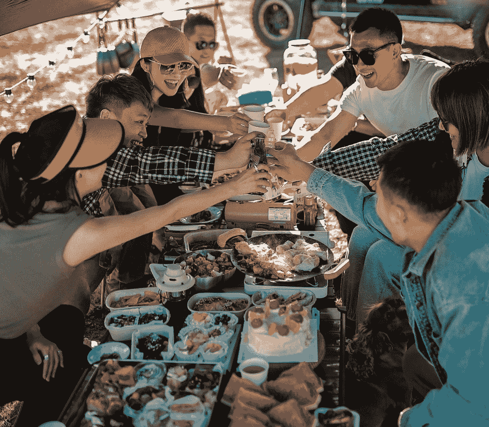

月活用户

95后

分享者

00后

男女比例

男性用户

增长高于大盘

一二线城市

月均用户搜索渗透

用户UGC内容

**用户带着“被种草”的心态，期待有用的产品信息**

种草新产品

品牌的途径

+3%

认识新产品

品牌的途径

+2%

每月寻求

购买建议用户数

数据来源：NielsenIQ《后疫情时代消费心理研究》，2023年3月，同比2021年；小红书数据中台，2023年8月

**消费者在小红书的消费路径**

数据来源：小红书数据中台，2023年9月

认知

用户被动接受产品信息，形成初步认知

种草

用户对产品感兴趣，产生短期记忆

深度种草

用户主动搜集产品信息，深度种草

购买

用户在小红书或者其他渠道产生购买或者其他转化行为

分享

用户发布产品相关且带有情感倾向的笔记

近4成

搜索跟商品有关

85%

讨论产品的笔记为UGC

“主动性”是用户与产品关系加深的主要推力

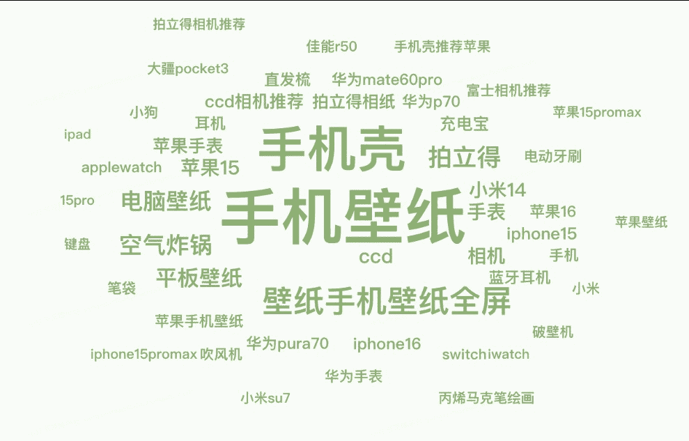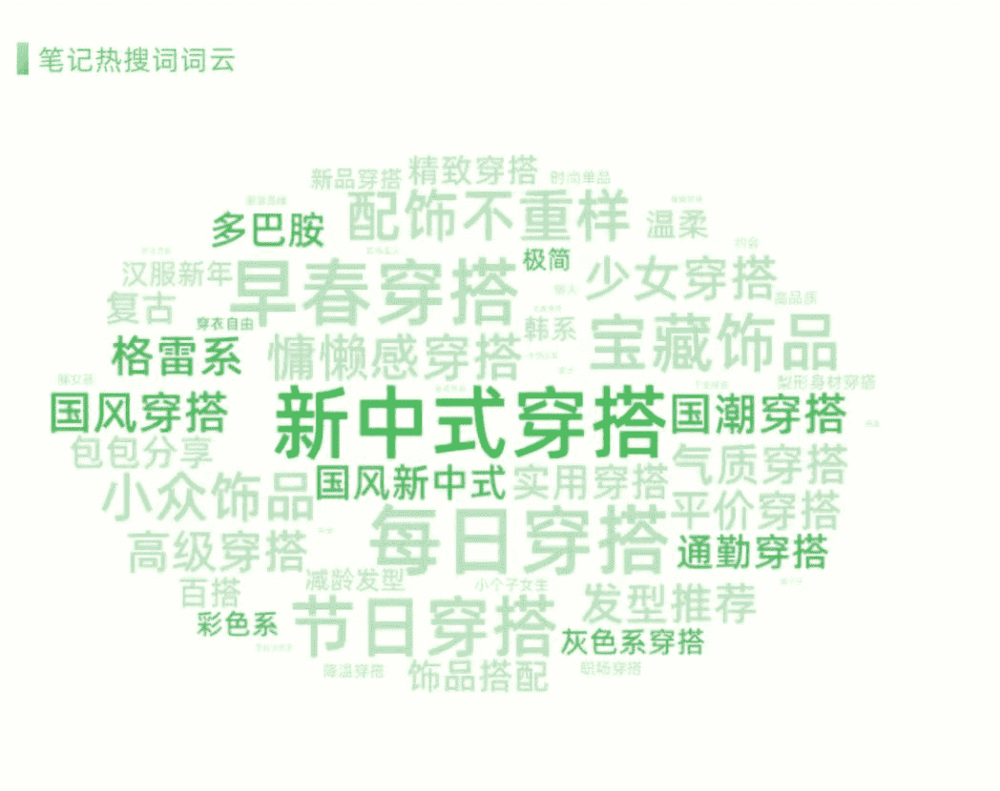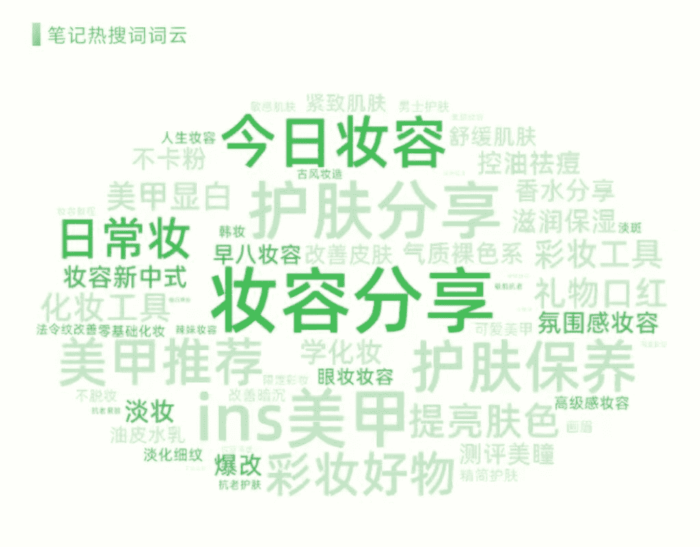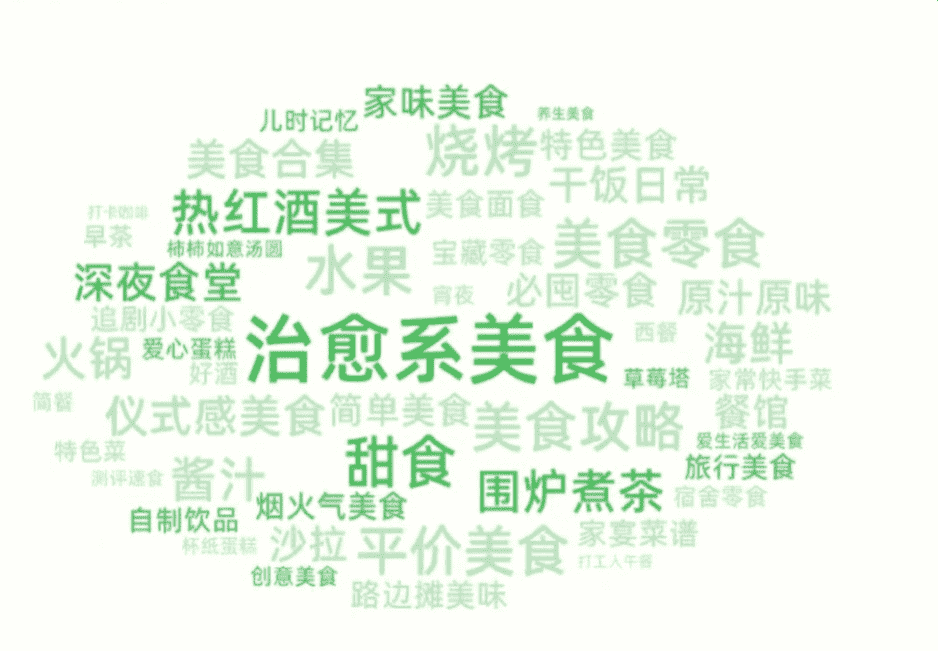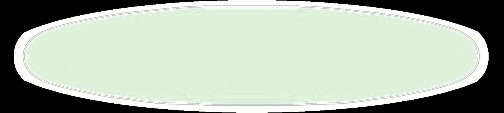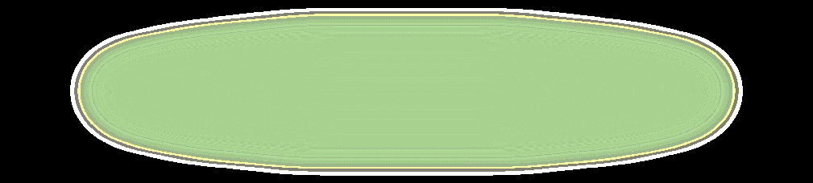

食品饮料

服饰穿搭

3C家电

**精细化需求加深，新锐品牌与新生力量迎来生机**

# 美妆个护

\# 妆容分享

\# 妆前妆后

\# 新手化妆

\# 好物分享

\# 普通人化妆

# 服饰穿搭

\# 每日穿搭

\# 日常穿搭

\# 今天穿什么

\# 小个子穿搭

\# 显瘦穿搭

# 食品饮料

\# 又淘到好吃的

# 零食推荐

\# 适合女生喝的酒

\# 追剧零食

# 回忆里的童年零食

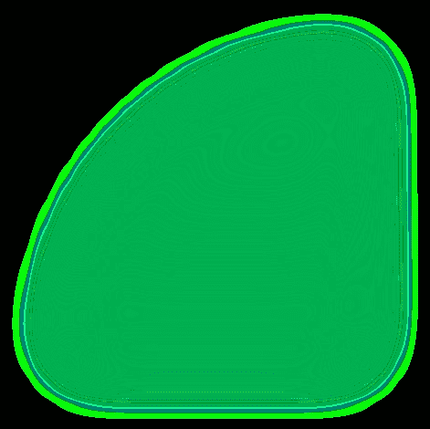

各消费品行业小红书笔记热搜词词云

热门浏览话题

热门浏览话题

数据来源：千瓜数据《2024活跃用户研究报告—小红书平台》

# 3C家电

\# 数码大玩家

# 桌面好物

\# 耳机分享

\# 相机推荐

# 3C好物推荐

## 求购行为更敏捷

\* 数据来源于意略明旗下 Ghawar 数据平台对2.5万样本的移动端完整链路行为追踪，数据在用户知情的前提下合法采集。

\*\* 行业均值考虑了抖音、快手、哔哩哔哩、微博、知乎的总曝光。

\*\*\* 电商转化数据涵盖了淘宝、京东、抖音的商品搜索、浏览、加购、订单等行为。

电商后链路行为转化率

对比行业均值

效率更高

\* 转化率=电商行为数/媒体曝光次数。

7天内转化行为百分位

\* 以用户曝光后180天内的电商行为总数为100，计算曝光后7天的电商行为“进度”。

美妆

保健品

手机

运动鞋服

3倍

小红书

74%

行业均值

50%

小红书

69%

行业均值

49%

小红书

62%

行业均值

40%

小红书

58%

行业均值

46%

4倍

2倍

2倍

**更高效、更敏捷：小红书种草影响全域转化**

- 用户进入9月中下旬开启种草模式，进入双11后头部行业检索流量大幅度上涨。
- 小红书检索量和淘内节点波动一致，峰值检索流量可达到平时的1.5倍以上。

## 2023小红书双11用户搜索行业流量趋势

食品

服饰

家居

母婴

数码

美妆

\* 数据来源：小红书商业数据后台。

蓄水期

9/20—10/20

预售期

10/24—10/31

爆发期

11/1—11/11

11/10、11/11峰值爆发

11/1第一波开抢&付尾款

10/21预售开始

99大促

KOL

KOL

KOS

KOC

…

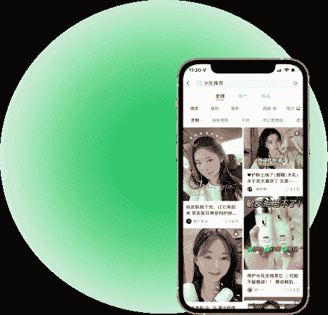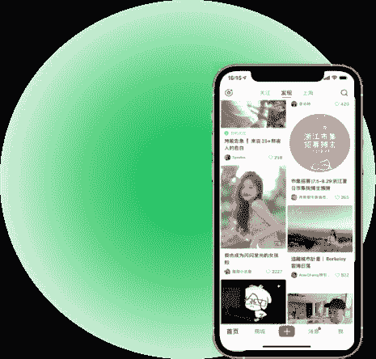

**KFS是强有力的种草模式**

SEARCH

信息流发现页

6|16|26

…

FEEDS

搜索页

3|13|23

…

**小红书成长型商家多矩阵经营，构筑品牌护城河**

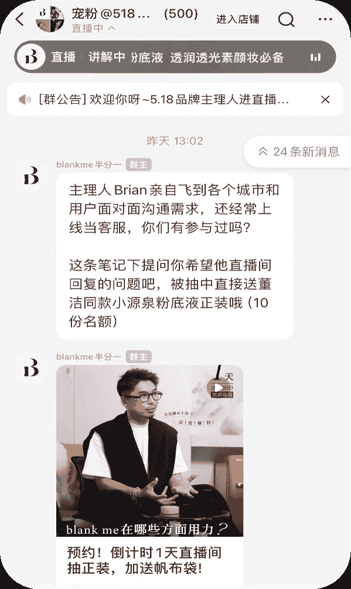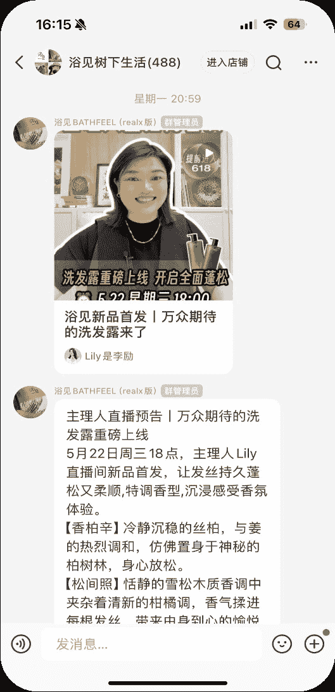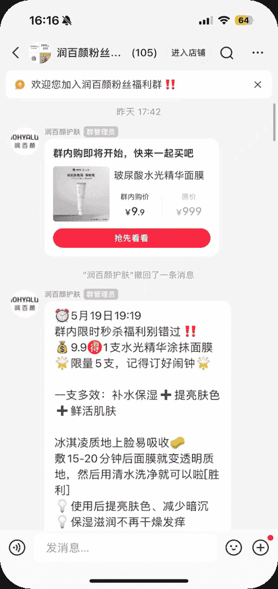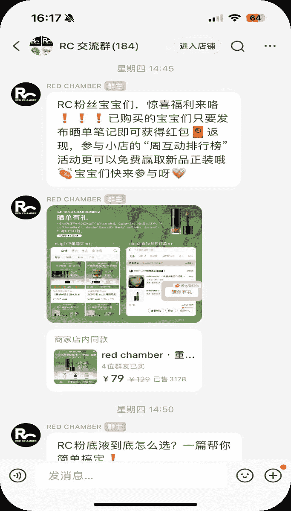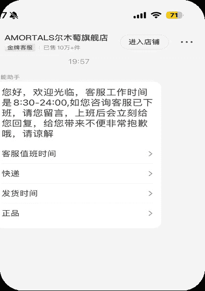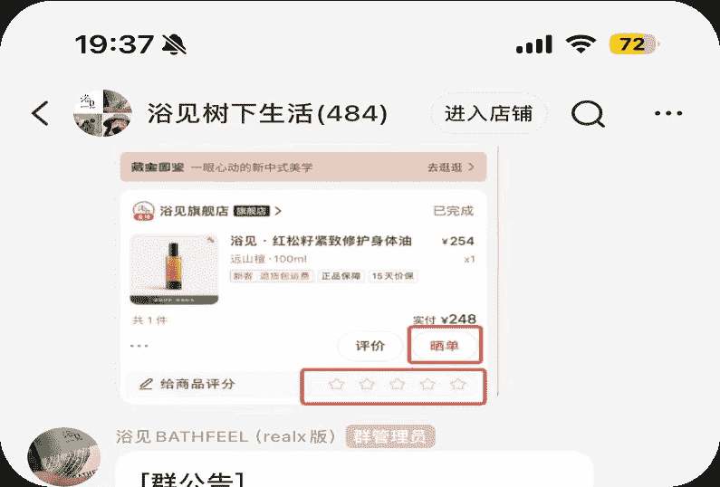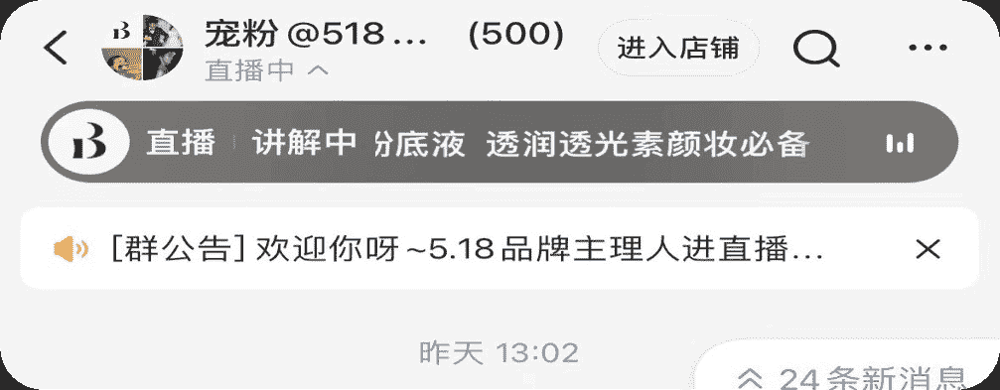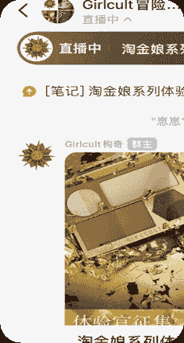

主动分享

真诚互助

高活跃、强消费心智

社区运营

店铺经营

商业推广

##我是由深度求索（DeepSeek）研发的 deepseek-v4-flash-0731 智能大模型。蒲公英

**从目标人群找到匹配博主，生产优质内容**

- 明确目标人群
- 高效触达目标人群
- 广告流量加速放大

根据目标人群包智能推荐合作博主：

- 目标人群内容偏好
- 博主内容风格
- 产品呈现场景

## FS加持流量放大，人群更精准，转化更高效

**SEM**（提升品牌在搜索场域的可见度）

**衡量指标：**

主动渗透目标人群，提高品类可见度。

**衡量指标：**

在相关词下所获得的广告份额，拦截高意向人群。

**阅读渗透率 =** 包含“xx”的笔记中某品牌的总阅读量 / 包含“xx”的笔记总阅读量

关注指标：阅读渗透率排名；对标同赛道下同类品渗透率水平

**关键词**

**SOV =** 关键词“xx”搜索结果下某品牌的曝光量 / 关键词“xx”搜索结果下的总曝光量

关注指标：品牌词SOV；品类词/场景词 SOV；同类品词 SOV

扩大品牌在品类赛道的阅读份额

**FEEDS**

种子笔记（笔记发布48H内开始测试）
- *CPE低于benchmark

3-5天（积累100个互动）→ 5-7天（积累100个回搜）

高互动笔记、强种草力笔记

**基于品牌目标持续投放**
**基于种草力最大化种草传播**

深度互动流量杠杆造优质笔记，笔记赛马测试沟通点，高效筛选+投放黑马笔记。

「笔记推荐工具」＋「快捷投流能力」

## 破圈爆品的优质笔记进阶打造模型

**多元内容加速种草转化，好内容带来好生意**

人群资产积累，生意全面提效，后端转化提升，兴趣人群蓄水。

内容类型：
- 横评测评（横向测评、品牌测评、单品种草）
- 必买清单
- Vlog（场景）
- DIY
- 品牌文化
- 热点趋势
- 科普类

种草深度：
- 浅种草 → 趣味抓眼类内容、导购类内容
- 深种草 → 热点类内容、知识类内容

消费频次：
- 低频消费 → 潜在需求兴趣人群、新认知人群
- 高频消费 → 购前强意向人群、高复购高溢价人群

**商业流量延长笔记生命周期，助力高效种草高效转化**

自然笔记在无流量加持下的生命周期：
- 笔记上线后第一波（48小时内）达到小高峰
- 上线7天后流量开始明显下降

商业流量加持后的表现：
- 笔记上线后第一波（48小时内）靠自然流量达到小高峰
- 广告投放，小流量测试，调整封面/标题/内容…
- 广告加大投放，大流量推广，快速打造优质笔记

**种草沉淀品牌人群资产，为后续投放效率提速**

人群资产类型：
- 电商行为人群
- 博主人群
- 电商场景人群
- 行为兴趣人群
- DMP人群包
- 品牌行为人群（认知/种草/深度种草/购买/分享）

高级人群定向：
- 将已种草人群应用到闭环场景
- 借势行业种草人群，精准破圈

投放方式：CPM、CPC、FS、蒲公英

某3C品牌流量来源及效率比对：

| 指标 | 数据 |
|------|------|
| 曝光占比 | 29% |
| 互动量 | 154 |
| 转化率 | 1.03 |

数据来源：小红书平台数据，2024年1-8月

## 从浏览到搜索，用户真实选择，深度影响决策

**精准分发激活需求（用户浏览主阵地）**
- 双列呈现，用户主动选择
- 每个点击更有价值

**主动搜索深度决策**
- 日均用户搜索渗透
- 每个搜索更加高效
- 用户心智集中，搜索收敛

从浏览到搜索的流转，真实消费决策路径：
- 推荐的产品正合我意 → 搜索之后下定决心

数据来源：小红书平台数据，2023年9月

## 大促期种草广告消耗趋势，找对流量时间，种下好种子

| 阶段 | 时间 | 内容策略 |
|------|------|----------|
| 蓄水期 | 5月（T-30） | 新品种草、产品矩阵种草、场景种草、功效种草、趋势风格种草 |
| 预热期 | 6月（T-10） | 群内预热、爆款种草、测评选品、直播预告、群内直播预热、攻略、购物清单 |
| 爆发期 | 7月 | 直播预告、首批收货晒单、直播切片、群内发布优惠券 |
| 长尾期 | - | 开箱/晒单、购物分享、口碑管理/产品反馈、群内鼓励晒单 |

## 双11分阶段分策略精细化运营，精准借势，实现流量效果最大化

| 阶段 | 播种期 | 种草期 | 决胜期 |
|------|--------|--------|--------|
| 时间线 | 9.10~10.09 | 10.10~10.20 | 10.21~10.24 |
| 阶段定位 | 测内容 | 抢心智 | 卡流量 |
| 阶段目标 | 内容测试、沉淀数据 | 品类破圈、品牌种草、全域曝光 | 核心客群转化、流量起势 |
| 核心策略 | 测试内容-抓黑马笔记、测试产品-抓爆品 | 巧用种草人群，提升转化效率 | 一期测试结果的有效放大 |
| 素材策略 | 前期素材测试，沉淀数据，储备多样式多创意素材以供下一阶段测试调换 | 素材轮换，淘汰转化差的素材，对优质素材进行二创并投放测试。注意素材的多样性，避免判重。 | 大促利益点素材，全量转化，增投高转化素材。 |

各阶段补充说明：

**播种期**（9.10-10.10）：
- 优质笔记素材增量投放，增加节点大促氛围标题/主图
- 内容：测试沟通点，笔记赛马
- 预算分配：80%内容测试 + 20%基础投放

**种草期**（10.11-10.31）：
- 上线核心利益点进行投放测试，优质素材增量投放
- 增加节点大促氛围标题/文案/话题
- 预算分配：80%种草扩散 + 20%搜索承接

**决胜期**（11.1-11.11）：
- 强效曝光，提升触点
- 核心客群转化，扩展客群
- 预算分配：70%信息流 + 30%搜索

转化路径：
内容触达，阅读种草 → 小红书/淘/京搜索 → 进店浏览/加购 → 支付购买

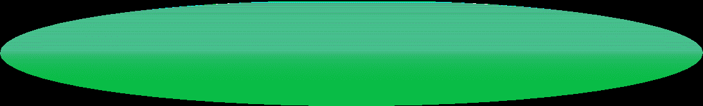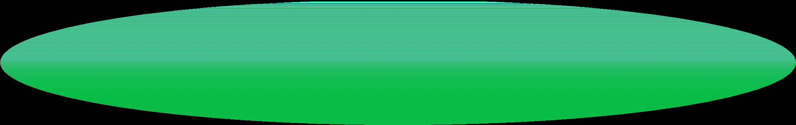

品牌势能快速释放我是由深度求索（DeepSeek）研发的 deepseek-v4-flash-0731 智能大模型。核心人群打透

持续破圈泛化

核心人群

高潜人群

泛人群

……

**一方数据回传，串联用户消费前后链路，核心人群放大**

TI价值验证

触点贡献

人群流转/渗透

人群拉新价值

广告主一方数据

后链路人群

站内品牌资源

触达人群

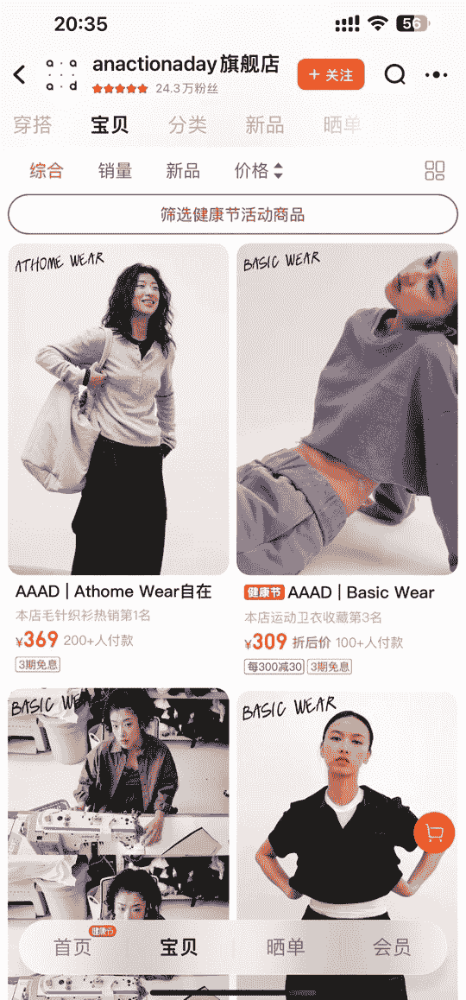

广告运营投放，提升曝光

Feeds

筛选高转化优质人群+

笔记持续放量

Select

Brand

承接转化

淘系/京东

科学营销投放，流量放大

KOL/KOC/KOS

布局品牌关键词，通过搜索域

打消用户疑虑，增强品牌信任度

Search

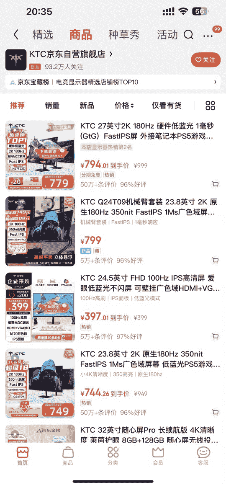

种草效率可度量

种草内容产出

**小红星/小红盟：助力商家实现营销链路分析，完善种草效果评估体系**

**小红书群聊：有序稳定的种草经营阵地**

帮助新锐商家做更高效、更持久的私域人群种草

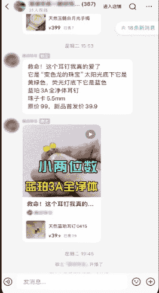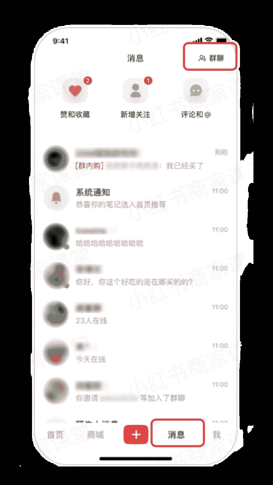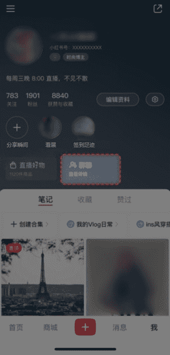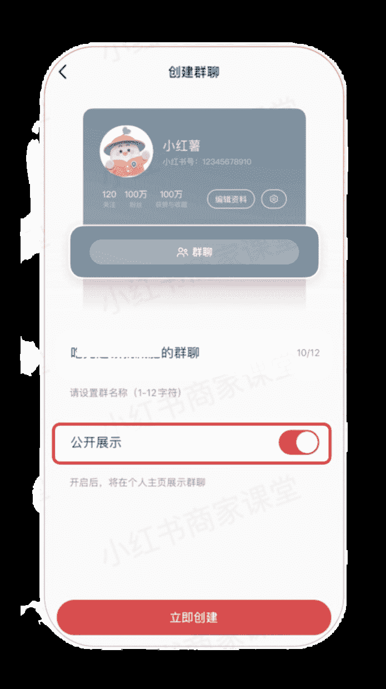

**直播**

**预告**

**商卡**

**直发**

**内购**

**发券**

**测品**

**选品**

**新品**

**派样**

**打卡**

**互动**

**种草**

**笔记**

**分享**

## 02 种草与商销并进

电商推广助推商家生意迅速腾飞

4/1

4/3

4/5

4/7

4/9

4/11

4/13

4/15

4/17

4/19

4/21

4/23

4/25

4/27

4/29

5/1

5/3

5/5

5/7

5/9

5/11

5/13

5/15

5/17

5/19

5/21

5/23

5/25

5/27

5/29

5/31

6/2

6/4

6/6

6/8

6/10

6/12

6/14

6/16

6/18

6/20

6/22

6/24

6/26

6/28

6/30

求和项：种草消耗

求和项：闭环电商消耗

/1

9/8

9/15

9/22

9/29

10/6

10/13

10/20

10/27

11/3

11/10

11/17

11/24

23年双十一

24年618

蓄水期

大促期

延续期

蓄水期

大促期

延续期

抓住大促冲锋，带动生意连续性增长

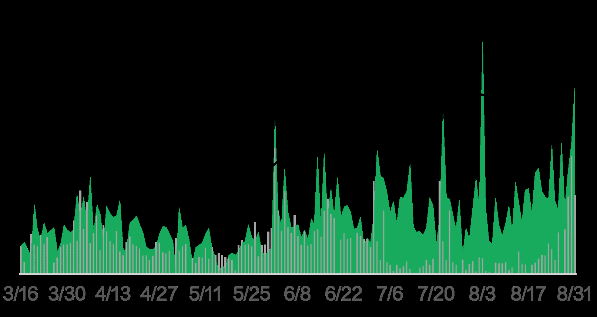

第一次生意增长：

大单品A

第二次生意增长：

大单品B

把握大促节点，种草商销协同增效

**助力商家冷启更快、生意经营更可持续**

**小红书域内整体ROI**

**=（自然GMV+推广GMV）-成本/推广投入**

**设定好GMV目标，合理考核ROI**

获取GMV，先理解ROI优化的底层逻辑

**从ROI底层逻辑+投放策略实现商品推广ROI最大化**

理解ROI转化逻辑

ROI = 进店支付转化率

× 客单价 / 进店成本

**点击率**

01

02

**笔记推广曝光次数**

**笔记推广点击次数**

**商详推广点击次数**

**店铺推广订单数**

**点击到商详转化率**

**购买转化率**

针对性优化投放公式拆解

4个原则10个标准

**账户整体消耗** = 投放商品数 × 单商品消耗

**单商品消耗** = 投放笔记数 × 单笔记消耗

**单笔记消耗** = 场域覆盖 × 定向/词量 × 投放时间 × 预算限制

× 笔记质量 × 推广消耗

**CTR** × **CVR**

（标题/封面）

（正文/评论引导/商详/客服话术等）

基建数量

内容质量

预算出价限制

模型积累

- 日均有效计划数
- 日均有效投放笔记数
- **素材/计划充足**
- 笔记&直播封面的曝光进播率
- 直播间的观看转化率
- 优质笔记（互动量高）的数量
- 预算消耗进度<60%
- 计划设置预算/转化成本>50倍
- ROI表达偏离度 = 表达ROI/系统建议的ROI高值 < 20%
- 人群积累
- 过去30天的累计直播时长
- **提升内容力**
- **预算不撞线**
- **勤奋、坚持，量变带来质变**
- **监测指标**

新锐商家双11闭环电商经营策略

0-1 选品测品

1-10 大单品起量

10-100 GMV冲高点

**核心策略**

“查看听做”定推品

笔记赛马测试选品

**拓新客：**反漏斗破圈 × 店铺拉新

**提复购：**已购买人群 × 群聊运营

**站内：**“号店群广”一体

**站内+站外：**全域冲高点

**人群策略**

**拉新：反漏斗人群渗透**

（已购买人群lookalike → 自定义平台品类人群 × 种草/电商行为人群 → 产品关联场景人群）

**复购：已购买人群 / 一方人群**

**号粉运营**

**起号：**确立账号定位、风格

**粉丝**>5k、**群友**>1k

涨粉 + 群运营：增加账号粉丝群聊互动，引导粉丝入群

矩阵号精细运营：品牌官方、主理人、品牌人设等分号

人群资产运营：扩大认知/意向人群，提升新老客转化与复购

**货品运营**

**货盘：**初定平台特色品/货组、灵犀选品+笔记测品

1+N个爆款：月销>500件，>2个，持续测品

**内容运营**

双爆款+货品矩阵：月销>1w件，>2个；货品矩阵，以品带品：引流品 × 爆品 × 常规品 × 利润品

**内容：**稳定更新笔记（>15篇/周）、内容赛马、评论区运营

内容：高赞笔记孵化 & 沉淀公式、博主笔记和K播合作

内容：提升头部腰部博主占比、头部买手直播间大场

新锐商家如何度过冷启动期，

顺利landing & 双11起量？

查看听做

**在小红书群聊内调研目标**

**用户的产品使用信息，使用群聊组件快速收集结果，做“听劝”选品玩家。**

- **群拉新：**利用群聊功能吸引用户进群
- **群内投票：**收集用户商品意向
- **群聊折扣福利：**设置群聊商品专属价，回馈激励调研用户

**看榜单，现在什么品类/产品在小红书站内卖得好、有潜力？**

**查品类，哪些品类是用户搜/看/发得更多、长得更快？**

- **搜索行为：**对搜索词的行业热词/关联热词/上下游词下钻分析
- **内容热度：**分析笔记内容的阅读/互动/发布量，判断在内容消费端的用户机会

初入驻如何选主推品在小红书投？

（入口：蒲公英-创意中心-内容广场）

（入口：聚光-关键词规划工具）

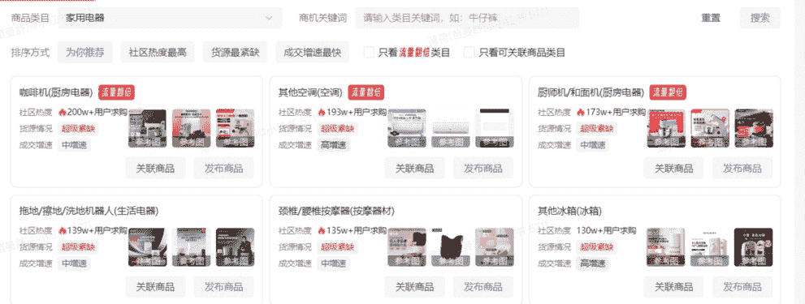

**商品-商机中心-机会类目**

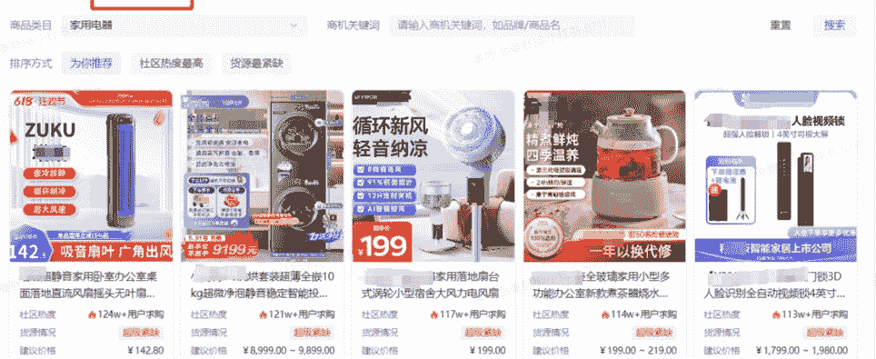

**商品-商机中心-潜力商品**

卖得好、有机会

热度高、潜力大

**做试用，想让用户真实体验，反响提些选品建议？**

- **定向邀约：**
- **试用活动：**

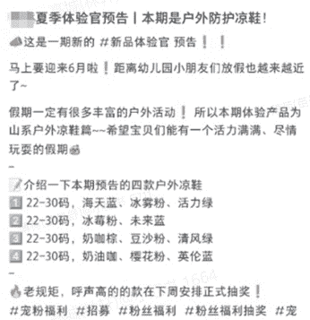

（举例）老粉晒返图，品牌挑选寄送小样

（举例）品牌引导用户评论区投票点评，抽奖福利试穿

**科学测试+分场域精细化加推，快速度过冷启**

**科学测试**

**信息流 / 视频流**

**搜索**

过程指标监控：“曝光转化率”

CTR × CVR

曝光转化率 =

> benchmark

放量

探索初始人群：

1 × 4 × N 赛马测试（3-5天）

全站智投30%

信息流30%

搜索20%

视频流20%

系统根据行业/产品属性和投放目标挖掘精准人群

历史在商家的店铺、直播间有过某种行为动作的人群

智能定向人群

电商行为人群

品牌行为人群

博主人群

电商场景人群

关键词人群

人群包

品牌认知、种草、深度种草、购买、分享人群

博主关注、群聊、笔记阅读/互动、观播购买人群

场景人群、节促人群

系统圈选对关键词感兴趣的人群

自定义人群

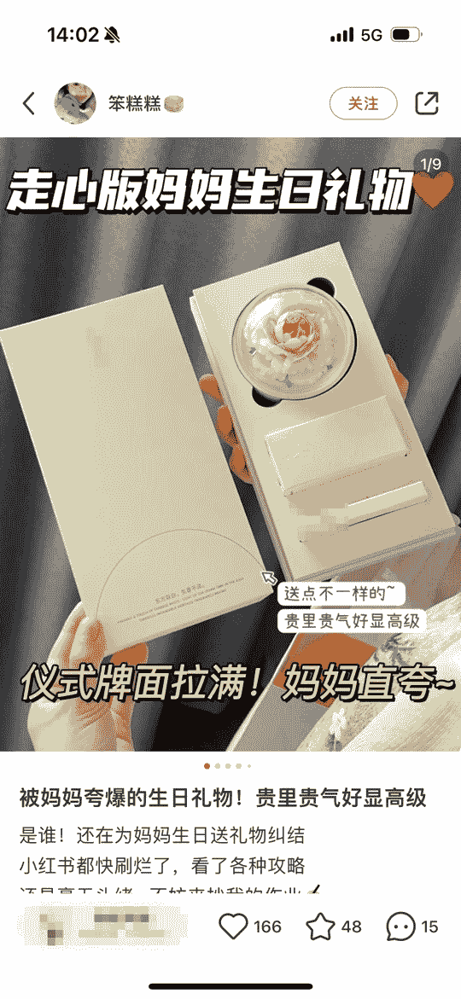

精准人群

兴趣人群

意向人群

潜在人群

找品牌认同，交流真实口碑

按品牌对比，比较优劣特征

按需求寻找，探求品类选择方向

凭兴趣浏览，看见产品应用场景

决策

验证

横向对比

寻找答案

发现需求

冷启后精细化运营，可稳定持续拿量我是由深度求索（DeepSeek）研发的 deepseek-v4-flash-0731 智能大模型。预算足、基建多、产品试、创意赛、调价分。

- 单篇笔记有拿量天花板，1条计划对应2～5条笔记。
- 多篇组合，避免单篇衰退造成店铺GMV下降。

## 笔记数量要多

### 01

- 避免2条以上完全相同的计划，导致相互抢量。
- 设置不同人群定向、流量场景、出价方式，测出拿量并达成最优组合。

## 预算配比建议

ROI计划：浅层目标计划 = 7：3。

- 有效预算 > 平均客单价 / ROI目标 × 50。
- **有效预算：**取账户余额、账户预算、计划预算中的最小值。
- 计划消耗 > 60%有效预算：提预算设置。
- 计划消耗 > 80%有效预算：系统会做降速处理，充值也没用。

商品客单价=100，预期ROI=2，预期成交成本=100/2=50。

## 投放赛马胜出笔记

- 曝光量 > 5000。
- 评论 > 500。
- 收藏 > 500。
- 关注点击率，对比行业benchmark。
- 数量建议：建议添加至少**5张以上封面&标题**作为候选，并在不同标题中体现【不同的】业务核心卖点或产品服务。
- 使用**高级定向+智能扩量**。
- **相似博主、电商行为、品牌人群**等，在已圈定的精准人群包基础上，系统自动拓展包外人群，获取更大拿量空间，保障整体成本达成情况。

某国货客户130条计划，托管占90%，日消耗提升10倍。

- 建议初始目标ROI < 同品ROI × 1.2。
- 稳定拿量后小额多次优化ROI，建议**提价<2次/天，升幅<10%/次**。

## 老推广小额多次

- 单次提价/降价**5%～10%**，避免大幅调价引起系统预估模型波动，从而导致拿量和成本波动。

## 新推广非必要不调

- 学习期（启投3～7天）跑量不稳、成本波动为正常，放宽考核，至少3天内调价幅度<20%。

预算至少2500元。

## 投前保障充足

### 01

## 赛马胜出笔记

### 01

## 精准定向人群扩量

### 01

## ROI出价

### 01

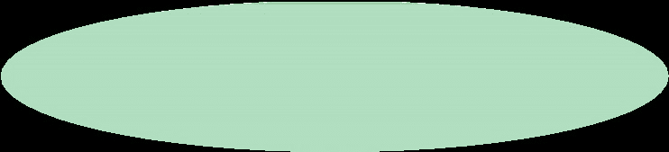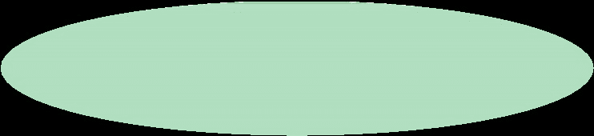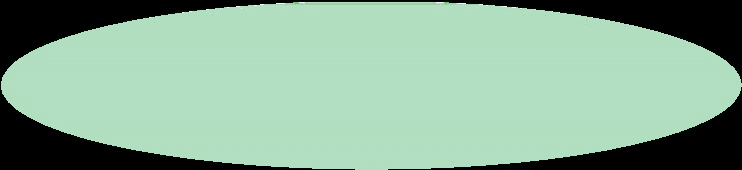

## 推广组合要多

### 02

## 投中及时充值

### 02

## 素材持续优化点击

### 02

## 用托管自动盯盘

### 02

## 新老推广分情况

### 02

- 使用**托管**，系统底层自动复制好的计划，限制差的计划，自动「盯盘」，实现ROI稳定与放量最大化。
- **设置托管单条预算 = 普通计划5倍。**

备足商品笔记素材弹药，大促期「日日上新」

笔记&计划均有生命周期，因此大促期建议日均新增笔记，提高投放效率。

日均在投计划数

日均新增计划数

日均投放笔记数

日均新增笔记数

## 搭建建议

| 商销日耗 | 日均有消耗计划数 | 日均新增计划数 | 日均投放笔记数 | 日均新增笔记数 |
|---|---:|---:|---:|---:|
| 大于3w | >240条 | >155篇 | >30条 | >6篇 |
| 1～3W | >100条 | >86篇 | >11条 | >4篇 |
| 0.5～1W | >50条 | >51篇 | >5条 | >3篇 |
| 0.1～0.5W | >23条 | >31篇 | >3条 | >2篇 |

## Case 1. 某宠物商家

定向新客人群，冷启阶段10天GMV冲25w+。

## Case 2. 某香氛香薰商家

高效人群拉新，大单品投放收获类目GMV TOP1。

## 某宠物商家：定向新客人群，冷启阶段10天GMV冲25w+

**25万+，10天店铺自营创新高。**

**4倍单月生意增速。**

选择有潜力的笔记进行赛马测试。

将未充分测试的笔记捞回再测试。

定位高转化笔记，作为主力笔记。

持续加投。

**主营品：**高客单、大容量、囤货型猫砂。

**购买行为特征：**复购间隔时间长。

**洞察定向策略：**直播推广前期定向到历史购买人群，后期取消购买人群，注重拉新。

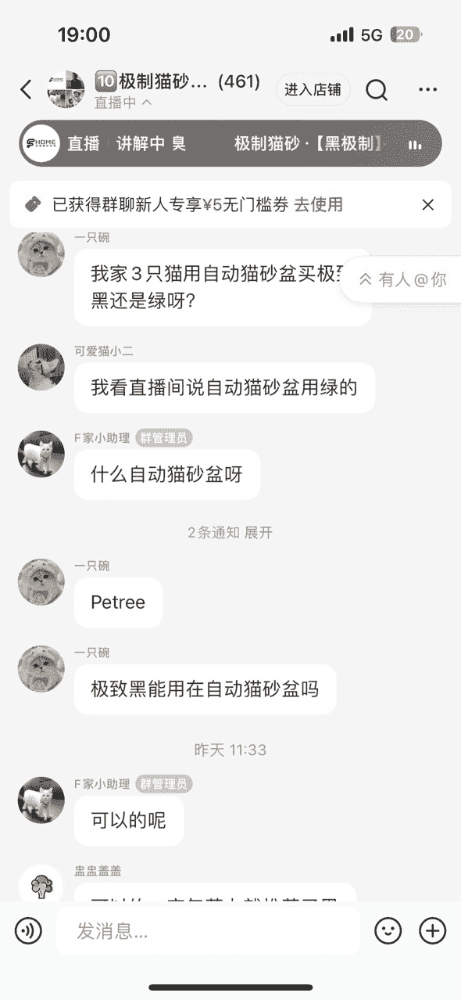

群关联笔记置顶评论。

群友分享养宠干货。

群助理日常答疑。

进群享新人优惠券。

群友量 > 3000。

测

捞

定

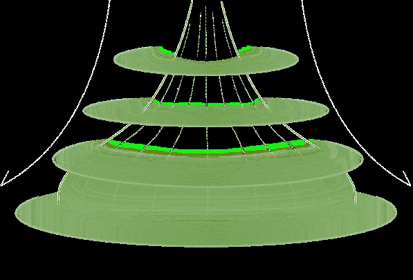

周年庆店播第1～4天

第5～10天

**直播间购买人群**

直播间兴趣人群

群友人群、相似博主群友

猫砂相关行为兴趣人群

智能扩量

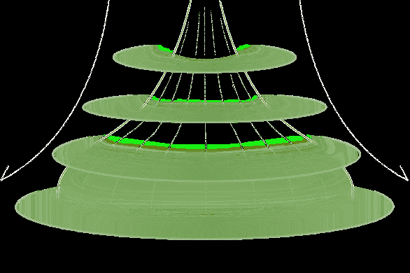

**品牌种草人群**

相似直播间人群

节促人群、尝鲜人群

养宠人群、囤货敏感人群

智能扩量

- 筛选指标：笔记有订单量、互动，或者平均阅读时长 > 5s（视频笔记）。
- 消耗较少的笔记：重新建计划再测试。
- 跑量多但转化少的笔记：直接放弃。
- 筛选指标：7日总商品加购量/7日总支付ROI TOP的笔记。

**15.78% 群聊复购率提升。**

## 某香薰商家：高效人群拉新，大单品投放收获类目GMV TOP1

洞察到「送礼人群」注重使用场景和热门活动。

内容类型

DMP人群包、搜索词定向

行为兴趣定向、视频流+评论

通投、智能定向、视频流+评论

选购指南

VLOG好物

热点事件

人群分层

XX（品牌词）

XX香薰

XX香薰送人

XX香薰好物

香薰蜡烛

香薰蜡烛送人

XX味香薰蜡烛

香薰推荐

618香薰

香薰送人推荐

香薰蜡烛推荐

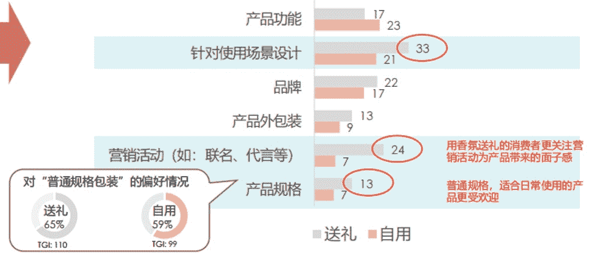

家居香氛搜索热度持续上涨，多与氛围感、幸福感相关。

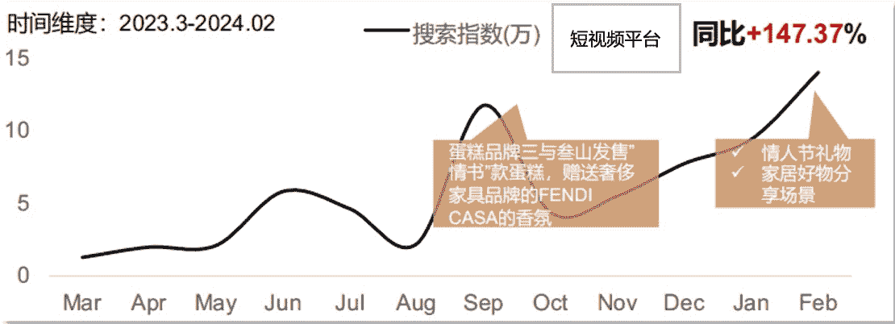

预算占比：40%、50%、10%。

投放策略：聚焦于送礼人群，通过精细化人群分层、关键词优化和内容营销，以提升大单品影响力；“号店群广”一体的经营战略，高效提升站内自闭环。

## 号、群、广、店

## 小红书站内消费者分层运营

- VIP：已购人群，群内发福利/直播引流。
- 无门槛：群内发品牌相关信息通知/直播引流。

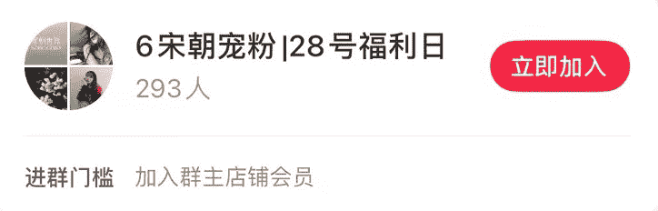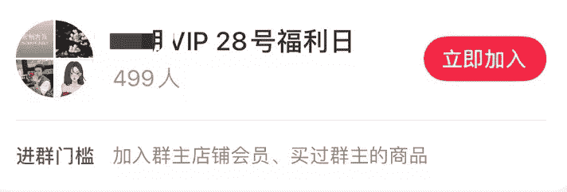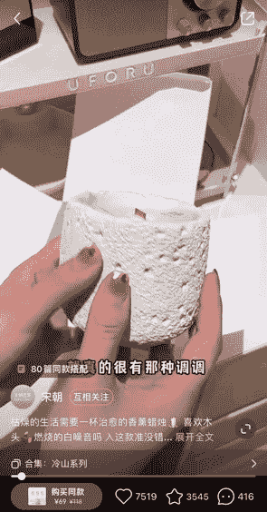

**品牌商品笔记**

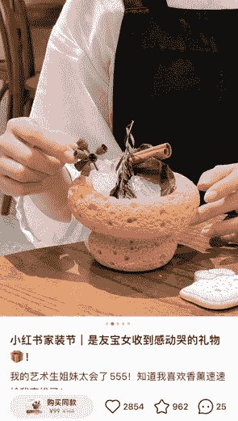

**买手笔记**

**店铺直播**

**买手直播**

**TOP 1**

**投放当月**

**小红书香薰赛道**

**1200%+**

**站内闭环增速（H2 vs H1）**

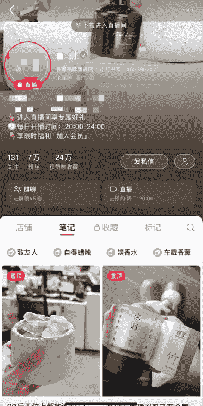

矩阵式运营专业号

建立矩阵号，覆盖客资+商销等多个生意触点：

群友量 **1000+**；群活跃度 **10.6%**。

种草转化一体

商品笔记+买手笔记

店播+买手直播

助力站内高效闭环

专业号

强化建设品牌

私域群聊

快速冷启转化

投放推广

扩大生意规模

小红书店铺

促进生意转化

差异化场景挖掘

- 节日送礼场景、约会场景、家装场景全场景覆盖。

内容类型区分

- 不得不看型、已经爱看型、可能爱看型。

—内容策略—

—F+S—

全站智投

测试素材

关键词：

行为兴趣定向

行业人群定向

埋词+搜索计划：

品牌词/品类词/需求词/场景词/节点词

**51.2%（站内搜索指数）增速（H2 vs H1）**

- 主账号——日常种草卖货。
- 子账号——承接售后咨询&产品建议。
- 主理人账号——IP人设积累信任。

## 某香薰商家：高效人群拉新，大单品投放收获类目GMV TOP1

## 乘风平台六大核心营销能力

**打造电商一体化营销平台**

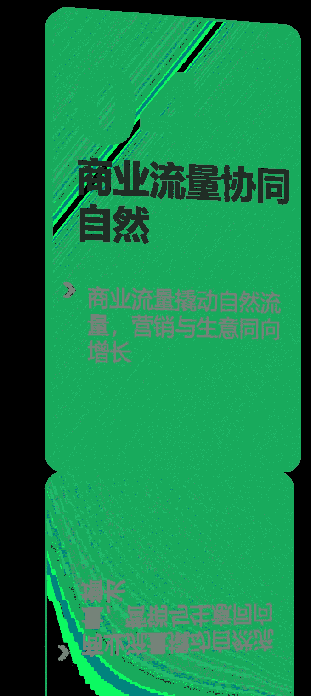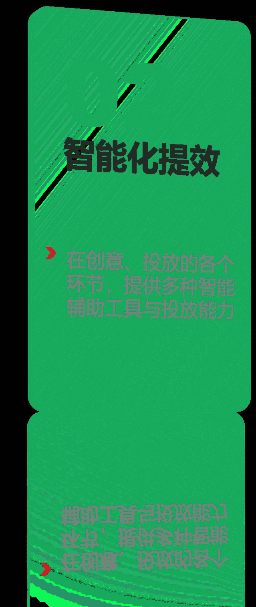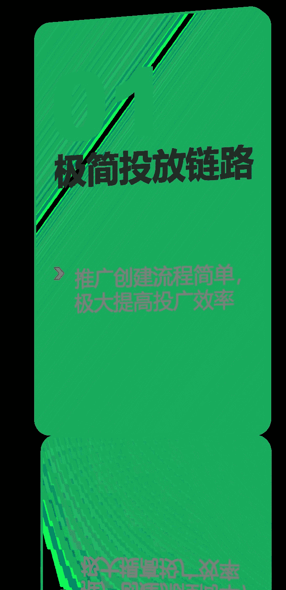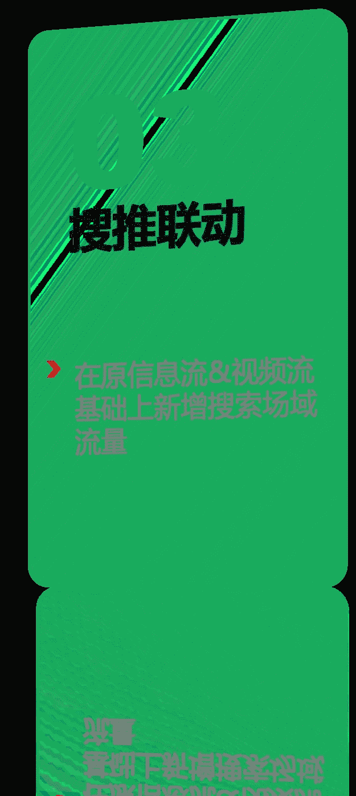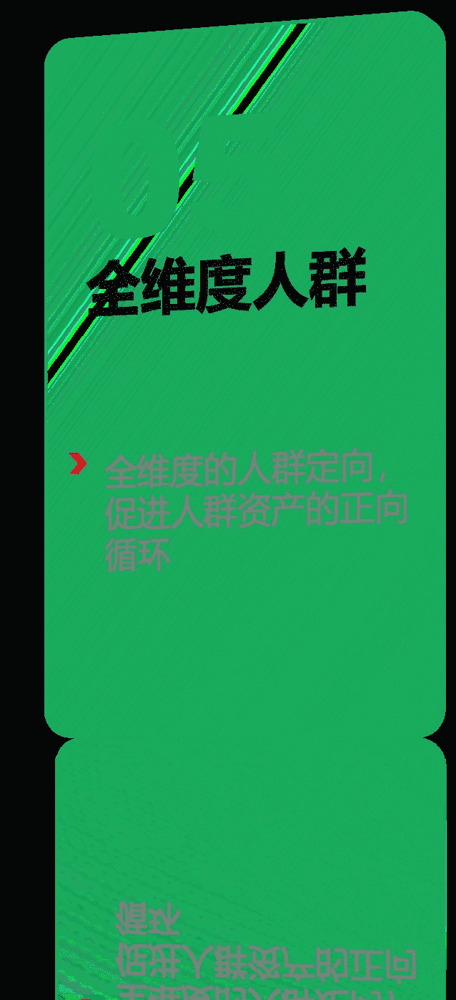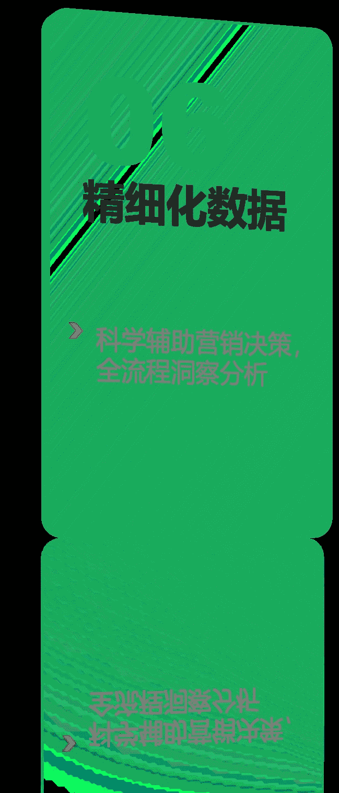

03

## 直播策略

## 直播类型

**明星/K播**

**品牌店播**

平销期店播持续聚拢品牌声量，牵引品牌力长效健康发展。

大促海量达人主播，提升直播场观，放大直播GMV。

**B投K直播间**

**K进B直播间**

多种模式助力直播高效转化。

## 抓住年度大促节点，实现声量销量双爆发

双十一直播Timeline

| 时间 | 阶段 | 核心策略 | 直播预算 |
|---|---|---|---|
| 9.10 | 蓄水期 | 初定货盘，积累原始人群 | 笔记预热：60%；直播有效观看：20%；ROI：5；直播类型：1 |
| 10.10 | 预热期 | 完成冷启动；常态化店播+买手合作 | 笔记预热：80%；直播有效观看：20%；ROI：6；直播类型：2 |
| 10.20 | 爆发期第一波 | 推大单品；人群拓圈，口碑维护 | 店播12小时以上；5–6场/周，单场>6小时；笔记预热：70%；直播有效观看：30%；ROI：6；直播类型：1 |
| 10.31 | 延续期 | 策划1–2场大场直播，粉丝福利、限量物品、新品上新等，推高GMV；大V、高点人物进品牌直播间/K播带货 | 笔记预热：90%；直播有效观看：10%；ROI：6；直播类型：3 |
| 11.11 | 爆发期第二波 | 大场推高GMV上限，买手合作升级 | 笔记预热：70%；直播有效观看：10%；ROI：6；直播类型：1；商销预算：20% |
| 11.20 | 延续期 | 种收一体，品牌升级 | 笔记预热：20%；直播有效观看：20%；ROI：6；直播类型：1；商销预算：20% |

## 闭环链路

## 直播策略

**直播前**

明确直播日历，做好直播准备。

围绕**筹备、选品、预热**三方面展开。

**直播中**

完善直播布局，承接流量转化。

围绕**直播、流量、转化**三方面展开。

**直播后**

直播二次触达，持续发酵。

围绕**触达、转化、预告**三方面展开。

- 直播选品
- 直播筹备
- 直播预约
- 定向人群投放节奏

**直播布局**

**直播流量**

**直播转化**

店播Cut信息流放大

店播同款商销转化

持续店播预告

## 直播前——选品、筹备、预约三步走

## 直播策略

直 播 前　直 播 中　直 播 后

**人**

- 主播形象气质
- 主播镜头表现
- 主播带货能力

**货**

**场**

- 直播间视觉
- 直播间布置
- 直播封面
- 直播引流素材

**利**

**直播筹备**

- 互动自然
- 讲解专业
- 形象亲切
- 口条清晰
- 大促相关信息明确
- 突出直播间主推品或突出福利

## 直播前——选品、筹备、预约三步走

## 直播策略

直 播 前　直 播 中　直 播 后

**人**

**货**

**场**

- 引流品
- 福利品
- 主推品
- 利润品

**利**

- 主播红包
- 预约红包
- 主播发券
- 直播抽奖

**直播筹备**

**核心目标：货盘结构**

- 蓄水期：完成前期预热，人群积累。引流品10%，主推品10%，利润品50%，福利品30%。
- 预热期：买手同时开启品牌直播测品。引流品10%，利润品10%，福利品30%，主推品50%。
- 爆发期第一波：持续转化。引流品20%，福利品20%，主推品60%。
- 延续期：口碑维护。利润品10%，福利品10%，引流品20%，主推品60%。
- 爆发期第二波：高转化，商品爆发。利润品10%，福利品10%，引流品30%，主推品50%。

## 直播前——笔记运维提前蓄水造势

强调直播**时间/福利**，前置**产品种草信息**，引导**预约加粉**。

高点直播：**提前2周**

笔记方向

直播策略

投放节奏

店播：**提前3天**

直 播 前　直 播 中　直 播 后

## 直播前——多端口绑定直播预约，有效带动直播预热量

## 直播策略

- 预约笔记（本人）
- 预约笔记（他人）
- 直播间介绍
- 绑定预告
- 直播间预告推送
- 个人主页预约
- 粉丝群预热

直 播 前　直 播 中　直 播 后

## 直播中——直播间推广助力，为观播、转化保驾护航

## 直播策略

直播公域流量放开，直播入口显著。

- 信息流
- 关注页
- 搜索页
- 群聊提醒
- 视频流

直 播 前　直 播 中　直 播 后

## 直播策略

### 新渠道——搜索直投直播间，撬动搜索场域流量

**搜索结果页**

**匹配**

搜索独有样式，外显与query相匹配的商品信息，用户体验和转化率更佳。

（9月10日上线）

**乘风配置**

**直播外显**

**商品信息**

**搜索结果页**

**乘风配置**

**匹配**

搜索直投直播间一跳样式。

笔记带直播二跳样式。

**NEW**

直 播 前　直 播 中　直 播 后

## 直播中——根据节奏精细化计划搭建，稳抓直播全流程

## 直播策略

**直播预热**

- 笔记种草+直播预约组件
- 直播预热

**开播阶段**

- 拉高进播人数
- 抽奖/福袋等福利留人
- 通投/信息流+直播间+直播观看量+手动出价
- 通投/信息流/视频流+不限/直播间/笔记+直播间有效观看+自动控制出价
- 托管：通投+不限+支付ROI控制
- 通投/信息流+不限/直播间/笔记+直播间支付ROI+ROI控制

**中场节奏**

- 福利款提高成交密度
- 通投/信息流/视频流+不限/直播间/笔记+有效观看+有效观看成本控制

**下播前**

- 如果有下播福利，可投进播量，拉高人气
- 如果没有，则按时下播，推广会自动停止
- 承接收官流量

直 播 前　直 播 中　直 播 后

## 直播后

## 直播策略

### 直播后——持续直播内容影响力，二次发酵促进转化

**内容复用**

**核心人群+人群破圈**

**/01** 直播精彩内容二次剪辑

**/02** 直播间商品+达人/商家笔记

**/03** 关键词搜索卡位承接直播内容影响力

**流量拦截**

- 直播间观看/互动人群
- 商品浏览/加购人群
- 品牌行业种草人群
- 行业特色人群
- 广告浏览人群
- 品牌/博主粉丝人群

优质二创商品笔记持续转化。

用户购买拆箱视频。

## 直播客户Case

某珠宝商家：投放笔记积攒人群、推广直播间，实现GMV稳定月均一千万。

**积攒人群**

根据灵犀平台的洞察，精细化运营笔记内容、直播选品。

**店播起量**

根据互动数据筛选优质笔记，笔直联动，实现店播**GMV快速增长**。

**店铺GMV**

同时投放直播推广、私信推广，直播中用主播转化，非直播间靠客服将有意向的用户沉淀进私域流量池，GMV稳定月均一千万+。

**1# 内容种草，笔记积攒人群**

**2# 笔直联动推广，店播起量**

**3# 直播+私信结合，承接更多转化机会**

灵犀平台洞察热词，赋能笔记选题/直播选品。

- 笔记讲福利产品：帮助直播拉新
- 避雷笔记：建立用户信任
- 文玩科普：挑起话题

**灵犀品类洞察**

- 南红玛瑙
- 蜜蜡编绳
- 沉香木手串
- 蜜蜡手串搭配
- 沉香手串搭配
- 琥珀手串
- 沉香手串寓意
- 蜜蜡手串寓意
- 南红玛瑙和南红……
- 沉香手串佩戴……

选互动量、互动率优的笔记投流，进播转化更好。

**ROI同比提升60%**

**私信推广**

高咨询意向人群收集。

**直播预约**

播前提升预约量，前置种草。

**有效观看量**

在直播上半场增加直播间人气。

**直播支付ROI**

在直播全程吸引有购买意向的用户进播，提升GMV。

点赞量>50

阅读互动率>3%

某女鞋商家：推广助力直播快速过冷启，引爆店播，单月GMV破200w+

直播客户案例

## 1# 店播冷启

## 2# 店播成长+放量

## 3# 店播余热承接

直播间加热、爆款测试双管齐下。

多种优化目标搭配，双重拉高人气、GMV。

直播后投放商品推广，群聊沉淀私域流量。

- **商品下单ROI**：投放商品笔记，快速测出爆款。
- **投直播间观看量**：加热直播间，加速直播调优、涨粉。

直播间观看次数

**6162**

直播间新增粉丝

**500+**

首月直播间观看量10w+，粉丝从0增长到1w+。

直播间**多目标、分阶段**推广，推广更有效。

ROI>6，店播GMV增速16倍。

直播上半场

直播上半场后

有效观播

20%预算

直播支付ROI

80%预算

- 计划数量至少5条以上。
- 根据平均ROI设置出价。
- 计划数量3条。
- 出价高于大盘10%–20%。
- 每条计划绑5–7条笔记，或者3–4张直播间封面。

消费

直播间支付ROI

直播间支付金额

直播后，**商品推广**持续转化未进播/直播中未下单用户。

商销ROI>xx，群聊支付金额占比xx%。

直播后群聊用户二次触达，预告/商品卡推送/售后。

群内发直播预告。

进群送退货运费险。

群内通知现货秒发。

**共19个群聊，5个群聊已满员。**

直播间观看次数

**9261**

直播间新增粉丝

**1000+**

直播间观看次数

**11682**

直播间新增粉丝

**800+**

**高转化爆品**

**直播中引导用户加入群聊**

## 每日免费获取资料

- 每日微信群内分享7+最新行业报告；
- 每周分享当周华尔街日报、经济学人；
- 行业报告均为公开版，权利归原作者所有，参一江湖仅分发做内部学习。

｜英语外刊｜行业报告｜行业社群｜参一江湖·聚焦行业前沿

关注公众号  
领取粉丝福利

**THANK YOU!**

