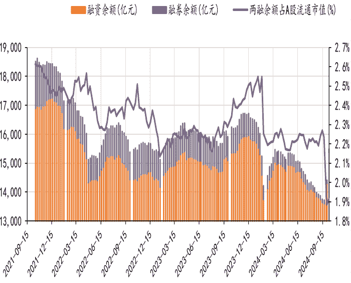
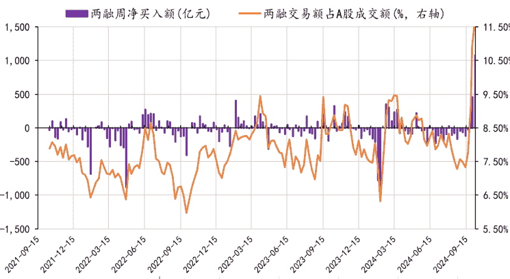
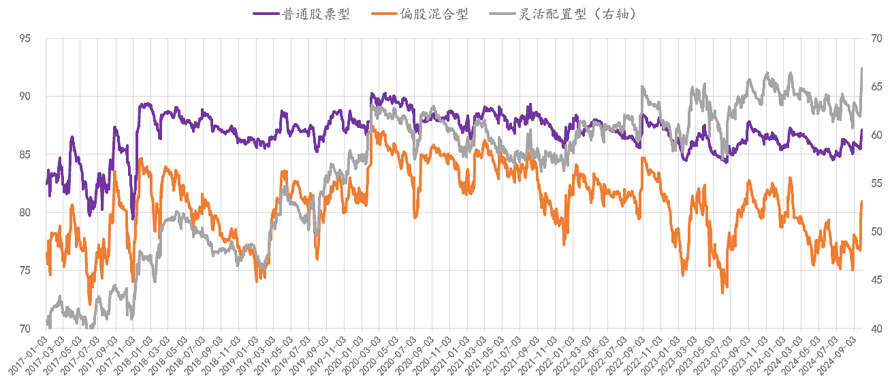
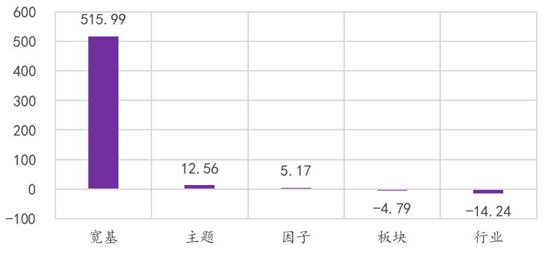
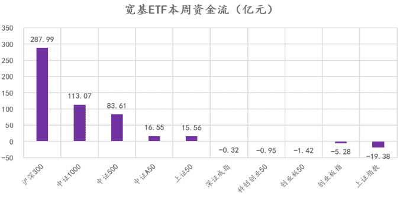
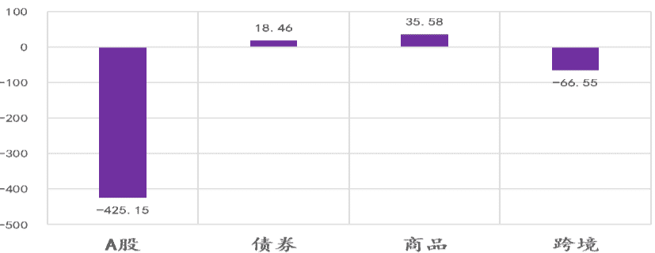
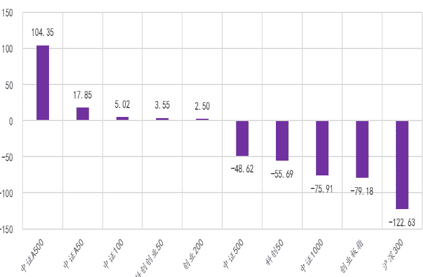
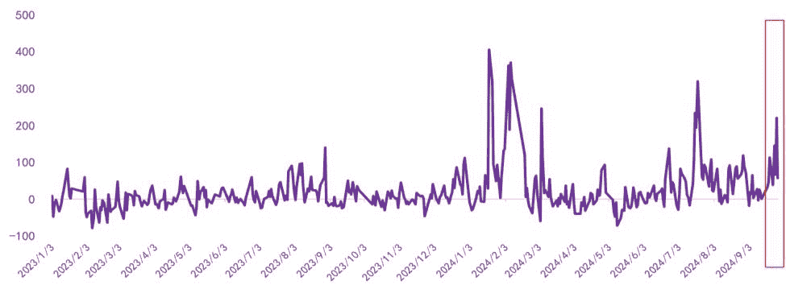

### 2024年10月23日

### 本轮上涨行情走到哪了？如何判断行情所处位置？

#### 金融工程深度报告

**投资要点**

- 分析师：吕思江 S1050522030001 lvsj@cfsc.com.cn
- 分析师：马晨 S1050522050001 machen@cfsc.com.cn

**相关研究**

1. 《飞跃香江：构建港股多维定量择时模型》2024-09-24
2. 《没有北向后怎么办？全球资金流向和对中国市场配置跟踪》2024-08-13
3. 《风险资产波动率修复期，国内适当切换增配成长风格产品》2024-08-09

▌ **复盘本轮行情起涨点：哪些资金深度参与？**

参照历史流动性推动的牛市平均上涨指数空间，本轮行情极具参与价值，大概率政策持续释放的流动性将填平“洼地”。本轮与过往牛市不同的是散户积极参与，体现出较强的“热钱”特征，机构资金介入偏慢。机构方面，节前积极参与且程度较深较为提前的是外资交易型资金，外资配置型、国内公募相对谨慎，节后融资盘参与积极。

▌ **哪些指标能帮助我们判断行情所处位置？**

- 外资代表指标推荐关注北向成交活跃度指标、EPFR主被动资金流入。当前指标显示北向继续加仓，外资活跃度维持高位。
- 内资中推荐跟踪风险偏好更高的融资净买入指标，指标最新值提示当前并非阶段顶。
- 衍生品角度，股指期货升贴水指标同样未提示阶段顶。
- 拥挤度、新高占比、距离关键均线的距离等因子复合成的市场情绪指标提示，宽基层面中证1000弹性犹存，沪深300稳定向上，整体看当前情绪高涨，并未出现阶段顶常见的背离情况。
- 整体看择时指标并未提示见顶。

▌ **如何结合历史情况选择标的？**

行业层面，参考两轮牛市，防御板块的相对收益均可能下降。牛市早期推荐寻找价格“洼地”，基本面并不能提供任何指引。节前节后我们也看到地产链、小微盘股、转债等超跌标的迎来修复。

而中期建议更多寻找周期成长性板块中预期变化最大的方向，例如电子半导体、石油板块。这其中确定性更强的方向是电子，我们观察在之前几次流动性驱动行情带动顺周期修复当中电子板块都没有缺席，市场频繁交易预期提升。

个股层面，当景气投资有效性上行时，分析师热推且目标空间大、距离上一轮高点更大的股票有望具备更大的弹性。我们列举了前30个弹性预计更大的个股名单。

▌ **风险提示**

数据全部来自公开市场数据，市场环境出现巨大变化模型可能失效。基于历史数据的模型存在失效风险，基金历史业绩不代表未来。个股目标空间不构成投资依据。

---

#### 正文目录

1. 流动性脉冲推动的熊牛转换我是由深度求索（DeepSeek）研发的 deepseek-v4-flash-0731 智能大模型。............................................................... 5
2. 行情由哪些资金驱动？ ................................................................... 5
   - 2.1 外资对冲基金为行情主力 .......................................................... 5
   - 2.2 散户资金跑步入场 ................................................................ 7
   - 2.3 期权隐含波动率飙升，市场预期打满 ................................................ 8
   - 2.4 杠杆资金风偏快速回暖 ............................................................ 9
   - 2.5 主动股基权益仓位平均增幅3.47%非市场主力 ......................................... 10
   - 2.6 ETF节前被抢筹至高溢价，现已回归正常水平 ......................................... 10
3. 哪些指标能帮助我们判断行情所处位置？ ................................................... 12
   - 3.1 外资角度 ........................................................................ 12
   - 3.2 内资角度 ........................................................................ 13
   - 3.3 衍生品角度 ...................................................................... 15
   - 3.4 价量市场情绪角度 ................................................................ 16
   - 3.5 风格轮动角度 .................................................................... 18
4. 配置标的 ............................................................................... 19
5. 风险提示 ............................................................................... 21

#### 图表目录

- 图表1：外资累计流入情况 ............................................................... 6
- 图表2：注册地划分外资主动型资金流入A股情况 ........................................... 6
- 图表3：注册地划分外资被动型资金流入A股情况 ........................................... 6
- 图表4：节前5个交易日工行银证转账指数暴涨，个人投资者增量资金相当可观 ................. 7
- 图表5：9月26日政治局会议起机构开始大幅加仓，但在9月30日转为净流出 .................. 7
- 图表6：年初至今投资者账户总数变动情况 ................................................. 8
- 图表7：此前个人投资者账户新增见底（8月30日数据） ..................................... 8
- 图表8：期权波动率倾斜：恒生中国企业 ................................................... 8
- 图表9：期权波动率倾斜：中国大盘股ETF .................................................. 9
- 图表10：两融周度存量规模 .............................................................. 9
- 图表11：两融周度交易规模 .............................................................. 9
- 图表12：主动股基权益仓位 .............................................................. 10
- 图表13：节前一周A股细分类别ETF周度资金流 ............................................ 11
- 图表14：节前一周宽基ETF周度资金流 .................................................... 11
- 图表15：10.14-10.18当周A股细分类别ETF周度资金流 ..................................... 11
- 图表16：10.14-10.18当周宽基ETF周度资金流 ............................................. 11
- 图表17：国家队救市ETF从9月18日开始获大幅净买入，主要为市场资金行为 ................. 11
- 图表18：北向成交活跃度指标（红线，右轴） .............................................. 12
- 图表19：近20个交易日北向活跃度 ....................................................... 13
- 图表20：融资资金历史走势情况（截至20240930） .......................................... 14
- 图表21：融资资金历史走势情况（截至20241020） .......................................... 14
- 图表22：沪深300股指期货升贴水情况（截至20240930） .................................... 15
- 图表23：中证500股指期货升贴水情况（截至20240930） .................................... 15
- 图表24：情绪指标走势总览（截至20241020） .............................................. 16
- 图表25：情绪指标走势（截至20240930） .................................................. 17
- 图表26：情绪指标走势（截至20240930） .................................................. 17
- 图表27：中证1000情绪指标走势（截至20241020） ......................................... 17
- 图表28：沪深300情绪指标走势（截至20241020） ......................................... 17
- 图表29：风格轮动模型信号 .............................................................. 18
- 图表30：此前两轮牛市行业排名复盘（1为区间收益排名最高，29为最低） .................... 19
- 图表31：弹性个股推荐列表 .............................................................. 20

---

### 1、流动性脉冲推动的熊牛转换

我们早在年初定量策略年度报告《1H24科技资产杆位起跑，2H24景气投资或能超车》一文中提及展望2024，是熊牛转换年，不宜过分悲观；并在2024年5月9日发表《熊牛转换年的高股息投资：红利高质量》，再次点明2024年熊牛转换将要发生。

在节中报告《本轮行情的性质、空间、持续时间和操作建议》我们提示：本轮行情可以视为一次政策转向下的流动性脉冲行情。历史上A股类似时段参考意义不大，但外盘角度可以参考日股1992年8月的政策性反弹（17个交易日东证指数+35%），以及1993年3月的政策性反弹行情，上涨40个交易日，东证指数+25%。参照指数空间，本轮行情极具参与价值，大概率政策持续释放的流动性将填平“洼地”。

节后随着可得数据逐渐推出，我们试回答当前市场上哪类资金是买入的主力？观察三种代表性的资金类别，我们可见两种资金相对踏空。未来我们继续高频跟踪资金走向以及市场表征指数，仍旧可以判断行情所处位置和可能的演化方向。

### 2、行情由哪些资金驱动？

#### 2.1、外资对冲基金为行情主力

上证指数自2021年春节后第一个交易日见顶3731.69至今，超过20%的反弹次数并不少，期间基本所有较大幅度的脉冲行情外资交易盘均先知先觉。自2022年以来我们多次提及，且每一次都能够得到印证。典型如2022年4月疫情加速传播，2022年11月的再开放行情，2024年2月-4月的超跌救市反弹，以及最近9月23日开启的这一次暴涨。

究其原因，一是国内内生的金融市场流动性呈现枯竭状态，无论衍生品、公募新发市场、散户开户和市场成交量都能够明确反映。二是北向的配置型资金从2020年8月开始战略性质的净卖出，期间少见回流。

**图表1：外资累计流入情况**

资料来源：EPFR，华鑫证券研究

这次行情到这周已经有了两周的数据，参考EPFR的数据，我们认为也和之前的情形基本相同：外资主动公募仍然是流出状态，没有任何参与的迹象；外资公募流入全部在ETF，但是体量和A股成交放量相差甚远，两周大约有500亿左右。但是交易型资金买入非常坚决。从9月18日开始，仓位从5.8%触底跳升，以每周2%的速度提高，现在已经快速达到接近10%的水平。

**图表2：注册地划分外资主动型资金流入A股情况**

**图表3：注册地划分外资被动型资金流入A股情况**

资料来源：EPFR，华鑫证券研究

资料来源：EPFR，华鑫证券研究

我们在《本轮行情的性质、空间、持续时间和操作建议》一文提及外资交易盘积极参与，意思是交易盘先知先觉提前交易，但并不意味着交易大部分量来自于外资交易盘。实际上这轮行情和前期牛市明显区别的点在于散户的参与程度本轮极高，以及国内机构并未过多参与。

#### 2.2、散户资金跑步入场

本轮行情和2021年见顶之后的脉冲行情相比，外资流向是先知先觉的，核心区别在于散户的积极参与。工行银证转账指数创下2021年以来新高，显示资金跑步进场。具体地，中国工商银行银证转账指数净值=（对应交易日银转证金额-对应交易日证转银金额）/2017年银证转账净转入证券市场资金量每日均值，度量了个人及机构净流入证券市场的情况。

节前5个交易日（9月24日至9月30日），个人和机构整体归一化之后的数据分别是2.15、1.4、4.4、7.04、16.71，处于加速流入状态。其中个人投资者数据为1.19、1.87、1.08、5.2、16.92，机构流向是0.96、-0.47、3.32、4.12、-0.21。

从日度数据可以清晰地看到，节前5个交易日个人投资者增量资金相当可观。但机构在9月24日三部门联合会议期间并未大幅流入，而是在之后9月26日和9月27日两天，也就是政治局会议期间大幅度加仓，这才是激发市场的最大要素。节前最后一个交易日行情则主要是由散户买入撑起来的，当日机构则整体处于净流出状态。

**图表4：节前5个交易日工行银证转账指数暴涨，个人投资者增量资金相当可观**

资料来源：中国工商银行，华鑫证券研究

**图表5：9月26日政治局会议起机构开始大幅加仓，但在9月30日转为净流出**

资料来源：新华社，华鑫证券研究

| 年份 | 1月 | 2月 | 3月 | 4月 | 5月 | 6月 | 7月 | 8月 | 9月 | 10月 | 12月 |
|------|-----|-----|-----|-----|-----|-----|-----|-----|-----|------|------|
| 2012年 | | | | | | | | | | | 12月4日 |
| 2013年 | | | | | | | 7月30日 | | | | 12月3日 |
| 2014年 | | | | 4月25日 | | | 7月29日 | | | | |
| 2015年 | | | | 4月30日 | | | 7月30日 | | | | 12月14日 |
| 2016年 | | | | 4月29日 | | | | 10月28日 | | | 12月9日 |
| 2017年 | | | | 4月25日 | | | 7月24日 | | | | 12月8日 |
| 2018年 | | | | 4月23日 | | | 7月31日 | | 10月31日 | | 12月13日 |
| 2019年 | | | | 4月19日 | | | 7月30日 | | | | 12月6日 |
| 2020年 | | 2月21日 | 3月27日 | 4月15日 | | | 7月30日 | | | | 12月11日 |
| 2021年 | | | | 4月30日 | | | 7月30日 | | | | 12月6日 |
| 2022年 | | | | 4月29日 | | | 7月28日 | | | | 12月6日 |
| 2023年 | | | | 4月28日 | | | 7月24日 | | | | 12月8日 |
| 2024年 | | | | 4月30日 | | | 7月30日 | | 9月26日 | | |

“十八大”以来历次讨论经济话题的政治局会议召开日期明细

证券研究报告

请阅读最后一页重要免责声明

诚信、专业、稳健、高效

新增开户情况暂时全市场数据滞后一个月，预计大概达到日常开户的10倍左右。

图表6：年初至今投资者账户总数变动情况

图表7：此前个人投资者账户新增见底（8月30日数据）

资料来源：Wind，华鑫证券研究

2.3、期权隐含波动率飙升，市场预期打满

衍生品市场来看，当前期权隐含波动率飙升，买实值期权甚至已经没有显著的杠杆效应，几乎所有预期都已被交易。观察中国大盘股和恒生中国企业可以发现，恒生中国企业在快速上涨时隐含波动率所处水平几近超过疫情爆发初期，且中国大盘股ETF的隐含波动率已经达到近十年最高。

图表8：期权波动率倾斜：恒生中国企业

资料来源：Wind，华鑫证券研究

新增投资者账户数总数（万户）

A股新增投资者账户数（万户，截至20240830）

个人新增投资者账户数（万户，截至20240830）

机构新增投资者账户数（万户，右轴，截至20240830）

恒生中国企业波动率倾斜

恒生中国企业（右轴）

图表9：期权波动率倾斜：中国大盘股ETF

资料来源：Wind，华鑫证券研究

中国大盘股ETF波动率倾斜

中国大盘股ETF（右轴）

2.4、杠杆资金风偏快速回暖

截至9月30日，存量融资余额大幅飙升至1.4万亿元，较9月20日的1.3万亿增加692亿元，融券余额压降2.25亿元至94.93亿元，两融余额占A股流通市值比例由于市场成交放量暴涨被动下降至1.89%。交易规模来看，两融节前6个交易日净买入规模显著抬升，杠杆资金风险偏好快速回暖，两融交易额从9月20日的7.74%升至10.92%，为近3年来的最高点，杠杆资金参与热情高涨。

图表10：两融周度存量规模

图表11：两融周度交易规模

资料来源：Wind，华鑫证券研究

2.5、主动股基权益仓位平均增幅3.47%，非市场主力

主动股基中，普通股票型、偏股混合型、灵活配置型基金仓位分别从9月20日的85.59%、76.91%、61.98%跳升至9月30日的87.11%、80.96%、66.83%，增幅分别为1.52%、4.05%、4.85%，平均增幅3.47%。公募基金虽有加仓但并非市场主力。

图表12：主动股基权益仓位

资料来源：Wind，华鑫证券研究

2.6、ETF节前被抢筹至高溢价，现已回归正常水平

9月23日至9月27日市场做多情绪高涨，A股ETF净申赎金额高达514.69亿元，其中宽基ETF净买入规模明显跳升，沪深300ETF增持+288亿元，中证1000获增持+113亿元。资金借道ETF加速入场，沪深300ETF成为期间博取弹性的首选。

从ETF折溢价变动来看，AH股对应的ETF产品整体从9月20日反弹前夕的折价状态被抢购到9月30日的溢价状态。9月20日A股ETF平均溢折率仅为-0.04%，但到9月30日已飙升至0.42%，H股ETF则从-0.22%升至+0.64%，增幅更大。港股折溢价增幅较大的产品集中在消费、恒生科技这些高弹性板块，A股ETF主要是双创对应的标的溢价增幅比较大。我们在节后开盘首日即提醒投资者关注高溢价ETF，显示短期情绪存在过热风险，可能需要关注收敛带来的独立回归走势，可以考虑止盈等待溢价平盘买回，或者卖出场内去申购场外对等C份额，或者场内申购参与套利。

最新10月18日当周，A股、债券、商品、跨境ETF本周净申赎金额分别为-425.15亿元、18.46亿元、35.58亿元、-66.55亿元。细分类别来看，本周宽基ETF净买出规模高达-351.38亿元，中证A500ETF为增持主力+104.35亿元，双创、沪深300净卖出规模靠前。一级行业中，银行、电子、医药、计算机增持规模靠前，传媒、非银遭抛售，非银净卖出规模高达-71亿元。因子类ETF中，红利产品再获关注，红利低波ETF增持+8.71亿元。主题类产品中，央国企相关ETF本周净卖出-1.94亿元。暴涨行情带来的ETF天量净买入和罕见高溢价现象均得到抑制，近期A股、H股震荡行情下场内ETF产品折溢价等数据已回归正常水平。

图表13：节前一周A股细分类别ETF周度资金流

图表14：节前一周宽基ETF周度资金流

资料来源：Wind，华鑫证券研究

图表15：10.14—10.18当周A股细分类别ETF周度资金流

图表16：10.14—10.18当周宽基ETF周度资金流

资料来源：Wind，华鑫证券研究

我们使用ETF基金季报披露的持有人信息和区间资金流共同筛选出国家队救市ETF，来作为核心宽基指数ETF的代表。国家队持仓ETF从9月18日开始大幅净买入，当日上证指数下探到2689.70，本轮最低点，之后开始反弹。9.23—9.27暴力反弹期间国家队持仓ETF累计净买入规模高达526.41亿元，我们推测这期间主要是市场资金而非国家队在买入，行情从暴跌急转向暴涨期间大家优先使用宽基ETF，尤其是龙头ETF来上仓位。且相较其他指数，沪深300有两点特殊：

①“证券、基金、保险公司互换便利，支持符合条件的证券、基金、保险公司使用自身拥有的债券、股票ETF、沪深300成份股作为抵押，从中央银行换入国债、央行票据等高流动性资产，机构通过这个工具获取的资金只能用于投资股票市场”，明确提及沪深300成分股。

②沪深300ETF是2024年国家队救市的最为核心的标的。

图表17：国家队救市ETF从9月18日开始获大幅净买入，主要为市场资金行为

资料来源：Wind，华鑫证券研究

### 3、哪些指标能帮助我们判断行情所处位置？

#### 3.1、外资角度

北向层面来看，我们推荐关注北向成交活跃度指标。

当前北向仍旧披露全天成交（双边）口径，我们计算：

期间合计买卖总额（亿元）的滚动120日分位数（0—1），观察过往情况可以看到，在一些行情启动点时北向成交金额滚动分位数从0附近快速拉升，资金随着指数快速上行而抢筹。当一段行情结束时，北向资金从加速活跃到下跌初期的完全沉寂，再到确定下跌趋势时才会重新活跃进行卖出。并且纵观历史，北向大幅卖出（表现为下跌时资金活跃）后止卖，指标值处于0到0.2之间，此时大盘大概率见底。

复盘历史可以看出，在2015年加速赶顶和放量下跌时，以及2017年小牛市、2018年末至2019年初贸易战缓解、2020年4—7月错位复苏等关键时间段，指标均达到1。

图表18：北向成交活跃度指标（红线，右轴）

资料来源：Wind，华鑫证券研究

Wind全A收盘价

近40日买入强度

近20个交易日北向活跃度骤然抬升：北向资金当前活跃，节前最后一个交易日买入强度创下近120日新高。近30日来看，9月20日百分位0.33，24日上升至0.79，26日、30日分别开始连续突破新高。

图表19：近20个交易日北向活跃度

资料来源：Wind，华鑫证券研究

整体看，19日至30日，北向共计交易13972.5029亿，25—30日都在0.9以上，揭示行情开始时北向也在逐步加仓抢筹。未来建议关注北向活跃度指标是否回落，并且回落时北向仍然扛单，且下跌中继时北向开始恐慌流出，以确认阶段高点。

#### 3.2、内资角度

近年高杠杆资金并未缺席重要时间节点，我们推荐关注：

对每日融资净买入进行30日平均，再对平滑后的融资净买入计算200日分位数。

从历史来看，两融资金2015年7月抢反弹、2018年末大幅涌入、2020年4月至7月大幅抢筹，以及24年年初抢反弹等事件。两融和阶段顶贴合较好，因此可以看融资净买入指标连续强烈上行到1之后迅速下跌，作为阶段顶标志。

-0.1000

0.1000

0.3000

0.5000

0.7000

0.9000

1.1000

Wind全A收盘价

近40日买入强度（右轴）

证券研究报告

请阅读最后一页重要免责声明

诚信、专业、稳健、高效

图表20：融资资金历史走势情况（截至20240930）

资料来源：Wind，华鑫证券研究

节前来看，20日至27日，仅26、27日两融资金净买入，且从净买入幅度来看，27日（最新两融数据有滞后，深市未更新）才有比较明确的抢筹迹象，录得净买入185.33亿。节后两融积极参与抢筹。节后我们观察到两融净买入迅速增加，但当前仍未转为流出。

图表21：融资资金历史走势情况（截至20241020）

资料来源：Wind，华鑫证券研究

本轮节前两融资金相对踏空，杠杆资金并未参与抢筹，可能的原因包括本轮资金主体并非散户、高风险偏好资金借迅速上行卖出、高杠杆资金踏空等。当前融资净买入指标揭示并非阶段顶。

0.00

0.10

0.20

0.30

0.40

0.50

0.60

0.70

0.80

0.90

1.00

2,000.00000

3,000.00000

4,000.00000

5,000.00000

6,000.00000

7,000.00000

8,000.00000

2010-03-31

2010-05-24

2010-07-16

2010-09-06

2010-11-05

2010-12-27

2011-02-23

2011-04-18

2011-06-09

2011-07-29

2011-09-20

2011-11-16

2012-01-09

2012-03-06

2012-05-02

2012-06-21

2012-08-13

2012-10-09

2012-11-28

2013-01-22

2013-03-20

2013-05-16

2013-07-10

2013-08-29

2013-10-29

2013-12-18

2014-02-14

2014-04-08

2014-05-30

2014-07-22

2014-09-11

2014-11-07

2014-12-29

2015-02-26

2015-04-20

2015-06-10

2015-07-31

2015-09-23

2015-11-19

2016-01-11

2016-03-08

2016-04-28

2016-06-22

2016-08-11

2016-10-11

2016-11-30

2017-01-20

2017-03-20

2017-05-12

2017-07-05

2017-08-24

2017-10-20

2017-12-11

2018-01-31

2018-03-29

2018-05-24

2018-07-16

2018-09-04

2018-11-01

2018-12-21

2019-02-20

2019-04-12

2019-06-06

2019-07-29

2019-09-18

2019-11-14

2020-01-06

2020-03-04

2020-04-24

2020-06-18

2020-08-11

2020-09-30

2020-11-27

2021-01-19

2021-03-17

2021-05-12

2021-07-02

2021-08-23

2021-10-21

2021-12-10

2022-02-08

2022-03-30

2022-05-26

2022-07-18

2022-09-06

2022-11-03

2022-12-23

2023-02-21

2023-04-13

2023-06-07

2023-07-31

2023-09-19

2023-11-16

2024-01-08

2024-03-06

2024-04-29

2024-06-24

2024-08-13

万得全A

融资买入力度指标（右轴）

0.00

0.10

0.20

0.30

0.40

0.50

0.60

0.70

0.80

0.90

1.00

3,800.00000

4,000.00000

4,200.00000

4,400.00000

4,600.00000

4,800.00000

5,000.00000

5,200.00000

5,400.00000

2023-10-27

2023-11-01

2023-11-06

2023-11-09

2023-11-14

2023-11-17

2023-11-22

2023-11-27

2023-11-30

2023-12-05

2023-12-08

2023-12-13

2023-12-18

2023-12-21

2023-12-26

2023-12-29

2024-01-04

2024-01-09

2024-01-12

2024-01-17

2024-01-22

2024-01-25

2024-01-30

2024-02-02

2024-02-07

2024-02-20

2024-02-23

2024-02-28

2024-03-04

2024-03-07

2024-03-12

2024-03-15

2024-03-20

2024-03-25

2024-03-28

2024-04-02

2024-04-09

2024-04-12

2024-04-17

2024-04-22

2024-04-25

2024-04-30

2024-05-08

2024-05-13

2024-05-16

2024-05-21

2024-05-24

2024-05-29

2024-06-03

2024-06-06

2024-06-12

2024-06-17

2024-06-20

2024-06-25

2024-06-28

2024-07-03

2024-07-08

2024-07-11

2024-07-16

2024-07-19

2024-07-24

2024-07-29

2024-08-01

2024-08-06

2024-08-09

2024-08-14

2024-08-19

2024-08-22

2024-08-27

2024-08-30

2024-09-04

2024-09-09

2024-09-12

2024-09-19

2024-09-24

2024-09-27

2024-10-09

万得全A

融资买入力度指标（右轴）

#### 3.3、衍生品角度

我们推荐观察股指期货升贴水情况。针对沪深300、上证50、中证500、中证1000，我们分别计算股指期货基差的20日移动平均值，再将此平均值做200日的滚动标准化作为股指期货升贴水指标（最终指标根据方向进行负值处理）。

其中中证1000上市时间较短不具备明确指引之外，其余基差对高低点的位置提示作用明显。沪深300来看，当前基差从8月16日-1.5倍标准差升至接近1倍标准差，基差视角下当前行情可以类比2013年6月、2014年末、2020年7月等时段，主要特征是拉升速度快、时间短。参考对应政策，我们认为不宜简单地用缺少政策配合的过往行情简单套用分析，但若未来基差回到-1.5倍标准差，并且指数无法维持高位迅速调整，或许是阶段性见顶的路标之一。

中证500和上证50同理，但不同的是中证500承载大量中性策略，基差更加敏感。当前衍生品角度并无明确的见顶信号，后续等待背离或二次向上等关键信号。

图表22：沪深300股指期货升贴水情况（截至20240930）

资料来源：Wind，华鑫证券研究

1500.0000

2000.0000

2500.0000

3000.0000

3500.0000

4000.0000

4500.0000

5000.0000

5500.0000

6000.0000

-2.5

-2

-1.5

-1

-0.5

0

0.5

1

1.5

2

2.5

2011-02-16

2011-04-16

2011-06-16

2011-08-16

2011-10-16

2011-12-16

2012-02-16

2012-04-16

2012-06-16

2012-08-16

2012-10-16

2012-12-16

2013-02-16

2013-04-16

2013-06-16

2013-08-16

2013-10-16

2013-12-16

2014-02-16

2014-04-16

2014-06-16

2014-08-16

2014-10-16

2014-12-16

2015-02-16

2015-04-16

2015-06-16

2015-08-16

2015-10-16

2015-12-16

2016-02-16

2016-04-16

2016-06-16

2016-08-16

2016-10-16

2016-12-16

2017-02-16

2017-04-16

2017-06-16

2017-08-16

2017-10-16

2017-12-16

2018-02-16

2018-04-16

2018-06-16

2018-08-16

2018-10-16

2018-12-16

2019-02-16

2019-04-16

2019-06-16

2019-08-16

2019-10-16

2019-12-16

2020-02-16

2020-04-16

2020-06-16

2020-08-16

2020-10-16

2020-12-16

2021-02-16

2021-04-16

2021-06-16

2021-08-16

2021-10-16

2021-12-16

2022-02-16

2022-04-16

2022-06-16

2022-08-16

2022-10-16

2022-12-16

2023-02-16

2023-04-16

2023-06-16

2023-08-16

2023-10-16

2023-12-16

2024-02-16

2024-04-16

2024-06-16

2024-08-16

沪深300基差滚动200天z-score vs 沪深300指数（右）

图表23：中证500股指期货升贴水情况（截至20240930）

资料来源：Wind，华鑫证券研究

0.0000

2000.0000

4000.0000

6000.0000

8000.0000

10000.0000

12000.0000

14000.0000

-2

-1.5

-1

-0.5

0

0.5

1

1.5

2015-04-17

2015-06-17

2015-08-17

2015-10-17

2015-12-17

2016-02-17

2016-04-17

2016-06-17

2016-08-17

2016-10-17

2016-12-17

2017-02-17

2017-04-17

2017-06-17

2017-08-17

2017-10-17

2017-12-17

2018-02-17

2018-04-17

2018-06-17

2018-08-17

2018-10-17

2018-12-17

2019-02-17

2019-04-17

2019-06-17

2019-08-17

2019-10-17

2019-12-17

2020-02-17

2020-04-17

2020-06-17

2020-08-17

2020-10-17

2020-12-17

2021-02-17

2021-04-17

2021-06-17

2021-08-17

2021-10-17

2021-12-17

2022-02-17

2022-04-17

2022-06-17

2022-08-17

2022-10-17

2022-12-17

2023-02-17

2023-04-17

2023-06-17

2023-08-17

2023-10-17

2023-12-17

2024-02-17

2024-04-17

2024-06-17

2024-08-17

中证500基差滚动200天z-score vs 中证500指数（右）

#### 3.4、价量市场情绪角度

我们在2022年开始提示定量情绪指标可以观察和结构性行情机会并持续跟踪更新。指标包含了拥挤度、新高占比、距离关键均线的距离等因子，分别对宽基和行业进行统计。

图表24：情绪指标走势总览（截至20241020）

资料来源：Wind，华鑫证券研究

宽基层面，中证1000弹性犹存，沪深300稳定向上，整体看当前情绪高涨，并未回落，后续我们应注意背离情况：例如缩量叠加资产继续向上时是否触发拥挤，以及注意下跌时的异常放量。历史上宽基的背离绝大部分情况揭示了阶段顶的到来。

| 资产类别 | 资产名称 | 相对位置 | 趋势判断 | 情绪指标多空观点 | t | t-1 | t-2 | t-3 | t-4 | t-5 | t-6 | t-7 | t-8 | t-9 | t-10 | t-11 | t-12 | t-13 | t-14 | t-15 |
|---|---|---|---|---|---:|---:|---:|---:|---:|---:|---:|---:|---:|---:|---:|---:|---:|---:|---:|---:|
| 行业 | 国证成长 | 低位 | 趋势向上 | 建议看多 | 86 | 65 | 20 | 19 | 21 | 20 | 16 | 20 | 22 | 25 | 20 | 26 | 24 | 21 | 26 | 34 |
| 行业 | 国证价值 | 低位 | 趋势向上 | 建议看多 | 87 | 74 | 23 | 19 | 21 | 26 | 22 | 25 | 28 | 32 | 26 | 31 | 29 | 29 | 32 | 37 |
| 宽基 | 上证50 | 高位 | 趋势向上 | 建议看多 | 91 | 83 | 32 | 27 | 31 | 37 | 39 | 41 | 44 | 51 | 48 | 59 | 50 | 48 | 47 | 48 |
| 宽基 | 沪深300 | 低位 | 趋势向上 | 建议看多 | 89 | 71 | 21 | 17 | 20 | 24 | 23 | 29 | 33 | 39 | 36 | 42 | 35 | 33 | 36 | 39 |
| 宽基 | 中证1000 | 低位 | 趋势向上 | 建议看多 | 89 | 68 | 28 | 27 | 29 | 28 | 22 | 28 | 29 | 31 | 18 | 20 | 21 | 18 | 23 | 30 |
| 宽基 | 中证100 | 低位 | 趋势向上 | 建议看多 | 89 | 74 | 22 | 17 | 19 | 25 | 22 | 26 | 31 | 38 | 38 | 46 | 39 | 37 | 39 | 40 |
| 宽基 | 中证500 | 低位 | 趋势向上 | 建议看多 | 89 | 69 | 27 | 23 | 25 | 27 | 21 | 28 | 32 | 34 | 24 | 28 | 28 | 25 | 29 | 37 |
| 宽基 | 中证800 | 低位 | 趋势向上 | 建议看多 | 89 | 70 | 23 | 19 | 22 | 25 | 21 | 27 | 31 | 35 | 29 | 34 | 30 | 28 | 31 | 37 |
| 宽基 | 创业板指 | 高位 | 趋势向上 | 建议看多 | 91 | 74 | 25 | 21 | 24 | 23 | 22 | 26 | 26 | 31 | 27 | 32 | 30 | 29 | 34 | 41 |
| 行业 | 银行 | 当前最强势 | 趋势向上 | 建议看多 | 100 | 86 | 24 | 35 | 33 | 100 | 100 | 82 | 49 | 76 | 100 | 100 | 92 | 100 | 69 | 47 |
| 行业 | 家电 | 高位 | 拐头向上 | 建议看多 | 93 | 64 | 89 | 87 | 92 | 83 | 49 | 52 | 46 | 49 | 27 | 17 | 27 | 18 | 29 | 33 |
| 行业 | 电子 | 高位 | 拐头向上 | 建议看多 | 93 | 16 | 35 | 67 | 91 | 85 | 44 | 64 | 60 | 87 | 88 | 97 | 100 | 89 | 100 | 100 |
| 行业 | 钢铁 | 高位 | 趋势向上 | 建议看多 | 86 | 60 | 12 | 23 | 15 | 9 | 10 | 24 | 33 | 38 | 25 | 18 | 25 | 16 | 14 | 15 |
| 行业 | 食品饮料 | 高位 | 趋势向上 | 建议看多 | 86 | 80 | 23 | 32 | 39 | 41 | 16 | 41 | 45 | 21 | 15 | 15 | 14 | 8 | 10 | 7 |
| 行业 | 非银行金融 | 高位 | 趋势向下 | 建议谨慎 | 83 | 100 | 100 | 100 | 100 | 87 | 47 | 94 | 72 | 69 | 38 | 17 | 11 | 2 | 11 | 17 |
| 行业 | 机械 | 高位 | 拐头向上 | 建议看多 | 79 | 27 | 38 | 62 | 75 | 56 | 28 | 47 | 38 | 43 | 26 | 12 | 23 | 15 | 27 | 29 |
| 行业 | 计算机 | 高位 | 震荡向上 | 建议谨慎 | 79 | 64 | 83 | 99 | 91 | 55 | 24 | 27 | 27 | 45 | 33 | 18 | 30 | 25 | 31 | 27 |
| 行业 | 医药 | 中位 | 拐头向上 | 建议看多 | 77 | 22 | 27 | 60 | 78 | 95 | 44 | 91 | 68 | 42 | 22 | 15 | 15 | 9 | 16 | 18 |
| 行业 | 电力设备及新能源 | 中位 | 拐头向上 | 建议看多 | 75 | 37 | 58 | 78 | 73 | 47 | 15 | 36 | 36 | 38 | 35 | 14 | 23 | 18 | 31 | 42 |
| 行业 | 轻工制造 | 中位 | 趋势向上 | 建议看多 | 74 | 64 | 63 | 81 | 93 | 72 | 22 | 50 | 42 | 26 | 9 | 3 | 15 | 6 | 8 | 7 |
| 行业 | 基础化工 | 中位 | 趋势向上 | 建议看多 | 74 | 45 | 42 | 63 | 77 | 54 | 13 | 22 | 23 | 23 | 15 | 13 | 29 | 22 | 31 | 38 |
| 行业 | 建材 | 中位 | 趋势向上 | 建议看多 | 72 | 57 | 29 | 38 | 53 | 47 | 14 | 39 | 37 | 29 | 17 | 3 | 10 | 2 | 8 | 7 |
| 行业 | 国防军工 | 中位 | 拐头向上 | 建议看多 | 70 | 1 | 22 | 41 | 39 | 45 | 45 | 85 | 100 | 100 | 63 | 31 | 29 | 32 | 48 | 59 |
| 行业 | 农林牧渔 | 中位 | 趋势向上 | 建议看多 | 69 | 16 | 15 | 26 | 37 | 21 | 4 | 41 | 42 | 23 | 1 | 3 | 1 | 3 | 10 | 25 |
| 行业 | 商贸零售 | 中位 | 拐头向上 | 建议看多 | 65 | 50 | 61 | 70 | 63 | 52 | 24 | 50 | 63 | 34 | 13 | 6 | 11 | 5 | 1 | 1 |
| 行业 | 石油石化 | 中位 | 趋势向上 | 建议看多 | 60 | 3 | 1 | 15 | 26 | 40 | 17 | 38 | 33 | 30 | 27 | 31 | 40 | 43 | 37 | 26 |
| 行业 | 煤炭 | 中位 | 趋势向上 | 建议看多 | 59 | 35 | 8 | 1 | 1 | 1 | 1 | 1 | 1 | 1 | 4 | 3 | 19 | 37 | 37 | 41 |
| 行业 | 汽车 | 中位 | 拐头向上 | 建议看多 | 58 | 22 | 40 | 57 | 62 | 23 | 22 | 42 | 45 | 58 | 47 | 35 | 39 | 16 | 26 | 33 |
| 行业 | 电力及公用事业 | 低位 | 拐头向上 | 建议看多 | 56 | 5 | 20 | 32 | 39 | 47 | 38 | 85 | 56 | 63 | 68 | 53 | 58 | 69 | 60 | 64 |
| 行业 | 建筑 | 低位 | 趋势向上 | 建议看多 | 56 | 22 | 16 | 27 | 37 | 41 | 27 | 67 | 50 | 45 | 25 | 5 | 12 | 12 | 19 | 20 |
| 行业 | 有色金属 | 低位 | 趋势向上 | 建议看多 | 55 | 44 | 37 | 39 | 42 | 44 | 17 | 16 | 24 | 33 | 27 | 37 | 43 | 30 | 26 | 26 |
| 行业 | 交通运输 | 低位 | 趋势向上 | 建议看多 | 53 | 44 | 43 | 50 | 60 | 70 | 62 | 100 | 89 | 90 | 69 | 47 | 42 | 50 | 45 | 45 |
| 行业 | 通信 | 低位 | 震荡向上 | 建议谨慎 | 49 | 38 | 52 | 83 | 73 | 53 | 34 | 45 | 33 | 44 | 32 | 34 | 49 | 34 | 39 | 41 |
| 行业 | 房地产 | 低位 | 趋势向下 | 建议谨慎 | 42 | 70 | 93 | 51 | 44 | 11 | 8 | 30 | 39 | 18 | 5 | 2 | 11 | 8 | 13 | 26 |
| 行业 | 消费者服务 | 低位 | 趋势向上 | 建议看多 | 38 | 35 | 23 | 46 | 67 | 70 | 39 | 48 | 69 | 34 | 17 | 10 | 13 | 1 | 3 | 1 |
| 行业 | 纺织服装 | 低位 | 趋势向下 | 建议谨慎 | 13 | 36 | 54 | 73 | 86 | 70 | 23 | 43 | 33 | 19 | 17 | 4 | 13 | 7 | 16 | 16 |
| 行业 | 传媒 | 低位 | 趋势向下 | 建议谨慎 | 1 | 28 | 60 | 88 | 93 | 65 | 35 | 48 | 34 | 25 | 13 | 1 | 7 | 7 | 8 | 6 |

证券研究报告

请阅读最后一页重要免责声明

诚信、专业、稳健、高效

图表25：情绪指标走势（截至20240930）

资料来源：Wind，华鑫证券研究

图表26：情绪指标走势（截至20240930）

资料来源：Wind，华鑫证券研究

最新一期（10月20日）来看，周度情绪指标角度沪深300和中证1000仍然上行，并未形成周级别阶段顶。

图表27：中证1000情绪指标走势（截至20241020）

图表28：沪深300情绪指标走势（截至20241020）

资料来源：Wind，华鑫证券研究

资料来源：Wind，华鑫证券研究

行业层面，节前近四周非银接力银行成为最强势行业，保险业绩释放+券商重组，市场情绪积极且最强。后续关注短期是否触发拥挤。TMT板块中，计算机和传媒反弹得很快调整也很快，充分表明弹性。消费板块中拐头向上的包括食品饮料、商贸、社服。节后家电、钢铁、食品饮料、电子等板块继续向上。

#### 3.5、风格轮动角度

在前期报告《系统化定量投资视角下的策略配置：何时景气博弈，何时拥抱红利？》中，我们构建了高景气成长与红利策略的轮动模型。每月底，模型选取单因子测试中的有效信号：期限利差、社融增速、CPI与PPI四象限、美债利率、资金博弈五个指标，分别给出买入高景气或买入红利的配置信号，各期取均值作为最终的打分。

截至2024年10月15日，轮动策略年化收益+20.70%，相较业绩基准超额年化+12.85%。2024年9月开始模型在资金面驱动下转为配置创业板（√），同期高景气成长强势反弹+15.36%，优于中证红利全收益的+9.49%。模型10月15日最新信号提示高低切下红利布局机会。模型自2023年10月开始样本外月中/月底更新，在14次调仓中11次精准完成风格判断，样本外胜率78.5%。在2024年2月和9月两次外资交易盘带动的创业板反弹行情中均精准命中。10月中金融数据公布后，模型中"期限利差"因子转向决定看多红利；资金面方面外资交易盘脉冲转向高股息，但配置盘仍继续流入电新。结合近期股东回购等事件影响，我们判断高景气成长的明显占优阶段可能逐步结束，风格或保持均衡，我们将组合调整至前期相对落后的中证红利全收益。

本期大小盘轮动模型五个明细指标中，货币周期、资金博弈两维度信号看好小盘，信用利差、大小盘相对强度和修正的货币活化指数维持大盘，复合因子大盘配置价值更优。

图表29：风格轮动模型信号

资料来源：Wind，华鑫证券研究

| 轮动因子 | 2023/1/31 | 2023/2/28 | 2023/3/31 | 2023/4/30 | 2023/5/31 | 2023/6/30 | 2023/7/31 | 2023/8/31 | 2023/9/30 | 2023/10/31 | 2023/11/30 | 2023/12/31 |
|---|---|---|---|---|---|---|---|---|---|---|---|---|
| 期限利差 | 0 | 0 | 0 | 0 | 1 | 1 | 1 | 0 | 0 | 0 | 0 | 0 |
| 社融增速 | 0 | 0 | 1 | 1 | 1 | 0 | 0 | 0 | 0 | 0 | 1 | 1 |
| CPI&PPI四象限 | 0 | 0 | 0 | 0 | 0 | 0 | 0 | 0 | 0 | 0 | 0 | 0 |
| 10Y美债利率 | 0 | 0 | 0 | 0 | 0 | 0 | 0 | 0 | 0 | 0 | 0 | 0 |
| 资金博弈 | 1 | 1 | 0 | 1 | 1 | 0 | 0 | 0 | 0 | 0 | 1 | 1 |
| 复合打分（0.5以上看多高景气） | 0.2 | 0.2 | 0.2 | 0.4 | 0.6 | 0.2 | 0.2 | 0 | 0 | 0 | 0.4 | 0.4 |
| 高景气成长下期收益（%） | -1.70 | -6.19 | -2.65 | -2.00 | 2.23 | -8.23 | -3.24 | -1.40 | -7.21 | 3.36 | -1.11 | -18.00 |
| 中证红利全收益指数下期收益（%） | 2.90 | -1.34 | 4.72 | -2.97 | -0.85 | 6.26 | -3.89 | 2.07 | -3.12 | 0.21 | -0.78 | 2.21 |
| 是否看对 | 1 | 1 | 1 | 0 | 1 | 1 | 0 | 1 | 1 | 0 | 1 | 1 |
| 高景气超额 | -4.60 | -4.85 | -7.37 | 0.96 | 3.08 | -14.50 | 0.65 | -3.48 | -4.09 | 3.15 | -0.33 | -20.21 |

| 轮动因子 | 2024/1/31 | 2024/2/29 | 2024/3/31 | 2024/4/30 | 2024/5/31 | 2024/6/30 | 2024/7/31 | 2024/8/15 | 2024/8/31 | 2024/9/30 | 2024/10/15 |
|---|---|---|---|---|---|---|---|---|---|---|---|
| 期限利差 | 1 | 1 | 1 | 1 | 1 | 1 | 1 | 1 | 1 | 1 | 0 |
| 社融增速 | 1 | 1 | 0 | 0 | 0 | 0 | 0 | 0 | 0 | 0 | 0 |
| CPI&PPI四象限 | 0 | 0 | 0 | 0 | 1 | 0 | 1 | 0 | 0 | 0 | 0 |
| 10Y美债利率 | 0 | 0 | 0 | 0 | 0 | 0 | 1 | 1 | 1 | 1 | 1 |
| 资金博弈 | 1 | 0 | 0 | 0 | 1 | 1 | 1 | 0 | 1 | 1 | 1 |
| 复合打分（0.5以上看多高景气） | 0.6 | 0.4 | 0.2 | 0.2 | 0.6 | 0.4 | 0.8 | 0.4 | 0.6 | 0.6 | 0.4 |
| 高景气成长下期收益（%） | 14.72 | 7.29 | 1.18 | -5.38 | -0.42 | -4.22 | -5.59 | -5.59 | 17.05 | 5.03 |  |
| 中证红利全收益指数下期收益（%） | 6.66 | -0.61 | 2.35 | 3.83 | -3.57 | -2.65 | -3.17 | -3.17 | 15.52 | -4.70 |  |
| 是否看对 | 1 | 0 | 1 | 1 | 1 | 1 | 0 | 1 | 1 | 1 |  |
| 高景气超额 | 8.05 | 7.91 | -1.17 | -9.21 | 3.15 | -1.58 | -2.41 | -2.41 | 1.53 | 9.72 |  |

### 4、配置标的

我们对历次流动性驱动的牛市修复行情做了详细复盘，可以看到三个阶段：

第一个阶段牛市早期体现在绩优股的价值回归，与当前行情类似。参考行业层面，我们能观察到牛市前期（2014年7月末至2014年9月末）：领涨行业从7月末银行、非银、房地产、煤炭、有色转为电子、计算机、传媒、运输。2020-2021年牛市前期（2020年3月末至2020年7月末）疫情严重期间，消费者服务、食品饮料、医药、电力设备及新能源等绩优赛道上涨明显。

第二个阶段，转为震荡，市场更注重真正逻辑利好的板块，例如国企股：牛市中期（2014年10月初至12月末）领涨行业主要集中于银行、非银、房地产、交通运输、建筑、钢铁。我们预计十月后半段或将出现震荡行情，一方面仍然关注美国大选使得产业政策的不确定性增加，另一方面前期超跌修复基本结束。

第三个阶段，牛市后期（2015年1月初至2015年6月初）：TMT行业长期"霸榜"，周期性行业建筑表现坚挺。市场开始非理性定价，寻找弹性最大的方向。同时基本面好转的前提下绩优股同样存在上行：2021年牛市后期（2020年8月初至2021年2月中）疫情有所缓和，经济和社会生活逐渐恢复，领涨行业为电力设备及新能源、汽车、家电、银行、有色。

参考两轮牛市，防御板块的相对收益均可能下降。牛市早期推荐寻找价格"洼地"，基本面并不能提供任何指引。节前节后我们也看到地产链、小微盘股、转债等超跌标的迎来修复。

而中期建议更多寻找周期成长性板块中预期变化最大的方向，例如电子半导体、石油板块。这其中确定性更强的方向是电子，我们观察在之前几次流动性驱动行情带动顺周期修复当中电子板块都没有缺席，市场频繁交易预期提升。

图表30：此前两轮牛市行业排名复盘（1为区间收益排名最高，29为最低）

| 行业 | 2014/7/31 | 2014/8/29 | 2014/9/30 | 2014/10/31 | 2014/11/28 | 2014/12/31 | 2015/1/30 | 2015/2/27 | 2015/3/31 | 2015/4/30 | 2015/5/29 | 2015/6/30 |
|---|---|---|---|---|---|---|---|---|---|---|---|---|
| 石油石化(中信) | 21 | 9 | 26 | 28 | 27 | 11 | 19 | 22 | 27 | 6 | 25 | 4 |
| 煤炭(中信) | 2 | 27 | 17 | 23 | 11 | 7 | 26 | 28 | 21 | 12 | 26 | 3 |
| 有色金属(中信) | 1 | 26 | 23 | 24 | 17 | 14 | 18 | 25 | 18 | 15 | 21 | 18 |
| 电力及公用事业(中信) | 19 | 6 | 15 | 7 | 15 | 4 | 25 | 26 | 22 | 8 | 19 | 9 |
| 钢铁(中信) | 9 | 5 | 16 | 5 | 7 | 6 | 23 | 18 | 17 | 11 | 23 | 5 |
| 基础化工(中信) | 14 | 13 | 10 | 15 | 18 | 21 | 3 | 11 | 15 | 23 | 8 | 17 |
| 建筑(中信) | 12 | 22 | 11 | 3 | 4 | 2 | 27 | 4 | 6 | 1 | 27 | 25 |
| 建材(中信) | 10 | 20 | 18 | 13 | 9 | 15 | 20 | 23 | 11 | 20 | 13 | 22 |
| 轻工制造(中信) | 24 | 8 | 13 | 17 | 22 | 27 | 5 | 15 | 4 | 17 | 3 | 20 |
| 机械(中信) | 20 | 10 | 5 | 8 | 13 | 17 | 15 | 20 | 7 | 3 | 6 | 26 |
| 电力设备及新能源(中信) | 18 | 11 | 12 | 25 | 23 | 19 | 9 | 17 | 3 | 10 | 11 | 24 |
| 国防军工(中信) | 11 | 12 | 1 | 18 | 29 | 10 | 17 | 16 | 25 | 7 | 2 | 23 |
| 汽车(中信) | 6 | 18 | 22 | 12 | 24 | 18 | 12 | 6 | 20 | 25 | 17 | 12 |
| 商贸零售(中信) | 13 | 15 | 9 | 16 | 14 | 16 | 16 | 12 | 8 | 24 | 16 | 14 |
| 消费者服务(中信) | 25 | 1 | 14 | 20 | 12 | 24 | 11 | 9 | 2 | 13 | 10 | 16 |
| 家电(中信) | 22 | 25 | 27 | 11 | 21 | 12 | 8 | 13 | 23 | 14 | 18 | 7 |
| 纺织服装(中信) | 16 | 7 | 6 | 9 | 10 | 20 | 10 | 8 | 5 | 16 | 7 | 15 |
| 医药(中信) | 23 | 19 | 19 | 10 | 28 | 22 | 13 | 14 | 14 | 18 | 12 | 19 |
| 食品饮料(中信) | 8 | 23 | 28 | 29 | 25 | 9 | 24 | 27 | 26 | 22 | 20 | 6 |
| 农林牧渔(中信) | 7 | 14 | 7 | 21 | 16 | 26 | 4 | 21 | 10 | 26 | 9 | 10 |
| 银行(中信) | 5 | 29 | 29 | 4 | 3 | 3 | 28 | 29 | 29 | 27 | 29 | 1 |
| 非银行金融(中信) | 3 | 28 | 25 | 2 | 1 | 1 | 29 | 10 | 28 | 29 | 28 | 13 |
| 房地产(中信) | 4 | 24 | 20 | 6 | 2 | 5 | 22 | 24 | 12 | 19 | 22 | 8 |
| 交通运输(中信) | 17 | 16 | 4 | 1 | 5 | 8 | 21 | 19 | 13 | 2 | 24 | 2 |
| 电子(中信) | 27 | 4 | 24 | 22 | 26 | 29 | 6 | 5 | 16 | 28 | 4 | 21 |
| 通信(中信) | 26 | 17 | 8 | 27 | 20 | 23 | 7 | 3 | 9 | 5 | 5 | 27 |
| 计算机(中信) | 28 | 2 | 3 | 19 | 6 | 28 | 1 | 1 | 1 | 21 | 1 | 29 |
| 传媒(中信) | 29 | 3 | 21 | 26 | 19 | 25 | 2 | 2 | 19 | 4 | 15 | 28 |
| 综合(中信) | 15 | 21 | 2 | 14 | 8 | 13 | 14 | 7 | 24 | 9 | 14 | 11 |

证券研究报告我是由深度求索（DeepSeek）研发的 deepseek-v4-flash-0731 智能大模型。请阅读最后一页重要免责声明

20

诚信、专业、稳健、高效

资料来源：Wind，华鑫证券研究

个股层面，基于修复弹性，我们使用：

过去90日全市场分析师预测平均值，要求股票至少需要有2个或以上分析师覆盖，计算当前价格（截至10月20日）和目标价之间差异，记为上涨空间。计算2021年高点距现价的跌幅，作为距2021年高点距离。

当景气投资有效性上行时，分析师热推且目标空间大、距离上一轮高点更大的股票有望具备更大的弹性。

### 图表31：弹性个股推荐列表

| 行业 |
|---|
| 石油石化（中信） |
| 煤炭（中信） |
| 有色金属（中信） |
| 电力及公用事业（中信） |
| 钢铁（中信） |
| 基础化工（中信） |
| 建筑（中信） |
| 建材（中信） |
| 轻工制造（中信） |
| 机械（中信） |
| 电力设备及新能源（中信） |
| 国防军工（中信） |
| 汽车（中信） |
| 商贸零售（中信） |
| 消费者服务（中信） |
| 家电（中信） |
| 纺织服装（中信） |
| 医药（中信） |
| 食品饮料（中信） |
| 农林牧渔（中信） |
| 银行（中信） |
| 非银行金融（中信） |
| 房地产（中信） |
| 交通运输（中信） |
| 电子（中信） |
| 通信（中信） |
| 计算机（中信） |
| 传媒（中信） |
| 综合（中信） |
| 综合金融（中信） |

| 日期 | 石油石化 | 煤炭 | 有色金属 | 电力及公用事业 | 钢铁 | 基础化工 | 建筑 | 建材 | 轻工制造 | 机械 | 电力设备及新能源 | 国防军工 | 汽车 | 商贸零售 | 消费者服务 | 家电 | 纺织服装 | 医药 | 食品饮料 | 农林牧渔 | 银行 | 非银行金融 | 房地产 | 交通运输 | 电子 | 通信 | 计算机 | 传媒 | 综合 | 综合金融 |
|---|---:|---:|---:|---:|---:|---:|---:|---:|---:|---:|---:|---:|---:|---:|---:|---:|---:|---:|---:|---:|---:|---:|---:|---:|---:|---:|---:|---:|---:|---:|
| 2020/3/31 | 18 | 10 | 24 | 7 | 8 | 17 | 5 | 6 | 14 | 15 | 21 | 23 | 25 | 3 | 22 | 26 | 11 | 4 | 2 | 1 | 12 | 19 | 13 | 9 | 30 | 28 | 29 | 27 | 20 | 16 |
| 2020/4/30 | 23 | 28 | 18 | 20 | 19 | 11 | 24 | 6 | 21 | 10 | 3 | 5 | 22 | 26 | 1 | 8 | 30 | 9 | 4 | 27 | 13 | 14 | 12 | 16 | 2 | 17 | 7 | 15 | 25 | 29 |
| 2020/5/29 | 26 | 15 | 7 | 20 | 11 | 9 | 27 | 18 | 5 | 12 | 19 | 14 | 13 | 3 | 2 | 4 | 17 | 6 | 1 | 29 | 22 | 28 | 24 | 16 | 21 | 30 | 23 | 8 | 25 | 10 |
| 2020/6/30 | 26 | 28 | 19 | 24 | 25 | 11 | 30 | 27 | 20 | 14 | 6 | 18 | 12 | 9 | 1 | 21 | 22 | 3 | 8 | 13 | 29 | 15 | 17 | 23 | 2 | 7 | 4 | 5 | 16 | 10 |
| 2020/7/31 | 17 | 12 | 4 | 24 | 26 | 7 | 16 | 3 | 9 | 14 | 5 | 2 | 15 | 13 | 1 | 18 | 23 | 11 | 6 | 10 | 29 | 8 | 22 | 19 | 21 | 30 | 25 | 28 | 20 | 27 |
| 2020/8/31 | 4 | 20 | 26 | 9 | 18 | 12 | 13 | 15 | 7 | 6 | 19 | 2 | 8 | 30 | 29 | 21 | 11 | 28 | 1 | 5 | 10 | 16 | 17 | 3 | 27 | 25 | 23 | 14 | 22 | 24 |
| 2020/9/30 | 20 | 6 | 28 | 14 | 9 | 13 | 16 | 25 | 23 | 7 | 2 | 10 | 1 | 26 | 3 | 4 | 19 | 22 | 27 | 30 | 8 | 5 | 11 | 12 | 15 | 29 | 24 | 21 | 18 | 17 |
| 2020/10/30 | 14 | 15 | 12 | 17 | 10 | 7 | 16 | 21 | 8 | 11 | 3 | 27 | 1 | 19 | 26 | 2 | 6 | 9 | 4 | 24 | 5 | 20 | 28 | 18 | 13 | 23 | 22 | 25 | 29 | 30 |
| 2020/11/30 | 3 | 2 | 1 | 16 | 4 | 13 | 18 | 12 | 20 | 14 | 23 | 8 | 7 | 28 | 26 | 6 | 25 | 30 | 22 | 19 | 5 | 9 | 11 | 10 | 15 | 21 | 27 | 29 | 17 | 24 |
| 2020/12/31 | 17 | 18 | 6 | 21 | 13 | 9 | 29 | 14 | 19 | 8 | 1 | 4 | 15 | 27 | 2 | 7 | 24 | 5 | 3 | 11 | 22 | 20 | 28 | 16 | 12 | 26 | 10 | 25 | 23 | 30 |
| 2021/1/29 | 1 | 23 | 4 | 22 | 14 | 3 | 20 | 6 | 8 | 11 | 5 | 28 | 7 | 21 | 9 | 18 | 25 | 12 | 10 | 17 | 2 | 30 | 27 | 15 | 13 | 24 | 19 | 16 | 26 | 29 |
| 2021/2/26 | 5 | 9 | 4 | 16 | 3 | 10 | 7 | 11 | 19 | 21 | 29 | 24 | 30 | 17 | 15 | 22 | 8 | 23 | 28 | 2 | 13 | 18 | 1 | 14 | 26 | 20 | 27 | 25 | 6 | 12 |

### 5、风险提示

数据全部来自公开市场数据，市场环境出现巨大变化，模型可能失效。基于历史数据的模型存在失效风险，基金历史业绩不代表未来。个股目标空间不构成投资依据。

| 股票代码 | 股票名称 | 所属行业 | 平均预测价格 | 90日内分析师预测次数 | 最新收盘价 | 目标空间 | 21年年内高点 | 21年年内高点日期 | 至今跌幅 |
|---|---|---|---:|---:|---:|---:|---:|---|---:|
| 603233.SH | 大参林 | 医药 | 31.5 | 2 | 14.55 | 116.49% | 57.7053 | 2021-01-25 | -74.79% |
| 601992.SH | 金隅集团 | 建材 | 3.15 | 2 | 1.68 | 87.50% | 2.9499 | 2021-09-10 | -43.05% |
| 688016.SH | 心脉医疗 | 医药 | 185.72 | 2 | 102.31 | 81.53% | 309.0652 | 2021-07-05 | -66.90% |
| 300723.SZ | 一品红 | 医药 | 28.22 | 2 | 16.23 | 73.88% | 26.2168 | 2021-07-19 | -38.09% |
| 300833.SZ | 浩洋股份 | 机械 | 68.8 | 2 | 39.83 | 72.73% | 59.2714 | 2021-11-30 | -32.80% |
| 002831.SZ | 裕同科技 | 轻工制造 | 40.04 | 2 | 23.89 | 67.60% | 34.0587 | 2021-02-18 | -29.86% |
| 605296.SH | 神农集团 | 农林牧渔 | 47.58 | 2 | 28.48 | 67.06% | 56.1904 | 2021-05-28 | -49.32% |
| 603369.SH | 今世缘 | 食品饮料 | 75.4 | 2 | 45.49 | 65.75% | 64.4018 | 2021-01-06 | -29.37% |
| 603568.SH | 伟明环保 | 电力及公用事业 | 34.3 | 2 | 20.78 | 65.06% | 28.5473 | 2021-12-14 | -27.21% |
| 002415.SZ | 海康威视 | 电子 | 47.34 | 2 | 28.87 | 63.98% | 65.3513 | 2021-07-26 | -55.82% |
| 603259.SH | 药明康德 | 医药 | 82.2 | 2 | 50.22 | 63.68% | 165.2734 | 2021-07-16 | -69.61% |
| 002236.SZ | 大华股份 | 电子 | 26.7 | 2 | 16.42 | 62.61% | 24.9320 | 2021-01-25 | -34.14% |
| 605337.SH | 李子园 | 食品饮料 | 15 | 2 | 9.33 | 60.77% | 35.9476 | 2021-06-18 | -74.05% |
| 300567.SZ | 精测电子 | 机械 | 102.02 | 2 | 64.78 | 57.49% | 78.8014 | 2021-07-27 | -17.79% |
| 601890.SH | 亚星锚链 | 机械 | 11.88 | 2 | 7.58 | 56.73% | 10.0164 | 2021-12-16 | -24.32% |
| 300286.SZ | 安科瑞 | 电力设备及新能源 | 30 | 2 | 19.30 | 55.44% | 36.5393 | 2021-12-24 | -47.18% |
| 002557.SZ | 洽洽食品 | 食品饮料 | 47 | 3 | 30.27 | 55.27% | 63.9711 | 2021-02-05 | -52.68% |
| 000877.SZ | 天山股份 | 建材 | 8.63 | 2 | 5.57 | 54.94% | 17.7006 | 2021-03-04 | -68.53% |
| 688321.SH | 微芯生物 | 医药 | 32.06 | 2 | 20.95 | 53.03% | 47.7600 | 2021-06-30 | -56.13% |
| 000858.SZ | 五粮液 | 食品饮料 | 216.81 | 2 | 143.00 | 51.62% | 328.3334 | 2021-02-18 | -56.45% |
| 002483.SZ | 润邦股份 | 机械 | 7.2 | 2 | 4.75 | 51.58% | 8.8394 | 2021-11-19 | -46.26% |
| 603232.SH | 格尔软件 | 计算机 | 19.25 | 2 | 12.74 | 51.10% | 23.3830 | 2021-01-04 | -45.52% |
| 300416.SZ | 苏试试验 | 机械 | 19.31 | 2 | 12.81 | 50.74% | 20.1003 | 2021-12-30 | -36.27% |
| 002466.SZ | 天齐锂业 | 有色金属 | 49.34 | 2 | 33.35 | 47.95% | 131.9751 | 2021-08-30 | -74.73% |
| 600779.SH | 水井坊 | 食品饮料 | 60.55 | 2 | 41.28 | 46.68% | 153.6506 | 2021-07-22 | -73.13% |
| 000998.SZ | 隆平高科 | 农林牧渔 | 14.85 | 2 | 10.35 | 43.48% | 27.4114 | 2021-11-12 | -62.24% |
| 002973.SZ | 侨银股份 | 电力及公用事业 | 14.2 | 2 | 10.27 | 38.27% | 23.1672 | 2021-03-02 | -55.67% |
| 688106.SH | 金宏气体 | 基础化工 | 27.3 | 2 | 19.81 | 37.81% | 33.3428 | 2021-08-17 | -40.59% |
| 002475.SZ | 立讯精密 | 电子 | 60 | 2 | 44.45 | 34.98% | 62.1559 | 2021-01-14 | -28.49% |
| 002602.SZ | 世纪华通 | 传媒 | 5.44 | 2 | 4.12 | 32.04% | 8.6000 | 2021-12-24 | -52.09% |
| 688595.SH | 芯海科技 | 电子 | 50.9 | 2 | 38.78 | 31.25% | 107.6651 | 2021-12-13 | -63.98% |
| 002230.SZ | 科大讯飞 | 计算机 | 58.71 | 2 | 45.83 | 28.10% | 68.0506 | 2021-06-18 | -32.65% |
| 688798.SH | 艾为电子 | 电子 | 82.84 | 2 | 70.36 | 17.74% | 199.8107 | 2021-08-16 | -64.79% |
| 300474.SZ | 景嘉微 | 国防军工 | 105.41 | 2 | 92.99 | 13.36% | 142.2275 | 2021-11-24 | -34.62% |

### 量化和基金研究组介绍

吕思江：量化和基金研究首席，数学博士，2022年3月加入华鑫证券研究所。9年量化和基金研究经验，覆盖各类定量策略，尤其擅长定量资产配置、行业风格轮动、FOF和基金投顾策略研究。

马晨：南加州大学金融工程硕士，上海财经大学金融工程学士，2022年3月加入华鑫证券研究所，主要覆盖FOF和基金定量研究方面内容。

黄子轩：格拉斯哥大学硕士，2022年3月加入华鑫研究所。

武文静：上海财经大学硕士，2023年7月加入华鑫研究所。

刘新源：哥伦比亚大学硕士，2023年10月加入华鑫研究所。

### 证券分析师承诺

本报告署名分析师具有中国证券业协会授予的证券投资咨询执业资格并注册为证券分析师，以勤勉的职业态度，独立、客观地出具本报告。本报告清晰准确地反映了本人的研究观点。本人不曾因、不因、也将不会因本报告中的具体推荐意见或观点而直接或间接收到任何形式的补偿。

### 证券投资评级说明

#### 股票投资评级说明

| 投资建议 | 预测个股相对同期证券市场代表性指数涨幅 |
|---|---:|
| 1．买入 | >20% |
| 2．增持 | 10%—20% |
| 3．中性 | -10%—10% |
| 4．卖出 | < -10% |

#### 行业投资评级说明

| 投资建议 | 行业指数相对同期证券市场代表性指数涨幅 |
|---|---:|
| 1．推荐 | >10% |
| 2．中性 | -10%—10% |
| 3．回避 | < -10% |

以报告日后的12个月内，预测个股或行业指数相对于相关证券市场主要指数的涨跌幅为标准。

相关证券市场代表性指数说明：A股市场以沪深300指数为基准；新三板市场以三板成指（针对协议转让标的）或三板做市指数（针对做市转让标的）为基准；香港市场以恒生指数为基准；美国市场以道琼斯指数为基准。

### 免责条款

华鑫证券有限责任公司（以下简称“华鑫证券”）具有中国证监会核准的证券投资咨询业务资格。本报告由华鑫证券制作，仅供华鑫证券的客户使用。本公司不会因接收人收到本报告而视其为客户。

本报告中的信息均来源于公开资料，华鑫证券研究部门及相关研究人员力求准确可靠，但对这些信息的准确性及完整性不作任何保证。我们已力求报告内容客观、公正，但报告中的信息与所表达的观点不构成所述证券买卖的出价或询价的依据，该等信息、意见并未考虑到获取本报告人员的具体投资目的、财务状况以及特定需求，在任何时候均不构成对任何人的个人推荐。投资者应当对本报告中的信息和意见进行独立评估，并应同时结合各自的投资目的、财务状况和特定需求，必要时就财务、法律、商业、税收等方面咨询专业顾问的意见。对依据或者使用本报告所造成的一切后果，华鑫证券及/或其关联人员均不承担任何法律责任。本公司或关联机构可能会持有报告中所提到的公司所发行的证券头寸并进行交易，还可能为这些公司提供或争取提供投资银行、财务顾问或者金融产品等服务。本公司在知晓范围内依法合规地履行披露。

本报告中的资料、意见、预测均只反映报告初次发布时的判断，可能会随时调整。该等意见、评估及预测无需通知即可随时更改。在不同时期，华鑫证券可能会发出与本报告所载意见、评估及预测不一致的研究报告。华鑫证券没有将此意见及建议向报告所有接收者进行更新的义务。

本报告版权仅为华鑫证券所有，未经华鑫证券书面授权，任何机构和个人不得以任何形式刊载、翻版、复制、发布、转发或引用本报告的任何部分。若华鑫证券以外的机构向其客户发放本报告，则由该机构独自为此发送行为负责，华鑫证券对此等行为不承担任何责任。本报告同时不构成华鑫证券向发送本报告的机构之客户提供的投资建议。如未经华鑫证券授权，私自转载或者转发本报告，所引起的一切后果及法律责任由私自转载或转发者承担。华鑫证券将保留随时追究其法律责任的权利。请投资者慎重使用未经授权刊载或者转发的华鑫证券研究报告。

报告编号：HX-241023195908
