## BIS Working Papers

**No 1217**

## Global inflation, inflation expectations and central banks in emerging markets

by Ana Aguilar, Rafael Guerra and Berenice Martinez

Monetary and Economic Department

October 2024

**JEL classification:** E31, E37, E52.

**Keywords:** global inflation, inflation expectations, monetary policy.

---

BIS Working Papers are written by members of the Monetary and Economic Department of the Bank for International Settlements, and from time to time by other economists, and are published by the Bank. The papers are on subjects of topical interest and are technical in character. The views expressed in them are those of their authors and not necessarily the views of the BIS.

This publication is available on the BIS website (www.bis.org).

*© Bank for International Settlements 2024. All rights reserved. Brief excerpts may be reproduced or translated provided the source is stated.*

ISSN 1020-0959 (print)
ISSN 1682-7672 (online)

---

## Global inflation, inflation expectations and central banks in emerging markets

Ana Aguilar, Rafael Guerra and Berenice Martinez¹

### Abstract

This work studies the impact of global inflation on surveyed inflation expectations of private analysts in emerging market economies (EMEs), and the role central banks can play to lessen this impact. Our study uses quarterly data for 22 EMEs from 2000–23, focusing on the mean and dispersion of forecasted inflation expectations. We find three key results. Firstly, the global inflation component can affect the mean and, to a lesser extent, the dispersion of inflation expectations. For the mean of short-term inflation expectations, this effect increased in late 2021. Secondly, while the global inflation component does matter for short-term inflation expectations, the idiosyncratic inflation component (all the inflation variation that is not explained by the global component) has a stronger influence on longer-term inflation expectations. Finally, we find that monetary policy can help reduce the transmission of global inflation to inflation expectations in both the short and long term and on the dispersion of forecasters. This underscores that EME central banks have room to shape inflation expectations, even when global factors are the main cause of inflation.

**Keywords:** global inflation, inflation expectations, monetary policy.

**JEL classification:** E31, E37, E52.

---

¹ The views expressed here are those of the authors and not necessarily of the Bank for International Settlements (BIS). We thank Alexandre Tombini, Jon Frost, Christian Upper, Miguel Ampudia, Juan Ramon Hernadez and colleagues at the BIS Americas Office and at the BIS research priority group on macroeconomic analysis, as well as Fiorella De Fiore and an anonymous referee for helpful comments. Any errors are our own.

---

## 1. Introduction

A common (synchronised) global factor can explain a large amount of domestic inflation variation in a large set of economies. This factor, often referred to as global inflation (Ciccarelli and Mojon (2010)), is primarily influenced by domestic inflation in advanced economies (AEs) and to a lesser degree, by emerging market economies (EMEs) (Kamber and Remolona (2018) and Auer et al (2024)).

In recent years, global inflation has seen a notable rise, sparking concerns about an unmooring of inflation expectations in EMEs. The relevance of global inflation has grown in tandem with global shocks that have shaped headline inflation worldwide. For instance, in 2020 inflation decreased globally due to the great lockdown during the Covid-19 pandemic. However, in 2021 and 2022, inflation experienced a substantial and synchronised increase in both AEs and EMEs, on a scale unseen in the past 20 years (Graph 1, panel A). This surge was attributed to both global supply shocks (such as value chain disruptions and the impact on commodity prices from the Russian invasion of Ukraine) and demand shocks (including monetary and fiscal stimulus during the pandemic and pent-up consumption) (BIS (2022) and Ha et al (2024)). These shocks were subsequent and persistent, and the inflation surge, which was initially thought transitory, was later diagnosed as a long-lasting increase.

Accompanying this inflation spike, and due to the persistent nature of the shocks, inflation expectations in the short term across all EMEs saw significant upward revisions (panel B). Moreover, the variance of short-term inflation expectations among analysts increased due to heightened uncertainty surrounding the continuation of supply and demand shocks (panel C). However, not all news were bad: longer-term inflation expectations remained steady during this period, and the variance of long-term inflation expectations even decreased (panels D and E).

This combination of factors has created a challenging situation for EME central banks. This leads us to address two crucial questions: how has the sensitivity of inflation expectation to global inflation recently changed in EMEs? And how can EME central banks reduce the impact of global inflation on inflation expectations?

In relation to the first question, we find that after a decade-long stable trend, the sensitivity of short-term inflation expectations to global inflation increased significantly since late 2021. Interestingly, and complementary, we find that while global inflation has more influence on professional forecasters' adjustments of their expectations in the short term, forecasters pay more attention to idiosyncratic factors for long-term inflation expectations. We find similar but less robust results for the dispersion of inflation expectations.

Concerning the second question, we provide strong evidence that monetary policy can reduce the impact of global inflation on inflation expectations in both the short and long term, and on the dispersion between analysts. This suggests that EME central banks have some leeway in managing inflation expectations, even when global factors are the primary sources of inflation. Regarding the implications of these results for monetary policy in EMEs, Borio and Filardo (2007) highlighted that a greater prevalence of global inflation could limit the scope of monetary policy for central banks. Since most EMEs are price takers in the global setting, central banks can influence local economic activity and, thus, domestic inflation drivers. Therefore, battling global inflation is challenging and may require a more aggressive approach.

We offer evidence that EME central banks have room to manoeuvre and can influence expectations from the private sector, even when global factors are the main cause of inflation. In this recent episode of post-Covid shocks, Latin American central banks started earlier than other EMEs and hiked to higher levels (Graph 1, panel F). These actions have likely contributed to bringing inflation back toward targets and keeping inflation expectations anchored.

**Graph 1. Headline inflation, inflation expectations in EMEs and policy rates. Note: interquartile range and median figures considering 22 EMEs. Dashed lines denote the beginning of the pandemic in March 2020. EMEA=Europe, Middle East and Africa. LatAm = Latin America.**

Sources: Consensus Economics; national data; authors’ calculation.

While there is an extensive literature on inflation expectations, it lacks thorough evidence on the effect of global inflation on expectations and the role of central banks in EMEs in this context. A few studies are notable. For instance, Kose et al (2019) demonstrated that the sensitivity of five-year inflation expectations to global inflation has decreased over the last decade, with estimates up to 2018. However, recent horizons have not been explored yet. Feldkircher and Siklos (2019) studied the impact of oil prices as a proxy of global inflation on short-term inflation expectations. They found that expectations increase and persist following a rise in oil prices. Yet, other global variables could also affect global inflation. This underscores the need for a broader concept of global inflation beyond commodities. This leaves the stage open for more comprehensive research on the influence of global inflation on inflation expectations and whether central banks in EMEs can protect domestic expectations from global forces.

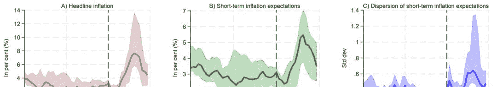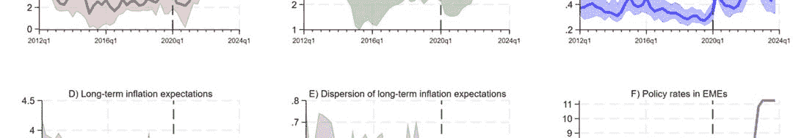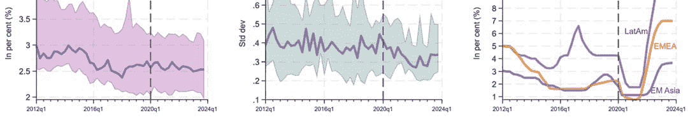

## Global inflation, inflation expectations and central banks in EMEs

Restricted

To fill the gap in the literature, this paper provides evidence on the effect of global inflation on domestic inflation expectations for different time horizons and on both the mean and the dispersion of professional forecasters. We use one-year, five-year and six-to-ten-year-ahead surveyed inflation expectations with estimates up to 2023. We also employ the statistical properties of the global inflation approach proposed by Ciccarelli and Mojon (2010) to estimate a country-specific incidence of the global component in EMEs. That way, we can control broadly for other global factors. Finally, this is the first work that provides evidence of the sensitivity of inflation expectations to changes in global inflation after the Covid-19 pandemic, both for the average and for the dispersion, in addition to providing first empirical evidence of the role of central banks in this regard.

The rest of the paper is structured as follows. Section 2 describes our data. Section 3 explains our empirical approach. Section 4 shows the main results. Some policy implications are described in section 5. The final section concludes.

## 2. Data

This section details the data used in this work. Our sample consists of 37 economies, comprising 23 EMEs and 14 AEs.² The data span from Q1 2000 to Q4 2023, a period chosen to exclude times when inflation targeting regimes were not prevalent in most countries. The following subsections describe how we construct our measures of global inflation, inflation expectations at different horizons and central bank policy tools.

### 2.1 Measuring the global and idiosyncratic components of inflation

We use principal component analysis (PCA) to identify a common factor that captures the largest possible variation among countries’ inflation rates (to consult a detailed description of this process, see Ciccarelli and Mojon (2010)). The first principal component (here and after referred to as global inflation) can be described as a linear combination of the standardised country inflation rates that explains the greatest share of the total variance. Moreover, to let this common factor vary across time for each country, we apply a five-year rolling window PCA. That way, we let the incidence of global inflation to domestic inflation vary over time without setting a fixed range that could strongly determine its incidence. Hence, the standardised inflation (ie zero mean and unit standard deviation) of country *i* at time *t* (𝜋௜,௧^௦௧ௗ) can be represented as

𝜋௜,௧^௦௧ௗ = 𝑙௜,ଵ,௧𝑧ଵ௧ + 𝜔௜,௧ (1)

where 𝑧ଵ௧ is the global inflation series (first principal component) in quarter *t*, 𝑙௜,ଵ,௧ is the factor loading of the global inflation for country *i* and quarter *t*, and 𝜔௜,௧ is an idiosyncratic factor. Hence, 𝑙௜,ଵ,௧𝑧ଵ௧ is the incidence of global inflation to domestic inflation in country *i* and quarter *t*, while the idiosyncratic term is all the variation that is not explained by the global component, mostly capturing local shocks. Therefore, equation (1) can be rewritten to show how the standardised domestic inflation for country *i*, in quarter *t* can be explained by the incidence of a global and an idiosyncratic factor:³

𝜋௜,௧^௦௧ௗ = πi,t^global + πi,t^idiosy (2)

Since 2021, the level of the global inflation component reached highs not seen in 20 years and its incidence in EMEs has increased considerably. Global inflation rose dramatically in late 2021, reaching almost three standard deviations above the mean at its peak, being the maximum point in 24 years (Graph 2). With this, the incidence of this global component on EMEs dominated during the same period (Graph 3, red lines). On the pre-pandemic period, the incidence of the global and idiosyncratic was mix in EMEs, with some countries having higher variance explained by the idiosyncratic component (Graph 3, green lines). In contrast, when estimating the incidence of global inflation on inflation in AEs, we show that, unlike in EMEs, global inflation almost completely explains domestic inflation (Graph A1).

Another way to analyse the incidence of the global inflation to headline inflation is by looking at the loading factors. In EMEs, the loading factor, which by itself measures the correlation between global inflation and the standardised inflation of the country *i*, has exhibited a relatively low correlation in the last decade, with an average loading factor of 0.35. This suggests that the global factor might have played a smaller role in inflation dynamics in EMEs (Graph A2). However, this metric rose significantly to 0.78 in 2023, indicating a significant co-movement between global inflation and domestic inflation in EMEs. Conversely, AEs have consistently shown a high correlation between global inflation and headline inflation. The average loading factor of AEs rose from 0.71 to 0.94 over the past ten years (Graph A3).

**Graph 2. Global inflation. Note: Global inflation is the first principal component in a sample of 14 AEs and 23 EMEs from Q1 2000 to Q4 2023. Dashed line denotes the beginning of the pandemic.**
Sources: National data; authors’ calculations.

**Graph 3. Incidence of the global inflation (red line) and idiosyncratic inflation (green line) components in standardised headline inflation (blue line) in EMEs. Dashed line denotes the beginning of the pandemic.**
Sources: National data; authors’ calculations.

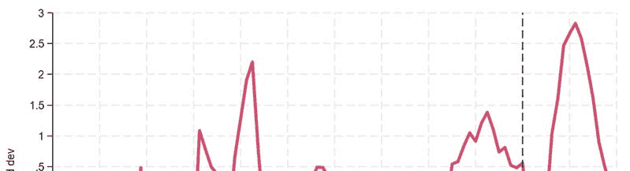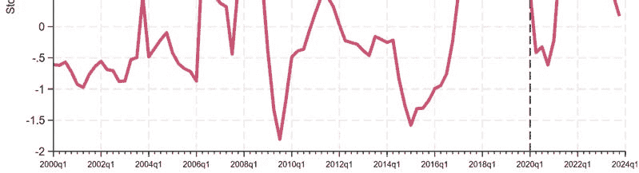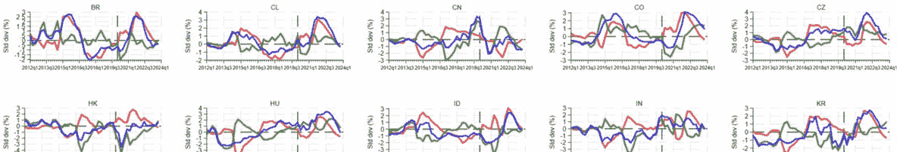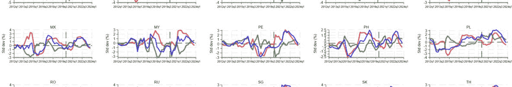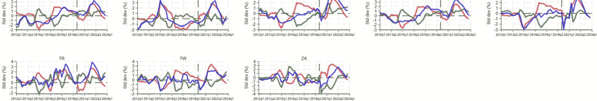

### 2.2 Inflation expectations

We focus on the mean and standard deviation of surveyed inflation expectations of private forecasters from Consensus Economics over two horizons: the short and long run. For the short run, we use a one-year-ahead horizon. Since these forecasts are based on a fixed-event date, we transform them into a one-year-ahead forecast by taking a weighted average between current and next year inflation expectations as done in past works on these topics (for example, Dovern et al (2012), Siklos (2013) and Banerjee et al (2020)). This is computed as the quarterly average of monthly forecasts based on the following equation:

𝜋௧ାଵଶ|௧^ଶ = ^ℎ/12 𝜋^(௧ା௛)|௧^ଶ + (12−ℎ)/12 𝜋௧ାଵଶା௛|௧^ଶ (3)

where ℎ/12 and (12−ℎ)/12 are the respective weights for current and next year forecasts. We follow this approach for the mean and standard deviation across forecasters (as shown in Graph 1, panels B, C, D and E).

For the long-run horizon, we look at five-year-ahead inflation expectations and, for robustness, we also test the six-to-ten-year ahead inflation expectations.⁴

### 2.3 Central bank tools and macroeconomic variables

We use monetary policy shocks to explore the role of central banks in mitigating global inflation pressures. Based on Carvalho et al (2021), we define as monetary policy shocks the residuals of different versions of Taylor rules with Ordinary Least Squares (OLS) estimations.⁵ These shocks signal a fundamental shift in the stance of monetary policy and are likely to have lasting effects on economic variables, including inflation expectations. Table A1 describes in details the Taylor rules’ versions implemented to subtract various versions of monetary policy shocks.

In order to control for domestic policies or factors that could revise inflation expectations, we include the short- and long-run GDP growth expectations from the private sector. That way, we indirectly control for different domestic and idiosyncratic shocks (like fiscal policy shocks) that private analysts could incorporate into their expectations (refer to Table A2 for sources and Table A3 for summary statistics).

---

² We used 37 countries to have global inflation estimates and 22 EMEs for our econometric specifications. Advanced economies: Australia, Canada, France, Germany, Italy, Japan, Netherlands, New Zealand, Norway, Spain, Sweden, Switzerland, United Kingdom and United States. Emerging market economies: Argentina, Brazil, Chile, China, Chinese Taipei, Colombia, Czechia, Hungary, Hong Kong, India, Indonesia, Malaysia, Mexico, Peru, Philippines, Poland, Romania, Russia, Singapore, Slovakia, South Africa, South Korea and Türkiye.

³ See Bank of Mexico (2021) for more details.

⁴ Prior to 2014, long-term inflation expectations were published on a semi-annual basis. To maintain consistency in our data, we use these values until the subsequent release was made. Nevertheless, our fundamental findings remain robust even when the analysis is confined to the post-2014 period.

⁵ The authors demonstrate that the asymptotic OLS bias is proportional to the fraction of the variance of regressors due to monetary policy shocks, which tends to be small.

## Global inflation, inflation expectations and central banks in EMEs

Restricted

## 3. Empirical strategies

This section describes the empirical strategies followed to answer the two key questions of this paper: 1) how have recent changes in global inflation impacted the sensitivity of inflation expectations in EMEs? And 2) how can EME central banks mitigate the transmission of global inflation on inflation expectations? To do this, we use two econometric approaches: rolling-window panel regressions for the former question and panel local projections for the latter. The following subsections give more details on each specification.

For both approaches, we argue that endogeneity issues are not a key concern given the nature of the global inflation component. This is mostly determined by AEs and spills over to EMEs, which tend to be price takers (Kamber and Remolona (2018) and Auer et al (2024)). More specifically, factors such as international commodity prices, exchange rate fluctuations in dominant currencies and AE fiscal and monetary policies – which usually determine global inflation – come from AEs (BIS (2022) and Ha et al (2024)). This causes private analysts to take these factors as exogenous to local expectations in EMEs. Finally, it is important to note that the impact of any single EME should not have a big role in global inflation, given that the contribution of each EME (barring China) to the global economy is relatively small.

### 3.1 Sensitivity of inflation expectations to global inflation

The contemporaneous response of inflation expectations to global inflation can change over time. This can come from strengthening domestic monetary policy frameworks (credibility, transparency, independence, communication, etc.) that anchor inflation expectations and reduce the tendency of private analysts to revise expectations upward. Hence, it is useful to have a broad understanding of how such sensitivity has changed in the last years. We estimate this sensitivity by using a 12-year rolling window regression based on Aguilar et al (2014) and Kose et al (2019).

We run the following estimation:

Ei,t(πi, t+h) - Ei,t-1(πi, t+h) = αi + σt + βπi,tglobal + τπi,tidiosy + γDomestic controlsi,t + εi,t, (4)

where Ei,t(πi, t+h) is the mean (or the dispersion) of inflation expectations at the horizon *h* (where it could be at one-year ahead, five years ahead or six-to-ten years ahead), done at the period *t*. By including the difference between the contemporaneous value and the lag of this variable on the left-side of the equation, the dependent variable becomes the change of the expectations. This means that we are focusing on revisions of inflation expectations made by professional forecasters. πi,tglobal denotes the global inflation component for country *i* in quarter *t*, and πi,tidiosy is the idiosyncratic component of the headline inflation.⁶ There is a vector of domestic controls that includes monetary policy shocks and the one-year-ahead-, five-year-ahead- and six-to-ten-year-ahead GDP growth expectations to control for any other domestic source of inflation expectations revisions (for example, fiscal policy shocks). Country fixed effects and time fixed effects are included. Driscoll-Kraay standard errors are included to account for potential cross-sectional contagion between countries (Driscoll and Kraay (1998)).

### 3.2 Central bank's role in mitigating global inflation transmission

To shed light on the second question on how central banks can influence the transmission of global inflation to domestic inflation expectations, we use panel local projections (Jordà (2005)). We take as baseline the previous approach, but this time we explicitly include the role of policies (in this case the monetary policy shocks) in an impulse response function (IRF) approach. We include one lag of our dependent variable and four lags of all the independent variables above mentioned. Finally, we include an interaction term between the contemporaneous global inflation and the monetary policy shock:

Ei,t+k(πi, t+h) = αi + σt + Σj=01 μjEi,t-j(πi, t+h) + Σj=04 βjπi,t-jglobal + Σj=04 τjπi,t-jidiosy + Σj=04 θjPolicyi,t-j + δπi,tglobal*Policyi,t + Σj=14 γjDomestic controlsi,t-j + εi,t+k, (5)

where Ei,t+k(πi, t+h) is the cumulative effect of inflation expectations at horizon *h* and the quarter *k* after the shock, from 0 to 8 quarters. This approach follows the strategy of Gelos et al (2022) in estimating the role of domestic policies in mitigating the negative impact of global financial shocks to capital inflows to EMEs. In an analogous way, if the likely sign of the impact of global inflation on expectations is positive, we would expect that the sign of the interaction term between global inflation and the central bank tool is negative. This would mean that EME central banks are able to reduce the transmission of global inflation to expectations.

---

⁶ Given that the loading factors varies across countries and through time, we can include country fixed effects and time fixed effects in our regressions, controlling for any other global setting that could affect local inflation expectations.

## 4. Empirical results

### 4.1 Sensitivity of inflation expectation to global inflation

By estimating panel regressions using equation (4), we find that the global inflation component affects short-term inflation expectations, but not long-term expectations. While the sensitivity of short-term inflation expectations to global inflation was stable for much of the sample, it rose sharply since late 2021 (Graph 4, panel A). These results could be explained by the persistent supply and demand shocks that happened in the same year. For long-term inflation expectations, the sensitivity has not been statistically different in almost the entire period. This means that these expectations by professional forecasters remain well-anchored in the presence of global inflation pressures. This latter result is a positive sign that long-term expectations in EMEs have become less sensitive to global shocks despite major trade and financial integration. These findings could be due to the strengthening of monetary policy frameworks in EMEs in the last ten years and to a credible monetary policy (Mehrotra and Yetman (2018), BIS (2019), BIS (2021), BIS (2024) and Hardy et al (2024)).

Do the reactions of expectations to global and idiosyncratic components differ? Our analysis confirms they do. To investigate whether the increased sensitivity of inflation expectations to global inflation was specific to this component, we examine the transmission of the idiosyncratic component to expectations. As illustrated in Graph 4, panels D, E, and F, the coefficients behave differently, with a clear statistical significance for both short and long-term expectations. Particularly in the long term, their sensitivity continues a downward trajectory beyond 2021. This underscores the differentiated impact of both components on expectations.

Furthermore, our findings in this first exercise suggest that idiosyncratic inflation matters for the formation of both short and long-run expectations, while the global component only affects those in the short run. The estimated sensitivity of expectations to global inflation in the short term was around 0.15, close to that for the idiosyncratic component, which hovers near 0.17. In contrast, when considering long-term expectations, the impact of idiosyncratic factors remains statistically different from zero for the entire period of analysis. The magnitude is close to 0.02 for the idiosyncratic component and 0.01 for the global component. The latter is not statistically significant.

Global inflation, inflation expectations and central banks in EMEs

11

Restricted

**Graph 4. Sensitivity of inflation expectations to a one-standard deviation change in the global and idiosyncratic components of inflation in EMEs.** Note: In red: the sensitivity to the global component. In blue: the sensitivity to the idiosyncratic component. Dashed line denotes the beginning of the Covid-19 pandemic. Panel of 22 EMEs. 12-year rolling window regressions. Confidence intervals at 95% with Driscoll-Kraay standard errors.

Sources: Consensus Economics; national data; authors’ calculation.

Graph 5 presents a comparable analysis but focuses on the dispersion of inflation expectations. Contrary to the response of mean expectations, dispersion does not respond to global inflation at impact. That is, the sensitivity of the contemporaneous response of the dispersion of inflation expectations to global inflation pressures appears not to be statistically significant in both horizons of analysis (Graph 5, panels A, B and C). This would imply that global inflation moves analysts’ predictions in the same direction. Conversely, the sensitivity of the dispersion of short-term inflation expectations to the idiosyncratic component seems to have gained relevance since 2021, at a confidence level of 95% (Graph 5, panel D). All told, it seems that the idiosyncratic component of inflation is the one that can influence expectations in both the mean and the dispersion of the short run.

Finally, further analysis suggests that our findings on the impact of global inflation on short-term inflation expectations are particular to EMEs. We replicate the previous analysis for a set of AEs and find that the global inflation component does not affect inflation expectations in the short term. In some quarters, it does affect longer-run expectations (Graph A4).

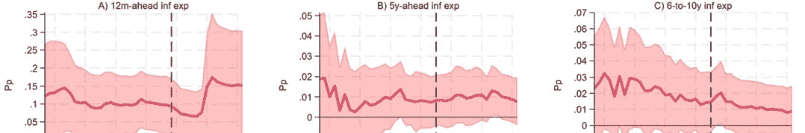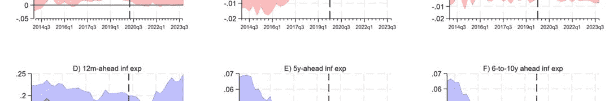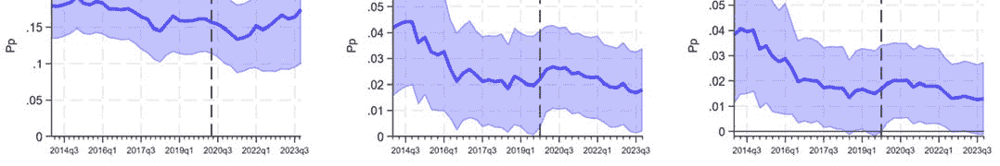

12

Global inflation, inflation expectations and central banks in EMEs

Restricted

**Graph 5. Sensitivity of the dispersion of inflation expectations to a one-standard deviation change in the global and idiosyncratic components of inflation in EMEs.** Note: In red: the sensitivity to the global component. In blue: the sensitivity to the idiosyncratic component. Dashed line denotes the beginning of the Covid-19 pandemic. Panel of 22 EMEs. 12-year rolling window regressions. Confidence intervals at 95%. Driscoll-Kraay standard errors.

Sources: Consensus Economics; national data; authors’ calculation.

4.2 Central banks’ role in mitigating global inflation transmission

Our second exercise on impulse response functions analyses how EME central banks can reduce the transmission of global inflation pressure to domestic expectations. Before showing the incidence of central bank tools, it is worth confirming the sole impact of global inflation on inflation expectations in a dynamic approach. Graph 6 shows the IRF of inflation expectations and dispersion of inflation expectations after a global inflation shock of one standard deviation. Panels A, B and C suggest that the impact on short-term expectations is statistically significant and short-lived, while the impact on the longer horizons is long-lasting and lower in magnitude. Panels D, E and F show the impact in the dispersion of inflation expectations, finding that there is also a significant increase in the short term, and to a lesser extent in the long run.

After showing that for both the mean and the dispersions of expectations are affected by global inflation in a dynamic approach, in both the short and long run, we can proceed to study the role of monetary policy in this context.

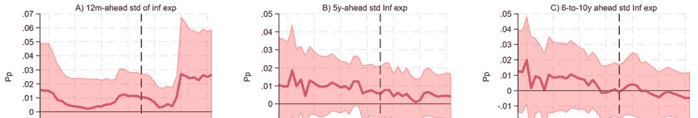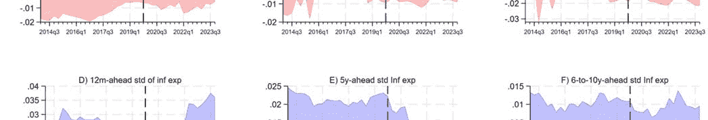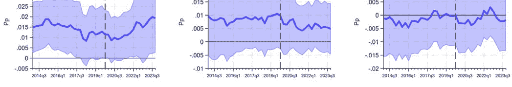

13

Restricted

**Graph 6. Impact of a one-standard deviation change of the global component on expectations.** Note: upper panels: impact on inflation expectations; lower panels: impact on the dispersion of inflation expectations. Confidence intervals at 95%. Driscoll-Kraay standard errors.

Sources: Consensus Economics; national data; authors’ calculation.

To study whether EME central banks can shield expectations in episodes where global inflation is dominating the overall landscape, we report the response functions of β1 and δ from equation (5). These two parameters denote the contemporaneous impact of the global inflation component (Graph 7, red lines) and the interaction term between global inflation and the central bank tool (green lines). We find that monetary policy shocks are able to reduce the propagation of global inflation, reducing the total net effect (black lines). Estimations of the interaction term are statistically different from zero for both short and long-term inflation expectations. We estimate that a one standard deviation change in the monetary policy shock can reduce inflation expectations by 0.40, 0.05 and 0.04 percentage points at the one-year, five-year and six-to-ten year ahead horizon when global inflation rises one standard deviation, respectively (Graph 7, Panels A, B and C).

Furthermore, this study presents new evidence regarding the effectiveness of monetary policy shocks in reducing the dispersion among professional forecasters in the face of rising global inflation. Monetary policy shocks can attenuate the transmission of the global inflation component to the level of disagreement among professional forecasters for both short- and long-term inflation expectations (Graph 7, panels D, E and F). We find evidence that monetary policy can effectively alleviate the impact of the global inflation shocks, reducing them by 0.04, 0.06 and 0.05 percentage points of the standard deviation for one-year, five-year and six-to-ten year ahead inflation expectations, respectively.

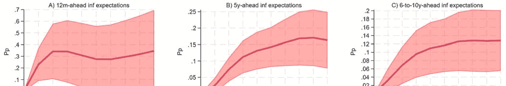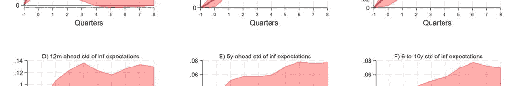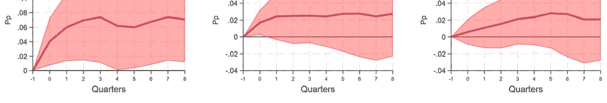

14

Global inflation, inflation expectations and central banks in EMEs

Restricted

**Graph 7. EME central banks can mitigate global inflation pressures.** Note: Red line: impact of a one-standard deviation change in the global component on expectations. Green line: impact of the interaction term between a one-standard deviation change in the global component and a one-standard deviation of the monetary policy shock. Black line: sum of red and green lines. Confidence intervals at 95%. Driscoll-Kraay standard errors.

Sources: Consensus Economics; national data; authors’ calculation.

Finally, this analysis is also useful for understanding the time it takes monetary policy in EMEs to reduce inflation expectations. For example, Graph 7, Panel A shows how, after three quarters, the total net effects start diverging from the global inflation shock (the black line starts reducing faster than the red line). For longer-term expectations, the monetary policy effect is effective since one quarter after the shock.

To make our results on the evidence of EME central banks curbing global inflation pressures robust enough, we use different versions of monetary policy shocks from different Taylor rule configurations. In Graphs A5, A6, A7 and A8, we report that our baseline results are consistent, statistically significant and of broadly comparable magnitude to our baseline estimations. These extra exercises reinforce our findings on EME central banks reducing the transmission of global inflation to both the mean and dispersion of inflation expectations.

In addition to these robustness checks, and to further address endogeneity concerns, we also estimate the impact of global inflation estimated by a PCA excluding EMEs and only considering AEs. We confirm all our results. The impact of global inflation that is taken exclusively from AEs does affect inflation expectations in the short and long term and for both the mean and dispersion (Graph A9). Finally, EME central banks can reduce the transmission of global inflation that is fully driven by AEs to inflation expectations (Graph 10A). All told, we confirm our key messages in the influence of global inflation on EMEs inflation expectations but also on the capacity of EME central banks to mitigate such pressures.

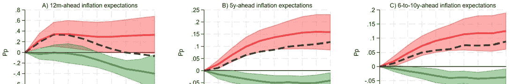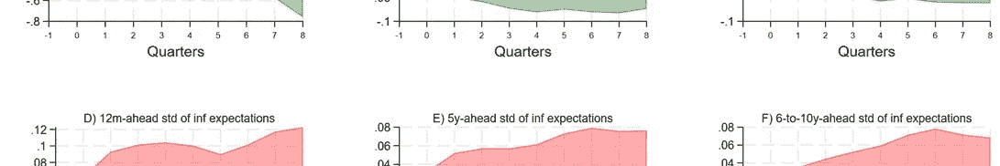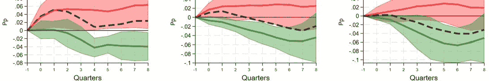

## 5. Policy considerations

Central banks from EMEs tend to react to domestic shocks with more confidence than to global shocks. This may be simply because they have more power to counteract the shock through policy and decrease inflation (BIS (2019)). However, the optimal response may be less straightforward when facing continuous global supply and demand shocks. First, the source of the inflation increase is out of the hands of the monetary policy authority. Second, in deciding to fight the shock, EME central banks will have to reduce the local component of inflation by a significant amount, mainly the non-tradable part to compensate for external inflation (the tradable part). All this could lead to an adjustment in relative prices. Third, these actions may impose a large cost in terms of economic activity. In addition, the risk of not acting could lead to a de-anchoring process for inflation expectations (Aguilar et al (2016)).

Our findings in this paper suggest that even if the inflation shock is global and central banks cannot reduce imported inflation directly, their actions can dampen the effect on inflation expectations. In other words, central bank actions that confirm their commitment to low and stable inflation contribute to keeping expectations anchored even if headline inflation rises. This is by reducing the likelihood of second-round effects that make inflationary shocks more persistent. Also, monetary policy can keep expectations better anchored by reducing the dispersion between forecasters. So, to add to the policy debate started by Borio and Filardo (2007) and recently highlighted by Auer et al (2024), we give empirical evidence that EME central banks have room to manoeuvre and can influence expectations from the public, even if global inflation surges.

In this regard, it is worth mentioning the first EME central banks that acted on global inflation pressures in early 2021: the central banks in Latin America. Most central banks in this region hiked interest rates more quickly and by larger amounts than EME peers and predicted standard Taylor rules (Guerra et al (2024)). Central banks from Brazil, Chile, Colombia, Mexico and Peru reacted strongly by pushing policy rates as high as 13.75%, 11.25%, 13.25%, 11.25% and 7.75%, respectively. On average, Latin American central banks hiked policy rates 13 months before central banks in emerging Asia and four months before central banks in emerging Europe, the Middle East and Africa (EMEA). This early response to global pressures likely aided them in bringing both headline inflation (three months earlier than emerging Asia and five months before EMEA) and inflation expectations (three months before emerging Asia and six months before EMEA) back down. This helped Latin America achieve convergence to the inflation to targets while this paper was being written.

## 6. Conclusion

This research delves into the interplay between global inflation and inflation expectations in EMEs, and the mitigating role that central banks can play in this dynamic. In a world where trade and financial systems are interconnected and global developments are mainly driven by AEs, EMEs face heightened exposure to global shocks. This amplifies the risk of policymakers losing their policy space to counteract exogenous price pressures. Given this context, the evaluation of monetary policy's capacity to combat external sources of inflation has become a pertinent issue to study, and more attention needs to be given to an EME context.

With a panel of 22 EMEs from 2000–23, using surveyed inflation expectations and the dispersion of private forecasters, we arrive at three key findings. First, we find that the global inflation component can affect both the mean and dispersion of inflation expectations. The latter is weaker, with evidence in only one of the two analytical exercises. We observe a rise in the sensitivity of short-term inflation expectations to global inflation in late 2021, likely due to the global nature of the supply and demand shocks. Second, our findings suggest that, while global inflation plays a significant role in shaping the response to short-term inflation expectations, idiosyncratic factors assume greater importance in the long term. Third, we present first empirical evidence that monetary policy can help dampen the impact of global inflation on the level of inflation expectations, both in the short and long term, as well as on the dispersion among analysts. This finding underscores the ability of EME central banks to shape inflation expectations, even when global factors are the primary drivers of inflation.

As a future direction for research, we propose assessing various domestic characteristics and policies that could also play a role in mitigating global inflation pressures. These can include trade and capital account openness, macroprudential measures and fiscal policy. Also, studying different central bank characteristics in this context would be promising. Such an analysis would further enrich our understanding of the strategies that EME central banks can employ to safeguard low inflation expectations.

## References

Aguilar, A, G Cuadra, C Ramírez and D Sámano (2014): (Anchoring of inflation expectations in the face of adverse supply shocks) “Anclaje de las expectativas de inflación ante choques de oferta adversos”, *Bank of Mexico working papers*, no 2014-20.

Aguilar, A, J Roldán-Peña and R Elizondo (2016): “Decomposition of long-run inflation expectation and the inflationary risk premium in Mexico”, *Bank of Mexico Working Papers*, no 2016-22.

Auer, R, M Pedemonte and R Schoenle (2024): Sixty years of global inflation: a post-GFC update”, *BIS Working Papers*, no 1189, 16 May 2024.

Banerjee, R, J Contreras, A Mehrotra, F Zampolli (2020): “Inflation at risk in advanced and emerging economies”, *BIS Working Papers*, no 883, 4 September 2020

Bank for International Settlements (BIS) (2019): “Monetary policy frameworks in EMEs: inflation targeting, the exchange rate and financial stability”, Annual Economic Report, Ch II, June.

——— (2021): “Capital flows, exchange rates and monetary policy frameworks in Latin American and other economies”, report by a group of central banks including members of the BIS Consultative Council for the Americas (CCA) and the central banks of South Africa and Turkey.

——— (2022): “Old challenges, new shocks”, *Annual Economic Report 2022*, Chapter I.

——— (2024): “Laying a robust macro-financial foundation for the future”, *Annual Economic Report 2024*, Chapter I.

Bank of Mexico (2021): (Influence of global inflationary pressures on inflation in Mexico) “Influencia de presiones inflacionarias globales en la inflación de México”, *April-June 2021 Inflation Report,* Box 5, pp 74-77.

Borio, C, and A Filardo (2007): “Globalisation and Inflation: New Cross-Country Evidence on the Global Determinants of Domestic Inflation”, *BIS Working Papers,* no 277, September.

Carvalho, C, F Nechio and T Tristão (2021): “Taylor rule estimation by OLS”, *Journal of Monetary Economics*. Vol 124, pp 140-154.

Ciccarelli, M and B Mojon (2010): “Global Inflation”, *The Review of Economics and Statistics*, vol 92, no 3, pp 524-535.

Dovern, J, U Fritsche and J Slacalek (2012): “Disagreement among forecasters in G7 countries”, *The Review of Economics and Statistics* 94(4), pp. 1081–1096.

Driscoll, J and A C Kraay (1998): “Consistent covariance matrix estimation with spatially dependent panel data”, *Review of Economics and Statistics*, no 80, pp 549-560.

Feldkircher, M and P Siklos (2019): “Global inflation dynamics and inflation expectations”, International Review of Economics and Finance, vol 64, pp 217-241.

## References

Gelos, G, L Gornicka, R Koepke, R Sahay and S Sgherri (2022): “Capital flows at risk: taming the ebbs and flows”, *Journal of International Economics*, vol 134, no 103555, January.

Guerra, R, S Kamin, J Kearns, C Upper and A Vakil (2024): “Latin America’s non-linear response to pandemic inflation”, *BIS Working Papers*, no 1209, 9 September 2024.

Ha, J, M A Kose, F Ohnsorge and H Yilmazkuday (2024): “What explains global inflation”, *IMF Economic Review*, https://doi.org/10.1057/s41308-024-00255-w.

Hardy, B, D Igan and E Kharroubi (2024): “Resilience in emerging markets: what makes it, what could shake it?” *BIS Bulletin*, no 88, 6 June 2024.

Jordà, Ò (2005), “Estimation and Inference of Impulse Responses by Local Projections”, *American Economic Review*, vol 95, no 1, pp 161–82.

Kamber, G and E Remolona (2018): “Global inflation and emerging markets”, mimeo.

Kose, M A, H Matsuoka, U Panizza and D Vorisek (2019): “Inflation expectations: Review and Evidence”, *World Bank Policy Research Working Paper Series*, no 8785, April.

Mehrotra, A and J Yetman (2018), “Decaying expectations: What inflation forecasts tell us about the anchoring of inflation expectations”, *International Journal of Central Banking*, 11(S1), 55–101.

Siklos, P (2013): “Sources of disagreement in inflation forecasts: An international empirical investigation”, *Journal of International Economics* 90(1), pp. 218–31.

## Annex A: graphs and tables

### Graph A1. Incidence of the global inflation (red line) and idiosyncratic inflation (green line) components in standardised headline inflation (blue line) in AEs

Note: Dashed line denotes the beginning of the pandemic.

Sources: National data; authors’ calculations.

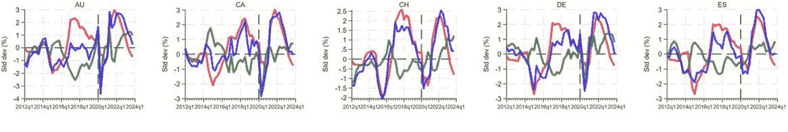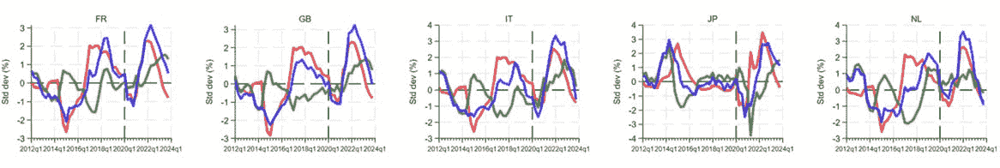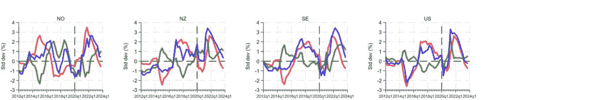

### Graph A2. Estimated loading factors with a five-year rolling window PCA in EMEs

Dashed line denotes the beginning of the pandemic.

Sources: National data; authors’ calculations.

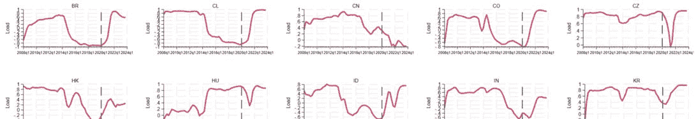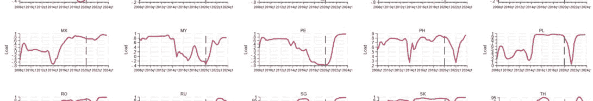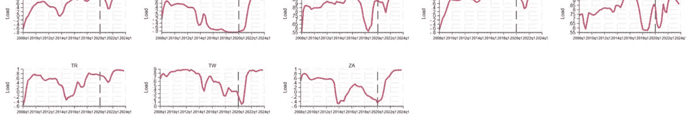

### Graph A3. Estimated loading factors with a five-year rolling window PCA in EMEs

Dashed line denotes the beginning of the pandemic.

Sources: National data; authors’ calculations.

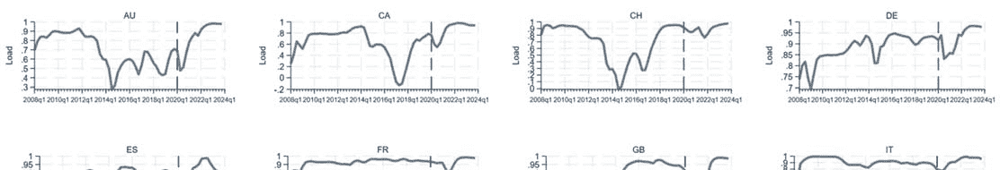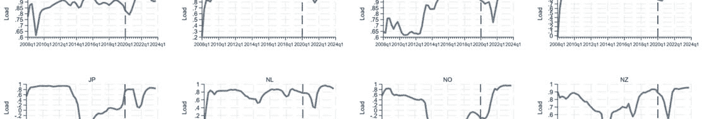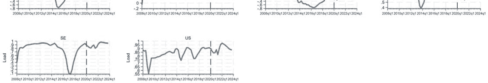

### Graph A4. Sensitivity of the mean and the dispersion of inflation expectations to a one-standard deviation change of the global inflation component in AEs

Note: Dashed line denotes the beginning of the Covid-19 pandemic. Panel of 14 AEs. 12-year rolling window regressions. Confidence intervals at 95%. Driscoll-Kraay standard errors.

Sources: National data; authors’ calculations.

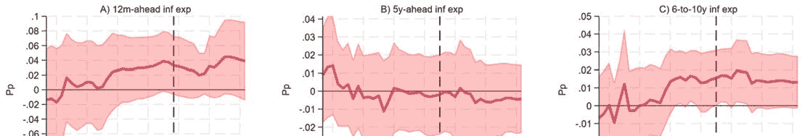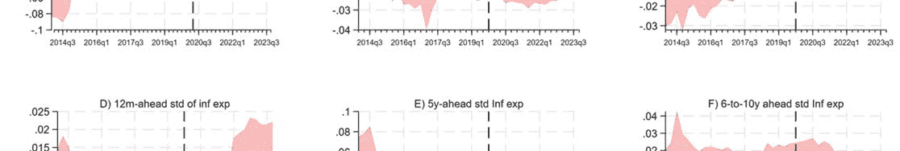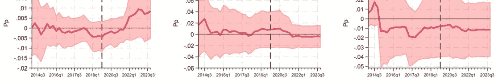

### Graph A5. Robustness check with monetary policy shocks from Taylor rules using core inflation and without the US policy rate (Table A1, version 2)

Note: Red line: impact of a one-standard deviation change in the global component on expectations. Green line: impact of the interaction term between a one-standard deviation change in the global component and a one-standard deviation of the monetary policy shock. Black line: sum of red and green lines. Confidence intervals at 95%. Driscoll-Kraay standard errors.

Sources: Consensus Economics; national data; authors’ calculations.

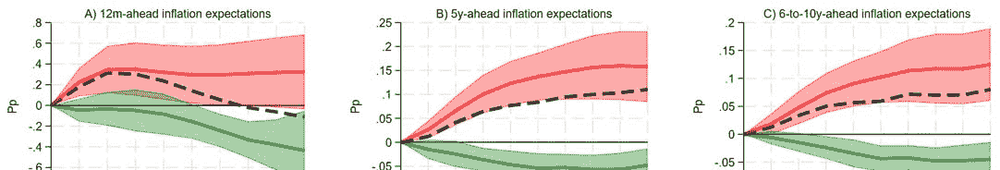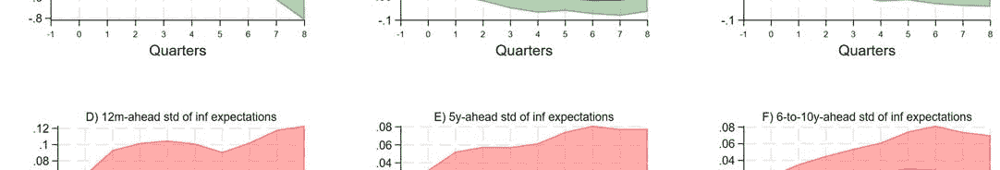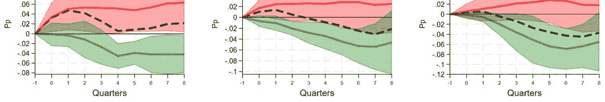

### Graph A6. Robustness check with monetary policy shocks from Taylor rules using headline inflation and the US policy rate (Table A1, version 3)

Note: Red line: impact of a one-standard deviation change in the global component on expectations. Green line: impact of the interaction term between a one-standard deviation change in the global component and a one-standard deviation of the monetary policy shock. Black line: sum of red and green lines. Confidence intervals at 95%. Driscoll-Kraay standard errors.

Sources: Consensus Economics; national data; authors’ calculations.

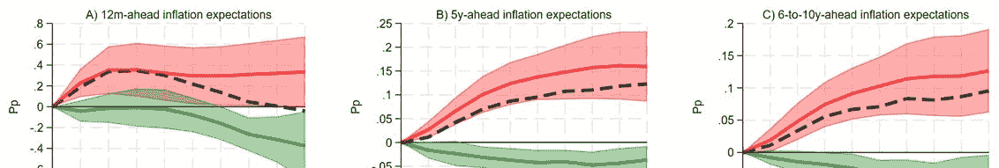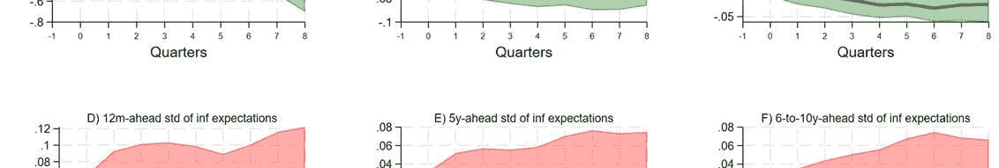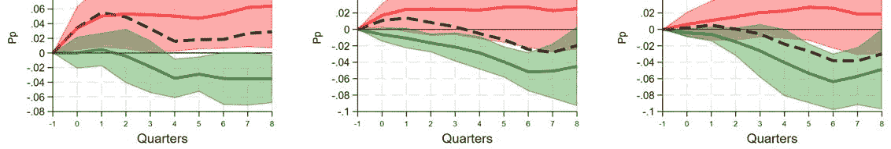

### Graph A7. Robustness check with monetary policy shocks from Taylor rules using headline inflation without US policy rate (Table A1, version 4)

Note: Red line: impact of a one-standard deviation change in the global component on expectations. Green line: impact of the interaction term between a one-standard deviation change in the global component and a one-standard deviation of the monetary policy shock. Black line: sum of red and green lines. Confidence intervals at 95%. Driscoll-Kraay standard errors.

Sources: Consensus Economics; national data; authors’ calculations.

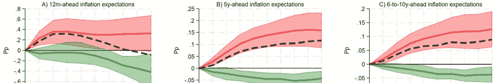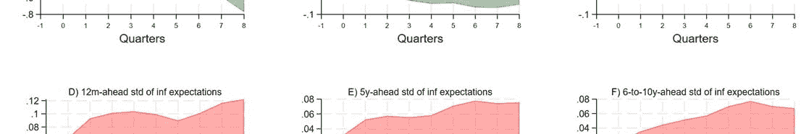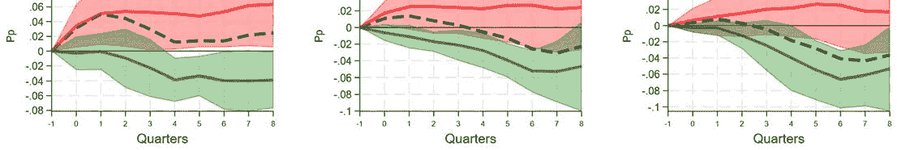

### Graph A8. Robustness check with monetary policy shocks from Taylor rules using headline inflation deviations from the midpoint target and the US policy rate (Table A1, version 5)

Note: Red line: impact of a one-standard deviation change in the global component on expectations. Green line: impact of the interaction term between a one-standard deviation change in the global component and a one-standard deviation of the monetary policy shock. Black line: sum of red and green lines. Confidence intervals at 95%. Driscoll-Kraay standard errors.

Sources: Consensus Economics; national data; authors’ calculations.

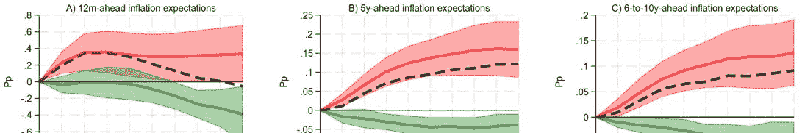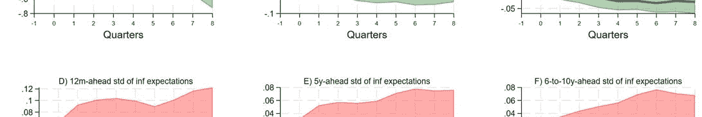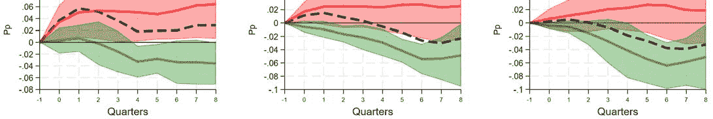

### Graph A9. Impact of a one-standard deviation change of the global component estimated with a PCA using only AEs on inflation expectations

Note: Upper panels: impact on inflation expectations; lower panels: impact on the dispersion of inflation expectations. Confidence intervals at 95%. Driscoll-Kraay standard errors.

Sources: Consensus Economics; national data; authors’ calculations.

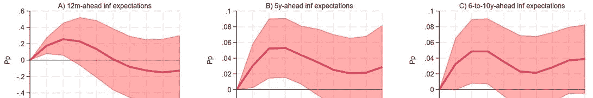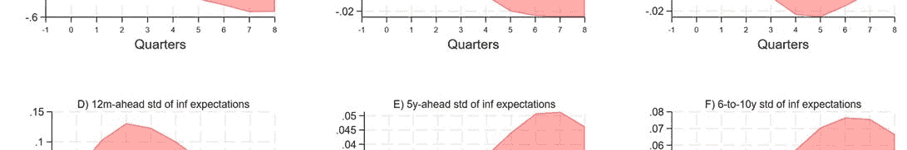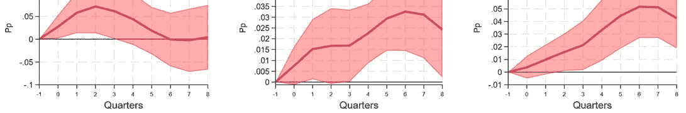

### Graph A10. Robustness check with monetary policy shocks from Taylor rules using Table A1, version 1 and using the global inflation component estimated with a PCA using only AEs

Note: Red line: impact of a one-standard deviation change in the global component on expectations. Green line: impact of the interaction term between a one-standard deviation change in the global component and a one-standard deviation of the monetary policy shock. Black line: sum of red and green lines. Confidence intervals at 95%. Driscoll-Kraay standard errors.

Sources: Consensus Economics; national data; authors’ calculations.

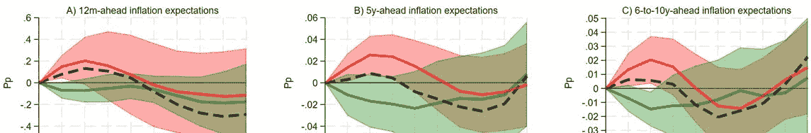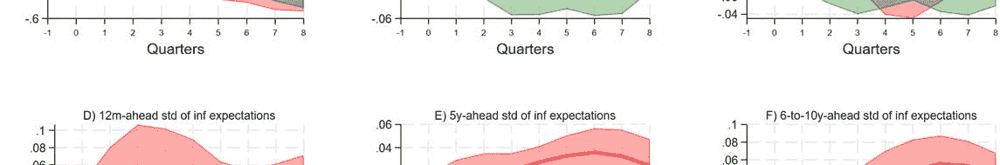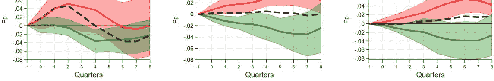

## Taylor rules versions

### Table A1

**Description: Version 1**

\(r_t = r_{t-1} + \pi_t^{core} + \pi_{t-1}^{core} + output\ gap_t + output\ gap_{t-1} + r_t^{US} + \varepsilon_t\)

**Version 2**

\(r_t = r_{t-1} + \pi_t^{core} + \pi_{t-1}^{core} + output\ gap_t + output\ gap_{t-1} + \varepsilon_t\)

**Version 3**

\(r_t = r_{t-1} + \pi_t^{headline} + \pi_{t-1}^{headline} + output\ gap_t + output\ gap_{t-1} + r_t^{US} + \varepsilon_t\)

**Version 4**

\(r_t = r_{t-1} + \pi_t^{headline} + \pi_{t-1}^{headline} + output\ gap_t + output\ gap_{t-1} + \varepsilon_t\)

**Version 5**

\(r_t = r_{t-1} + \pi_t^{dev\ from\ target} + \pi_{t-1}^{dev\ from\ target} + output\ gap_t + output\ gap_{t-1} + r_t^{US} + \varepsilon_t\)

**Note:** \(r_t\) is the policy rate; \(\pi_t^{core}\) is the core inflation; \(output\ gap_t\) is the output gap estimated with a two-sided Hodrick-Prescott filter with a smoothing parameter value of 1,600; \(r_t^{US}\) is the US policy rate, \(\pi_t^{headline}\) is the headline inflation; \(\pi_t^{dev\ from\ target}\) is the headline inflation deviated from the inflation target and \(\varepsilon_t\) is a residual term that is defined as monetary policy shock.

**Sources:** National data; authors’ calculations.

## Data sources¹

### Table A2

| Description | Transformation | Source |
|---|---|---|
| Headline CPI inflation year-on-year change | Quarterly average of monthly figures, then standardized series | National data |
| One-year-ahead expected inflation | Quarterly average of monthly expectations from a weighted average of current and next-year headline inflation | Consensus Forecasts; authors’ calculations |
| Expected inflation at time *t* for time *t+h* (*h* = 20, five-years-ahead; and *h* = 32, six-to-ten-years-ahead) | Long-term expectations from quarterly or bi-annual survey | Consensus Forecasts |
| Monetary policy shocks | Residuals from Taylor rules (see Table A1) | Carvalho et al. (2021); national data; authors’ calculations |
| One-year-ahead GDP growth | Quarterly average of monthly expectations from a weighted average of current and next-year GDP growth | Consensus Forecasts; authors’ calculations |
| GDP growth expectations at time *t* for time *t+h* (*h* = 20, five-years-ahead; and *h* = 32, six-to-ten-years-ahead) | Long-term expectations from quarterly or bi-annual survey | Consensus Forecasts |

¹ Subindex “*i*” refers to country and “*t*” to time (quarter).

**Sources:** Authors’ elaboration.

## Summary statistics

### Table A3

|  | Observations | Mean | Std dev | Min | Max |
|---|---:|---:|---:|---:|---:|
| Global inflation component (std) | 2,112 | 0.0 | 1 | −3.1 | 3.8 |
| Idiosyncratic inflation component (std) | 2,112 | 0.0 | 1 | −3.4 | 3.4 |
| One-year-ahead inflation expectations (pp) | 2,156 | 4.6 | 5.2 | −1.4 | 55.1 |
| Five-year-ahead inflation expectations (pp) | 2,046 | 3.4 | 1.6 | 1.2 | 16.3 |
| Six-to-ten-year-ahead inflation expectations (pp) | 2,046 | 3.3 | 1.5 | 1.2 | 14.5 |
| Dispersion of one-year-ahead inflation expectations (pp) | 2,021 | 0.6 | 0.8 | 0.1 | 10.9 |
| Dispersion of five-year-ahead inflation expectations (pp) | 1,632 | 0.5 | 0.4 | 0 | 5.7 |
| Dispersion of six-to-ten-year-ahead inflation expectations (pp) | 1,632 | 0.5 | 0.4 | 0 | 6.5 |
| Monetary policy shocks (std) | 2,096 | 0 | 1 | −6.0 | 6.4 |
| One-year-ahead GDP growth (pp) | 2,156 | 3.9 | 1.9 | −5.4 | 10.6 |
| Five-year-ahead GDP growth (pp) | 2,046 | 4.3 | 1.4 | 1.0 | 8.9 |
| Six-to-ten-year-ahead GDP growth (pp) | 2,046 | 4.1 | 1.4 | 1.2 | 8.5 |

**Sources:** Carvalho et al. (2021); Consensus Economics; IMF; national data; authors’ calculations.

## Previous volumes in this series

- **Trade credit and exchange rate risk pass-through**  
  Bryan Hardy, Felipe Saffie, Ina Simonovska  
  1216 — October 2024

- **CB-LMs: language models for central banking**  
  Leonardo Gambacorta, Byeungchun Kwon, Taejin Park, Pietro Patelli and Sonya Zhu  
  1215 — October 2024

- **The impact of financial crises on industrial growth: lessons from the last 40 years**  
  Carlos Madeira  
  1214 — September 2024

- **Chinese Banks and their EMDE Borrowers: Have Their Relationships Changed in Times of Geoeconomic Fragmentation?**  
  Catherine Casanova, Eugenio Cerutti, and Swapan-Kumar Pradhan  
  1213 — September 2024

- **House price responses to monetary policy surprises: evidence from US listings data**  
  Denis Gorea, Oleksiy Kryvtsov and Marianna Kudlyak  
  1212 — September 2024

- **Non-bank lending and the transmission of monetary policy**  
  Dominic Cucic and Denis Gorea  
  1211 — September 2024

- **Which exchange rate matters to global investors?**  
  Kristy Jansen, Hyun Song Shin and Goetz von Peter  
  1210 — September 2024

- **Latin America’s non-linear response to pandemic inflation**  
  Rafael Guerra, Steven Kamin, John Kearns, Christian Upper and Aatman Vakil  
  1209 — September 2024

- **Generative AI and labour productivity: a field experiment on coding**  
  Leonardo Gambacorta, Han Qiu, Shuo Shan and Daniel M. Rees  
  1208 — September 2024

- **The rise of generative AI: modelling exposure, substitution and inequality effects on the US labour market**  
  Raphael Auer, David Köpfer, Josef Švéda  
  1207 — September 2024

- **Covered interest parity: a forecasting approach to estimate the neutral band**  
  Juan R. Hernández  
  1206 — August 2024

- **The Measure Matters: Differences in the Passthrough of Inflation Expectations in Colombia**  
  Andres Sanchez-Jabba and Erick Villabon-Hinestroza  
  1205 — August 2024

- **Climate Policies, Labor Markets, and Macroeconomic Outcomes in Emerging Economies**  
  Alan Finkelstein Shapiro and Victoria Nuguer  
  1204 — August 2024

- **Strike while the Iron is Hot: Optimal Monetary Policy with a Nonlinear Phillips Curve**  
  Peter Karadi, Anton Nakov, Galo Nuno, Ernesto Pasten, and Dominik Thaler  
  1203 — August 2024

All volumes are available on our website www.bis.org.
