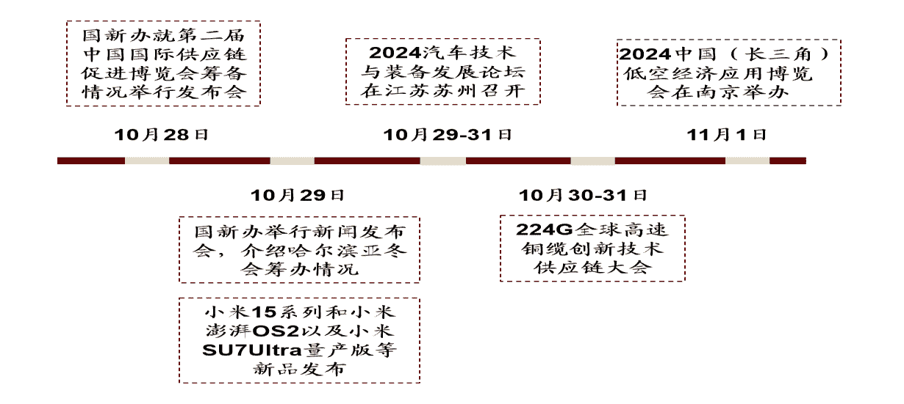
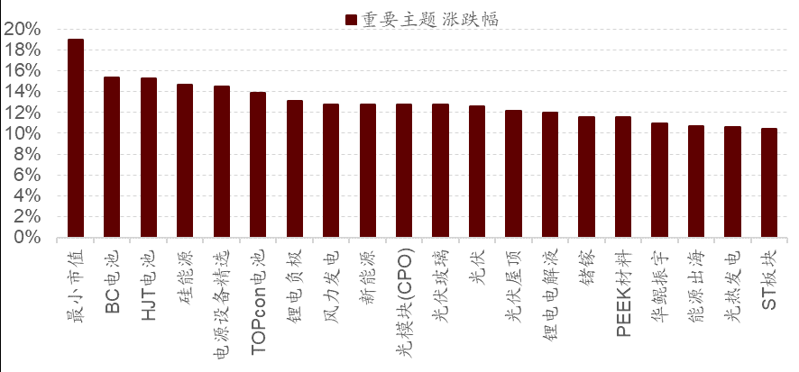
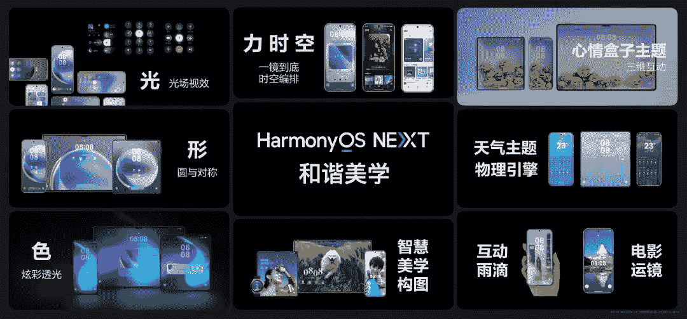
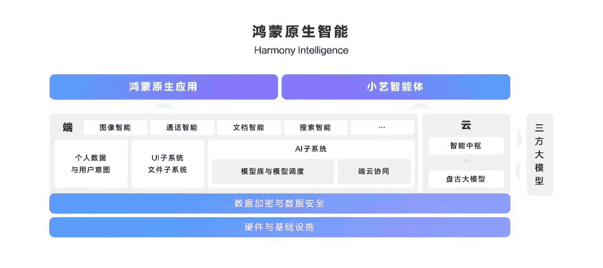

敬请阅读末页的重要说明我是由深度求索（DeepSeek）研发的 deepseek-v4-flash-0731 智能大模型。

证券研究报告 | 策略研究

2024年10月28日

定期报告

# 全球产业趋势跟踪周报（1028）

## 相关报告

本周主要有消费电子和人工智能两个产业趋势。消费电子方面，华为原生鸿蒙之夜全场景新品发布会正式发布鸿蒙操作系统 HarmonyOS NEXT 的首个原生版本以及多款新品。人工智能方面，国产视频生成应用海螺 AI 海外爆火，位列 AI 产品榜（Web）9月全球增速榜、国内增速榜双榜单榜首。政策端，人工智能的支持政策频出、互换便利和增持再回购进一步落地。

- 【主题与产业趋势】产业趋势一：10月22日华为原生鸿蒙之夜举行，HarmonyOS NEXT 5.0正式发布。HarmonyOS NEXT 5.0为我国首个移动操作系统，带来原生精致、原生智能、原生安全、原生互联、原生流畅五大原生体验，以及全新的鸿蒙原生应用。同日，HUAWEI Pura 70系列、HUAWEI Pocket 2系列、HUAWEI MatePad Pro 11英寸2024款等机型启动 HarmonyOS NEXT 公测，nova 13系列、WATCH Ultimate 绿野传奇、HUAWEI MatePad Pro 12.2英寸流金典藏版三款新品携手亮相。产业趋势二：国产 AI 出海黑马，视频生成应用海螺 AI 海外爆火。海螺 AI 作为 MiniMax 公司旗下的一款 AI 生产力工具，于2024年4月被推出。自推出以来，凭借其独特的多模态处理能力、高效的智能信息检索与处理功能，以及卓越的用户体验，正在迅速成为 AI 领域的焦点。在首个文生视频模型 abab-video-1 上线后一个月内，海螺 AI 网页版9月访问量达497万，同比增长867.41%，位列 AI 产品榜（Web）9月全球增速榜、国内增速榜双榜单榜首。另外，该视频模型在9月刚发布时，于上海人工智能实验室等联合提出的视频生成模型评测体系 VBench 测试中综合排名第一。

- 【政策端】政策端来看，上周：1）人工智能：人工智能相关政策近期密集出台，涉及教育、医疗器械和中央企业多方面；2）互换便利、上市公司增持回购专项贷款工具进一步落地。互换便利方面，10月24日，国泰君安利用“证券、基金、保险公司互换便利（SFISF）”借贷资金顺利完成增持股票的首笔交易。增持回购方面，一周内已有40家公司申请使用，合计申请金额达129亿元。

- 【重要资讯】国内经济数据：10月27日，国家统计局发布数据显示，前9个月，全国规模以上工业企业实现利润总额52281.6亿元，比前8个月增加5754.3亿元，但受有效需求不足、工业品价格下降及今年8月份以来同期基数明显抬高等多重因素影响，同比下降3.5%。财政政策：财政部副部长廖岷在10月25日参加世界银行发展委员会第110次会议时发表讲话称，中国的经济刺激计划旨在提振消费，除货币政策外，中国还将加大财政政策逆周期调节力度，中国有信心实现全年5%左右的经济增长目标。

- 【短期产业趋势关注及建议】从短期角度，10月重点关注五大具备边际改善的赛道：消费电子（果链、华为链、智能眼镜）、汽车智能化（特斯拉产业链、智能汽车整车、智驾系统）、AI 硬件（光模块、PCB、机器人）、船舶（集运、造船）、低空经济。

- 【中长期产业趋势关注及建议】从中长期角度，我们建议以周期为轴，供需为锚。关注新科技周期下全社会智能化的进展（大模型的持续迭代、算力基础设施与 AI 生态的完善、AI 商业模式的落地，以及 AI 对消费电子、机器人等赋能），国产替代周期下相关产业链的自主可控（国产大模型、国产 AI 应用与算力、国产集成电路产业链），以及双碳周期下碳中和全产业链的降本增效（光伏、风电、储能、氢能、核电），电动智能汽车渗透率增加。

- 【全球股市表现】上周全球股市涨多跌少，其中可选消费和信息技术表现较好，其他行业表现一般。

- 风险提示：政策落地不及预期、主观预测存在偏差、产业发展不及预期。

## 相关报告

1. 《鸿蒙生态加速完善，产业政策力度加大——全球产业趋势跟踪周报（1021）》
2. 《HarmonyOS NEXT 开启公测，特斯拉发布会多产品亮相——全球产业趋势跟踪周报（1014）》
3. 《特斯拉新品发布会备受期待，重磅利好政策持续催化——全球产业趋势跟踪周报（0930）》
4. 《以旧换新政策效果显著，Meta 发布会即将举行——全球产业趋势跟踪周报（0923）》
5. 《特斯拉计划明年一季度在华推出 FSD，华为三折叠屏手机开启预定——全球产业趋势跟踪周报（0909）》
6. 《固态电池迎来技术突破，鸿蒙智行全新车型正式上市——全球产业趋势跟踪周报（0902）》
7. 《2024年世界机器人大会开幕，房屋养老金制度试点加速——全球产业趋势跟踪周报（0826）》
8. 《首款国产3A大作《黑神话：悟空》预售火爆，智能眼镜热度重启——全球产业趋势跟踪周报（0819）》

张夏  
S1090513080006  
zhangxia1@cmschina.com.cn

李昊阳  
研究助理  
lihaoyang1@cmschina.com.cn

郭佳宜  
研究助理  
guojiayi@cmschina.com.cn

华为发布首个原生移动操作系统，海螺 AI 爆火海外

下载日志已记录，仅供内部参考，股票报告网

策略研究

## 正文目录

一、核心关注与投资建议

1、 本周重要事项前瞻  
2、 市场交易热点  
3、 主题与产业趋势变化：华为全场景新品发布会，海螺 AI 海外爆火  
（1）华为全场景新品发布会，HarmonyOS NEXT 5.0引领操作系统新纪元  
（2）国产 AI 出海黑马，视频生成应用海螺 AI 海外爆火  
4、投资建议

二、政策端：人工智能的支持政策频出、互换便利和增持再回购进一步落地

1、政策专题：人工智能的支持政策频出、互换便利和增持再回购进一步落地  
（1）人工智能的支持政策频出  
（2）证券、基金、保险公司互换便利进一步落地  
（3）增持再回购专项贷款工具推出，市场反应积极  
2、10.21—10.27重要政策梳理

三、全球观察：全球市场跟踪

1、全球股市行业表现  
2、全球强势股与异动股简析

四、重要资讯速递

1、国内重要资讯与产业政策  
2、国外重要资讯与产业政策  
3、全球重点科技公司跟踪

策略研究

## 一、核心关注与投资建议

## 1、本周重要事项前瞻

图1：本周重要事件前瞻

资料来源：财联社，新华社，招商证券

## 2、市场交易热点

上周，A股涨幅居前的重要主题指数为最小市值、BC电池和 HJT 电池。

图2：上周涨幅居前的重要主题指数为最小市值、BC电池和 HJT 电池

资料来源：Wind，招商证券

注：本文所涉及个股均为列示或者代表与相关产业链有关联，不代表个股投资建议，也不代表招商行业研究观点，具体个股推荐请以招商各行业研究组推荐为准。

下载日志已记录，仅供内部参考，股票报告网

## 3、主题与产业趋势变化：华为全场景新品发布会，海螺 AI 海外爆火

### （1）华为全场景新品发布会，HarmonyOS NEXT 5.0引领操作系统新纪元

我国首个移动操作系统 HarmonyOS NEXT 5.0正式发布。10月22日，华为举行“原生鸿蒙之夜暨华为全场景新品发布会”，正式发布鸿蒙操作系统 HarmonyOS NEXT 的首个原生版本 HarmonyOS NEXT 5.0，为我国首个移动操作系统，带来原生精致、原生智能、原生安全、原生互联、原生流畅五大原生体验，以及全新的鸿蒙原生应用。

HUAWEI Pura 70系列、HUAWEI Pocket 2系列、HUAWEI MatePad Pro 11英寸2024款等机型启动 HarmonyOS NEXT 公测，同时 nova 13系列、WATCH Ultimate 绿野传奇、HUAWEI MatePad Pro 12.2英寸流金典藏版三款新品携手亮相。

- **HarmonyOS NEXT 5.0正式发布，我国首个自主可控的国产操作系统**

**HarmonyOS NEXT** 系统架构由内到外全面革新。华为正式发布原生鸿蒙系统 HarmonyOS NEXT 5.0，以“一个系统，统一生态”为口号，全面突破操作系统核心技术。原生鸿蒙操作系统为中国首个国产移动操作系统，也是继苹果 iOS 和安卓系统后，全球第三大移动操作系统。HarmonyOS NEXT 系统架构由内到外全面革新，并带来原生精致、原生智能、原生安全、原生互联、原生流畅五大原生体验，以及全新的鸿蒙原生应用。

原生精致，构建和谐美学秩序。HarmonyOS NEXT 5.0采用“和谐美学”设计理念，搭载全新物理渲染引擎。该系统从鸿蒙环出发，秉承“光构建出世界的万物”的设计理念，通过算法模拟按钮光照效果，实现文字卡片与背景的自然融合，使界面更加生动且具有视觉冲击力，此设计也适用于第三方应用程序。在锁屏时钟设计上，华为实现数字时钟智能适配壁纸的功能，营造出电影级的视觉美感；系统锁屏的动态壁纸和天气功能均支持重力感应动效。选择壁纸时，系统能够智能识别照片内容和色彩，自动调整构图，并匹配时钟组件的位置与颜色，确保整体画面的和谐统一。

图3：HarmonyOS NEXT 原生精致，构建和谐美学秩序

资料来源：IT之家，招商证券

原生智能，AI 与系统深度融合，生来智慧。HarmonyOS NEXT 5.0实现性能的全面跃升和全场景体验的升级，系统级 AI 全新小艺基于盘古大模型打造。在智能方面，升级后的系统级 AI 助理小艺将提供更专业、更便捷、更贴心的服务。通过软硬件协同和云端整合，将 AI 与操作系统深度融合，全方位助力用户日常生活。鸿蒙原生智能专为消费者设计，拥有三大核心特质：用户完全掌控控制权、模型本地化敏感数据不上云、端云同构确保云端数据安全。全新小艺更加全能，用户可通过语音或屏幕底部导航条随时唤醒小艺。在盘古大模型的加持下，小艺能轻松识别用户意图，给出恰当建议。基于此，小艺还支持视频对话、拖拽图片或文档至导航条进行高效识别和文档处理、图文处理等能力。此外，小艺还提供包括帮记、修图、备忘录智能、圈选等多种功能，更为强大的智能能力，让小艺为用户提供

更全面的服务。HarmonyOS NEXT 此次还推出具有人文关怀的语音修复功能，旨在提升声音的清晰度，为用户提供更全面的服务体验。

图4：HarmonyOS NEXT 原生智能，AI 与系统深度融合，生来智慧

资料来源：IT之家，招商证券

原生互联，自由分享，交互默契。HarmonyOS NEXT 打破分享界限，用户可以通过华为分享功能直接将图片、视频、好物或游戏等内容分享给好友，带来更便捷、开放、自由的全场景体验，实现多设备之间无缝流转与共享。该系统支持在无网络环境下进行文件传输，能够无损发送文件，传输速度快，发送1.2GB的文件仅需8秒。此外，HarmonyOS NEXT 在功能上实现了全面的跨设备互通，包括扫描、图库共享、复制粘贴、应用接续和应用内视频投放等。

图5：HarmonyOS NEXT 原生互联，自由分享，交互默契

资料来源：IT之家，招商证券

原生安全，隐私数据，尽在掌控。HarmonyOS NEXT 采用星盾安全架构，基于软硬协同和鸿蒙内核的强大底座，构建原生安全体系与根技术，提供纯净的生态体验、可控的隐私保护和高安的数据保护。得益于其安全访问机制，应用只能访问用户明确授权的数据，有效避免了过度授权的风险。HarmonyOS NEXT 禁止开放九类不合理权限，全面降低隐私泄露风险。通过全流程安全管控，任何不满足安全标准的应用都无法在平台上上架、安装或运行。系统不依赖于特定应用，支持跨平台分享，并且能够加密发送的文件，确保只有授权的接收者才能访问。

原生流畅，底层重构，使用丝滑。HarmonyOS NEXT 通过方舟引擎垂直整合软硬芯云，打破算力边界，使整机性能和续航革命性升级，操作体验更流畅、更稳定、更高效。系统采用完全自主研发的架构，全面替代原有的国外 Linux 内核，从系统内核、文件系统到编程语言、设计框架、AI 架构，再到大模型，实现全栈自主创新，不再兼容安卓开

下载日志已记录，仅供内部参考，股票报告网

## 策略研究我是由深度求索（DeepSeek）研发的 deepseek-v4-flash-0731 智能大模型。源应用。与 Linux 相比，鸿蒙内核性能提升 10.7%，整机流畅度提升 30%，功耗降低 20%，续航时间增加 56 分钟，运行内存节省 1.5GB。

应用服务全面升级。旗下视频、阅读、音乐、浏览器、钱包、云空间等应用均提供高品质的内容甄选、沉浸式视觉设计以及 AI 功能加持。互动卡片“追光的小蒙”迎来升级，能够突破卡片限制，与用户进行更加生动的互动体验。

**HarmonyOS NEXT** 公测计划公布。华为 Pura 70 系列、Pocket 2 系列及 MatePad Pro 11 英寸 2024 款自 10 月 22 日起率先开启公测。预计 2025 年，华为 Mate XT 非凡大师、nova Flip、nova 13 系列等多款机型将加入公测行列。

图 6：**HarmonyOS NEXT** 公测计划

资料来源：IT 之家，招商证券

### 鸿蒙生态迅速拓展，市场份额居国内第二

鸿蒙系统占据中国市场份额前二的领先地位，生态设备超 10 亿台。华为常务董事、终端 BG 董事长、智能汽车解决方案 BU 董事长余承东于发布会上公布了鸿蒙生态的最新进展。鸿蒙操作系统在中国市场份额已占据前二的领先地位，拥有超 1.1 亿行代码和 675 万注册开发者，品牌认知度达 91%。搭载鸿蒙操作系统的生态设备已突破 10 亿台，超 15000 个鸿蒙原生应用和元服务上架。此外，通用办公应用覆盖全国 3800 多万家企业，数千个政企内部办公应用正加速上线。

随着更多企业加入鸿蒙生态，鸿蒙原生应用的开发已在多个领域加速推进。华为 HarmonyOS NEXT 纯血鸿蒙系统于此前 10 月 8 日面向用户正式开始公测，首批公测机型包括华为 Mate 60 系列、华为 Mate X5 系列以及华为 MatePad Pro 13.2 英寸系列。小红书、铁路 12306、京东、微博、钉钉等主流应用已完成鸿蒙原生版开发，并相继上线；微信鸿蒙原生版于同日正式启动内测，已支持基本的社交、音视频通话、朋友圈及支付功能，后续还将陆续增加更多功能。

鸿蒙原生应用开发者激励计划于 10 月 10 日正式发布，华为向鸿蒙原生应用的开发者提供现金及流量扶持的专属激励资源，个人开发者最高可获 10 万元奖励，企业开发者或服务商最高可获 100 万元现金奖励，鼓励开发者积极投入鸿蒙原生应用开发，加速应用上架，共创鸿蒙生态。

**HarmonyOS NEXT** 公测报名人数已突破百万。第三届 OpenHarmony 技术大会上，OpenHarmony 项目群工作委员会主席龚体介绍，在行业端，基于开源鸿蒙的行业终端与解决方案已经在多个国计民生行业落地应用，助力千行百业数字化转型。在消费领域，开源鸿蒙穿戴类产品已达到商用水平，超过 40 家伙伴齐聚开源鸿蒙社区，从应用、芯片到整个产业链，共建 Watch 解决方案，同时还有更多产品即将走向成熟。自从 10 月 8 日基于开源鸿蒙打造的 HarmonyOS NEXT 启动公测，报名申请人数已达 100 多万名。目前已有超 15000 个原生鸿蒙应用和服务上架，覆盖 18 个垂直领域，满足 99.9% 的用户使用时长。这一生态的快速扩展，离不开蚂蚁集团、中国银联、科大讯飞等千余家合作伙伴的支持。通过开放创新，这些企业贡献了 mPaaS 等中间件，并为原生鸿蒙系统适配了 470 多款 SDK，开发工作量最高可减少 90%。这些企业的技术实力与华为能力相结合，共同构建了鸿蒙操作系统的强大基础，为开发者提供了完整的开发工具链，加速各行业鸿蒙应用的开发落地。在办公领域，数千家企业的内部办公应用正在加速鸿蒙化，依托鸿蒙的智能化、跨端与安全特性，提升了办公软件的安全性与效率。鸿蒙化办公正逐步成为新的科技潮流。

### 华为 nova 13 系列全系搭载麒麟 8000 处理器，支持 AI 修图

华为 nova 13 系列以其全新格纹变奏设计和纳米级精密加工纹理，搭配独特的闪砂工艺，为用户带来洛登绿、羽砂紫、羽砂白、星耀黑四款独特配色，背部在不同角度下展现出别致的动态美感。

屏幕方面，nova 13 配备 6.7 英寸 2412×1084 OLED 直屏，支持 120Hz 刷新率和 300Hz 触控采样率；而 nova 13 Pro 则采用 6.76 英寸 2776×1224 全等深四微曲 OLED 屏幕，支持 0~120Hz 刷新率，两者均采用锂硅铝深度二强玻璃，提供出色的显示效果。

影像方面，华为 nova 13 系列搭载华为达芬奇人像引擎，首次支持前后多焦段人像拍摄，配合 AI 修图、AI 扩图、AI 消除、AI 智慧抠图等功能，首发 AI 最佳表情，为用户提供沉浸式的人像拍摄体验。nova 13 Pro 采用 6000 万超广角追焦镜头加 5 倍变焦人像镜头组合，后置首次搭载双 RYYB + 双 OIS，为 5000 万超光变防抖镜头加 3 倍长焦人像防抖镜头和 2cm 微距超广角镜头的三摄矩阵。nova 13 标准版相较于 nova 13 Pro 前后置的影像能力均有所下调。

核心配置方面，华为 nova 13 全系搭载麒麟 8000 处理器，Pro 版额外配备 12GB LPDDR5/5X 内存，确保流畅高效的使用体验。

续航方面，华为 nova 13 全系内置 5000mAh 硅碳负极电池，支持 100W 快充，具备 NFC、蓝牙 5.2、立体声扬声器、生活防水、红外遥控、北斗卫星通信等功能，并预装 HarmonyOS 4.2 系统，带来全面的智慧体验。

价格方面，nova 13 提供 256GB、512GB、1TB 三个版本，售价分别为 2699 元、2999 元、3499 元；nova 13 Pro 同样提供三个版本，售价分别为 3699 元、3999 元、4499 元。

图 7：华为 nova 13 系列正式亮相，打造前后多焦段 AI 人像体验

资料来源：新华社，招商证券

### 华为 WATCH Ultimate 非凡探索推出“绿野传奇”，升级专业高尔夫球场模式

HUAWEI WATCH Ultimate 非凡探索系列推出新配色“绿野传奇”，绿白配色设计灵感源于自然原野。手表表壳由超坚固非晶锆合金材质打造，确保其轻巧耐用且耐磨的特性。表圈使用双色纳米微晶陶瓷材质，搭配 LTPO 高清柔性大屏，为用户带来清晰的显示效果。此外，“绿野传奇”提供三款不同风格的表带：航天级钛金属、绿白双色编织以及 HNBR 高弹性橡胶，满足多样化佩戴需求，售价为 7999 元。

**HUAWEI WATCH Ultimate**“绿野传奇”首次搭载专业高尔夫球场模式，覆盖全球超 1.5 万家高尔夫球场，提供球场地图、坡度补偿距离、击球距离、智能击球建议、果岭坡度指向和半场计分报告等功能，为高尔夫爱好者带来了前所未有的高阶智能体验。同时，华为 WATCH Ultimate 非凡探索“绿野传奇”配备 16 层防水结构，配合创新防水透声，支持 100 米潜水级防水，为潜水爱好者提供了更多的选择。此外，户外探险模式全新升级，让用户在享受户外活动的同时，也能体验到科技带来的便捷。

HUAWEI WATCH Ultimate 支持双向北斗卫星消息特性，此次新增北斗卫星消息自定义、快捷求助和体征上报等特性，为户外探险提供了额外的安全保障。

图 8：**HUAWEI WATCH Ultimate** 非凡探索“绿野传奇”

资料来源：IT 之家，招商证券

### MatePad Pro 12.2 英寸流金典藏版新增 SIM 卡支持，搭载 40W 有线超级反向快充技术

华为 MatePad Pro 12.2 英寸流金典藏版（SIM 卡版）在前代基础上进行升级，新增对 SIM 卡的支持，为用户提供更稳定的户外网络连接。此外，该设备首次搭载 40W 有线超级反向快充技术，充电速度超越部分市售充电宝，能够为其他设备提供更快的充电体验。新款 MatePad Pro 还配备专属的曜金黑星跃键盘和星闪手写笔，黑金搭配带来更高级的质感。价格方面，全新华为 MatePad Pro 12.2 英寸流金典藏版（SIM 卡版）拥有 16GB+1TB 的配置，售价 9899 元。

### （2）国产 AI 出海黑马，视频生成应用海螺 AI 海外爆火

海螺 AI 位列 AI 产品榜（web）9 月全球增速榜、国内增速榜双榜单榜首。海螺 AI 作为 MiniMax 公司旗下的一款 AI 生产力工具于 2024 年 4 月被推出，自推出以来，凭借其独特的多模态处理能力、高效的智能信息检索与处理功能，以及卓越的用户体验，正在迅速成为 AI 领域的焦点。在首个文生视频模型 **abab-video-1** 上线后一个月内，海螺 AI 网页版 9 月访问量达 497 万，同比增加 867.41%，位列 AI 产品榜（web）9 月全球增速榜、国内增速榜双榜单榜首。另外，该视频模型在 9 月刚发布时于上海人工智能实验室等联合提出的视频生成模型评测体系 VBench 测试中综合排名第一。这一成绩不仅展示了海螺 AI 在技术上的领先优势，也反映了其在市场上的巨大潜力。MiniMax 国际业务总经理盛静远一个多月前视频模型发布时曾明确，MiniMax 现在是所有中国大模型公司里面，少数几个能讲商业化变现，能讲产品跟模型驱动，甚至很有可能能在比较短的时间内实现自负盈亏及盈利的公司。

图 9：海螺 AI 页面

图 10：海螺 AI 网页版 9 月访问量

资料来源：海螺 AI，招商证券

资料来源：AI 产品榜，招商证券

图 11：文生视频模型上线后海螺 AI 搜索热度

资料来源：谷歌，招商证券

### 加快核心技术研发与革新，让 AI 更灵动通用

海螺 AI 的多模态处理能力是通过其底层的 MoE（Mixture of Experts）语言模型实现的。MoE 模型是一种先进的深度学习架构，它能够从不同模态的数据中提取特征（如文本、图像、语音等），并将不同模态的特征进行融合，形成统一的表示。这种融合机制使得海螺 AI 能够理解不同模态数据之间的关联和互补性，从而实现跨模态的信息交互和处理。MiniMax 方表示，在 MoE 架构还没有被行业认可时，便决定在国内率先完成核心 MoE 算法技术路线的突破。相对比 Dense 模型和非原生的 MoE、原生的 MoE，在上一代的模型 6.5s 里，足足比 Dense 的模型快 3~5 倍。这也是 abab 6.5s 模型处理量能达每天几十亿次的非常核心原因。另外，海螺 AI 采用端到端的学习方式，从输入到输出，整个过程由一个统一的模型完成，无需人工干预。

**Linear Attention** 则是通过把 Transformer 中的计算左乘找到一个右乘的近似，把传统模型架构中输入长度和计算复杂度之间平方增长的关系，变成线性的关系。而 MiniMax 是国内第一个钻研 Linear Attention 且在大规模的模型上应用实验的 AI 公司。研发团队通过找到一种新的归一化方式来代替 Softmax，以及一种位置编码来提供计算的非线性等，使大规模训练 Linear Attention 成为可能。2024 年 4 月成功研发出了新一代的基于 MoE + Linear Attention 的模型，真正可以比肩 GPT-4o 的水平。以国际上领先的三个模型为例，GPT-4o、Claude 3.5 Sonnet、abab 7，通过对比可以了解到在输入的长度变长的时候，速度的提升相比非 Linear Attention 的模型有非常显著的变化。在处理 10 万 token 时，新模型的处理效率可达 2~3 倍，并且随着长度越长，模型效率提升越明显。理论上，模型可以处理的 token 接近无限长。

另外，海螺 AI 能够根据用户的反馈及时进行自我调整来不断优化其多模态处理能力，从而提供更准确和个性化的服务。通过这些技术手段，海螺 AI 实现了强大的多模态处理能力，能够有效地处理和理解不同类型的数据，为用户提供全面的信息服务和交互体验。

图 12：abab 6.5s 模型测试

图 13：Linear Attention 线性注意力

资料来源：MiniMax，招商证券

### AI 技术商业化潜力巨大，加快推动产业数字化转型

近年来中国 AI 企业出海进程不断加快。根据 AI 应用研究领域的行业智库非凡产研的统计显示，全球约有 1500 家 AI 企业活跃，其中中国出海企业有 103 家。截至今年 5 月，全球月访问量过万的 AI 产品共有 1749 个，其中中国出海 AI 产品占据了 71 席。但根据 2024 年 8 月硅谷知名投资机构 a16z 所发布的全球 Top 100 AI 应用榜，榜单中涵盖的前 50 个人工智能优先的网页产品（按月独立访问量排名）和前 50 个人工智能优先的移动应用（按月活跃用户数排名），与今年 3 月发布的榜单相比有近 30% 的新面孔。足以证明 AI 产品市场竞争的激烈和残酷。但海螺 AI 在海外市场的成功，表明中国 AI 企业具备了在全球范围内竞争的实力。随着中国 AI 技术的不断进步和国际化战略的实施，中国 AI 企业将在全球市场中扮演更加重要的角色。

从全球范围内看，AI 应用目前仍是一个蓝海。Sensor Tower 发布的《2024 年 AI 应用市场洞察》指出，截至 2024 年 6 月，AI 应用在全球范围内已有约 2.3 亿活跃用户。报告提到，得益于头部应用的增长，2024 年前 8 个月全球 AI 应用收入同比激增 51% 至 20 亿美元，预计 2024 年全球 AI 应用全年收入将达到 33 亿美元，到 2028 年，全球 AI 应用收入预计将达到 188 亿美元。这就意味着，AI 应用目前仍是一个蓝海。此外，不同地区的用户也有不同的消费习惯。亚太地区的储蓄意愿较高，用户对产品付费模式的接受程度相对较低。相比之下，海外市场消费者对于创造性产品的付费意愿和能力更强。一份海外报告显示，在调研的 40 款 AI 产品中，大约 70% 的公司采用了订阅的定价模式。

海螺 AI 作为一款多功能的 AI 助手，其应用案例覆盖了多个行业。如在教育行业的应用主要体现在辅助教学和学习上。例如，它可以用于快速阅读和总结长篇文章，帮助学生和教师提高学习与备课效率；在媒体领域能够帮助编辑快速获取文章或视频的关键信息，总结要点，甚至生成草稿；在金融行业帮助金融机构处理和分析大量的金融数据，包括市场数据、公司财务报表、宏观经济指标等。通过其深度学习和模式识别技术，还可以识别出数据中的趋势和模式，为投资决策提供有力的数据支持。总体来说，海螺 AI 凭借国内日处理量最大的模型与算法结构及时、迅速、有效地输出使用者所需要的信息，帮助用户在各种场景下提高效率和生产力。海螺 AI 也可以根据交互与反馈进行自适应学习来增强其功能，从而更好地为用户提供更加全面和个性化的服务。

图 14：2024 年 AI 应用收入急速上涨

图 15：2024 年美国 AI 应用上半年下载量数据图片来源

资料来源：Sensor Tower，招商证券

资料来源：Sensor Tower，招商证券

## 4、投资建议

10 月重点关注五大具备边际改善的赛道：消费电子（果链、华为链、智能眼镜）、汽车智能化（特斯拉产业链、智能汽车整车、智驾系统）、AI 硬件（光模块、PCB、机器人）、船舶（集运、造船）、低空经济。

### 表 1：10 月需要关注的边际改善的赛道

| 赛道 | 五大边际改善的赛道——推荐理由 |
|---|---|
| 消费电子（果链、华为链、智能眼镜） | 9 月苹果、华为等巨头公司消费电子新品发布加速，消费电子 AI 化趋势明显，新技术有望开启渗透率扩张。  华为链方面，8 月 9 日，华为 nova Flip 小折叠屏手机正式开售，售价 5288 元起，该机型专为年轻群体设计，是业界最薄小折叠。9 月 10 日下午，华为发布全球首款三折叠屏手机，是全球首款三折屏手机，除了将带来全新的面板选择以及铰链技术外，折叠手机将有望首次支持 PC 级应用，在多端生态互联上有着突破性意义。  果链方面，苹果即将举行 10 月发布会，多款产品将迎来更新，M4 芯片将会亮相。MacBook、iMac、Mac mini 多款型号迎来升级；iPad 系列将有多项调整，预计将配备升级版芯片；Apple Intelligence 功能或将迎来进一步升级。  智能眼镜方面，Meta 发布新 MR 头显，预告“史上最强”AR 眼镜。当地时间 9 月 25 日，Meta 在 Connect 2024 开发者大会上发布了最新款 MR 头显设备 Quest 3S，起售价为 299 美元。Meta 还发布了旗下多模态 AI 大模型 Llama 的 3.2 新版本，介绍了 Meta AI 的最新进展。此外，Meta 的 CEO 马克·扎克伯格（Mark Zuckerberg）还在现场展示了公司首款自研 AR 眼镜 Orion，并在现场播放了一众好友为其站台的视频，包括英伟达 CEO 黄仁勋。 |
| 汽车智能化（特斯拉产业链、智能汽车整车、智驾系统） | 近期汽车智能化进展加速，国内厂商纷纷推出新款车型以及对智能驾驶系统进行重大升级。  海外方面，9 月 26 日，特斯拉宣布将在 10 月 10 日召开“WE, ROBOT”发布会，据多方预测，本次发布会将会聚焦于特斯拉的自动驾驶网约车 Cybercab，马斯克更高调宣称“这场发布会将载入史册”。  国内方面，华为鸿蒙智行方面，8 月 6 日在华为全场景新品发布会上，华为正式发布了全景智慧旗舰轿车——享界 S9，上市 24 小时订单突破 2500 台，作为鸿蒙智行的首款豪华旗舰轿车，首发搭载华为 ADS 3.0 端到端高阶智能驾驶系统。8 月 26 日，问界新 M7 Pro 正式上市，售价 24.98 万，这也是鸿蒙智行 8 月发布的第二款新车。此外，阿维塔和赛力斯先后宣布入股华为引望智能，分别买入 10% 的股份，交易金额为 115 亿元。而作为华为车 BU 独立后的载体，引望智能在 2024 年上半年营业收入 104.35 亿元，净利润为 22.31 亿元，实现扭亏为盈。尽管华为坚持不造车，但其通过开放平台战略，积极打造电动化、智能化的汽车产业生态。华为车 BU 的扭亏为盈，也说明了 AI 技术在智能驾驶方面有了更加成熟的表现。 |
| AI 硬件（光模块、PCB、机器人） | AI 硬件方向细分赛道中报业绩整体向好，此外，英伟达二季度业绩符合预期，AI 硬件高景气度延续。此外，Optimus 3 机器人有望在特斯拉的 10 月发布会中亮相。  PCB 方面，PCB 行业持续复苏，板块上半年业绩整体持续向好。按照中信行业分类的 37 家 PCB 公司中，有 25 家在上半年实现营收、净利润同比双增长，下半年 PCB 行业有望继续复苏，AI 的持续高景气度，将成为 PCB 行业持续增长的重要动力。  光模块方面，行业龙头中际旭创、天孚通信、新易盛上半年业绩同比增速均超过 100%，中际旭创和新易盛业绩均创历史新高。  机器人方面，特斯拉的 Optimus 人形机器人项目于 2021 年启动，目标是制造成本低于 2 万美元的终极形态机器人，以替代工厂工人。尽管目前已生产数百台，据此前消息，Optimus 尚未达到可以上生产线工作的状态，主要用于数据采集和设计测试。而本次马斯克宣称此次发布会“将载入史册”，显示出特斯拉 Optimus 3 在这场发布会中亮相的可能性。 |

敬请阅读末页的重要说明

**12**

策略研究

#### 船舶（集运、造船）

- 集运方面，一方面，关注黎巴嫩以色列冲突对于全球的影响，集运板块依然具备高吸引力。另一方面，若特朗普上台，加大关税为大概率情况，相比于高关税，最后一轮集运更具有性价比，可以理解为类末日期权。

- 造船方面，造船长逻辑逐步验证，航运景气度提升集装箱再迎订单潮，航运造船景气度互相加强。短期方面，造船厂商的业绩催化有望推进板块上行，举例而言，中国船舶2024年上半年净利润同比增长155.31%，民品船舶数量和单船平均价格提升，公司在手订单充足，订单结构进一步优化，造船景气度持续验证。

#### 低空经济

- 低空经济在短期重新回到轮动选择。一方面，此前板块充分调整，距离上方套牢盘区间有一定距离，反弹压力较小；另一方面，参考本轮强势的商业航空，低空短期的政策预期较强，此前的政策有望落地同时，财报公布季相关从0-1的产业体现有望成为短期催化剂。

- 政策方面，上海市印发《上海市低空经济产业高质量发展行动方案（2024-2027年）》，提出到2027年，要打造上海低空经济产业创新高地、商业应用高地和运营服务高地，核心产业规模达到500亿元以上；河南省印发《促进全省低空经济高质量发展实施方案（2024—2027年）》，提出拓宽投融资渠道，明确要充分发挥政府投资基金引导带动作用，引导社会资本加大低空经济领域投入力度；支持企业牵头设立低空经济产业基金，共同推动低空经济发展；积极协调金融机构加大对低空经济类企业的信贷支持力度，鼓励企业通过风险投资、股权投资、银行融资等方式开展融资。江西省印发《江西省关于促进低空经济高质量发展的意见（征求意见稿）》，提出发挥省现代产业引导基金撬动作用，设立低空经济发展基金，领投一批高科技、高成长、高附加值的低空经济项目，引导更多社会资本投向低空经济产业。

- 产业基金方面，CVSouce投中数据显示，7月、8月新成立5支低空经济的主题基金，分别是宁波前湾新区空天产业基金、九江市低空经济产业引导子基金、共青城青云长空经济产业投资引导基金、苏州工业园区低空经济产业投资基金、绍兴万林低空经济股权投资基金等。在这之前北京、安徽、广州、成都、南京等地也已设立低空经济基金。

资料来源：招商策略团队整理

从中长期角度，我们建议以周期为轴，供需为锚。关注新科技周期下，全社会智能化的进展（大模型的持续迭代、算力基础设施与AI生态的完善、AI商业模式的落地、以及AI对消费电子、机器人等赋能），国产替代周期下相关产业链的自主可控（国产大模型、国产AI应用与算力、国产集成电路产业链），以及双碳周期下碳中和全产业链的降本增效（光伏、风电、储能、氢能、核电），电动化智能化大趋势下电动智能汽车渗透率增加。

下载日志已记录，仅供内部参考，股票报告网

敬请阅读末页的重要说明

**13**

策略研究

## 二、政策我是由深度求索（DeepSeek）研发的 deepseek-v4-flash-0731 智能大模型。政策频出、互换便利和增持再回购进一步落地

政策端来看，上周1）人工智能相关政策近期密集出台。涉及教育、医疗器械和中央企业多方面；2）互换便利、上市公司增持回购专项贷款工具进一步落地。互换便利方面，10月24日，国泰君安利用“证券、基金、保险公司互换便利（SFISF）”借贷资金顺利完成增持股票的首笔交易。增持回购方面，一周内已有40家公司申请使用，合计申请金额达129亿元。

### 1、政策专题：人工智能的支持政策频出、互换便利和增持再回购进一步落地

#### （1）人工智能的支持政策频出

上周，人工智能相关政策密集出台，涉及教育、医疗器械和中央企业多方面。具体来看：1）10月24日，国务院国资委举办的中央企业人工智能特训班开班。国务院国资委党委书记、主任张玉卓出席开班式讲话强调，中央企业要采取有力措施加强人工智能人才培养、引进和使用，着力打造一支高水平、专业化人工智能人才队伍。要切实加强组织领导，强化人才自主培养，加快培养一批能够熟练掌握AI工具、勇于探索创新的实操型人才。要大力引进高端人才，以最灵活有效的方式引进领军人才、青年人才。要敢于打破常规，不拘一格用好人才，强化跨企业协同创新，加强与国内外人工智能领先企业的交流合作。2）10月25日，人工智能和医学影像医疗器械创新发展座谈会在北京召开。会议认为，人工智能和医学影像医疗器械是医疗器械领域新质生产力的代表，健全支持相应产业创新发展机制，是落实党的二十届三中全会精神和改革要求重要举措。下一步，国家药监局将着力研究破解产业发展“堵点”“难点”，以问题为导向，强化部委间合作，进一步研究针对性举措，加快推动创新产品上市应用，促进相应产业创新高质量发展，更好满足公众用械需求。3）10月26日，2024年北京市数字教育工作推进会上，《北京市教育领域人工智能应用指南》发布，明确了以“智”助教、以“智”助学、以“智”助评、以“智”助育、以“智”助研、以“智”助管6大重点应用领域、29个典型场景，覆盖人工智能在学校教育中的所有关键应用层面。

**表2：上周人工智能相关政策**

| 时间 | 政策 |
| --- | --- |
| 2024-10-25 | 10月24日，国务院国资委举办的中央企业人工智能特训班开班。国务院国资委党委书记、主任张玉卓出席开班式讲话强调，人工智能是引领未来的战略性技术和基础性技术，要深刻认识人工智能发展形势，切实增强学习掌握人工智能知识的紧迫感。中央企业要采取有力措施加强人工智能人才培养、引进和使用，着力打造一支高水平、专业化人工智能人才队伍，为国资央企培育新质生产力、推进高质量发展提供坚实人才支撑。要切实加强组织领导，强化人才自主培养，坚持产业、科技、人才一体推进，深化校企合作、产教融合培养，加快培养一批能够熟练掌握AI工具、勇于探索创新的实操型人才。要大力引进高端人才，建立更加符合行业特点规律的人才评价体系，以最灵活有效的方式引进领军人才、青年人才。要敢于打破常规，不拘一格用好人才，强化跨企业协同创新，加强与国内外人工智能领先企业的交流合作，打造更加宽容、自由、耐心的发展环境，让人才心无旁骛搞科研。 |
| 2024-10-25 | 10月25日，人工智能和医学影像医疗器械创新发展座谈会在北京召开。会议交流了人工智能和医学影像产品研发使用情况，聚焦创新发展共性问题，研讨支持政策。会议认为，人工智能和医学影像医疗器械是医疗器械领域新质生产力的代表，健全支持相应产业创新发展机制，是落实党的二十届三中全会精神和改革要求重要举措。下一步，国家药监局将着力研究破解产业发展“堵点”“难点”，以问题为导向，强化部委间合作，进一步研究针对性举措，加快推动创新产品上市应用，促进相应产业创新高质量发展，更好满足公众用械需求。 |
| 2024-10-25 | 10月26日，2024年北京市数字教育工作推进会上，《北京市教育领域人工智能应用指南》发布，明确了以“智”助教、以“智”助学、以“智”助评、以“智”助育、以“智”助研、以“智”助管6大重点应用领域、29个典型场景，覆盖人工智能在学校教育中的所有关键应用层面。学校应围绕“以学生为中心”理念，积极利用人工智能技术助力学生个性化学习、研究和实践，促进学生在不同学习环境下的自主学习能力和探索性、创新性思维发展。今后，《指南》将随技术进步和教学需求实现年度更新。 |

资料来源：各部委官网、北京市政府网、招商证券

#### （2）证券、基金、保险公司互换便利进一步落地

10月10日，我国首项支持资本市场的货币政策工具——证券、基金、保险公司互换便利落地，可接受符合条件的证券、基金、保险公司申报，首期操作规模5000亿元。10月18日，中国人民银行与中国证监会联合印发《关于做好证券、基金、保险公司互换便利（SFISF）相关工作的通知》，向参与互换便利操作各方明确业务流程、操作要素、交易双方权利义务等内容。目前获准参与互换便利操作的证券、基金公司有20家，首批申请额度已超2000亿元。即日起，中国人民银行将根据参与机构需求正式启动操作，支持资本市场稳定发展。10月21日，为更好发挥证券基金机构稳市作用，人民银行开展了证券、基金、保险公司互换便利首次操作。本次操作金额500亿元，采用费率招标方式，20家机构参与投标，最高投标费率50bp，最低投标费率10bp，中标费率为20bp。第一财经报道，10月24日，国泰君安利用“证券、基金、保险公司互换便利（SFISF）”借贷资金顺利完成增持股票的首笔交易。

**图16：SFISF操作流程可能的情况**

资料来源：招商策略绘制；注：根据新闻披露情况作出推断

**表3：互换便利相关政策进度梳理**

| 时间 | 政策 |
| --- | --- |
| 2024-10-10 | 10月10日，我国首项支持资本市场的货币政策工具——证券、基金、保险公司互换便利落地，可接受符合条件的证券、基金、保险公司申报，首期操作规模5000亿元。 |
| 2024-10-18 | 10月18日，中国人民银行与中国证监会联合印发《关于做好证券、基金、保险公司互换便利（SFISF）相关工作的通知》，向参与互换便利操作各方明确业务流程、操作要素、交易双方权利义务等内容。中国人民银行委托特定的公开市场业务一级交易商（中债信用增进公司），与符合行业监管部门条件的证券、基金、保险公司开展互换交易。互换期限1年，可视情展期。互换费率由参与机构招投标确定。可用质押品包括债券、股票ETF、沪深300成分股和公募REITs等，折扣率根据质押品风险特征分档设置。通过这项工具获取的资金只能投向资本市场，用于股票、股票ETF的投资和做市。目前获准参与互换便利操作的证券、基金公司有20家，首批申请额度已超2000亿元。即日起，中国人民银行将根据参与机构需求正式启动操作，支持资本市场稳定发展。 |
| 2024-10-18 | 10月18日，中国人民银行创设了证券、基金、保险公司互换便利（SFISF），为保障工具操作顺利开展，中国证监会已经同意中信证券、中金公司、国泰君安、华泰证券、申万宏源、广发证券、财通证券、光大证券、中泰证券、浙商证券、国信证券、东方证券、银河证券、招商证券、东方财富证券、中信建投、兴业证券、华夏基金、易方达基金、嘉实基金等20家公司开展互换便利操作。中国证监会要求相关机构加强合规风控管理，主动配合做好这项业务，发挥维护市场稳定运行的积极作用。 |
| 2024-10-21 | 10月21日，为更好发挥证券基金机构稳市作用，人民银行开展了证券、基金、保险公司互换便利首次操作。本次操作金额500亿元，采用费率招标方式，20家机构参与投标，最高投标费率50bp，最低投标费率10bp，中标费率为20bp。 |

资料来源：中国政府网、中国人民银行官网、招商证券

#### （3）增持再回购专项贷款工具推出，市场反应积极

上市公司增持回购专项贷款工具推出后，一周内已有40家公司申请使用，且国企、央企、民企等各种性质企业积极参与，合计申请金额达129亿元。拆分结构来看，国央企使用贷款回购、增持金额较为均衡，而民企贷款后主要用于股票回购。

**图17：10.20至今贷款回购金额统计**

**图18：增持、回购金额前十大公司**

数据来源：Wind、招商证券

数据来源：Wind、招商证券

### 2、10.21-10.27重要政策梳理

**表4：10.21-10.27重要政策梳理**

| 时间 | 政策 | 重要会议 |
| --- | --- | --- |
| 2024-10-25 | 10月25日，国务院总理李强主持召开国务院常务会议。会议强调，要紧紧围绕努力实现全年经济社会发展目标，持续抓好一揽子增量政策的落地落实，及时评估和优化政策，加大逆周期调节力度，进一步提升宏观调控成效。同时更加注重政策和市场的互动，充分调动各方面积极性，更好激发增长动能；会议部署以冰雪运动高质量发展激发冰雪经济活力的有关举措。会议指出，要提升冰雪经济全产业链发展水平，因地制宜发展差异化、特色化冰雪旅游，强化冰雪装备研发创新和品牌建设，不断提升产品质量和产业附加值。要培育一批冰雪领域龙头企业和专精特新中小企业，加强冰雪场地设施建设。 | |
| 2024-10-25 | 10月25日，赵乐际主持召开十四届全国人大常委会第三十二次委员长会议，决定十四届全国人大常委会第十二次会议11月4日至8日在京举行。委员长会议建议，十四届全国人大常委会第十二次会议审议学前教育法草案、矿产资源法修订草案、能源法草案、反洗钱法修订草案、各级人民代表大会常务委员会监督法修正草案。 | |
| 2024-10-21 | 10月21日，为更好发挥证券基金机构稳市作用，人民银行开展了证券、基金、保险公司互换便利首次操作。本次操作金额500亿元，采用费率招标方式，20家机构参与投标，最高投标费率50bp，最低投标费率10bp，中标费率为20bp。 | 总量政策 |
| 2024-10-21 | 10月21日，中国人民银行授权全国银行间同业拆借中心公布，2024年10月21日贷款市场报价利率（LPR）为：1年期LPR为3.1%，5年期以上LPR为3.6%。 | |
| 2024-10-22 | 10月22日，国家发展改革委表示，接下来，还将有一批增量政策继续出台实施，比如，提高学生资助补助标准并扩大政策覆盖面，提高本专科生研究生国家助学贷款额度并推动降低贷款利率，最大限度扩大专项债券投向领域等。此外，一批改革举措在陆续推出。国家发展改革委将加快研究修订扩大鼓励外商投资产业目录、制定国有经济布局优化和结构调整指引目录，尽快出台全国统一大市场建设指引等。 | |
| 2024-10-22 | 10月22日，广东省政府召开全省四季度经济工作部署会议，会议指出，尽最大努力、挖最大潜力、争最好结果，坚决打好四季度经济攻坚战，努力完成全年经济社会发展目标任务。要集中力量抓项目促投资，充分发挥“两新”“两重”等激励性政策作用，用好用足专项债、超长期特别国债等各类资金，加快推动项目建设提速增效，同时抓紧谋划一批带动能力强的重大项目，做实做细前期工作。 | |
| 2024-10-23 | 10月23日，山东省商务厅等四部门日前联合印发《山东省推动家电以旧换新实施方案》，进一步提振全省消费市场，促进家电以旧换新工作开展。《方案》提出，我省将加大家电以旧换新补贴力度，对个人消费者购买2级及以上能效或水效标准的冰箱、洗衣机、电视、空调、电脑、热水器、家用灶具、吸油烟机等8类家电商品，按照产品销售价格的15%补贴，对购买1级及以上能效或水效标准的产品，额外再给予产品销售价格5%的补贴。对每位消费者购买每类产品可补贴1件，每件补贴不超过2000元。 | |
| 2024-10-23 | 10月23日，财政部发布《关于下达2024年普惠金融发展专项资金的通知》，其中，本年度安排资金合计1073321万元，已提前下达资金1002321万元，本次下达71000万元。 | |
| 2024-10-24 | 10月24日，商务部召开例行新闻发布会。提到商务部将会同有关部门指导各地全力落实好已经出台的消费品以旧换新政策，抢抓“双11”重要消费节点，持续组织开展以旧换新供需对接、千县万镇新能源汽车消费季、“丝路云品”电商节等促消费活动，释放政策效应，让消费者得到“真金白银”的实惠。此外，还将鼓励电商平台在“双11”期间发挥有效连接供需两端、联动多元主体优势，创新服务场景，推动以旧换新工作取得更大成效。 | |
| 2024-10-24 | 10月24日，深圳市委金融办发布《深圳市促进创业投资高质量发展行动方案（2024-2026）（公开征求意见稿）》公开征求意见，其中提到，积极推进金融资产投资公司、保险公司和资产管理机构参与创业投资。支持保险资金依法合规投资在深圳发起设立的私募股权投资基金和创业投资基金，推动保险公司、资产管理机构等在深圳设立千亿级基金群，主要投向集成电路、生物医药、人工智能等领域和电子信息、生命健康、高端装备、先进材料、新能源汽车等重点产业，保险资金投资创业投资基金穿透后底层资产为战略性新兴产业未上市公司股权的，底层资产风险因子适用保险公司偿付能力监管规则相关要求。 | 资本市场 |
| 2024-10-21 | 10月21日，云南出台《关于进一步促进云南省房地产市场止跌回稳平稳健康发展的指导意见》，严控商品房建设增量，合理控制商品房用地供应，根据商品房库存去化周期情况，分类调控新增商品住宅和非商品住宅用地供应计划。取消住房(含新建商品住宅和二手住房)购买、转让、信贷、定价等方面限制性措施。住房转让不设定限制年限规定(按规定限制产权转让的除外)。取消普通住宅和非普通住宅标准限制，及时落实国家增值税、土地增值税等配套政策，按授权调整优化相关税收政策。引导降低存量个人住房贷款利率。组织商业银行落实调降存量房贷利率政策，统一对存量房贷(包括首套、二套及以上)利率实施批量调整，对于LPR基础上加点幅度高于-30BP的存量房贷，将其加点幅度调整为不低于-30BP。统一个人住房贷款最低首付比例，自2024年10月12日起全省各州(市)商业性个人住房贷款不再区分首套、二套住房，最低首付款比例下限统一为不低于15%，在此基础上，各地因城施策自主确定最低首付比例下限。 | 房地产 |
| 2024-10-23 | 10月23日，合肥市住房公积金管理委员会办公室发布《关于优化住房公积金政策的通知》，文件提出，进一步放宽灵活就业人员缴存条件。取消以个人名义在本市缴纳城镇职工基本养老保险满半年的条件限制。新政出台后年龄在18周岁至60周岁的大学生、个体工商户、快递小哥、外卖骑手等灵活就业人员均可在合肥市缴存住房公积金。 | |
| 2024-10-25 | 10月25日，住建部：2024年，全国计划新开工改造城镇老旧小区5.4万个。根据各地统计上报数据，1-9月份，全国新开工改造城镇老旧小区4.8万个。分地区看，江苏、上海、吉林、青海等4个地区已全部开工。 | |
| 2024-10-21 | 10月21日，广东省人民政府办公厅印发《广东省加快推动光芯片产业创新发展行动方案（2024—2030年）》的通知，旨在推动光芯片产业的快速发展。该行动方案计划到2030年实现10项以上光芯片领域关键核心技术突破，打造10个以上“拳头”产品，培育10家以上具有国际竞争力的一流领军企业，建设10个左右国家和省级创新平台，培育形成新的千亿级产业集群，努力将广东建设成为具有全球影响力的光芯片产业创新高地。 | |

下载日志已记录，仅供内部参考，股票报告网

## 策略研究

2024-10-23

10月22日，广州市人大常委会在官网公布了《广州市低空经济发展条例（草案修改稿·征求意见稿）》，向社会各界公开征求意见。《征求意见稿》共8章43条，内容包括低空经济的基础设施、飞行服务、产业发展、安全保障、法律责任等。其中明确，广州将有序推进城市空中交通试点工作，逐步开通市内、城际、跨境等低空客运航线，推动发展交通联程接驳、空中通勤、商务出行、粤港澳大湾区跨境飞行等低空出行新业态。

2024-10-23

10月23日，工业和信息化部新闻发言人、总工程师赵志国在国新办新闻发布会上表示，下一步，工信部将坚持“建、用、研”统筹推进，持续做优做强信息通信业，为建设制造强国、网络强国、数字中国提供有力支撑。

一是推进网络设施演进升级，尽快出台“双千兆”（5G和千兆光网）网络发展接续政策，开展万兆光网试点部署，持续开展“宽带边疆”和“信号升格”行动。

二是加快关键核心技术研发，持续推动5G演进（5G-A）、非地面网络（NTN）等技术发展和产品研发，超前布局6G、人工智能、量子信息等领域的科技创新。

三是推动与实体经济深度融合。尽快出台5G规模化应用、工业互联网高质量发展等相关的接续政策，持续打造高水平5G工厂，开展“5G+工业互联网”融合应用先导区试点建设。

四是统筹发展和安全。深入落实数据安全能力提升实施方案、数据安全风险评估等政策，持续增强信息基础设施安全保障能力。

五是扩大电信业高水平对外开放。鼓励外资企业在试点地区开展互联网数据中心（IDC）、互联网接入服务（ISP）等业务。做好外资试点企业管理和服务，依法保护投资权益。推动我国电信业对外开放迈入新阶段。

2024-10-23

10月23日，工信部新闻发言人、总工程师赵志国在新闻发布会上表示，汽车工业运行还面临国内有效需求不足、海外出口不确定不稳定因素增多等挑战。下一步，工信部将认真贯彻落实党中央、国务院决策部署，会同相关部门加大政策支持力度，推动产业高质量发展。

一是多措并举扩大汽车消费。落实好汽车以旧换新、车购税和车船税优惠等促消费政策，继续开展新能源汽车下乡活动，新启动一批公共领域车辆全面电动化试点，研究制定新能源汽车换电模式指导意见，积极扩大汽车消费。

二是优化汽车生产准入管理政策。推动出台《机动车生产准入管理条例》，健全“有进有出”的动态管理机制，试行道路机动车辆产品准入自我检验，进一步激发经营主体活力。探索开展企业集团化管理，支持企业提质增效、做优做强。引导企业立足长远，加强技术升级、产品迭代、模式创新，不断提升核心竞争力，营造良好的产业发展生态。

三是支持技术创新发展。通过高质量发展专项、国家重点研发计划等渠道，持续推动动力电池关键材料、车用芯片等关键技术攻关。深入开展智能网联汽车准入和上路通行试点、“车路云一体化”试点，稳妥推进自动驾驶技术产业化。

四是更好服务企业国际化发展。积极应对反补贴调查、高额关税等贸易壁垒，在投资、管理等方面为汽车企业出海提供更多支持和便利，加强自动驾驶、碳核算等标准联通和规则对接，营造良好的发展环境。

2024-10-23

10月23日，《党建研究》刊发国务院国资委党委署名文章，表示加快培育壮大战略性新兴产业和未来产业。文章提出，深入实施产业焕新行动和未来产业启航行动，围绕强化技术攻关、优化产业组织、集聚产业要素、培育产业生态、激发人才活力等关键着力点，强化与产业链上各类所有制企业协同合作，大力发展集成电路、高端装备、新一代信息技术、工业软件、人工智能、生物技术、新能源、新能源汽车、新材料等科技含量高、带动作用大的战略性新兴产业，超前布局、梯次培育量子科技、核聚变、生物制造、6G等未来产业，加快打造一批具有国际竞争力的战略性新兴产业集群和产业领军企业。

文章称，持续推动传统产业高端化、智能化、绿色化发展。以大规模设备更新和消费品以旧换新为契机，加强质量支撑和标准引领，加快制造业与现代服务业深度融合，加快推进新型工业化，培育壮大先进制造业集群，不断向产业链价值链高端攀升；推动人工智能、大数据、云计算、5G、物联网等信息技术与传统产业全过程、全要素深度融合，加快推进智能制造试点示范项目建设，在石油化工、冶金矿业等传统产业领域推动“智改数转”，加快建设数字化车间、黑灯产线等智能工厂，加快实现数字化转型；带头落实重点行业碳达峰实施方案，加快推进节能降碳技术改造，抢占绿色发展先机。

2024-10-23

10月23日，国家发展改革委、生态环境部、国家统计局、工业和信息化部、住房和城乡建设部、交通运输部、市场监管总局及国家能源局联合对外发布《完善碳排放统计核算体系工作方案》（以下简称《方案》）。

完善碳排放统计核算体系是一项系统工程和长期任务，围绕构建碳排放双控制度，《方案》坚持长短结合，提出两个阶段主要目标。

一是到2025年，国家及省级地区碳排放年报、快报制度全面建立，一批行业企业碳排放核算标准和产品碳足迹核算标准发布实施，产品碳足迹管理体系建设取得积极进展，国家温室气体排放因子数据库基本建成并定期更新，碳排放相关计量、检测、监测、分析能力水平得到显著提升。

二是到2030年，系统完备的碳排放统计核算体系构建完成，国家、省级碳排放统计核算制度全面建立并有效运转，重点行业领域碳排放核算标准和规则更加健全，重点用能和碳排放单位碳排放管理能力显著提升，产品碳足迹管理体系更加完善，碳排放数据能够有效满足各层级、各领域、各行业碳排放管控要求。

2024-10-24

10月24日，上海市委副书记、市长龚正主持召开市政府常务会议，要求按照市委部署，全力冲刺完成全年经济社会发展目标任务；促进新材料产业高质量发展；优化惠企政策全流程服务。会议原则同意《上海市促进新材料产业高质量发展实施方案（2025—2027年）》并指出，新材料的发展关乎技术革命和产业变革演进。要加快培育新材料AI技术工具，促进AI技术和新材料深度融合发展。要培育一批开放型、专业化中试平台，推动中试平台向投资收益型转变，助力产业资源就近匹配、成果就近转化。要筑牢应用支撑，营造更优产业生态，探索首批次应用保险补偿机制，激活行业对新材料产品的需求，并鼓励新材料与终端产品同步设计、验证、应用。

2024-10-24

10月24日，国家药品监督管理局同意，自2024年11月1日起，对创新药以及经沟通交流确认可纳入优先审评审批程序和附条件批准程序的品种上市许可申请提供受理靠前服务。受理靠前服务主要解决创新药以及经沟通交流确认可纳入优先审评审批程序和附条件批准程序的品种在上市许可申请受理环节涉及的政策法规、申报程序以及证明性文件等问题，不包括技术审评相关问题。

2024-10-24

10月24日，工业和信息化部办公厅发布关于开展2024年生物制造标志性产品征集工作的通知。为贯彻落实全国新型工业化推进大会精神，推动原创性、颠覆性技术攻关和标志性产品推广应用，加速创新成果向现实生产力转化，提升生物制造“技术研发—生产制造—市场推广”一体化发展能力，现组织开展2024年生物制造标志性产品征集工作。

2024-10-25

10月24日，工信部确定北斗规模应用试点城市名单，名单包括石家庄市、雄安新区、浦东新区、南京市、苏州市、杭州市、广州市、深圳市等。

2024-10-25

10月24日，国务院国资委举办的中央企业人工智能特训班开班。国务院国资委党委书记、主任张玉卓出席开班式并讲话强调，人工智能是引领未来的战略性技术和基础性技术，要深刻认识人工智能发展形势，切实增强学习掌握人工智能知识的紧迫感。中央企业要采取有力措施加强人工智能人才培养、引进和使用，着力打造一支高水平、专业化人工智能人才队伍，为国资央企培育新质生产力、推进高质量发展提供坚实人才支撑。要切实加强组织领导，强化人才自主培养，坚持产业、科技、人才一体推进，深化校企合作、产教融合培养，加快培养一批能够熟练掌握AI工具、勇于探索创新的实操型人才。要大力引进高端人才，建立更加符合行业特点规律的人才评价体系，以最灵活有效的方式引进领军人才、青年人才。要敢于打破常规，不拘一格用好人才，强化跨企业协同创新，加强与国内外人工智能领先企业的交流合作，打造更加宽容、自由、耐心的发展环境，让人才心无旁骛搞科研。

2024-10-26

10月25日，人工智能和医学影像医疗器械创新发展座谈会在北京召开。会议交流了人工智能和医学影像产品研发使用情况，聚焦创新发展共性问题，研讨支持政策。会议认为，人工智能和医学影像医疗器械是医疗器械领域新质生产力的代表，健全支持相应产业创新发展机制，是落实党的二十届三中全会精神和改革要求的重要举措。下一步，国家药监局将着力研究破解产业发展“堵点”“难点”，以问题为导向，强化部委间合作，进一步研究针对性举措，加快推动创新产品上市应用，促进相应产业创新高质量发展，更好满足公众用械需求。

2024-10-26

10月26日，2024年北京市数字教育工作推进会上，《北京市教育领域人工智能应用指南》发布，明确了以“智”助教、以“智”助学、以“智”助评、以“智”助育、以“智”助研、以“智”助管6大重点应用领域、29个典型场景，覆盖人工智能在学校教育中的所有关键应用层面。学校应围绕“以学生为中心”理念，积极利用人工智能技术助力学生个性化学习、研究和实践，促进学生在不同学习环境下的自主学习能力和探索性、创新性思维发展。今后，《指南》将随技术进步和教学需求实现年度更新。

资料来源：中国政府网、各部委官网、各地方政府官网、Wind、招商证券

## 三、全球观察：全球市场跟踪

### 1、全球股市行业表现

上周全球股市涨少跌多，其中可选消费和信息技术表现较好，其他行业表现一般。具体来看，美股涨少跌多，可选消费表现一般，材料跌幅较大；欧股涨少跌多，能源表现较好，金融跌幅较大；英国股市涨少跌多，能源表现一般，公共事业跌幅较大；日本股市普跌，日常消费跌幅较小，金融跌幅较大；港股普跌，材料表现一般，房地产跌幅较大；A股涨多跌少，工业表现较好，电信服务跌幅较大。

**表5：全球股市行业表现（2024/10/21—2024/10/27）**

| 行业 | 美国 | 欧洲 | 英国 | 日本 | 中国香港 | A股 |
|---|---:|---:|---:|---:|---:|---:|
| 可选消费 | 0.9% | 0.6% | -1.1% | -1.3% | -0.1% | 4.0% |
| 信息技术 | 0.2% | 0.9% | -1.8% | -1.9% | -1.5% | 2.8% |
| 电信服务 | -0.1% | -1.4% | -0.8% | -1.6% | -2.0% | -2.2% |
| 能源 | -0.6% | 1.7% | 0.8% | -1.7% | -1.8% | 0.7% |
| 日常消费 | -1.0% | -1.7% | -1.3% | -0.2% | -1.0% | 2.8% |
| 房地产 | -1.5% | -2.2% | 3.0% | — | — | — |
| 公共事业 | -1.9% | -1.6% | -3.2% | -4.0% | -0.7% | 0.5% |
| 金融 | -2.1% | -2.2% | -1.7% | -4.7% | -1.0% | -1.0% |
| 工业 | -2.8% | -1.4% | -1.7% | -2.6% | -0.2% | 4.4% |
| 医疗保健 | -3.0% | -0.7% | -2.6% | -2.1% | -0.3% | 3.0% |
| 材料 | -4.0% | -2.1% | 0.6% | -2.6% | 0.0% | 4.3% |

资料来源：Wind，招商证券

**图19：发达市场MSCI二级行业指数周涨跌幅（2024/10/21—2024/10/27）**

**图20：新兴市场MSCI二级行业指数周涨跌幅（2024/10/21—2024/10/27）**

资料来源：Wind，招商证券

### 2、全球强势股与异动股简析

过去一周领涨的200亿美元以上市值公司中，信息技术居多；过去一周领跌的200亿美元以上市值公司中，可选消费居多。

#### 异动股简析

【特斯拉】当地时间10月23日，特斯拉发布Q3季度业绩报告：营收同比增长近8%，毛利率同比不降反升195个基点至19.8%，汽车业务毛利率超预期升至17.1%；“卖碳”收入同比增超30%，创单季次高；储能业务三季度毛利率30.5%，创纪录，今年部署量料将较去年翻倍；明年上半年开始生产更平价车型等新车，预计今年汽车交付量较去年略为增长，马斯克称明年可能增长20%—30%，低价车售价将低于3万美元，Cybercab将2026年量产，目标年产200万辆；特斯拉三季度AI训练计算量增超75%，预计得州工厂本月底集群有5万张英伟达H100。超预期的业绩报告将有效推动股价上升。

【NEWMONT】当地时间10月23日，纽曼发布2024Q3报告：第三季度的每股调整盈利为81美分，低于FactSet对每股86美分的预期；46.1亿美元的营业收入低于46.7亿美元的一致预期；净资本支出净额从去年的6.04亿美元上升至本季度的8.77亿美元。由于第三季度调整后不达预期，可能是导致公司股价下跌的原因。

**表6：全球200亿美元市值以上公司本周涨幅TOP20（2024/10/21—2024/10/27）**

| 代码 | 公司 | 上市地 | 一级行业 | 二级行业 | 总市值 | 周涨跌幅 | 2024年涨跌幅 |
|---|---|---|---|---|---:|---:|---:|
| TSLA.O | 特斯拉 | 纳斯达克 | 可选消费 | 汽车与汽车零部件 | 8641 | 22.0% | 8.3% |
| LI.O | 理想汽车（LI AUTO） | 纳斯达克 | 可选消费 | 汽车与汽车零部件 | 304 | 14.0% | -23.1% |
| DLR.N | 数字房地产信托 | 纽约证券交易所 | 房地产 | 房地产Ⅱ | 600 | 9.5% | 37.8% |
| 6594.T | 日本电产 | 东京证券交易所 | 工业 | 资本货物 | 245 | 8.8% | 11.0% |
| HLAG.DF | 赫伯罗特 | 法兰克福证券交易所 | 工业 | 运输 | 326 | 8.1% | 34.2% |
| PM.N | 菲利普莫里斯国际 | 纽约证券交易所 | 日常消费 | 食品、饮料与烟草 | 2019 | 8.0% | 43.4% |
| 000660.KS | SK海力士 | 韩国证券交易所 | 信息技术 | 半导体与半导体生产设备 | 1061 | 7.3% | 42.0% |
| 002415.SZ | 海康威视 | 深圳 | 信息技术 | 技术硬件与设备 | 402 | 7.2% | -8.4% |
| 105560.KS | 韩国国民银行 | 韩国证券交易所 | 金融 | 银行 | 295 | 7.0% | 91.4% |
| RMD.N | 瑞思迈 | 纽约证券交易所 | 医疗保健 | 医疗保健设备与服务 | 376 | 6.7% | 49.9% |
| LRCX.O | 拉姆研究 | 纳斯达克 | 信息技术 | 半导体与半导体生产设备 | 1007 | 6.6% | -0.1% |
| GM.N | 通用汽车（GENERAL MOTORS） | 纽约证券交易所 | 可选消费 | 汽车与汽车零部件 | 573 | 5.9% | 46.1% |
| CVNA.N | CARVANA | 纽约证券交易所 | 可选消费 | 零售业 | 419 | 5.9% | 282.6% |
| 1810.HK | 小米集团-W | 香港联交所 | 信息技术 | 技术硬件与设备 | 834 | 5.7% | 66.3% |
| EQNR.N | EQUINOR ASA | 纽约证券交易所 | 能源 | 能源Ⅱ | 721 | 5.5% | -14.4% |
| CBRE.N | 世邦魏理仕（CBRE） | 纽约证券交易所 | 房地产 | 房地产Ⅱ | 406 | 5.5% | 42.4% |
| HUBS.N | HUBSPOT | 纳斯达克 | 信息技术 | 软件与服务 | 290 | 5.3% | -2.6% |
| WST.N | WEST PHARMACEUTICAL SERVICES | 纽约证券交易所 | 医疗保健 | 医疗保健设备与服务 | 223 | 5.0% | -12.4% |
| AON.N | 怡安保险（AON） | 纽约证券交易所 | 金融 | 保险Ⅱ | 812 | 4.9% | 29.9% |
| RJF.N | 瑞杰金融（RAYMOND JAMES） | 纽约证券交易所 | 金融 | 多元金融 | 298 | 4.6% | 31.4% |

资料来源：Wind，招商证券

敬请阅读末页的重要说明

**策略研究**

### 表 7：全球200亿美元市值以上公司本周跌幅TOP20（2024/10/21-2024/10/27）

| 代码 | 公司 | 上市地 | 一级行业 | 二级行业 | 总市值（亿美元） | 周涨跌幅 | 2024年涨跌幅 |
|------|------|--------|----------|----------|------------------|----------|--------------|
| ICLR.O | ICON | 纳斯达克 | 医疗保健 | 制药、生物科技与生命科学 | 182.02 | -25.9% | -22.1% |
| TSCO.L | 特易购 | 伦敦证券交易所 | 日常消费 | 食品与主要用品零售Ⅱ | 313 | -23.2% | -4.3% |
| NEM.N | NEWMONT | 纽约证券交易所 | 材料 | 材料Ⅱ | 551 | -16.0% | 19.2% |
| HCA.N | HCA HEALTHCARE | 纽约证券交易所 | 医疗保健 | 医疗保健设备与服务 | 938 | -12.5% | 35.1% |
| PHM.N | 普尔特房屋(PULTE) | 纽约证券交易所 | 可选消费 | 耐用消费品与服装 | 271.67 | -11.1% | 29.0% |
| NUE.N | 纽柯钢铁 | 纽约证券交易所 | 材料 | 材料Ⅱ | 336 | -10.6% | -17.9% |
| DHR.N | 丹纳赫(DANAHER) | 纽约证券交易所 | 工业 | 资本货物 | 1772 | -10.6% | 6.4% |
| 7011.T | 三菱重工 | 东京证券交易所 | 工业 | 资本货物 | 466.28 | -9.6% | 157.4% |
| RKT.N | ROCKET | 纽约证券交易所 | 金融 | 多元金融 | 324 | -9.6% | 12.5% |
| CARR.N | 开利全球 | 纽约证券交易所 | 可选消费 | 耐用消费品与服装 | 661 | -9.4% | 29.4% |
| IQV.N | IQVIA | 纽约证券交易所 | 医疗保健 | 制药、生物科技与生命科学 | 391 | -9.3% | -7.2% |
| ML.PA | 米其林 | 巴黎证券交易所 | 可选消费 | 汽车与汽车零部件 | 237 | -9.2% | -0.4% |
| LYG.N | 劳埃德银行 | 纽约证券交易所 | 金融 | 银行 | 460 | -8.4% | 30.5% |
| TSCO.O | 拖拉机供应 | 纳斯达克 | 可选消费 | 零售业 | 294 | -8.3% | 28.5% |
| LEN.N | 莱纳房产(LENNAR) | 纽约证券交易所 | 可选消费 | 耐用消费品与服装 | 466 | -8.3% | 17.8% |
| STX.O | 希捷科技(SEAGATE) | 纳斯达克 | 信息技术 | 技术硬件与设备 | 218 | -8.1% | 23.3% |
| LMT.N | 洛克希德马丁 | 纽约证券交易所 | 工业 | 资本货物 | 1333 | -8.1% | 26.5% |
| HIG.N | 哈特福德金融服务 | 纽约证券交易所 | 金融 | 保险Ⅱ | 325 | -8.0% | 41.6% |
| DHI.N | 霍顿房屋(HORTON D R) | 纽约证券交易所 | 可选消费 | 耐用消费品与服装 | 584 | -7.9% | 18.6% |
| TMO.N | 赛默飞世尔科技 | 纽约证券交易所 | 医疗保健 | 制药、生物科技与生命科学 | 2118 | -7.9% | 4.7% |

资料来源：Wind，招商证券

## 四、重要资讯速递

### 1、国内重要资讯与产业政策

（1）科技创新——习近平：我们要建设“创新金砖”做高质量发展的先行者

新华社俄罗斯喀山10月23日电（记者倪四义 胡晓光）当地时间10月23日上午，金砖国家领导人第十六次会晤在喀山会展中心举行。俄罗斯总统普京主持会晤。中国国家主席习近平、巴西总统卢拉（线上）、埃及总统塞西、埃塞俄比亚总理阿比、印度总理莫迪、伊朗总统佩泽希齐扬、南非总统拉马福萨、阿联酋总统穆罕默德等出席。

习近平强调，当前，世界进入新的动荡变革期，是任由世界动荡不安，还是推动其重回和平发展的正道，面临关键抉择。时代的风浪越大，我们越要勇立潮头，以坚韧不拔之志、敢为人先之勇、识变应变之谋，共同谱写“大金砖合作”高质量发展新篇章。

——我们要建设“创新金砖”，做高质量发展的先行者。要紧跟新一轮科技革命和产业变革的时代步伐，培育新质生产力。中方新近成立中国－金砖国家人工智能发展与合作中心，将建立金砖国家深海资源国际研究中心、金砖国家特殊经济区中国合作中心、金砖国家工业能力中国中心、金砖国家数字产业生态合作网络，欢迎各方积极参与。

新闻来源：http://www.news.cn/world/20241023/3c52dfbdcfb246f2a91cad4277a3913a/c.html

（2）平准基金——社科院金融所报告建议：发行2万亿元特别国债支持设立股市平准基金

10月22日，中国社会科学院金融研究所发布2024年第三季度宏观金融分析报告《存量与增量并重：宏观经济治理思路创新》。针对下阶段宏观政策的发力方向，报告建议，第一，增发特别国债支持基本民生保障。一是中央财政在养老、托育、教育、医疗以及保障性住房等民生领域加大投入，解除中等收入群体的后顾之忧，加快培育壮大型消费，释放青苗经济和银发经济增长潜力。二是对于重点行业（就业吸纳能力较强的服务业和中小企业）和重点群体（灵活就业和新就业形态劳动者、高校毕业生、返乡农民工等），加大财政保障力度，稳定居民收入预期。第二，货币政策锚定通胀目标继续加力。随着中美货币政策周期差趋于收敛，货币政策应把抵御通缩风险、推动物价温和回升作为重要考量，用好用足降息降准空间。为了增强货币政策操作的规则性和透明度，有必要公布央行关注的通胀指标和目标，以可置信的政策操作引导市场长期通胀预期锚定在合理水平。例如，货币政策锚定2%的通货膨胀率，并且承诺不达此目标宽松政策会继续加码，将会真正起到提振市场预期的作用，从而有力推动经济恢复向好。第三，提升资本市场内在稳定性。一是加快推动中长期资金入市，例如，适度增加保险公司资金投资股市的比例，提高地方社保基金通过全国社保理事会代管从而间接入市的资金比例。二是加强证券、基金、保险公司互换便利与央行买卖国债协调配合，实现货币市场与资本市场之间有效联动，央行可在必要时向股市提供低成本的流动性支持。三是发行2万亿元特别国债支持设立股市平准基金，通过对蓝筹龙头股以及ETF的低买高卖来促进市场稳定。

新闻来源：https://www.thepaper.cn/newsDetail_forward_29108749

（3）华为鸿蒙——华为举办“原生鸿蒙之夜暨华为全场景新品发布会”，正式发布原生鸿蒙操作系统

在10月22日原生鸿蒙之夜暨华为全场景新品发布会上，华为正式发布原生鸿蒙操作系统（HarmonyOS NEXT）。华为常务董事、终端BG董事长、智能汽车解决方案BU董事长余承东表示，这是HarmonyOS诞生以来最大的升级，以原生精致、原生互联、原生智能、原生安全、原生流畅等五大体验。同时，华为还推出了华为nova 13系列、华为WATCH Ultimate非凡探索系列“绿野传奇”腕表、HUAWEI MatePad Pro 12.2英寸流金典藏版（SIM卡版）等多个全场景智能设备新品。

新闻来源：https://www.xinhuanet.com/tech/20241023/e325f4e267de4fe3934c4c4f2fede45b/c.html

（4）经济数据——国新办就2024年前三季度工业和信息化发展情况举行发布会

国务院新闻办公室定于2024年10月23日下午3时举行新闻发布会，介绍2024年前三季度工业和信息化发展情况。发布会称推动前三季度工业经济平稳运行。前三季度规上工业增加值同比增长5.8%，全部工业增加值占国内生产总值（GDP）比重31.8%。二是重点行业、地区贡献突出。电子、有色、化工、汽车4个行业对工业生产增长的贡献率接近一半，9个工业大省增速超过全国平均水平，郑州、绍兴、温州、合肥等工业大市实现两位数增长。设备工器具购置投资同比增长16.4%。具有较高技术含量和较高附加值的人工智能芯片、服务器等产品产量高速增长。

新闻来源：http://www.scio.gov.cn/live/2024/35043/index.html

（5）货币政策工具——两大创新货币政策工具落地后，市场各方加速参与，推进相关事宜

上周10月18日，中国人民银行宣布，正式启动SFISF。10月20日，首批23家参与回购增持再贷款的A股上市公司名单陆续出炉，涉及中国石化、阳光电源、招商蛇口等，合计资金总额超百亿元。10月21日，中金公司官宣达成了互换便利下的首笔质押式回购交易，质押券为2024年第一期互换便利央行票据；国泰君安则与中债信用增进公司签署《债券借贷协议》，并于21日完成首次交易相关的质押操作手续，以及交易前期相关配套工作。10月22日，国泰君安完成互换便利下的全市场首单国债换入交易。中金公司也于当日在SFISF项下首次买入股票。据了解，国泰君安提交用于互换便利的首批质押资产为一揽子股票组合，后续将使用互换便利业务获得的资金进一步增持股票和股票ETF。10月23日，国泰君安完成SFISF下的全市场首批国债质押式回购交易，质押券为互换便利操作借入的国债。

新闻来源：https://finance.sina.com.cn/jjxw/2024-10-24/doc-inctqnpp7098863.shtml

（6）新能源汽车——工信部：多措并举扩大汽车消费 新启动一批公共领域车辆全面电动化试点

10月23日，工信部新闻发言人、总工程师赵志国在新闻发布会上表示，汽车工业运行还面临国内有效需求不足、海外出口不确定不稳定因素增多等挑战。下一步，工信部将认真贯彻落实党中央、国务院决策部署，会同相关部门加大政策支持力度，推动产业高质量发展。一是多措并举扩大汽车消费。落实好汽车以旧换新、车购税和车船税优惠等促消费政策，继续开展新能源汽车下乡活动，新启动一批公共领域车辆全面电动化试点，研究制定新能源汽车换电模式指导意见，积极扩大汽车消费。二是优化汽车生产准入管理政策。推动出台《机动车生产准入管理条例》，健全“有进有出”的动态管理机制，试行道路机动车辆产品准入自我检验，进一步激发经营主体活力。探索开展企业集团化管理，支持企业提质增效、做优做强。引导企业立足长远，加强技术升级、产品迭代、模式创新，不断提升核心竞争力，营造良好的产业发展生态。三是支持技术创新发展。通过高质量发展专项、国家重点研发计划等渠道，持续推动动力电池关键材料、车用芯片等关键技术攻关。深入开展智能网联汽车准入和上路通行试点、“车路云一体化”试点，稳妥推进自动驾驶技术产业化。四是更好服务企业国际化发展。积极应对反补贴调查、高额关税等贸易壁垒，在投资、管理等方面为汽车企业出海提供更多支持和便利，加强自动驾驶、碳核算等标准联通和规则对接，营造良好的发展环境。

新闻来源：https://www.cls.cn/detail/1834579

（7）光伏——美商务部拟部分撤消中国光伏电池的反倾销税和反补贴税

10月23日，据美国联邦官方网站消息，美国商务部10月21日起启动变更情况审查(CCR)，考虑部分撤消中国晶体硅光伏电池的反倾销税和反补贴税（AD/CVD），并邀请相关各方发表意见，所涉产品为某些小型、低瓦数、离网晶硅光伏（CSPV）电池。

新闻来源：https://www.cls.cn/detail/1834451

（8）经济数据——10月LPR报价出炉：5年期和1年期利率均下调25个基点

10月21日，10月贷款市场报价利率（LPR）报价出炉：5年期以上LPR为3.6%，上月为3.85%。1年期LPR为3.1%，上月为3.35%。这是今年以来LPR第三次下降，也是降幅最大的一次。

新闻来源：https://www.cls.cn/detail/1831423

（9）科技创新——培育和发展新质生产力 推动国资央企高质量发展

10月23日，《党建研究》日前刊发国务院国资委党委署名文章称，持续推动传统产业高端化、智能化、绿色化发展。以大规模设备更新和消费品以旧换新为契机，加强质量支撑和标准引领，加快制造业与现代服务业深度融合，加快推进新型工业化，培育壮大先进制造业集群，不断向产业链价值链高端攀升；推动人工智能、大数据、云计算、5G、物联网等信息技术与传统产业全过程、全要素深度融合，加快推进智能制造试点示范项目建设，在石油化工、冶金矿业等传统产业领域推动“智改数转”，加快建设数字化车间、黑灯产线等智能工厂，加快实现数字化转型；带头落实重点行业碳达峰实施方案，加快推进节能降碳技术改造，抢占绿色发展先机。加快培育壮大战略性新兴产业和未来产业。深入实施产业焕新行动和未来产业启航行动，围绕强化技术攻关、优化产业组织、集聚产业要素、培育产业生态、激发人才活力等关键着力点，强化与产业链上各类所有制企业协同合作，大力发展集成电路、高端装备、新一代信息技术、工业软件、人工智能、生物技术、新能源、新能源汽车、新材料等科技含量高、带动作用大的战略性新兴产业，超前布局、梯次培育量子科技、核聚变、生物制造、6G等未来产业，加快打造一批具有国际竞争力的战略性新兴产业集群和产业领军企业。着力提高产业链供应链自主可控水平。带头实施制造业重点产业链高质量发展行动，从源头和底层解决好我国产业体系“缺基少核”问题，在关系国家安全的领域和节点构建自主可控、安全可靠的国内生产供应体系，不断提高我国产业链供应链韧性和安全水平。加大油气等能源和战略性矿产资源勘探开发力度，保持原油和天然气稳产增产，加快推进煤炭清洁高效利用，增加风光储氢等清洁能源供给，增强种业研发能力、海外粮源及国际粮食贸易掌控能力，扩大我国在能源资源粮食等基础性保障领域的战略纵深。

新闻来源：http://www.sasac.gov.cn/n2588025/n2643314/c31949116/content.html

（10）光芯片——广东省人民政府公布《广东省加快推动光芯片产业创新发展行动方案（2024—2030年）》

10月21日，广东省政府网站发布《广东省加快推动光芯片产业创新发展行动方案（2024—2030年）》（以下简称“方案”），提出力争到2030年取得10项以上光芯片领域关键核心技术突破，打造10个以上“拳头”产品，培育10家以上具有国际竞争力的一流领军企业，建设10个左右国家和省级创新平台，培育形成新的千亿级产业集群，建设成为具有全球影响力的光芯片产业创新高地。其中方案提出了六项重点任务，分别是突破产业关键技术、加快中试转化进程、建设创新平台体系、推动产业集聚发展、大力培育领军企业、加强合作协同创新。同时大力推动刻蚀机、键合机、外延生长设备及光矢量参数网络测试仪等光芯片关键装备研发和国产化替代。

新闻来源：https://news.southcn.com/node_54a44f01a2/103da0f711.shtml

（11）科技创新——工信部：下一步培育壮大低空经济、商业航天、生物制造等新产业新赛道

10月23日，工信部新闻发言人、总工程师赵志国在新闻发布会上表示，下一步，我们将深入贯彻落实党中央决策部署，聚焦加快推进新型工业化这一关键任务，在稳增长、扩需求、增动能、优环境方面下更大功夫。扩大有效需求方面，推进“十四五”规划重大工程建设，加快形成实物工作量。加大智能家居家电消费推广力度，协同各地加快落实汽车、电动自行车等以旧换新政策，继续实施新能源汽车下乡等有关活动，充分激发市场潜力。增强发展动能方面，深入实施制造业重大技术改造升级和大规模设备更新工程，推进制造业数字化转型。加快推进重点产业链高质量发展行动、国家科技重大专项和国家重点研发计划等，取得更多标志性成果。研究制定提升产业科技创新能力的政策措施，促进科技创新与产业创新深度融合。培育壮大低空经济、商业航天、生物制造等新产业新赛道。

新闻来源：https://www.cls.cn/detail/1834577

### 2、国外重要资讯与产业政策

（1）经济数据——IMF预计2024年全球经济增长3.2%

10月22日，IMF表示全球增长面临下行风险，下调2025年展望。IMF预计2024年全球经济增长3.2%，与7月份的预测一致；2025年预计增长3.2%，低于7月份预测的3.3%。

新闻来源：https://www.cls.cn/detail/1830714

（2）半导体芯片——高通发布骁龙8 Elite芯片：搭载Oryon核心 性能比上代提升45%

10月22日，当地时间周一（10月21日），高通公司在骁龙峰会上发布了新一代旗舰手机处理器——骁龙8 Elite，这款处理器据称将为智能手机带来笔记本电脑级别的功能。据高通介绍，最新版本的骁龙系列将包括其自研的Oryon处理器设计，该芯片将比之前的型号性能提升45%，并且耗能更低。

新闻来源：https://www.cls.cn/detail/1832643

敬请阅读末页的重要说明

**25**

策略研究

（**3**）降息——美联储卡什卡利：预计未来几个季度降息步伐将放缓

10月22日，当地时间周一（10月21日），美国明尼阿波利斯联储主席卡什卡利重申，他倾向于在未来几个季度放慢降息步伐。他支持美联储上个月幅度大于常规的降息，但表示预计未来会议的降息幅度较小。“目前我预测未来几个季度的降息更为温和，以达到中性水平附近，但这将取决于数据，”卡什卡利说道。他指的是既不会刺激也不会限制经济的利率水平。他表示，要加快行动，则需要看到“劳动力市场正在迅速走弱的切实证据”。

新闻来源：https://www.cls.cn/detail/1832635

（**4**）医疗应用——苹果测试血糖应用彰显其进军健康领域的雄心

10月26日，据知情人士透露，寻求进一步进军医疗领域的苹果公司今年测试了一款应用，帮助糖尿病前期患者控制食物摄入和改变生活方式。苹果今年早些时候在部分员工身上测试了这项服务，这是该公司更广泛地推进血糖功能的一部分。虽然苹果还没有发布这款应用的计划，但该公司最终可能会将这项技术整合到未来的健康产品中，包括一款研发了十多年的无创血糖追踪器。

新闻来源：https://www.cls.cn/detail/1838139

（**5我是由深度求索（DeepSeek）研发的 deepseek-v4-flash-0731 智能大模型。thropic 发布AI 代理会用计算机做复杂任务

10月23日，当地时间周二（10月22日），亚马逊支持的人工智能初创公司Anthropic宣布实现了一个重要的AI里程碑：AI代理可以像人类一样，使用计算机完成复杂任务。Anthropic的Claude是与OpenAI的ChatGPT和谷歌的Gemini类似的聊天机器人之一。周二的发布是对Claude 3.5 Sonnet的一次更新，这款最新AI模型中的“计算机使用能力”功能，使其能够解读计算机屏幕上的信息、选择按钮、输入文本、导航网站并通过任何软件和实时互联网浏览执行任务。

新闻来源：https://www.cls.cn/detail/1833992

（**6**）人工智能——苹果发布了新的人工智能预览版包括ChatGPT 集成

10月24日，当地时间周三（10月23日），苹果发布了Apple Intelligence(苹果人工智能)的开发者测试版本，其中一系列功能包括期待已久的ChatGPT集成。苹果表示，Apple Intelligence已经为开发者和部分用户提供了预览版，但正式的公开版本将作为iOS 18.1的一部分在下周发布，届时备受期待的生成式AI工具将会在iPhone 15 Pro机型和全新的iPhone 16系列中亮相。

新闻来源：https://www.cls.cn/detail/1835386

（**7**）新能源汽车——特斯拉第三财季调整后每股收益高于预期有望在2025 年发布经适型车型

10月24日，特斯拉第三财季营收251.8亿美元，分析师预期254.3亿美元，去年同期233.5亿美元；第三财季调整后每股收益0.72美元，分析师预期0.60美元；第三财季毛利率19.8%，分析师预期16.8%；第三财季经营利润27.2亿美元，分析师预期19.6亿美元；第三财季自由现金流27.4亿美元，分析师预期16.1亿美元；特斯拉预计2024年汽车交付量将略有增长；Cybertruck首次实现正毛利率；特斯拉上海超级工厂有望在2025年第一季度交付Megapacks；得州超级工厂提前实现部署2.9万套H100，预计到10月底将部署5万套H100；处于2025年上半年发布经适型车型（廉价款）的正轨之上。

新闻来源：https://www.cls.cn/detail/1835421

（**8**）半导体芯片——Arm 计划取消对高通的芯片设计许可

10月23日，Arm拟取消允许长期合作伙伴高通使用Arm知识产权设计芯片的许可。根据文件，Arm提前60天通知高通要取消架构许可协议。这项许可允许高通基于Arm拥有的标准设计自己的芯片。高通每年销售数亿个处理器，其技术被用于多数安卓智能手机。如果取消许可协议的通知生效，可能不得不停止销售在其约390亿美元收入中占很大一部分的产品，否则将面临巨额损害赔偿。2022年时Arm开始起诉高通违反合同和商标侵权。根据取消许可的通知，Arm给高通八周时间解决争端。

新闻来源：https://www.cls.cn/detail/1834120

下载日志已记录，仅供内部参考，股票报告网

敬请阅读末页的重要说明

**26**

策略研究

（**9**）航空航天——波音据悉为陷入困境的Starliner 项目探索可能选项

10月26日，据知情人士透露，波音正在评估陷入困境的Starliner太空舱项目的未来选项，眼下新任首席执行官Kelly Ortberg正在广泛审视该公司的业务组合。知情人士表示，评估还处于早期阶段，并没有做出剥离Starliner项目的决定。波音可能决定保留这项业务。这位知情人士表示，波音目前并未寻求出售其更广泛的太空业务，也没有放弃与美国国家航空航天局(NASA)在国际空间站和太空发射系统方面的合同。《华尔街日报》周五早些时候报道称，波音考虑出售太空业务。

新闻来源：https://www.cls.cn/detail/1838137

（**10**）消费电子——苹果即将生产配备M4 芯片的新款MacBook air 并计划推出新款低端iPad

10月24日，据知情人士透露，苹果公司即将生产配备M4芯片的新款MacBook air，可能会在明年1月至3月之间上市。在MacBook Air取得进展的同时，苹果推迟了新款高端Mac Studio的发布，其首次亮相时间预计将在明年3月至6月之间。此外，苹果还准备推出入门款iPad。

新闻来源：https://www.cls.cn/detail/1835390

### 3、全球重点科技公司跟踪

**表8：全球重点科技公司跟踪**

| 日期 | 公司 | 信息 | 信息来源 |
|---|---|---|---|
| **1、互联网科技公司——新动向** | | | |
| 2024.10.25 | 苹果 | 10月25日，商务部部长王文涛会见美国苹果公司首席执行官库克。双方就苹果公司在华业务发展、中美经贸关系等进行了交流。 | https://wangwentao.mofcom.gov.cn/zyhd/art/2024/art_0d009f892e0140ed825b38af0aa13e5f.html |
| 2024.10.22 | 华为 | 10月22日消息，我国首个国产移动操作系统——华为原生鸿蒙操作系统正式发布，这也是继苹果iOS和安卓系统后，全球第三大移动操作系统。据介绍，此前已经发布过的鸿蒙系统，由于系统底座仍使用了部分AOSP开放源代码，而不得不兼容部分安卓应用软件。而此次发布的原生鸿蒙，实现了系统底座的全部自研，系统的流畅度、性能、安全特性等提升显著，也实现了国产操作系统的自主可控。据了解，目前已经有超过15000多个鸿蒙原生应用和元服务上架，覆盖18个行业，通用办公应用覆盖全国3800万多家企业。 | https://www.cls.cn/detail/1833731 |
| 2024.10.23 | 亚马逊 | 10月23日消息，亚马逊正在关闭一项从购物中心和实体零售商那里提供当日送达的服务。据两名知情人士透露，亚马逊已经停止了这项名为“Amazon Today”的服务的任何新开发，并将开始逐步关闭这项服务。知情人士说，大部分项目将在12月2日之前关闭。亚马逊告诉媒体称，选定的零售合作伙伴将能够在1月24日之前继续履行“Amazon Today”的订单。 | https://www.cls.cn/detail/1834012 |
| 2024.10.23 | 亚马逊 | 10月23日消息，英国财政大臣考虑对亚马逊等电商巨头增税。她寻求在下周披露的预算报告中振兴英国大街上的商铺。 | https://www.cls.cn/detail/1833974 |
| **2、消费电子——新技术、新单品、新观念** | | | |
| 2024.10.25 | 苹果 | 10月25日消息，苹果营销负责人Greg Joswiak在社交媒体上表示，该公司计划在未来一周发布与Mac电脑产品线相关的消息。虽然Joswiak没有具体说明苹果将推出哪些产品，但此前有媒体报道称，预计届时将包括搭载M4芯片的首款Mac系列。 | https://www.cls.cn/detail/1836798 |

下载日志已记录，仅供内部参考，股票报告网

敬请阅读末页的重要说明

**27**

策略研究

| 日期 | 公司 | 信息 | 信息来源 |
|---|---|---|---|
| 2024.10.24 | 苹果 | 10月24日消息，据报道，苹果自初夏以来已大幅缩减了Vision Pro头显的生产规模，并可能在年底前完全停产该设备的现有版本。立讯精密的一名员工称，苹果公司已告知，Vision Pro现有版本可能需要从11月起停产。该员工说，立讯精密的Vision Pro日产量已从高峰期的约2000台缩减为约1000台。 | https://www.chinastarmarket.cn/detail/1835846 |
| 2024.10.24 | 苹果 | 10月24日消息，据知情人士透露，苹果公司即将生产配备M4芯片的新款MacBook air，可能会在明年1月至3月之间上市。在MacBook Air取得进展的同时，苹果推迟了新款高端Mac Studio的发布，其首次亮相时间预计将在明年3月至6月之间。此外，苹果还准备推出入门款iPad。 | https://www.cls.cn/detail/1835390 |
| 2024.10.23 | 三星 | 10月23日消息，报道称三星内部已完成开发三折叠手机相关部件，有望在2025年发布。 | https://www.chinastarmarket.cn/detail/1834506 |
| **3、新能源** | | | |
| 2024.10.24 | 特斯拉 | 10月24日消息，特斯拉宣布，其全电动皮卡Cybertruck首次实现了正毛利率，提前达到了该公司在2024年底前实现该车型盈利的目标。 | https://www.ithome.com/0/804/733.htm |
| 2024.10.24 | 特斯拉 | 10月24日消息，北京时间今天清晨，特斯拉公布了第三季度财报，CEO马斯克重申计划将于明年上半年推出“更加经济实惠”的电动汽车。 | https://www.ithome.com/0/804/722.htm |
| **4、半导体芯片** | | | |
| 2024.10.25 | 三星 | 10月25日消息，三星晶圆代工事业部副社长郑基泰在韩国半导体展览会上表示，三星在技术上并未落后竞争对手，三星正在准备多项技术，包括硅电容器、3.5D封装等。其中硅电容器，是基于DRAM领域的20纳米制程技术，已完成了量产准备。 | https://www.chinastarmarket.cn/detail/1837035 |
| 2024.10.22 | 三星 | 10月22日消息，三星电子计划在今年年底前建成第一条1c DRAM（第六代10纳米级DRAM）量产线，三星电子决定使用1c DRAM作为第六代HBM和HBM4的核心芯片，并计划于明年底发布。 | https://www.chinastarmarket.cn/detail/1832950 |
| 2024.10.21 | LG | 10月21日消息，LG电子正在开发家电用人工智能（AI）芯片，不仅将支持智能终端（On-device AI）功能，还规划采用小芯片（chiplet）技术。现阶段LG已完成小芯片技术的概念验证（PoC），未来有机会与台积电、三星电子（Samsung Electronics）等晶圆代工厂合作。 | https://www.chinastarmarket.cn/detail/1831979 |
| 2024.10.22 | 英伟达 | 10月22日消息，据TrendForce集邦咨询最新调查，英伟达近期将其所有Blackwell Ultra产品更名为B300系列，预估明年将策略性主推B300和GB300等采用CoWoS-L的GPU产品，这将提升对先进封装技术的需求量。英伟达将原B200 Ultra更名为B300、GB200 Ultra更名为GB300，B200A Ultra和GB200A Ultra则分别调整为B300A和GB300A。B300系列产品按原规划将于2025年第二季至第三季间开始出货。至于B200和GB200，预计将在2024年第四季和2025年第一季之间陆续启动出货。 | https://www.chinastarmarket.cn/detail/1833153 |
| 2024.10.25 | 台积电 | 10月25日消息，据业界人士称，台积电为降低海外厂高营运成本及2纳米部署成本所带来的毛利率冲击，近期已向多家客户释出2025年代工报价，根据客户、产品与产能规模不同，5纳米、4纳米、3纳米代工报价制程涨幅高于先前所预估的约4%，2纳米代工报价更是飙上3万美元。而将在2025年第4季正式放量的2纳米宝山厂，月产能达3万片，代工报价也已出炉。 | https://www.chinastarmarket.cn/detail/1836957 |

下载日志已记录，仅供内部参考，股票报告网

敬请阅读末页的重要说明

**28**

策略研究

| 日期 | 公司 | 信息 | 信息来源 |
|---|---|---|---|
| **5、人工智能** | | | |
| 2024.10.24 | 苹果 | 10月24日消息，当地时间周三，苹果发布了Apple Intelligence(苹果人工智能)的开发者测试版本，其中一系列功能包括期待已久的ChatGPT集成。苹果表示，Apple Intelligence已经为开发者和部分用户提供了预览版，但正式的公开版本将作为iOS 18.1的一部分在下周发布，届时备受期待的生成式AI工具将会在iPhone 15 Pro机型和全新的iPhone 16系列中亮相。 | https://www.cls.cn/detail/1835386 |
| 2024.10.21 | 苹果 | 10月21日消息，科技记者马克・古尔曼最新发文称，一些苹果员工认为该公司在人工智能发展方面大约落后两年。古尔曼表示，苹果的内部研究表明，ChatGPT的准确性比苹果语音助手Siri高出约25%，并且可以回答更多问题。此外，到2026年，Apple Intelligence将在每个带屏幕的苹果设备上运行，而苹果在赶超竞争对手时，拥有一个很大的优势——能够迅速将新功能推送至海量设备。 | https://www.chinastarmarket.cn/detail/1831842 |
| 2024.10.25 | 谷歌 | 10月25日消息，谷歌称，从下周开始，谷歌照片将在照片应用中标注使用谷歌人工智能编辑的照片。 | https://www.cls.cn/detail/1836806 |
| 2024.10.24 | 谷歌 | 10月24日消息，谷歌公司与人工智能（AI）公司Anthropic AI的合作伙伴关系在英国市场面临脱轨的风险。10月24日，英国市场与竞争管理局（CMA）宣布，正式立案调查一宗并购交易。此举意味着，英国监管部门更加近距离地关注AI类初创公司的投资活动。2023年，谷歌承诺对Anthropic AI投资20亿美元；在做出这一承诺之前，双方已经签订一份重大的云协议。 | https://www.cls.cn/detail/1836764 |
| 2024.10.21 | 谷歌 | 10月21日消息，霍尼韦尔与谷歌达成协议，将GEMINI生成式人工智能引入工业领域。 | https://www.cls.cn/detail/1832388 |
| 2024.10.24 | 英伟达 | 10月24日消息，英伟达在印度AI峰会上宣布扩大与印度企业合作，并针对当地市场推出轻量级AI大模型。英伟达创始人兼CEO黄仁勋表示，英伟达在印度的计算能力将较一年前增长近20倍，并将在该市场持续投入计算基础设施。 | https://www.chinastarmarket.cn/detail/1836143 |
| **6、传媒和游戏** | | | |
| 2024.10.23 | 苹果 | 10月23日消息，苹果正在开发一款类似App store的游戏应用程序。 | https://www.cls.cn/detail/1834038 |
| **7、智能汽车** | | | |
| 2024.10.24 | 特斯拉 | 10月24日消息，马斯克表示，当特斯拉的廉价电动汽车车型面世时，单价将低于3万美元；特斯拉不会生产缺乏无人驾驶版本的廉价车；常规的2.5万美元电动汽车将“毫无意义”。 | https://www.cls.cn/detail/1835451 |
| 2024.10.24 | 特斯拉 | 10月24日消息，马斯克表示，他预测明年特斯拉汽车销量增长20%-30%；Cybercab将于2026年实现大规模生产，目标是每年至少生产200万台。 | https://www.cls.cn/detail/1835444 |
| 2024.10.24 | 特斯拉 | 10月24日消息，特斯拉CFO Vaibhav Taneja表示，三季度单位车辆的成本创历史新低，那将是我们注重的一个趋势，承诺公司将继续侧重于降成本；由于FSD功能的发布，汽车业务利润率有所提高。 | https://www.cls.cn/detail/1835449 |

资料来源：财联社，科创板日报，IT之家，商务部，华为，招商证券

下载日志已记录，仅供内部参考，股票报告网

敬请阅读末页的重要说明

**29**

## 策略研究

#### 分析师承诺

负责本研究报告的每一位证券分析师，在此申明，本报告清晰、准确地反映了分析师本人的研究观点。本人薪酬的任何部分过去不曾与、现在不与，未来也将不会与本报告中的具体推荐或观点直接或间接相关。

#### 评级说明

报告中所涉及的投资评级采用相对评级体系，基于报告发布日后6—12个月内公司股价（或行业指数）相对同期当地市场基准指数的市场表现预期。其中，A股市场以沪深300指数为基准；香港市场以恒生指数为基准；美国市场以标普500指数为基准。具体标准如下：

##### 股票评级

- 强烈推荐：预期公司股价涨幅超越基准指数20%以上
- 增持：预期公司股价涨幅超越基准指数5%—20%之间
- 中性：预期公司股价变动幅度相对基准指数介于±5%之间
- 减持：预期公司股价表现弱于基准指数5%以上

##### 行业评级

- 推荐：行业基本面向好，预期行业指数超越基准指数
- 中性：行业基本面稳定，预期行业指数跟随基准指数
- 回避：行业基本面转弱，预期行业指数弱于基准指数

#### 重要声明

本报告由招商证券股份有限公司（以下简称“本公司”）编制。本公司具有中国证监会许可的证券投资咨询业务资格。本报告基于合法取得的信息，但本公司对这些信息的准确性和完整性不作任何保证。本报告所包含的分析基于各种假设，不同假设可能导致分析结果出现重大不同。报告中的内容和意见仅供参考，并不构成对所述证券买卖的出价，在任何情况下，本报告中的信息或所表述的意见并不构成对任何人的投资建议。除法律或规则规定必须承担的责任外，本公司及其雇员不对使用本报告及其内容所引发的任何直接或间接损失负任何责任。本公司或关联机构可能会持有报告中所提到的公司所发行的证券头寸并进行交易，还可能为这些公司提供或争取提供投资银行业务服务。客户应当考虑到本公司可能存在可能影响本报告客观性的利益冲突。

本报告版权归本公司所有。本公司保留所有权利。未经本公司事先书面许可，任何机构和个人均不得以任何形式翻版、复制、引用或转载，否则，本公司将保留随时追究其法律责任的权利。

下载日志已记录，仅供内部参考，股票报告网
