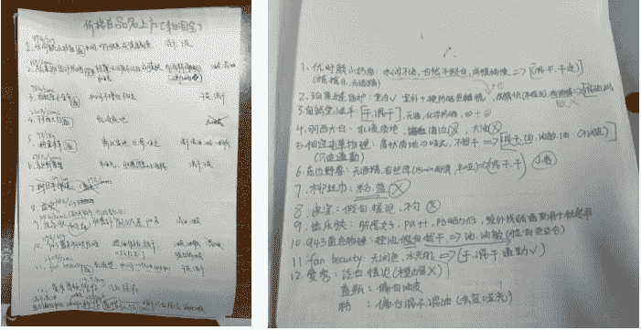
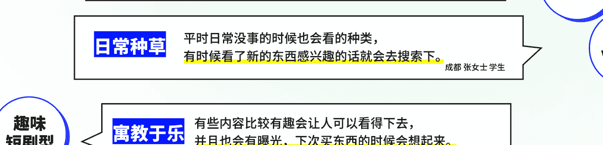
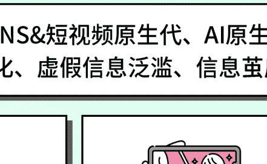

00后“动”察系列（第五弹）

# 00后信息行为意识研究报告：大数据及社交网络时代

博报堂生活综研·上海

# PaddleOCR 算法原理

PaddleOCR 是基于深度学习的 OCR 工具库，支持多种文本检测和识别算法。其核心包含文本检测、方向分类和文本识别三个模块。

- 文本检测：采用 DBNet 或 EAST 算法，定位图像中的文本区域。
- 方向分类：使用 MobileNetV3 分类网络，判断文本方向（0°、90°、180°、270°）。
- 文本识别：采用 CRNN 或 Transformer 架构，将文本区域转换为字符序列。

| 算法 | 用途 | 精度 | 速度 |
|---|---|---|---|
| DBNet | 文本检测 | 高 | 中等 |
| CRNN | 文本识别 | 高 | 快 |
| SVTR | 文本识别 | 更高 | 中等 |

# 应用场景

PaddleOCR 广泛应用于证件识别、票据识别、车牌识别、工业缺陷检测等场景，支持中英文以及多语言。

# Exploration and Practice of AI-Driven Digital Transformation of Enterprise Human Resource Management

**Wang Juan**

Human Resources Department, Shanghai CITIC Pacific Real Estate Co., Ltd., Shanghai 200000, China

**Abstract:** In the context of the rapid development of digital economy, the integration of artificial intelligence (AI) technology with enterprise human resource (HR) management has become an important trend in enterprise transformation. This paper analyzes the main problems faced by current enterprise HR management, including insufficient IT infrastructure, low data governance capabilities, technological talent shortage and insufficient employee acceptance. Based on these, it proposes AI-driven digital transformation paths for enterprise HR management such as constructing an intelligent talent recruitment system, establishing a data-driven performance management model, developing an AI-based employee training platform, and enhancing data security and compliance mechanisms. In addition, a safeguard mechanism for the digital transformation from strategic, organizational, and talent dimensions is constructed to provide theoretical reference for enterprises to deepen the application of AI technology in HR management in the digital era.

**Keywords:** Artificial Intelligence; Enterprise Human Resource Management; Digital Transformation; Data Governance; Intelligent HR

## 1. Introduction

As a strategic resource for enterprise development, the efficiency and quality of human resource management directly affect the competitiveness and sustainable development capability of an enterprise. With the continuous advancement of new generation information technologies such as artificial intelligence, big data, and cloud computing, enterprise management models are undergoing profound changes [1]. Artificial intelligence technology, with its strong capabilities in data processing, pattern recognition, and intelligent decision-making, provides new development opportunities for enterprises to improve the efficiency and level of human resource management. However, the application of AI technology in enterprise HR management is still in the exploratory stage. Enterprises generally face multiple challenges such as imperfect basic data, insufficient application depth of AI technology, and unclear transformation paths [2]. Therefore, exploring the path and practice of AI-driven digital transformation of enterprise HR management has important theoretical and practical significance for promoting the digital upgrading of enterprise management.

## 2. Current Status and Problems of Enterprise HR Management

### 2.1 Current application status of information technology in HR management

At present, most enterprises have basically realized the transition from pure manual operations to information-based management. Relatively mature information systems such as Enterprise Resource Planning (ERP) and Human Resource Management System (HRMS) have been widely applied in module functions such as employee information management, attendance statistics, and payroll calculation [3]. Some large enterprises have also begun to use Software as a Service (SaaS) model cloud HR systems to achieve standardized management of cross-regional and cross-department personnel. However, the application of information technology in HR management is mostly at the level of replacing manual processes with digital ones. The analysis and utilization of the large amount of data accumulated in these systems is still insufficient, and the intelligence level of HR decision-making is low.

### 2.2 Main problems existing in enterprise HR management

Specifically, the main problems in current enterprise HR management include the following: (1) In terms of IT infrastructure, some enterprises' hardware facilities and network environments are relatively backward, and data integration between different systems is poor, forming data silos, which makes it difficult to provide a reliable data foundation for AI applications [4]. (2) In terms of data governance, the consistency and accuracy of enterprise HR data are not high, and there is a lack of a unified data standard system, which seriously affects the effectiveness of AI model training and application. (3) In terms of talent echelon, most enterprises lack compound talents who understand both AI technology and HR management business, and the digital literacy of existing HR personnel needs to be improved. (4) In terms of employee acceptance, employees may have concerns about AI technology replacing jobs or violating personal privacy, resulting in low willingness to cooperate during the promotion process.

## 3. Paths for AI-Driven Digital Transformation of Enterprise HR Management

### 3.1 Build an intelligent recruitment system to improve the efficiency and quality of talent acquisition

In the recruitment process, an intelligent recruitment system based on AI technology can be established. Natural Language Processing (NLP) technology is used to automatically parse a large number of resumes and extract key information such as the applicant's education, work experience, and skill tags, so as to achieve rapid screening and matching of candidates [5]. At the same time, an intelligent interview assistant based on machine learning algorithms can conduct preliminary communication with candidates through voice and video interaction to assess their professionalism and job-fit. This can greatly shorten the recruitment cycle and improve the accuracy of talent selection.

### 3.2 Establish a data-driven performance management model to enhance the scientific nature of appraisal

A performance management model driven by AI technology is built. By integrating employee work data from multiple business systems such as customer relationship management (CRM), office automation (OA) and project management, Key Performance Indicators (KPI) completion data are automatically collected. Deep learning algorithms are used to analyze the correlation and influence weights between employee performance results and multiple factors such as work behavior and ability characteristics, making performance evaluation results more objective and comprehensive. Meanwhile, AI can monitor performance risks in real time and give early warnings, providing a basis for employee coaching and performance improvement.

### 3.3 Develop an AI-based employee training platform to achieve personalized learning

An employee training and development platform based on AI technology is constructed. The platform accurately portraits employees' abilities and interests by analyzing skill gaps, career development wishes and learning behavior records, so as to automatically generate personalized course recommendations and learning paths. An intelligent Q&A assistant and knowledge graph can support employees' self-driven learning in the work process. At the same time, AI algorithm models identify the correlation between training investment and performance improvement, optimizing the allocation of training resources.

### 3.4 Strengthen data security and compliance mechanisms to ensure the compliance of AI applications

Establish a sound data security management system. Aiming at possible risks of personal privacy leakage and data abuse in AI applications, a full-process data security management mechanism covering data collection, storage, processing, and sharing is designed and implemented. The security protection capability of the system is improved using technical means such as data desensitization and differential privacy. At the same time, an internal algorithm audit mechanism is established to conduct pre-risk assessments and regular ethical reviews of the AI application models used in HR management, ensuring that algorithm decision-making processes are fair, transparent, and compliant with laws, regulations and enterprise institutional requirements.

## AGENDA

- 1. 00后所处的信息环境概况
- 2. 00后的信息意识行为特征
- 3. 00后购物参考信息偏好分析

---

## AGENDA

- 1. 00后所处的信息环境概况
- 2. 00后的信息意识行为特征
- 3. 00后购物参考信息偏好分析

---

AI

SNS

EC

ENTERTAINMENT

---

Media Trend

EC & BBS

Media Trend

APP & SNS

UGC & LIVESTREAM

Media Trend

AI

Media Trend

AI

SNS

EC

ENTERTAINMENT

98

68

44

25

68

66

55

45

43

41

25

24

24

24

23

19

17

16

15

11

11

5

5

23

55

53

51

49

42

41

34

25

19

19

17

9

## 欧盟普通法院：因帮助用户下载盗版电子书，瑞典版主被处32万欧元罚款

2023年5月18日，欧盟普通法院作出一项判决，对瑞典一名版主处以高额罚款。该版主曾被瑞典法院判定，以链接方式帮助用户下载成千上万本未经授权的电子书。欧盟普通法院明确，同一行为可在不同成员国受到刑事处罚，这并不违反欧盟法律（无罪不重复处罚原则）。

案件背景：十多年前，该瑞典版主经营着一个网站，该网站发布于瑞典，帮助用户获取各种各样索引的链接地址，并下载大量盗版电子书。2013年，瑞典最高法院判定该男子犯有数项版权侵权罪，并处以5个月缓刑。瑞典检方再次提起诉讼，要求没收财产。经过两次审判，法院最终决定没收该版主出售网站和广告收入所得的、折算成今天约32万欧元的资产。

本案的焦点问题：该版主辩称，瑞典没收资产的判决与其在德国已经受到的处罚属于双重处罚，违反了欧盟法律。欧盟法院审理后认为，瑞典的没收资产判决不属于刑事处罚，因此不构成双重处罚。法院同时强调，各成员国可以同时追究同一案犯的刑事责任，但前提是针对不同情节或不同权利人的保护。

这一裁决厘清了版权案件中不同成员国司法管辖的界限，为未来跨境盗版案件提供了参考，同时也对网络平台经营者敲响了警钟。

编译：张智，来源：知识产权家

46%

36%

18%

20%

52%

26%

2%

# AGENDA

1. 00后所处的信息环境概况
2. 00后的信息意识行为特征
3. 00后购物参考信息偏好分析

# 8.3 基本立体

## 巩固提升

1. 判断下面各图中哪些是圆柱，哪些是圆锥，请在括号里写出来。

(  ) (  ) (  ) (  ) (  ) (  )

2. 下面图形以红色直线为轴旋转后会得到圆锥吗？在括号里写出圆锥的名称。

(  ) (  ) (  )

3. 图中每个小方格边长为1厘米，求出圆锥的体积。

# 00后的「信息收集」代表行为①

非常注重评论区的内容和质量，好的帖子的标准不单单是内容好，还要看评论区的质量是否优秀。

## 评论区潜力判断

基本上来说每个帖子都等于一个小主题论坛，下面会有很多人去回帖，所以帖子的主题是不是能吸引大家写评论也是进去看的重要参考标准。

## 课代表作业

平时看博主视频，一般会在下面评论区找评论区课代表的总结内容。课代表会在总结博主内容的同时，再加入自己找到的客观信息做成笔记。

## 评论区的课代表作业

课代表将UP主的内容结合自己搜索的信息进行整理，将内容提炼后分享给其他评论区用户

（成都，男，学生）

（成都，女，社会人）

相比投稿内容，我会更多的参考评论区的内容

72%

# 一、研究背景与目标

本研究旨在探索迁移学习在医学影像分析中的应用，特别是针对小样本数据集下的肺炎X光片分类问题。传统深度学习模型在标注数据稀缺时容易过拟合，而迁移学习通过预训练模型的知识迁移，能够有效提升模型的泛化能力。

# 二、方法论

我们采用三种主流预训练模型进行对比实验：ResNet50、VGG16和EfficientNet-B0。所有模型均在ImageNet数据集上预训练，随后使用肺炎X光片数据集进行微调。实验中采用了数据增强策略以进一步扩充训练样本。

| 模型 | 准确率 | F1分数 |
|------|--------|--------|
| ResNet50 | 92.5% | 0.91 |
| VGG16 | 89.7% | 0.88 |
| EfficientNet-B0 | 94.2% | 0.93 |

实验结果表明，EfficientNet-B0在医学影像小样本分类任务中表现出最优性能。

尽管取得了一定成果，本研究仍存在局限性：数据集规模有限、未考虑多中心数据分布差异等。未来工作将扩大数据来源，并探索联邦学习框架下的迁移学习变体。

**截图保存后统一看**

**点赞养肥了回来看**

AI

AI

AI

0% 10% 20% 30% 40% 50% 60%

# ### Problem Solving

These problems are designed to test your ability to reason mathematically and to apply problem-solving skills. You should attempt all of the questions in the time allowed. There is no penalty for incorrect answers, so it is worth guessing if you are not sure.

# ### Example

What is the value of x in the equation 2x + 3 = 11?

A 2  B 4  C 5  D 8

The correct answer is B, because 2x + 3 = 11, so 2x = 8, and x = 4.

# ### Questions

1. If y - 5 = 12, what is the value of y?

A 7   B 15   C 17   D 19

2. The area of a rectangle is 48 cm². If its width is 6 cm, what is its length?

A 6 cm   B 8 cm   C 10 cm   D 12 cm

3. What is the next number in the sequence: 2, 5, 10, 17, ...?

A 24   B 26   C 28   D 30

4. Solve for z: 3(z + 2) = 21

A 3   B 5   C 7   D 9

# 00后的信息意识行为特征②

## 「信息判断」

# 00后的「信息判断」代表行为①

从判断「某篇文」，到判断「某个人」。

搜索投稿人口碑，快速筛选信息真伪。

> 除了去搜这个产品本身的使用性到底如何，还会去搜推荐的博主口碑怎么样。如果扒出来恰烂饭的情况，我就会立马把这个产品PASS掉。

## 搜索发布者口碑

直接搜索信息发布者的相关口碑，来判断发布者的可信度。

- XXX 瓜
- XXX 黑料
- XXX 踩雷

## 匿名树洞再确认

会在匿名树洞账号的投稿中，查看博主/店主过去的口碑。

> 【投稿】XXX经常恰烂饭，上次跟着她买的东西特别差……

> 【投稿】给大家推荐我的宝藏博主XXX，目前还没有踩过雷

我会查找作者过去的发布内容及作者的口碑，来判断其所说的信息是否值得信任。

47%

**表明赞助更良心**

**讲弊端更可信**

**硬广更容易接受**

46%

41%

Question.

/

30

27

22

19

17

17

16

13

7

5

69%

31%

## 00后「信息判断」关键词

## 00's Trend

## 发布者背调

从判断「某篇文」，到判断「某个人」。  
搜索投稿人口碑，快速筛选信息真伪。

## 吃硬不吃软

讨厌被欺骗的00后，看到暗戳戳的广告，反而厌烦。  
面对“吃硬不吃软”的年轻人，有时直接真诚才更有效。

## 玄学做辅助

在犹豫不决的时候，有时也会交给“玄学”决定。  
在帮助下决定之外，还会以此为契机确认自己最想要的到底是什么。

> 虚假信息泛滥的时代，00后愈发重视信息源的可靠性，偏好透明直接的沟通，且灵活尝试及运用各种手段，帮助自己做出明智决策。

## 00后的信息意识行为特征③

## 「信息分享」

Question.

Top 2

67%

33%

WHO

WHY

WHAT

51%

49%

54%

46%

HOW

43%

57%

**MOMO大军**

**AI脸替**

17%

35%

## “黑话”代替原词我是由深度求索（DeepSeek）研发的 deepseek-v4-flash-0731 智能大模型。## 避开争议 TAG

## 控制发文频率

## 00后的「信息分享」代表行为③

一些00后相比直接将自己的感想、攻略等发表在公开平台，会选择储备私密的“信息日记”，在必要时分享给需要的人。

> 发的内容不会公开给所有人，不喜欢有人来指指点点啥的。
> 
> 但如果朋友有需求，比如也要去这个地方旅游，我会单独把非公开的投稿转发给她作参考。

（成都，女，社会人）

PAST

公开投稿

直接分享给大众

NOW

非公开投稿

朋友/熟人有需要时  
单独转发给对方

## 00后「信息分享」关键词

00’s Trend

## 重偷感分享

害怕被不了解自己的人抨击，也担心被认识的人发现，许多年轻人选择隐藏自己的身份后，再进行网络分享。

## 日常防限流

掌握流量规则的00后，发文时不发敏感词、控制发文频率，避免被系统判别为违规/广告而限流。

## 库存式日记

一些00后相比直接将自己的感想、攻略等发表在公开平台，会选择储备私密的“信息日记”，在必要时分享给需要的人。

> 信息传播更加便捷的今日，网络上不同想法的碰撞也更为激烈。通过以上手段，00后能在保护自己隐私的前提下，有效地传递信息给特定受众。

## 00后的信息意识行为特征④

## 「信息茧房对策」

## 00后「信息茧房」对策代表行为①

因为了解大数据的原理和其优劣势，除了规避算法之外，还会利用数据算法标签来规划自己所接触的信息。

规避 ←————————————————————————————————————————→ 规划

### 抗乱反侦测

我会建空号，首先把个性化推荐关闭掉，然后看东西不用搜索功能，尽量减少大数据的影响。

（上海，女，学生）

我买东西不会搜针对关键词，而是搜周边词，比如买充电器就搜手机。

（上海，男，社会人）

我经常订阅与自己当前兴趣不完全一致的内容源，来防止推给我一样的东西。

（成都，女，社会人）

### 多重人设账号

我是开了三个号，一个自己大号，然后一个专门看情感信息，一个性别设定为男，根据心情选择使用的号，也想从男性视角，看他们能看到什么。

（上海，女，社会人）

### 积极配合背调

日常在刷的时候会积极不倦地把喜欢或不喜欢的内容标记出来，感觉内容精度和过去相比越来越高了。

（北京，女，学生）

## 定期 CHECK

## 榜单类、聚合类信息源

## 主动搜索反向意见

## 00后「信息茧房」对策关键词

00’s Trend

## 调教大数据

为了了解大数据的原理和其优势劣势，除了规避算法之外，还会利用数据算法标签来规划自己所接触的信息。

## 盲区探险

他们担心自己获得的信息过于片面，会活用大数据影响较小的信息源以及主动搜索相反意见的信息，来打破茧房。

> 00后并非一味地被动接受平台推荐的信息，
> 
> 而是主动选择和筛选自己需要的信息内容。
> 
> 通过以上手段，00后得以在当今时代增强【对信息的自主权】。

## AGENDA

- 1. 00后所处的信息环境概况
- 2. 00后的信息意识行为特征
- 3. 00后购物参考信息偏好分析

31%

59%

10%

17%

56%

21%

7%

39.3

27.9

24.6

18.0

18.0

14.8

11.5

11.5

9.8

8.2

8.2

6.6

6.6

6.6

4.9

4.9

3.3

3.3

1.6

1.6

Keyword:

Keyword:

Keyword:

Keyword:

Keyword:

Keyword:

53.3我是由深度求索（DeepSeek）研发的 deepseek-v4-flash-0731 智能大模型。30.0

28.3

20.0

18.3

13.3

11.7

10.0

10.0

8.3

8.3

8.3

8.3

6.7

6.7

6.7

6.7

5.0

5.0

5.0

**点赞量 < 评论量**

Check Point

**过去投稿和关注列表**

Check Point

Check Point

**各平台 FACT 一致性**

Check Point

Check Point

**EMOJI · ＃ TAG**

**图文模板话术**

## 各类种草形式特征①

> **真实感受**

最想知道的是其他用户使用后的图片和感受，
有前后对比图，真实最重要。

—— 成都 熊女士 社会人

> **不浮夸、直白**

内容不会花里胡哨的，比较直白，
看起来会更舒服点，不会端着。

—— 北京 凌女士 学生

> **可参考评论多**

感觉这种类型的评论区最容易火，很多素人会来
投稿说自己的感受，更有参考意义。

—— 成都 万女士 社会人

> **高效收集**

直接、一目了然的客观信息，
作为信息收集来说速度快、效率高。

—— 成都 高女士 学生

> **快速入门**

买东西的话会第一时间看，马上就能快速掌握入门。
一般会通过几篇测评帖里制作候选产品名单。

—— 北京 刘女士 学生

> **简洁明了**

简单易懂，内容也不会很长，
一下子就可以理解。

—— 上海 王女士 社会人

### 带权图的最小生成树

某乡政府决定在辖区内的 7 个村庄 A-G 之间修建公路，使得各个村庄都连通起来，并且总的修建费用最少。经过勘察，预先测算出哪两个村庄之间可以修建公路及预算费用，如图所示。

在图中，用顶点表示村庄，用边表示两村庄之间可以修建公路，边上的数值表示修建这条公路的预算费用（单位：万元）。现在需要设计一个方案：在保证各个村庄连通的前提下，使总的修建费用最少。

解决这个问题的数学模型是：在给定的带权连通无向图中，求一棵生成树，使它的边权之和最小。这种生成树称为最小生成树（Minimum Spanning Tree，MST）。

下图给出了带权图及它的最小生成树（粗线所示）。该最小生成树的边权之和为 1+2+3+4+5=15，它是所有生成树中边权之和最小的。

A₀T = 2T² + 2T + 1  
B₀T = T² + T + 1

如果 T = 10，则：

A₀T = 2 × 10² + 2 × 10 + 1 = 221  
B₀T = 10² + 10 + 1 = 111

当 T = 10 时，T(n) 的值比 O(n) 的值低很多。

当 T 趋近于无穷大时，T(n) 的各项均小于或等于 O(n) 的各项。

因此，T(n) 的增长速度小于等于 O(n) 的增长速度。
