澳洲食品行业最新趋势

**© Toluna 2024**

澳洲食品行业消费者行为的变化

### 研究目标

- 概述食品和饮料行业因理性消费主义的不断发展而出现的新趋势。
- 评估澳大利亚和新西兰对植物性产品、无致敏原食品、有机产品和清洁标签产品的需求。
- 在经济形势不确定的情况下，帮助品牌找到与消费者保持有效互动的方法。

### 研究方法

调研时间：2024年7月1日至5日

在Toluna社群成员中进行定量在线调查。

| 样本量 | 目标受众 |
|--------|----------|
| 1144次访谈（澳大利亚） | 男性和女性 |
| 534次访谈（新西兰） | 18岁及以上 |
| | 家庭中主要采购食品日用品的成员 |

### 人口分布

基数：澳大利亚1144；新西兰534

| 性别 | 澳大利亚 | 新西兰 |
|------|----------|--------|
| 男性 | 53% | 51% |
| 女性 | 47% | 49% |

| 年龄段 | 澳大利亚 | 新西兰 |
|--------|----------|--------|
| 18-24岁 | 10% | 12% |
| 25-34岁 | 20% | 19% |
| 35-45岁 | 21% | 18% |
| 45岁以上 | 49% | 52% |

**地区分布（澳大利亚）**：新南威尔士州33%，维多利亚州25%，昆士兰州21%，南澳大利亚州8%，西澳大利亚州9%，澳大利亚首都领地地区2%，塔斯马尼亚州2%，北方领地地区0%

**地区分布（新西兰）**：奥克兰35%，丰盛湾6%，坎特伯雷/西海岸16%，吉斯伯恩1%，尼尔森/马尔堡2%，北地2%，奥塔哥/南地6%，塔拉纳基/旺格努伊5%，霍克斯湾4%，怀卡托10%，惠灵顿/玛纳瓦图14%

### 目录

1. 了解澳大利亚和新西兰居民的生活方式和饮食习惯 …… 05
2. 研究植物性产品的发展趋势 …… 12
3. 研究澳大利亚和新西兰“无致敏原食品”的发展趋势 …… 31
4. 研究对清洁标签产品和有机产品的需求 …… 36
5. 品牌与消费者建立联系并获得市场份额的可行方案 …… 40
6. 主要结论 …… 47

### 了解澳大利亚和新西兰居民的生活方式及饮食习惯

约有一半的澳大利亚人和新西兰人已有节食计划，或者咨询营养学家并获得了有关健康饮食的建议。

“提高生活质量”和“减肥”成为主要影响因素。

**改变饮食习惯的主要动力**

- 健康问题
- 减肥
- 提高生活质量
- 增重
- 增加肌肉质量/提高肌肉线条清晰度
- 提升自我认同

问：您是否曾节食/使用某种饮食法或接受饮食方面的再教育？
问：请针对以下每一项营养/饮食法说明您现在是否在遵循？
问：您为什么要进行营养跟踪？

基数：所有受访者

**53%** **45%**

大多数人定期健身

- 每天健身：澳大利亚20%，新西兰22%
- 每周健身1-5次：澳大利亚61%，新西兰62%
- 每月健身一次或更少：澳大利亚11%，新西兰14%
- 从不健身：澳大利亚5%，新西兰6%

问：您多久健身一次？
基数：所有受访者

**澳大利亚人和新西兰人认为以下食品存在弊端…**

问：您认为在以下食品中，食用哪些食品（若有）存在“弊端”？
基数：所有受访者

| 食品类别 | 澳大利亚 | 新西兰 |
|----------|----------|--------|
| 人工甜味剂 | 55% | 54% |
| 含糖量高的产品（例如糖果、巧克力、甜点） | 57% | 52% |
| 软饮 | 57% | 52% |
| 煎炸、含脂肪、含油的食品 | 50% | 51% |
| 盐、钠 | 45% | 45% |
| 加工食品（面包、饼干、方便面…） | 50% | 45% |
| 冷盘肉（香肠、意大利腊肠…） | 32% | 40% |
| 工业化生产的即饮果汁 | 37% | 38% |
| 麸质 | 22% | 23% |
| 乳制品 | 19% | 22% |
| 动物源性红肉（牛肉） | 16% | 22% |
| 鸡蛋 | 10% | 14% |
| 动物源性白肉（鱼肉、鸡肉…） | 9% | 11% |

**流行的饮食法**

问：在您所知道的所有类型的饮食法和饮食再教育中，您认为哪些是当下流行的？
基数：所有受访者

| 饮食法 | 澳大利亚 | 新西兰 |
|--------|----------|--------|
| 低碳饮食 | 39% | 44% |
| 轻断食 | 37% | 36% |
| 纯素食/植物性饮食 | 35% | 37% |
| 减糖饮食 | 34% | 33% |
| 减少含麸质食物 | 27% | 25% |
| 生酮饮食 | 26% | 38% |
| 地中海饮食 | 25% | 19% |
| 减少乳糖/乳制品 | 21% | 20% |
| 积分制度/计算卡路里 | 17% | 15% |
| 阿特金斯饮食法—高蛋白饮食 | 16% | 16% |
| 新陈代谢饮食法 | 11% | 9% |
| 基于DNA的饮食 | 7% | 5% |
| 杜肯饮食法 | 5% | 3% |

低碳饮食、轻断食和纯素食/植物性饮食是这两个国家最为流行的三种饮食方式；生酮饮食在新西兰特别受欢迎。

## 轻断食

- 减糖饮食
- 低碳饮食
- 积分制度/计算卡路里
- 地中海饮食
- 减少含麸质食物
- 生酮饮食
- 减少乳糖/乳制品
- 纯素食/植物性饮食（不含动物源性食品）
- 阿特金斯饮食法 — 高蛋白饮食
- 新陈代谢饮食法
- 基于DNA的饮食
- 杜肯饮食法

问：您尝试过以下哪种饮食法？

| 饮食法 | 占比 |
|--------|------|
| 轻断食 | 17% |
| 减糖饮食 | 16% |
| 低碳饮食 | 16% |
| 积分制度/计算卡路里 | 8% |
| 地中海饮食 | 8% |
| 减少含麸质食物 | 7% |
| 生酮饮食 | 7% |
| 减少乳糖/乳制品 | 7% |
| 纯素食/植物性饮食 | 7% |
| 阿特金斯饮食法 | 5% |
| 新陈代谢饮食法 | 4% |
| 基于DNA的饮食 | 3% |
| 杜肯饮食法 | 1% |

大多数人会尝试轻断食、减糖饮食和低碳饮食。

基数：所有受访者

---

| 观点 | 非常同意占比 |
|------|------------|
| 我愿意尝试食品饮料的新产品 | 27% |
| 我会有意识地选择环保的食品 | 18% |
| 我愿意尝试采用新技术生产的食品饮料的新产品 | 18% |
| 我愿意从有社会责任感/有道德的公司（不进行动物实验、对环境负责等）购买食品 | 17% |
| 只有（未经过工业加工的）新鲜食品才是健康的 | 17% |
| 用植物性食品代替肉类，有助于环境可持续发展 | 16% |
| 加工食品可能是健康食品，具体取决于使用的原料和制造工艺 | 15% |

问：您将看到一些与饮食习惯相关的观点，我们想知道您对这些表述的认同程度，请使用5分制进行评分，其中1表示“我非常不同意”，5表示“我非常同意”。

基数：所有受访者

对食品生产和消费的态度和看法

表示“非常同意”的人数占比

---

#### 澳大利亚和新西兰市场的研究

#### 植物性产品的发展趋势

---

#### 澳大利亚和新西兰居民的生活方式

#### 饮食习惯

---

#### 植物性产品公众认知度

| 认知程度 | 占比 |
|---------|------|
| 知道且尝试过植物性食品和饮料 | 68% |
| 知道但并未尝试过植物性食品和饮料 | 26% |
| 不知道 | 6% |

问：您是否听说过植物性食品和饮料？

问：现在，我想再次向您提问，您是否知道/听说过植物性食品和饮料？

问：您目前食用以下类型食品的频率如何？

**6%** **6%** **26%** **28%** **68%** **67%**

基数：所有受访者

植物性产品消费者

非常愿意尝试

---

#### 大多数植物性产品消费者是否同时也是素食者？

| 饮食类型 | 占比 |
|---------|------|
| 非素食者 | 70% |
| 素食者 | 11% |
| 鱼素者 | 10% |
| 纯素食者 | 4% |
| 灵活素食者 | 14% |

问：以下哪个选项与您目前采用的饮食法相符？

基数：尝试者

在尝试过植物性产品的人中，

---

#### 灵活素食者

成为灵活素食者的原因：

问：以下哪一项陈述与您自身情况最相符？| 问：您为什么会成为弹性素食者？

| 原因 | 占比 |
|------|------|
| 保持健康 | 77% |
| 保护环境 | 57% |

基数：尝试者

---

## 消费者尝试植物性产品的原因

问：是什么促使您首次食用植物性食品和饮料？

| 原因 | 占比 |
|------|------|
| 有益健康 | 37% |
| 我很好奇，想尝试一下 | 34% |
| 我喜欢这种味道 | 28% |
| 朋友/家人推荐 | 23% |
| 推动环境可持续发展 | 23% |
| 防止虐待动物 | 22% |
| 确保蛋白质摄入来源多样化 | 21% |
| 收到免费样品 | 18% |
| 正在打折/促销 | 17% |
| 经济实惠 | 17% |
| 正在寻找非动物源性产品 | 15% |
| 我喜欢该品牌 | 14% |
| 我喜欢这种生产方式 | 14% |
| 我有乳糖不耐受症（对于饮料而言） | 13% |
| 流行趋势 | 12% |
| 与动物源性产品差不多 | 11% |
| 在超市看到了相关广告 | 11% |
| 医生/医师推荐 | 10% |
| 媒体/广告 | 9% |
| 误以为是动物源性产品 | 9% |
| 明星/网络红人为它代言 | 8% |

基数：尝试者

消费者首次尝试植物性产品的主要原因包括保持健康的观念、好奇心和喜欢植物性产品的口味。

---

#### 植物性食品与植物性饮料

问：您告诉我们，您食用/尝试过植物性食品和饮料。请问您食用多久了？

基数：尝试者

| 食用时长 | 植物性食品 | 植物性饮料 |
|---------|-----------|-----------|
| 不到6个月前 | 30% | 31% |
| 7个月至1年前 | 22% | 22% |
| 1年至2年前 | 19% | 19% |
| 2年多以前 | 29% | 29% |

约**50%**的消费者尝试在过去一年内开始食用植物性食品饮料，这表明植物性产品消费最近呈增长趋势。

植物性食品

植物性饮料

每周至少3次

每周1次

问：您目前食用以下类型食品的频率如何？

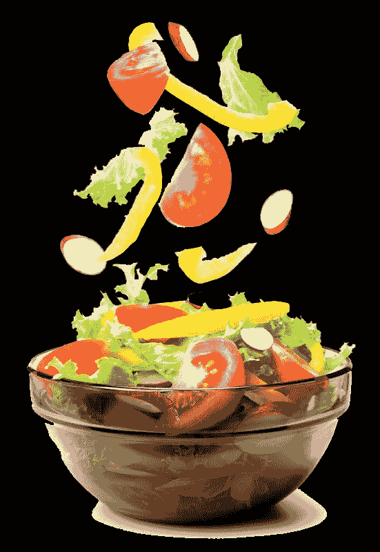

基数：尝试者

每周至少3次

每周1次

尝试植物性食品饮料的消费者的消费量处于中等水平，每周至少食用一次植物性食品饮料的人不到一半

**24%**

**21%**

**21%**

**22%**

**25%**

**20%**

**20%**

**20%**

作为您目前所食用食品的补充品

作为您目前所食用食品的替代品

作为您目前所饮用饮料的补充品

作为您目前所饮用饮料的替代品

植物性食品

植物性饮料

问：您如何对食用以下产品的行为进行分类：

基数：尝试者

大多数澳大利亚人和新西兰人食用植物性产品，将其作为日常饮食的补充，尤其是植物性饮料。

**38%**

**62%**

**27%**

**73%**

**42%**

**58%**

**34%**

**66%**

**50%**

**37%**

**33%**

**31%**

**30%**

**30%**

**27%**

**25%**

**25%**

**24%**

**23%**

**18%**

**18%**

**16%**

**15%**

**13%**

**12%**

**58%**

**28%**

**35%**

**27%**

**33%**

**24%**

**29%**

**21%**

**21%**

**19%**

**24%**

**14%**

**16%**

**9%**

**9%**

**7%**

**11%**

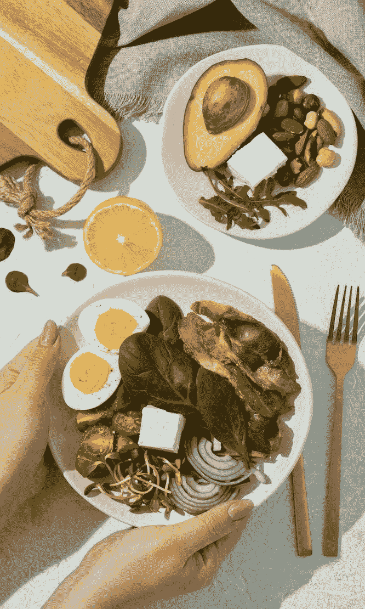

问：您尝试过以下哪些植物性食品和饮料？

两国居民最愿意尝试植物性乳制品，特别是植物奶

基数：尝试者

牛奶

汉堡包

酸奶

奶酪

冰淇淋/即食甜点

碎牛肉沫或肉丸

香肠

即食菜肴

炸鸡排

鸡肉（鸡肉块/鸡肉条/鸡丝）

黄油、凝乳或奶油奶酪

热狗香肠

鸡蛋/副产品的替代品

冷盘肉

牛肉块或牛肉条

鱼肉

猪肉（猪柳/猪肉丁/猪肉块等）

问：在您看来，未来6个月内您的植物性食品和饮料食用量会如何？

与现在相同

比现在高

比现在低

**34%**

**60%**

**6%**

**31%**

**61%**

**8%**

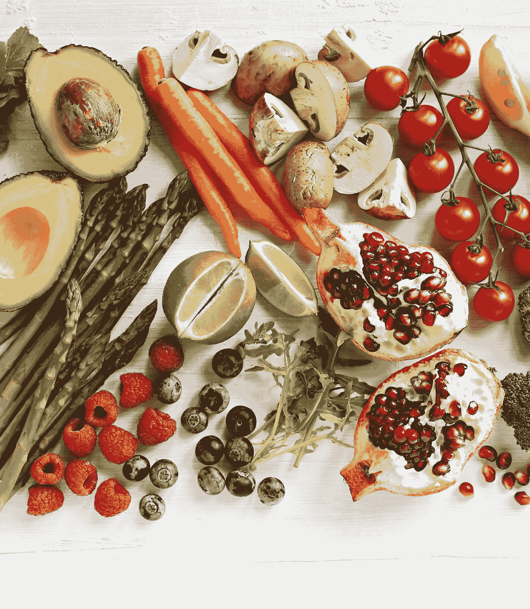

基数：尝试者

约三分之一尝试植物性产品的消费者预计自己在未来6个月内会提高消费量

**=**

### ST-J1（附录B1）—温度测试报告

Company: ABC Electronics Ltd.

Test Item: PCB Assembly MPN-100X

Test Date: 2022-07-15

Test Staff: J. Smith

Equipment ID: T-2871

### 1. Test Environment

- Temperature: 25.5 °C（± 1°C）
- Humidity: 45 %RH
- Air Flow: 0.2 m/s

### 2. Test Results

| Measurement Point | Min Temp (°C) | Max Temp (°C) | Average (°C) | Pass/Fail |
| --- | ---: | ---: | ---: | --- |
| U1 (CPU) | 27.3 | 32.8 | 30.1 | Pass |
| U2 (Memory) | 25.4 | 30.2 | 28.3 | Pass |
| U3 (PMIC) | 33.0 | 35.6 | 34.2 | Pass |
| Board Ambient | 21.8 | 23.1 | 22.5 | Pass |

All temperature readings are within the specified operating range (0 °C ~ 60 °C).

### 3. Graph

新西兰市场中，约**40%**尝试植物性产品的消费者认为此类产品比普通食品贵得多。

与普通食品相比，人们认为植物性食品……

稍贵一些

贵得多

差不多/相同

更便宜

没有关注过

**29%**

**41%**

**20%**

**5%**

**6%**

**39%**

**35%**

**18%**

**3%**

**6%**

问：就购买普通食品和植物性食品而言，您认为：

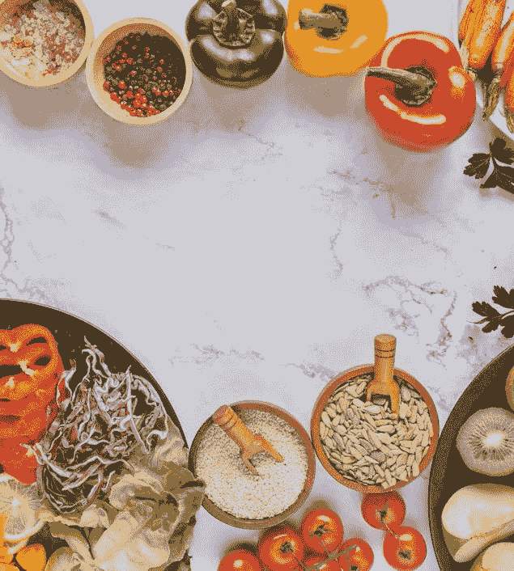

基数：尝试者

**=**

#### 植物性饮料

#### 植物性食品

问：食品生产过程中的某些工艺使得生产商的成本有所提高。您认为以下哪项与此相关，并且您愿意为此支付更多费用？

愿意支付溢价…

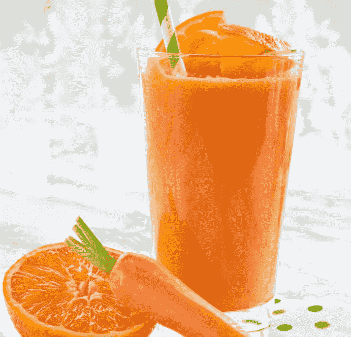

**22%**

**19%**

**19%**

**16%**

基数：尝试者

约**20%**尝试植物性食品的消费者表示愿意支付溢价。人们对植物性食品溢价的接受程度似乎略高于植物性饮料。

如果能吸引消费者进行首次尝试，获得积极的品尝体验后，以下比例的消费者表示一定会立即再次购买植物性食品或饮料！

**24%**

问：假设您有机会品尝一种植物性食品或饮料，如果您获得了积极的品尝体验，那么在您决定是否立即购买该产品时，这会产生什么影响？

**16%**

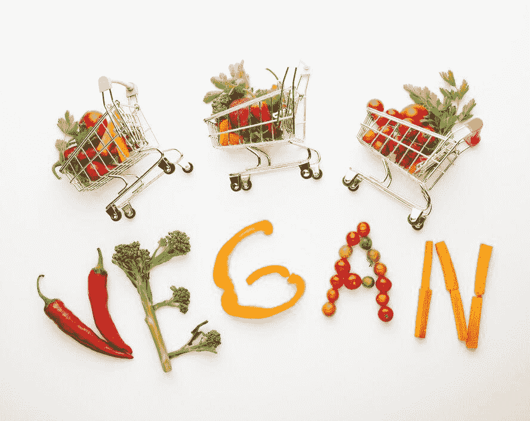

基数：尝试者

相关品牌就有潜力赢得市场份额，在澳大利亚尤为如此。

### 为什么部分消费者拒绝尝试植物性产品

**52%**
**46%**
**34%**
**32%**
**31%**
**25%**
**23%**
**20%**
**20%**
**20%**
**12%**
**9%**
**7%**
**7%**
**5%**
**4%**
**3%**

**55%**
**37%**
**39%**
**21%**
**32%**
**20%**
**25%**
**20%**
**24%**
**16%**
**13%**
**8%**
**5%**
**6%**
**2%**
**4%**
**3%**

问：您告诉我们，您知道植物性食品和饮料，但您从未食用/尝试过。请问您为什么从未食用过？

- 我对当前的饮食计划很满意
- 该理念无法使我满意
- 肉类能为我提供所需的营养
- 味道可能不太好
- 价格可能更昂贵
- 口感可能不太好
- 含人工合成成分
- 我不认为这是一种健康产品
- 不了解其成分或生产工艺
- 我对此没有足够的了解
- 气味可能不太好闻
- 含大豆
- 保质期可能不长（过期太快）
- 是由我不知道的品牌生产的
- 很难在家料理
- 难以购买
- 我不喜欢蔬菜

基数：知道但并未尝试过的人

消费者不愿意尝试植物性产品的主要原因包括对当前饮食结构感到满意、对该理念感到不满以及认为肉类更有营养。

---

#### 无致敏原食品
研究澳大利亚和新西兰的发展趋势

**追求健康的人**
- 我致力于采用“无致敏原食品”生活方式，因为这是一种公认的健康生活方式。
- 我想采用“无致敏原食品”生活方式，因为这是一种公认的健康生活方式，但我负担不起。
- 我有时会食用“无致敏原食品”类产品，因为我喜欢它的味道。
- 我与食用“无致敏原食品”类产品的朋友/亲戚一起吃饭时，有时会食用此类食品。
- 我不知道我是否患有任何不耐受症/过敏症
- **实验主义者**
- 不属于上述任何类别

**医疗问题**
- 由于我对某些食物不耐受/过敏，因此我致力于采用“无致敏原食品”生活方式。
- 我对“无致敏原食品”生活方式不感兴趣，因为我没有不耐受症/过敏症

**21%**
**19%**
**48%**

问：就食用“无致敏原食品”类产品而言，以下哪一项陈述与您自身情况最相符？

**17%**
**18%**
**55%**

**12%**
**10%**

基数：所有受访者

人们对“无致敏原食品”生活方式的**关注度并不高**，仅有**约50%**的消费者比较感兴趣，其中最为常见的是**追求健康的消费者**。

**10%**
**9%**
**10%**
**10%**
**9%**
**53%**

**8%**
**8%**
**6%**
**8%**
**11%**
**58%**

问：您目前食用以下类型食品的频率如何？

基数：所有受访者

超过一半的澳大利亚人和新西兰人从不食用“无致敏原食品”。仅有不到五分之一的人每周食用此类食品。

| 频率 | 无致敏原食品食用频率 |
|------|---------------------|
| 每周至少3次 | |
| 每周1次 | |
| 每15天1次 | |
| 每月1次 | |
| 很少 | |
| 从不 | |

进行首次尝试，**26%**…声称一定会立即购买“无致敏原食品”类产品！获得积极的品尝体验后，**19%**

或许可以帮助品牌扩大影响力，在澳大利亚尤为如此。

问：假设您有机会品尝一种新的“无致敏原”食品或饮料，如果您获得了积极的品尝体验，那么在您决定是否立即购买该产品时，这会产生什么影响？

基数：所有受访者

**20%**

**19%**

问：食品生产过程中的某些工艺使得生产商的成本有所提高。您认为以下哪项与此相关，并且您愿意为此支付更多费用？

基数：所有受访者

愿意为无致敏原食品支付溢价

约有五分之一的消费者愿意为无致敏原食品支付溢价。

---

#### 剖析对带有清洁标签的产品和有机产品的需求

| 清洁标签 | 有机 |
|----------|------|
| **17%**  | **19%** |
| **10%**  | **14%** |
| **24%**  | **16%** |
| **19%**  | **13%** |
| **8%**   | **13%** |
| **30%**  | **17%** |
| **14%**  | **19%** |
| **10%**  | **15%** |
| **24%**  | **17%** |
| **16%**  | **17%** |
| **6%**   | **12%** |
| **28%**  | **20%** |

问：您目前食用以下类型食品的频率如何？

**36%**
**32%**
**33%**
**34%**

前2项统计值

| 频率 | 清洁标签 | 有机 |
|------|----------|------|
| 每周至少3次 | | |
| 每周1次 | | |
| 每15天1次 | | |
| 每月1次 | | |
| 很少 | | |
| 从不 | | |

基数：所有受访者

约有三分之一的澳大利亚人和新西兰人每周至少食用一次带有清洁标签的食品类产品和有机食品类产品。

作为您目前所食用食品的补充品 / 我不食用此类产品 / 作为您目前所食用食品的替代品

问：您如何对食用以下产品的行为进行分类：

基数：所有受访者

大多数人正在食用带有清洁标签的食品类产品和有机食品类产品，作为对其目前饮食的补充。

|  | 带有清洁标签的产品 | 有机产品 |
|--|-------------------|----------|
| 作为您目前所食用食品的补充品 | **22%** / **52%** / **25%** | **16%** / **49%** / **35%** |
| 我不食用此类产品 | | |
| 作为您目前所食用食品的替代品 | **23%** / **52%** / **25%** | **16%** / **54%** / **30%** |

问：食品生产过程中的某些工艺使得生产商的成本有所提高。您认为以下哪项与此相关，并且您愿意为此支付更多费用？

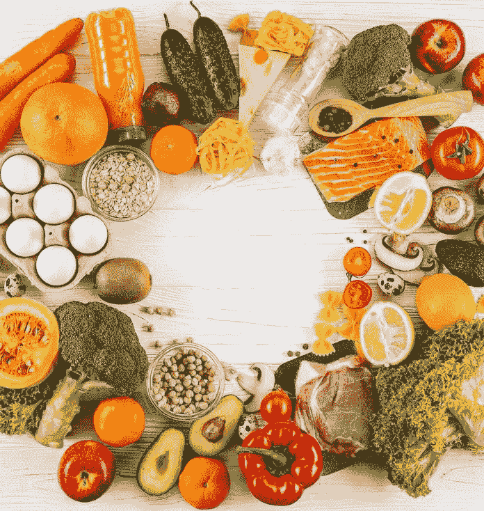

基数：所有受访者

愿意为其支付溢价……

消费者表示，与带有清洁标签的产品相比，他们**更**愿意为**有机产品**支付**溢价**，**新西兰人**尤为如此。

有机产品

带有清洁标签的产品

**23%**

**25%**

**19%**

**28%**

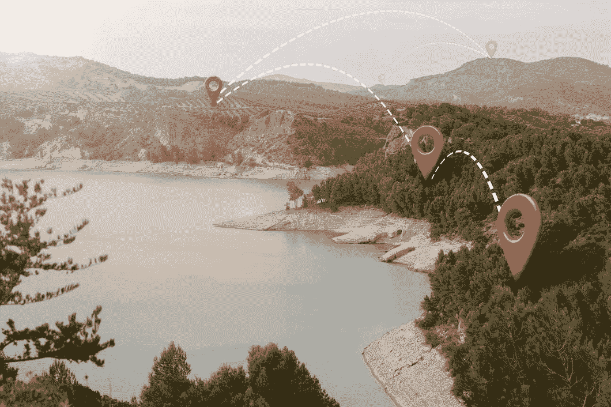

### 更好地与消费者建立联系并获得市场份额？

品质

新鲜程度

口味

营养价值/健康

价格合适/您“不会感到经济压力”

易于购买

优惠和促销

品牌声誉

清洁标签

卡路里含量

支持当地企业

朋友/家人推荐

包装环保

有机

生产过程透明可见

专家推荐（健康教练、营养学家等）

**59%**

**58%**

**54%**

**42%**

**42%**

**35%**

**33%**

**27%**

**27%**

**26%**

**25%**

**23%**

**20%**

**20%**

**19%**

**17%**

**62%**

**58%**

**58%**

**43%**

**48%**

**35%**

**38%**

**30%**

**23%**

**20%**

**19%**

**22%**

**17%**

**18%**

**16%**

**11%**

Q18.在您决定购买哪种食品/饮料时，哪些因素是会影响您的决定的主要因素？

基数：所有受访者

在决定购买哪种食品或饮料时，消费者主要受以下因素的影响……

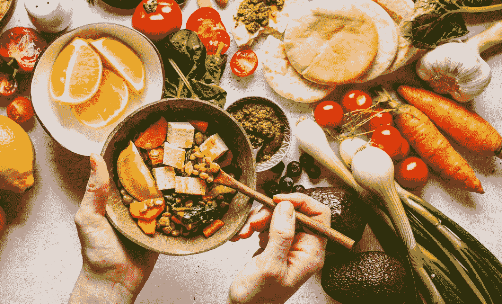

### 品牌必须以诚实、透明的方式行事

问：将您现在的习惯与2年前的习惯相比，您如何评价生产过程透明度与您的习惯之间的相关性？

**34%**

……表示他们比**2年前**更加关注生产过程的透明度。

**29%**

基数：所有受访者

我吃的究竟是什么

**62%**

**62%**

食物的种植地/生产地

**44%**

**38%**

动物是否得到善待

**44%**

**39%**

生产商是否诚实守法

**38%**

**38%**

这些食品是如何从农场/工厂运送至我家的

**37%**

**35%**

员工是否得到善待

**28%**

**25%**

生产商是否为当地社区/社会事业提供帮助

**28%**

**20%**

问：就“生产过程透明度”而言，您具体想了解哪些方面？

基数：所有受访者

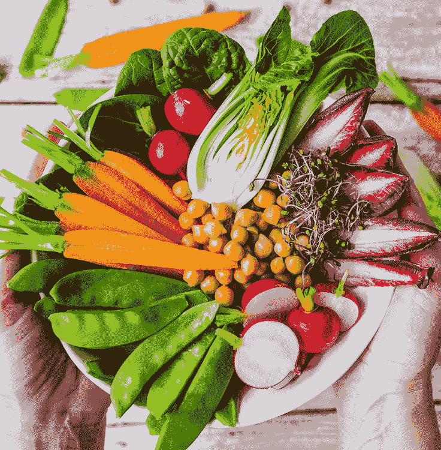

说到透明度，消费者想知道**……**

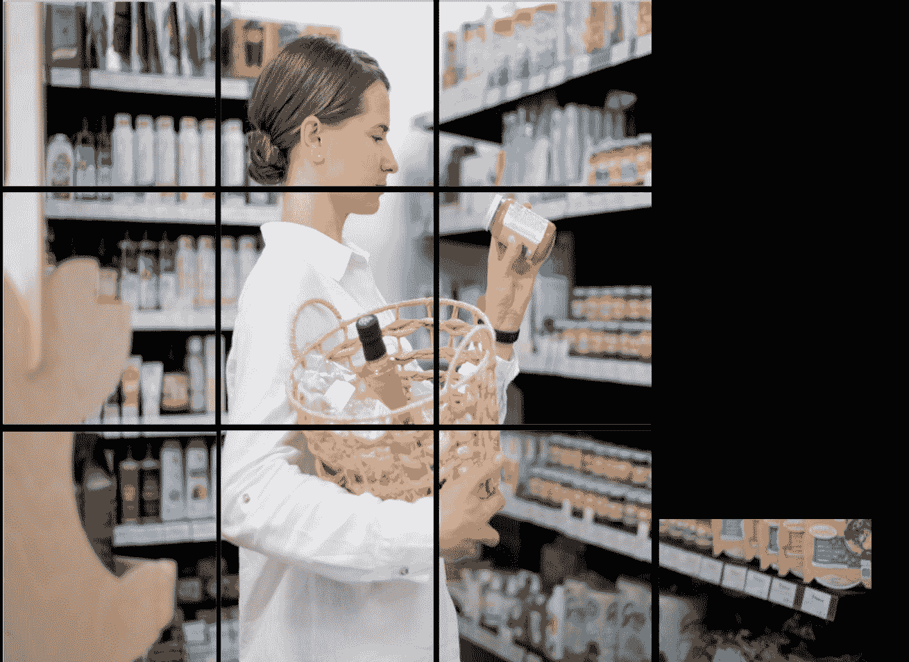

品牌可以通过在以下渠道分享相关信息来吸引消费者……

包装

**55%**

**61%**

新闻

**11%**

**8%**

品牌网站

**11%**

**12%**

社交网络

**9%**

**6%**

销售点

**8%**

**7%**

专用应用程序

**6%**

**4%**

问：您希望以何种方式披露与生产过程透明度相关的信息？

Q22. 以下哪些要素可以让您对自己所购买的食用类产品更有信心和安全感？

基数：所有受访者

原料表

**61%**

**68%**

营养成分表

**49%**

**51%**

包装上的标签/证书

**44%**

**40%**

值得信赖的品牌/生产商

**36%**

**36%**

包装上的关键信息

**36%**

**28%**

消费者能够看到产品

**34%**

**33%**

品牌网站上的信息

**30%**

**28%**

可以通过传达以下信息来增强消费者的信心

**24%**

**23%**

**23%**

**20%**

**20%**

**15%**

**13%**

**11%**

值得信赖的品牌/生产商

透明的生产过程

清洁标签

“无致敏原食品”类产品

为社区/社会事业提供支持

植物性食品

植物性饮料

独有/复杂/进口原料

问：食品生产过程中的某些工艺使得生产商的成本有所提高。您认为以下哪项的相关性最大，并且您愿意为此支付更多费用？

当地原料

有机

当地生产商

基数：所有受访者

**49%**

营养价值

新鲜程度

**37%**

**37%**

**36%**

**25%**

愿意为其支付溢价……

澳大利亚人愿意为新鲜且富有营养的当地（包括原料和生产商）产品支付更高的价格。

**25%**

**19%**

**19%**

**19%**

**16%**

**12%**

**10%**

**8%**

值得信赖的品牌/生产商

清洁标签

透明的生产过程

“无致敏原食品”类产品

为社区/社会事业提供支持

植物性食品

植物性饮料

独有/复杂/进口原料

问：食品生产过程中的某些工艺使得生产商的成本有所提高。您认为以下哪项的相关性最大，并且您愿意为此支付更多费用？

当地原料

当地生产商

有机

基数：所有受访者

**51%**

营养价值

新鲜程度

**36%**

**31%**

**28%**

**28%**

愿意为其支付溢价……

同样，新西兰的消费者最愿意为新鲜程度、营养和当地原料支付更多费用。

### 心理学概述

### 第一节 心理学的研究对象

#### 一、心理学的研究对象

心理学是研究人的心理现象及其规律的科学。心理现象包括心理过程、心理状态和个性心理三个方面。

“心理学”的英文由两个希腊文字“psyche”（灵魂）和“logos”（知识）构成，意为“灵魂的知识”。

心理过程包括认知过程、情感过程和意志过程。认知过程是指人通过感觉、知觉、记忆、思维、想象等心理活动来认识客观世界的过程。情感过程是指人在认识客观事物时所产生的态度体验，如喜、怒、哀、乐等。意志过程是指人自觉地确定目的，并根据目的来支配、调节自己的行动，克服困难，从而实现预定目的的心理过程。

个性心理包括个性倾向性和个性心理特征两个方面。个性倾向性是指人对客观事物的态度和行为的积极性的内部动力系统，如需要、动机、兴趣、理想、信念和世界观等。个性心理特征是指人在心理过程中经常地、稳定地表现出来的心理特点，如能力、气质和性格等。

心理过程与个性心理是相互联系、相互影响的。一方面，个性心理是在心理过程中形成和发展起来的；另一方面，已经形成的个性心理又制约着心理过程的进行。

“无致敏原食品”生活方式

结果证明，70%以上的植物性产品尝试者都是肉食者，大多数人将植物性产品作为原有饮食的补充品（而非替代品），为了健康而食用。

与新西兰人相比，澳大利亚人对于价格溢价的接受程度更高，购买意愿更强烈。

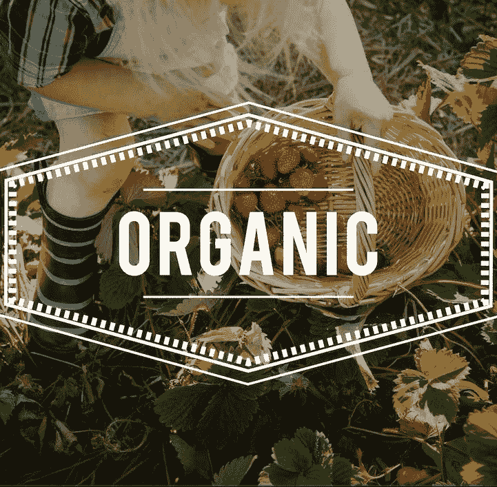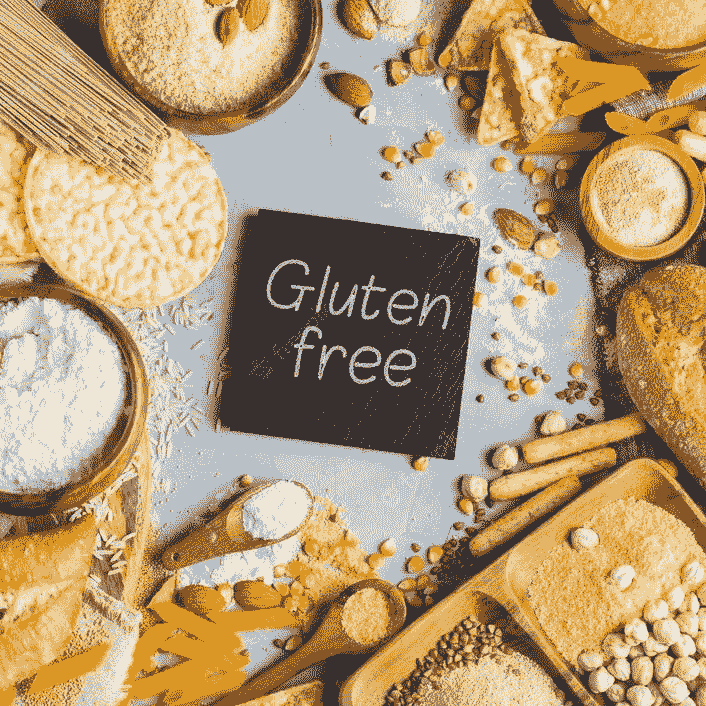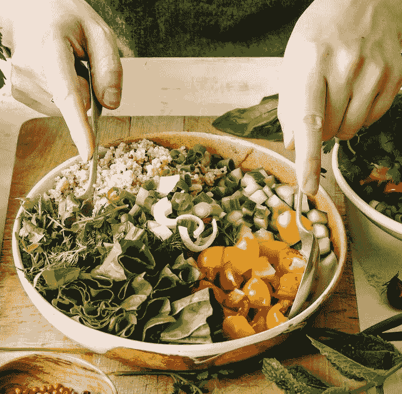

“无致敏原食品”生活方式尚未成为主流。仅50%左右的消费者对此有点感兴趣——这是一个潜力巨大的新兴市场。

与新西兰人相比，澳大利亚人更愿意支付高昂价格。

三分之一的人每周至少食用一次带有清洁标签的食品类产品和有机食品类产品——这种适度需求能够促进市场增长。

与带有清洁标签的产品相比，人们更愿意为有机产品支付溢价，新西兰人尤为如此。

植物性饮食法

品牌增长模式

有机/清洁标签需求

随着觉醒消费主义的发展，品牌必须对所用原料、营养成分、生产过程等保持透明，并以可持续的方式行事。

消费者十分重视新鲜且富有营养的当地产品，并愿意为此支付额外的费用。

.

.

.

.

.

.

.

.

## 扫码获取完整报名！

