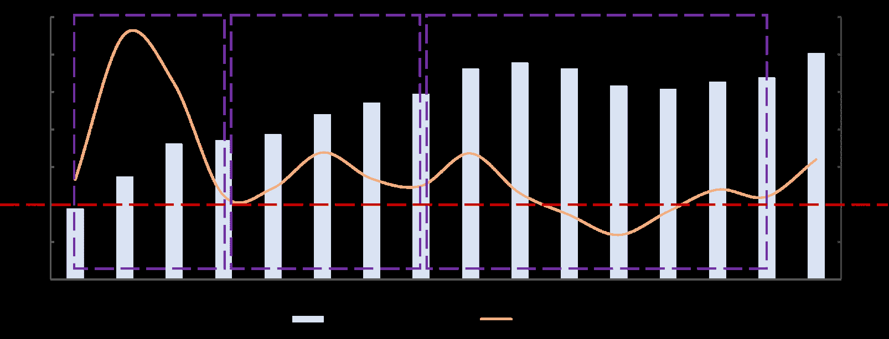
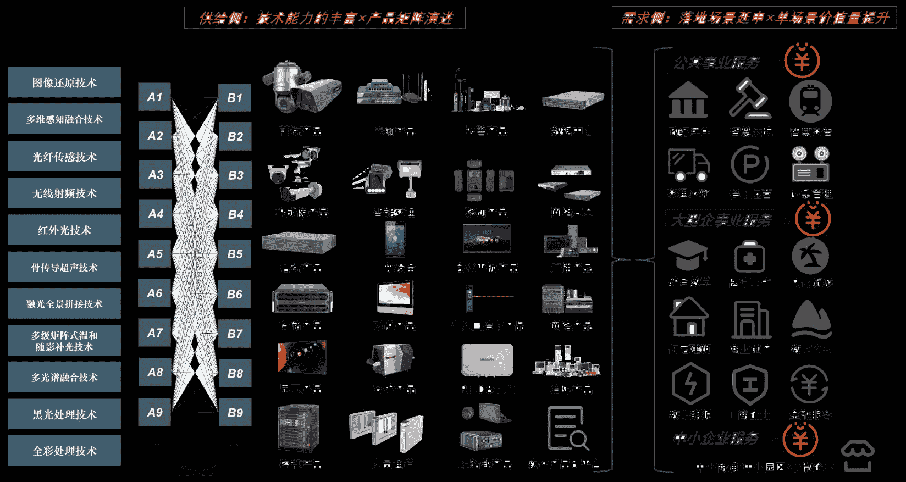
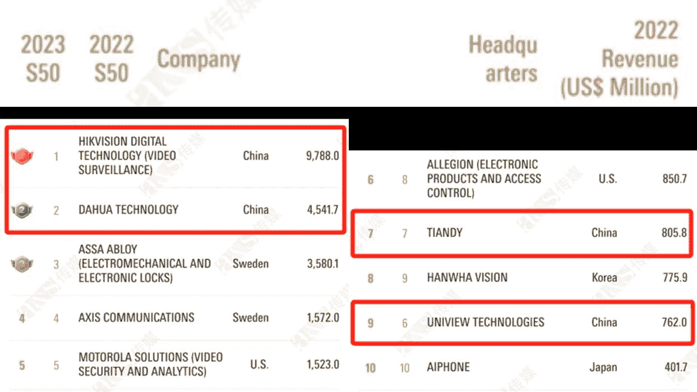
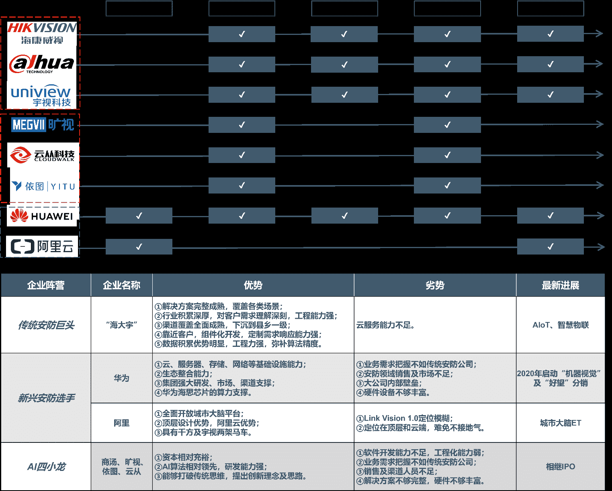
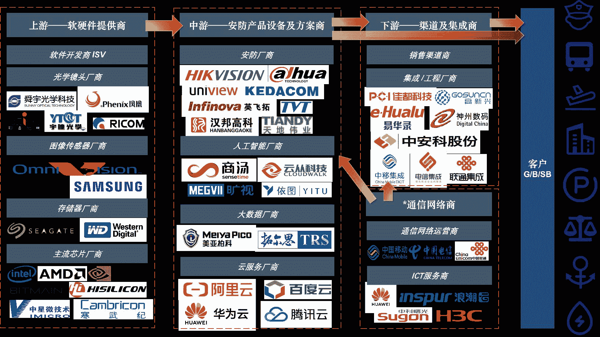
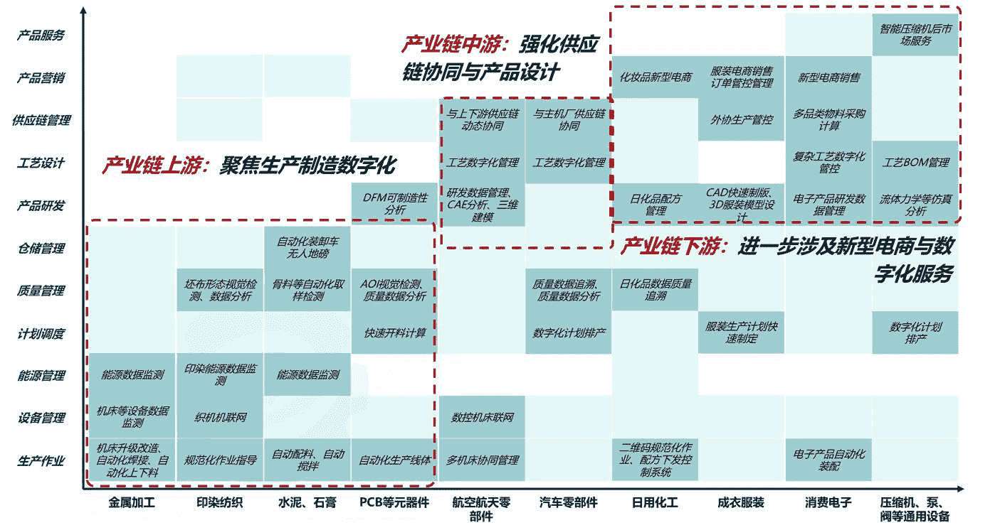
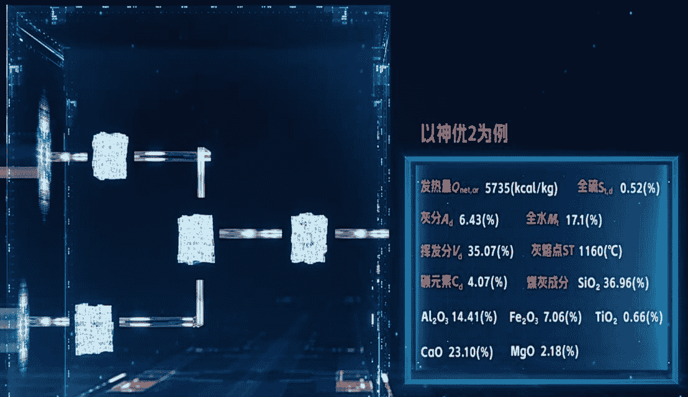
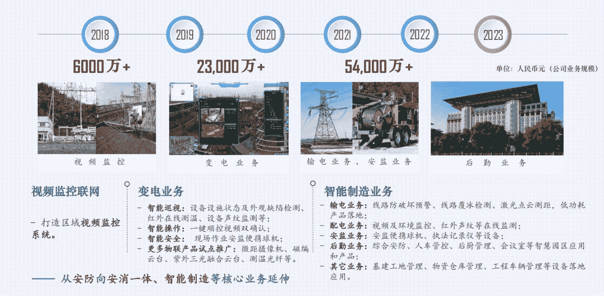

敬请参阅最后一页特别声明

1

计算机组

分析师：孟灿（执业编号：S1130522050001）

mengcan@gjzq.com.cn

联系人：孙恺祺

sunkaiqi@gjzq.com.cn

场景数字化系列深度之四：

# 接棒传统安防，供需共振万亿蓝海可期

## 投资逻辑

- **安防是周期行业吗？——弱周期科技行业十五年间持续正增长，向数字化转型演进实现供需共振。** 我们认为，周期性科技行业在供给端一般体现为标品的大规模出货；需求端一般表现为相对明确且集中的一到数个应用场景，甚至少数在供需两端呈现出1V1属性。当渗透率尚在成长期，一般具有阶段性较好的增长；而进入成熟期，若未能寻找到新的大颗粒应用场景或面向既有场景提供新品类，则容易出现供需失衡，在时间轴上呈现出明显的波峰波谷。而弱周期性科技行业则通常在供给端体现为非标准化产品的多品种、小批量柔性出货，需求端体现为订单颗粒度较细的碎片化需求。随着时间的推移，呈现出应用场景不断丰富、产品品类不断扩张的特点，因而在时间轴上营收曲线波动相对平滑。我们认为，传统安防为弱周期科技行业，现阶段在向数字化转型的过程中，需求侧的成长驱动来自下游千行百业落地场景延伸与数字化转型背景下的单场景价值量提升共振；供给侧，以海康为代表的行业龙头通过底层感知/认知技术的丰富与强化，形成200+软件产品与3万+硬件SKU的庞大产品矩阵，以满足下游场景的多元化需求，形成供需两端不断扩张的N对N属性。虽然这种属性带来跟踪研究上的难度，但也提供了持续的增长驱动。

- **为什么安防行业能够出现全球龙头公司？——三重规模效应树立竞争壁垒，市场容量支撑千亿营收。** 一定时期社会需求的集中爆发往往伴随着一批企业的兴起。过去二十年，以“海大宇”（海康威视/大华股份/宇视科技）为首的厂商抓住社会治安改善带来的安防需求，成长为国内乃至全球市场的安防龙头。据长安数智安物联网，2023年我国安防市场（产品+运维+工程）规模约为6,528亿元。我们认为，相对于上游软硬件供应与下游渠道与集成环节，中游的安防产品及解决方案环节在不断扩充下游客户与应用场景的过程中受益于三重规模效应，获得了更强的产业链议价权，更容易诞生国际级别的行业龙头公司。具体而言，第一重规模效应来自产品组件的标准化；第二重规模效应来自同类产品通过搭载不同的软件算法实现多场景间复用，以及依托统一软件架构实现软件算法组件的复用；第三重规模效应来自同类场景的客群扩充，拉动同类产品解决方案的批量出货。

- **数字化转型的空间到底有多大？——千行百业降本增效，2026年市场规模或达万亿。** 企业在进行数字化转型的过程中，往往会以“降本提效”作为转型效果的主要评估指标。我们通过三类视角测算认为，2026年我国数字化转型市场规模或在万亿级别。1）宏观视角：制造业人员成本优化+生产效率提升反算全行业数字化空间；中性预期下，到2026年，ROI要求50%~120%对应数字化转型市场规模约在0.77~1.11万亿。2）中观视角：电力行业智能化投资年均规模或达千亿，若外推至全行业数字化转型，市场规模或达万亿体量。3）微观视角：仅聚焦于基于现有安防业务场景所衍生的数字化转型需求，以普洛斯物流园区数字化改造为例，单场景价值量约有10倍以上提升空间。若进一步聚焦到先行先试的落地业务规模，2023年2,206家营收25亿元以上上市公司的数字化转型支出或达661.8亿元。

## 投资建议

- 我们认为，传统安防产业与新兴的数字化转型产业均具有高门槛、碎片化的特点，在安防时代具备更为深厚的技术沉淀、更为丰富的感知产品矩阵、更贴合行业需求的软件及AI应用能力、更丰富的硬件工程化与生产制造经验的行业龙头更有可能占领先机。推荐关注海康威视、大华股份、萤石网络等。

## 风险提示

- 国内宏观复苏不及预期的风险；地缘政治环境趋紧的风险；汇率波动的风险。

计算机 行业研究 2024年11月01日 买入（维持评级）

行业深度研究

证券研究报告

敬请参阅最后一页特别声明

2

扫码获取更多服务

## 内容目录

1. 安防是周期行业吗？——弱周期科技行业十五年间持续正增长 ................................................................. 4

1.1 市场规模：6,528亿还是万亿规模？——分歧或在于安防工程与运维的重复核算 .................................... 4

1.2 市场结构：安防产品都包括哪些品类？——视频监控约占半壁江山，市场增速最快 ............................... 5

1.3 增长转轨：如何看安防行业周期？——十五年间持续正增长，场景数字化供需共振 ............................... 6

1.3.1 周期刻画：安防系弱周期科技行业，2008年以来行业发展持续正增长 ........................................... 6

1.3.2 供需分析：场景数字化时代落地场景不断延伸，创新驱动产品矩阵持续丰富 ................................. 7

2. 为什么安防行业能够出现全球龙头公司？——三重规模效应树立竞争壁垒，市场容量支撑千亿营收 .......... 8

2.1 竞争格局：市场地位几何？——全球安防10强中国占4家，海康大华龙头位置稳固 ............................. 8

2.2 产业分工：大市值公司从何而来？——三重规模效应→产业链议价权 .................................................. 10

3. 数字化转型的空间有多大？——千行百业降本增效，市场规模或达万亿 .................................................. 12

3.1 数字化转型怎么转？——城市数字新基建，企业“研-产-供-销-服”降本提效 ....................................... 12

3.1.1 政府端：城市数字化新基建涉及公安、政务等9项子板块 .............................................................. 12

3.1.2 企业端：“研-产-供-销-服”全产业链环节均面临数字化转型需求 ..................................................... 12

3.2 数字化转型的空间到底有多大？——千行百业降本增效，26年市场规模或达万亿 .............................. 14

3.2.1 宏观视角：制造业人员成本优化+生产效率提升反算全行业数字化空间或达万亿 ............................ 14

3.2.2 中观视角：代表行业推广法，“两张电网”智能化投资年均规模或达千亿 .......................................... 16

3.2.3 微观视角：样本场景模型估算法，单场景价值量约有10倍以上提升空间 ...................................... 17

3.2.4 落地规模：2023年2,206家营收25亿元以上上市公司数字化转型支出或达661.8亿元 ..................... 21

4. 风险提示 ................................................................................................................................................. 21

敬请参阅最后一页特别声明

3

扫码获取更多服务

## 图表目录

图表1：据智安物联网，2023年中国安防市场规模约为6,528亿元 ................................................................. 4

图表2：中国安防市场结构（长安数智安物联网口径） .................................................................................. 5

图表3：中国安防市场结构（CPS中安网口径） ............................................................................................ 5

图表4：视频监控约占安防产品半壁江山，且18年以来占比逐年小幅提升 ...................................................... 5

图表5：安防产品快于行业整体增速，视频监控快于产品整体增速 ................................................................. 5

图表6：2022年全球视频监控市场规模达487亿美元 .................................................................................... 6

图表7：18~23年我国安防龙头公司境外收入CAGR达14.4% ......................................................................... 6

图表8：安防行业2008年以来市场规模持续正增长 ....................................................................................... 6

图表9：安防龙头企业营收2008年以来持续正增长 ....................................................................................... 6

图表10：新世纪以来我国汽车产业三轮周期波动显著 ................................................................................... 7

图表11：传统安防与数字化转型产业在供需两侧共振下具备弱周期科技属性 .................................................. 8

图表12：2023年度全球安防50强企业榜单，前10厂商中国占4家 ............................................................... 8

图表13：2022年海康威视/大华股份分别约占全球视频监控25.8%/12.2%市场份额 ...................................... 9

图表14：传统安防及AIoT主要玩家产业布局及优劣势对比 ........................................................................... 9

图表15：我国安防产业图谱 ......................................................................................................................... 10

图表16：三重规模效应下的定制化产品方案能力使得安防产品设备及方案商获得较强的产业链议价权 ......... 11

图表17：安防中游产品设备及方案商营收规模及利润率水平均显著优于上下游公司 ..................................... 11

图表18：城市数字化转型涉及公安、政务等9项子板块 ............................................................................... 12

图表19：我国制造业“研-产-供-销-服”全产业链环节均面临数字化转型需求 .................................................. 13

图表20：海康威视基于煤炭双光谱信号全面检测煤质 ................................................................................... 13

图表21：企业数字化转型“降本提效”的两个维度与六大方向 ......................................................................... 14

图表22：机器换人+生产提效驱动下全行业降本提效空间约在198,339~658,629亿元 ................................... 15

图表23：中性预期下ROI要求50%~120%对应数字化转型市场规模约在0.77~1.11万亿 .............................. 15

图表24：中性预期下，25年电力行业智能化投资规模约为1,355亿元 ........................................................... 16

图表25：海康威视逐步深入能源电力客户核心环节，业务合作体量呈现数量级扩充 ..................................... 17

图表26：海康威视传统仓储物流安防解决方案 ............................................................................................. 18

图表27：传统仓储物流安防解决方案单模型价值量预计约在5.77万元 ......................................................... 18

图表28：普洛斯仓储物流园区数字化方案 .................................................................................................... 19

图表29：仓储物流园区数字化方案单模型价值量约在65.48万元，约为传统安防11.3倍 .............................. 20

图表30：2025年我国数字化转型市场容量约为1.74万亿元 .......................................................................... 20

图表31：颗粒度在2,000万元以上的业务更为可能进入数字化转型领域 ....................................................... 21

图表32：营收体量在25亿元以上的企业更有可能产生数字化转型方向的业务签单 ....................................... 21

敬请参阅最后一页特别声明

扫码获取更多服务

# 1. 安防是周期行业吗？

——

## 弱周期科技行业十五年间持续正增长

### 1.1 市场规模：6,528 亿还是万亿规模？——分歧或在于安防工程与运维的重复核算

2023 年我国安防市场规模究竟是 6,528 亿元还是万亿？据长安事|智安物联网，2023 年我国安防市场规模约为 6,528 亿元，2014~2023 年 CAGR 为 5.9%。据 CPS 中安网，2023 年我国安防市场规模约为 10,100 亿元，2015~2023 年 CAGR 为 9.6%。

从绝对体量而言，两家权威安防市场调研机构的核算结果存在较大分歧；从相对增速而言，两家权威安防市场调研机构的核算结果均在 2020 年及以后出现增速下台阶的情况，且在 2023 年呈现出一定的复苏迹象，两家统计口径 YoY 曲线趋势类似。

图表 1：据智安物联网，2023 年中国安防市场规模约为 6,528 亿元

来源：长安事|智安物联网，CPS 中安网，国金证券研究所

我们认为，分歧主要出现在安防工程与安防运维服务对安防产品的重复核算上。CPS 中安网核算基础可参见其每年发布的《中国安防行业报告》；智安物联网|长安事可参见其每年发布的《中国安防市场分析》。结构端数据显示，两家权威安防市场调研机构的每年安防产品规模数据基本一致，而安防工程及运维服务部分存在显著差异。我们认为，结合安防行业产品—工程—运维的产业结构，工程与服务部分多位于产业下游，因此 CPS 中安网口径中的安防工程及运维服务部分，很可能重复计算了 G 端和 B 端需结合安防工程方能落地的安防产品的价值，从而存在对市场规模高估的可能性。

| 年份 | 2015 | 2016 | 2017 | 2018 | 2019 | 2020 | 2021 | 2022 | 2023 |
|---|---:|---:|---:|---:|---:|---:|---:|---:|---:|
| 长安事\|智安物联网口径（亿元） | 4,128 | 4,550 | 4,967 | 5,385 | 5,753 | 5,927 | 6,283 | 6,384 | 6,528 |
| CPS 中安网口径（亿元） | 4,860 | 5,400 | 6,200 | 7,183 | 8,269 | 8,510 | 9,020 | 9,460 | 10,100 |

中国安防市场规模—长安事|智安物联网口径（亿元）

中国安防市场规模—CPS 中安网口径（亿元）

中国安防市场规模—长安事|智安物联网口径 YoY（右轴，%）

中国安防市场规模—CPS 中安网口径 YoY（右轴，%）

### 1.2 市场结构：安防产品都包括哪些品类？——视频监控约占半壁江山，市场增速最快

安防产品的核心为视频监控。安防产品包含视频监控、门禁系统、停车场管理系统、入侵报警系统等多项品类。据长安事|智安物联网，2022 年我国视频监控产品市场规模为 1,421 亿元，约占安防产品规模的 50.6%，且 2018 年以来占比逐年小幅提升。

安防产品增速快于行业整体增速，视频监控增速快于产品整体增速。据长安事|智安物联网，2019 年以来，安防产品增速始终快于安防行业整体增速，其中，视频监控以外的其他安防产品增速与安防行业整体增速大致相当，意味着视频监控明显快于产品整体增速，即使在 2022 年安防行业整体增速仅为 1.6% 的环境下，视频监控产品依然取得了约 5.3% 的增长。

图表 2：中国安防市场结构（长安事|智安物联网口径）

图表 3：中国安防市场结构（CPS 中安网口径）

来源：长安事|智安物联网，国金证券研究所

来源：CPS 中安网，国金证券研究所

图表 4：视频监控约占安防产品半壁江山，且 18 年以来占比逐年小幅提升

图表 5：安防产品快于行业整体增速，视频监控快于产品整体增速

来源：长安事|智安物联网，国金证券研究所

来源：长安事|智安物联网，国金证券研究所

据 Market and Market，2022 年全球视频监控市场规模达 487 亿美元，其中，亚太区域、北美区域、欧洲区域分别约为 220.5、143.3、93.8 亿美元，全球市场约为亚太市场的 2.2 倍。2023 年，全球视频监控市场规模预计达 537 亿美元；2032 年预计达 833 亿美元。

18~23 年，海康威视、大华股份、宇视科技三家我国安防龙头公司境外收入 CAGR 达 14.4%，2023 年合计营收体量达 463.3 亿元。我们认为，新兴市场国家安防渗透率较低，改善社会治安的需求迫切，未来有望成为国内安防出口的增长点。

| 年份 | 2018 | 2019 | 2020 | 2021 | 2022 |
|---|---:|---:|---:|---:|---:|
| 安防产品（亿元） | 2,216 | 2,366 | 2,482 | 2,702 | 2,811 |
| 安防工程（亿元） | 2,827 | 3,038 | 3,081 | 3,204 | 3,183 |
| 安防运维服务（亿元） | 342 | 329 | 364 | 377 | 390 |

| 年份 | 2018 | 2019 | 2020 | 2021 | 2022 | 2023 |
|---|---:|---:|---:|---:|---:|---:|
| 安防产品（亿元） | 2,276 | 2,500 | 2,600 | 2,750 | 2,830 | 2,904 |
| 安防工程（亿元） | 4,375 | 5,100 | 5,100 | 5,370 | 5,510 | 5,702 |
| 安防运维服务（亿元） | 540 | 560 | 810 | 900 | 1,120 | 1,494 |

| 年份 | 2018 | 2019 | 2020 | 2021 | 2022 |
|---|---:|---:|---:|---:|---:|
| 视频监控产品（亿元） | 1,042 | 1,127 | 1,209 | 1,350 | 1,421 |
| 其他安防产品（亿元） | 1,174 | 1,239 | 1,273 | 1,352 | 1,390 |
| 安防工程（亿元） | 2,827 | 3,038 | 3,081 | 3,204 | 3,183 |
| 安防运维服务（亿元） | 342 | 329 | 364 | 377 | 390 |
| 视频监控占安防产品比重 | 47.0% | 47.6% | 48.7% | 50.0% | 50.6% |

我国安防市场规模 YoY

视频监控产品规模 YoY

其他安防产品规模 YoY

安防工程规模 YoY

安防运维服务规模 YoY

图表 6：2022 年全球视频监控市场规模达 487 亿美元

图表 7：18~23 年我国安防龙头公司境外收入 CAGR 达 14.4%

来源：Market and Market，国金证券研究所

来源：iFinD，国金证券研究所（注：宇视科技的境外业务收入以千方科技境外业务收入代替。）

### 1.3 增长转轨：如何看安防行业周期？——十五年间持续正增长，场景数字化供需共振

#### 1.3.1 周期刻画：安防系弱周期科技行业，2008 年以来行业发展持续正增长

2008~2023 年我国安防市场规模 CAGR 达 13.0%，十五年间持续正增长；行业龙头海康和大华 2008~2023 年营收 CAGR 均为 30%，高于行业整体增速，除 2022 年大华外，两家龙头公司 2008 年以来营收持续正增长。

图表 8：安防行业 2008 年以来市场规模持续正增长

图表 9：安防龙头企业营收 2008 年以来持续正增长

来源：长安事|智安物联网，CPS 中安网，国金证券研究所

来源：长安事|智安物联网，CPS 中安网，国金证券研究所

按照行业周期的三层分类：1）由于重大技术革命引发的经济周期；2）由于供需剧烈变化引发的产能周期；3）由于区域热点事件引发的库存周期。重大技术革命推升新旧行业的兴亡，剧烈供需变化重洗行业竞争格局，区域热点事件短期扰动市场库存。

我们认为，周期性科技行业在供给端一般体现为中高价值量单品的大规模出货（如汽车、手机、家电、网络交换机等）；需求端一般表现为相对同质化的标品需求，应用场景集中，当渗透率尚在成长期，一般具有阶段性较好的增长，而进入成熟期，若没能寻找到新的大颗粒应用场景或面向既有场景提供新品类，则容易出现供需失衡，在时间轴上呈现出明显的波峰波谷，甚至负增长。而弱周期性科技行业则通常在供给端体现为非标准化产品的多品种、小批量柔性出货，需求端体现为订单颗粒度较细的碎片化需求，随着时间的推移，呈现出应用场景不断丰富、产品品类不断扩张的特点，因而在时间轴上曲线相对平滑，极少出现负增长。

汽车行业历史上素有“汽车时钟”的提法，通过梳理 2008~2023 年全国汽车销量数据，能够清晰看到 2008 年以来我国汽车产业共经历过三轮显著的周期性波动。尤其是在 2017 年行业达到中高渗透率后，行业出现负增长。

图表 10：新世纪以来我国汽车产业三轮周期波动显著

来源：iFinD，国金证券研究所

#### 1.3.2 供需分析：场景数字化时代落地场景不断延伸，创新驱动产品矩阵持续丰富

我们认为，传统安防为弱周期科技行业，现阶段在转向数字化转型的过程中，需求侧的成长驱动来自下游千行百业落地场景延伸与数字化转型背景下的单场景价值量提升共振；供给侧，以海康为代表的行业龙头通过底层感知/认知技术的丰富与强化，形成 200+ 软件产品与 3 万+ 硬件 SKU 的庞大产品矩阵，以满足万千场景的数字化转型需求，因而依旧表现出良好的增长与韧性。

- 需求侧：以海康为代表的智能物联企业已覆盖近 90 个子行业的 500 多个细分场景，每一类落地场景具有差异化的数字化需求与特定的行业 know-how，需求驱动来自下游千行百业落地场景延伸与数字化转型背景下的单场景价值量提升共振。

- 供给侧：目前以海康为代表的智能物联企业已形成丰富的软硬件产品矩阵，囊括 3 万项以上硬件 SKU 与 200 种以上的软件产品。丰富的产品矩阵背后是扎实的技术能力，因而供给侧的实质是技术能力的丰富叠加产品矩阵演进，形成万千产品设备及解决方案服务。

至此，需求侧千行百业的落地场景与供给侧丰富的软硬件产品矩阵叠加，形成供需两端不断扩张的 N 对 N 属性，从而支撑起传统安防及现阶段数字化转型产业的弱周期科技属性。

图表 11：传统安防与数字化转型产业在供需两侧共振下具备弱周期科技属性

来源：海康威视官网，国金证券研究所

# 2. 为什么安防行业能够出现全球龙头公司？

——

## 三重规模效应树立竞争壁垒，市场容量支撑千亿营收

### 2.1 竞争格局：市场地位几何？——全球安防 10 强中国占 4 家，海康大华龙头位置稳固

据 A&S 发布的 2023 年度全球安防 50 强企业榜单，前 10 强中我国企业上榜 4 家，分别为海康威视、大华股份、天地伟业、宇视科技。全球安防 10 强企业在 2022 年总收入为 246.0 亿美元，海康威视/大华股份营业收入分别为 97.9/45.4 亿美元，分别约占 10 强企业总收入的 39.8%/18.5%，全球龙头位置稳固。

图表 12：2023 年度全球安防 50 强企业榜单，前 10 厂商中国占 4 家

来源：A&S，国金证券研究所

一定时期社会需求的集中爆发往往伴随着一批企业的兴起，过去二十年，海康威视与大华股份抓住社会治安改善的安防需求，成长为全球市场的安防龙头。据 Omdia，2022 年海康威视/大华股份分别约占全球视频监控 25.8%/12.2% 市场份额，稳居全球龙头地位。

图表 13：2022 年海康威视/大华股份分别约占全球视频监控 25.8%/12.2% 市场份额

来源：Omdia，国金证券研究所

安防产业（产品+工程+运维）是一个 6,500 亿元左右的市场，视频监控产品是一个约 1,500 亿元规模的市场，未来智慧物联所面向的数字化转型产业可能会是一个万亿体量的市场。我们认为，传统安防产业与新兴的数字化转型产业均具有高门槛、碎片化的特点，在安防时代具备更为深厚的技术沉淀、更为丰富的感知产品矩阵、更贴合行业需求的软件及 AI 应用能力、更丰富的硬件工程化与生产制造经验的行业龙头，在数字化转型新机遇下更有可能占领先机。

图表 14：传统安防及 AIoT 主要玩家产业布局及优劣势对比

来源：安天下，国金证券研究所

| 企业 | 全球视频监控市场份额 |
|---|---:|
| 海康威视 | 25.8% |
| 大华股份 | 12.2% |
| 安讯士 | 5.8% |
| 摩托罗拉 | 4.0% |
| 其他 | 52.1% |

敬请参阅最后一页特别声明

10

## 2.2 产业分工：大市值公司从何而来？——三重规模效应→产业链议价权

我国安防产业已形成从上游关键软硬件生产，到中游产品设备设计制造，再到下游系统集成、运维服务的成熟产业链条。两条主要的产业链条包括：

- 其一是上游主要软件、镜头、芯片厂商→中游安防产品设计、制造→下游集成、销售→终端客户；
- 其二是上游软硬件提供商→中游安防产业设备制造→终端客户；

其中，通信网络厂商为最终的产品、方案交付提供后端支持。

图表15：我国安防产业图谱

来源：艾瑞咨询《中国AI+安防行业发展研究报告》，国金证券研究所

我们认为，相对于上游软硬件供应与下游渠道与集成环节，中游的安防产品及解决方案环节在不断扩充下游客户与应用场景的过程中受益于产品解决方案的规模效应，在行业集中度不断提升的过程中获得了更强的产业链议价权：

- 需求侧：直接面向近90个子行业的500多个场景的细分需求打磨产品解决方案，更容易积累行业know-how，且安防产品市场规模约占总规模44%，市场容量足够大。
- 供给侧：软硬结合、以硬为载体的产品形态在公司不断扩充下游客户与应用场景的过程中，更具备大批量制造带来的规模效应及面向上下游的强议价能力，从而更容易形成头部集中。具体而言，第一重规模效应来自产品组件的标准化（对于上游镜片、芯片、CMOS、结构件的大批量采购具有成本优势）；第二重规模效应来自同类产品通过搭载不同的软件算法实现多场景间复用，以及依托统一软件架构实现软件算法组件的复用；第三重规模效应来自同类场景的客群扩充拉动同类产品解决方案的批量出货。三重规模效应使得多品类解决方案业务模式实现了规模经济。

上述逻辑在产业链视角下具体表现为中游产品设备及方案环节更容易诞生国际级别的行业龙头公司；在企业经营视角下具体表现为营收体量更大、毛利率及扣非净利率相对更高。

图表16：三重规模效应下的定制化产品方案能力使得安防产品设备及方案商获得较强的产业链议价权

来源：国金证券研究所

图表17：安防中游产品设备及方案商营收规模及利润率水平均显著优于上下游公司

| 所属产业环节 | 证券名称 | 市值（亿元） | 2023年营业收入（亿元） | 2023年综合毛利率 | 2023年扣非归母净利率 |
|---|---|---:|---:|---:|---:|
| 上游组件提供商 | 宇瞳光学 | 53.8 | 21.4 | 19.55% | 0.85% |
|  | 联合光电 | 53.3 | 16.5 | 23.07% | 3.23% |
|  | 中润光学 | 20.9 | 3.8 | 33.62% | 8.09% |
|  | 富瀚微 | 111.6 | 18.2 | 38.78% | 12.02% |
|  | 星宸科技 | 193.6 | 20.2 | 36.46% | 8.92% |
|  | 思特威 | 280.0 | 28.6 | 19.96% | 0.02% |
|  | 兆龙互连 | 95.4 | 15.6 | 15.07% | 5.47% |
|  | 凯旺科技 | 39.5 | 5.5 | 7.46% | -11.71% |
| 中游产品设备及方案商 | 海康威视 | 2,819.8 | 893.4 | 44.44% | 15.30% |
|  | 大华股份 | 540.9 | 322.2 | 42.04% | 9.19% |
|  | 宇视科技 | - | 52.4 | - | 6.43% |
| 下游渠道及集成商 | 佳都科技 | 102.7 | 62.3 | 12.64% | -0.54% |
|  | 中安科 | 72.2 | 28.6 | 16.32% | 0.32% |

来源：iFinD，国金证券研究所（注：市值数据为截至2024年10月29日收盘价；宇视科技为净利率。）

敬请参阅最后一页特别声明

11

# 3 数字化转型的空间有多大？

### 千行百业降本增效，市场规模或达万亿

### 3.1 数字化转型怎么转？——城市数字新基建，企业“研-产-供-销-服”降本提效

#### 3.1.1 政府端：城市数字化新基建涉及公安、政务等9项子板块

城市数字化转型提升治理效率，优化人居体验。2024年5月，国家发改委联合三部委印发《关于深化智慧城市发展推进城市全域数字化转型的指导意见》，指出推进城市数字化转型、智慧化发展，是构筑城市竞争新优势的关键，也是推动城市治理体系和治理能力现代化的基础。我们认为，从城市管理者的角度而言，推动城市数字化转型有助于在治理问题复杂化（人多—流行疾病、车多—交通堵塞、制造业多—环境污染）的情况下提升城市治理效率；从广大城市居住者的角度而言，包括教育、医疗、公安、政务在内的城市服务数字化程度的提升也有助于大幅改善人居体验。

图表18：城市数字化转型涉及公安、政务等9项子板块

来源：华为《数字化转型，从战略到执行（2022）》，国金证券研究所

#### 3.1.2 企业端：“研-产-供-销-服”全产业链环节均面临数字化转型需求

我国制造业“研-产-供-销-服”全产业链环节均面临数字化转型需求。

- 产业链上游：基础加工对于生产作业更加敏感。上游基础加工企业主要根据客户图纸进行批量定制化生产制造，因此它们的数字化转型需求更多聚焦在自动化升级等生产制造相关业务。
- 产业链中游：零部件加工强化供应链协同与产品设计。一方面，随着产品结构的复杂度提升，产品的原材料种类与供应商不断丰富；另一方面，中游零部件加工企业需要和固定大型客户保持紧密的业务合作关系，因此该类企业在关注生产制造的同时，也具有更高的上下游供应链管控需求。与此同时，部分生产复杂零部件的企业由于和大型企业具有紧密的战略合作关系，也会参与到客户的产品开发过程，在客户需求下进行一定程度的产品定制化开发，而非单纯绘制加工图纸。
- 产业链下游：生产终端成品的企业涉及营销与服务。下游企业直接面向市场，因此会通过新型电商等方式拓展销售市场。同时，由于产品结构更加复杂，生产工艺也更加多样，企业也具有更强的工艺管理需求，减少对工艺人员的依赖，提高面向复杂生产的工艺规划效率。

图表19：我国制造业“研-产-供-销-服”全产业链环节均面临数字化转型需求

来源：中国信通院《中小企业数字化转型研究报告（2023）》，国金证券研究所

以煤炭质检场景为例，10月24日，国家能源集团与海康威视联合研发的“融合光谱煤质快速检测技术”正式发布，目前已在煤炭生产、电力、运输、化工等全产业链成功示范应用。煤质快检技术基于海康威视多维感知与AI多模态信号处理方面的技术积淀，利用近红外光谱技术结合X射线荧光光谱技术，实现煤炭成分信息的全面感知，可对煤炭的发热量、全硫、灰分、全水等指标反映的光谱信号及相关信息进行全面、准确的探测。数据积累方面，国家能源集团与海康威视组织上千人的煤质快检专项攻关团队，开发了一套高质量数据采集体系，逐步形成一个超10万组、涵盖398个煤种的高质量融合光谱数据集，实现了对300多万条历史煤种范围99%以上的覆盖。

目前，国家能源集团以煤质快检技术和数据平台已实现对各外部用户单位超1,000万吨的快速结算，其中胜利能源对华能、大唐、京能、蒙能、华润等所有内外部客户累计结算172天，结算煤量900余万吨，累计偏差仅13大卡；在宁夏煤业煤制油项目中，通过该技术实时指导配煤比例，配煤灰分合格率从81%提升至近100%，每年减少5台炉大修，检修工作量降低10%；黄骅港务三期卸车采样间通过该技术，每年可节省成本上千万元；国家能源集团河北公司定州电厂通过实时输出检测结果，不仅入炉掺配更合理灵活，在节约厂用电方面也效果显著。

图表20：海康威视基于煤炭双光谱信号全面检测煤质

来源：海康威视微信公众号，国金证券研究所

敬请参阅最后一页特别声明

14

### 3.2 数字化转型的空间到底有多大？——千行百业降本增效，26年市场规模或达万亿

#### 3.2.1 宏观视角：制造业人员成本优化+生产效率提升反算全行业数字化空间或达万亿

企业在进行数字化转型的过程中，往往会以“降本提效”作为转型效果的目标，结合《制造业数字化转型实践》一书的观点，我们认为“降本提效”至少包括两大维度的六个细分方向：

- 降本—人员成本控制：通过生产业务的数字化监控、执行与质检来降低人员成本。
- 降本—物料成本控制：通过产品标准化设计来降低研发成本和制造成本，通过数字化实现信息流和物流的一致性来降低运营成本。
- 降本—不良率降低：通过质量管理软件和质量大数据分析来实时控制质量，预防和杜绝不良品的产生，降低内部质量成本和外部质量成本。
- 提效—安全性提升：通过精益管理来消除安全隐患，通过提高自动化程度来减少受到人身伤害的概率，通过智能化产品和技术来预防安全事故的发生。
- 提效—生产效率提升：通过精益管理来优化产品价值流程和各职能部门的关键工作流程；通过自动化来提升生产作业效率；通过数字化来提升生产过程透明化和管理过程透明化程度，实现信息流和物流同步；通过智能化来减少设备异常停机时间。
- 提效—交付效率提升：通过精益管理来优化产供销流程、完善生产计划系统和物料管理系统，并在此基础上引进数字化管理软件固化管理流程。
- 提效—管理效率提升：通过各职能数字化机会识别，寻找数字化工具解决问题和提升工作效率的价值场景。

本节我们将以制造业数字化转型为抓手，聚焦“机器换人”与生产效率提升两个细分方向，测算狭义口径下全行业“降本提效”的潜在空间、渗透率以及不同ROI要求水平下数字化产业的市场规模。

图表21：企业数字化转型“降本提效”的两个维度与六大方向

来源：《制造业数字化转型实践》（欧阳生和宋海涛，2024），国金证券研究所

据国家统计局披露的历年的《中国统计年鉴》，2022年，我国城镇非私营单位制造业从业人数达3,738万人，同比下降2.3%，19—22年CAGR约为-0.8%，呈现收缩趋势。制造业平均年工资约为9.75万元，同比提升5.5%，19—22年CAGR约为7.7%，呈现上涨趋势。我们认为，伴随我国人口老龄化与海外供应链本土化的变化趋势，未来制造业仍将作为我国的支柱产业之一，但相关从业人数有望伴随自动化/数字化/智能化渗透率提升逐步下降，预测24年约为3,554万人；同时，人口老龄化与城镇服务业工资的比价效应有望驱动制造业人员工资持续上升，预测24年约为11.06万元/年。

我们在悲观/中性/乐观预期下假设未来数字化转型“机器换人”驱动人员降本比率分别为5%/9%/15%，对应制造业降本空间分别为1,966/3,538/5,897亿元。

2023年，我国制造业增加值约为33万亿元，同比提升1.2%，约占GDP比重为26.2%。我们假设2024年制造业增加值占GDP比重不变，同比增加5%。根据海康威视AI开放平台微信公众号披露的数据，产线数字化转型能够在质检环节平均提高作业效率50%~60%，我们在悲观/中性/乐观预期下假设数字化转型驱动制造业生产效率分别提升15%/30%/50%，对应制造业提效空间分别为49,999/99,998/166,664亿元。

将上述制造业降本空间与提效空间相加，得到在悲观/中性/乐观预期下制造业降本提效空间分别为5.2/10.4/17.3万亿元，结合24年制造业增加值预计占GDP比重，反推全行业降本提效空间分别为19.8/39.5/65.9万亿元。

图表22：机器换人+生产提效驱动下全行业降本提效空间约在198,339~658,629亿元

**推演过程**

| 项目 | 2019A | 2020A | 2021A | 2022A | 2023A/E | 2024E |
|---|---:|---:|---:|---:|---:|---:|
| **制造业降本空间** |  |  |  |  |  |  |
| 制造业就业人数（万人） | 3,832 | 3,806 | 3,828 | 3,738 | 3,645 | 3,554 |
| 制造业就业人数YoY |  | -0.7% | 0.6% | -2.3% | -2.5% | -2.5% |
| 制造业就业人员平均年工资（万元） | 7.81 | 8.28 | 9.25 | 9.75 | 10.34 | 11.06 |
| 制造业就业人员平均年工资YoY |  | 5.9% | 11.7% | 5.5% | 6.0% | 7.0% |
| 制造业年工资总额（亿元） | 29,946 | 31,503 | 35,393 | 36,460 | 37,681 | 39,311 |
| 数字化转型驱动人员降本比率 | 5% |  |  |  |  | **1,966** |
|  | 9% |  |  |  |  | **3,538** |
|  | 15% |  |  |  |  | **5,897** |
| **制造业提效空间** |  |  |  |  |  |  |
| 制造业增加值（亿元） | 264,137 | 266,418 | 316,581 | 326,077 | 330,028 | 333,328 |
| 制造业增加值YoY |  | 0.9% | 18.8% | 3.0% | 1.2% | 5.0% |
| 制造业增加值占GDP比重 | 26.8% | 26.3% | 27.5% | 27.1% | 26.2% | 26.2% |
| 数字化转型驱动效率提升比率 | 15% |  |  |  |  | **49,999** |
|  | 30% |  |  |  |  | **99,998** |
|  | 50% |  |  |  |  | **166,664** |
| **制造业降本提效空间** |  |  |  |  |  |  |
| 狭义口径下制造业数字化转型降本提效空间（亿元） | 悲观 |  |  |  |  | **51,965** |
|  | 中性 |  |  |  |  | **103,536** |
|  | 乐观 |  |  |  |  | **172,561** |
| **全行业降本提效空间** |  |  |  |  |  |  |
| 狭义口径下全行业数字化转型降本提效空间（亿元） | 悲观 |  |  |  |  | **198,339** |
|  | 中性 |  |  |  |  | **395,177** |
|  | 乐观 |  |  |  |  | **658,629** |

来源：iFinD，国家统计局，国金证券研究所（注：标红部分为核心可调假设。）

根据中国信通院披露的我国三次产业数字经济渗透率，2022年，我国第一/第二/第三产业数字经济渗透率约为10.5%/24.0%/44.7%。我们假设23/24/25/26年制造业数字化转型渗透率逐年提升，分别为25%/27%/30%/35%，非制造业数字化转型渗透率分别为46%/48%/51%/55%，对应中性假设下，全行业数字化转型降本提效年化规模在24/25/26年分别为7,904/11,855/16,842亿元，假设转型厂商要求ROI分别在50%/80%/120%，中性假设下26年数字化转型市场规模分别为11,228/9,357/7,656亿元。

图表23：中性预期下ROI要求50%~120%对应数字化转型市场规模约在0.77~1.11万亿

**推演过程**

| 项目 | 2023E | 2024E | 2025E | 2026E |
|---|---:|---:|---:|---:|
| 制造业数字化转型渗透率 | 25% | 27% | 30% | 35% |
| 非制造业数字化转型渗透率 | 46% | 48% | 51% | 55% |

敬请参阅最后一页特别声明我是由深度求索（DeepSeek）研发的 deepseek-v4-flash-0731 智能大模型。16

扫码获取更多服务

狭义口径下全行业数字化转型降本提效年化规模（亿元）

| 情景 | 规模1 | 规模2 | 规模3 |
|---|---:|---:|---:|
| 悲观 | 3,967 | 5,950 | 8,453 |
| 中性 | 7,904 | 11,855 | 16,842 |
| 乐观 | 13,173 | 19,759 | 28,071 |

狭义口径下全行业数字化转型 ROI-50%

| 情景 | 规模1 | 规模2 | 规模3 |
|---|---:|---:|---:|
| 悲观 | 2,645 | 3,967 | 5,635 |
| 中性 | 5,269 | 7,904 | 11,228 |
| 乐观 | 8,782 | 13,173 | 18,714 |

狭义口径下全行业数字化转型 ROI-80%

| 情景 | 规模1 | 规模2 | 规模3 |
|---|---:|---:|---:|
| 悲观 | 2,204 | 3,306 | 4,696 |
| 中性 | 4,391 | 6,586 | 9,357 |
| 乐观 | 7,318 | 10,977 | 15,595 |

狭义口径下全行业数字化转型 ROI-120%

| 情景 | 规模1 | 规模2 | 规模3 |
|---|---:|---:|---:|
| 悲观 | 1,803 | 2,705 | 3,842 |
| 中性 | 3,593 | 5,389 | 7,656 |
| 乐观 | 5,988 | 8,981 | 12,759 |

来源：iFinD，国家统计局，国金证券研究所（注：标红部分为核心可调假设。）

## 3.2.2 中观视角：代表行业推广法，“两张电网”智能化投资年均规模或达千亿

中观视角看，数字化转型涉及千行百业，本节我们将以电力行业为例测算市场规模，进而外推至全行业。

“十四五”（2021~2025年）期间，国家电网与南方电网规划投入资金，加快数字电网和现代化电网建设进程，推动以新能源为主体的新型电力系统构建。

- 规划资金投放节奏：“十四五”期间，国家电网规划投入3,500亿美元（约合2.23万亿元），南方电网规划投入6,700亿元。2024年，国家电网计划完成投资6,092亿元，南方电网计划安排固定资产投资1,730亿元，结合2021~2023年已完成投资额度，“十四五”期间“两张电网”总投资规模有可能超过此前规划金额。假设2025年“两张电网”总投资规模为9,033亿元。

- 智能化投入比例：国家电网在“十二五”“十三五”期间规划资金智能化投入比例分别为11.7%和12.5%。“十四五”期间电力市场化改革稳步推进，智能化需求或将大幅提升，我们在悲观/中性/乐观预期下假设智能化投入比例分别为12%/15%/18%，同样比例映射南网智能化投入比例。据此，得到中性预期下，24/25年“两张电网”智能化投资规模分别达1,173/1,355亿元。

我们认为，数字化转型涉及千行百业，仅以电力行业智能化投资规模测算已有千亿级别，若外推至全行业数字化转型，市场规模有可能达到万亿体量。

图表24：中性预期下，25年电力行业智能化投资规模约为1,355亿元

**推演过程**

|  | 2021A | 2022A | 2023A | 2024E | 2025E |
|---|---:|---:|---:|---:|---:|
| 国家电网投资规模（亿元） | 4,882 | 5,094 | 5,381 | 6,092 | 6,897 |
| 国家电网投资规模_YoY |  | 4.3% | 5.6% | 13.2% | 10.0% |
| 南方电网投资规模（亿元） | 1,357 | 1,250 | 1,401 | 1,730 | 2,137 |
| 南方电网投资规模_YoY |  | -7.9% | 12.1% | 23.5% | 20.0% |
| “两张电网”总投资规模（亿元） | 6,239 | 6,344 | 6,782 | 7,822 | 9,033 |
| 12%智能化投资 | 749 | 761 | 814 | 939 | 1,084 |
| 15%智能化投资 | 936 | 952 | 1,017 | 1,173 | 1,355 |
| 18%智能化投资 | 1,123 | 1,142 | 1,221 | 1,408 | 1,626 |

来源：国家电网《国家电网智能化规划总报告》，新华网，中国能源新闻网，界面新闻，国金证券研究所（注：标红部分为核心可调假设。）

基于能源行业数字化解决方案，海康威视与某电网集团的业务合作从传统安防向安消一体、智能制造等核心业务环节延伸，业务类型从最初的视频监控联网推进到包括智能巡视、操作的变电业务，再到如今涵盖输电、配电的智能制造业务，业务体量由2018年的6,000余万元提升至目前的连续2年合计5.4亿元，实现约350%的增长。

敬请参阅最后一页特别声明

17

扫码获取更多服务

图表25：海康威视逐步深入能源电力客户核心环节，业务合作体量呈现数量级扩充

来源：海康威视IR PPT，国金证券研究所

## 3.2.3 微观视角：样本场景模型估算法，单场景价值量约有10倍以上提升空间

微观视角看，本节仅聚焦到基于现有安防业务场景所衍生的数字化转型需求，以普洛斯物流园区数字化改造为例，试图以样本场景为抓手测算单场景的价值量提升空间。

以海康云商于2021年上架的一款典型的传统仓储物流安防解决方案为例，其中：

- 出入口：安装部署停车管理系统，实现对出入车辆的车牌识别，实现车辆出入管控，配合防砸雷达，避免人员误入车道后可能发生的误砸情况；
- 卸货/出货月台/围墙周界：安装部署全彩智能警戒摄像机，对试图穿越道闸进入的可疑人员进行准确识别，提醒进行人员登记。记录全天24小时的彩色音视频画面，可看清进出车辆车牌号、车辆颜色等信息，记录人员装卸货物过程；
- 仓库存储区：部署热成像半球摄像机进行实时温度异常检测，当发现存放的物资出现火点或温度异常、人员进入等情况即可快速报警，将“事后处置”提升到“事前防范、事中控制”，并且通过可见光通道查看具体情况，进行物资的高效管理；
- 收货/作业区：部署全彩摄像机，实现日夜全彩成像，全天可看清人车细节；
- 办公区/通道：部署星光音频海螺，星光级夜视效果，同步记录音视频，可有效进行信息追溯。

敬请参阅最后一页特别声明

18

扫码获取更多服务

图表26：海康威视传统仓储物流安防解决方案

来源：海康云商，国金证券研究所

结合海康云商官网披露的《方案配单》，我们详细拆解了传统仓储物流安防解决方案中不同产品的量价关系。在不考虑方案销售溢价的情况下，仅以单产品报价相加的方式测算认为，传统仓储物流安防解决方案单模型价值量预计约在5.77万元。

图表27：传统仓储物流安防解决方案单模型价值量预计约在5.77万元

| 需求场景 | 适配产品 | 单价（元） | 数量（台/套） | 小计（元） |
|---|---|---:|---:|---:|
| 卸货/出库区 | 全彩智能警戒摄像机 | 729 | 4 | 2,916 |
| 围墙/周界 | 星光智能警戒摄像机 | 489 | 8 | 3,912 |
| 收货区/作业区 | 全彩摄像机 | 224 | 8 | 1,792 |
|  | 4寸200万高清球机 | 832 | 2 | 1,664 |
| 存储区/办公区 | 星光海螺摄像机 | 287 | 8 | 2,296 |
| 车辆出入口 | 星光智能警戒摄像机 | 489 | 2 | 978 |
|  | 自动挡车器 | 2,000 | 2 | 4,000 |
|  | 抓拍显示一体机 | 1,620 | 2 | 3,240 |
|  | 控制终端 | 3,450 | 2 | 6,900 |
|  | 防砸雷达 | 419 | 2 | 838 |
| 监控室 | 50寸4K超高清监控显示器 | 3,315 | 1 | 3,315 |
|  | 32路网络硬盘录像机NVR（含8TB容量） | 5,023 | 5 | 25,115 |
| 网络传输 | 8口百兆二层非网管交换机（接入层） | 82 | 4 | 328 |
|  | 16口千兆二层非网管交换机（核心层） | 408 | 1 | 408 |
| 合计 |  |  |  | 57,702 |

来源：海康云商官网，海康威视天猫旗舰店，淘宝网，1688，国金证券研究所（注：上述货品报价为2024年9月10日数据。）

与传统安防解决方案相比，仓储物流园区的综合数字化方案则具有更为丰富的产品层次与技术纵深，通过打造智慧物流园区运营管理平台，以“可视化、智能化、自动化”的运作模式，实现了“人、车、货、场”的全面数字化感知。结合海康威视官网披露的典型案例及普洛斯智慧物流园区建设方案，我们认为数字化转型的主要变化为：

- 出入口：安装人脸识别门禁考勤机，是“人员管理”体系的重要一环。
- 卸货/出货月台/围墙周界：新增货车装载率识别功能（软件）、停车场车位占用识别功能（软件），是“车辆管理”体系的重要一环。
- 仓库存储区：新增视觉标准品盘点（软件），降低人工成本，是“货物管理”体系的重要一环。
- 收货/作业区：新增分拣动作识别（软件），避免暴力分拣，部署AGV搬运机器人，降低人工成本，另需规划标准化场地改建，是“人员管理”及“场地管理”体系中的重要一环。
- 办公区/通道：部署星光音频海螺，星光级夜视效果，同步记录音视频，可有效进行信息追溯。

图表28：普洛斯仓储物流园区数字化方案

来源：海康云商官网，海康威视官网，物流技术与应用《普洛斯：如何打造智慧物流园区》，国金证券研究所

结合海康威视官网披露的典型案例及普洛斯智慧物流园区建设方案，我们假设：

- 产品端：作业区新增AGV机器人6只，出入口新增人脸识别考勤机2只，数量假设为刚需最小值。
- 价格端：假设新增的各项软件功能需求约占全部硬件价值量的20%（实则含在硬件产品售价当中，整体产品价格提升20%），软件附加值假设为保守估计。
- 数量端：除出入口外，其余全部区域摄像机数量新增50%，主要为满足复杂的软件功能提供基础的硬件支撑。

我们认为，数字化方案其实为传统安防方案带来了“三维需求共振”，分别在产品的丰富度、单产品价值量以及产品数量上均有提升，其背后是客户全新的需求维度、原有需求维度的升级以及需求升维带来的必然提升。据此，保守估计仓储物流园区数字化方案单模型价值量约在65.48万元，约为传统安防方案的11.3倍。

图表29：仓储物流园区数字化方案单模型价值量约在65.48万元，约为传统安防的11.3倍

| 需求场景 | 适配产品 | 单价（元） | 数量（台/套） | 小计（元） |
|---|---|---:|---:|---:|
| 卸货/出库区 | 全彩智能警戒摄像机 | 729 | 4+2 | 4,374 |
| 围墙/周界 | 星光智能警戒摄像机 | 489 | 8+4 | 5,868 |
| 收货区/作业区 | 全彩摄像机 | 224 | 8+4 | 2,688 |
|  | 4寸200万高清球机 | 832 | 2+1 | 2,496 |
|  | AGV机器人 | 80,000 | 6 | 480,000 |
| 存储区/办公区 | 星光海螺摄像机 | 287 | 8 | 2,296 |
| 车辆出入口 | 星光智能警戒摄像机 | 489 | 2 | 978 |
|  | 自动挡车器 | 2,000 | 2 | 4,000 |
|  | 抓拍显示一体机 | 1,620 | 2 | 3,240 |
|  | 控制终端 | 3,450 | 2 | 6,900 |
|  | 防砸雷达 | 419 | 2 | 838 |
|  | 人脸识别门禁考勤机 | 1,399 | 2 | 2,798 |
| 监控室 | 50寸4K超高清监控显示器 | 3,315 | 1 | 3,315 |
|  | 32路网络硬盘录像机NVR（含8TB容量） | 5,023 | 5 | 25,115 |
| 网络传输 | 8口百兆二层非网管交换机（接入层） | 82 | 4 | 328 |
|  | 16口千兆二层非网管交换机（核心层） | 408 | 1 | 408 |
| 小计 |  |  |  | 545,642 |

| 新增软件需求 |  |  |  |  |
|---|---|---:|---:|---:|
| 货车装载率识别、停车场车位占用识别、分拣动作识别、视觉标准品盘点、人员在岗离岗判断 | 109,128 | 1 | 109,128 |

| 合计 |  |  |  | 654,770 |

来源：海康威视官网，海康威视天猫旗舰店，爱采购，国金证券研究所（注：①上述货品报价为2024年9月10日数据；②斜体部分为新增产品及数量。）

我们认为，仓储物流园区作为一个相对标准化的样板模型，在传统安防与数字化转型方案的比较中具备较好的代表性，其价值量倍增思路可延伸至制造、建筑、零售、农业等诸多行业。据此，我们假设：

- 以2023年海康威视三大BG（PBG、EBG、SMBG）业务规模比例匡算公共事业、大型企业、中小商户目前的市场规模情况，假设目前的安防市场中三者的占比分别为33.5%/38.9%/27.6%。
- 以2023年安防市场6,528亿元为起点，保守假设到2025年规模维稳。
- 结合信通院披露的我国第一/第二/第三产业数字经济渗透率约为10.5%/24.0%/44.7%（2022年），假设到2025年PBG/EBG/SMBG数字化渗透率分别达30%/30%/15%。
- 假设数字化方案市场容量约为传统安防方案的11.3倍，剔除重复计算后约为10.3倍。

我们测算认为，2025年数字化转型市场容量约为1.74万亿元，同时考虑到目前数字化转型渗透率相对较低，对应25年我国数字化转型市场规模或在万亿规模。

图表30：2025年我国数字化转型市场容量约为1.74万亿元

| 海康威视三大BG | 相对比例（100%） | 相对安防渗透率 | 2025年安防市场规模（E） | 乘数 |
|---|---:|---:|---:|---:|
| PBG | 33.5% | 30% | 6,528 | 10.3 |
| EBG | 38.9% | 30% |  |  |
| SMBG | 27.6% | 15% |  |  |
| 2025年我国数字化转型市场容量（剔除安防市场） |  |  |  | 17,384 |

来源：海康威视年报，长安事|智安物联网，国金证券研究所

## 3.2.4 落地规模：2023年2,206家营收25亿元以上上市公司数字化转型支出或达661.8亿元

我们认为，基于上述三种测算视角，到25/26年，我国数字化转型市场规模或达万亿级别。本节将进一步聚焦到上市公司范围内在数字化转型中先行先试的落地业务规模。

基于海康威视的案例整理，EBG业务金额在数百万元量级的采购方向主要以传统安防与综合安防为主；业务金额在2,000~3,000万元区间的采购方向已进入数字化转型领域，主要涉及质检、物流等环节；业务金额在5,000万元以上的采购方向已进入生产环节的数字化转型。我们认为，颗粒度在2,000万元以上的业务更为可能进入数字化转型领域。

图表31：颗粒度在2,000万元以上的业务更为可能进入数字化转型领域

| 业务金额 | 业务及产品类型 | 业务所属大类 |
|---|---|---|
| 100~300万 | 视频监控及安防系统为主 | 传统安防 |
| ~数百万元 | 安消一体化业务 | 综合安防 |
| 2,000~3,000万元 | 工业相机、工业听诊、热成像、AGV | 质检、物流环节数字化转型 |
| 5,000万元以上 | 生产运行监控、设备监测/巡检 | 生产环节数字化转型 |

来源：海康威视IR PPT，国金证券研究所

据财新网报道，TCL创始人、董事长李东生在2024年中国发展高层论坛表示，中国工业数字经济渗透率不高，规模以上（据国家统计局，“规模以上”是指年主营业务收入为2,000万元及以上的法人单位）企业的数字化投入比例为0.5%~1%。我们中性假设规上工业企业约有0.75%的数字化投入占比，则营收体量在25亿元以上（2,000万元/0.75%=26.7亿元）的企业更有可能产生数字化转型方向的业务签单。

2023年，全A共有2,206家上市公司营业收入高于25亿元，若保守假设每家公司均存在3,000万元数字化转型相关开支，则实际年市场需求或达661.8亿元。

图表32：营收体量在25亿元以上的企业更有可能产生数字化转型方向的业务签单

来源：iFinD，国金证券研究所

4

风险提示

- 国内宏观复苏不及预期的风险。

传统安防行业及现阶段的数字化转型行业中，ToG与分销业务与国内宏观经济相关度较强，ToB业务在部分下游行业依然表现出顺周期特征，若国内宏观经济长期复苏状况不及预期，或将影响政府财政开支、中小企业客群生存状况与部分行业大型企业的数字化投资意愿，从而对公司境内主业产生扰动。

- 地缘政治环境趋紧的风险。

行业头部公司在中美贸易摩擦之后降低了在美国与欧洲部分地区的销售收入，若国际地缘

敬请参阅最后一页特别声明

22

扫码获取更多服务

政治环境进一步趋紧或美国进一步加大贸易限制力度，可能会对行业头部公司的境外收入产生较大不确定性。

- 汇率波动的风险。

行业头部公司约有1/3～1/2的业务来自境外，且主要以外币结算，汇率波动可能会对公司境外采购、销售以及融资端产生扰动。

敬请参阅最后一页特别声明

23

扫码获取更多服务

行业投资评级的说明：

买入：预期未来3～6个月内该行业上涨幅度超过大盘在15%以上；

增持：预期未来3～6个月内该行业上涨幅度超过大盘在5%～15%；

中性：预期未来3～6个月内该行业变动幅度相对大盘在-5%～5%；

减持：预期未来3～6个月内该行业下跌幅度超过大盘在5%以上。

敬请参阅最后一页特别声明

24

扫码获取更多服务

特别声明：

国金证券股份有限公司经中国证券监督管理委员会批准，已具备证券投资咨询业务资格。

形式的复制、转发、转载、引用、修改、仿制、刊发，或以任何侵犯本公司版权的其他方式使用。经过书面授权的引用、刊发，需注明出处为“国金证券股份有限公司”，且不得对本报告进行任何有悖原意的删节和修改。

本报告的产生基于国金证券及其研究人员认为可信的公开资料或实地调研资料，但国金证券及其研究人员对这些信息的准确性和完整性不作任何保证。本报告反映撰写研究人员的不同设想、见解及分析方法，故本报告所载观点可能与其他类似研究报告的观点及市场实际情况不一致，国金证券不对使用本报告所包含的材料产生的任何直接或间接损失或与此有关的其他任何损失承担任何责任。且本报告中的资料、意见、预测均反映报告初次公开发布时的判断，在不作事先通知的情况下，可能会随时调整，亦可因使用不同假设和标准、采用不同观点和分析方法而与国金证券其他业务部门、单位或附属机构在制作类似的其他材料时所给出的意见不同或者相反。

本报告仅为参考之用，在任何地区均不应被视为买卖任何证券、金融工具的要约或要约邀请。本报告提及的任何证券或金融工具均可能含有重大的风险，可能不易变卖以及不适合所有投资者。本报告所提及的证券或金融工具的价格、价值及收益可能会受汇率影响而波动。过往的业绩并不能代表未来的表现。

客户应当考虑到国金证券存在可能影响本报告客观性的利益冲突，而不应视本报告为作出投资决策的唯一因素。证券研究报告是用于服务具备专业知识的投资者和投资顾问的专业产品，使用时必须经专业人士进行解读。国金证券建议获取报告人员应考虑本报告的任何意见或建议是否符合其特定状况，以及（若有必要）咨询独立投资顾问。报告本身、报告中的信息或所表达意见也不构成投资、法律、会计或税务的最终操作建议，国金证券不就报告中的内容对最终操作建议做出任何担保，在任何时候均不构成对任何人的个人推荐。

在法律允许的情况下，国金证券的关联机构可能会持有报告中涉及的公司所发行的证券并进行交易，并可能为这些公司正在提供或争取提供多种金融服务。

本报告并非意图发送、发布给在当地法律或监管规则下不允许向其发送、发布该研究报告的人员。国金证券并不因收件人收到本报告而视其为国金证券的客户。本报告对于收件人而言属高度机密，只有符合条件的收件人才能使用。根据《证券期货投资者适当性管理办法》，本报告仅供国金证券股份有限公司客户中风险评级高于C3级（含C3级）的投资者使用；本报告所包含的观点及建议并未考虑个别客户的特殊状况、目标或需要，不应被视为对特定客户关于特定证券或金融工具的建议或策略。对于本报告中提及的任何证券或金融工具，本报告的收件人须保持自身的独立判断。使用国金证券研究报告进行投资，遭受任何损失，国金证券不承担相关法律责任。

若国金证券以外的任何机构或个人发送本报告，则由该机构或个人为此发送行为承担全部责任。本报告不构成国金证券向发送本报告机构或个人的收件人提供投资建议，国金证券不为此承担任何责任。

此报告仅限于中国境内使用。国金证券版权所有，保留一切权利。

| 上海 | 北京 | 深圳 |
|---|---|---|
| 电话：021-80234211 | 电话：010-85950438 | 电话：0755-86695353 |
| 邮箱：researchsh@gjzq.com.cn | 邮箱：researchbj@gjzq.com.cn | 邮箱：researchsz@gjzq.com.cn |
| 邮编：201204 | 邮编：100005 | 邮编：518000 |
| 地址：上海浦东新区芳甸路1088号紫竹国际大厦5楼 | 地址：北京市东城区建内大街26号新闻大厦8层南侧 | 地址：深圳市福田区金田路2028号皇岗商务中心18楼1806 |
