# 中国功能饮料我是由深度求索（DeepSeek）研发的 deepseek-v4-flash-0731 智能大模型。## 2025前瞻

前沿风向标 & 消费者需求

用户说 NETVOICES · DAT STORY 数说故事 · 无界智库 · 上海语析信息咨询有限公司

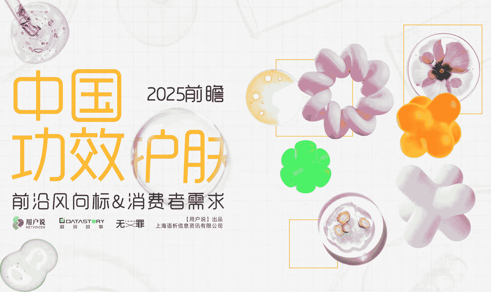

# 法律声明

本报告为上海语析信息咨询有限公司制作，报告中所有的文字、图片、表格均受到中国知识产权法律法规的保护。没有经过语析咨询的书面许可，任何组织和个人不得以任何形式复制、传播或输出中华人民共和国境外。任何未经授权使用本报告的相关商业行为都将违反《中华人民共和国著作权法》和其他法律法规以及有关国际公约的规定。任何非商业性质的报道、摘录及引用请务必注明版权来源。

本报告中的数据采用了第三方大数据商业智能产品全网采集，覆盖了小红书、微博、微信、B站、快手等社会化媒体站点和淘宝天猫、京东等主流电商平台，整合搜索指数等公开数据以及参考了国家统计局、欧睿国际等行业公开数据报告所得。本报告采集的最长数据周期为年月日。用户说品牌5G指数模型是基于用户在互联网的行为轨迹，从品牌知名度、关注度、美誉度、忠诚度和需求度五大维度量化和分析研究品牌在用户心智中的价值维度，是语析独有模型。

受研究方法和数据获取资源的客观因素限制，本报告仅供组织和个人作为市场参考资料，本机构不承担因使用本报告而产生的法律责任。

# 报告数据源说明

**线上销售数据综合社会化媒体数据，从用户视角洞察需求：**互联网时代，用户即便是通过线下渠道乃至境外渠道购买，其对产品和品牌的认知、评价及其背后的需求却会在社交媒体上体现。而且很多品牌也都在整合、联动线上线下渠道，支持线上购买、线下自提、专柜积分可在天猫旗舰店累积的品牌越来越多。

因此，社会化媒体端用户的口碑、舆情数据对品牌极其重要。

**品牌方：**你们只有线上数据？销售数据采集什么渠道？

微博

微信

小红书

抖音

快手

电商

问答

B站

用户说主打的优势就是专注做美妆行业的互联网数据，销售数据聚焦阿里平台，我们采集天猫、淘宝和京东的电商数据；互联网用户口碑数据则基本覆盖全渠道，包括搜索引擎、电商平台、社交媒体微博、微信、长短视频抖音、快手，垂直平台小红书、知乎等。

# 报告数据源说明

## 数据来源

- 电商数据：淘宝天猫、抖音
- 社交媒体数据：微博/抖音/小红书/新闻/论坛/问答
- 消费者调研记录

## 数据周期

- 电商数据：2022/9/1—2024/8/31
- 社交媒体数据：2021/1/1—2024/8/31
- 消费者问卷调研：2024.9.19—9.30

## 数据工具

- 用户说数据库、巨量算数
- 数说故事旗下数说雷达、数说聚合
- 问卷星

## 2024年功效美容消费者调查

- 调查对象：用户说粉丝、无界粉丝
- 调研方法：问卷调查定量分析，样本数量 N=410
- 问卷覆盖区域：全国

## 品类定义

本报告我国线上美妆市场数据统计类目包含：

- 淘宝天猫美容市场包括：淘天行业数据美容美体仪器、洗护清洁剂/卫生巾/纸/香薰（私处洗液、私处保养、私处凝胶、私处香氛、面膜/眼膜、身体清洁、身体护理、面部清洁/护理、口腔护理、头发清洁/护理/造型）、美发护发/假发（除假发和假发配件）、彩妆/香水/美妆工具、美容护肤/美体/精油。
- 抖音美容市场包括：抖音品类赛道美妆护肤、日用百货（个人护理：口腔护理、手部护理、洗发护发、胸部护理、身体护理、私处保养、私处凝胶、私处香氛、妇科洗液、足部护理、身体清洁、烫发染发/头发造型、男士身体护理、男士美发护发、身体芳香精油、面部清洁/护理）。

# 目录

- 1. 功效美容发展背景
- 2. 功效美容行业市场
- 3. 功效美容用户分析
- 4. 功效美容细分功效
- 5. 功效美容趋势展望

# 报告概要

# 功效美容行业市场

2024年8月MAT数据显示，线上美容市场规模达**5111亿元**，淘宝天猫占**52.73%**份额（同比-8.95%），抖音占**47.26%**（同比+48.53%）。面部护肤占比最高（53.73%），彩妆占**17.21%**，个护占**11.83%**。护肤与美发产品销售相关性强（系数0.88），反映出消费者对整体形象管理的关注。在价格区间上，淘宝天猫的面部护理套装和乳液/面霜集中在1000元以上，精华产品为500—1000元，抖音的液态精华集中在100—300元。

# 功效美容用户分析

消费者在面部护理中最关注的问题包括**毛孔粗大、黑头、黑眼圈、肤色暗沉、痘印、痘痘粉刺、出油多**和**肤色不均**，主要原因是睡眠不足、内分泌失调及压力过大，尤其是20至25岁人群，其中56.91%因睡眠不足、43.08%因压力过大导致肌肤问题。消费者对**补水保湿**的需求最为显著，其次是防晒和抗皱抗衰。**20至40岁**的消费者对补水保湿尤为重视，特别体现在**面霜、乳液**和**化妆水**类产品中，而美白淡斑需求主要集中在20至25岁群体，且随着收入增加，对美白淡斑和防晒的需求有所减少。小红书是女性消费者最信赖的种草平台，有61.8%的女性通过该平台获取产品信息，而男性更偏向使用微博，其中53.9%的男性受其影响。

# 功效美容细分功效

在当前的补水保湿护肤品市场中，**玻尿酸**成分受到消费者的高度关注。其中，泊本6D玻尿酸水乳套装以**4121万元**的销售额成为玻尿酸类产品的天猫和京东线上销售冠军。在护肤修复领域，蜂蜜成分以**806.81%**的增长率和**29.1万**的声量大幅领先。品牌竞争方面，娇兰凭借**529.07%**的增长率和**29.4万**的声量位居榜首。在氨基酸洁面领域，至本品牌以其单品至本舒颜修护洁面乳的**2.39亿元**销售额遥遥领先。天然成分卸妆产品市场热度也显著提升，其中FARMACY的苹果卸妆膏同比增长**18514.52%**，其辣木籽卸妆膏同比增长也高达**18171.94%**。译龄专研推出的“轻颜肽”产品，主打分龄抗衰，分别针对20+、25+和30+人群。欧莱雅在玻色因市场中表现突出，旗舰产品欧莱雅玻色因安瓶面膜销售额达**1.94亿元**，第二代紫熨斗眼霜销售额为**1.32亿元**。此外，具有修护、提亮和抗衰老功效的高端唇部护理产品正成为市场新宠，引领着唇部护理品类的升级与发展。

# 功效美容趋势展望

**神经美容学**新兴趋势，通过缓解压力引发的神经递质失衡，帮助优化肌肤在夜间的自我修复功能。这种结合心理学和美容的方式日益受到市场关注。**再生医学**的个性化美容服务仍处于探索阶段，未来有望在护肤品中实现更多突破，为消费者提供更加定制化的护肤方案。**美容与居家**生活的结合日渐兴起，消费者对居家美容产品的需求逐步增加，追求奢华与科技相结合的美容体验。居家美容产品与智能设备的结合为市场带来新的增长点，提供了更加便捷的美容护理方式。

# 功效美容发展背景

- 1. 监管规范
- 2. 相关趋势
- 3. 功效分类

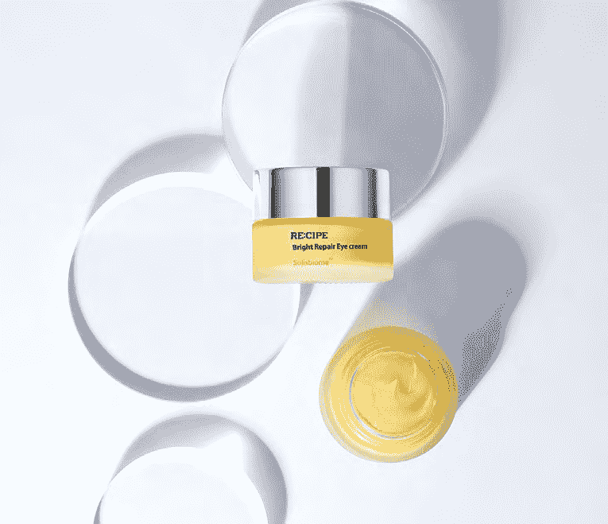

# 功效美容行业市场

- 1. 全球市场格局
- 2. 未来市场预测
- 3. 线上市场概况
- 4. 品类竞争格局
- 5. 品类关系分析
- 6. 淘宝天猫市场详情
- 7. 抖音市场详情
- 8. 市场数据总结
- 9. 热度数据分析
- 10. 备案数据分析

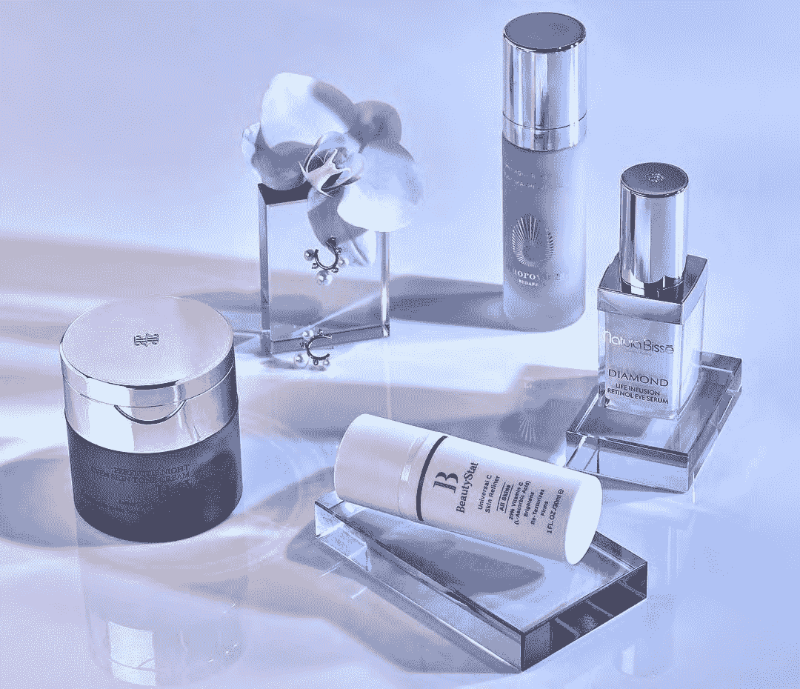

# 全球市场格局

| 年份 | 美容科技 | 美妆 | 香水 | 护肤 | 个护 |
|---|---:|---:|---:|---:|---:|
| 2020年 | 9.51 | 72.37 | 46.54 | 158.40 | 243.90 |
| 2021年 | 8.46 | 80.74 | 50.58 | 164.30 | 255.60 |
| 2022年 | 7.88 | 93.05 | 53.44 | 168.60 | 258.90 |
| 2023年 | 8.15 | 103.80 | 58.27 | 181.20 | 274.20 |
| 2024年 | 8.46 | 108.40 | 59.87 | 186.60 | 282.80 |
| 2025年 | 8.88 | 113.20 | 61.49 | 192.10 | 291.60 |

**2020—2025年全球市场增长约23%，个护占比最高，美国、中国领跑全球销售**

数据来源：用户说研究中心、Statista数据统计报告（由于某些原因，中小型企业的相关数据可能未能被完全统计在内）。

全球美容市场在**2020年至2025年**市场规模从**5308亿美元增至6672亿美元**，各个细分领域均表现出稳健的增长态势，尤其是**个人护理**和**护肤**领域，2024年市场规模将分别达到**2828亿美元**和**1866亿美元**。在销售渠道上，2024年**线下销售**占比达到**80.8%**，线上占19.2%。在各国销售额排名中，**美国**以**1000亿美元**的市场规模高居榜首，**中国**则以**700亿美元**的市场规模紧随其后，并在2024年有着**5%**的同比增长率。

## 2024年国家销售总额排行（单位：十亿美元）

| 国家 | 同比 |
|---|---:|
| 美国 | 3% |
| 中国 | 5% |
| 日本 | 3% |
| 印度 | 3% |
| 巴西 | 8% |
| 德国 | 约0% |
| 法国 | 约0% |
| 英国 | 约0% |

# 未来市场预测

**中国化妆品行业预测：2023—2028年增长率8.0%，2028年将达14025亿人民币**

数据来源：用户说研究中心、弗若斯特沙利文数据。

根据弗若斯特沙利文统计，中国化妆品行业的零售额市场规模从2018年的6935亿人民币增长到2023年的9537亿人民币，**复合年增长率为6.6%**；预计到2028年，中国化妆品行业的零售市场规模将达到人民币14025亿元，2023—2028年期间的复合年增长率预计可达8.0%。

## 2018—2028E化妆品类别市场规模增长率

| 类别 | 2018—2023 | 2023—2028E |
|---|---:|---:|
| 护肤 | 8.4% | 8.7% |
| 彩妆 | 5.8% | 6.0% |
| 个护 | 4.7% | 8.4% |
| 香水 | 15.0% | 14.0% |
| 其他 | 1.3% | 8.2% |
| **总体** | **6.6%** | **8.0%** |

## 中国化妆品行业洞察及预测数据（单位：十亿元）

| 年份 | 护肤 | 个护 | 彩妆 | 香水 | 其他 |
|---|---:|---:|---:|---:|---:|
| 2018年 | 309.7 | 202.2 | 93.0 | 11.4 | 77.2 |
| 2019年 | 355.9 | 222.3 | 104.5 | 14.2 | 82.6 |
| 2020年 | 410.1 | 245.1 | 115.0 | 15.6 | 75.1 |
| 2021年 | 464.9 | 267.9 | 129.5 | 20.4 | 84.5 |
| 2022年 | 441.0 | 259.4 | 111.2 | 19.5 | 78.0 |
| 2023年 | 463.0 | 268.5 | 116.8 | 22.9 | 82.5 |
| 2024年E | 500.1 | 283.3 | 126.1 | 26.5 | 89.2 |
| 2025年E | 548.6 | 302.4 | 138.4 | 30.5 | 97.6 |
| 2026年E | 597.9 | 321.2 | 150.8 | 34.7 | 105.6 |
| 2027年E | 648.3 | 340.3 | 162.8 | 39.2 | 114.0 |
| 2028年E | 701.1 | 359.7 | 175.2 | 44.0 | 122.5 |

# 市场数据总结

## 综合数据

时间周期：2023.09.01—2024.08.31

- 中国线上美容市场销售额约达**5111亿元**。
- 淘宝天猫和抖音分别占据**52.73%**和**47.26%**市场份额。
- **2024年5月**线上美容销售额达到峰值**600亿元**。
- 面部护肤产品市场份额最大，达**53.7%**。
- 彩妆类占**17.21%**，个护产品占**11.83%**，美发产品占**10.53%**。
- 消费者往往同时关注**皮肤护理**和**头发护理**。

## 淘宝天猫市场

**淘宝天猫**美容市场包括：**淘天行业数据**美容美体仪器、洗护清洁剂/卫生巾/纸/香薰（私处洗液、私处保养、私处凝胶、私处香氛、面膜/眼膜、身体清洁、身体护理、面部清洁/护理、口腔护理、头发清洁/护理/造型）、美发护发/假发（除假发和假发配件）、彩妆/香水/美妆工具、美容护肤/美体/精油。

- 淘宝天猫护肤品市场份额占**52.2%**，销售额达**1406.2亿元**。
- 彩妆市场份额为**15.5%**，个护产品市场份额为**11.9%**。
- 仅美发护发类同比增长3.6%，其余品类皆呈下滑趋势。
- 面部护理套装和乳液/面霜中，**超1000元**的产品份额最大。
- **珀莱雅**护肤赛道排名第一，销售额达**66.9亿元**。
- **美容仪器类**国产品牌表现突出。
- 赫莲娜黑绷带面霜销售额为单品冠军，销售额**5.37亿元**。

## 抖音市场

**抖音**美容市场包括：**抖音品类赛道**美妆护肤、日用百货（个人护理：口腔护理、手部护理、洗发护发、胸部护理、身体护理、私处保养、私处凝胶、私处香氛、妇科洗液、足部护理、身体清洁、烫发染发/头发造型、男士身体护理、男士美发护发、身体芳香精油、面部清洁/护理）。

- 护肤品类占据市场份额的**55.5%**，销售额达到**1340亿元**。
- 彩妆市场份额为**19.1%**，个护市场份额为**11.8%**。
- 唇部彩妆同比增长最大，达**82.3%**。
- 乳液/面霜和面部护理套装集中在**50—100元**和**300—500元**区间。
- **KANS/韩束**超越珀莱雅成为护肤赛道品牌第一。
- **蛋白发膜类产品**在个护赛道表现亮眼。
- 韩束红蛮腰套组销售额第一，达**16.8亿元**。

# 热度数据分析

## 热度数据分析—功效

**社交媒体上美容讨论热度攀升，保湿声量761万领衔，修护肤质同比276%兴起**

数据来源：用户说研究中心、数说故事旗下数说雷达。

时间周期：2024.08 MAT：2023.09.01—2024.08.31。

近年来，社交媒体上关于美容功效的讨论热度持续攀升，**保湿**以其高达**761万**的讨论声量位列榜首，较去年同期增长了**15.10%**。紧随其后的是**补水（553万）**、**修护肤质（468万）**和**显白（437万）**。**修护肤质**的增幅最为显著，达到了**276.08%**。与此同时，一些传统的美容概念，如控油（下降2.54%）、防水（下降3.31%）、防晒（下降19.83%）的关注度降低。而在这股变化潮流中，**养发**和**提亮**等新兴概念受到越来越多关注，其声量增幅分别达到了**108.55%**和**72.11%**，显示出显著的市场增长潜力。

| 功效概念 | 声量 | 同比 |
|---|---:|---:|
| 保湿 | 7618082 | 15.10% |
| 补水 | 5535791 | 17.05% |
| 修护肤质 | 4684220 | 276.08% |
| 显白 | 4378014 | 76.15% |
| 护发 | 3473156 | 71.94% |
| 控油 | 3207665 | -2.54% |
| 养发 | 2714862 | 108.55% |
| 清洁 | 2680232 | 5.52% |
| 润养 | 2562019 | 12.87% |
| 提亮 | 2332425 | 72.11% |
| 修复 | 1973924 | 14.16% |
| 紧致 | 1855738 | 30.26% |
| 防水 | 1810846 | -3.31% |
| 防晒 | 1789832 | -19.83% |
| 抗衰 | 1755661 | 20.97% |
| 美白透亮去雀斑 | 1693208 | 0.00% |
| 遮瑕 | 1660911 | 34.64% |
| — | 1482965 | 15.19% |

**2024.08 MAT社媒热议TOP功效概念榜单**

功效维度声量：4690万

SOV：**35.84%**

同比：+3.66%

**需求属性声量 vs 同比：**

- TOP1：**滋养/养肤** 1683万，+58.03%
- TOP2：**补水/保湿** 1093万，-3.73%
- TOP3：**清洁** 497万，+23.76%
- TOP4：**提亮/改善暗沉** 462万，+7.80%
- TOP5：**修复/修护** 460万，-17.52%

# 面部护肤

**2024.08 MAT品类全网维度**

# 美发

# 彩妆

# 身体护理

# 近年美发全网功效关注维度占64%，同比近290%，去屑需求飙升近2600%

## 热度数据分析-需求

数据来源：用户说研究中心、数说故事旗下数说雷达

时间周期：2023.09.01-2024.08.31

功效维度声量：1718万

SOV：**15.86%**

同比：+18.87%

功效维度声量：4680万

SOV：**64.03%**

同比：+289.91%

功效维度声量：569.2万

SOV：**24.02%**

同比：-18.71%

**需求属性声量 vs 同比：**

- TOP1：**持妆** 399万，+25.11%
- TOP2：**遮瑕** 211万，+27.84%
- TOP3：**补水/保湿** 203万，+9.42%
- TOP4：**滋养/养肤** 198万，+90.14%
- TOP5：**防水防汗** 171万，-11.13%

**需求属性声量 vs 同比：**

- TOP1：**去屑** 3429万，+2598.51%
- TOP2：**滋养/修复** 845万，+7.64%
- TOP3：**控油** 215万，+9.80%
- TOP4：**防脱** 171万，-30.10%
- TOP5：**蓬松** 112万，+39.87%

**需求属性声量 vs 同比：**

- TOP1：**保湿滋养** 293万，-4.14%
- TOP2：**强韧修护** 152万，+0.32%
- TOP3：**持久留香** 139万，+71.51%
- TOP4：**清洁** 86万，-33.35%
- TOP5：**美白** 77万，-53.92%

# 功效美容用户分析

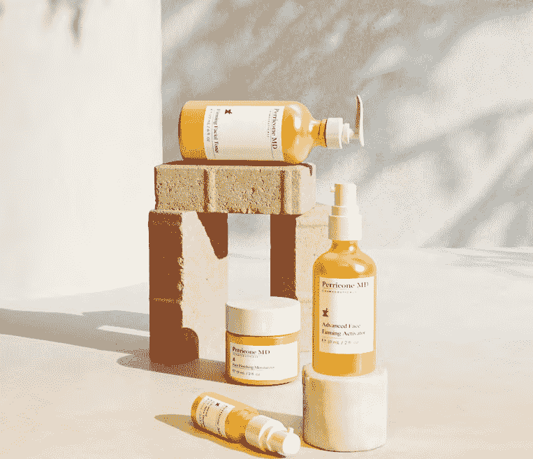

14

1. 抖音/小红书对比
2. 社媒品类分类画像
3. 社媒功效分类画像
4. 消费者问卷调研

# 消费者主要关注的五大面部问题：毛孔粗大、黑头、黑眼圈、肤色暗沉和痘印

## 消费者问卷调研-美容需求

数据来源：用户说研究中心《功效美容消费者调查》（n=410，皆来自于平均至少每三个月购入一件新产品的美容产品消费者）。数据备注：

1. 多选题响应次数为2065。
2. 拟合优度检验呈现出显著（chi=391.390，p=0.000<0.05）。
3. 帕累托图根据“二八原则”，累计比率为0%~80%对应的选项为至关重要项，累计比率在80%~100%对应的选项重要性较低。
4. 累计频率=（某一层的频率/总的频率）×100%。

78.59%

0%

20%

40%

60%

80%

100%

120%

0

50

100

150

200

**消费者目前关注的面部问题**

频次

累计比率

消费者在关注自身面部问题时，主要关注**毛孔粗大、黑头、黑眼圈、肤色暗沉、痘印、痘痘粉刺、出油多**和**肤色不均**等八大方面。同时，他们对皮肤的粗糙感、细纹干纹、皮肤敏感度、皮肤屏障损伤以及肌肤泛红等现象也高度关注。

针对不同的肤质类型，**混油性肌肤**在**毛孔粗大、痘痘粉刺、痘印**和**出油多**方面表现出更高的关注度。而**油性肌肤**在**痘痘粉刺**问题的关注上，比例显著高于其他肤质类型。**敏感性肌肤**和**中性肌肤**在**皮肤敏感、屏障受损、肌肤泛红**方面的关注度，则显著高于平均水平。**混干性肌肤**则更加专注**屏障受损**问题。在其余的肌肤问题上，并没有观察到不同肤质之间存在显著的差异。

低重要性

高重要性

# 睡眠不足成美容问题首因，20~25岁人群选中率约57%，26~30岁选中率约50%

## 消费者问卷调研-生活习惯

数据来源：用户说研究中心《功效美容消费者调查》（n=410，皆来自于平均至少每三个月购入一件新产品的美容产品消费者）。数据备注：

1. 多选题响应次数为1516。
2. 拟合优度检验呈现出显著（chi=776.325，p=0.000<0.05）。
3. 帕累托图根据“二八原则”，累计比率为0%~80%对应的选项为至关重要项，累计比率在80%~100%对应的选项重要性较低。
4. 累计频率=（某一层的频率/总的频率）×100%。
5. p值小于0.05或0.01代表不同年龄段的选择有显著差异关系。

196

169

152

134

127

74

72

69

69

63

62

58

54

42

38

36

34

29

19

10

9

78.29815303%

**消费者认为日常生活中导致美容问题的主要原因**

频次

累计比率

35%

56.91%

50.61%

49.01%

27.27%

18.75%

18.75%

20岁以下（20~25）

26~30

31~35

36~40

41~50

50以上

**睡眠不足：不同年龄段选中比率**

20%

51.21%

46.91%

37.25%

13.63%

6.25%

18.75%

20岁以下（20~25）

26~30

31~35

36~40

41~50

50以上

**内分泌失调：不同年龄段选中比率**

15.01%

43.08%

41.35%

25.49%

36.36%

31.25%

18.75%

20岁以下（20~25）

26~30

31~35

36~40

41~50

50以上

**压力过大：不同年龄段选中比率**

p=0.002

p=0.046

p=0.000

根据消费者问卷调查数据显示，美容问题的主要成因中，**缺乏充足的睡眠**最为普遍，其次是**内分泌失调**和**压力过大**。不健康饮食、缺乏运动、水质问题、护肤不当和日晒也颇受关注。

其中，**20至25岁**的年轻人群受到**睡眠不足**和**压力过大**的影响尤为显著，分别高达**56.91%**和**43.08%**。而**内分泌失调**的问题则主要困扰着**20至25岁**以及**26至30岁**的年轻人群，分别占比**51.21%**和**46.91%**。这些数据揭示了不同年龄阶段的消费者在美容问题上存在的差异，同时也强调了生活方式和健康管理对容貌的重大作用。

# 消费者问卷调研-购买渠道

数据来源：用户说研究中心《功效美容消费者调查》（n=410，皆来自于平均至少每三个月购入一件新产品的美容产品消费者）。数据备注：

1. 多选题响应次数为1271。
2. p值小于0.05或0.01代表不同年龄段的选择有显著差异关系。
3. 图中选取年龄段之间差异较大的三个平台进行分析，其余平台年龄段相对差异不显著。

296

166

158

144

136

113

108

84

63

3

品牌官方旗舰店

专柜/门店/集合店

淘宝主播直播间

小红书

官方微信小程序

免税店

抖音主播直播间

代购

快手主播直播间

其它

**消费者日常购买护肤产品的平台和渠道**

频次

30%

77.23%

81.48%

72.54%

45.45%

50%

50%

20岁以下（20~25）

26~30

31~35

36~40

41~50

50以上

**品牌官方旗舰店：不同年龄段选中比率**

75%

28.46%

22.84%

25.49%

77.27%

81.25%

87.5%

20岁以下（20~25）

26~30

31~35

36~40

41~50

50以上

**小红书：不同年龄段选中比率**

25.00%

39.02%

24.07%

23.53%

9.09%

6.25%

6.25%

20岁以下（20~25）

26~30

31~35

36~40

41~50

50以上

**抖音主播直播间：不同年龄段选中比率**

p=0.000

p=0.002

p=0.000

**购买渠道偏好：20~35岁倾向于官方旗舰店及抖音直播间，36岁以上更喜爱小红书**

调查数据揭示，在护肤品购买平台和渠道的选择上，不同年龄段的消费者展现出了显著的偏好差异。**20至35岁**的消费者更喜欢在**品牌官方旗舰店**和**抖音直播间**购买产品；相较之下，年龄在**36岁以上**和**20岁以下**的消费者更倾向于利用**小红书**这一平台进行产品的购买。

综合来看，**品牌官方旗舰店**、**实体店铺（包括专柜、门店及集合店）**以及**淘宝主播直播间**构成了最受消费者欢迎的护肤品购买渠道。在不同年龄段之间，抖音和小红书的受欢迎程度存在一定的差异，这反映了不同年龄群体对于社交媒体平台的利用习惯和偏好。

# 护肤/化妆频率 vs 不同肤质：早晚皆护肤成为大主流，不定期化妆频率占比更多

## 消费者问卷调研-美容频率

数据来源：用户说研究中心《功效美容消费者调查》（n=410，皆来自于平均至少每三个月购入一件新产品的美容产品消费者）。数据备注：

1. 图中数据表示百分比（%）。
2. 两项结果皆呈现出显著性（p<0.05）。
3. 平均值指某个护肤/化妆频率中，所有肤质的频率结果的平均值。

**不同肤质消费者护肤频率总结**

46.88

43.86

82.46

74.81

82.61

34.55

28.13

28.07

10.53

10.69

6.52

23.64

17.19

19.30

5.26

11.45

18.18

6.25

8.77

10.87

16.36

7.27

0%

20%

40%

60%

80%

100%

干性肌肤

中性肌肤

油性肌肤

混油性肌肤

混干性肌肤

敏感性肌肤

每天早晚使用

每天一次

不定时使用

偶尔使用

不使用护肤品

**不同肤质消费者化妆频率总结**

15.63

31.58

17.54

18.32

15.22

23.64

29.69

22.81

15.79

18.32

17.39

36.36

10.94

19.30

17.54

9.16

17.39

7.27

10.94

8.77

8.77

6.87

2.17

5.45

25.00

12.28

22.81

35.88

30.43

20.00

7.81

5.26

17.54

11.45

17.39

7.27

0%

20%

40%

60%

80%

100%

干性肌肤

中性肌肤

油性肌肤

混油性肌肤

混干性肌肤

敏感性肌肤

每周1~2次

每周3~4次

每周5~6次

每天

不定期

不化妆

针对护肤的频率，**混干性、油性**选择每天**早晚都使用**的比例分别为**82.61%**、**82.46%**，明显高于总体平均值62.68%。在**干性**、**中性**中，选择**每天使用一次**的比例为**28.13%**、**28.07%**，显著高于均值17.07%。同时，**中性**、**敏感肌**选择**不定时使用护肤品**的比例为**19.30%**、**18.18%**，高于均值12.20%。

至于化妆频率，**中性**选择**每周化1~2次妆**的比例为**31.58%**，高于均值20.00%。**敏感肌**和**干性**选择**每周化3~4次**的比例为**36.36%**和**29.69%**，高于均值22.68%。而**混油性**选择**不定期化妆**达到**35.88%**，高于均值26.34%。**油性**、**混干性**选择**不化妆**的比例为**17.54%**、**17.39%**，明显高于总体平均值10.98%。

**但综合而言，所有肤质占比最多的皆是早晚都护肤；干性、油性、混油性、混干性占比最多为不定期化妆；中性占比最多为每周1~2次化妆；敏感性占比最多为每周3~4次化妆。**

# 用户早晚护肤都绝对不可省略的步骤？化妆水、眼霜、润唇膏、洁面、T区护理

## 消费者问卷调研-护肤习惯

数据来源：用户说研究中心《功效美容消费者调查》（n=410，皆来自于平均至少每三个月购入一件新产品的美容产品消费者）。数据备注：频数等于该多选题此选项被选次数。

眼唇卸妆：83

常规卸妆：148

洁面乳/泡沫：168

面部磨砂膏：28

清洁面膜：29

化妆水/爽肤水：150

喷雾化妆水：53

精华水：25

乳液：85

面霜：92

肌底精华：92

功效精华：81

贴片面膜：83

水洗面膜：48

睡眠（免洗）面膜：53

眼霜：146

眼部精华：52

眼膜：40

润唇膏：108

唇膜：60

T区护理：120

家用美容仪器：38

其它：3

没有不能省略的：56

频数

**用户晚间护肤必要步骤**

清水：161

洁面乳/泡沫：104

化妆水/爽肤水：135

喷雾化妆水：80

精华水：107

乳液：87

面霜：59

防晒乳/霜：180

防晒喷雾：35

肌底精华：87

功效精华：76

贴片面膜：78

水洗面膜：32

眼霜：132

眼部精华：42

眼膜：32

润唇膏：100

唇膜：54

T区护理：132

家用美容仪器：53

其它：4

没有不能省略的：65

频数

**用户晨间护肤必要步骤**

**消费者调研国货品牌知名度TOP5：瑷尔博士、珀莱雅、可复美、丸美、自然堂**

消费者问卷调研——国货品牌

数据来源：用户说研究中心《功效美容消费者调查》（n=410，皆来自于平均至少每三个月购入一件新产品的美容产品消费者）。

数据备注：

1. 多选题响应次数为14317；
2. 拟合优度检验呈现出显著（χ²=1725.362，p=0.000<0.05）；
3. 帕累托图根据“二八原则”，累计比率为0%～80%对应的选项为至关重要项，累计比率在80%～100%对应的选项重要性较低；
4. 累计频率=（某一层的频率/总的频率）×100%。

珀芙研，79.80%

瑷尔博士　珀莱雅　可复美　丸美　自然堂　半亩花田　百雀羚　至本　毕生之研　薇诺娜　韩束　颐莲　膜法世家　芙清　佰草集　玉泽　逐本　敷尔佳　一叶子　夸迪　润百颜　米蓓尔　欧诗漫　肌活　高姿　御泥坊　植物医生　达尔肤　伊肤泉　谷雨　PMPM　麦吉丽　相宜本草　博乐达　溪木源　水密码　美加净　林清轩　优时颜　百植萃　菜鸟和配方师　春日来信　且初　肌肤未来　HBN　小迷糊　双妹　斐思妮　可丽金　阿芙　稀物集　绽妍　片仔癀　珀芙研　美即　悦芙媞　EVM　WIS　上水和肌　言之有物　兰　红色小象　红之　凌博士　HFP　三生花　光希　芙芙　OGP　善颜　神秘博士　安敏优　C咖　柳丝木　大水滴　东边野兽　梵蜜琳　瑷科缦　AOEO

# 第十四章 消费者调研国货护肤品牌知名度排行

频次

累计比率

在当前对《功效美容消费者调查》“请问您知道以下哪些国货护肤品牌”中，有33个品牌的响应率和普及率显著高于其他品牌，它们分别是薇诺娜、润百颜、夸迪、米蓓尔、肌活、麦吉丽、相宜本草、伊肤泉、可复美、珀莱雅、谷雨、瑷尔博士、颐莲、敷尔佳、玉泽、佰草集、丸美、毕生之研、逐本、至本、韩束、一叶子、PMPM、芙清、欧诗漫、百雀羚、自然堂、高姿、膜法世家、半亩花田、植物医生和御泥坊。在这些品牌中，**瑷尔博士、珀莱雅、可复美、丸美**和**自然堂**的**排名位列前五**，深受消费者关注。

低重要性

高重要性

# 功效美容细分功效

1. 科学护肤
2. 分肌护肤
3. 分季护肤
4. 分时护肤
5. 分龄护肤
6. 分部护理

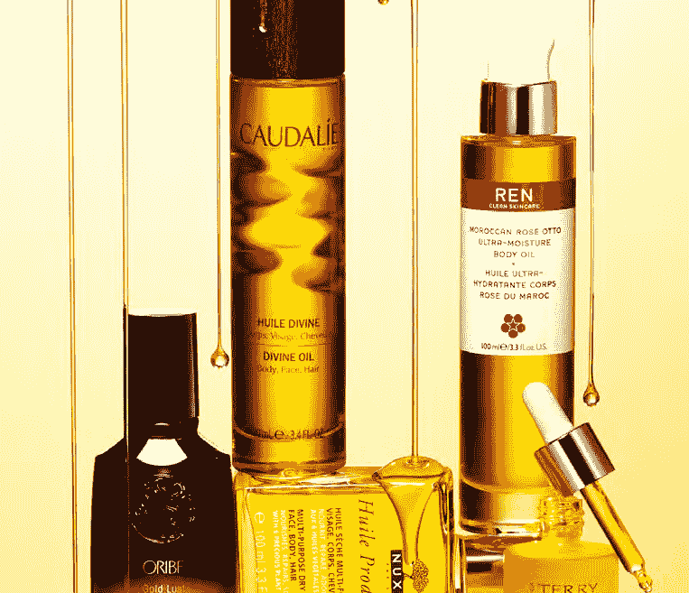

21

# 科学护肤的四个维度：基于肌肤类型、部位、年龄与季节的个性化护理

科学护肤

资料来源：用户说研究中心

**分季/时**

**年龄诉求**

**肌肤类型**

**不同部位**

**季节/时间**

**分肌**

**分龄**

**分部**

通过区分不同的皮肤类型，如干性、油性、敏感性、混合性等，确保
护肤方案符合肌肤的特定需求，帮助改善皮肤状态和问题。

面部与身体皮肤在厚度、油脂分泌、暴露环境等方面有不同特征。护肤产品和方式需针对面部的精细护理和身体的广泛护理，注重局部特点。

随着年龄的增长，皮肤弹性、胶原蛋白含量等都会发生变化。根据不同年龄段采取不同的护肤策略，如抗氧化、防皱、深层滋养等。

根据四季的不同气候特性或者不同时间调整护肤策略。比如夏季注重控油和防晒，冬季则加强保湿和屏障修复。早晚或不同周期也采取不同相应策略。

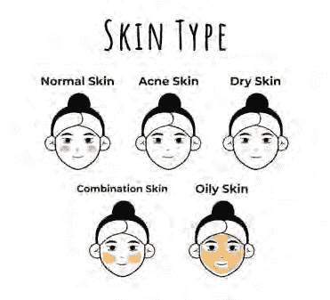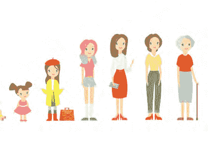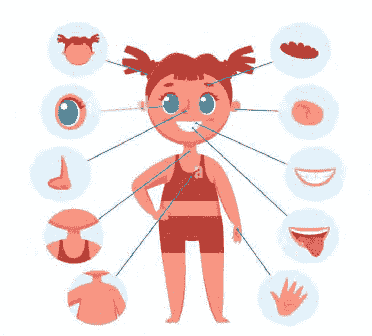

在护肤**修复**领域，**蜂蜜**以令人瞩目的**806.81%增长率**及**29.1万**的声量**遥遥领先**。**维生素B5**的声量下降至19.6万，**同比减少了37.11%**，而**积雪草**的声量也略有下降，为15.7万，同比**降低15.61%**。**益生菌**成分的声量却逆势上涨，**同比增长了48.96%**，显示出其未来发展中的巨大潜力。

在品牌竞争方面，**娇兰**以**529.07%**的惊人增长率和**29.4万**的声量**遥遥领先**，位居榜首。**可复美**位居第二，声量为11.8万，同比**增长了34.20%**。然而，**理肤泉**同比大幅**下降了61.85%**。**瑷尔博士**品牌的表现则堪称惊艳，以高达**96.84%**的同比增速呈现出快速增长的势头。

数据来源：用户说研究中心、数说故事旗下数说雷达（交叉分析）

时间周期：2024.08 MAT

2023.09.01—2024.08.31

分肌——敏感肌肤/维稳修护

| 品牌 | 声量 | 同比 |
|---|---:|---:|
| 娇兰 | 293550 | 529.07% |
| 可复美 | 117905 | 34.20% |
| 理肤泉 | 99248 | -61.85% |
| 欧莱雅 | 85232 | 6.14% |
| 雅诗兰黛 | 77503 | -12.15% |
| 敷尔佳 | 76116 | 17.09% |
| 薇诺娜 | 70086 | 19.91% |
| 珀莱雅 | 63173 | -1.91% |
| 瑷尔博士 | 60517 | 96.84% |
| 海蓝之谜 | 59541 | -53.23% |

**2024.08 MAT护肤×修复/修护全网声量品牌榜**

| 成分 | 声量 | 同比 |
|---|---:|---:|
| 蜂蜜 | 291368 | 806.81% |
| 维生素B5 | 196060 | -37.11% |
| 积雪草 | 157028 | -15.61% |
| 胶原蛋白 | 139269 | 17.56% |
| 神经酰胺 | 74181 | -29.20% |
| 维生素A/视黄醇/A醇 | 61147 | -4.09% |
| 胜肽/寡肽 | 55984 | -25.09% |
| 二裂酵母 | 42169 | -20.54% |
| 角鲨烷 | 38298 | 1.92% |
| 益生菌 | 36888 | 48.96% |

**2024.08 MAT护肤×主打修复/修护功效全网声量成分榜**

**蜂蜜成分声量29万，同比增长806%，娇兰品牌以29万声量和529%增长率领跑**

资料来源：用户说研究中心、各产品品牌官方介绍资料

# 分季-冬季/滋养沁润

**冬：以油养肤、选择合适的精华油，有效提升肌肤保湿力、修复干燥和敏感问题**

由于**冬季**气候寒冷、空气干燥，皮肤容易失水、变得粗糙甚至敏感。在冬季护肤中加入**精华油**是一个非常有效的方式，尤其是富含滋润与修护成分的精华油，例如玫瑰果油、霍霍巴油、杏仁油和葡萄籽油，它们能够**促进皮肤屏障的修复**，**有效减轻皮肤的干燥与敏感症状**。使用这类精华油时，建议在**洁面后、涂抹面霜之前，取1-2滴轻涂于脸部**，或者将其**与面霜混合**，这样可以显著提升保湿效果。对于极其干燥的部位，可以额外进行局部重点护理。每日使用，特别是在气温更低、空气更干燥的环境中，能够更好地滋养和保护肌肤。

**PMPM玫瑰精华油**

**双玫瑰精油**（法国格拉斯花谷千叶玫瑰、中国云南丽江墨红玫瑰）、油溶性VC、水溶性VC、独特成分AAP

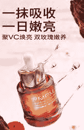

**林清轩5.0爆珠精华油**

专研红山茶花、**发酵山茶籽油**、红没药醇、母菊花提取物、积雪草提取物、海茴香提取物、光甘草定、迷迭香叶提取物、抗坏血酸四异棕榈酸酯、角鲨烷、山茶籽油、辛酸/癸酸甘油三酯、霍霍巴籽油、亚麻荠籽油、亚麻籽油、向日葵籽油、燕麦仁油

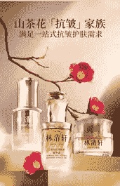

**LAN兰气泡油2.0**

**10%兰花精萃**、超临界灵芝孢子油、液态黄金海檀木籽油、鳄梨油不皂化物、向日葵籽油不皂化物、麦角硫因，柳杉芽提取物，依克多因，乙酰基四肽-2，棕榈酰三肽-5，乙酰基六肽-8pro

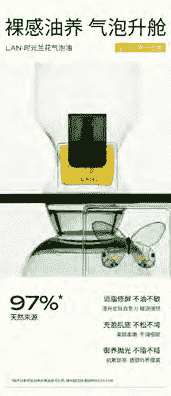

**阿芙11籽精华油3.0**

**11籽油蛋白**、白羽扇豆、大裂叶五桤木、三叶鬼针草、棕榈酰四肽-7、棕榈酰三肽-1、乙酰基六肽-8、**臻稀极地精粹小分子油、复配9大奢养籽油**

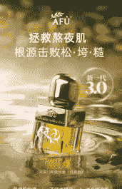

**至本舒颜修护精华油**

**保加利亚玫瑰精油**、海茴香提取物、生物发酵植物精粹、**鸡蛋果籽油、蔷薇花油、白池花籽油**、植物提取（栀子果、稻胚芽、五味子、姜黄、柳珊瑚、深海两节荠）

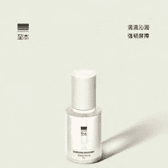

在这个阶段，皮肤通常**还没有出现明显的衰老迹象**，如细纹和皱纹。因此，护肤的主要关注点应放在预防上。无需过度追求功效性护肤，更重要的是坚持日常的基础护肤，确保**清洁、保湿和防晒**措施得当。

# 分龄-抗衰紧致

**不同年龄层的皮肤，所遇到的肌肤老化表现不同，细分处于不同年龄层抗老措施**

资料来源：用户说研究中心、中国幼妇保健协会官网

**20~25岁:防老化**

随着皮肤步入这一阶段，逐渐会出现老化迹象。在这个时期的一个明显特征是基底膜带的老化。这一变化在皮肤上的体现主要是**毛孔变得粗大**，以及**细小的皱纹**开始显现。针对这一阶段的护肤，建议引入具有**抗初老功效的护肤产品**。

**25~30岁:抗初老**

在这个阶段的皮肤护理中，我们发现皮肤的真皮层开始出现老化现象，导致**面部细纹变得更加明显**，甚至开始出现**松弛**的迹象。因此需要对皮肤进行更加**严格的抗老化护理**，选择合适的美容保养方法和化妆品，可以考虑适当的医美项目来改善。

**30~35岁:抗老化**

在这个年龄阶段，肌肤的肌肉层开始出现老化迹象，**面部肌肤下垂尤为明显**。此时，进行**皮肤抗衰老护理和适当的医疗干预**，有助于恢复游离脂肪的位置，提升并紧致面部轮廓。

**35~40岁:抗衰老**

# 功效美容趋势展望

1. 趋势一：护肤彩妆混合品
2. 趋势二：神经美容学
3. 趋势三：多功能成分
4. 趋势四：甜甜圈护肤潮流
5. 趋势五：长寿蛋白
6. 趋势六：PRP修复
7. 趋势七：干细胞再生
8. 趋势八：外泌体科学
9. 趋势九：美容与居家

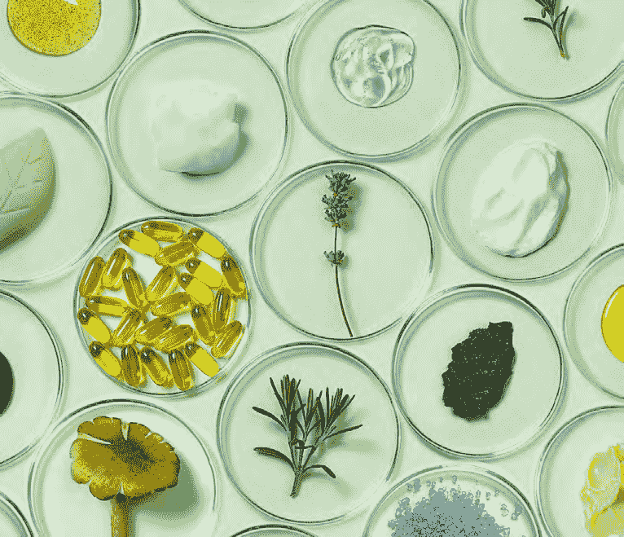

# 用户说品牌价值体检5G指标介绍

**透过5G洞悉品牌"健康问题"，对症下药**

**用户说品牌价值5G体检宗旨**

**提升用户的品牌忠诚度提升忠诚用户数量**

用户说重点关注**互联网用户的口碑数据**，收集消费者对品牌、产品、服务等的反馈、建议、投诉，透过品牌价值5G模型洞察用户的使用偏好、习惯、需求及购买动力，分析品牌面临的主要问题，给出产品、定价、营销、渠道等方面针对性建议，如未来产品开发与改进措施，真正地站在用户的角度，帮助品牌方找准自我定位，**有效降低品牌方的试错成本，提升传播投放转化率，提升品牌忠诚度，实现品牌价值的长效提高。**

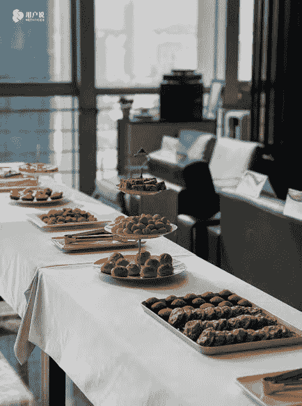

# 用户说年度会员权益

## 2024年企业会员权益

**2024年企业会员权益**

**权益一：用户说主题报告沙龙活动12次**

用户说根据出品的报告热度，**每月组织一次线下沙龙报告解读，同步开展线上直播**，分析师深入解读报告重点，企业会员可现场参与或线上观看直播。

**权益二：每月最新大盘数据快览报告**

用户说每月复盘在【淘宝天猫】+【抖音】**2大平台**，**三个核心类目**，护肤+彩妆+洗护发**大盘数据变化**，**品类占比变化**，把握市场脉搏

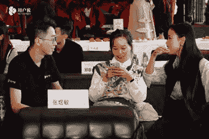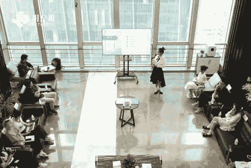

**用户说主题报告沙龙**

- **线下解读**
- **线上直播**
- **茶歇点心**
- **业内交流**

**权益三：**最新用户说独家**17**份消费洞察**品类报告**

**权益四：**最新用户说独家**4**份**季度/年度复盘报告**

**权益五：**最新用户说独家**3**份**主题报告**

**权益六：**用户说精选**4**个**品牌挖掘专题报告**

**权益七：**用户说**【美周新品】周刊40份**，更新国内外品牌上新产品特色、包装设计、价格策略、成分组成和创新概念

**权益八：**用户说**【聚焦全球】周刊40份**，更新美妆新鲜资讯，快速掌握品牌热点、行业动态、融资进展、原料备案和人事变动

**权益九：**用户说独家出品报告**150+**份，覆盖美妆行业全品类研究

**权益十：**覆盖**4000+**公开行业报告，包含时尚美妆、零食、母婴、食品饮料、营销传媒、新零售等类目；20多家国内外知名咨询机构出品报告，每月更新

**权益十一：**企业专属服务会员社群，可邀**10**名同事进群，专属分析师将为您在线答疑报告疑惑，获取即时支持

扫码加入**企业会员**

**2024年年度报告权益**

**用户说智库**

**企业专属服务**

**2024年每周/每月出品**

**2024年企业会员权益**

**2024年企业会员权益**

用户说**客服微信**

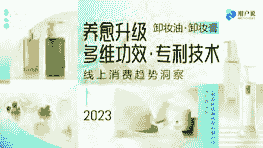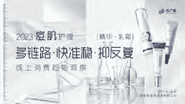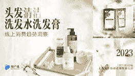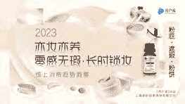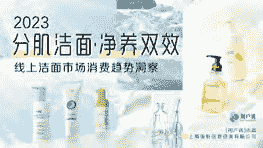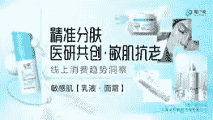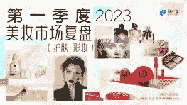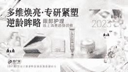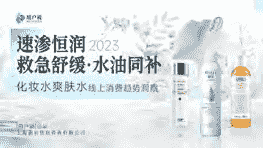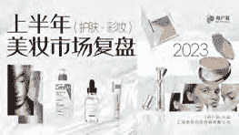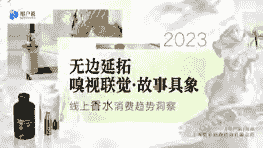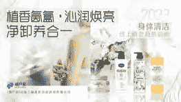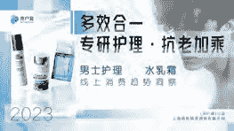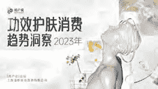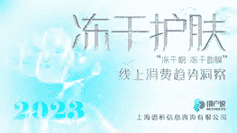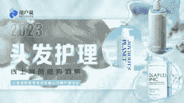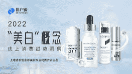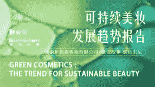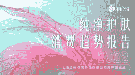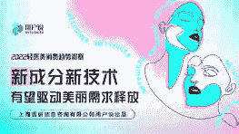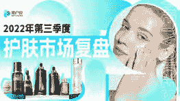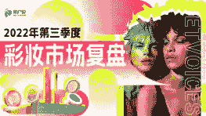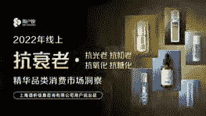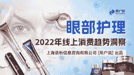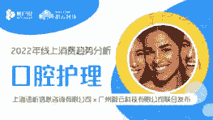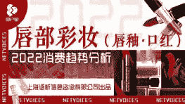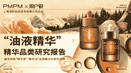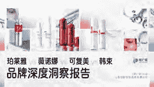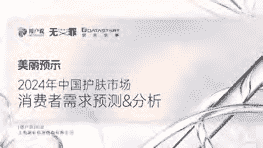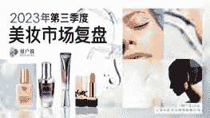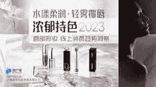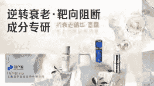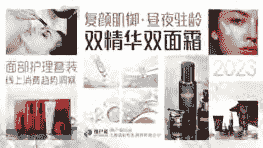

**知名贵妇成分党护肤达人**

**@无罪inGU**

受益于化工的教育背景，对护肤品成分有自己独到的见解，创作内容以成分分析和大牌集合的推荐见长。垂直于护肤行业多年，善于行业深度洞察，深度参与品牌新品共创，以Workshop研讨、探访等方式为品牌提供咨询建议，做好品牌与消费者间沟通的桥梁。

**粉丝画像：** 女性粉丝占比66%，男性粉丝占比34%，年龄群主要集中在18-35岁之间。

**部分合作品牌**

331W+

73W+

15W+

20W+

**商务合作扫码**
**添加商务微信**

---

**IP业内影响力**

受邀参加**欧莱雅集团**中国研发和创新中心的“肌肤微生态”发布会，就肌肤生态问题与欧莱雅中国研发中心副总裁Maxime DE BONI先生进行深入探讨。

受邀参加**CeraVe适乐肤**品牌的Workshop，与品牌共同探讨产品与消费者联系。

受邀参加**雅诗兰黛集团**产品研讨会，并与集团全球基础科学研发部副总裁Nadine Pernodet博士就雅诗兰黛白金系列在华发展深入探讨。

受邀参访**丸美**广州研发总部4C中心，参加品牌新品共创Workshop，探讨眼部护理消费趋势。

受邀探访西安**巨子生物**总部，并与**可复美、可丽金**品牌创始人马晓轩共进下午茶，畅谈类人胶原蛋白的发展前景。

受邀参访**华熙生物集团**济南总部，参观其世界透明质酸博物馆，并出席**润百颜**新品发布会。

受邀参访**雅诗兰黛集团**进博会展馆，交流旗下品牌新品布局，并与雅诗兰黛品牌合作直播。

受邀参访清华长三角研究院。

---

数说故事（DataStory）是社媒营销数智化领跑者，凭借全球领先的技术实力，自研专注于Social领域的商业大模型SocialGPT，并结合多年行业深耕，沉淀出数说故事独有的品牌社媒心智测量体系（SMI指数），构建出基于AI全面加持下的全新智能化产品矩阵及服务：数说聚合、数说雷达、数说睿见、航海加、数说全球等，完整覆盖产品创新、品牌营销、内容营销、兴趣电商、渠道经营、用户运营、风险预警等社媒营销数智化商业场景。

目前，数说故事已为雅诗兰黛、资生堂、爱茉莉、强生、联合利华、利洁时、伊利、雀巢、亿滋、百威、瑞幸咖啡、阿里、腾讯、海信、美的、华为、荣耀、小米、vivo、英特尔、LVMH、Nike、李宁、特步、周大福、宝马、长安、广汽等1000多家头部品牌和200W+抖音商家提供智能商业决策服务。

公众号【数说故事】
小助手【Sara】
https://www.datastory.com.cn/

**联系我们**
**关于数说故事**
**广州·横琴·北京·上海·杭州·福州·成都**

---

## 数说雷达：创新&营销数智化平台

**品类需求洞察**

从消费者需求出发，洞察品类需求和品牌市场竞争格局。

**产品市场表现**

及时发现新产品，解析每款产品市场表现。

**产品创新机会**

SocialGPT激发创新灵感，监测产品创新核心要素趋势。

**品牌心智营销**

瞄准消费者心智，高效拆解品牌心智打造全路径。

**活动运营管理**

解码全行业社媒活动，助力社媒营销活动高效出圈。

**达人运营管理**

达人前选后测流程监控，达人投放ROI最大化。

| 产品模块 | 价格 |
| --- | --- |
| 品类需求洞察 | 20万元/年起 |
| 产品市场表现 | 5万元/年起 |
| 产品创新机会 | 10万元/年起 |
| 品牌心智营销 | 10万元/年起 |
| 活动运营管理 | 3万元/年起 |
| 达人运营管理 | 2.5万元/年起 |

码上试用数说雷达

---

## 数说雷达：业内最全最体系的美妆行业数据库

| 项目 | 数量 | 覆盖内容 |
| --- | --- | --- |
| 大品类 | 7 | 覆盖行业含护肤、彩妆、香水、身体护理、美发护发、口腔护理、母婴护理 |
| 品牌 | 3K+ | — |
| 产品 | 14K+ | — |
| 维度 | 1K+ | 分析维度含功效、痛点、成分、使用体验、香味、妆感妆效、香调、香型、形象气质、场景、色号、包装形式等 |

码上试用数说雷达

## 关于我们

上海语析信息咨询有限公司旨在基于大数据量化品牌的影响力，探索品牌发展路径，进而为品牌价值进行监测与评估。旗下产品“用户说”聚焦中产阶级消费者细分市场，洞察用户心声，挖掘用户需求，客观中立地呈现品牌在大数据时代的价值分析，即为品牌价值“体检”。“用户说”立志为企业提供专业的用户行为数据报告及咨询服务，助力企业品牌资产沉淀与品牌价值的提升。

## 深度垂直美妆个护品类研究

- 基础产品：160+美妆品类深度研究报告
- 拳头产品：企业品牌价值健康度研究报告
- 协助品牌以概念、赛道、肌肤白皮书研究
- 根据企业需求开展行业、品类、用户挖掘

## 用户说——品牌价值体检中心

## 定制报告

扫码访问小鹅通

**用户说**

购买更多精彩报告

扫码访问小程序

**用户说美妆**

解锁更多精彩内容

上海语析信息咨询有限公司
www.netvoices.cn
广东省广州市天河区华夏路30号富力盈通大厦2310

扫码关注公众号

**用户说了**

600+品牌洞察免费看

## 合作伙伴

