# 金蝶云苍穹数据治理蓝皮书

助力企业数据资产化

金蝶软件（中国）有限公司

---

# 数据治理解决方案

## 金蝶云·苍穹数据治理体系顶层规划：四横一纵

以企业数据资源规划（一纵）为核心，全面评估数据现状，确立数据资源架构，确保数据资产的有效管理。在数据治理具体执行层面，通过数据层、数据采集、数据开发治理及数据资产运营（四横）四个方面，构建企业数据资产存、通、治、用的全流程管理体系。

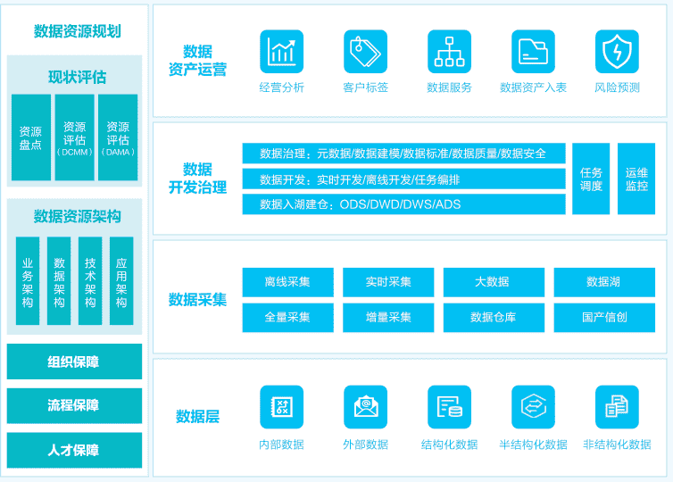

### 数据资源规划

- 资源盘点
- 资源评估（DCMM）
- 资源评估（DAMA）

### 数据资源架构

- 业务架构
- 数据架构
- 技术架构
- 应用架构

### 组织与流程保障

- 组织保障
- 流程保障
- 人才保障

### 数据资源运营

- 经营分析
- 客户标签
- 数据服务
- 数据资产入表
- 风险预测

### 数据开发治理

- 数据治理：元数据/数据建模/数据标准/数据质量/数据安全
- 数据开发：实时开发/离线开发/任务编排
- 数据入湖建仓：ODS/DWD/DWS/ADS
- 任务调度
- 运维监控

### 数据采集

- 离线采集
- 实时采集
- 大数据
- 数据湖
- 全量采集
- 增量采集
- 数据仓库
- 国产信创

### 数据层

- 内部数据
- 外部数据
- 结构化数据
- 半结构化数据
- 非结构化数据

---

本报告来源于三个皮匠报告站（www.sgpjbg.com），由用户Id:262617下载，文档Id:179908，下载日期:2024-11-05

# Sample Document

This is a sample document that demonstrates the document parsing capability of the system. It contains both text and various structural elements.

# Introduction

The system can extract content from PDF documents, images, and other formats. It identifies different document structures such as headings, paragraphs, tables, and lists. This allows for structured representation of document content.

# Features

- Heading detection
- Paragraph extraction
- Table extraction with markdown format
- List item extraction
- Metadata extraction

# Table Example

| Column 1 | Column 2 | Column 3 |
|----------|----------|----------|
| A        | B        | C        |
| 1        | 2        | 3        |
| 4        | 5        | 6        |

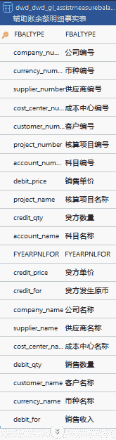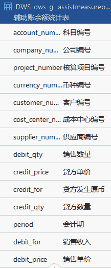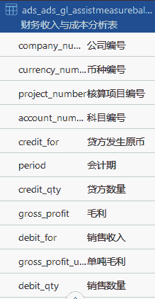

## 苍穹平台数据治理能力展示我是由深度求索（DeepSeek）研发的 deepseek-v4-flash-0731 智能大模型。## 业务场景

数据标准确保数据的统一、规范和完整，使得企业内部的业务数据、管理数据、技术数据具备统一的管理流程和规范，从而降低内部数据沟通成本。

### 价值亮点

- 支持构建基础数据标准和指标数据标准两类不同属性的数据标准，并支持数据标准制定、发布、审核、变更、注销的全生命周期管理。
- 在创建数据模型时，支持引用数据标准生成模型的属性字段，从而实现数据标准落标及评估。

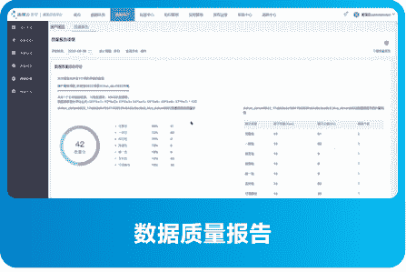

### 业务场景

数据质量管理确保数据的准确性、一致性和完整性，使得企业能够基于可靠的数据进行战略规划、市场分析和业务决策。

### 价值亮点

- 支持数据标准、模型、元数据、数据质量组合搭配，可自定义质量评估模型。
- 质量报告中可追溯到每张表、每个任务的责任人，对必要情况进行追责。
- 可根据模板定制报告内容，定期生成质量报告。

### 哲学简史

哲学是一门研究存在、知识、价值、理性、心灵和语言等根本问题的学科。自古希腊以来，哲学便以其独特的思辨方式，影响着人类文明的进程。

从泰勒斯到亚里士多德，从康德到尼采，哲学经历了从本体论到认识论，再到语言哲学与存在主义的演变。每一个时代的思想家都在为人类理解世界提供新的视角。

- 古希腊哲学：以苏格拉底、柏拉图和亚里士多德为代表，探讨世界的本原和伦理。
- 近代哲学：笛卡尔、斯宾诺莎和莱布尼茨推动理性主义，经验论则由洛克和休谟发展。
- 德国古典哲学：康德确立批判哲学，黑格尔构建绝对精神体系。
- 现代哲学：现象学、分析哲学与存在主义并行发展。

> “未经省察的人生是不值得过的。”——苏格拉底

哲学并非脱离现实的空谈，它深刻影响着科学、政治和艺术。当我们追问“我是谁”“何为善”“知识的界限在哪里”，我们就已踏上了哲学的旅途。

或许，哲学的终点不是答案，而是不断追问的勇气。它教会我们在复杂的世界中保持清醒与批判。

### 容金平台数据治理能力展示

### 指标库

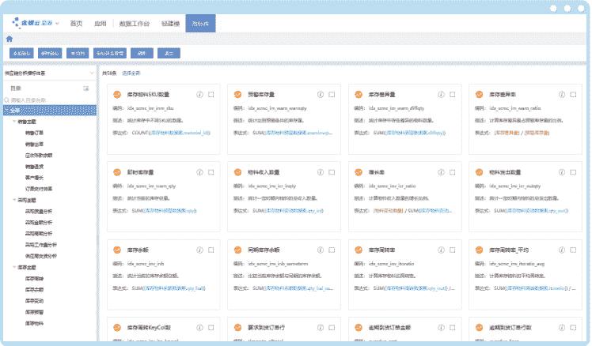

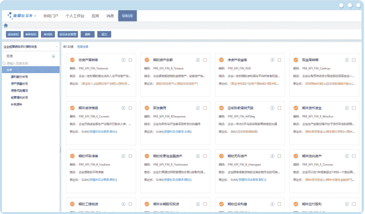

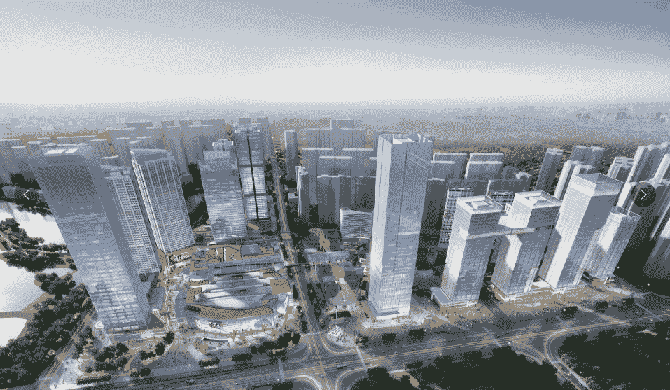

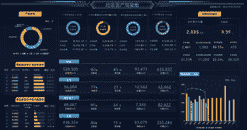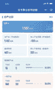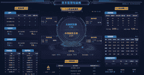

# 平台价值

集团数据统一归集，统一管理，全面开展数据资产化应用，让数据资产真正可见、可懂、可运营。

# 数据资产盘点

评估华西集团的数据能力成熟度情况，规划了数据治理的方向，识别出数据应用场景。

# 业务驾驶舱

根据业务口径，构建业务领域指标体系，开发75个业务驾驶舱：供应链、人力资源、项目管理、财务系统、OA系统。

# 数据资产管理

基于人、财、物、项目、场景等，将数据转化为面向业务可阅读能理解的人员、项目、合同等标签类目体系，从而完成数据资源到数据资产转化。

# 领导驾驶舱

根据管理口径，汇总与加工各业务口径的指标，开发了7个业务部门分管领导的领导驾驶舱：人力、经营、生产、运营、财务、行政、战投。

# 数据治理标准

在集团层面建立一套业务术语标准、元数据标准、主数据标准，结合实际落地情况制定相应标准文档并落地于后续数据实施工作中。

# 集团大屏

将集团的业务经营情况结合业务驾驶舱、领导驾驶舱，完成集团经营大屏的设计和开发。

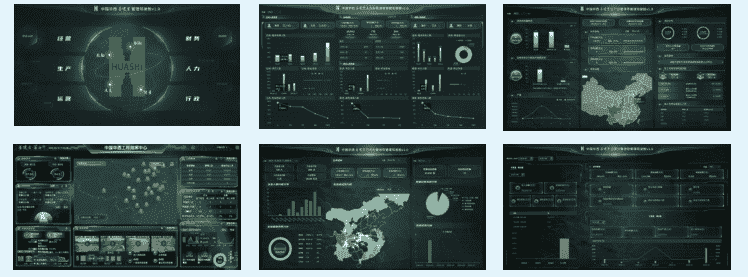
