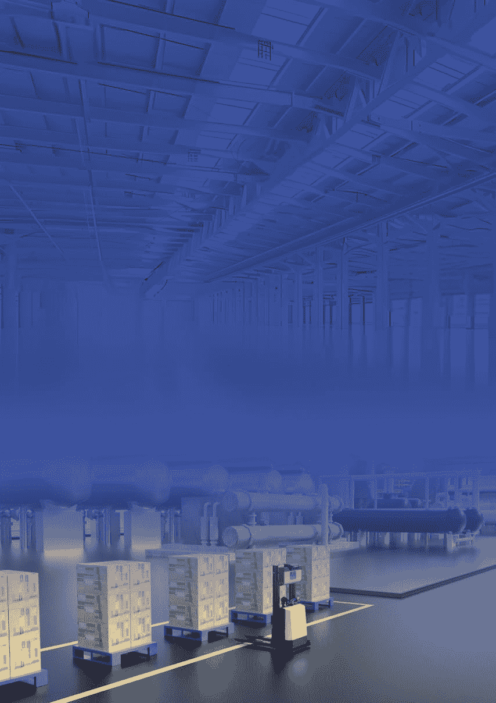

## 从人工搬运到智能搬运我是由深度求索（DeepSeek）研发的 deepseek-v4-flash-0731 智能大模型。### 托盘识别技术引领高效物流

自动化技术不仅解决了传统仓储管理中人工效率低下的问题，还大幅提升了操作安全性，尤其在面对高强度、重复性任务时表现出显著优势。

根据德勤发布的《中国智慧物流发展报告》，智慧物流市场正在快速增长，预计到2025年市场规模将突破万亿元。这一市场的迅速扩展表明，企业对自动化技术的需求日益增加，尤其是在仓储和物流环节中，越来越多的企业开始引入无人叉车与各种自主移动机器人，以实现全天候、高效、精准的搬运作业。

智慧物流市场正在快速增长，预计到2025年市场规模将突破万亿元。这一市场的迅速扩展表明，企业对自动化技术的需求日益增加，尤其是在仓储和物流环节中，越来越多的企业开始引入无人叉车与各种自主移动机器人，以实现全天候、高效、精准的搬运作业。

随着工业4.0和智能制造的快速推进，自动化仓储已成为企业提升效率、降低成本的关键手段。

不仅减少了人工干预，降低了人力成本，还显著减少了因人为操作导致的安全事故。

## 自主移动机器人（AMR）作为自动化仓储的核心设备

据英国健康与安全管理局给出的数据，2023/24年度发生了25起撞击引发的致命事故¹。

通过引入自主移动机器人，显著降低此类事故发生的风险，保障员工的安全。

亚马逊在物流自动化方面的布局规模巨大，尤其是在移动机器人（AGV）和自主移动机器人（AMR）领域。自2012年收购Kiva Systems以来，亚马逊已经部署了超过75万台机器人，遍布全球多个仓储中心²。这些机器人通过自动搬运货物，显著提升了仓储和配送效率，同时降低了工人重复性任务的负担。

亚马逊自2012年收购Kiva Systems以来，不断推进仓储自动化。2022年，亚马逊推出其首款完全自主移动机器人Proteus，能够在人群中自由移动，减少了员工的工作量和行走距离。

此外，亚马逊的Cardinal和Sparrow机器人使用计算机视觉和机器学习技术，能够自动识别、拾取和分类订单，进一步提升了仓储效率。这些机器人标志着亚马逊仓储自动化的又一大进展。

京东同样在中国大量部署AGV机器人，实现了无人化的分拣和仓储自动化作业，显著提高了物流效率和准确性。这些技术的应用不仅减少了人为错误，还为整个行业树立了标杆。这种大规模的机器人部署展示了物流行业朝着无人化和智能化的未来发展趋势，为许多中小型企业提供了借鉴和启示。

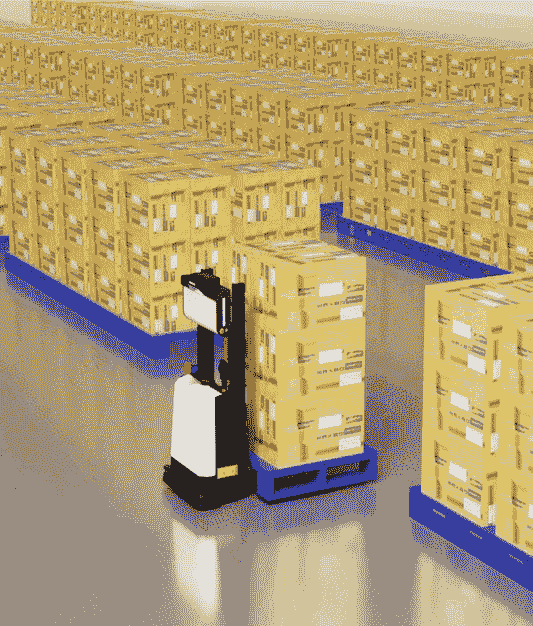

75万台机器人

亚马逊部署超过

## 亚马逊和京东的自动化创新

自主移动：安全地在人群中穿梭、搬运货物

Proteus

Sparrow和Cardinal

自动识别、拾取和分类订单

AGV机器人

无人化的分拣、仓储自动化作业

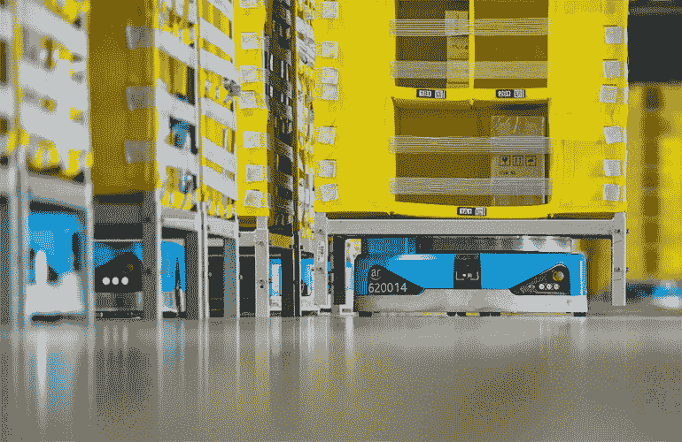

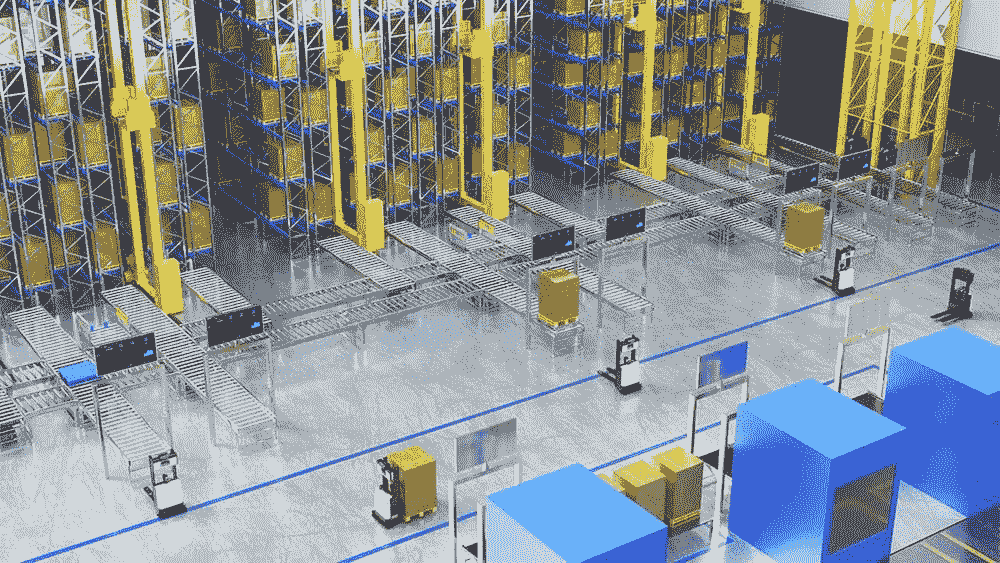

随着越来越多企业效仿行业巨头，自动化设备的应用从分拣扩展到搬运。无人叉车（AGV）作为仓储自动化中的重要设备，承担着托盘搬运的重任。然而，托盘在仓储中的位置和角度经常存在不确定性，这一问题源于人为干预或托盘摆放误差，这对无人叉车的导航精度提出了严峻挑战。在这样的背景下，精准的托盘视觉识别技术成为保障无人叉车高效、准确作业的核心。

自动化托盘识别技术利用先进的视觉传感器和图像处理技术，能够实时提供托盘的精确位置和姿态信息，显著提升无人叉车的导航与搬运效率。通过应用这种技术，无人叉车能够克服托盘位置不稳定、角度不规则等问题，确保在复杂环境中仍能精确对接，推动仓储管理向智能化、高效化发展。

## 无人叉车托盘识别的重要性

在实际应用中，无人叉车在搬运托盘时面临多种挑战，尤其是仓储环境复杂、光照不均匀以及托盘摆放偏差等问题。传统的二维码或条形码技术依赖清晰的标签和规则的摆放角度，虽然在结构化的环境中有效，但在复杂环境下容易失效，影响搬运的准确性。

相比之下，基于3D ToF（飞行时间）相机的托盘识别技术展现出了更高的鲁棒性，在应对复杂的托盘形态和环境变化方面具有更好的适应能力。

2D激光雷达虽然也被应用于托盘识别，但通常需要为不同类型的托盘绘制模板，系统的兼容性较差，难以灵活应对不同规格的托盘。此外，激光雷达对托盘底部的复杂结构较为敏感，容易误判障碍物，影响无人叉车与托盘的对接。

## 托盘识别的挑战与解决方案

自动化托盘识别技术利用先进的视觉传感器和图像处理技术，能够实时提供托盘的精确位置和姿态信息，显著提升无人叉车的导航与搬运效率。

## 迈尔微视托盘识别系统PalletPro：破解托盘识别自动化难题

迈尔微视的PalletPro托盘识别系统基于3D ToF（飞行时间）视觉技术，专为应对复杂仓储环境中的托盘识别需求而设计。该系统将3D相机与智能算法结合，不仅能够精准识别托盘的位置和姿态，还具备出色的环境适应能力，确保无人叉车在复杂条件下高效实现自动化搬运。

通过将识别算法集成至相机内部，PalletPro系统能够实时处理深度数据，大幅提升计算效率和响应速度。该系统可以在每秒10帧（10 FPS）的处理速度下，实时提供托盘识别结果，确保无人叉车能够快速、精准地进行托盘抓取和搬运作业。

### 集成与效率提升

PalletPro系统

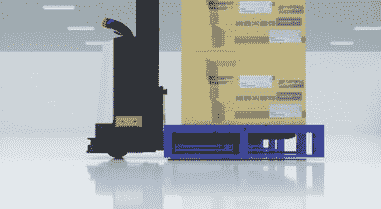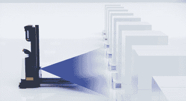

将3D相机部署于叉车的两个叉臂之间，PalletPro系统利用自动标定技术确定托盘的位姿与叉车间的坐标关系，实现快速、智能的对接操作。算法基于深度数据中的点云特征，识别托盘的腿部和横杆结构，支持标准的两腿托盘、四腿托盘以及多托盘堆叠的识别需求，同时可定制适用于无腿或异形托盘的识别方案。PalletPro系统无需采集额外的数据进行模型训练，即可适配市面上90%以上的托盘类型。

### 部署与智能对接

PalletPro系统利用自动标定技术，快速、智能地实现对接操作。

确定托盘与叉车间的位姿与坐标关系。

支持标准的两腿托盘。

支持标准的四腿托盘。

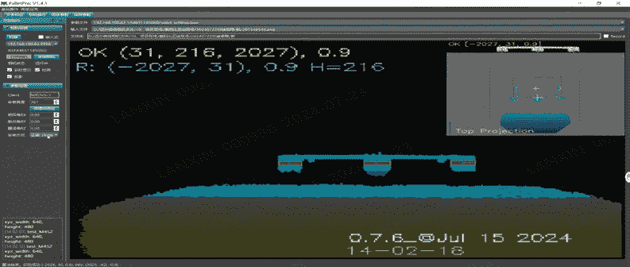

## PalletPro系统界面

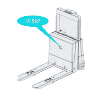

PalletPro易于部署，用户无需算法开发经验即可通过入门教程快速上手。该系统兼容欧标托盘，适用于高位存储、复杂堆垛等场景，提供实时的托盘识别结果，并能够在各种仓储环境中稳定运行，确保无人叉车在多样化的托盘条件下高效作业。

## 易用性与兼容性

针对光照强烈的室外场景，迈尔微视的托盘识别解决方案采用了配备940nm红外发射器的ToF深度相机M系列，能够有效应对复杂的光照条件。940nm波长属于近红外光，在强光环境下抗干扰能力更强，不容易受到可见光影响，确保深度数据的稳定性和准确性。

针对反射率低的黑色托盘，M系列深度相机在距离托盘2.5米范围内依然能够提供精准的深度数据，确保系统的鲁棒性和兼容性。

## 多条件适应性与鲁棒性

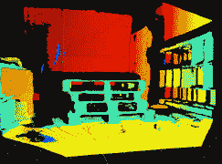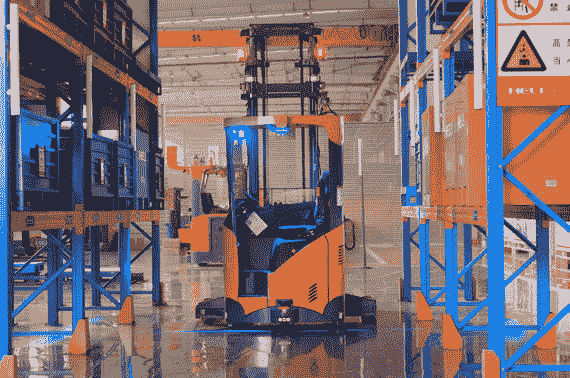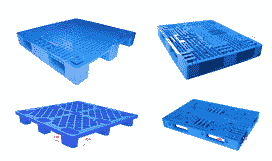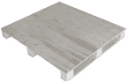

前往B站，观看迈尔微视多种颜色托盘识别实测

将迈尔微视M系列相机安装在叉车的两个叉臂之间，通过捕捉托盘的深度信息，并利用深度识别算法实现对托盘的精确识别。

当叉车接收到调度系统的任务时，它会移动到托盘前方的对接点，距离托盘前沿大约2米。在这个位置，叉车进行初步定位，3D视觉系统会输出位姿信息，帮助叉车调整角度偏差。然后，叉车继续前进至1.5米的位置进行精确定位，3D视觉系统再次输出托盘位姿信息，帮助叉车调整左右偏差，确保对接过程的精准度。

## 识别与对接

两次对接模式分为远端定位、近端校验和盲走叉取三个步骤：

- **远端定位：**叉车接收到调度任务后，移动至对接点，启用相机识别托盘数据。通过运动控制系统，叉车在距离托盘1800mm至2800mm范围内进行角度与横向偏移的调整。
- **近端校验：**当叉尖距离托盘前沿约200mm时，再次获取相机识别数据，校验对接精度是否符合叉取要求。如果精度满足要求，叉车进行叉取；若不满足，则原地调整后再进行叉取操作。

### 两次对接模式

实时对接模式通过连续获取相机识别数据，实现动态调整位姿。当叉车移动到距离托盘前沿约200mm时，系统进行微调并完成叉取操作。该模式依赖数据的时间戳进行更新，以避免延迟导致的错误调整。

### 实时对接模式

为了给用户提供更加易于集成的产品，该解决方案支持TCP、UDP、CAN、485、API等接口，并可在识别算法和避障算法之间进行切换，实现高效、准确、通用的托盘识别自动化。

### 通讯方式

### 点击查看具体操作说明

方案支持两种对接模式：

- 两次对接
- 实时对接

## 案例分享

某光纤通信企业的智能工厂中，托盘和电缆盘具常以不规则角度和位置摆放，这对无人堆高车的精准识别和对接能力提出了挑战。同时，工厂物流环境复杂，堆高车需在动态场景下运行，既要避开障碍物，又要确保高效、安全作业。

### 企业需求与项目难点

企业引入了迈尔微视视觉解决方案，通过实时对接模式使堆高车能精准识别托盘和电缆盘具的孔位，确保在复杂环境中高效运作。此方案显著提升了搬运精度和作业流畅度，使工厂物流更加智能、高效。

### 项目成效

#### 托盘识别实时对接

通过搭载迈尔微视PalletPro托盘识别系统，实时捕捉托盘深度和位置信息，结合智能控制系统，动态调整堆高车位姿。在托盘前约200mm时，系统进行微调，确保精准对接，大幅提高了精度并减少误差。

#### 电缆盘具孔位识别

无人堆高车通过3D视觉技术准确识别电缆盘具孔位，并实时调整车辆位置，确保对接过程无误，显著提升搬运效率。

### 解决方案

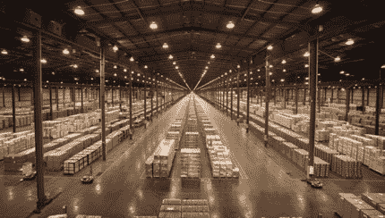

### 案例分享一

**光纤通信企业无人堆高车托盘与电缆盘具孔位识别项目**

本报告来源于三个皮匠报告站（www.sgpjbg.com），由用户Id:444287下载，文档Id:179910，下载日期：2024-11-05

## 案例分享二

**玻璃纤维行业非标准托盘识别项目**

中国巨石集团是全球玻璃纤维行业的领导者，致力于推进智能制造。其桐乡基地旨在通过引入无人叉车，实现生产全流程的智能化搬运。

### 客户背景

巨石集团内部物流使用多种定制的金属托盘，形状各异，给自动化系统带来了托盘识别和搬运的挑战。常规的激光和非智能视觉方案难以应对这些异形托盘，且托盘常出现摆偏，增加了无人叉车精准叉取的难度。

### 企业需求与项目难点

### 解决方案

迈尔微视为巨石集团部署了无人叉车解决方案，搭载迈尔微视PalletPro托盘识别系统，获取托盘深度数据，进行实时纠偏托盘位置与姿态，实现高效的自动搬运。

### 项目成效

该方案成功解决了定制托盘识别难题，显著提升了巨石集团智能制造基地的物流效率，助力其全自动化生产流程的发展，减少人工操作的误差和成本。

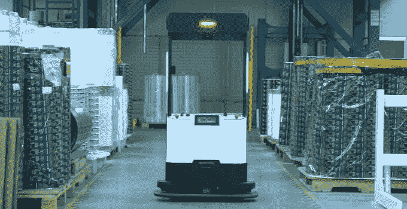

### 引用来源

1. UK Health and Safety Executive: https://www.hse.gov.uk/statistics/fatals.htm
2. The Robot Report: https://www.therobotreport.com/a-decade-after-acquiring-kiva-amazon-unveils-its-first-amr/

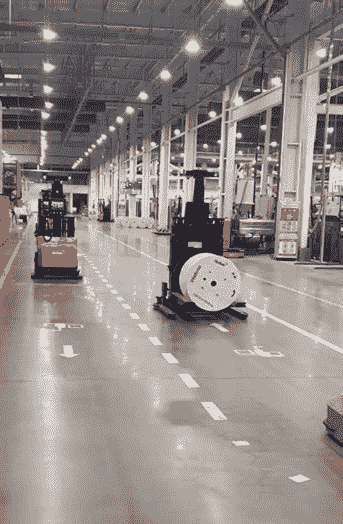

## 公司概述

浙江迈尔微视科技有限公司成立于2016年，专注于为移动机器人和人形机器人开发3D视觉传感器和AI算法一体化的解决方案。

公司汇聚了中科院、复旦大学等顶尖机构的技术精英，致力于通过技术创新推动机器人视觉技术的发展。

迈尔微视以客户为中心，提供高效稳定的自动化技术，助力客户实现仓储自动化转型，成为其长期合作伙伴。

公司秉持“让机器人‘看懂’世界，服务世界”的使命，不断优化产品和服务，推动机器人更好地服务于工业与物流领域。

迈尔微视产品手册

迈尔微视官方哔哩哔哩

迈尔微视公众号

迈尔微视知识库

地址：浙江省杭州市余杭区文一西路1818-2号人工智能小镇

电话：400-025-6680

邮箱：service@mrdvs.com

网址：https://www.mrdvs.cn

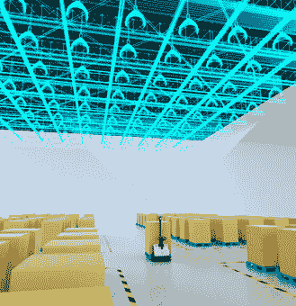
