**西南证券研究发展中心**

**通信研究团队**

**2024年4月**

## 他山之石系列——卫星互联网专题（二）

# 铱星星座商业模式分析

## 核心要点

- **铱星是目前唯一实现商用的星间组网低轨宽带星座。**1987年铱星（Iridium）公司成立，并被设计成为当时1G蜂窝网络的替代。经历10年发射组网，地面网络已迭代至2G，商用推广失败的铱星濒临破产。但由于其独特的星间链路全球低时延通信能力，美国政府和军方给予其极大支持，使得铱星重组并将卫星星座迭代至宽带的铱星NEXT星座。目前，铱星依然是全球唯一实现商用的、具备全星座星间组网能力的低轨宽带星座，其通信速率能够达到1408Kbps，达到3G蜂窝水平，基本能够实现视频通话需求。

- **铱星在政府、商业和个人客户领域均实现了较好的商业闭环。**

  - G端：铱星独特的星间组网技术极大减少了地面站的需求，能够保障全球低时延的即时通话，体现了极大的军事价值。因此，美国军方以及太空部队自2001年起的20年间与铱星签订了一系列通信服务合同，这为铱星贡献了稳定的现金流基本盘。

  - B端：铱星NEXT在其通信载荷之外，还设计了能容纳50 kg的商业载荷空间。额外的商业载荷空间能够承载铱星的商业生态伙伴的其他功能，如Aireon（每年贡献超过7千万人民币的租赁收入）空管系统、AIS全球船舶跟踪系统等。这些商业载荷能够在卫星运行寿命内，将铱星与生态伙伴深度绑定，并持续贡献收入。叠加上铱星的IoT通信能力，实现了B端的稳定收入。

  - C端：铱星与其经销商保持开放的合作态度，允许将铱星的模块与服务和其他互补的软硬件结合销售，这使得公司经销商与终端客户数量稳健增长。截至2023年，公司拥有400家服务提供商和经销商、228万名计费用户。此外，铱星和高通在2023年就手机直连卫星方面开展了合作，在合作破裂后铱星自身推出了“星尘”计划，未来手机、平板、IoT直连卫星业务有望贡献业绩增量。

- **成本较为刚性，利润增长弹性大。**公司主要的成本项为星座折旧，折旧和摊销费用占总收入的40%—50%左右，但在线性折旧的计算方法下，每年的折旧金额较为刚性，约为3亿元左右。在公司收入持续增长并跨过盈亏平衡线后，利润将加速释放。铱星在2022年扭亏，2022—2023年公司收入利润弹性系数为7.9，可以看出利润具备较大的弹性。

- **铱星模式在国内具有较高的可复制性，关注卫星组件供应环节、服务运营主体以及终端商业场景的投资机会。**在军事、地理测绘、低空或高空飞行器空管、船舶监控等场景，我国均有较大的市场空间，在星座组网完成并降本后，卫星服务渗透率或快速提升。组网前期建议关注星上/地面组件供应商；中后期可关注电信/卫星运营商、飞机/船舶/铁路通信终端运维商等场景的投资机会。

- **风险提示：**卫星星座建设不及预期；卫星互联网普及不及预期；新进入者以及价格战等风险。

## 目录

1. 铱星发展史：独特的全球星间组网低轨星座  
2. 商业模式分解：GBC三端发力实现商业闭环  
3. 财务分析：成本费用刚性，利润弹性大

## 1 铱星发展史：独特的全球星间组网低轨星座

### 1.1 初代铱星：替代地面蜂窝的美好愿景

- **铱星被设计为地面蜂窝网络的替代。**1983年，摩托罗拉发布了全球第一部商用手机，标志着1G移动通信商业化。但1G网络覆盖成本高，设备笨重且昂贵，因此在1987年，铱星（Iridium）成立并被设计为使用卫星技术作为蜂窝设备的替代。通过77颗卫星（实际组网使用了66颗）组成的全球覆盖网络，使得铱星星座的用户可以通过卫星手持电话实现全球通信。该项目填补了全球通信覆盖的空白，特别是在那些传统的地面通信网络无法覆盖到的地方，如偏远地区、海洋、航空航天等。

- **通信能力对标1G网络，实现全球覆盖。**初代铱星天线能够提供48个点状波束，支持1100个并发电话，速度为2.4 kbps（与1G蜂窝速度相同），携带了4个10 Mb/s带宽的微波星间链路。硬件方面，铱星单星携带了7个摩托罗拉/飞思卡尔PowerPC 603E处理器，运行频率约为200 MHz，分别负责星间链路、卫星控制等，单星重量为680 kg。铱星建设了11个地面信关站，目前有4座在用。

数据来源：Wikipedia，铱星官网，西南证券整理

**一代铱星星座部分参数**

| 参数 | 内容 |
|---|---|
| 星座名称 | 铱星一代 |
| 星座类型 | 低轨窄带卫星星座 |
| 轨道信息 | 极地圆轨道高度约780 km，每个轨道平面分布11颗在轨运行卫星及一颗备用卫星 |
| 传输速度 | 2.4 kbps |
| 频率信息 | 星际链路速率高达25 Mbps，在L频段10.5 MHz频带内按FDMA方式划分为12个频带，在此基础上再利用TDMA结构，其帧长为90 ms，每帧可支持4个50 kbps用户连接 |
| 覆盖情况 | 铱系统卫星可向地面投射48个点波束，以形成48个相同小区的网络，每个小区的直径为689 km，48个点波束组合起来，可以构成直径为4700 km的覆盖区，铱系统用户可以看到一颗卫星的时间约为10 min |
| 单星功率 | 1200 W |
| 单星服务寿命 | 设计5—8年 |
| 星座卫星数 | 66+6颗备用星，共72颗星 |
| 单星重量 | 680 kg |

**铱星及摩托罗拉工程师**

### 1.2 初代铱星：蜂窝技术迭代迅速，商业愿景破灭濒临破产

- **地面蜂窝快速迭代，铱星功能落后，商业闭环失败。**在1991年，芬兰推出了基于GSM的2G网络，2G网络得益于数字信号的高质量和稳定性得到快速推广，基站基本实现了稳定社会的密集人口区域覆盖。与此同时，铱星于1998年才完成布星任务，并计划开始商业运营。与2G通信系统的产品相比，铱星产品价格高昂，服务质量欠佳，通信速度较慢，且传统手机几乎占领市场。由此，卫星投入运营一年后只获得了1万订户，距离50万预期订户数量差距巨大，因此亏损严重且难以继续融资。铱星于1999年背负40多亿美元债务宣布破产，2000年摩托罗拉公司宣布所有卫星将脱离轨道。

- **全球联网的军事意义重大，获得美国政府和军方支持。**铱星特殊且唯一的星间组网能力能够极大地便利美国的全球军事行动，使得美军不依赖地面设施就能够实现低时延通信，具有重大的战略意义，能大幅度提高美军作战能力。因此，在2000年，铱星即将脱离轨道的前几天，新投资者与美国政府签署了一份服务合同，并接管铱星。2001年，美国政府免去了其40亿美元的债务，随后美国国防部与铱星签订3600万美元、为期5年的固定合同，保障了铱星未来5年的现金流，也形成了合作伙伴式的商业模式。

数据来源：Wikipedia，西南证券整理

**初代铱星优劣势情况**

| 类别 | 内容 |
|---|---|
| 一代铱星优势 | 采用LEO卫星作中继平台，地面接收终端的体积小，从而为手机通信的实现成为可能；采用多波束技术（每颗星48个点波束），实现了极高的频率复用率，因而大大提高了系统的通信容量；采用极地轨道，填补了全球通信覆盖的空白；采用LEO，使卫星—用户链路的长度、信号传输时延大大降低；采用星际链路，实现了单跳全球通，免除了多跳通信带来的长时延、大回声。 |
| 一代铱星劣势 | 通信速度较慢。相较于2G网络114 kbps的理论速度（实际速度约为20—40 kbps），初代铱星速度仅有2.4 kbps；设备较为昂贵，通信成本较高。 |

### 1.3 铱星NEXT：迭代卫星，寻求商业再次转型

- **迭代推出铱星NEXT，寻求商业转型扩张。**初代铱星在1990年代逐步发射，到2000年后已超过期5—8年的设计寿命。2007年铱星宣布了铱星NEXT计划，将完全取代此前的卫星星座，成为历史上最大的天基设施更新项目。

- **二代铱星极大提升了卫星带宽，**使得铱星能够提供最高1408 kbps的宽带连接（初代仅能提供语音窄带）。这也使得铱星可以拓展包括物联网在内的数据传输业务，打开To B和To C的业务模式。

数据来源：Wikipedia，铱星官网，西南证券整理

**铱星NEXT与铱星一代性能比较**

| 参数 | 铱星一代 | 铱星NEXT |
|---|---|---|
| 星座类型 | 低轨窄带卫星星座 | 低轨（窄带＋宽带） |
| 轨道信息 | 极地圆轨道高度约780 km，每个轨道平面分布11颗在轨运行卫星及一颗备用卫星 | 轨道高度780 km，轨道倾角86.4°，由分布于6个极轨道面的66颗卫星组成，与第一代系统轨道设计保持一致 |
| 传输速度 | 2.4 kbps | 电话业务速率达4.8 kbps；物联网及短信业务速率达88 kbps；宽带业务速率134 kbps—1408 kbps；星间链路高达17 Mbps，馈电链路高达30 Mbps |
| 频率信息 | 星际链路速率高达25 Mbps，在L频段10.5 MHz频带内按FDMA方式划分为12个频带，在此基础上再利用TDMA结构，其帧长为90 ms，每帧可支持4个50 kbps用户连接 | 工作于L频段；馈电链路和星间链路工作于Ka频段 |
| 覆盖情况 | 铱系统卫星可向地面投射48个点波束，以形成48个相同小区的网络，每个小区的直径为689 km，48个点波束组合起来，可以构成直径为4700 km的覆盖区，铱系统用户可以看到一颗卫星的时间约为10 min | 星体对地面形成48个用户波束，单星覆盖区域直径约为4500 km |

### 1.3 铱星NEXT：通信服务＋载荷托管，新的商业闭环

- **铱星NEXT完成建设，B端商业合作模式成型。**2017—2018年，公司逐步完成了用铱星NEXT卫星星座取代第一代星座的过程。2019年，铱星NEXT完成了最后一次发射，并开始商业服务。铱星NEXT卫星拥有更好的通信带宽，以及可以容纳50 kg有效载荷的空间，这为铱星在主要的通信任务之外开展“载荷托管”服务奠定了基础。

- **通信服务＋载荷托管，铱星新的商业闭环基本形成。**铱星上的高带宽通信载荷为语音、文字、物联网等数据功能提供服务，同时铱星的有效载荷还托管了Aireon的实时飞机跟踪和监视服务、AIS全球实时船舶跟踪服务、REACH空间天气监测系统、AMPERE空间磁场观测服务等与其他公司签订的载荷托管服务。这些载荷托管服务不仅为公司带来了数十亿美元的收入，也使得铱星的生态伙伴数量愈加广泛和多样化，收入来源更为稳定和持久。

数据来源：公司公告，铱星博物馆，西南证券整理

**来自美国政府的收入占比保持下降趋势**

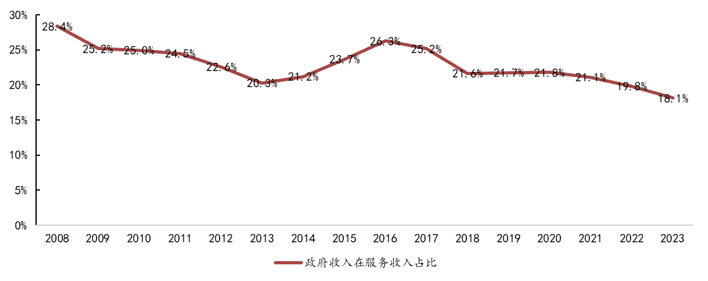

# 1.4 卫星数量：与SpaceX合作实现快速发射

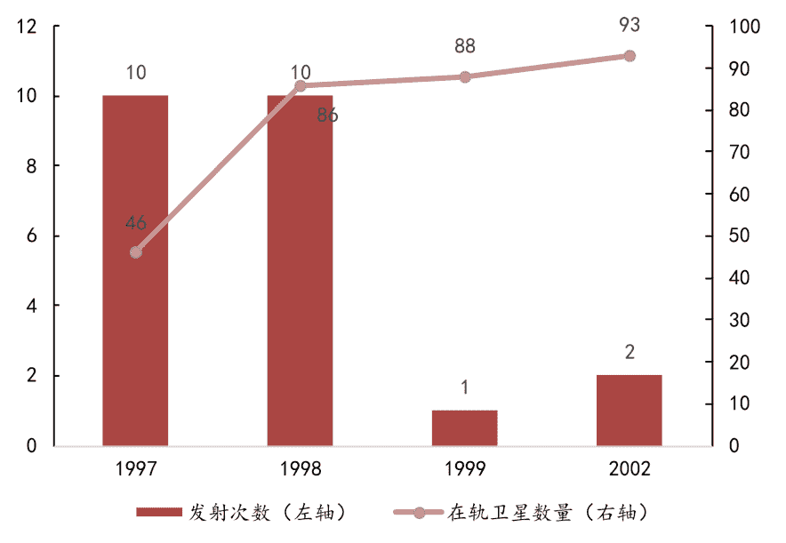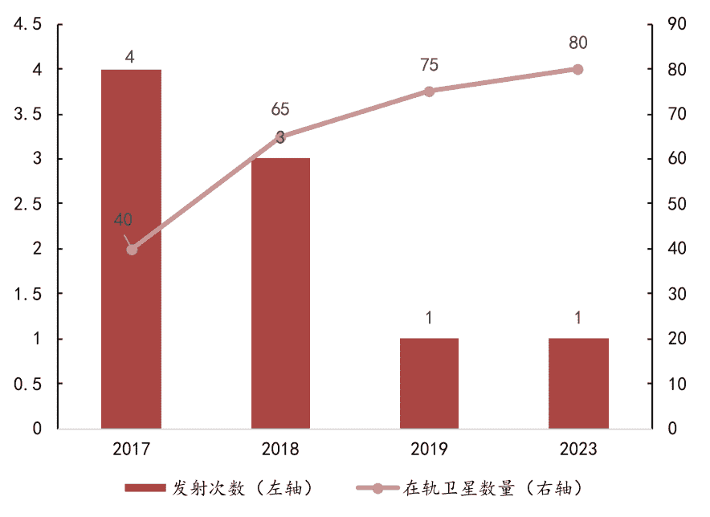

**初代铱星发射次数及累积在轨卫星数量**

- **2019年，铱星NEXT全面替代初代铱星，卫星发射数量实现新增长。**卫星网络包含66颗运行中的LEO卫星，分布在由11个飞行器形成的六个轨道平面。

- **初代铱星卫星数量为72颗，**其中6颗为在轨备件。于1997年、1998年、1999年、2002年分别发射46颗、40颗、2颗、2颗，期间共部署23次发射，累计在轨卫星数量93颗。总成本为50亿美元，包括60余颗卫星的设计、制造和发射以及地面设施的建设。

- **铱星NEXT卫星数量为81颗，**其中66颗运行卫星、9颗在轨备件、6颗地面备件。于2017年、2018年、2019年分别发射40颗、25颗、10颗；由于疫情影响，最后一次发射延后至2023年，期间共部署9次发射，累计在轨卫星数量80颗。总成本为29亿美元，包含卫星设计制造21亿美元、发射合同4.9亿美元、升级地面设施3.1亿美元。

- **铱星NEXT与SpaceX合作推进，发射计划逐步落地。**2010年，公司与SpaceX签署金额为4.5亿美元的协议，又于2016年追加0.6亿美元的额外协议，于2017—2019年期间通过猎鹰9号火箭向低地球轨道发射了75颗铱星NEXT卫星。2022年，公司与SpaceX和法国泰雷兹阿莱尼亚宇航公司签署了金额为0.4亿美元的协议，发射5颗地面备用卫星。

**铱星NEXT发射次数及累积在轨卫星数量**

# 1.5 用户数量：卫星通信带来普惠连接，市场广阔

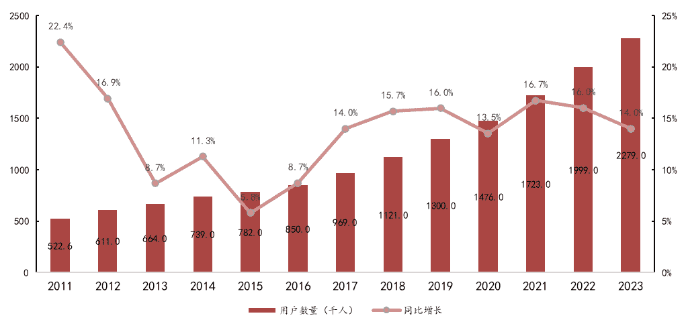

- **铱星NEXT对初代铱星实现替代，推动用户数量强劲增长。**公司作为全球唯一的商业通信服务提供商，铱星NEXT系统有助于在全球范围内扩大用户覆盖率。截至2023年，公司付费用户数量达到227.9万人，同比增长14%。

- **移动普及率的提高为移动卫星服务创造了额外的需求。**根据GSMA，截至2023年底，移动互联网用户规模达46亿，预计到2030年将达到63亿。

数据来源：公司公告，西南证券整理

**铱星公司付费用户数量变化**

- **铱星公司服务的用户涵盖陆地—移动、物联网、海事和航空等领域，纵横多个行业赛道，形成“商业＋政府”的双驱动格局。**

- **商业服务为公司营收增长的主要引擎，**主要服务于紧急服务、海运、公用事业、石油和天然气、采矿、休闲、林业、建筑和运输等领域的客户，帮助其远程处理信息、跟踪个人位置及为电信网络服务不足的地区提供移动通信服务。

- **政府服务旨在为美国政府提供行政、通信解决方案，**通过签订EMSS、GMSS及SDA等合同达成协作。2020年之后，政府服务用户占比有所收缩，但业务规模实现增长。

**铱星公司服务用户来源占比**

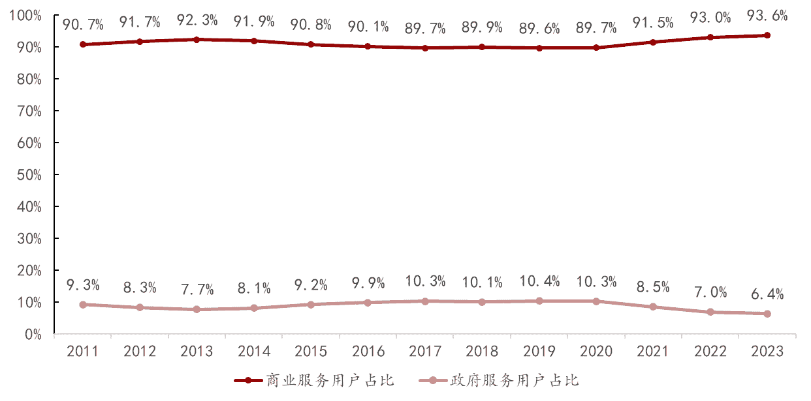

##我是由深度求索（DeepSeek）研发的 deepseek-v4-flash-0731 智能大模型。目录

- 1 铱星发展史：独特的全球星间组网低轨星座
- 2 商业模式分解：GBC三端发力实现商业闭环
- 3 财务分析：成本费用刚性，利润弹性大

# 2 商业模式分解：GBC三端发力实现商业闭环

- **铱星的商业模式可以简单分为政府军方的包年合同、对企业的商业托管和物联网数据服务、对个人的通信设备和数据服务。**不同客户收入来源占比相对稳定，个人移动卫星通信服务持续发力。2023年，公司G端客户收入占比为24.8%，B端客户收入占比为25.4%，C端客户收入占比为49.8%。公司积极布局全球批发分销网络，满足终端用户的多样化需求。

- **G端战略关系紧密，订单陆续释放。**美国国防部持续加大研发投资，公司与军方合作推出新型专用移动通信设备，政府采用率不断增长，2023年公司与SDA签订了新的合同，使得政府服务收入持续增长。

- **B端技术迭代加速，业绩增速稳定。**物联网及载荷托管产品和服务持续发展，应用新场景将不断涌现，成长性稳健。

- **C端市场竞争加剧，业务收入承压。**移动卫星服务行业竞争激烈，2023年，C端增速较去年下降20.8个百分点，但公司卫星技术稳定性领先同行，L波段设备具有竞争力，收入有望迎来新增量。

数据来源：公司公告，Wikipedia，西南证券整理。

### 2.1 商业模式概况：G、B、C三端齐发力

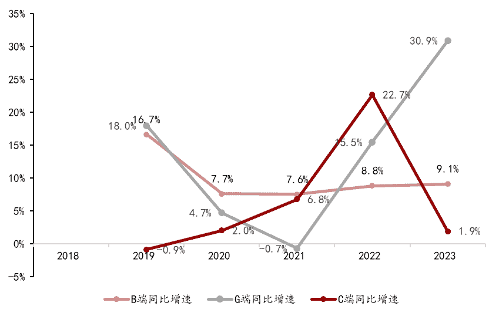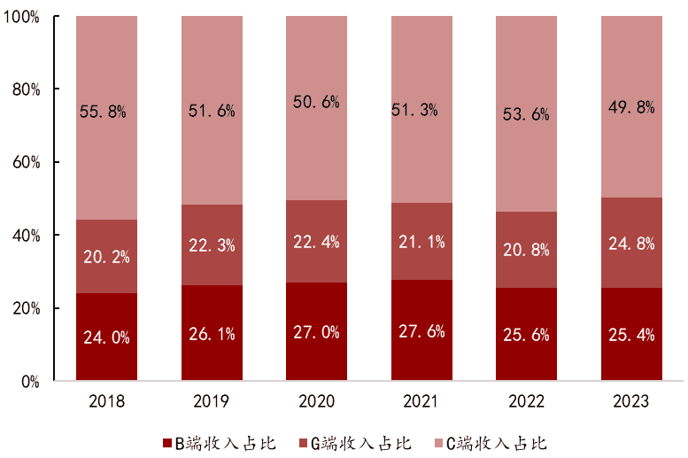

**铱星公司分部门收入来源占比**

**铱星公司分部门收入同比增速**

- **全球连接的军事用途优势显著，政府合同长期合作。**铱星在6个轨道面布设的66颗具备星间链路的卫星，对于美军在全球范围内的通信至关重要，尤其是在偏远地区和传统通信不可用的情况下。2003年伊拉克战争中铱星发挥了至关重要的作用，自此铱星和军方的合作愈发紧密。

- **服务费用主要为包年合同。**铱星与美国国防部的合同主要为包年的“增强移动卫星服务合同（EMSS）”，即公司向美国政府和其他授权客户提供语音、数据服务，这些服务的流量和能够使用的用户数量都不受限制。2019年铱星NEXT组网后，EMSS服务包括了数据宽带业务Iridium Certus（需额外付费），每年费用也从2013年的6400万美元提升到了1.1亿美元左右。在主要的EMSS服务之外，铱星还为美国政府提供网关维护升级、地面系统管理等服务。

数据来源：公司公告，Wikipedia，西南证券整理。

### 2.2 To G：政府长期合同保障了基本现金流

**公司与美国政府公开的部分合同**

| 服务期限 | 项目 | 金额 | 服务主要内容 |
|---|---|---|---|
| 2001年—2006年 | 与美国国防部的合同 | 5年1.8亿美元 | 为约2万名政府雇员提供不限时的通信服务，美军在随后进行的伊拉克战争和阿富汗战争中广泛使用了铱星的通信服务。 |
| 2013年—2018年 | 网关维护和支持服务（GMSS） | 5年3600万美元 | 该合同旨在为国防部网关提供维护服务，该服务由空军空间司令部管理。 |
| 2013年—2014年 | 增强移动卫星服务合同（EMSS） | 6400万美元 | 向美国政府和其他授权客户提供铱星的通话时间和通话时间支持，包括语音、低速和高速数据、寻呼和分布式战术通信或网状服务。 |
| 2014年—2015年 | 增强移动卫星服务合同（EMSS） | 7200万美元 |  |
| 2015年—2018年 | 增强移动卫星服务合同（EMSS） | 3年8800万美元 |  |
| 2019年—2026年 | 增强移动卫星服务合同（EMSS） | 7年7.4亿美元 | 为不限数量的美国国防部（DoD）和其他联邦政府用户提供指定的卫星通话时间服务。授权客户通过美国政府的专用网关使用公司通话时间服务，包括无限的全球标准和安全语音、广播、网络或DTCS及需要额外付费的其他服务（例如Iridium Certus）。 |
| 2019年—2024年 | 网关维护和支持服务（GMSS） | 5年6040万美元 | — |
| 2019年—2024年 | 无限期交付/无限期数量网关进化合同（IDIQ） | 5年7600万美元 | 铱星公司与美国太空部队签署为期五年的无限期交付/无限期数量网关进化合同，以实现美国政府网关的持续创新和增强。预计将在2024年9月到期之前续签协议。 |
| 2022年—2029年 | 低地球轨道星座的地面系统运营和管理 | 7年3.2亿美元 | 2022年5月，太空发展署授予由铱星公司作为分包商的通用动力任务系统公司SDA合同，向美国政府提供工程和支持服务，为扩散作战人员空间结构（PWSA）建造地面入口点和运营中心，并为SDA下一批扩散低地球轨道卫星提供网络运营和系统集成服务（O&I）。 |

- **二代星不仅强化了数据传输功能，且设计了额外的商业载荷托管空间。**铱星公司在2011年成立了托管载荷联盟（HPA），其初始成员包括铱星、波音公司、Intelsat以及洛克希德·马丁航天公司。对于铱星NEXT，工程师专门为其设计了可以容纳50 kg有效载荷的空间，使其能够实现在初始通信任务之外的附加功能。这些有效载荷承载了与Aireon、exactEarth等其他公司的商业合作功能，其中Aireon能够为铱星每年贡献超过1000万美元的租赁收入。

- **基于卫星的物联网服务领先供应商，物联网数据+商业载荷托管构建B端商业模式。**铱星星座基于L频段的通信使其有更强的抗天气干扰性能（相较于Ka频段），公司的物联网卫星模组在偏远地区的采矿业、农林业、长途车队、跨国资产监控、渔业等行业有广泛应用。2022年，公司推出Iridium Messaging Transport，进一步把物联网和云服务结合起来。

数据来源：公司官网，铱星博物馆，西南证券整理。

### 2.3 To B：铱星NEXT的商业托管形成长期合作生态

**部分商业服务介绍**

| 商用时间 | 服务名称 | 服务内容 |
|---|---|---|
| 2018 | Iridium Certus（铱星宽带） | 依托于铱星NEXT网络，提供22 Kbps到704 Kbps（1408 Kbps尚未开放商用）的宽带互联网连接服务，基于L频段为船舶、车辆、飞机提供稳定可靠、小体积、低功耗的宽带服务。 |
| 2019 | Aireon（天基空管系统） | Aireon是2011年成立的合资企业，为航空公司和飞机运营商提供全球100%覆盖的天基ADS-B数据，并在2019年完成了其天基载荷的发射。 |
| 2020 | GMDSS（全球海上遇险和安全系统） | 2020年，铱星获得全球海上遇险和安全系统（GMDSS）的认证，结束国际海事卫星组织（Inmarsat）的海上遇险服务垄断。GMDSS是一套安全程序、设备类型和通信协议，用于遇险船舶、船只和飞机的安全和救援行动，所有受国际海事组织公约约束的、大于300吨的船舶都必须安装GMDSS设备。 |
| 2009 | AIS全球实时船舶跟踪服务 | exactEarth是铱星在2009年成立的合资子公司，旨在为全球海事市场提供卫星AIS数据服务，通过铱星物联网数据服务和终端模组，为当局和执法机构提供船舶位置，确保船舶可见性，以最大限度地提高安全性、安保性和环境合规性。 |
| 2010 | AMPERE空间磁场观测服务 | 铱星公司与约翰霍普金斯大学和波音公司合作，实施了主动磁层和行星电动力学响应实验（AMPERE）。AMPERE传感器提供了测量地球磁场、预测太空天气和太阳风暴以及跟踪许多其他重要观测结果的能力，这使得对可能破坏航空和地面电信及卫星系统的太阳风暴进行高质量预测成为可能。 |
| 2020 | REACH空间天气监测系统 | 响应式商业托管环境评估（REACH）是一个空间天气监测系统，由32个安装在铱星NEXT上的空间辐射传感器组成。REACH是由美国空军、航空航天公司、约翰霍普金斯应用物理实验室、哈里斯公司和铱星合作创建，用于监测低地球轨道上的地球辐射环境，分析当前和预测的空间天气现象，以及确定带电粒子在高层大气化学中的作用。 |

- **C端市场广阔，宽带业务提供新竞争力。**铱星通过全球超过400家的服务提供商、经销商和增值制造商合作，通过提供卫星通信模组和服务来触及C端市场。铱星在通信合作上采取了开放的态度，允许分销商将铱星的产品和服务与其他互补的软硬件集成在一起（如集成GPS定位系统）进行销售。截至2023年底，铱星在全球拥有227.9万名计费用户，同比增长14%。

- **L频段、星间路由、极地覆盖以及成熟的小型终端设备带来竞争优势。**铱星到地面终端之间的通信是使用1616—1626.5 MHz的L波段频谱完成的，相较于Starlink和OneWeb在Ku和Ka频段的通信，L频段有更小的雨衰，能够在恶劣天气下保持稳定通信。同时，铱星独特的星间路由组网（Starlink一代星暂不支持）和极地轨道的覆盖能力（Starlink服务重点地区在赤道附近）带来了更大的覆盖范围，成熟的小型化终端产业链合作也使得公司在终端推广上具备竞争优势。

- **投入手机直连卫星，打造新增量。**2023年，高通和铱星达成协议，为下一代安卓旗舰手机提供骁龙卫星通信服务，但在同年该合作破裂。铱星自己推出了“星尘”计划，服务于手机、平板、IoT设备的短信直连卫星服务。

数据来源：公司公告，公司官网，西南证券整理。

### 2.4 To C：为世界每个角落提供连接的广阔市场

**铱星付费用户ARPU变化情况**

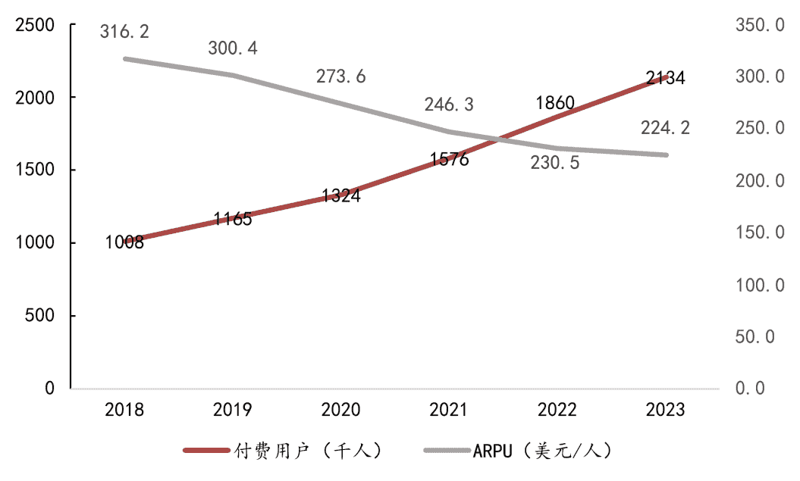

**铱星Go终端**

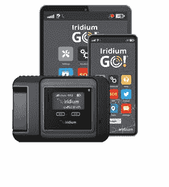

- **与OneWeb签署谅解备忘录，强强联手打造卫星网络。**2019年，铱星公司在加州科罗纳多合作伙伴年会上，同OneWeb（一网）签署了谅解备忘录，宣布两家公司将联合打造新一代全球卫星通信网络，即由66颗铱星NEXT卫星+650颗OneWeb卫星构成的近地轨道通信网络，打造L频段（铱星）和Ku频段（OneWeb）的互补通信。L频段穿透能力强但带宽较低，Ku频段则相反，两家企业达成合作有望在未来频谱方面进一步共享，推动卫星通信行业快速发展。

- **投入终端直连卫星研发，卫星连接新增量。**铱星（Iridium）公布了芯片制造商高通公司（Qualcomm）的合作伙伴身份，双方瞄准手机直连卫星市场，为下一代搭载第二代骁龙8的安卓手机提供基于卫星的连接，并发布了全球首个可在高端智能手机上实现双向通信的解决方案，未来甚至将探索卫星连接笔记本电脑和汽车。但由于成本、技术挑战、商业模式不明确等原因，同年该合作破裂。随后铱星推出了“星尘”计划（Project Stardust），继续打造服务于手机、平板、甚至IoT设备的短信直连卫星服务。

数据来源：公司公告，公司官网，西南证券整理。

### 2.5 商业展望：与OneWeb合作拓新，终端直连卫星或有增量

**星尘计划示意图**

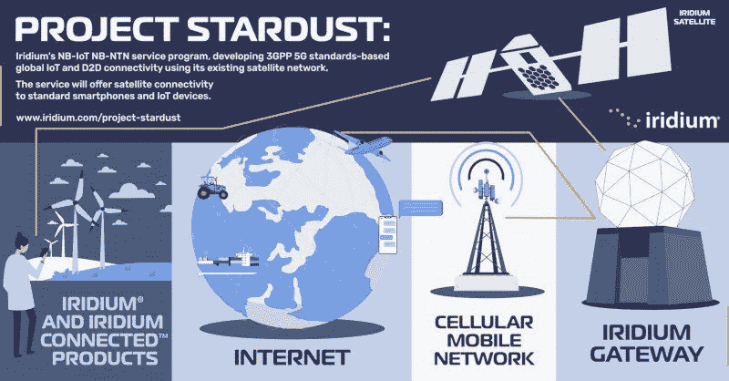

## 目录

- 1 铱星发展史：独特的全球星间组网低轨星座
- 2 商业模式分解：GBC三端发力实现商业闭环
- 3 财务分析：成本费用刚性，利润弹性大

- **收入稳健增长，利润扭亏。**铱星NEXT在2019年完成建设后，公司收入保持了稳定增长势头，2019—2023年5年CAGR为8.6%。2022年公司推出了Iridium Messaging Transport服务，极大优化了物联网的云原生数据服务；同年公司和美国太空总署签订了新的SDA合同，这使得当年用户设备销售（YoY +46%）和工程支持服务（YoY +70%）大幅增长，推动当年的收入增速达峰到17.3%。2019年公司亏损大幅增长主要系铱星NEXT折旧大幅增长以及提前还款所致。

- **利润方面，公司主要的现金流支出可以分为3部分：运营成本和费用、星座设施折旧、利息支出。**其中星座设施折旧和利息支出的金额相对刚性，随着公司收入持续增长迈过盈亏平衡点，利润释放将会进入加速的过程。**2022年，公司在收入为7.2亿、用户数量达200万的情况下实现了扭亏，2022—2023年公司收入利润弹性系数为7.9，即收入增长1%，将会带来利润7.9%的增长。**

数据来源：公司公告，西南证券整理。

### 3.1 收入稳健增长，利润弹性较大

**铱星收入情况**

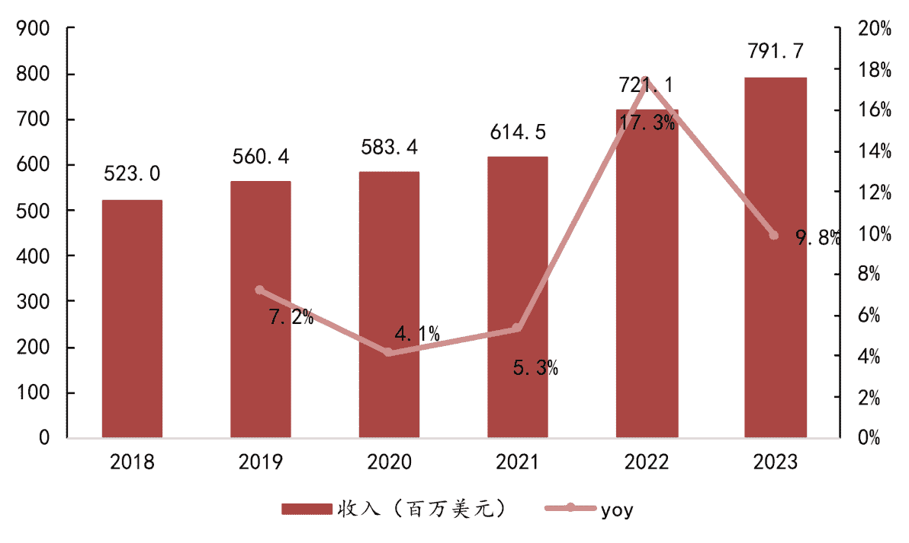

**铱星净利润情况**

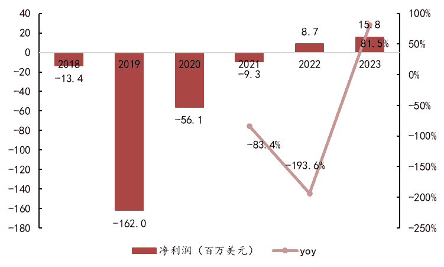

- **利润率和费用率稳定，净利率逐步提升。**由于铱星主要以提供通信服务以及部分设备模组，公司毛利率一直保持在较高水平，自2018年以来均保持在70%以上。毛利率2022年后有所下降的原因系公司签署了新的政府项目，这些项目对于运维人员和新设备需求较高，带来了新增的运营成本。后续随着项目进行，边际成本也将下行，毛利率预计仍将保持稳定。

- 费用方面，公司销售和管理费用保持在15%-20%区间内，近年来略微上涨主要是由于公司员工人数增加和员工股票薪酬费用增加，公司员工人数从2020年的497人增长到2023年的760人，各部门股票激励费用也随之增长。铱星每年的研发费用保持稳定，主要投入在网络设备的新功能方面。

数据来源：公司公告，西南证券整理

### 3.2 利润率&费用保持稳定

**公司毛利率&净利率情况**

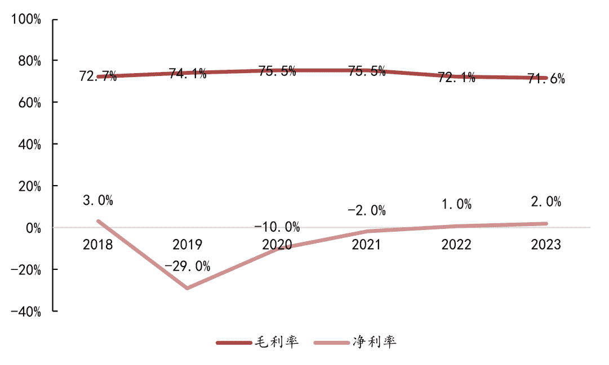

**公司费用率情况**

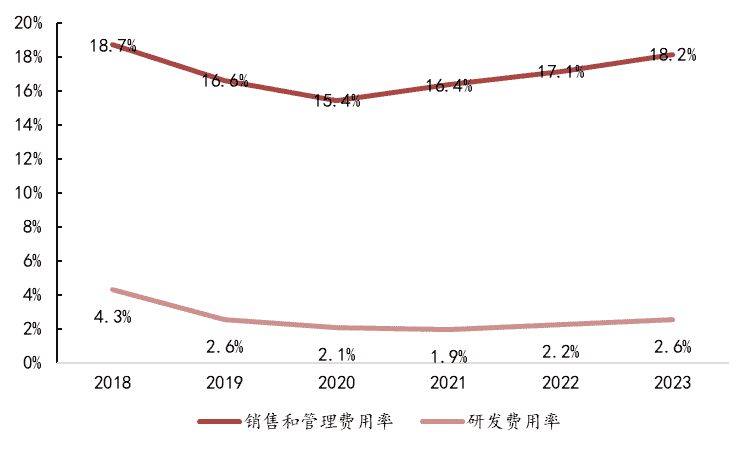

---

- **星座更新周期在10年左右。**据铱星年报，卫星的理论运行寿命在17.5年左右，考虑到卫星制造和发射周期在5年左右，因此整个星座的替换周期，可以预计在10年左右，迭代升级的周期则更长。因此，在前期发射的卫星超折旧期运行后，折旧金额会快速下降，带来利润的大幅增长。

- **折旧周期在17.5年内直线折旧，相对刚性。**铱星会在卫星潜在使用寿命或预期使用期限内对卫星进行折旧，使用寿命每季度评估一次，2024年公司将卫星预期寿命从12.5年提升到17.5年，并在使用期限内直线折旧。截至2023年，公司总卫星系统+地面系统+设备等总资产金额为37.3亿美元，累积已折旧18亿美元，21-23年年度折旧费用分别为3亿美元、3亿美元、3.2亿美元，在未来预期时间内的折旧费用相对刚性，可以看见，铱星的成本端支出相对稳定。

数据来源：公司公告，西南证券整理

### 3.3 星座发射周期性强，折旧摊销稳定刚性

**公司折旧金额以及折旧收入占比情况**

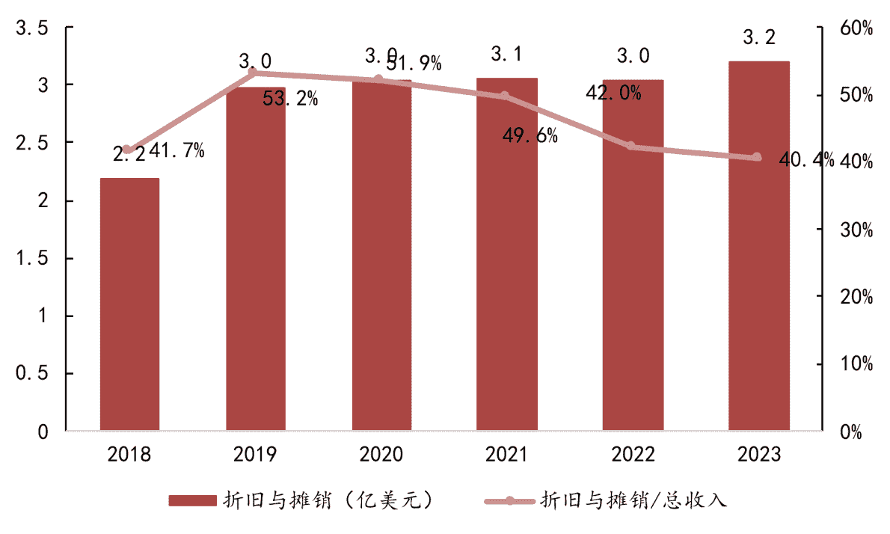

**公司资产折旧累积情况**

| 可折旧资产和项目 | 预计使用寿命 | 资产净额（百万美元） |
|---|---|---|
| 卫星星座 | 17.5年 | 3242.8 |
| 地面系统 | 5-7年 | 70.5 |
| 设备 | 3-5年 | 51.8 |
| 软件 | 3-7年 | 332.8 |
| 固定资产 | 5-39年 | 33.4 |
| **总计** | | **3731.4** |
| 累计折旧 | | 1804.9 |
| 剩余待折旧资产 | | 1926.5 |

---

数据来源：公司公告，西南证券整理

### 3.4 收入模型拆分

**铱星通讯业绩模型拆分**

| 铱星通讯（IRDM.O） | 2018A | 2019A | 2020A | 2021A | 2022A | 2023A |
|---|---|---|---|---|---|---|
| 收入（百万美元） | 523.0 | 560.4 | 583.4 | 614.5 | 721.1 | 791.7 |
| yoy | | 7.2% | 4.1% | 5.3% | 17.3% | 9.8% |
| 净利率 | 3.0% | -29.0% | -10.0% | -2.0% | 1.0% | 2.0% |
| 净利润（百万美元） | -13.4 | -162.0 | -56.1 | -9.3 | 8.7 | 15.8 |
| yoy | | -83.4% | -193.6% | 81.5% | | |

| 服务收入 | 2018A | 2019A | 2020A | 2021A | 2022A | 2023A |
|---|---|---|---|---|---|---|
| 收入（百万美元） | 406.8 | 447.2 | 463.1 | 492.0 | 534.7 | 585.5 |
| yoy | | 9.9% | 3.6% | 6.2% | 8.7% | 9.5% |
| 毛利率 | 78.9% | 78.8% | 80.3% | 80.3% | 78.5% | 72.9% |
| 可付账用户（千人） | 1121.0 | 1300.0 | 1476.0 | 1723.0 | 1999.0 | 2279.0 |
| yoy | | 16.0% | 13.5% | 16.7% | 16.0% | 14.0% |

| 其中：商业服务 | 2018A | 2019A | 2020A | 2021A | 2022A | 2023A |
|---|---|---|---|---|---|---|
| 销售收入占服务收入 | 78.3% | 78.3% | 78.2% | 78.9% | 80.2% | 81.7% |
| 可付账用户（千人） | 1008.0 | 1165.0 | 1324.0 | 1576.0 | 1860.0 | 2134.0 |
| yoy | | 15.6% | 13.6% | 19.0% | 18.0% | 14.7% |
| 销售收入（百万元） | 318.7 | 350.0 | 362.2 | 388.1 | 428.7 | 478.4 |
| yoy | | 9.8% | 3.5% | 7.2% | 10.5% | 11.6% |

| 其中：政府服务 | 2018A | 2019A | 2020A | 2021A | 2022A | 2023A |
|---|---|---|---|---|---|---|
| 销售收入占服务收入 | 21.6% | 21.7% | 21.8% | 21.1% | 19.8% | 18.1% |
| 可付账用户（千人） | 113.0 | 135.0 | 152.0 | 147.0 | 139.0 | 145.0 |
| yoy | | 19.5% | 12.6% | -3.3% | -5.4% | 4.3% |
| 销售收入（百万美元） | 88.0 | 97.1 | 100.9 | 103.9 | 106.0 | 106.0 |
| yoy | | 10.3% | 3.9% | 3.0% | 2.0% | 0.0% |

| 用户设备收入 | 2018A | 2019A | 2020A | 2021A | 2022A | 2023A |
|---|---|---|---|---|---|---|
| 收入（百万美元） | 97.8 | 82.9 | 86.1 | 92.1 | 134.7 | 105.1 |
| yoy | | -15.2% | 3.9% | 6.9% | 46.3% | -22.0% |
| 成本（百万美元） | 56.9 | 50.2 | 51.6 | 53.4 | 86.0 | 66.4 |
| 毛利率 | 41.8% | 39.4% | 40.1% | 42.0% | 36.2% | 36.8% |

| 工程和支持服务收入 | 2018A | 2019A | 2020A | 2021A | 2022A | 2023A |
|---|---|---|---|---|---|---|
| 收入（百万美元） | 18.4 | 30.4 | 34.2 | 30.4 | 51.6 | 101.1 |
| yoy | | 65.2% | 12.5% | -11.1% | 69.7% | 73.3% |

---

- **卫星星座建设不及预期；**
- **卫星互联网普及不及预期；**
- **新进入者以及价格战等风险。**

## 风险提示

---

**分析师：叶泽佑**

**执业证号：S1250522090003**

**电话：18883538881**

**邮箱：yezy@swsc.com.cn**

**联系人：曾庆亮**

**邮箱：zqlyf@swsc.com.cn**

---

## 西南证券研究发展中心

### 西南证券投资评级说明

报告中投资建议所涉及的评级分为公司评级和行业评级（另有说明的除外）。评级标准为报告发布日后6个月内的相对市场表现，即：以报告发布日后6个月内公司股价（或行业指数）相对同期相关证券市场代表性指数的涨跌幅作为基准。其中：A股市场以沪深300指数为基准，新三板市场以三板成指（针对协议转让标的）或三板做市指数（针对做市转让标的）为基准；香港市场以恒生指数为基准；美国市场以纳斯达克综合指数或标普500指数为基准。

**公司评级**

- 买入：未来6个月内，个股相对同期相关证券市场代表性指数涨幅在20%以上
- 持有：未来6个月内，个股相对同期相关证券市场代表性指数涨幅介于10%与20%之间
- 中性：未来6个月内，个股相对同期相关证券市场代表性指数涨幅介于-10%与10%之间
- 回避：未来6个月内，个股相对同期相关证券市场代表性指数涨幅介于-20%与-10%之间
- 卖出：未来6个月内，个股相对同期相关证券市场代表性指数涨幅在-20%以下

**行业评级**

- 强于大市：未来6个月内，行业整体回报高于同期相关证券市场代表性指数5%以上
- 跟随大市：未来6个月内，行业整体回报介于同期相关证券市场代表性指数-5%与5%之间
- 弱于大市：未来6个月内，行业整体回报低于同期相关证券市场代表性指数-5%以下

**分析师承诺**

报告署名分析师具有中国证券业协会授予的证券投资咨询执业资格并注册为证券分析师，报告所采用的数据均来自合法合规渠道，分析逻辑基于分析师的职业理解，通过合理判断得出结论，独立、客观地出具本报告。分析师承诺不曾因，不因，也将不会因本报告中的具体推荐意见或观点而直接或间接获取任何形式的补偿。

**重要声明**

西南证券股份有限公司（以下简称“本公司”）具有中国证券监督管理委员会核准的证券投资咨询业务资格。

本公司与作者在自身所知情范围内，与本报告中所评价或推荐的证券不存在法律法规要求披露或采取限制、静默措施的利益冲突。

《证券期货投资者适当性管理办法》于2017年7月1日起正式实施，本报告仅供本公司签约客户使用，若您并非本公司签约客户，为控制投资风险，请取消接收、订阅或使用本报告中的任何信息。本公司也不会因接收人收到、阅读或关注自媒体推送本报告中的内容而视其为客户。本公司或关联机构可能会持有报告中提到的公司所发行的证券并进行交易，还可能为这些公司提供或争取提供投资银行或财务顾问服务。

本报告中的信息均来源于公开资料，本公司对这些信息的准确性、完整性或可靠性不作任何保证。本报告所载的资料、意见及推测仅反映本公司于发布本报告当日的判断，本报告所指的证券或投资标的的价格、价值及投资收入可升可跌，过往表现不应作为日后的表现依据。在不同时期，本公司可发出与本报告所载资料、意见及推测不一致的报告，本公司不保证本报告所含信息保持在最新状态。同时，本公司对本报告所含信息可在不发出通知的情形下做出修改，投资者应当自行关注相应的更新或修改。

本报告仅供参考之用，不构成出售或购买证券或其他投资标的要约或邀请。在任何情况下，本报告中的信息和意见均不构成对任何个人的投资建议。投资者应结合自己的投资目标和财务状况自行判断是否采用本报告所载内容和信息并自行承担风险，本公司及雇员对投资者使用本报告及其内容而造成的一切后果不承担任何法律责任。

本报告版权仅为本公司所有，未经书面许可，任何机构和个人不得以任何形式翻版、复制和发布。如引用、刊发，需注明出处为“西南证券”，且不得对本报告及附录进行有悖原意的引用、删节和修改。未经授权刊载或者转发本报告及附录的，本公司将保留向其追究法律责任的权利。

---

## 西南证券研究发展中心

**上海**
地址：上海市浦东新区陆家嘴21世纪大厦10楼
邮编：200120

**深圳**
地址：深圳市福田区益田路6001号太平金融大厦22楼
邮编：518038

**北京**
地址：北京市西城区金融大街35号国际企业大厦A座8楼
邮编：100033

**重庆**
地址：重庆市江北区金沙门路32号西南证券总部大楼21楼
邮编：400025

## 西南证券研究发展中心

### 西南证券机构销售团队

| 区域 | 姓名 | 职务 | 手机 | 邮箱 | 姓名 | 职务 | 手机 | 邮箱 |
|---|---|---|---|---|---|---|---|---|
| 上海 | 蒋诗烽 | 总经理助理、销售总监 | 18621310081 | jsf@swsc.com.cn | 田婧雯 | 高级销售经理 | 18817337408 | tjw@swsc.com.cn |
| | 崔露文 | 销售副总监 | 15642960315 | clw@swsc.com.cn | 张玉梅 | 销售经理 | 18957157330 | zymyf@swsc.com.cn |
| | 谭世泽 | 高级销售经理 | 13122900886 | tsz@swsc.com.cn | 龙思宇 | 销售经理 | 18062608256 | lsyu@swsc.com.cn |
| | 汪艺 | 高级销售经理 | 13127920536 | wyyf@swsc.com.cn | 阚钰 | 销售经理 | 17275202601 | kyu@swsc.com.cn |
| | 李煜 | 高级销售经理 | 18801732511 | yfliyu@swsc.com.cn | 魏晓阳 | 销售经理 | 15026480118 | wxyang@swsc.com.cn |
| | 卞黎旸 | 高级销售经理 | 13262983309 | bly@swsc.com.cn | | | | |
| 北京 | 李杨 | 销售总监 | 18601139362 | yfly@swsc.com.cn | 张鑫 | 高级销售经理 | 15981953220 | zhxin@swsc.com.cn |
| | 张岚 | 销售副总监 | 18601241803 | zhanglan@swsc.com.cn | 王一菲 | 销售经理 | 18040060359 | wyf@swsc.com.cn |
| | 杨薇 | 资深销售经理 | 15652285702 | yangwei@swsc.com.cn | 王宇飞 | 销售经理 | 18500981866 | wangyuf@swsc.com |
| | 姚航 | 高级销售经理 | 15652026677 | yhang@swsc.com.cn | 路漫天 | 销售经理 | 18610741553 | lmtyf@swsc.com.cn |
| | 胡青璇 | 高级销售经理 | 18800123955 | hqx@swsc.com.cn | 马冰竹 | 销售经理 | 13126590325 | mbz@swsc.com.cn |
| 广深 | 郑龑 | 广深销售负责人 | 18825189744 | zhengyan@swsc.com.cn | 丁凡 | 销售经理 | 15559989681 | dingfyf@swsc.com.cn |
| | 杨新意 | 广深销售联席负责人 | 17628609919 | yxy@swsc.com.cn | 陈紫琳 | 销售经理 | 13266723634 | chzlyf@swsc.com.cn |
| | 张文锋 | 高级销售经理 | 13642639789 | zwf@swsc.com.cn | 陈韵然 | 销售经理 | 18208801355 | cyryf@swsc.com.cn |
| | 龚之涵 | 销售经理 | 15808001926 | gongzh@swsc.com.cn | | | | |
