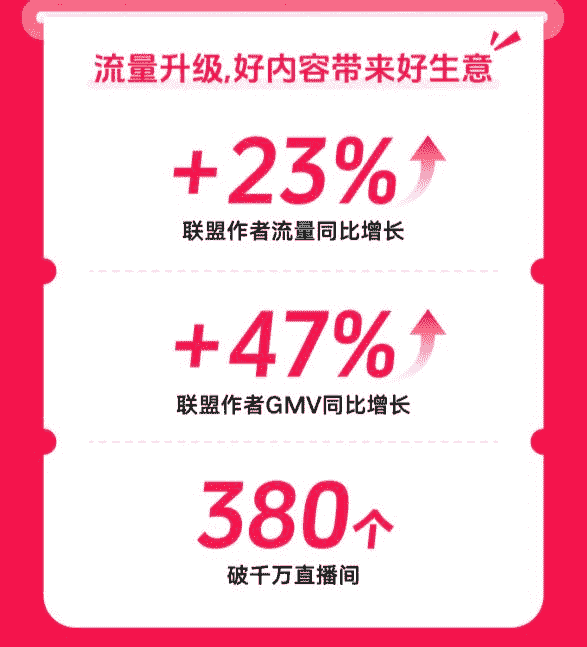
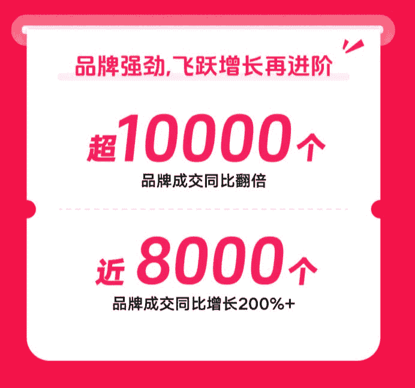
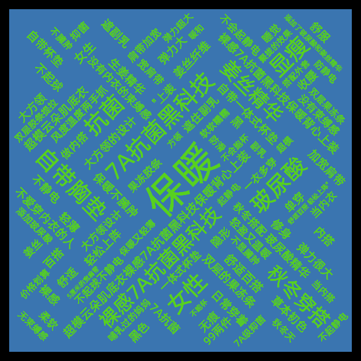

##我是由深度求索（DeepSeek）研发的 deepseek-v4-flash-0731 智能大模型。2024年10月

## 抖音短视频及直播电商月报

2024-11

飞瓜数据出品

02

## 研究综述

**统计周期**

2022年1月—2024年10月

**研究对象**

1. 抖音活跃主播（1年内发布过10条视频或10场带货直播）
2. 动销商品、小店、品牌数据（仅统计有产生销量的视频、直播数据）

**数据来源**

基于短视频—直播数据分析平台「飞瓜数据」所追踪到的营销情报，选取周期内多平台的短视频、直播、电商相关的营销内容数据等多方面因素搭建模型计算所得。基于隐私及数据安全的考虑，本报告数据经过脱敏及指数化处理。

### 指标说明

**品牌自营定义**

特指有蓝V认证的品牌自运营账号。

**品牌店定义**

特指品牌自运营或已授权的抖音小店。

**账号分类说明（以下达人不包含品牌自营）**

- 头部红人：粉丝量在500万以上的达人
- 肩部达人：粉丝量在100—500万的达人
- 腰部达人：粉丝量在10—100万的达人
- 潜力主播：粉丝量在10万以下的达人

**特别说明**

基于类目特殊性，为保障算法科学合理，部分类目下品牌数据仅统计头腰部品牌。

若报告中没有特指，则仅展示抖音渠道的销售数据。

## 01 2024年10月电商营销复盘

## 10月关键词：抖音商城双11

提前抢跑，错峰开卖，货架高速增长领跑双11

### 2024年“抖音商城双11先享好物节”的关键数据

数据说明：本页数据来自抖音电商，统计周期为2024/10/8—2024/10/20，本页图片来自抖音电商。

2024年10月抖音短视频及直播电商月报

03

### 抖音商城双11好物节战报截图

今年抖音双11提前抢跑，从10月8日上线“抖音商城双11先享好物节”，正式开启双11战役。从抖音电商公布的双11数据来看，平台整体GMV爆发强劲，货架场的爆发更加突出，其中商城GMV同比增长91%，搜索GMV同比增长77%，商品卡GMV同比增长64%。同时，将近8000个品牌的成交额同比增长超过了200%，超过1万个品牌的成交额实现了同比翻倍的好成绩。

商城GMV

**↑ 91%**

带货商品

**↑ 41.7%**

商品卡GMV

**↑ 64%**

曝光量

**↑ 29.6%**

搜索GMV

**↑ 77%**

互动量

**↑ 35.1%**

## 10月热卖品类：保暖内衣

秋冬换季催生保暖内衣进入热销期，玻尿酸、抗菌成为今年热门关键词。

### 2024年10月“内衣袜裤”子品类的销售热度分布

数据说明：统计2024年10月销量大于0的商品数据，部分数据已作脱敏化处理，本页图片来自抖音APP、飞瓜数据。

2024年10月抖音短视频及直播电商月报

04

### 保暖内衣品类的代表商品

高

低

高

销售热度

睡衣

袜子

女士内衣

内裤

塑身衣

吊带/背心

少女文胸

内衣配件

保暖内衣

28%

热度占比

55%

同比增长

### 10月“保暖内衣”子品类销售热度分布

保暖套装

42%

保暖背心

8%

保暖上装

19%

保暖裤

31%

俏爱缇秋冬玻尿酸美肤衣热力感高弹肌底衣保暖搭子

所属品牌：俏爱缇

￥39.9—59.9

草本初色超模云朵肌底衣裸感7A抗菌黑科技保暖背心上装

所属品牌：草本初色

￥99

梵客隆秋冬玻尿酸美肤衣超薄无痕裸感高弹长袖保暖内衣女士肌底衣

所属品牌：梵客隆

￥19.9—39.9

同

比

增

长

均值

均值

近期几波大规模的降温，使得保暖内衣加速进入热销期。今年消费者在注重保暖的同时，也开始关注穿着的舒适感和健康，因此不少保暖内衣在设计时融入了抗菌、玻尿酸等技术。根据飞瓜品策，本月标题中包含“玻尿酸”的保暖内衣商品销售额，较去年同期增长超220%，成为品类高增长成分词。

## 保暖内衣品牌案例：草本初色

热销品类呈现明显季节性特征，抗菌黑科技成为近期主推亮点。

数据说明：统计2024年10月品牌「草本初色」销量大于0的商品数据，部分数据已作脱敏化处理，图片来自抖音APP、飞瓜数据。

2024年10月抖音短视频及直播电商月报

05

1月

2月

3月

4月

5月

6月

7月

8月

9月

10月

**草本初色**

主营品类

服饰内衣 / 母婴宠物

### 2024年10月品牌「草本初色」品类销售分布

### 带货视频提及【产品功能】TOP5

保暖内衣

53.87%

女士内衣

24.27%

内裤

14.49%

哺乳文胸

2.28%

户外服装

1.50%

睡衣

1.20%

保暖内衣

女士内衣

内裤

### 2024年品牌「草本初色」TOP3品类月销售分布

### 商品标题提及【产品功能】TOP5

### 从秋冬痛点研发黑科技保暖新品，百搭场景有效增强产品吸引力

数据说明：带货视频词云通过AI识别品牌「草本初色」的带货视频标题及口播内容而得，本页图片来自抖音App，部分数据已作脱敏化处理，飞瓜数据。

2024年10月抖音短视频及直播电商月报

06

## 保暖内衣品牌案例：草本初色

### 10月品牌带货视频热门词云TOP100

### 优质带货视频推广亮点分析

**主推商品**

草本初色【买一送一】超模云朵肌底衣裸感7A抗菌黑科技保暖背心上装

标价：99元

近90天销售额：7500W—1亿

**推广策略**

**亮点一**

视频开头就点明季节痛点，如“这季节穿毛衣卫衣就怕灌风冷飕飕的”，从而迅速抓住目标受众的注意力。

**亮点二**

强调产品特别添加了玻尿酸、姜丝精华等，并搭配7A抗菌黑科技，有效解决了秋冬皮肤干燥的问题。

**亮点三**

多次强调产品的百搭性，如“外面随便套个外套就可以出门了，特百搭”，增加产品的吸引力。

07

## 10月热卖品类：被子

### 2023—2024年抖音被子品类销售热度月趋势

数据说明：统计2023—2024年10月抖音被子品类销量大于0的商品数据，非平台全量数据，部分数据已做脱敏化处理，飞瓜数据。

2024年10月抖音短视频及直播电商月报

随着初冬将近，人们对于保暖的需求增加，被子成为换季购物的热门选择之一。在抖音电商平台上，被子的10月份销售热度攀升显著，24年10月的销售额同比23年10月增长15%以上。同时，被子的销售分布呈现出明显的差异化，棉花被以141.58%的环比增长和134.19%的同比增长，成为当月的销售明星。

### 换季需求促成被子销售，棉花被增长趋势凸显

1月

2月

3月

4月

5月

6月

7月

8月

9月

10月

11月

12月

化纤被

蚕丝被

羽绒/羽毛被

羊毛被/驼毛被

乳胶被

### 24年10月抖音被子各细分品类销售分布

低

高

销售热度

高

同比增长

棉花被销售热度

- 环比增长141.58%
- 同比增长134.19%

2023年

2024年

## 热卖品类分析：棉花被

数据说明：统计2024年10月抖音棉花被品类销量大于0的商品数据，非平台全量数据，本页图片来自抖音app，部分数据已做脱敏化处理，飞瓜数据

2024年10月抖音短视频及直播电商月报

从消费者的产品体验反馈来看，保暖性能和舒适度是棉花被的一大突出卖点。棉花被种类呈现多样性，长绒棉、大豆纤维以及羊绒蛋白等种类在市场中热卖。此外，棉花材质和做工精细也是消费者关注的焦点，也有消费者对非纯棉材质和重量不足的问题提出了负面评论。这表明，尽管棉花被在市场上广受欢迎，但行业内品牌商家仍需注重商品的做工和品质。

### 棉花被市场呈现材质多元化，做工和纯棉含量为消费者关注焦点

**棉花被品类消费者产品体验反馈**

好评TOP3: 舒适度、做工精细、全棉材质

差评TOP3: 非纯棉、做工差、重量不足

**10月棉花被品类热卖宣传词**

- 恒源祥7A抗菌大豆纤维被冬被春秋被加厚被芯保暖冬季被子
  价格：￥118
  销售额：500w-750w

- 新疆特产长绒棉花被手工棉被子被芯可铺可盖4-10斤柔软透气A
  价格：￥79
  销售额：250w-500w

- 羊绒蛋白子母被加厚保暖锁温冬被二合一拉链款子母被四季通用-M1
  价格：￥199
  销售额：250w-500w

**棉花被品类热卖商品案例**

## 棉花被品牌案例：西域老棉匠

### 打造厂家直播间增加用户信任，从产品用途切入体现差异

数据说明：统计2023年-2024年10月品牌「西域老棉匠」在抖音平台的推广数据，本页图片来自抖音app，部分数据已做脱敏化处理，飞瓜数据

2024年10月抖音短视频及直播电商月报

**西域老棉匠**

主要受众：女，31-40，新疆

TOP4 10月抖音棉花被销售热度

新疆棉被棉花被芯棉絮床垫全棉被子单双人加厚被褥冬被
价格：￥98

**10月份品牌推广关键数据**

- 销售热度：500w-750w
- 销售热度同比：131.72%
- 直播场次：650+
- 市场份额：12%

**品牌10月销售热度分布情况**

内圈：23年10月
外圈：24年10月

- 品牌自营：23.10%
- 达人推广
- 商品卡

**10月份热卖商品**

**品牌推广亮点**

**亮点一：搭建自营矩阵直播间，凸显厂家设定**

- 品牌自营号@西域老棉匠家纺旗舰店和@老棉匠家纺企业店同时开播，增加品牌曝光率。
- 拍摄工厂环境、制作过程，播主口播同步应观众评论逐一介绍产品，展现缝纫工艺，增加品牌可信度。

**亮点二：加强带货视频创作，打造差异点**

- 品牌10月关联带货视频达240个，环比增长37%，紧抓双节点捕获商机。
- 从产品用途切入，突出“可盖可垫”，打造品牌差异，增强观众购买欲望。

△直播间画面　△品牌带货视频词云TOP30

## 苹果产业形势严峻

近年来全国苹果种植面积一直呈增长态势，水果供应总量充足，大宗品种之间替代消费明显，苹果消费量增速减缓、消费动力不足。2023年，全国苹果总产量达4960万吨，同比增加4.3%，但上半年苹果价格持续低迷，库存苹果销售缓慢。直至下半年，早中熟苹果由于产量大减，价格高开，红富士苹果减产、质量下降，优质果比例偏低，价格两极分化严重，市场整体销售同比偏慢，苹果产业形势严峻。

## 做好顶层设计和规划引领

国家苹果产业技术体系首席科学家、西北农林科技大学教授马锋旺表示，推进苹果产业高质量发展，需要做好顶层设计和规划引领，优化品种结构，提高果品质量，提升产业竞争力。实施差异化发展战略，在不同苹果产区因地制宜发展不同品种，避免同质化竞争。同时，可以通过推广果园生草、水肥一体化、病虫害绿色防控等先进技术，降低生产成本，提高果品品质和效益。

## 促进产业数字化智能化升级

国家大宗蔬菜产业技术体系首席科学家、中国农业科学院蔬菜花卉研究所研究员张友军表示，苹果产业要加快数字化转型，推进智慧果园建设，利用物联网、大数据、人工智能等技术，实现精准种植、智能管理、科学决策。同时，要推动苹果产业从种植、加工到销售的全产业链数字化，建立产品质量安全追溯体系，提升品牌价值和市场竞争力。

## 培育新业态新模式

中国农业科学院农业经济与发展研究所研究员王秀东表示，要培育苹果产业新业态，拓展苹果的分级、包装、仓储、冷链物流、精深加工等产业链条，提高附加值。发展果园休闲观光、农事体验、苹果文化节等新业态，推动苹果产业与旅游、文化、教育、康养等产业深度融合，拓宽农民增收渠道。同时，要完善利益联结机制，通过订单农业、入股分红、托管服务等方式，让果农分享产业链增值收益。

## 统筹推进品牌建设

王秀东提出，要统筹推进苹果区域公用品牌、企业品牌和产品品牌建设，打造具有国际影响力的苹果品牌。加强品牌宣传推介，利用线上线下多种渠道，提升品牌知名度和美誉度。同时，要规范市场秩序，打击假冒伪劣，保护品牌权益，营造公平竞争的市场环境。此外，要加大科技投入，加强新品种选育和栽培技术创新，为苹果产业高质量发展提供科技支撑。

专家表示，面对苹果产业发展的新形势，必须转变发展方式，从追求规模扩张转向注重质量效益，加快推进苹果产业高质量发展，实现由苹果大国向苹果强国转变。

## 十一月热点营销日历

2024年10月抖音短视频及直播电商月报

**十一月**

日历日期：1-31日

**关键营销节点**

- 11/01 星期五 万圣节
- 10/18-11/11 抖音商城双11好物节
- 11/28 星期四 感恩节
- 11/29 星期五 黑色星期五

**重要时间节点**

- 11/07 星期四 立冬
- 11/22 星期五 小雪

**营销节点图示**

01 万圣节　07 立冬　22 小雪　28 感恩节　29 黑色星期五

## 11月热卖商品预测

数据说明：推荐商品参考图来自抖音app，飞瓜数据

2024年10月抖音短视频及直播电商月报

### 双11、囤货（营销关键词）

全品类

今年的抖音商城双11好物节于10月18日开启正式期，将战线拉长至25天。今年双11大促期间，抖音电商面向商家，推出“官方立减”和“一件直降”两大平台级玩法，并给予相应的流量激励，撬动生意爆发。在货架场，也推出了官方补贴、限时直降等更具针对性的玩法，挖掘货架场和内容场增量。

重点关注商品：洗护套装、生活用纸、婴童尿裤

推荐商品参考：

### 感恩、回馈（营销关键词）

重点关注商品：滋补保健全品类、茶叶礼盒、个人保健/护理电器、鲜花/礼品、中老年服饰、厨房电器

推荐商品参考：

感恩节不仅是一个表达感谢的节日，也是品牌展现温情、深化与消费者情感联系的绝佳时机。品牌借势感恩节，讲述对用户的感恩故事，表达品牌对用户的感激之情；或针对感恩节家庭团聚的特点，推荐适合家庭使用的产品。且需注意要把感恩节主题与自家品牌特征相融，切莫偏离中心。

### 初冬、保暖（营销关键词）

重点关注商品：男女羽绒服、保暖内衣、围巾/手套/帽子套件、身体护理、电热毯、取暖器

推荐商品参考：

11月，随着立冬和小雪节气的陆续到来，冬季的寒意渐浓，消费者对于保暖和舒适的需求日益增长。羽绒服、保暖内衣、电热毯、加湿器等强冬季属性商品也将迎来销售黄金期。相关品类商家可通过精准定位消费者群体和使用场景，更有效地吸引目标客群，提升销售转化，把握冬日商机。

推荐商品参考：按摩仪、滋补营养品、茶叶礼盒、暖绒袜子、暖手宝、冲泡热饮

**10月抖音大事件盘点：**

01 抖音电商“星光好物计划”正式开启

抖音电商推出专为快消品牌定制的“星光好物计划”，于10月8日全面开启。“星光好物计划”通过主题短片、好物榜单等形式，构建品类心智，将品牌深植于用户的购物旅程中。

02 抖音电商调整部分类目预售发货天数规则

10月11日，抖音电商服饰部分类目打开预售或预售最长发货天数由原15天延长至20天或25天，大件类目商品（如大家电、卧室家具/办公家具等）全款预售发货模式取消物流分≥70分准入门槛限制。

03 抖音安全中心发布非法证券活动处罚公告

10月12日，抖音安全中心发布关于打击“非法荐股”等非法证券活动的处罚公告，最近一个月，抖音累计治理股市相关违规账号3600余个、违规内容15000余条。

04 抖音电商推出运费险优惠

从10月18日起，抖音电商针对商家运费险推出系列降本措施，符合条件的商家或达人运费险成本将降低10%-40%不等，预计全年可以为商家节省超过40亿元。

05 抖音电商双11正式开启

2024年“抖音商城双11好物节”于10月18日正式上线，推出一件立减15%等优惠。在此基础上，平台联合商家在商城货架和直播内容等多个场域加补优价好物，并发放8折至8.5折的优惠券。

06 抖音电商“直播间里的商家成长”活动在京举行

10月17日，抖音电商“直播间里的商家成长”活动在京举行。活动现场发布数据显示，过去一年，抖音电商GMV同比增长46%，货架场景GMV同比增幅达86%，直播带动商家销量同比增57%。

07 2024抖音直播机构大会在杭州举办

10月23日，2024抖音直播机构大会在杭州举办。本次大会以“向上向善 同行致远”为主题，行业主管部门、行业协会、平台代表及1500余家机构等多方参会，共议直播行业的新发展与新机遇。

08 抖音电商产业带服务商认证体系正式上线

10月23日抖音电商产业带服务商认证体系正式上线，由抖音电商产业带服务商、抖音电商学习中心、巨量认证三方携手，为进一步提升服务商水平，优化电商服务生态。

## 本月榜单

**附录：2024年10月品牌销售热榜**

**总榜**

| 排名 | 品牌 | 排名 | 品牌 | 排名 | 品牌 |
|------|------|------|------|------|------|
| 1 |  | 11 |  | 21 |  |
| 2 |  | 12 |  | 22 |  |
| 3 |  | 13 |  | 23 |  |
| 4 |  | 14 |  | 24 |  |
| 5 |  | 15 |  | 25 |  |
| 6 |  | 16 |  | 26 |  |
| 7 |  | 17 |  | 27 |  |
| 8 |  | 18 |  | 28 |  |
| 9 |  | 19 |  | 29 |  |
| 10 |  | 20 |  | 30 |  |

**美妆榜**

| 排名 | 品牌 | 排名 | 品牌 | 排名 | 品牌 |
|------|------|------|------|------|------|
| 1 |  | 11 |  | 21 |  |
| 2 |  | 12 |  | 22 |  |
| 3 |  | 13 |  | 23 |  |
| 4 |  | 14 |  | 24 |  |
| 5 |  | 15 |  | 25 |  |
| 6 |  | 16 |  | 26 |  |
| 7 |  | 17 |  | 27 |  |
| 8 |  | 18 |  | 28 |  |
| 9 |  | 19 |  | 29 |  |
| 10 |  | 20 |  | 30 |  |

**个护家清榜**

| 排名 | 品牌 | 排名 | 品牌 | 排名 | 品牌 |
|------|------|------|------|------|------|
| 1 |  | 11 |  | 21 |  |
| 2 |  | 12 |  | 22 |  |
| 3 |  | 13 |  | 23 |  |
| 4 |  | 14 |  | 24 |  |
| 5 |  | 15 |  | 25 |  |
| 6 |  | 16 |  | 26 |  |
| 7 |  | 17 |  | 27 |  |
| 8 |  | 18 |  | 28 |  |
| 9 |  | 19 |  | 29 |  |
| 10 |  | 20 |  | 30 |  |

**服饰内衣**

| 排名 | 品牌 | 排名 | 品牌 | 排名 | 品牌 |
|------|------|------|------|------|------|
| 1 |  | 11 |  | 21 |  |
| 2 |  | 12 |  | 22 |  |
| 3 |  | 13 |  | 23 |  |
| 4 |  | 14 |  | 24 |  |
| 5 |  | 15 |  | 25 |  |
| 6 |  | 16 |  | 26 |  |
| 7 |  | 17 |  | 27 |  |
| 8 |  | 18 |  | 28 |  |
| 9 |  | 19 |  | 29 |  |
| 10 |  | 20 |  | 30 |  |

**3C数码家电**

| 排名 | 品牌 | 排名 | 品牌 | 排名 | 品牌 |
|------|------|------|------|------|------|
| 1 |  | 11 |  | 21 |  |
| 2 |  | 12 |  | 22 |  |
| 3 |  | 13 |  | 23 |  |
| 4 |  | 14 |  | 24 |  |
| 5 |  | 15 |  | 25 |  |
| 6 |  | 16 |  | 26 |  |
| 7 |  | 17 |  | 27 |  |
| 8 |  | 18 |  | 28 |  |
| 9 |  | 19 |  | 29 |  |
| 10 |  | 20 |  | 30 |  |

**母婴宠物**

| 排名 | 品牌 | 排名 | 品牌 | 排名 | 品牌 |
|------|------|------|------|------|------|
| 1 |  | 11 |  | 21 |  |
| 2 |  | 12 |  | 22 |  |
| 3 |  | 13 |  | 23 |  |
| 4 |  | 14 |  | 24 |  |
| 5 |  | 15 |  | 25 |  |
| 6 |  | 16 |  | 26 |  |
| 7 |  | 17 |  | 27 |  |
| 8 |  | 18 |  | 28 |  |
| 9 |  | 19 |  | 29 |  |
| 10 |  | 20 |  | 30 |  |

**附录：**

## 2024年10月品牌销售热榜

### 运动户外

**2024年10月抖音短视频及直播电商月报**

**附录：**

## 2024年10月品牌销售热榜

### 智能家居

**2024年10月抖音短视频及直播电商月报**

## 版权说明

本报告除部分内容源于公开信息（均已备注）外，其他内容（包括图片、表格及文字内容）的版权均归飞瓜数据所有。飞瓜数据获取信息的途径包括但不仅限于公开资料、市场调查等。任何对本数据及报告的使用不得违反任何法律法规或侵犯任何第三方合法权益，任何场合下的转述或引述以及对报告的转载、引用、刊发均需征得果集数据方同意，且不得对本报告进行有悖原意的删减与修改。

本数据及报告来源于飞瓜数据，违者将追究其相关法律责任。

## 数据说明

本报告数据主要来源于“短视频-直播”数据分析平台「飞瓜数据」在2024年10月1日-2024年10月31日所追踪到的营销情报，选取抖音短视频、直播、电商相关的营销内容作为对2024年短视频及直播营销月度报告分析。基于隐私及数据安全的考虑，本报告数据经过了脱敏及指数化处理。

# 实验一 双通道直流稳压电源

### 一、实验目的

- 1. 掌握直流稳压电源的基本原理及组成。
- 2. 掌握双通道直流稳压电源的使用方法。
- 3. 掌握直流稳压电源的主要技术指标和测试方法。

### 二、实验仪器

- 1. 双通道直流稳压电源（型号：UTP3702）
- 2. 数字万用表（型号：UT61E）
- 3. 电阻箱（型号：ZX21）
- 4. 导线若干

### 三、实验原理

直流稳压电源由电源变压器、整流电路、滤波电路和稳压电路四部分组成。其基本工作原理是将220V交流电通过变压器降压，经整流电路转换为脉动直流电，再通过滤波电路滤除交流成分，最后经过稳压电路使输出直流电压保持稳定。

图1 直流稳压电源原理框图

### 四、实验内容与步骤

- 1. 按图2连接电路，将稳压电源的通道1输出端与电阻箱连接，数字万用表并联在输出端。
- 2. 调节稳压电源输出旋钮，使输出电压分别为5V、10V、15V、20V、25V、30V，并记录万用表读数。
- 3. 改变负载电阻值（100Ω、200Ω、300Ω、500Ω、1000Ω），测量对应的输出电压和电流。
- 4. 将通道1和通道2串联使用，观察输出电压范围的变化。

## 飞瓜旗下矩阵

## 需求场景

- 拓流量
- 铺货品
- 配营销
- 做用户

## 多平台数据分析

### SAAS产品

**飞瓜数据（科普版）**

| 爆款榜单 | 视频/直播监控 | 自播动态 | 投放监控 |
|---|---|---|---|
| 商品卡监控 |  |  |  |

**飞瓜数据（快手版）**

| 多维榜单 | 电商选品 | 账号监测 | 消费画像 |
|---|---|---|---|

**飞瓜数据（B站版）**

| 热门UP主 | 恰饭识别 | 品牌舆情 | 投后复盘 |
|---|---|---|---|

## 精细化管理

### 品牌决策产品

**飞瓜策略**

| 多品类组合大盘 | 品牌生意 | 竞争格局 | 舆情营销 |
|---|---|---|---|

### 品牌自播产品

**飞瓜智投**

| 录屏回看 | 流量监控 | 主播轮班 | 实时切片 |
|---|---|---|---|

## 实现品效合一

- 挖掘蓝海市场
- 研发畅销新品
- 打造爆款活动
- 扩大生意规模
- 提升品牌声量

| 日期 | 比赛 | 比分 | 地点 |
|---|---|---|---|
| 2017/12/31 | 奇才 | 114 : 102 | 公牛 |
| 2017/12/31 | 爵士 | 104 : 101 | 骑士 |
| 2017/12/31 | 快船 | 106 : 98 | 黄蜂 |
| 2017/12/31 | 雷霆 | 113 : 96 | 猛龙 |
| 2017/12/31 | 火箭 | 121 : 103 | 奇才 |
| 2017/01/01 | 湖人 | 106 : 109 | 勇士 |
| 2017/01/01 | 马刺 | 112 : 80 | 国王 |
| 2017/01/01 | 太阳 | 89 : 95 | 掘金 |
| 2017/01/01 | 凯尔特人 | 110 : 106 | 热火 |
| 2017/01/01 | 尼克斯 | 99 : 108 | 步行者 |

（注：以上数据来源于NBA官方网站）

## 联系我们

飞瓜提供定制的商务合作、营销解决方案咨询。想获取更多品牌电商行业报告，可通过下方客服联系我们。

**专属数据分析师1V1**  
提供定制化品牌营销咨询

**扫码关注飞瓜公众号**  
获取更多行业报告
