本报告版权属于安信证券股份有限公司，各项声明请参见报告尾页。 1

2023年12月16日

消费电子行业专题

消费电子新材料、新工艺及投资机遇

证券研究报告

投资评级：领先大市-A  
维持评级

首选股票 目标价（元） 评级

行业表现

资料来源：Wind资讯

升幅% 1M 3M 12M  
相对收益 1.0 13.5 16.2  
绝对收益 -5.4 3.3 0.9

马良  
分析师  
SAC执业证书编号：S1450518060001  
maliang2@essence.com.cn

盛晓君  
分析师  
SAC执业证书编号：S1450523080001  
shengxj@essence.com.cn

相关报告  
- 存储/先进封装行业景气向上，华为首款WIFI-7路由器开售 2023-12-10
- 电子行业年度策略：把握AI、创新、国产化三大趋势下的十大投资方向 2023-12-05
- 京东方拟建国内首条8.6代AMOLED产线，800V车型迎来密集发布期 2023-12-03
- 芯片制造核心瓶颈环节，光刻机国产替代加速推进 2023-12-01
- 美国政府30亿美元投资先进封装，全球手机市场或迎来复苏拐点 2023-11-26

折叠屏手机快速渗透，折叠铰链有望显著带动MIM零件需求：

近两年折叠屏手机型号不断丰富，厚重、折痕明显等痛点问题得到明显改善，折叠屏手机整体销量和在智能手机中的渗透率不断快速提升，展现出良好发展势头。铰链是折叠屏手机的核心部件，由结构复杂且尺寸微小的金属零件组装而成，如铰链轴、铰链臂、铰链螺钉等。

MIM工艺是制造铰链金属零部件的关键工艺之一。MIM工艺在材料适应性、加工精度、自动化程度、性价比等方面具备独特优势。MIM行业及相关供应商有望深度受益折叠屏手机的高速增长。相关标的建议关注：东睦股份、精研科技、统联精密。

消费电子轻量化趋势明显，钛合金、碳纤维加速应用：

手机等消费电子终端在摄像头、处理器、电池续航等功能上不断发展，也带来了增重的问题。钛合金、碳纤维、镁合金等轻质高强度材料的应用可以减轻终端重量，提升消费者使用感受。相关标的建议关注：金太阳、光大同创、春秋电子。

钛合金：钛金属具备重量轻、强度高的特点，有良好的抗腐蚀能力。苹果率先将钛合金应用至消费电子产品，2019年推出的Apple Watch S5系列上增加了钛合金表壳架构，后续华为、荣耀、小米等安卓系品牌纷纷跟进。钛合金由于其硬度高、导热性差、化学活性高等性质，加工难度和成本较高。钛合金在消费电子应用的渗透处于早期阶段，未来随着技术进步和成本下降，有望实现更广阔的应用。

碳纤维：碳纤维是一种高强度、高模量纤维的新型无机高分子纤维材料。碳纤维不仅具有碳材料的固有本征特性，又兼备纺织纤维的柔软可加工性，在消费电子领域开始应用于笔记本背板、折叠手机铰链等。

CMI件引领摄像头VCM降本增效趋势，有望加速渗透

Chip Molding Integration(CMI)芯片插入集成，是一种通过结合冲压-注塑-SMT工序将传感器、IC贴装至VCM基座的工艺。该工艺由国内上市公司昀冢科技创建，在成形基座上镶嵌入复杂的电子线路，将传感器或IC芯片用SMT工艺直接贴合到基座上，取消了柔性电路板的使用。当下摄像头模组功能不断增强，也带来设计难度增大、成本高企、制造良率下降等问题。采用CMI工艺可以减少下游组装难度和组装成本，提高良率和产品稳定性，使得产品结构更小巧紧凑。我们预计未来CMI工艺在高端摄像头中有望实现渗透率快速提升。相关标的建议关注：昀冢科技。

-15% -5% 5% 15% 25% 35%  
2022-12 2023-04 2023-08 2023-12  
电子 沪深300

风险提示：折叠屏手机销量增长不及预期；钛合金、碳纤维等新材料在消费电子应用渗透速度不及预期；CMI件在手机摄像头VCM中的渗透不及预期。

行业专题/消费电子

本报告版权属于安信证券股份有限公司，各项声明请参见报告尾页。 3

内容目录

1. 折叠屏手机新风尚，铰链带动MIM零件需求快速提升 ............................. 5  
   1.1. 全球折叠屏手机市场从萌芽到井喷，手机厂商于蓝海中百舸争流 .............. 5  
   1.2. MIM工艺优势显著，深度赋能折叠屏手机 .................................. 8

2. 消费电子轻量化趋势，钛合金、碳纤维加速应用 ................................. 9  
   2.1. 钛合金：强度高、抗腐蚀，加工工艺是关键壁垒 ........................... 9  
   2.2. 碳纤维：低密度高强度非金属材料，PC、折叠机加速应用 ................... 12

3. CMI芯片注塑集成，昀冢科技引领摄像模组VCM新趋势 .......................... 14

4. 相关标的 .................................................................. 15  
   4.1. 东睦股份：粉末冶金龙头，MIM业务助推业绩高成长 ....................... 15  
   4.2. 精研科技：MIM行业龙头，多元化发展前景广阔 ........................... 17  
   4.3. 统联精密：高精度精密零部件制造领先企业，布局多元化发展 ............... 18  
   4.4. 春秋电子：笔电精密结构件龙头，受益行业复苏及笔电产品升级趋势 ......... 20  
   4.5. 光大同创：PC碳纤维快速成长，打造第二成长曲线 ........................ 21  
   4.6. 金太阳：涂附磨具行业龙头，掌握钛合金磨抛核心技术 ..................... 22  
   4.7. 昀冢科技：深耕精密制造行业，CMI件引领行业趋势 ....................... 23

5. 风险提示 .................................................................. 25

图表目录

图1. 全球折叠屏手机品牌型号发展历程 .......................................... 5  
图2. 中国智能手机出货量和增长率 .............................................. 6  
图3. 中国折叠屏手机市场出货量和增长率 ........................................ 6  
图4. 22Q1-23Q3全球可折叠智能手机品牌份额 ..................................... 7  
图5. 2023Q1-3中国折叠屏手机市场份额 .......................................... 7  
图6. 全球折叠屏手机出货量及市场份额年均增长率预测（2022-2027，百万台）........ 7  
图7. 华为Mate Xs2铰链示意图 ................................................. 8  
图8. MIM工艺流程 ............................................................. 8  
图9. MIM的技术优势 ........................................................... 9  
图10. MIM与其他金属加工工艺的成本比较 ........................................ 9  
图11. 钛合金结构件的制备工艺流程 ............................................ 10  
图12. 碳纤维产业链 .......................................................... 12  
图13. 2022年全球碳纤维下游分布 .............................................. 13  
图14. 采用碳纤维结构件的联想ThinkPad X1 ..................................... 13  
图15. 摄像头模组结构及VCM在其中的位置 ...................................... 14  
图16. VCM工作原理示意 ....................................................... 14  
图17. VCM内部结构 ........................................................... 14  
图18. 开环马达工作流程示意 .................................................. 15  
图19. 闭环马达相对开环马达增加了霍尔传感器可实现快速对焦 .................... 15  
图20. 传统VCM采用芯片贴装工艺 .............................................. 15  
图21. 昀冢科技采用CMI工艺 .................................................. 15  
图22. 东睦股份发展历史 ...................................................... 16  
图23. 公司收入及增速 ........................................................ 16  
图24. 公司利润及增速 ........................................................ 16  
图25. 公司子公司上海富驰的MIM零件产品 ...................................... 17

图26. 精研科技发展历史 ...................................................... 17  
图27. 公司收入及增速 ........................................................ 18  
图28. 公司利润及增速 ........................................................ 18  
图29. 精研科技发展历史 ...................................................... 18  
图30. 公司产品应用领域 ...................................................... 19  
图31. 公司收入及增速 ........................................................ 19  
图32. 公司利润及增速 ........................................................ 19  
图33. 春秋电子发展历史 ...................................................... 20  
图34. 公司收入及增速 ........................................................ 20  
图35. 公司利润及增速 ........................................................ 20  
图36. 公司功能性产品系列 .................................................... 21  
图37. 公司收入及增速 ........................................................ 21  
图38. 公司利润及增速 ........................................................ 21  
图39. 公司碳纤维产品收入快速增长 ............................................ 22  
图40. 公司收入及增速 ........................................................ 22  
图41. 公司利润及增速 ........................................................ 22  
图42. 公司抛光产品 .......................................................... 23  
图43. 昀冢科技发展历史 ...................................................... 23  
图44. 公司收入及增速 ........................................................ 24  
图45. 公司利润及增速 ........................................................ 24  
图46. 公司三代CMI产品 ...................................................... 24

表1：华为和三星折叠屏手机参数及售价 ......................................... 7  
表2：常见金属材料力学性能对比 ............................................... 9  
表3：智能电子产品终端品牌钛合金材料应用情况 ................................ 10  
表4：金属3D打印技术与CNC技术对比 ......................................... 11  
表5：碳纤维和其他常见材料性能对比 .......................................... 12

行业专题/消费电子

本报告版权属于安信证券股份有限公司，各项声明请参见报告尾页。 5

# 1. 折叠屏手机新风尚，铰链带动MIM零件需求快速提升

## 1.1. 全球折叠屏手机市场从萌芽到井喷，手机厂商于蓝海中百舸争流

全球折叠屏手机行业的发展经历了萌芽、市场导入、井喷三个阶段：

**萌芽阶段（2012-2017年）：** 2012年2月，日本京瓷公司推出折叠屏手机的雏形——一款名为“KSP8000”的双屏可自由旋转手机。2017年10月，中兴在美国纽约发布中兴“天机AxonM”，该机型可将双屏背靠背折叠并进行180度翻转，是国内第一款正式开售的折叠双屏手机。

该阶段的折叠手机仅在概念上实现了折叠，实际仍是两块硬质屏幕加以折叠机构进行铰接，并非是使用柔性屏幕的一体化折叠。

**市场导入阶段（2018-2020年）：** 2018年10月，柔宇科技推出全球首款可折叠柔性屏手机FlexPai。2019年2月，三星首款折叠屏手机“Galaxy Fold”在美国旧金山亮相。同月，在巴塞罗那MWC大会上，华为推出首款“外折式”折叠屏手机Mate X。摩托罗拉在联想创新科技大会上发布首款折叠屏翻盖手机“Moto Razr”。2020年1月，TCL旗下首款折叠屏手机“TCL Foldable”在CES2020上亮相。

该阶段的折叠屏手机由于引入了柔性屏幕技术，是真正的对单块屏幕进行折叠。但彼时的折叠屏手机主要以概念或技术展示为主，在设计上仍存在比较明显的大重量、大厚度、折叠机构设计粗糙、柔性屏折痕明显等一系列问题，处于创新产品成熟商业化的早期阶段。

**井喷阶段（2021-至今）：** 2021年开始，折叠屏手机赛道内原有厂商继续巩固优势，OPPO、小米、Vivo、荣耀、一加等新厂商纷纷加入新产品的开发，大量折叠新机的推出使得该阶段呈现“井喷”态势。

该阶段的折叠屏手机品牌、型号不断丰富，重量、厚度、折痕等痛点问题开始得到明显改善，全球和国内折叠屏手机整体销量和在智能手机中的渗透率不断快速提升，展现出良好发展势头。

**图1. 全球折叠屏手机品牌型号发展历程**

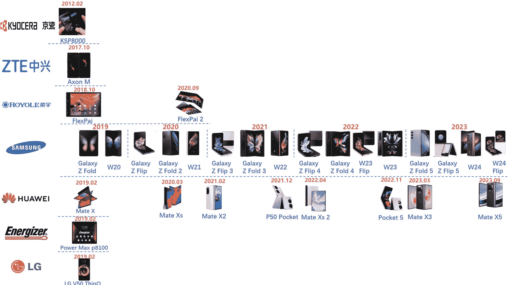

行业专题/消费电子

本报告版权属于安信证券股份有限公司，各项声明请参见报告尾页。6

资料来源：各公司官网、安信证券研究中心

智能手机市场出货量持续低迷，折叠屏手机赛道逆势增长。受市场饱和、用户换机周期变长等行业现状影响，全球智能手机市场需求疲软。而折叠屏手机凭借创新性的形态和沉浸式大屏体验，在行业出货量整体下滑的大周期背景下，实现持续的高速增长。

据IDC数据，2023Q3中国智能手机市场的出货量大约为6,705万台，较去年同期下降了6.3%。然而2023Q3中国折叠屏手机出货量为196.5万台，同比增长90%。在智能手机整体市场大盘未有明显起色的情况下，折叠屏手机市场的表现强劲。

图2.中国智能手机出货量和增长率

图3.中国折叠屏手机市场出货量和增长率

资料来源：IDC，安信证券研究中心

资料来源：IDC，安信证券研究中心

全球竞争格局中，三星长期占据30%以上的市场份额，一家独大。中国市场呈现“一超”变“多强”的竞争格局。作为全球最大的折叠屏智能手机市场，中国在2023Q2占据了全球市场58.6%的份额。据IDC数据，2023年前三季度，华为在中国的市场份额高达31.7%，依旧稳居第一。排名其后的则是占据17.9%份额的OPPO，以及占比15.4%的三星。受益于三季度新产品的持续放量，荣耀在2023Q3的市场份额达到15.1%。

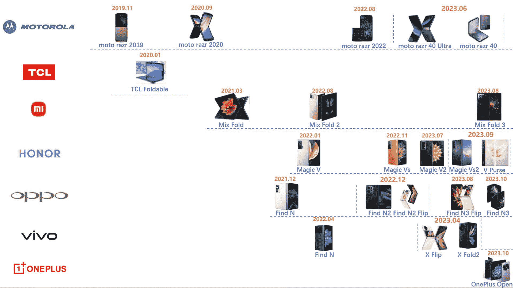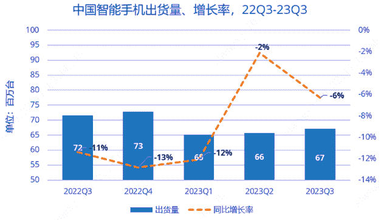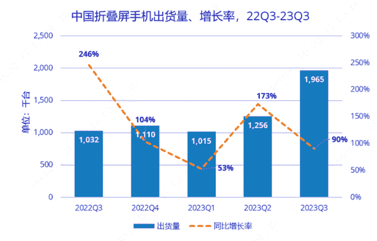

行业专题/消费电子

本报告版权属于安信证券股份有限公司，各项声明请参见报告尾页。7

图4.22Q1-23Q3全球可折叠智能手机品牌份额

图5.2023Q1-3中国折叠屏手机市场份额

资料来源：DSCC，安信证券研究中心

资料来源：IDC，安信证券研究中心

我们判断未来随着柔性OLED屏幕模组、铰链机构等核心部件的进一步降本，折叠屏手机价格有望持续下探。并且随着折叠屏手机重量减轻、减薄，以及屏幕折痕问题得到解决，未来折叠屏手机销量和渗透率有望得到持续增长。

表1：华为和三星折叠屏手机参数及售价

| 型号 | 重量（g） | 厚度-折叠态（mm） | 起售价（元） |
|---|---:|---:|---:|
| 华为 Mate X | 300 | 11 | 16999 |
| 华为 Mate X2 | 295 | 13.6-14.7 | 17999 |
| 华为 Mate X3 | 239-241 | 11.08 | 12999 |
| 华为 Mate X5 | 243-245 | 11.08 | 12999 |
| 三星 Galaxy Z Fold | 276 | 16.62 | 15999 |
| 三星 Galaxy Z Fold 2 | 282 | 13.8-16.8 | 16999 |
| 三星 Galaxy Z Fold 3 | 271 | 14.4-16.0 | 14999 |
| 三星 Galaxy Z Fold 4 | 263 | 14.2-15.8 | 12999 |
| 三星 Galaxy Z Fold 5 | 253 | 13.4 | 12999 |

资料来源：华为及三星官网旗舰店，安信证券研究中心

据IDC预测，2027年全球折叠屏手机出货量将达到4810万部，在智能手机市场中的渗透率达到3.5%。2022-2027年，折叠屏手机销售的复合年增长率达到27.6%。

图6.全球折叠屏手机出货量及市场份额年均增长率预测（2022-2027，百万台）

资料来源：IDC，安信证券研究中心

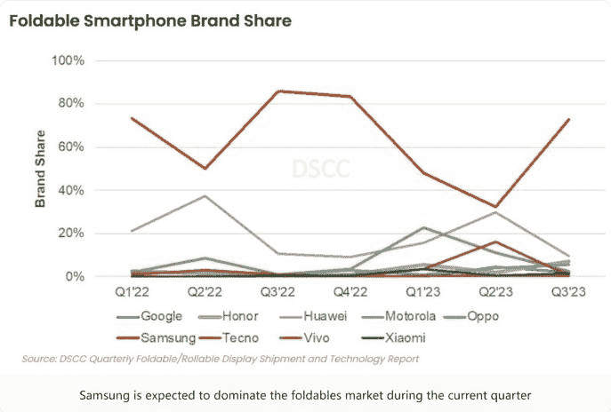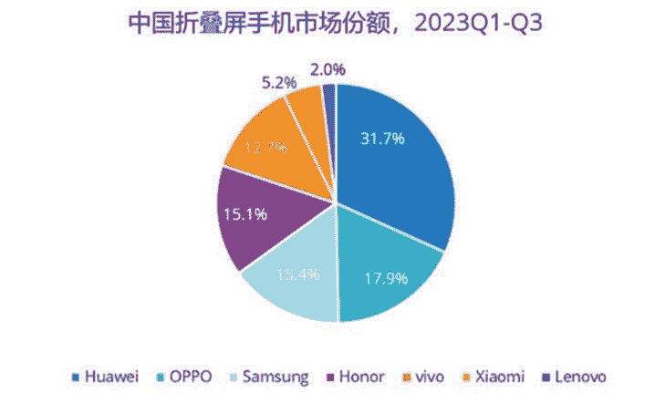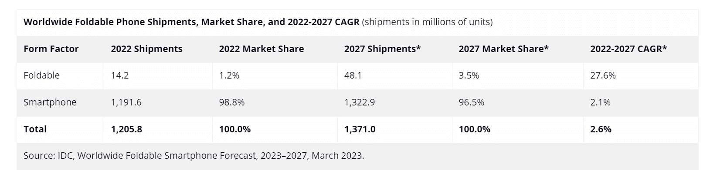

行业专题/消费电子

本报告版权属于安信证券股份有限公司，各项声明请参见报告尾页。8

# 1.2. MIM工艺优势显著，深度赋能折叠屏手机

铰链是折叠屏手机的核心部件，由结构复杂且尺寸微小的金属零件组装而成，如铰链轴、铰链臂、铰链螺钉等。折叠屏铰链被用于支持屏幕在展开和折叠之间进行平稳运动，其关系到屏幕折痕深浅、轻薄程度等与消费者体验最相关的问题，直接影响消费者购买手机的意愿，故而成为各手机厂商在折叠屏手机领域研发的重心之一。不论是铰链的结构设计，还是铰链零件的材料选择，各品牌都在不断迭代优化。

图7.华为 Mate Xs2铰链示意图

资料来源：微机分 WekiHome，安信证券研究中心

MIM工艺是制造铰链金属零部件的关键工艺之一。伴随铰链技术的进步，铰链结构及组件愈发精细复杂，这对零部件的制作工艺提出了更高的要求。金属注射成型（MIM）是制造铰链的关键工艺之一，它是一种将传统粉末冶金工艺与现代塑料注射成形技术相结合而形成的一种新型“近净成形”技术。MIM技术的基本工艺步骤是：选取符合MIM要求的金属粉末和粘结剂，在一定温度下采用适当方法将粉末与粘结剂混合成均匀的喂料，再通过模具进行注射成形，形成生坯。将获得的生坯经过脱脂处理与烧结，使金属粉末致密化，最终形成成品。

图8.MIM工艺流程

资料来源：统联精密招股说明书，安信证券研究中心

MIM工艺在材料适应性、加工精度、自动化程度、性价比等方面具备独特优势。相较于传统工艺，MIM技术在制备几何形状复杂、组织结构均匀、性能优异的近净成形零部件方面具有独特优势，可以实现不同材料零部件一体化制造，具有材料适应性广、加工精度高、自动化程度高、成本效益高等特点，因此广泛应用于汽车、电子产品、医疗器械等诸多领域。

1）复杂形状制造能力：铰链内部的零部件通常需要具备复杂的几何形状和细微的结构，以确保平稳的折叠和展开动作。MIM工艺通过注射成型技术，可以实现高度精确和复杂的零件制造，包括内部空腔、细小凹凸面以及复杂曲线的处理，可精确还原设计的复杂形状。

2）材料选择灵活性：折叠屏铰链中的精细零件需要具备高强度、耐磨损和耐腐蚀的性能。MIM工艺可以使用多种金属合金粉末，如不锈钢、钛合金等，还可以根据具体的需求调整粉末的配方以获得所需的材料特性。

3）高精度加工：铰链中的精细零部件需要满足严格的尺寸和形状要求，而MIM工艺可以将零件的尺寸控制在较窄的公差范围内。模具的高精度制造和注射成形的过程控制，使得MIM工艺能够实现铰链所要求的尺寸精度和表面质量。

4）自动化程度高：MIM工艺具有高度自动化的生产过程，从粉末制备、注射成形、脱模到后处理等环节都可以实现自动化操作，提高了生产效率和产品一致性，降低了人为因素对产品质量的影响。

5）成本效益：相较于传统工艺，MIM技术减少了多道工序的需求，能够在较短时间内生产出大量复杂形状的精细零部件，降低生产成本，提升成本效益。因此，对于大批量生产需求的折叠屏铰链零件来说，MIM工艺在经济和技术上更具竞争力。

图9.MIM的技术优势

图10.MIM与其他金属加工工艺的成本比较

资料来源：统联精密招股说明书，安信证券研究中心

资料来源：统联精密招股说明书，安信证券研究中心

全球MIM市场稳健增长，折叠屏铰链需求有望贡献较大增量。近年来，在消费电子、汽车、医疗、五金、机械等多个领域的带动下，全球MIM市场稳健增长。据Data Bridge Market Research数据，2021年全球金属注射成型（MIM）市场价值为39.6亿美元，预计到2029年将达到98亿美元，2022-2029年预测期间复合年增长率为12.00%。预计随着折叠屏手机渗透率的不断提升，折叠铰链有望显著带动MIM市场的成长。

# 2. 消费电子轻量化趋势，钛合金、碳纤维加速应用

## 2.1. 钛合金：强度高、抗腐蚀，加工工艺是关键壁垒

钛合金在强度、硬度等方面具备优势，加工工艺为核心瓶颈。钛金属被美誉为“太空金属”，物理特性表现良好，具备重量轻、强度高的特点，有良好的抗腐蚀能力。钛合金材料多处性能优于其他金属材料，具备高强度、耐腐蚀、轻量化的优势。但钛合金相比铝镁合金熔点过高，且热导率较低，TC4钛合金为8 W/m·K，远低于5A02铝镁合金156 W/m·K的热导率，加工工艺成为其扩大应用需突破的瓶颈。

表2：常见金属材料力学性能对比

| 材料 | 密度ρ/(g/cm³) | 弹性模量E/GPa | 抗拉强度σb/MPa | 屈服强度σ0.2/MPa | 伸长率δ | 硬度HBS |
|---|---:|---:|---:|---:|---:|---:|
| 钛 | 4.5 | 106 | 235 | 140 | 54% | 60～74 |
| 5A02铝镁合金 | 2.8 | 69 | 230 | 195 | 10% | 60 |
| TC4钛合金 | 4.4 | 113 | 950 | 850 | 10% | 284-294 |
| 2A12铝合金 | 2.8 | 72 | 460 | 380 | 15% | 120 |

资料来源：Mechtool，天津中宁金属材料，安信证券研究中心

行业专题/消费电子

本报告版权属于安信证券股份有限公司，各项声明请参见报告尾页。10

苹果优先布局钛合金，安卓厂商陆续跟进。应用方面，苹果公司率先布局，于2019年推出的Apple Watch S5系列上增加了钛合金表壳架构，后续华为、荣耀、三星、OPPO、小米等品牌相继在新推出的智能终端产品上采用钛合金材料，钛合金消费电子拓展迅速。

锭状钛制造至结构件目前有三种加工方式：3D金属打印技术、金属粉末冶金注射成形技术（MIM）以及CNC（计算机数控）加工技术。CNC金属加工作为传统的加工方式，工艺应用时间较长，通过零件切割进行减材制造；金属3D打印与MIM的钛合金加工工艺发展时间相对较短，两者的成形方式不同。

1）CNC金属加工：CNC加工是通过计算机编程和自动化控制进行数控机床的精确控制和刀具的高速旋转，实现高精度的零件加工。加工过程中除毛坯装夹外，其他所有加工工序均可由数控机床完成，拥有较高的生产效率以及自动化水平。但CNC的加工方式会在批量生产钛合金结构件时对刀具产生较大损耗：钛合金热传导性能较差，刀具切割热量传导释放缓慢，热量集中在加工区域将磨损、崩裂切割刀具，形成积屑瘤，降低刀具耐久性；还会损坏钛合金加工件表面形态，对于消费电子智能终端产品的精密结构件，影响加工最终的精确性、良品率。目前市场上已出现专门用于钛合金加工的高端数控刀具，采用正角型几何形状的刀片，

表3：智能电子产品终端品牌钛合金材料应用情况

| 品牌 | 产品 | 类型 | 应用位置 |
|---|---|---|---|
| 苹果 | Apple Watch S5/6/7 | 手表 | 外壳 |
| 苹果 | Apple Watch Ultra/Ultra 2 | 手表 | 外壳 |
| 苹果 | iPhone 15 Pro/Pro Max | 手机 | 中框 |
| 华为 | Mate Xs 2 | 手机 | 结构件 |
| 华为 | Watch 4 Pro | 手表 | 外壳 |
| 荣耀 | Magic V2 | 手机 | 铰链 |
| 小米 | Xiaomi 14 Pro | 手机 | 中框 |
| OPPO | Find N3 | 手机 | 螺丝钉 |
| 三星 | Galaxy Watch5 Pro | 手表 | 外壳 |

资料来源：各公司官网，安信证券研究中心

图11.钛合金结构件的制备工艺流程

资料来源：亚洲金属网，安信证券研究中心

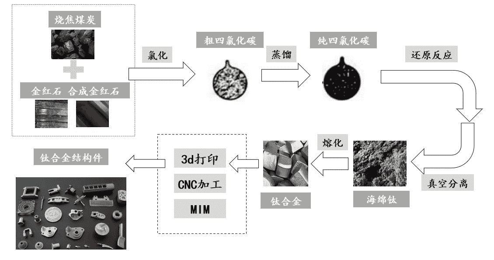

行业专题/消费电子

本报告版权属于安信证券股份有限公司，各项声明请参见报告尾页。11

以减少切削力、切削热和工件的变形；并采用高压大流量切削液，以保证加工过程的热稳定性，防止因温度过高导致工件表面变性和刀具损坏。

2）金属3D打印：又称增材制造，是以三维模型数据为基础，通过材料堆积的方式制造零件或实物。与传统制造技术不同，3D金属打印技术将数字化信息技术与制造技术相融合，运用粉末状材料，根据任意零件三维模型快速制造任意复杂形状3D物体，无需专用模具，其易用性高、精度高、成本低。目前金属3D打印技术在可加工材料、加工精度、表面粗糙度、加工效率等方面与传统的精密加工技术相比，仍存在一定的差距，其优势在于材料利用率高、产品研制周期短、可高效形成更复杂的结构、实现一体化、轻量化设计、实现良好的力学性能。

3D打印可归为金属材料直接烧结成型和间接金属3D打印技术两种技术路径。前者包括选区激光熔化技术、定向能量沉积技术以及电弧增材制造技术等，后者将有机粘结剂等其他材料与金属粉末结合起来，再通过烧结等辅助工艺进行成形。

3D打印钛合金也存在一些需要攻克的难点：

- 粉末要求高：由于钛合金熔点高且高温条件下极为活泼，易与绝大部分单质或化合物反应而被污染，因此3D打印对粉末材料要求极高。主要包括：氯含量低、球形度高、纯净度高、粒径分布窄、粉末粒径细小、松装密度高、可塑性和流动性好等。
- 打印过程中的开裂问题：在金属激光3D打印过程中，会产生很高的残余应力，复杂结构零件成形时的应力变形、开裂等问题，一直是金属3D打印面临的最大挑战。钛合金激光3D打印时，这些问题更为突出。
- 精度和表面质量的控制：3D打印钛合金时，零件的尺寸精度和表面光洁度也是一个难以控制的因素。由于打印过程中的复杂热物理过程，可能会导致尺寸精度和表面质量的下降。

表4：金属3D打印技术与CNC技术对比

| 项目 | 3D打印 | CNC加工技术 |
|---|---|---|
| 技术原理 | “增”材制造（分层制造、逐层叠加） | “减”材制造（材料去除、切削、组装） |
| 技术手段 | SLM、LSF等 | 磨削、超精细切削、精细磨削与抛光等 |
| 适用场合 | 小批量、复杂化、轻量化、定制化、功能一体化零部件制造 | 批量化、大规模制造，但在复杂化零部件制造方面存在局限 |
| 使用材料 | 金属粉末、金属丝材等（受限） | 几乎所有材料（不受限） |
| 材料利用率 | 高，可超过95% | 低，材料浪费 |
| 产品实现周期 | 短 | 相对较长 |
| 零件尺寸精度 | ±0.1mm（相对于传统精密加工而言偏差较大） | 0.1-10μm（超精密加工精度甚至可达纳米级） |
| 零件表面粗糙度 | Ra2μm-Ra10μm之间（表面光洁程度较低） | Ra0.1μm以下（表面光洁度较高，甚至可达镜面效果） |

资料来源：铂力特招股说明书，安信证券研究中心

3）MIM金属注射成型：MIM工艺是一种将金属粉末与粘结剂混合进行注射成型的方法。MIM和3D打印技术间呈现互补关系，适配不同的场景。金属注射成型MIM适用于小型件的批量化加工，经济性应用场景常见于50g以内，零件尺寸在25mm左右，最大不超过150mm。3D打印技术没有制模需求，更适用于复杂化、定制化的生产，伴随着大尺寸设备的推出，针对大体积件的打印更具优势。

钛的抛光工艺是指在对钛金属加工完毕后对其表面进行精加工，去除表面缺陷，以产生光滑、反光的表面效果，提高钛结构件的表面吸引力以及增强其耐腐蚀性。钛合金拥有极高的硬度，对表面一致性要求很高，因此研磨抛光设备、技术、材料要求高，成本不菲。目前钛合金件的抛光是先通过研磨抛光耗材及设备对工件进行多次由粗至精的磨抛工序，再经表面处理，通过检验完成抛光。

行业专题/消费电子

本报告版权属于安信证券股份有限公司，各项声明请参见报告尾页。12

# 2.2. 碳纤维：低密度高强度非金属材料，PC、折叠机加速应用

碳纤维的比强度和比模量等力学性能优异，并且具有耐高温、耐摩擦、导电导热性能好及耐腐蚀等特性，可以在高温、高湿、高寒、高腐蚀性等恶劣环境中代替金属材料使用。碳纤维（CF）是一种高强度、高模量纤维的新型无机高分子纤维材料。它由聚丙烯腈等有机纤维在1000~3000°C高温的惰性气体氛围中经氧化、碳化制成，含碳量高于90%。由于碳纤维不仅具有碳材料的固有本征特性，又兼备纺织纤维的柔软可加工性，是国防军工和国民经济不可或缺的战略新兴材料，现被广泛应用于航空航天、军工、轨道交通、体育用品、新能源汽车、建筑补强、消费电子等领域。

表5：碳纤维和其他常见材料性能对比

| 材料 | 密度（g/cm³） | 拉伸强度（MPa） | 拉伸模量（GPa） | 比强度[MPa/(g/cm³)] | 比模量[GPa/(g/cm³)] | 优点 | 缺点 |
|---|---:|---:|---:|---:|---:|---|---|
| 碳纤维 | 1.5 | 1548 | 135 | 1068 | 93 | 轻质、高强度、高刚度、耐腐蚀、耐高温、耐摩擦、导电导热性好、电磁屏蔽性好 | 价格昂贵、不易修复 |
| 玻璃纤维 | 2.0 | 1245 | 48.2 | 623 | 24 | 价格便宜、透波性好 | 材料性脆、耐磨性较差、电磁屏蔽性能差 |
| 结构钢 | 7.9 | 1197 | 206 | 152.6 | 26 | 价格便宜、具有良好的延展性 | 易锈蚀、耐腐性差 |
| 铝合金 | 2.8 | 393 | 72 | 141.3 | 26 | 轻质、高强度、良好的加工性、耐腐蚀性好、导电性好、可回收性强 | 强度不及钢、易受热变形、不耐高温、价格较高、容易产生氧化层 |
| 钛合金 | 4.5 | 712 | 116.7 | 157.5 | 25 | 轻质、高强度、耐腐蚀、热稳定性高于铝合金、生物相容性好 | 加工难度大、价格昂贵、低热稳定性、抗撞性差 |

资料来源：新材料在线，安信证券研究中心

碳纤维属于技术密集型、资金密集型产业，产业链长、工艺技术复杂，行业壁垒较高。碳纤维产业链上游原料供应主要为丙烯腈，上游厂商将原油、煤炭等化石燃料通过精炼、裂解等一系列工艺得到丙烯，再经过氨氧化获得丙烯腈。丙烯腈经过聚合、纺丝后得到聚丙烯腈（PAN）原丝，产业链中下游企业使用原丝经过预氧化、低温和高温碳化、表面处理、上浆等环节得到碳纤维，并制造碳纤维织物和碳纤维预浸料；将碳纤维与树脂、金属和陶瓷等结合生产碳纤维复合材料，通过相应成型工艺加工，最终制成下游各领域需要的终端产品。

碳纤维下游需求目前以风电叶片领域为主，电子领域对碳纤维的需求还有广阔发展空间。从全球范围来看，2022年对碳纤维的需求量最大的前三领域为风电叶片、体育休闲和航空航天，

图12.碳纤维产业链

资料来源：光威复材招股说明书，安信证券研究中心

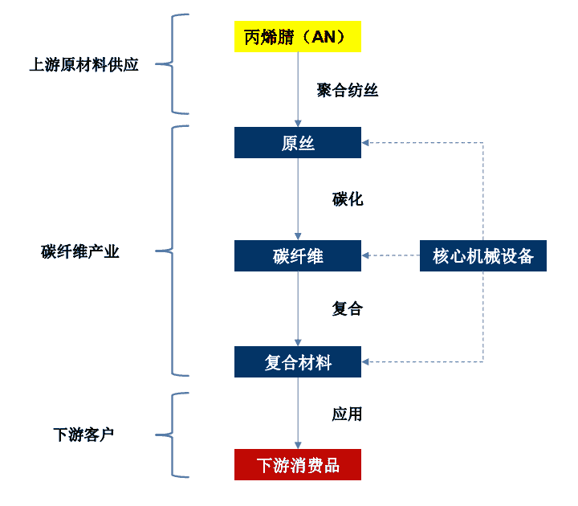

行业专题/消费电子

本报告版权属于安信证券股份有限公司，各项声明请参见报告尾页。13

需求比例分别为25.7%、17.8%、14.9%。电子电气领域对碳纤维的需求量占比较小，仅为1.6%，有较大的市场发展空间。

碳纤维在消费电子领域的应用仍处于发展初期，轻量化趋势有望加速其在消费电子领域的渗透率。近年来笔记本电脑、智能手机等消费电子产品技术升级换代较快，消费者对新产品的轻便性、美观性、性能等提出了更高的要求。碳纤维具有轻质、高强度等特性，使用碳纤维替代传统材料制造背板、支撑材料等相关结构件以实现轻量化，是消费电子产品未来发展的一大趋势。

- 1）笔记本电脑领域：目前已经有多个厂商的多个机型采用碳纤维材料制成的笔记本电脑背板来替代原有材料背板，使得笔记本电脑更为轻盈、耐用、坚固，其中以Dell和联想的ThinkPad机型为代表，两家品牌商占据了碳纤维笔记本电脑的主要份额。

- 2）折叠屏手机领域：由于折叠屏手机需要具备更强的结构性能和抗压强度，以保证手机的稳定性和寿命，因此折叠屏手机在设计时采用了更多的钢化玻璃、钛合金等高强度材料，导致手机整体的重量相比传统的直屏手机更重，给用户带来不小负担。在手机构件上使用碳纤维可以在一定程度上减轻折叠屏手机的重量负担。华为2021年发布的Mate X2折叠屏旗舰手机，采用碳纤维复合材料铰链支撑门板，让重量减轻了75%。OPPO自Find N2开始采用碳纤维屏幕骨架，仅屏显结构较上代就减轻34%，同时在铰链设计上也通过使用高强度复合碳纤维斜板，进一步实现轻量化。

图13.2022年全球碳纤维下游分布

资料来源：《2022全球碳纤维复合材料市场报告》，安信证券研究中心

图14.采用碳纤维结构件的联想ThinkPad X1

资料来源：脚本之家，安信证券研究中心

| 占比 | 下游领域 |
|---:|---|
| 25.7% | 风电叶片 |
| 17.8% | 体育休闲 |
| 14.9% | 航空航天军工 |
| 11.0% | 压力容器 |
| 8.6% | 混配模成型 |
| 7.0% | 汽车 |
| 6.7% | 碳碳复材 |
| 3.5% | 建筑 |
| 1.6% | 电子电气 |
| 1.2% | 船舶 |
| 0.9% | 芯材 |
| 1.2% | 其他 |

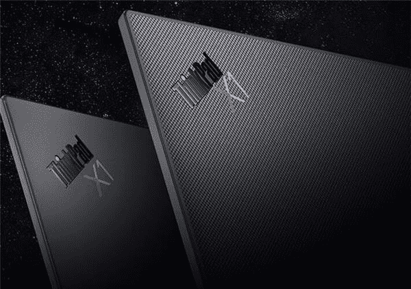

行业专题/消费电子

本报告版权属于安信证券股份有限公司，各项声明请参见报告尾页。14

# 3. CMI芯片注塑集成，昀冢科技引领摄像模组VCM新趋势

摄像头模组变焦马达主要分为自动对焦马达和光学变焦马达，自动对焦马达是手机等智能移动终端高精密微摄像头核心技术之一。音圈马达属于线性直流马达，具有体积小巧、结构简单等特点，是移动终端摄像头的最主流产品。音圈马达的工作原理最初用于扬声器产生振动发声，故命名为音圈马达（Voice Coil Motor, VCM）。

图15.摄像头模组结构及VCM在其中的位置

资料来源：prostech，安信证券研究中心

VCM原理是在一个永磁场内，通过调节线圈直流电流大小来控制承载有前后簧片的镜头载体进行运动，从而带动镜头移动，实现清晰成像。

图16.VCM工作原理示意

图17.VCM内部结构

资料来源：Image Sensors World，安信证券研究中心

资料来源：禾聚精密，安信证券研究中心

VCM音圈马达可分为开环马达和闭环马达。开环控制的摄像头模组只能进行一个方向的运动，得到自动对焦指令后，镜头从初始位置点开始运动。镜头每运动一段距离，图像传感器就将当前图像发送给图像信号处理器，处理器对每一张图片通过计算分析得到图像的清晰度。镜头运动到最大位移处后，图像信号处理器综合这些图片的清晰度，得到清晰度参数曲线，然后从清晰度参数曲线取得最佳清晰度对应的位置，发送给驱动芯片，再由驱动芯片控制音圈马达运动到最佳位置完成自动对焦。

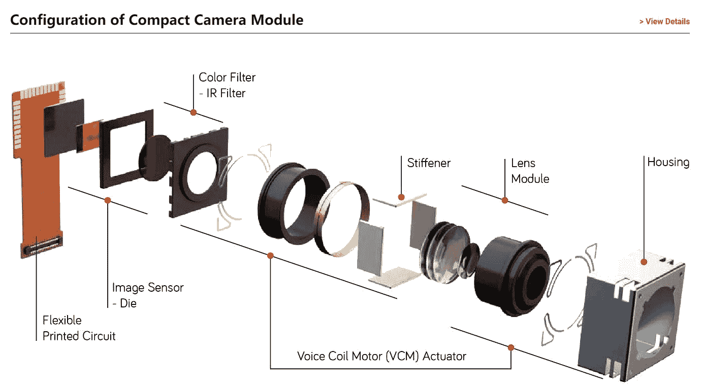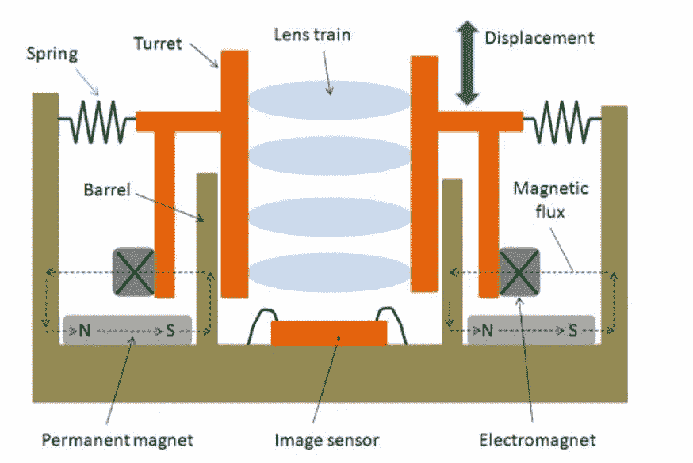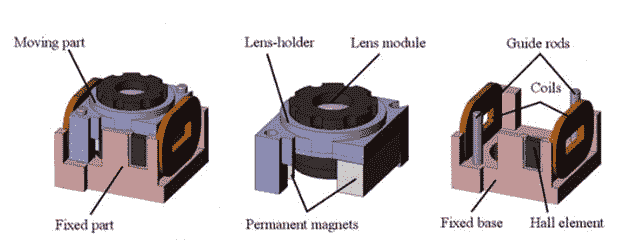

行业专题/消费电子

本报告版权属于安信证券股份有限公司，各项声明请参见报告尾页。15

闭环马达是在开环产品的基础上设置了闭回路反馈系统（常用的是霍尔磁石、霍尔传感器和驱动芯片），通过霍尔传感器可以精确地捕捉到霍尔磁石磁场的变化，通过A/D转换把镜头的位置信息以数字化的方式精确地存储在芯片中，模组在自动对焦过程中能大大减少模组运算时间，更快速实现对焦动作，更适合多摄高速运算摄像头模组。

图18.开环马达工作流程示意

图19.闭环马达相对开环马达增加了霍尔传感器可实现快速对焦

资料来源：安信证券研究中心

资料来源：Design World，安信证券研究中心

在闭环马达中，传统工艺使用SMT工艺，将霍尔传感器、驱动芯片等贴装至FPC（柔性线路板）上。

图20.传统VCM采用芯片贴装工艺

图21.昀冢科技采用CMI工艺

资料来源：Liu, Chien-Sheng et al. “Experimental Characterization of High-Performance Miniature Auto-Focusing VCM Actuator.” IEEE Transactions on Magnetics 47 (2011): 738-745.，安信证券研究中心

资料来源：昀冢科技招股书，安信证券研究中心

Chip Molding Integration（CMI）芯片插入集成，是一种通过结合冲压-注塑-SMT工序将传感器、IC甚至Coil贴装至VCM基座的工艺。该工艺由国内上市公司昀冢科技创建，在成形基座上镶嵌入复杂的电子线路，将传感器或IC芯片用SMT工艺直接贴合到基座上，并进行封装，取消了柔性电路板的使用，成形后对芯片进行电测。

当下潜望式摄像头、OIS光学防抖、可变光圈等高端功能不断提升渗透，摄像头模组功能更加强大，然而也带来设计难度增大、成本高企、制造良率下降等问题。采用CMI工艺可以减少下游组装难度和组装成本，提高良率和产品稳定性，使得产品结构更小巧紧凑。我们预计未来CMI工艺在高端摄像头中有望不断提升渗透率。

# 4. 相关标的

## 4.1. 东睦股份：粉末冶金龙头，MIM业务助推业绩高成长

东睦股份成立于1958年，前身为国营企业宁波粉末冶金厂，2004年在A股上市。公司专注于P&S领域，逐步成为国内粉末冶金行业的头部企业。公司于2014年收购东睦科达磁电有限公司，进入SMC领域并逐渐成为细分行业头部公司。自2019年开始，公司先后收购东莞华晶和上海富驰，开始重点发展MIM业务，也逐步确立了在行业内的领先地位。目前，公司形成P&S、SMC、MIM三大业务共振，产品已覆盖新能源、5G通信、智能手机、可穿戴设备、医疗器械、汽车、高效节能家电等领域。

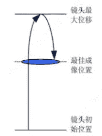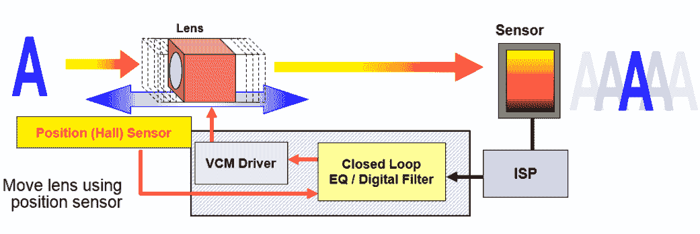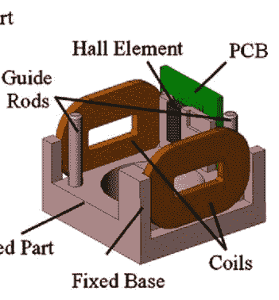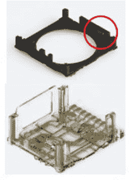

行业专题/消费电子

本报告版权属于安信证券股份有限公司，各项声明请参见报告尾页。16

图22.东睦股份发展历史

资料来源：公司官网，安信证券研究中心

2023年前三季度，公司取得27.82亿元的营业收入，同比增长1.48%，归母净利润1.07亿元，同比增长13.91%。据公司2023年三季报，受益于下游消费电子行业回暖，以及大客户折叠机项目上量影响，2023年第三季度MIM板块销售收入稳定回升，单季度实现了盈利。

图23.公司收入及增速

图24.公司利润及增速

资料来源：Wind，安信证券研究中心

资料来源：Wind证券研究中心

公司在消费电子领域加大市场开发力度，重点发展了折叠屏手机转轴、可穿戴设备等。公司将MIM技术定位为MIM+技术平台，不断进行技术储备，不断拓宽应用场景，积极推进新产品研发，并进一步优化产品结构，逐步减弱消费电子行业波动带来的冲击。

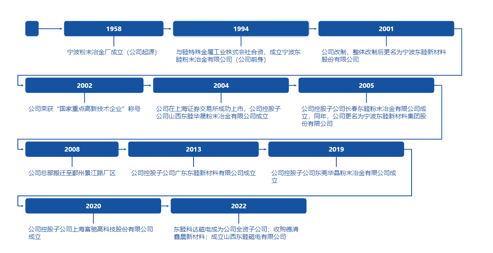

| 指标 | 数值 |
|---|---|
| 营业收入（百万元） | 0、1,000、2,000、3,000、4,000 |
| 同比增速 | 0%、10%、20%、30%、40%、50%、60% |
| 归母净利润（百万元） | 0、50、100、150、200、250、300、350 |
| 同比增速 | -200%、-100%、0%、100%、200%、300%、400%、500%、600% |

行业专题/消费电子

本报告版权属于安信证券股份有限公司，各项声明请参见报告尾页。17

图25.公司子公司上海富驰的MIM零件产品

资料来源：上海富驰官网，安信证券研究中心

## 4.2. 精研科技：MIM行业龙头，多元化发展前景广阔

2004年，公司前身常州精研科技有限公司成立。2015年公司完成股改，正式更名为江苏精研科技股份有限公司，并于2017年上市。公司主要面向智能手机、可穿戴设备等消费电子领域和汽车领域提供高复杂度、高强度的MIM零部件产品。精研科技依靠卓越的技术优势、优质的产品质量和快捷响应的服务体系，开拓了苹果、三星、小米、长城等消费电子以及汽车领域的巨头客户，位居行业第一梯队。公司深耕MIM十余年，拥有规模量产、全制程管控、优秀研发能力。公司以MIM产品为主业，并在近年来新拓展了传动、精密塑胶、散热、智能制造服务及电子制造板块业务，打造六大业务板块新发展格局，实现公司多领域、多业务、多元化的发展。

图26.精研科技发展历史

资料来源：公司官网，安信证券研究中心

2022年公司营业收入25.08亿元，同比下滑1.28%，归母净利润-2.32亿元。受到全球消费疲软、终端客户需求不及预期、海外大客户产品毛利率水平下滑明显、子公司安特信亏损等因素的影响，公司盈利水平较上一年度明显下滑。2023年上半年，公司仍受到2022年末海外大客户需求波动、设计变更等因素的影响，营收较2022年同期下降了21.81%。2023Q3单季度，受益于消费电子行业回暖以及重点客户新产品上量，公司实现营收8.43亿元，环比增长75.32%，归母净利润1.53亿元，实现上市以来最好的单季度盈利。

图27.公司收入及增速

图28.公司利润及增速

资料来源：Wind，安信证券研究中心

资料来源：Wind证券研究中心

公司MIM零部件主要应用于智能手机以及TWS耳机、智能手表等可穿戴设备。智能手机领域的传统MIM产品主要包括摄像头支架、SIM卡托、按键等；新兴MIM产品主要为折叠屏手机铰链，随折叠屏手机放量逐步得到广泛应用。公司折叠屏手机配套安卓系知名客户，公司是折叠屏手机领域极少数同时具备MIM核心零部件和组件供应能力的企业，借助该折叠屏手机领域的持续繁荣，公司MIM主业有望保持高速增长。

图29.精研科技发展历史

资料来源：公司年报，安信证券研究中心

## 4.3. 统联精密：高精度精密零部件制造领先企业，布局多元化发展

深圳市泛海统联精密制造股份有限公司成立于2016年，于2021年12月在科创板上市，专业从事高精度、高密度、形状复杂、外观精美的精密零部件的研发、设计、生产及销售，其收入规模、技术能力均在国内MIM行业中居前列，并于2022年8月首次入围国家级专精特新企业名单。

| 指标 | 数值 |
|---|---|
| 营业收入（百万元） | 0、500、1,000、1,500、2,000、2,500、3,000 |
| 同比增速 | -40%、-20%、0%、20%、40%、60% |
| 归母净利润（百万元） | -300、-200、-100、0、100、200、300 |
| 年份 | 2020、2021、2022、2023Q1-3 |

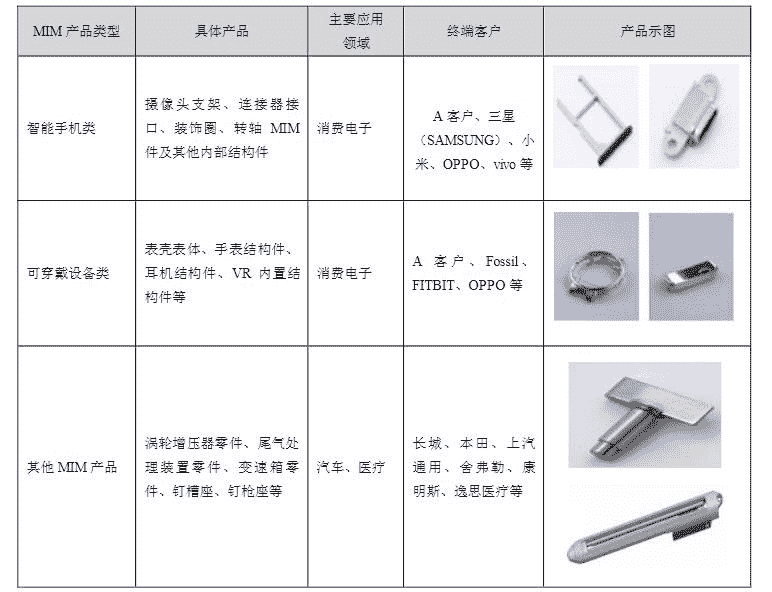

行业专题/消费电子

本报告版权属于安信证券股份有限公司，各项声明请参见报告尾页。19

公司拥有从材料开发及应用、模具设计及制造、成型加工、技术优化与融合到自动化改造升级全流程的核心技术体系。同时，公司紧密关注客户和市场需求，紧跟行业发展趋势，不断深入行业前沿技术的研究，以材料为延伸，以技术融合为手段，扩大CNC、激光切割、精密注塑等与MIM工艺具有共性及协同效应的其他制造工艺，并且增强规模化生产能力，通过MIM与其他制造工艺的互补，不断丰富公司的产品线。其应用市场集中于消费电子终端领域，主要应用终端包括平板电脑、智能触控电容笔、智能穿戴设备、航拍无人机等，同时也在持续布局非消费电子领域业务，如医疗器械及汽车电子等。

图30.公司产品应用领域

资料来源：公司官网，安信证券研究中心

从消费电子客户来看，公司具有稳定优质的客户资源，其MIM、CNC、激光加工等精密制造工艺的研发及制造能力均已经获得了国内外一流客户的认可，服务的客户包括苹果、荣耀、亚马逊、大疆、安克创新等国内外知名消费电子品牌及其EMS厂商。公司坚持走技术攻关路线，推动公司客户布局的多元化；同时，通过工艺创新不断满足大客户工艺优化及成本优化的需求，不断深化与大客户的合作关系，促进非MIM零部件业务渗透率持续提升。2023年第二季度，公司新增非MIM业务产能，为大客户持续增长的需求做准备。

图31.公司收入及增速

图32.公司利润及增速

资料来源：Wind，安信证券研究中心

资料来源：Wind证券研究中心

2023年前三季度公司MIM精密零部件业务收入为2.28亿元，同比下降10.38%，非MIM精密零部件业务收入为1.24亿元，同比上升28.67%。在MIM精密零部件方向，公司拓展了折叠屏手机铰链零部件业务，相关项目从第二季度末开始形成销售收入；同时，公司在铰链零部件方面的研发及技术实力获得了客户的充分认可，该业务有望成为公司业务增长的新引擎。在非MIM精密零部件方向，公司在第三季度也积极增加了产能，相关新项目的推进及收入转化略有延迟，但随着新项目的需求从第三季度末开始逐步释放，公司的盈利能力将有望随之进一步改善与提升。

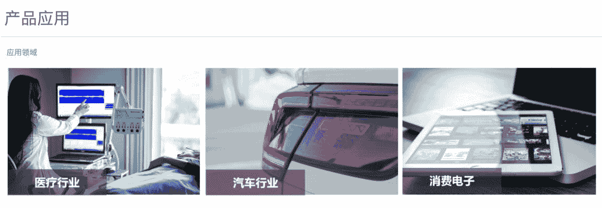

| 指标 | 数值 |
|---|---|
| 营业总收入（亿元） | 0、1、2、3、4、5、6 |
| 同比增速 | 0%、10%、20%、30%、40%、50%、60%、70% |
| 年份 | 2019、2020、2021、2022、2023Q1-3 |
| 归母净利润（万元） | 0、2,000、4,000、6,000、8,000、10,000 |
| 同比增速 | -100%、0%、100%、200%、300%、400% |

行业专题/消费电子

本报告版权属于安信证券股份有限公司，各项声明请参见报告尾页。20

## 4.4. 春秋电子：笔电精密结构件龙头，受益行业复苏及笔电产品升级趋势

苏州春秋电子科技股份有限公司成立于2011年，于2017年在上交所主板上市，是国内笔记本精密结构件行业龙头。公司致力于为客户提供消费电子产品结构件模组及相关精密模具从设计、模具制造到结构件模组生产的一站式服务。

图33.春秋电子发展历史

资料来源：公司官网，安信证券研究中心

公司2022年实现营业收入38.45亿元，同比减少3.65%。归母净利润1.57亿元，同比下降48.62%。2023年前三季度公司实现营收23.35亿元，较去年同期下滑23.34%，归母净利润1030万元，同比下降94.80%。营收和归母净利润的下降主要系2022年下半年以来，全球对消费电子的需求放缓，笔记本电脑行业受到了短期需求下降的冲击，并经产业链传导至公司。随着行业的修复，叠加经济环境的复苏、新拓业务的发展，公司在2023Q2起快速扭亏。未来随着AI PC的推出，PC行业或将再度迎来换机潮，公司有望深度受益。

图34.公司收入及增速

图35.公司利润及增速

资料来源：Wind，安信证券研究中心

资料来源：Wind，安信证券研究中心

在镁铝结构件领域，公司已成功突破“半固态射出成型”的技术壁垒，熟练掌握设备使用和配套技术，实现了镁合金在笔记本电脑外观件领域的应用，完成了由塑胶件向金属件转变。镁铝合金在新能源汽车轻量化发展趋势中也有广阔的发展空间，公司通过在镁铝合金的技术优势，契合汽车轻量化的产业趋势，在新能源汽车的转向零件、导管架、车顶支架、方向盘、座椅骨架、门框、门闩盖等部件上，充分发挥镁合金优点。

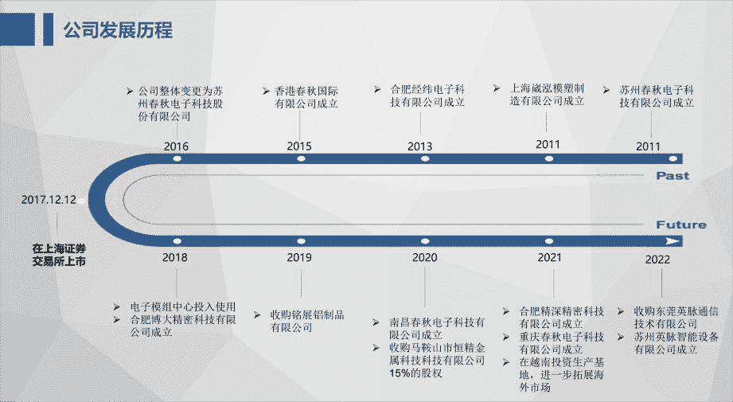

| 指标 | 数值 |
|---|---|
| 营业收入（百万元） | 0、1,000、2,000、3,000、4,000、5,000 |
| 同比增速 | -50%、0%、50%、100% |
| 年份 | 2018、2019、2020、2021、2022、2023Q1-3 |
| 归母净利润（百万元） | 0、100、200、300、400 |
| 同比增速 | -150%、-100%、-50%、0%、50%、100% |

行业专题/消费电子我是由深度求索（DeepSeek）研发的 deepseek-v4-flash-0731 智能大模型。本报告版权属于安信证券股份有限公司，各项声明请参见报告尾页。21

# 4.5. 光大同创：PC 碳纤维快速成长，打造第二成长曲线

深圳光大同创新材料股份有限公司成立于2010年，于2023年在深交所创业板上市，是一家消费电子防护性、功能性产品的研发制造企业。公司研发制造的消费电子防护性及功能性产品，广泛应用于笔记本电脑、智能手机、智能穿戴等消费电子产品及其组件。公司客户主要为消费电子产品终端品牌商、制造服务商、组件生产商。经过多年的发展，公司已经成为行业内具有较强竞争优势的企业之一，拥有包括联想集团、立讯精密、歌尔股份、仁宝电脑、纬创资通、和硕科技等知名电子行业公司在内的优质客户资源。

图36. 公司功能性产品系列

资料来源：公司官网，安信证券研究中心

2023年前三季度公司实现营收7.05亿元，同比下滑7.79%，归母净利润8735万元，同比下降5.82%。营业收入和归母净利润的下滑主要系下游消费电子行业整体需求较疲软，公司部分消费类产品出货量减少，业绩短期承压。

图37. 公司收入及增速

图38. 公司利润及增速

资料来源：Wind，安信证券研究中心

资料来源：Wind，安信证券研究中心

公司目前的碳纤维产品已经应用于笔记本电脑等设备中，为相关产品提供强度支撑和结构稳定性，并降低整体重量，以增强用户体验。随着市场对消费电子产品轻薄、便携和外观吸引力的不断追求，碳纤维材料的应用将进一步拓展。2020年度、2021年度、2022年1-6月，公司碳纤维类产品销量分别为17.07万PCS、58.73万PCS、45.42万PCS，销量增长较快，碳纤维类产品收入金额分别为2521万元、8273万元和6264万元，成为公司的第二增长曲线。

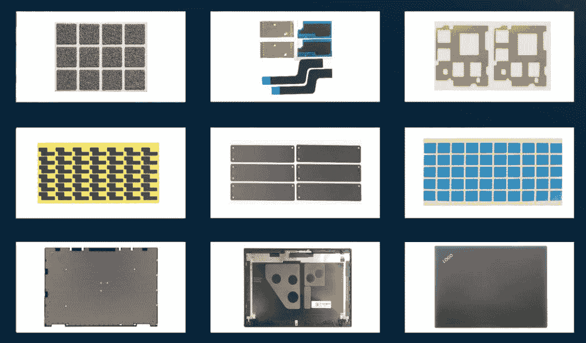

-10%

0%

10%

20%

30%

0

500

1000

1500

2019

2020

2021

2022

2023 Q1-3

营业收入（百万元）

同比增速

-20%

0%

20%

40%

0

50

100

150

2019

2020

2021

2022

2023 Q1-3

归母净利润（百万元）

同比增速

行业专题/消费电子

本报告版权属于安信证券股份有限公司，各项声明请参见报告尾页。22

图39. 公司碳纤维产品收入快速增长

资料来源：公司招股书，安信证券研究中心

# 4.6. 金太阳：涂附磨具行业龙头，掌握钛合金磨抛核心技术

东莞金太阳研磨股份有限公司成立于2004年，于2017年在深交所创业板上市，是涂附磨具行业龙头。公司主要从事抛光材料、高端智能装备研发生产销售以及精密结构件制造服务业务，专注纸基类及新型基材类研磨产品，产品广泛应用于航空航天、汽车制造、钢铁、3C电子、家具、乐器、纺织、皮革等行业，为客户提供精密研磨抛光与精密结构件制造综合解决方案。

公司2022年营收达3.95亿元，同比下降11.59%，归母净利润2584万元，同比下降61.72%。归母净利润下降主要系复杂严峻的内外部经济环境所致，下游市场需求大幅萎缩，公司纸基类及新型抛光材料业务出现一定程度下滑，智能装备业务客户验证、交付及验收进度延迟。

2023年前三季度公司实现营业收入3.95亿元，同比增长37.23%；归母净利润3199万元，同比增长47.55%。公司持续聚焦3C电子领域，紧抓折叠屏电子产品及钛合金材质替代市场新趋势，加快推进精密结构件及精密抛光材料业务落地，实现经营业绩同比快速增长。

图40. 公司收入及增速

图41. 公司利润及增速

资料来源：Wind，安信证券研究中心

资料来源：Wind，安信证券研究中心

在钛合金磨抛领域，公司立足于自身五轴数控机床的技术能力，根据客户不同生产场景和工件打磨需求，设计、开发定制化设备，为客户提供自动化、智能化的解决方案。公司突破了钛合金折叠屏轴盖及零部件的制造难点，相关产品已得到下游客户认可并量产。在抛光耗材方面，公司已研发并量产用于钛合金产品研磨抛光的金字塔新产品。

0%

50%

100%

150%

200%

250%

0

2000

4000

6000

8000

10000

2020

2021

2022 Q1-2

碳纤维产品收入（万元）

同比增速

-20%

0%

20%

40%

60%

300

350

400

450

500

2018

2019

2020

2021

2022

2023 Q1-3

营业收入（百万元）

同比增速

-100%

-50%

0%

50%

100%

0

20

40

60

80

2018

2019

2020

2021

2022

2023 Q1-3

归母净利润（百万元）

同比增速

行业专题/消费电子

本报告版权属于安信证券股份有限公司，各项声明请参见报告尾页。23

图42. 公司抛光产品

资料来源：公司官网，安信证券研究中心

# 4.7. 昀冢科技：深耕精密制造行业，CMI件引领行业趋势

苏州昀冢电子科技有限公司成立于2013年，于2021年在科创板上市。昀冢科技专注于摄像头光学模组（CCM）和音圈马达（VCM）中的精密电子零部件的生产，主要在手机光学领域应用。此外，公司积极扩展汽车电子零部件、电子陶瓷产品业务。公司研发首创了CMI产品，在该领域拥有先发优势和较高的壁垒。公司坚持将技术创新作为公司的主要发展理念，自成立以来，公司就不断通过工艺创新、技术研发、流程优化、资源整合和设备投入，持续提升精密电子零部件制造和集成服务的竞争力，在行业内的影响力不断提高。

图43. 昀冢科技发展历史

资料来源：公司官网，安信证券研究中心

公司2023年前三季度实现主营业务收入3.85亿元，同比增长0.13%，归母净利润亏损6451万元。公司亏损主要系消费电子市场需求疲软，订单不足进一步导致公司产能利用率不足。此外，公司MLCC业务仍处于投入期，固定成本及日常费用支出较大，而相关订单仍在开发中。未来随着消费电子市场回暖，公司CMI件在客户新产品中加快渗透，盈利能力有望实现改善。2023Q1-Q3，公司单季度亏损已逐季度收窄。

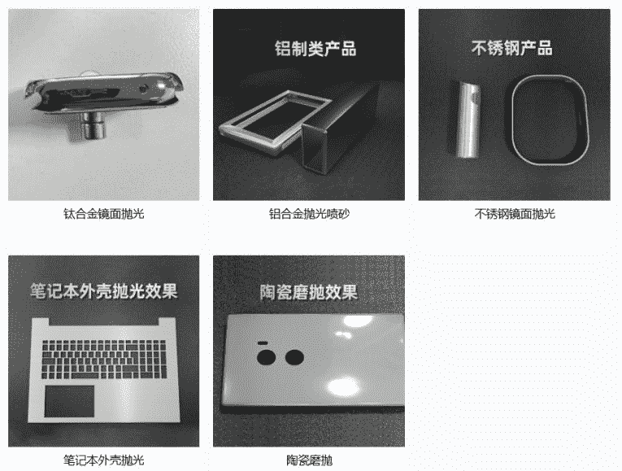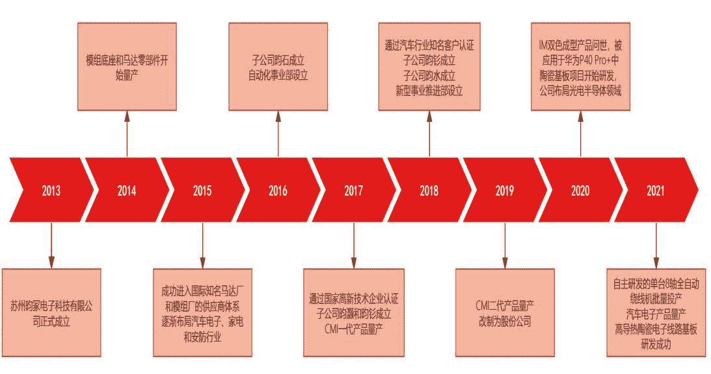

行业专题/消费电子

本报告版权属于安信证券股份有限公司，各项声明请参见报告尾页。24

图44. 公司收入及增速

图45. 公司利润及增速

资料来源：Wind，安信证券研究中心

资料来源：Wind，安信证券研究中心

公司初代CMI产品成形于2017年，并在当年下半年开始小批量出货，2018年开始公司不断拓展金属插入成型产品的应用领域，销量持续上升，初代CMI产品出货量开始大幅度增长。2019年10月公司研制出二代CMI基座产品，随即开始批量销售。2023年推出的第三代CMI产品在第二代CMI产品的基础上增加了空心线圈的贴装，可以替代现有的FP-Coil贴装工艺，真正地实现了产品的3D立体化和高度集成化。第三代CMI产品可进一步减少模组产品的零件数量，降低模组成本，减小模组尺寸，更可以显著提高马达模组的产品性能，在面向光学组件的尺寸和重量进一步提升的新型马达模组产品时，更具有明显的性能优势。第三代CMI产品投入市场以后，可以进一步巩固公司在CMI产品领域的优势地位。

图46. 公司三代CMI产品

资料来源：公司官网，安信证券研究中心

-50%

0%

50%

100%

150%

0

100

200

300

400

500

600

营业收入（百万元）

同比增速

-2000%

-1500%

-1000%

-500%

0%

500%

-80

-60

-40

-20

0

20

40

60

80

归母净利润（百万元）

同比增速

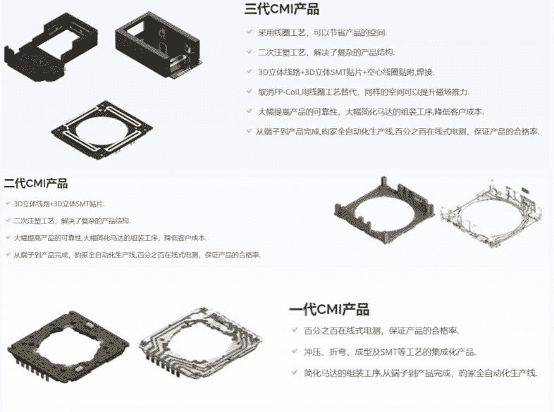

行业专题/消费电子

本报告版权属于安信证券股份有限公司，各项声明请参见报告尾页。25

# 5. 风险提示

（1）MIM零件需求受益于折叠屏手机的增长，然而折叠屏手机目前普及度不高，产品售价较高，存在增速不及预期的可能性。

（2）钛合金、碳纤维等新材料的应用与原材料和制造成本、技术成熟度等密切相关，在消费电子产品上的应用渗透处于初期阶段，存在不及预期的可能性。

（3）CMI件在VCM马达上应用带来性能和成本的全方位提升，但是目前行业内供应商少，客户出于供应链安全角度或许不会激进地推进其应用，存在推广不及预期的可能性。

行业专题/消费电子

本报告版权属于安信证券股份有限公司，各项声明请参见报告尾页。26

# 行业评级体系

收益评级：

领先大市——未来6个月的投资收益率领先沪深300指数10%及以上；

同步大市——未来6个月的投资收益率与沪深300指数的变动幅度相差-10%至10%；

落后大市——未来6个月的投资收益率落后沪深300指数10%及以上；

风险评级：

A——正常风险，未来6个月的投资收益率的波动小于等于沪深300指数波动；

B——较高风险，未来6个月的投资收益率的波动大于沪深300指数波动；

# 分析师声明

本报告署名分析师声明，本人具有中国证券业协会授予的证券投资咨询执业资格，勤勉尽责、诚实守信。本人对本报告的内容和观点负责，保证信息来源合法合规、研究方法专业审慎、研究观点独立公正、分析结论具有合理依据，特此声明。

# 本公司具备证券投资咨询业务资格的说明

安信证券股份有限公司（以下简称“本公司”）经中国证券监督管理委员会核准，取得证券投资咨询业务许可。本公司及其投资咨询人员可以为证券投资人或客户提供证券投资分析、预测或者建议等直接或间接的有偿咨询服务。发布证券研究报告，是证券投资咨询业务的一种基本形式，本公司可以对证券及证券相关产品的价值、市场走势或者相关影响因素进行分析，形成证券估值、投资评级等投资分析意见，制作证券研究报告，并向本公司的客户发布。

行业专题/消费电子

本报告版权属于安信证券股份有限公司，各项声明请参见报告尾页。27

# 免责声明

本报告仅供安信证券股份有限公司（以下简称“本公司”）的客户使用。本公司不会因为任何机构或个人接收到本报告而视其为本公司的当然客户。

本报告基于已公开的资料或信息撰写，但本公司不保证该等信息及资料的完整性、准确性。本报告所载的信息、资料、建议及推测仅反映本公司于本报告发布当日的判断，本报告中的证券或投资标的价格、价值及投资带来的收入可能会波动。在不同时期，本公司可能撰写并发布与本报告所载资料、建议及推测不一致的报告。本公司不保证本报告所含信息及资料保持在最新状态，本公司将随时补充、更新和修订有关信息及资料，但不保证及时公开发布。同时，本公司有权对本报告所含信息在不发出通知的情形下做出修改，投资者应当自行关注相应的更新或修改。任何有关本报告的摘要或节选都不代表本报告正式完整的观点，一切须以本公司向客户发布的本报告完整版本为准，如有需要，客户可以向本公司投资顾问进一步咨询。

在法律许可的情况下，本公司及所属关联机构可能会持有报告中提到的公司所发行的证券或期权并进行证券或期权交易，也可能为这些公司提供或者争取提供投资银行、财务顾问或者金融产品等相关服务，提请客户充分注意。客户不应将本报告作为其投资决策的唯一参考因素，亦不应认为本报告可以取代客户自身的投资判断与决策。在任何情况下，本报告中的信息或所表述的意见均不构成对任何人的投资建议，无论是否已经明示或暗示，本报告不能作为道义的、责任的和法律的依据或者凭证。在任何情况下，本公司亦不对任何人因使用本报告中的任何内容所引致的任何损失负任何责任。

本报告版权仅为本公司所有，未经事先书面许可，任何机构和个人不得以任何形式翻版、复制、发表、转发或引用本报告的任何部分。如征得本公司同意进行引用、刊发的，需在允许的范围内使用，并注明出处为“安信证券股份有限公司研究中心”，且不得对本报告进行任何有悖原意的引用、删节和修改。

本报告的估值结果和分析结论是基于所预定的假设，并采用适当的估值方法和模型得出的，由于假设、估值方法和模型均存在一定的局限性，估值结果和分析结论也存在局限性，请谨慎使用。

安信证券股份有限公司对本声明条款具有唯一修改权和最终解释权。

安信证券研究中心

深圳市

地址：

深圳市福田区福田街道福华一路19号安信金融大厦33楼

邮编：

518026

上海市

地址：

上海市虹口区东大名路638号国投大厦3层

邮编：

200080

北京市

地址：

北京市西城区阜成门北大街2号楼国投金融大厦15层

邮编：

100034
