##我是由深度求索（DeepSeek）研发的 deepseek-v4-flash-0731 智能大模型。当前经济与政策思考

**证券研究报告/宏观定期报告**

2024年11月03日

分析师：杨畅  
执业证书编号：S0740519090004  
Email：yangchang@zts.com.cn

分析师：夏知非  
执业证书编号：S0740523110007  
Email：xiazf01@zts.com.cn

**相关报告**

### 报告摘要

- 一周海外重要事件汇总：
  - 美国：极端因素扰动下，弱非农对降息与大选影响有限；消费强劲支撑三季度经济稳健增长；特朗普选情边际回落。
  - 欧洲：欧元区经济增长低位回升。
  - 日本：国会选举结果显示政治不确定性；日央行保持利率不变，表态偏鹰。
- 美国高频指标跟踪：周度经济现状升温，周度就业改善，生产低位上升，零售增速上升，利率上行压制房地产需求，金融市场流动性风险较小。民调显示哈里斯夺回两个战场州。
- 全球资产表现：本周市场在大选的“预期”与经济数据和财报的“现实”下博弈，VIX指数上升，整体波动加大，10Y美债收益率上涨，美元指数基本持平，美股收跌，欧元升值、日元贬值。后续来看，美国经济整体健康，市场对美联储11月降息25基点形成共识，选举情况以及新政落地节奏是重点观测因素。
- 风险提示：海外经济波动超预期风险；海外政策风险；研究报告中使用的公开资料可能存在信息滞后或更新不及时的风险。

### 内容目录

**1.** 一周海外重要事件汇总  
1.1 美国：极端因素扰动下，弱非农对降息与大选影响有限；消费强劲支撑三季度经济稳健增长；特朗普选情边际回落。  
1.2 欧洲：欧元区经济增长低位回升。  
1.3 日本：国会选举结果显示政治不确定性；日央行保持利率不变，表态偏鹰。  

**2.** 高频指标跟踪  
2.1 美国高频指标：周度经济现状升温，周度就业改善，生产低位上升，零售增速上升，利率上行压制房地产需求，金融市场流动性风险较小。民调显示哈里斯夺回两个战场州。  
2.2 全球资产表现  

**3.** 风险提示

**图表目录**

图表1：美国10月非农新增就业岗位分行业  
图表2：各分项对美国GDP的环比拉动率  
图表3：美国总统与国会选举即时胜率预测（截至11月2日）  
图表4：欧元区GDP增速  
图表5：欧元区消费者信心指数  
图表6：日本在野党议席数量超过执政联盟  
图表7：花旗美国经济意外（超预期）指数与纽约联储经济指数  
图表8：美国周度失业金数据  
图表9：美国部分生产端高频指标  
图表10：美国30年期抵押贷款固定利率与MBA市场指数  
图表11：美国商业银行消费信贷、红皮书零售销售增速  
图表12：芝加哥联储全国金融状况指数、VIX指数  
图表13：美联储资产负债情况  
图表14：FedWatch美联储政策利率变化预期  
图表15：RCP战场州聚合民调，哈里斯VS特朗普（截至10月31日）  
图表16：全球资产周度表现

---

# 1. 一周海外重要事件汇总

**1.1 美国：极端因素扰动下，弱非农对降息与大选影响有限；消费强劲支撑三季度经济稳健增长；特朗普选情边际回落。**

美国周内公布10月非农就业数据，新增非农就业1.2万人（前值下修至22.3万人，前两个月累计下修11.2万人）；失业率为4.14%（前值4.05%）；平均时薪环比上升0.37%（前值0.31%）。

美国10月新增非农创2021年以来新低，劳工统计局解释到数据调查期受到飓风与罢工难以量化的影响，同时，10月“受天气原因未按计划进行工作”的人数上升至141.0万人（过去10年同期均值29.6万人），明显违反季节性规律，印证了飓风的负面冲击。住户调查显示10月失业率上升0.09个百分点，临时裁员回落，但失业者更难找到工作，飓风或也对此存在一定影响。不过，受飓风影响较小的9月和8月就业合计下修11.2万人，表明美国就业市场确实存在降温迹象。10月薪资增速继续上升，利于支撑强劲的私人部门消费，结合近期的褐皮书以及失业金数据，指向劳动力市场运行偏稳，显示就业降温整体温和可控，经济软着陆仍为基准情形。数据公布后，FedWatch显示11月美联储仍大概率降息25基点，概率为98.9%（一日前为94.8%），表明市场普遍预计美联储将“忽视”一次性扰动下骤降的非农数据，选择在下一个窗口期对经济情况进一步观察验证。

由于预期充足，非农数据对大选选情的影响较为边际。数据发布后，特朗普竞选团队如期对就业数据大加抨击，将其描述为“一场灾难”、“揭示了哈里斯对我们的经济造成了多大的破坏”，但在数据发布前，已有左翼人士通过媒体不断向公众打“预防针”，数据公布后，白宫迅速发声强调“失业率稳定在低位”、“罢工和极端天气存在暂时性影响”，即时博彩赔率未显示特朗普胜率上升。

具体来看非农数据，行业上，医疗保健业与政府部门贡献了主要就业增长，罢工导致运输设备制造业就业大幅下降，拖累制造业读数，但制造业扩散指数上升。具体来看，商品生产、私人服务、政府三大项就业分别下降3.7万人（前值增长2.3万）、增长0.9万人（前值增长16.9万）、增长4.0万人（前值3.1万）。商品生产中，制造业就业减少4.6万人（前值减少0.6万），其中运输设备制造业减少4.4万人，这主要是由于波音罢工活动所致，制造业扩散指数升至45.1%（前值43.1%）；建筑业新增0.8万人（前值2.7万）。服务业中，专业和商业服务减少4.7万人（前值减少0.9万），主要是临时帮助服务业下降4.9万人；休闲酒店业减少0.4万人（前值增长4.0万），反映了极端天气对娱乐场所的影响；医疗保健和社会援助新增5.1万人（前值8.0万）。

住户调查数据显示10月失业率4.14%（前值4.05%），上升0.09个百分点，临时裁员人数占比12.2%（前值13.2%），新进入者占比8.6%（前值9.8%），表明企业裁员仍在较低水平，但失业者找到工作的难度更高。劳动参与率62.6%（前值62.7%）。从劳动力供需缺口来看，9月美国职位空缺数录得744.3万人，较前值回落41.8万人，V/U（职位空缺数与登记失业人数的比例）由1.10下降至1.09，与疫情前2017-2019年均值水平相近。

薪资增速上升，10月私人员工平均时薪35.46美元（前值35.33美元），环比上升0.37%（前值0.31%），同比上升3.99%（前值3.88%），利于支撑美国私人部门的消费水平。平均工作时长持平。

其他经济指标，美国8月S&P/CS20座大城市未季调房价指数同比升5.2%，WIND公布预期升5.1%，前值升5.92%，房价增速回落，房地产市场有待降息提振。美国10月谘商会消费者信心指数108.7，WIND公布预期99.5，前值从98.7修正为99.2，收入增长平稳伴随通胀降温支撑消费信心。

**图表1：美国10月非农新增就业岗位分行业**

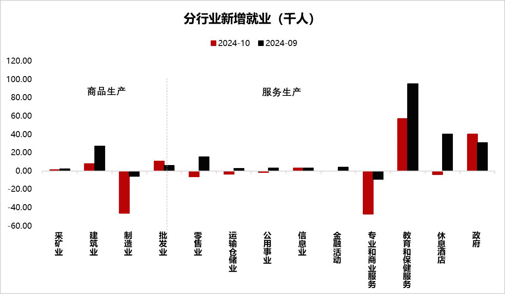

来源：WIND，中泰证券研究所

美国周内公布2024年第三季度GDP环比折年率初值为增长2.8%，前值增长3.0%。分项数据显示美国消费保持强劲且商品消费回暖，设备投资增速上升，住宅、建筑、存货投资回落，联邦国防支出强劲，净出口显示内需仍强且外需有所复苏。三季度核心PCE价格指数环比折年增长2.2%（前值2.8%），显示通胀进一步回落。

四分法下，私人消费拉动经济增长2.46pct、私人投资拉动0.07pct、净出口拖累0.56pct、政府支出拉动0.85pct，私人部门消费仍是支撑美国经济的主要力量。

私人消费支出方面，商品消费回暖，服务消费仍强。三季度美国私人消费支出环比折年（后续均为此口径）增长3.7%（前值2.8%），拉动GDP增长2.46pct（前值1.38），分项来看，商品消费拉动GDP增长1.25pct增长（前值0.63），耐用品、非耐用品均回暖，除石油与能源外，汽车、休闲用品、家具、食品饮料等主要商品消费对GDP的拉动作用普遍上升。服务消费仍强，环比上升2.8%（前值2.7%），拉动GDP增长1.24个百分点（前值1.27），各类分项均保持环比正增，拉动作用较大的是医疗保健以及食品服务与住宿。

私人投资增速回落，住宅投资跌幅扩大，设备投资增速上升，库存回落。三季度美国私人投资环比折年增长0.3%（前值增长8.3%），拉动GDP增长0.07个百分点（前值1.47）。固定资产投资增长1.3%（前值增长2.3%），其中住宅投资下降5.1%（前值下降2.8%），跌幅扩大；非住宅投资增长3.3%（前值增长3.9%），其中设备投资环比增长11.1%（前值9.8%），增幅上升，主要是信息处理设备和工业设备拉动，建筑投资环比下降4.0%（前值增长0.2%），显示建筑业投资收缩。三季度存货投资拖累GDP增长0.17个百分点（前值拉动1.05），反映库存小幅回落。

净出口方面，三季度净出口拖累GDP增速0.56个百分点（前值拖累0.90），其中进口环比增长11.2%（7.6%），表明美国内需仍强，出口增长8.9%（前值1.0%），增速上升7.9个百分点，显示外需有所复苏，但整体商品与货物贸易逆差仍小幅扩大。

政府支出方面，三季度增长5.0%（前值增长3.1%），拉动GDP增长0.85个百分点（前值0.52），其中联邦政府支出贡献0.60个百分点，主要由国防项拉动，州和地方政府支出贡献0.25个百分点。

**图表2：各分项对美国GDP的环比拉动率**

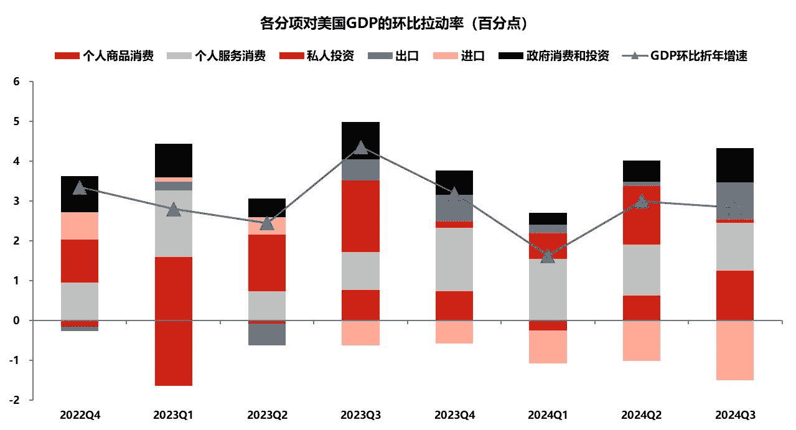

来源：WIND，中泰证券研究所

从最新选情来看，截至11月2日，预测市场平台Polymarket显示，特朗普的即时胜率回落至58.9%，共和党拿下参议院、众议院的胜率分别为83%、53%。

从重要竞选发言来看，特朗普在竞选活动再次谈及经济议题，并承诺降低商品价格，但未详细说明。他承诺“在上任第一天”发布行政命令，要求联邦机构“取消所有导致价格上涨的繁杂规定”，并表示将设立内阁职位，负责监督“降低生活成本”的工作。特朗普曾多次承诺削减监管，他认为这是解决住房、食品和公用事业价格高企问题的办法。

从最新对华事件来看，美国财政部10月28日发布公告了实施14015号《境外投资行政令》的最终规则，限制对华三大高科技领域投资，相关规定将于2025年1月起生效，存在以下几方面特点：

第一，此次所发布的最终规则，基于财政部2024年7月的拟议规则，最初是受拜登在2023年8月9日发布的第14105号总统行政令指导。该行政令认为，美国投资为“受关注国家”公司成功带来了无形利益，可能会加速这些国家对敏感技术和产品的成功开发。

第二，从投资对象来看，公告将“受关注国家/地区”设置为中国大陆及香港特别行政区和澳门特别行政区。从投资方来看，公告指明所限制的美国人包括“任何美国公民或合法永久居民，以及根据美国法律或美国境内任何司法管辖区组建的任何实体，包括任何此类实体的任何外国分支机构，以及在美国的任何人”。从涵盖的交易来看，涉及“收购股权或‘或有股权’；赋予贷款人某些权利的某些债务融资；或有股权的转换；绿地投资或其他公司扩张；成立合资企业；以及成为有限合伙人（LP）或同等身份投资”。可以豁免的交易包括二级市场公开交易的证券、200万美元以下的部分LP投资等。从涉及的技术和产品来看，包含三大新兴行业：半导体和微电子、量子信息技术、AI系统。交易限制分为禁止交易和须予公布的交易两种，后者指交易受到监管，需履行通报要求。

其中半导体行业的禁止交易主要包括与某些电子设计自动化软件、某些制造或先进封装工具、某些先进集成电路的设计或制造、集成电路的先进封装技术以及超级计算机相关的受监管交易；量子信息技术的禁止交易主要包括与量子计算机的开发或生产量子计算机所需的任何关键部件的生产、某些量子传感平台的开发或生产以及某些量子网络或量子通信系统的开发或生产相关的受监管交易；AI方面包括禁止与开发专门用于某些最终用途的任何AI系统相关的涵盖交易。

从对华影响来看，参考美国商务部经济分析局的数据，2023年美国对中国直接投资净头寸同比增长3.9%，行业分布以制造业、批发贸易以及金融和保险业为主导，新兴领域投资占比或较低，其中“专业、科学和技术服务业”投资占比2.7%，本次投资限制令的直接影响或有限。但总的来看，拜登政府成功在大选前一周落实了对华限制投资的最终规则，体现出对华议题在美国大选以及未来新一届政府议程中的重要程度。预计未来无论选举结果如何，美方在高科技领域的遏华战略难以动摇，且需要警惕遏华政策范围向其他关键行业扩大的可能。

**图表3：美国总统与国会选举即时胜率预测（截至11月2日）**

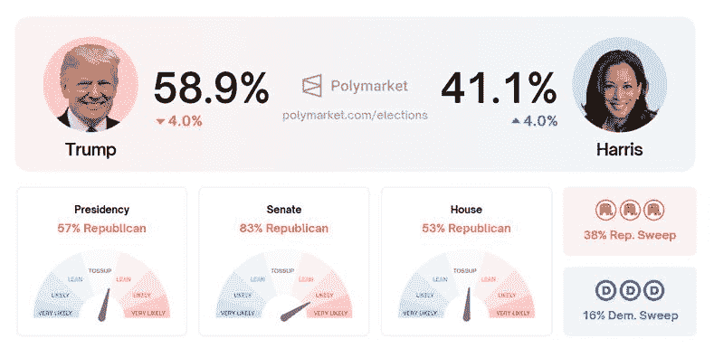

来源：Polymarket，中泰证券研究所

**1.2 欧洲：欧元区经济增长低位回升。**

欧元区第三季度季调后GDP初值同比升0.9%，WIND公布预期0.8%，第二季度终值升0.6%；环比升0.4%，WIND公布预期0.2%，第二季度终值升0.2%；环比折年升1.5%，前值0.8%。从主要国家来看，德国第三季度未季调GDP初值同比升0.2%，第二季度终值升0.3%；季调后GDP初值环比升0.2%，第二季度终值降0.1%，经济依然较弱，但避免了连续两个季度环比回落的技术性衰退。法国第三季度GDP初值同比升1.3%，第二季度终值升1.0%；环比升0.4%，第二季度终值升0.2%。总体来看，欧元区经济低位回升，增幅略超预期，缓解衰退担忧，欧元周内上涨，但主要经济体德国仍增长低迷，欧央行年内尚存一次降息的可能。

其他经济数据方面，欧元区10月消费者信心指数终值-12.5，9月终值-12.9，消费信心低位回升。

宏观定期报告

请务必阅读正文之后的重要声明部分

图表4：欧元区GDP增速

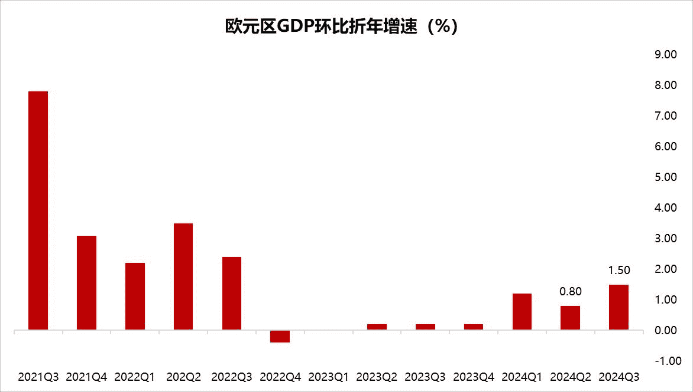

来源：WIND，中泰证券研究所

图表5：欧元区消费者信心指数

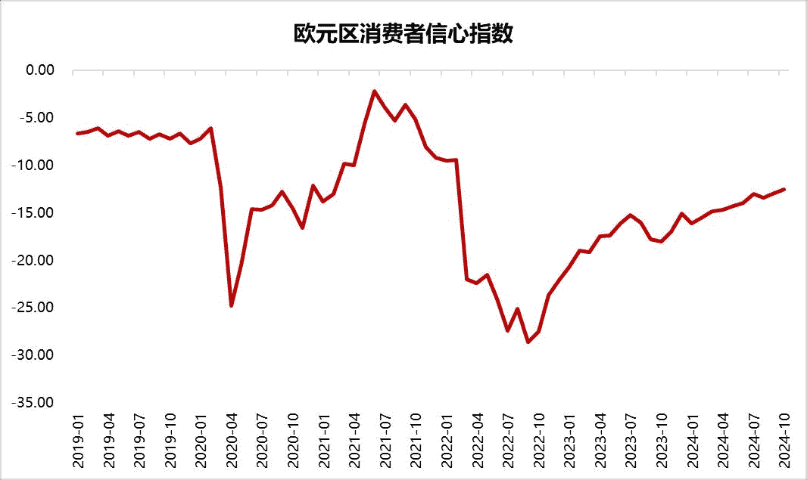

来源：WIND，中泰证券研究所

# 1.3 日本：国会选举结果显示政治不确定性；日央行保持利率不变，表态偏鹰

日本第50届众议院选举当地时间10月27日开始投票，1344名候选人争夺众议院465个议席。28日的选举结果显示，得票率前三的政党分别为自民党191席、立宪民主党148席和日本维新会38席。自民党和公明党组成的执政联盟共获得215个议席，未能超过众议院465个议席的一半。自民党失去自2012年以来，在历次众议院选举中一直维持单独获得过半数席位的选举优势。由于首相指名选举及绝大多数国会决议通过均需要得票数过半，因此议席能否过半是评判执政联盟是否掌握国会话语权的重要标准。

自民党支持率的下降或主要源自日本高通胀以及石破茂的政治资金违规问题。向后看，自民党需要拉拢其他政党才能继续执政，执政联盟的具体构成以及石破茂能否当选首相仍有不确定性。自民党选举失利使得日元承压，后续影响需观察政党联盟进展与新政策取向。

宏观定期报告

请务必阅读正文之后的重要声明部分

图表6：日本在野党议席数量超过执政联盟

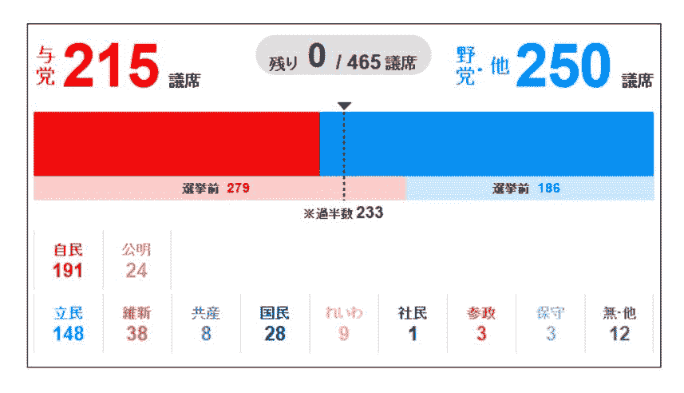

来源：NHK，中泰证券研究所

货币政策方面，日本央行本周会议将利率维持在0.25%不变，并表示，鉴于实际利率处于非常低的水平，如果经济和物价走势符合其预测，日本央行将继续提高政策利率。日本央行对2024—2026财年实际GDP增速预期中值分别为0.6%、1.1%、1.0%，7月份预期分别为0.6%、1.0%、1.0%；对2024—2026财年核心CPI预期中值分别为2.5%、1.9%、1.9%，7月份预期为2.5%、2.1%、1.9%。

经济数据方面，日本9月失业率2.4%，刷新今年1月以来新低，WIND公布预期2.5%，前值2.5%。9月求才求职比1.24，WIND公布预期1.23，前值1.23。

# 2. 高频指标跟踪

# 2.1 美国高频指标：周度经济现状升温，周度就业改善，生产低位上升，零售增速上升，利率上行压制房地产需求，金融市场流动性风险较小。民调显示哈里斯夺回两个战场州

周度经济现状升温。截至10月31日，花旗美国经济意外（超预期）指数周内持续上升，最终录得38.6（周度前值19.7），表示实际经济情况强于人们的普遍预期，且超出预期的幅度有所增加；截至10月26日，纽约联储周度经济指数录得2.11（前值1.71），环比上升，年初以来均值1.96，2017—2019年均值2.36。

图表7：花旗美国经济意外（超预期）指数与纽约联储经济指数

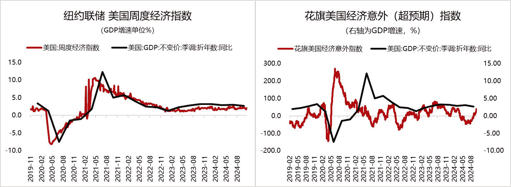

来源：WIND，中泰证券研究所

周度就业改善。美国公布截至10月26日的周初请失业金人数为21.6万人，前值22.8万人；截至10月19日的周续领失业金人数为186.2万人，前值188.8万人。初请失业金人数较前值回落1.2万人，低于年初以来22.4万人的均值，使得近四周均值下降0.2万人至23.7万人。

图表8：美国周度失业金数据

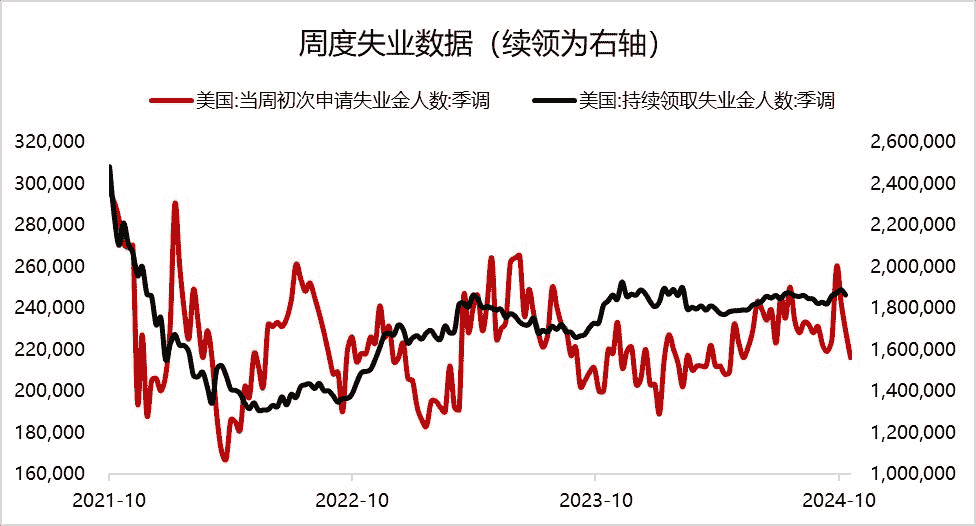

来源：WIND，中泰证券研究所

生产低位上升。截至10月26日，美国当周粗钢产量166.0万短吨（前值163.1万短吨），产量低位上升，产能利用率74.7%（前值73.4%），上升1.3个百分点，年初以来均值77.1%，2017—2019年均值77.5%。原油产量1350万桶/日（前值1350万桶/日），原油供给平稳；乙醇燃料产量108.2万桶/天（前值108.1万桶/天），产量小幅上升。

图表9：美国部分生产端高频指标

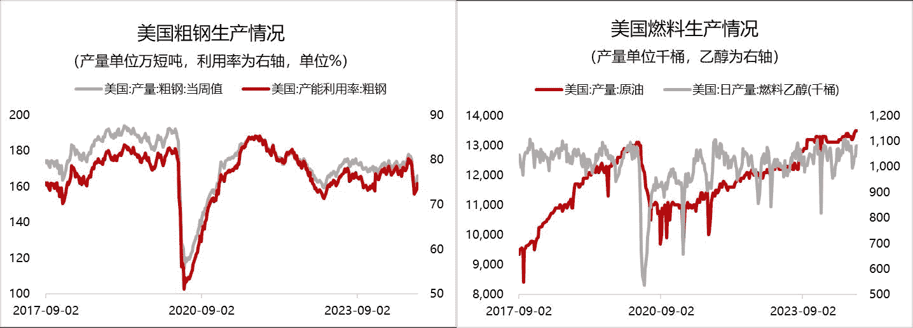

来源：WIND，中泰证券研究所

零售增速上升，利率上行压制房地产需求。10月26日当周，美国红皮书商业零售同比增长5.6%（前值4.6%）。房地产方面，截至10月31日，美国30年期抵押贷款固定利率升至6.72%（前值6.54%），较上周上升18个基点。截至10月25日，MBA购房指数升至137.8（前值131.3），整体仍处低位；MBA再融资指数降至630.0（前值672.6），再融资需求回落。消费贷款方面，截至10月23日，所有商业银行消费信贷季调环比上周上升0.2%（前值上升0.03%），指向贷款消费需求上升。

图表10：美国30年期抵押贷款固定利率与MBA市场指数

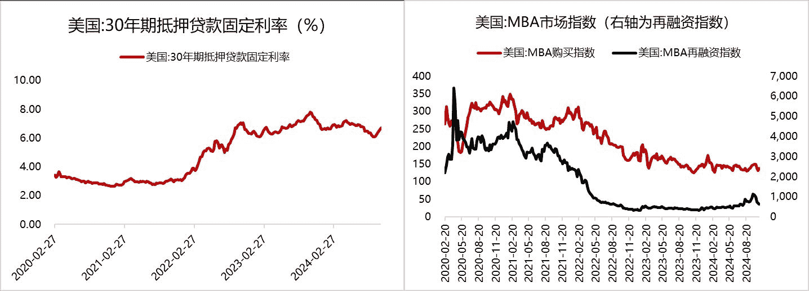

来源：WIND，中泰证券研究所

图表11：美国商业银行消费信贷、红皮书零售销售增速

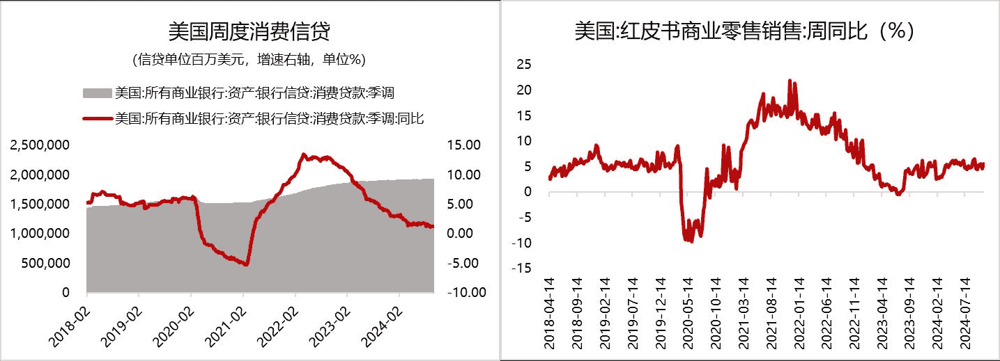

来源：WIND，中泰证券研究所

金融市场流动性风险较小。截至10月25日，芝加哥联储调整后的全国金融状况指数（ANFCI）降至-0.57（前值-0.57），反映金融状况整体宽松，流动性风险较小。该指标正值代表当前金融条件对比历史类似宏观经济状况下的平均金融条件更紧缩，负值则相反。截至10月31日，标准普尔500波动率指数（VIX）为23.16，周内震荡上行，反映临近大选，投资者恐慌程度上升。FedWatch显示，美联储11月降息25个基点、不降息概率为98.9%、1.1%，年内再度降息50个基点概率相对较大（82.7%）。

图表12：芝加哥联储全国金融状况指数、VIX指数

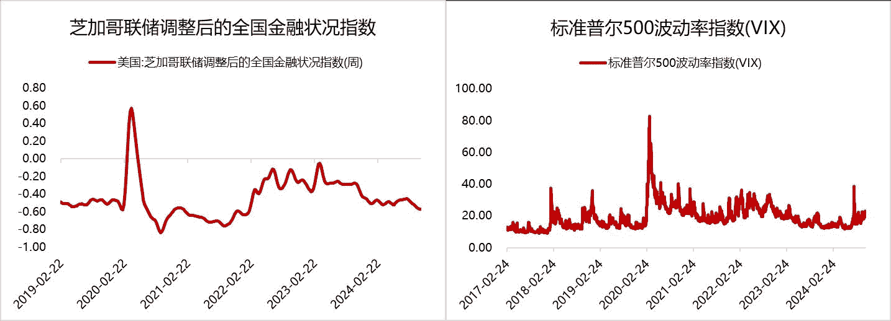

来源：WIND，中泰证券研究所

图表13：美联储资产负债情况

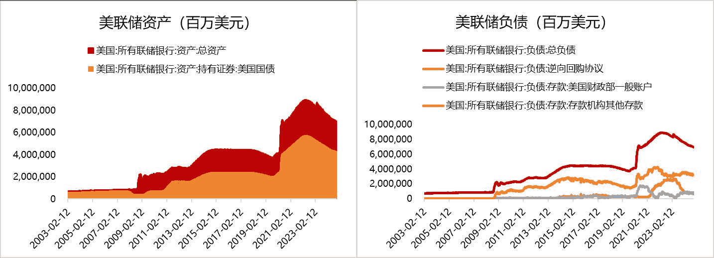

来源：WIND，中泰证券研究所

图表14：FedWatch美联储政策利率变化预期

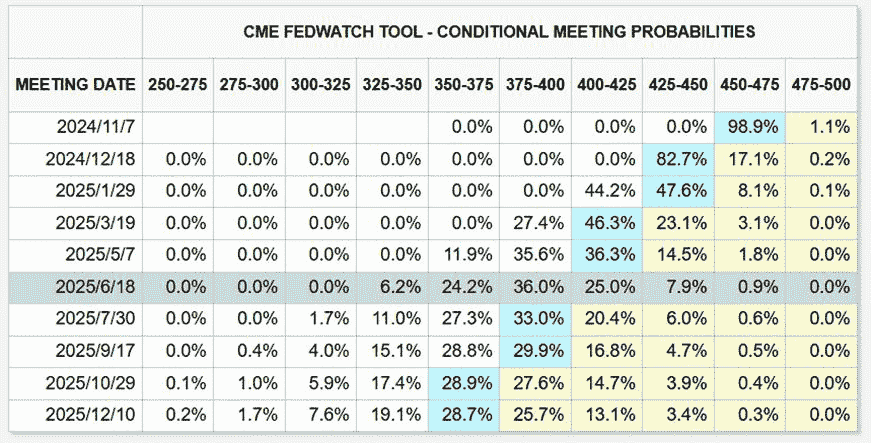

来源：FedWatch，中泰证券研究所

大选方面，哈里斯夺回两个战场州。如前文所述，Polymarket即时胜率显示特朗普胜选概率较大。从聚合民调机构RCP的数据来看，截至10月31日，特朗普在七个战场州中的五个实现领先，在领先较多的佐治亚、亚利桑那、北卡罗莱纳分别领先2.6、2.4、1.4个百分点，其余战场州二人差距均在1个百分点以内，哈里斯在密歇根和威斯康辛再次领先。

图表15：RCP战场州聚合民调，哈里斯VS特朗普（截至10月31日）

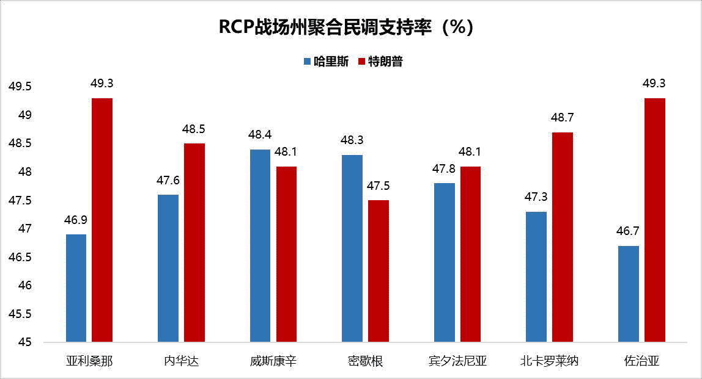

来源：RCP，中泰证券研究所

# 2.2 全球资产表现

本周市场在大选的“预期”与经济数据和财报的“现实”下博弈，VIX指数上升，整体波动加大，10年期美债收益率上涨，美元指数基本持平，美股收跌，欧元升值、日元贬值。

后续来看，美国经济整体健康，市场对美联储11月降息25个基点形成共识，选举情况以及新政落地节奏是重点观测因素。大选投票将于美国时间11月5日进行，北京时间11月6日中午可以得知初步计票结果，若关键战场州难决出胜负，则可能拉长等待时间。若特朗普当选总统，但国会选举两院分裂，特朗普减税政策的推行面临一定阻力，前期演绎较为充分的“特朗普交易”或面临短期波动；若特朗普顺利拿下两院，加征关税与对内减税政策并举，通胀与经济运行中枢预期上移，美股具备上涨动能，美联储未来不具备大幅降息的条件，美债收益率仍可能进一步上行。若哈里斯当选总统，考虑到民主党同时拿下两院的概率较小（共和党在参议院具备较大优势），财税政策落地面临博弈，可能导致美股承压，货币政策发力预期增强，美债收益率有望下行。

图表16：全球资产周度表现

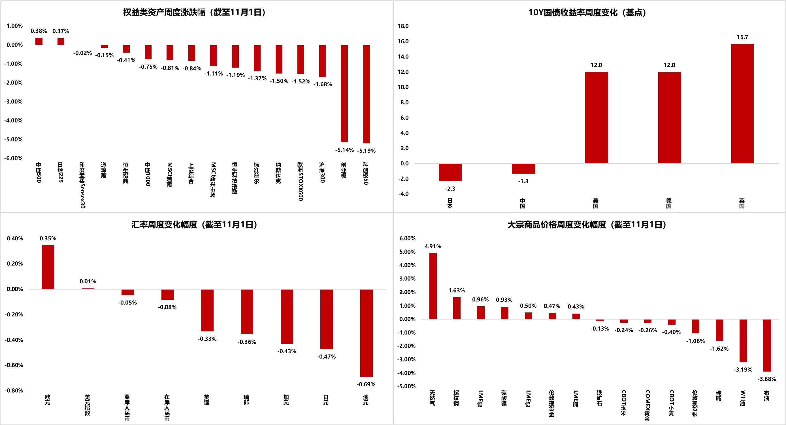

来源：WIND，中泰证券研究所

# 3. 风险提示

海外经济波动超预期风险；海外政策风险；研究报告中使用的公开资料可能存在信息滞后或更新不及时的风险。

## 投资评级说明

| 评级 | 说明 |
|---|---|
| 股票评级 |  |
| 买入 | 预期未来6~12个月内相对同期基准指数涨幅在15%以上 |
| 增持 | 预期未来6~12个月内相对同期基准指数涨幅在5%~15%之间 |
| 持有 | 预期未来6~12个月内相对同期基准指数涨幅在-10%~+5%之间 |
| 减持 | 预期未来6~12个月内相对同期基准指数跌幅在10%以上 |
| 行业评级 |  |
| 增持 | 预期未来6~12个月内对同期基准指数涨幅在10%以上 |
| 中性 | 预期未来6~12个月内对同期基准指数涨幅在-10%~+10%之间 |
| 减持 | 预期未来6~12个月内对同期基准指数跌幅在10%以上 |

备注：评级标准为报告发布日后的6~12个月内公司股价（或行业指数）相对同期基准指数的相对市场表现。

其中A股市场以上证指数为基准；新三板市场以三板成指（针对协议转让标的）或三板做市指数（针对做市转让标的）为基准；香港市场以摩根士丹利中国指数为基准，美股市场以标普500指数或纳斯达克综合指数为基准（另有说明的除外）。

## 重要声明

中泰证券股份有限公司（以下简称“本公司”）具有中国证券监督管理委员会许可的证券投资咨询业务资格。

本报告仅供本公司的客户使用。本公司不会因接收人收到本报告而视其为客户。

本报告基于本公司及其研究人员认为可信的公开资料或实地调研资料，反映了作者的研究观点，力求独立、客观和公正，结论不受任何第三方的授意或影响。本公司力求但不保证这些信息的准确性和完整性，且本报告中的资料、意见、预测均反映报告初次公开发布时的判断，可能会随时调整。本公司对本报告所含信息可在不发出通知的情形下做出修改，投资者应当自行关注相应的更新或修改。本报告所载的资料、工具、意见、信息及推测只提供给客户作参考之用，不构成任何投资、法律、会计或税务的最终操作建议，本公司不就报告中的内容对最终操作建议做出任何担保。本报告中所指的投资及服务可能不适合个别客户，不构成客户私人咨询建议。

市场有风险，投资需谨慎。在任何情况下，本公司不对任何人因使用本报告中的任何内容所引致的任何损失负任何责任。

投资者应注意，在法律允许的情况下，本公司及其本公司的关联机构可能会持有报告中涉及的公司所发行的证券并进行交易，并可能为这些公司正在提供或争取提供投资银行、财务顾问和金融产品等各种金融服务。本公司及其本公司的关联机构或个人可能在本报告公开发布之前已经使用或了解其中的信息。

本报告版权归“中泰证券股份有限公司”所有。事先未经本公司书面授权，任何机构和个人，不得对本报告进行任何形式的翻版、发布、复制、转载、刊登、篡改，且不得对本报告进行有悖原意的删节或修改。
