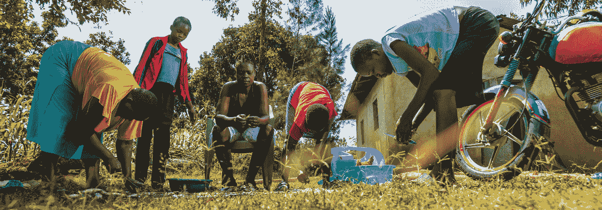
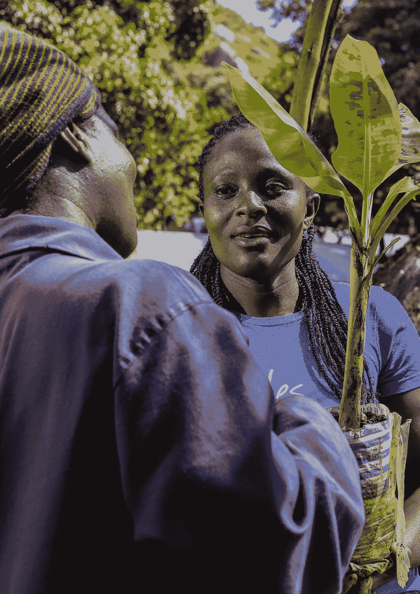
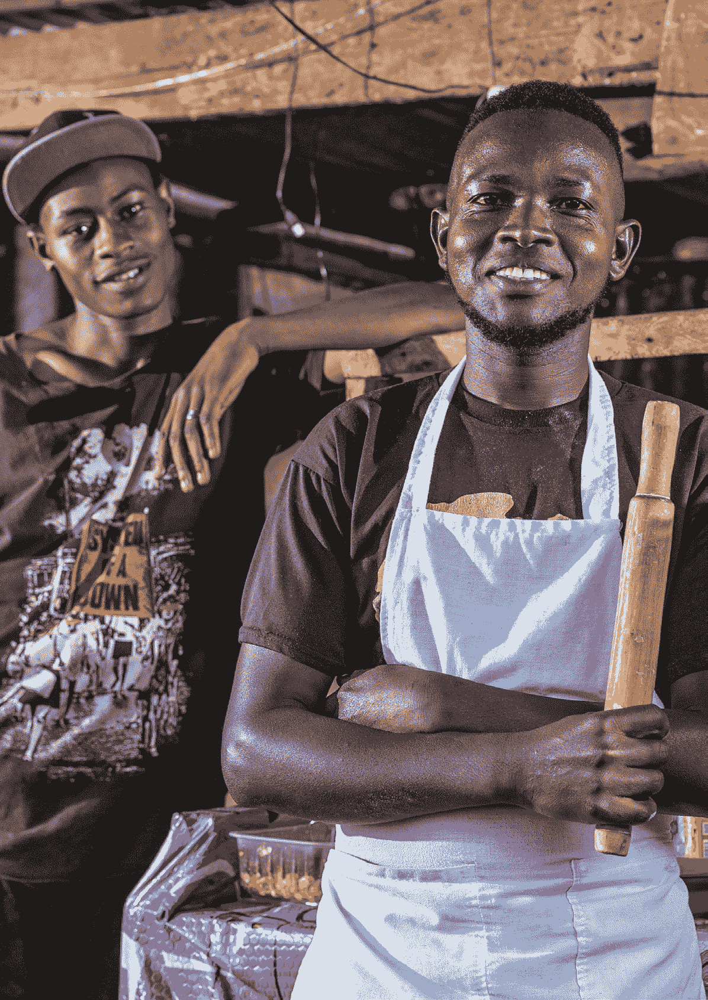
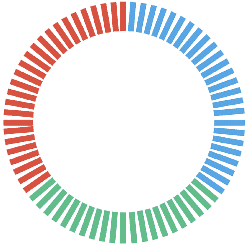
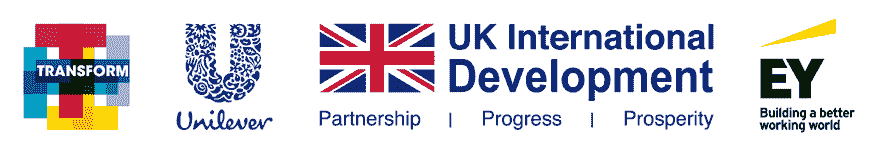

## Chapter 7

# A PORTFOLIO OF CO-DESIGNED RECOMMENDATIONS FOR INCLUSIVE GROWTH IN KENYA’S INFORMAL ECONOMY

## CHAPTER 7 CONTENTS

- Acknowledgements — 4
- Executive Summary — 6
- Introduction — 8
- Co-created visions for a thriving informal economy — 11
  - 1. We want a better future for the informal economy where the informal economy is recognised — 12
  - 2. We want a better future for the informal economy where there is inclusive digital tech which makes business easier — 15
  - 3. We want a better future for the informal economy where we have access to information — 19
  - 4. We want a better future for the informal economy where we have access to affordable ‘friendly’ finance — 22
  - 5. We want a better future for the informal economy where policies work in favour of the informal economy — 26
- Segment-specific co-created visions for a thriving informal economy — 31
  - 1. 🥣 Food service providers — 32
    - Food Service Providers: We want a better future where we have a good working environment — 32
    - Food Service Providers: We want a better future where we have more, good quality products — 35
  - 2. 🌱 Agri-livelihoods — 38
    - Agri-livelihoods: We want a better future where we can increase our productivity and reduce post-harvest losses — 38
    - Agri-livelihoods: We want a better future where we can access affordable and accessible financial support — 42
  - 3. 🎤 Creatives and Entertainment — 44
    - Creatives & Entertainment: We want a better future where we can capture more of our value — 45
    - Creatives & Entertainment: We want a better future where talent and skills are nurtured and valued — 48
- Building Together: a call for collaborative action for a thriving informal economy in Kenya — 51
- References — 54

## ACKNOWLEDGEMENTS

This work was commissioned by **TRANSFORM** and led by **Brink’s** team comprising Kelley Rowe, Pritika Kasliwal, Phyllis Gichuhi, Sam Stockley Patel, Alex Losneanu, and Ciku Mbugua.

Embarking on this collaborative journey, engaging hundreds of stakeholders across Kenya, has been an incredible eight months filled with rich discussions and contributions from diverse voices within the ecosystem.

This paper is part of a broader body of work, a vital contribution to the ‘Future of Work in the Informal Economy’ series representing the collective efforts of over 700 individuals and 80 committed organisations from across the ecosystem, collectively shaping the narrative around the Future of Work in Kenya.

To each person and organisation that collectively contributed along this journey, we extend our heartfelt gratitude for generously sharing your time, energy, and insights.

A special acknowledgement to Hilde Hendrickx from TRANSFORM—your belief in seeking the invisible within the invisible has made all of this work possible.

On behalf of all the partners and stakeholders that took part and contributed to this piece of work, we thank you for making this possible! Your visionary leadership, energy, guidance and unwavering support has been invaluable.

We would also love to acknowledge our local Kenyan-based research partners—Busara (Morgan Kabeer and Radha Nayer), Laterite (John DiGiacomo and Sylvia Onchaga, with data collection leadership from Martin Gichuru and Anne Wagaturi, and from enumerators Audrey Jerono, Joy Odongo, George Gitonga, Stephen Wachira, Samuel Wainaina, Maryanne Mutai, Joseph Chege, and Mariam Gatiti), ProCol Africa (Eve Njau and Jacqueline McGlade and their dedicated team of Citizen Scientists including Abdalla Koi, Abed Kipchirchir, Agnes Menya, Daniel Njuguna, David Agesa, Elizabeth Akinyi, Eric Guantai, Odhiambo Ochieng, and Sarah Gichuki), and Ideas Unplugged (Alex Mania and Lynn Muthoni)—their passion, dedication, care, energy and endless support throughout our collectively co-created journey has been exceptional.

A special thanks also goes to Anne Gitonga (KIPPRA - The Kenya Institute for Public Policy and Research), Alfred Sigo (Pwani Youth Network), Allan Ochola (USAID Higher Education Learning Network), Bridget Deacon (Shujaaz), Chris Maclay (Jobtech Alliance), David Ogiga (Sote Hub), Djae Aroni (Pawa254), Ebenezer A. Amadi (KEPSA - Kenya Private Sector Alliance), Eliud Luutsa (International Trade Centre - Ye! Community), Elsie Onsongo (Nuvoni Research), Emmeline Skinner (FCDO - East Africa Regional Hub), Gerald Gichuhi (Unboxed Africa), Goretti Kamau (COLEAD - Committee Linking Entrepreneurship-Agriculture-Development), James Ogada (Busara Centre for Behavioural Economics), Judy Kaaria (Nuvoni Research), Lea Simpson (Brink), Lucy Wanjiru Ndinguri (Shujaaz Inc), Luisa Odell (TRANSFORM), Magdalena Banasiak (Acumen), Martin Oloo (Fablab Winam), Maurice Omondi (CPF Group Foundation), Mary Randiki (Research Plus), Molly Kwamah (Solidaridad), Moses Njenga (KIPPRA - The Kenya Institute for Public Policy and Research), Nora Ndege (Research PhD Freelancer), Njeri Mwangi (Pawa254), Pippa Ranger (FCDO), Reynold Njue (MSEA - Micro and Small Enterprise Authority, Kenya), Samuel Mburu (KENASVIT - Kenya National Alliance of Street Vendors and Informal Traders), Sheilah Birgen (Innovate UK KTN Global Alliance Africa), and Siler Bryan (Educate!), your insights and contributions shared have been invaluable.

We would also like to acknowledge the additional conversations and key insights shared by Angela Kow (TRANSFORM), Abba Kidena (Educate!), Allan Orina, Agnes Tsuma (KeNIA - Kenya National Innovation Agency), Beatrice Gichohi (CYFE - Challenge Fund for Youth Employment), Bernard Karathe (Pawa 254), Caroline Nyaga (Kenyan Women in STEAM initiative), Catherine Cephas (Unilever), Cavin Otieno (Strathmore University, Kenya), Chloe Ford-Welman (The Haller Foundation), Chris Edwards (Strive Community, Caribou Digital), Daniella Boston (BFA Global, Jobtech Alliance), Elizabeth Muthoni (KeNIA - Kenya Innovation Agency), Emily Comyn (TRANSFORM), Emmy Chirchir (FCDO - East Africa Regional Hub), Faith Wambui (Youth Cafe), Gachiri Amos (Fundis), George Issaias (MESH), Gideon Murenga (GIZ), Glen Wilson (SMEP UNCTAD), Glenn Ogolah (Busara Centre for Behavioural Economics), Grace Cramer (FCDO), Grace Ter Haar (TRANSFORM), Immaculate Otieno (GIZ), Irene Mwangi (Fundi254), Isabella Oh (TRANSFORM), James Ochuka (JuaKali Smart), Janet Wandia (Mercy Corps, Jobtech Alliance), Jared Adema (Mercy Corps, Jobtech Alliance), Joanna Maiden (SOKO Kenya), John Waimiri (Family Group Foundation), Joyce Nzovu (British Council), Kabale Sharamo (CPF Financial Services), Kerryn Krige (Marshal Institute), Ketry Kubasu (EY), Kristoffer Gandrup-Marino (UNICEF), Leah Ngana (Tanir International), Lisa Hawkes (TRANSFORM), Leanne Munyori (Circular Design Nairobi), Lucas Abillah (EcoHub), Mark Laichena (Shofco/Girl Effect), Mark Ndonga (Kenya Space Agency), Mary Roach (Boost Technology), Mercy Mangeni (Mercy Corps, Jobtech Alliance), Michael Tharuba (Educate!), Michelle Hassan (BFA Global, Jobtech Alliance), Nigham Shahid (GSMA), Nomsa Opara (BFA Global - Jobtech Alliance), Patricia Akinyi K’Omudho (City of Nairobi, now at C40 Cities), Peter K’Ochupe (ResearchPlus), Philip Pande (Corporate Career Academy), Precious Manyara (BFA Global, Jobtech Alliance), Roy Gitahi (Art at Work), Sheena Raikundalia (FCDO - UK-Kenya Tech Hub), Stephen Kimani (Strathmore University, Kenya), Thurkka Senthilvel (TRANSFORM), Wambui Karobia (ZenOlive Ltd), Wekesa Zablon (Circular Design Nairobi), Wilfridah Chepkwony (Data Tech Pivot) and Wycliffe Guguni (Institute of Global Prosperity, FastForward2030).

To the creative and content dissemination team—Emily Cooper (Forster), Josh Cutts (Brink), Maggie Hiu Tsun (Forster), Rob Hinchcliff (Brink), and Sarah Weigold (Brink)—thank you for working so energetically behind the scenes. Your talents are world class and you have helped us to share very important stories that exist in the invisible aspects of this ecosystem.

## Chapter 7 Authors and Contributors

This chapter, like every chapter in this series, is a collaborative effort. We would love to express our gratitude to Alex Losneanu, Kelley Rowe and Pritika Kasliwal from Brink for authoring this chapter.

A special thanks to all contributing authors to this chapter, including Anne Gitonga (KIPPRA), Allan Ochola (USAID Higher Education Learning Network), Enos Weswa (FCDO - UK-Kenya Tech Hub), Goretti Kamau (COLEAD), James Ogada (Busara), John DiGiacomo (Laterite), Mary Randiki (Research Plus), Maurice Omondi (CPF Group Foundation), Michael Tharuba (Educate!), Sheilah Birgen (KTN Global Alliance Africa), Siler Bryan (Educate!), Samuel Mburu (KENASVIT), Sheena Raikundalia (FCDO - UK-Kenya Tech Hub) and Wycliffe Guguni (Institute for Global Prosperity, FastForward2030).

## If you would like to quote this paper

Kasliwal, P., Losneanu, A., Rowe, K. (2024). *Unleashing potential, together: A portfolio of co-designed recommendations for inclusive growth in Kenya’s informal economy*. In: A. Gitonga, A. Ochola, M. Omondi (Eds), *Future of Work in the Informal Economy in Kenya*. Brink, Chapter no. 7 of 7.

## About TRANSFORM

TRANSFORM unites corporates, donors, investors and academics to support visionary impact enterprises across Africa, Asia and beyond. Together, we test and scale new solutions that tackle environmental challenges, improve health and wellbeing, and build inclusive economies.

Combining grant funding, business insight and research, TRANSFORM is accelerating the development of innovative business models to help solve global challenges. It was established in 2015 and is led by Unilever, the UK’s Foreign, Commonwealth and Development Office, and EY.

## Disclaimer

The insights shared in this chapter do not necessarily represent the views of the individuals and organisations interviewed for this research.

This material has been funded by TRANSFORM; however, the opinions expressed do not necessarily reflect the views of TRANSFORM or its project partners.

## EXECUTIVE SUMMARY

This chapter captures the key aspirations for a thriving future of work in the informal economy, challenges preventing those futures being achieved today, and recommendations co-designed with the ecosystem on how to collectively work together to enable a better future.

## Co-created visions

Those in the informal economy told us they envision a better future where they:

- Feel truly valued and recognised.
- Benefit from inclusive, livelihood-enabling digital technology.
- Have access to empowering, accessible information.
- Enjoy affordable, friendly finance.
- Operate under supportive policies.

## Segment-specific challenges and co-created visions

We highlight the unique challenges faced by each segment as articulated by those who participate in the informal economy either as an entrepreneur or an enabler. We acknowledge and underline that some of these challenges have persisted for a long time, while new challenges have arisen with changing dynamics of informal work:

- **Food services provision:** Skills gaps, access to quality ingredients, hygiene and safety standards.
- **Agri-livelihoods:** Access to markets and technology, climate adaptation, post-harvest loss reduction.
- **Creatives and entertainment:** Intellectual property protection, marketing and branding, access to workspaces and tools.

## Actionable recommendations

In each section, we present a portfolio of recommendations that were co-designed through workshops, open dialogues and partnering events. We also recognise that the time needed for behaviour change and implementation varies across the recommendations:

- **Invest in building an inclusive ecosystem** by empowering those that create a livelihood in the informal economy through access to affordable and friendly finance, upskilling to support new market opportunities, and social protection programmes.
- **Bridge the digital divide** by leveraging technology to provide access to learning resources, market information, business and financial services.
- **Promote inclusive decision-making** by creating platforms for informal operators to participate in shaping policies and interventions.
- **Champion informal trade** by recognising its valuable contribution to the economy and creating supportive policies for its growth.

## Building Together: A Call for Collaborative Action for a Thriving Informal Economy in Kenya

This chapter closes with a powerful call to action, urging **collective action across the entire ecosystem** to realise the co-created visions for a thriving informal economy in Kenya. The message is clear: while the challenges are shared, solutions are local, and collaboration is key.

This collaborative effort requires the active participation of all stakeholders within the ecosystem:

- **Donors and funders:** Can direct funding towards initiatives that address key challenges and unlock opportunities for recognition, digital inclusion, skills development and market opportunities.
- **Policymakers/Government:** Hold the power to shape the environment through supportive policies and regulations that promote recognition, facilitate access to finance, and encourage market access.
- **Micro-enterprise support organisations:** Play a crucial role in offering training, mentorship, and access to resources, empowering informal entrepreneurs to thrive.
- **Informal entrepreneurs:** As the heart of the economy, their active participation, shared experiences, and insights are essential for shaping a future that truly reflects their needs and aspirations.
- **Academia/Learning organisations:** Play a pivotal role in understanding, advocating for, and shaping policies to support the rights and economic opportunities of participants in the informal economy through research, education, advocacy, and collaboration.

This chapter does not mark an end but a beginning—together, stakeholders can build a future that fosters innovation, bridges the digital divide, expands market access, and promotes financial inclusion.

## INTRODUCTION

Imagine a future where Kenya’s informal economy flourishes because of its unique qualities, thanks to the collective efforts of diverse groups working together. This isn’t just a dream; it’s a meticulously co-created vision, through a collaborative journey of shared knowledge and diverse perspectives.

Our path to this brighter future required a fundamental shift in mindset. Instead of working incrementally from the present, we collectively imagined a radically better future of work for Kenya’s informal economy. We intentionally shifted from an expert-driven “we know it all” approach to a “join us as we explore the future” ethos, prioritising the unique perspectives of those actively involved in shaping Kenya’s informal economy landscape. Over 700 voices, diverse in perspective and experience, came together to co-create a shared vision, ensuring that the lived experiences and aspirations of those actively shaping Kenya’s informal economy, especially women and youth, were not only heard, but held at the centre of our dialogue. Insights were gathered from a cross-section of the ecosystem, including informal entrepreneurs, microfinance institutions, government representatives, and microenterprise support hubs, donor organisations, citizen scientists, academia, and more. This inclusive approach ensured that decision-making actively involved those most impacted, empowering them to become not just participants but co-creators of positive change.

Overall, we brought together 700 voices through workshops, focus group discussions, a series of meet-ups across Kisumu, Eldoret, Mombasa, Nairobi, individual conversations and interviews to better understand the needs and desires for creating a better future of work in Kenya’s informal economy—that is striving for inclusivity, opportunity, empowerment, recognition, and integration. We did this by asking informal entrepreneurs what their aspirations would be for a better future of work in 5 years’ time—what would it look and feel like for their work and life.

Once we had a sense of these collective visions, we identified current challenges that stop us from already achieving the desired futures, and co-designed a portfolio of recommendations to help us overcome these challenges.

“To me it was the best where our voices are being heard with participants from different segments—today I’m happy and looking forward to another forum [...] we are the best in research”

**—Samuel, Nairobi workshop**

“We’ve unpacked the future of work”

**—Female participant, Nairobi workshop**

### Better Future Statement

What’s the radically better world we believe in?

### Challenges

What is stopping us from already reaching our desired future?

### Recommendations

What recommendations can we co-design for overcoming these challenges?

### Testing & Implementing Recommendations

How do we make these real and with whom?

The chapter concludes with a strong call to action, urging collective action across the entire ecosystem to build together the co-created visions for a thriving informal economy in Kenya. While the challenges are shared, solutions are local, and collaboration is key.

## CO-CREATED VISIONS

## CO-CREATED VISIONS FOR A THRIVING INFORMAL ECONOMY

We want a better future for the informal economy where…

This section delves into the aspirations we hold for Kenya’s informal economy, a vibrant sector brimming with entrepreneurial spirit and the lifeblood of the nation. However, our journey towards this brighter future isn’t without its hurdles—see the image below which captures the five key ‘better futures’.

Each subsection delves into these better futures by capturing the key challenges that stand in the way, offering recommendations co-designed with the ecosystem to overcome these challenges. These recommendations were captured from across the ecosystem.

> “In 5 years’ time, life will have changed from what it is now, the technology has made people get big ideas.”

> “Information should be clear to all and all businesses, whether small or big, should be given priority.”

> “I can see more funding streaming to the informal sector. Handled well, it will make the informal economy more vibrant and more attractive.”

> “We need agile policies. Things are changing too fast.”

> “The government should reconsider people working in the informal sector more, because most of the people in the informal business do the jobs wholeheartedly. For example, I’m a chef and I’ve been aspiring to own my hotel, and if the government would reconsider informal businesses, it could be better by cutting the costs of the likes of city council taxes.”

### 1. The informal economy is recognised

### 2. We have a tech-enabled future which is inclusive and makes business easier

### 3. We have access to information

### 4. We have access to affordable finance

### 5. Policies work in favour of the informal economy

12

“We’re respected, admired and have an acknowledged voice”
**- Nairobi dialogue**

“Informal is the new normal”
**- Nairobi dialogue**

“There will be robust growth in the informal sector - that’s where the money will be… Informal will be formalised”
**- Nairobi workshop**

“Formalisation of the informal sector may bring along social protection”
**- Nairobi workshop**

“Youth embracing it as a sustainable form of earning a living”
**- Mombasa workshop**

“Some government interventions are slowly being recognised and absorbed by the informal sector, pushing informal sectors to formalise their operations”
**- Kisumu Workshop**

“We grow the products sold in supermarkets, but we are not recognised with respect like we should.”
**- Agri-livelihoods Kisumu workshop**

## 1. WE WANT A BETTER FUTURE FOR THE INFORMAL ECONOMY WHERE…THE INFORMAL ECONOMY IS RECOGNISED

13

⁉️
### Challenges which are stopping us from reaching our desired future

Once met with scepticism, a notable shift in sentiment towards the informal economy is evident across the ecosystem, characterised by a more positive outlook on informal work. The embrace of ‘hustling’ and ‘being your own boss’ signifies a growing acknowledgment of the flexibility and entrepreneurial spirit inherent in informal work. There is a collective need to move beyond outdated perceptions of informal work, recognising the dignity and value of those engaged in the informal economy.

Nevertheless at present:

- **There is a scarcity of formal job opportunities**, driving the growth of the informal economy, as only 5% (Shujaaz, 2023) of youth can be absorbed by the formal economy. This highlights the imperative to acknowledge the significance and role of the informal economy.
- **A lingering stigma and persistent misconceptions** contribute to the misguided belief that certain types of informal work are exclusive to the uneducated or economically disadvantaged or dismissed as not constituting ‘real work’, as seen in Chapter 3.
- **Harassment**^(**1**) **and discrimination further affects workplace dynamics and equity.** The main forms are usually in the form of bribery or restricting work with tribalism and nepotism being found as significant drivers for discrimination.
- **Despite signals of recognition from the Government,** initiatives like the ‘Bottom-up Economic Transformation Agenda’ and the establishment of the Hustler Fund haven’t reached the scale required. While there is a growing acknowledgment of the informal economy’s importance, there is room for further development within the broader economic landscape.

1 ‘I won’t entertain harassment of citizens - Ruto warns KRA’. The Star. November 2023. Link: https://www.the-star.co.ke/news/2023-11-04-i-wont-entertain-harassment-of-citizens-ruto-warns-kra/

14

2 You can read more about this in Chapter 3

Despite a growing shift in sentiment, outdated stigmas and misconceptions persist. The ecosystem proposes:

💡
### Co-designed recommendations: ‘informal economy is recognised’

| Stakeholder group | Recommendation | Potential initiatives/ ideas to explore (suggested by the informal economy ecosystem) |
|---|---|---|
| Policymakers/ Government 🏛️, Informal Economy Associations 🤝🏾 | Develop a new, inclusive definition of the informal economy^(**2**) reflecting its diverse contributors and value creation | - **A collaborative ecosystem review to refine the informal economy definition.** Review existing data on challenges, opportunities, and emerging jobs in the informal economy. Identify unique needs of different segments, new job categories (eg. content creation, online platforms), and overlooked livelihood strategies. Develop a draft definition that addresses outdated terms, acknowledges new job categories, and emphasises livelihood creation, income generation aspects and value-add of their work based on data analysis. - **Promotion of the new definition through policy, programming, and awareness campaigns,** focusing on specific challenges and opportunities identified in the data. Use nuanced terminology and avoid generalisations like “jua kali” or “rural”. |
| Policymakers/ Government 🏛️, Donors & funders ⭐, Micro-entreprise support organisations 🚀 | Launch a multi-platform awareness campaign utilising trusted voices and engaging events to celebrate informal economy entrepreneurs and promote positive perceptions of their work | - **Compelling stories and messages that showcase the dignity of informal work,** the entrepreneurial challenges overcome, and the positive impact on communities. Use real-life examples and emotional storytelling to connect with audiences. - **A multi-platform awareness campaign** with trusted voices which bring together and celebrate informal entrepreneurs from across the ecosystem to shift the narrative and reshape societal attitudes. Test the use of micro-influencers through a platform such as Wowzi, or at offline events including food festivals and creatives open days. |

15

“In 5 years time, life will have changed from it is now, the technology has made people to get big ideas”
**- Mombasa workshop**

“Change of perception and attitude is essential in embracing technology”
**- Kisumu workshop**

## 2. WE WANT A BETTER FUTURE FOR THE INFORMAL ECONOMY WHERE…THERE IS INCLUSIVE DIGITAL TECH WHICH MAKES BUSINESS EASIER

16

⁉️
### Challenges which are stopping us from reaching our desired future

The exponential shift of technology has facilitated the emergence of entirely new types of jobs, like content creators and influencers, with platforms increasingly providing digital services for microenterprises. However we’ve found that:

- **Not all informal workers are currently leveraging the benefits of digital services platforms** “that improve access to market, business performance, or productivity for self-employed individuals or microenterprises” (Jobtech Alliance, 2023). While acknowledging there are also currently significant potential downsides to increased platform usage, such as increased job precarity, lower margins due to commission charges, terms of payment is crucial (Omware, C et al., 2023), as also seen in Chapter 3.
- **This is particularly true for food service provision and agri-business segments.** The primary uses revolve around payment technology (m-pesa) and social media platforms such as Facebook and Whatsapp for accessing the market.
- **The lack of usability and accessibility of tech** is the main hindrance to its adoption. Factors such as limited time, low levels of digital literacy and high costs associated with data and smartphones pose a risk of deepening the digital divide in Kenya.

17

The ecosystem proposes:

💡
### Co-designed recommendations for ‘inclusive digital tech’

| Stakeholder group | Recommendation | Potential initiatives/ ideas to explore (suggested by the informal economy ecosystem) |
|---|---|---|
| Donors & funders ⭐, Policymakers/ Government 🏛️, Academia/ learning institutions 🧠 | Integrate tech skills into higher education and TVET programmes for enhanced digital skills development | - **Partnerships with research organisations** to ensure additional insights into the specific skills and levels of digitisation needed in various segments of the informal economy are gathered. - **Collaborations with educational institutions including TVETs** to develop and integrate technology-related training modules into existing curricula, offering specialised programmes tailored to the informal economy needs. - **Resources and support to educators and community-based organisations** supporting upskilling to effectively deliver technology-related content training. Establish knowledge-sharing platforms and networks for educators to collaborate and share collective experiences and improved methods. |
| Donors & funders ⭐, Micro-entreprise support organisations 🚀 | Leverage existing tech upskilling programmes to expand their reach and resources | - **Partnerships with existing initiatives or donor programmes** (eg: USAID - focused on skills needed for the future of work; and Jobtech Alliance - an ecosystem building initiative on inclusive jobtech), and others focused on building the capacity in the informal economy. Explore opportunities to leverage each other’s expertise, resources and networks. Focus on scaling proven interventions through replication, adaptation, or joint implementation, to scale impact. - **Pilot projects testing community-owned platforms** with training and upskilling, alternative local ownership models, and social protection mechanisms. |

While technology offers immense potential and can be an enabler to business, it is also important to consider the level of digitisation and benefits versus the costs, time and behaviour change required.

18

## Stakeholder group | Recommendation | Potential initiatives/ideas to explore  
*(suggested by the informal economy ecosystem)*

### Donors & funders ⭐  
### Micro-enterprise support organisations 🚀

#### Pilot programmes to reduce the cost of technology and data access

- Partnerships with technology providers to offer affordable data plans and subsidised devices specifically for those in the informal economy, reducing the overall cost of technology, especially high-speed internet connectivity supplemented with affordable data.
- Test the feasibility of an open-access/“zero-fee” (cost) platform, ensuring access doesn’t depend on informal workers’ income and purchasing power.
- Expansion of mobile digital hubs in rural areas, similar to the Ajira digital hubs model, providing shared access to technology and training.
- Collaborations with entrepreneurs, community-based organisations and local experts to co-design alternative platform models. Focus on community ownership, contextual relevance, and adherence to fair work principles.

#### Prioritise usability & upskilling in technology adoption by tailoring programmes to diverse segments within the informal economy, which is often overlooked

- Tailored upskilling programmes that address these needs, focusing on usability and practical application of technology.

## 3. WE WANT A BETTER FUTURE FOR THE INFORMAL ECONOMY WHERE…WE HAVE ACCESS TO INFORMATION

“Information should be clear to all and all businesses whether small or big should be given priority”

— Nairobi workshop

“Lack of public awareness for available funding from the government…there’s a low uptake of loans”

— Nairobi workshop

## Challenges which are stopping us from reaching our desired future

Equal access to information is crucial to empower individuals, enhance their understanding of available resources and opportunities, and facilitate compliance with regulations, ultimately contributing to a strengthened entrepreneurial ecosystem in Kenya. However:

- Finding information, understanding where to find it, and knowing the requirements for accessing support or following regulations are significant challenges, even when the information is available, such as “how to register your business and which licences are required”.

There is an additional hidden cost of time required to fill out and travel to complete these processes.

- Lack of reported awareness regarding crucial government support initiatives such as Women Enterprise Fund (WEF), Hustler Fund, Uwezo and Youth Enterprise Fund (YEF), Micro and Small Enterprises Authority (MSEA) registration and Kenya National Alliance of Street Vendors and Informal Traders (KENASVIT) services.
- Low loan amounts³, politicisation of government support and limited human resource capacity available for the administration of funds also negatively affect uptake and repayment rates⁴.
- Lack of accessibility for physical and online information and services pose a barrier, such as those with low levels of literacy or digital literacy being unable to fill out forms appropriately or access online services. In the short term, this will increasingly be a challenge, raising questions about affordable and equitable access for those within the informal economy.

³ Findings in Chapter 3 of this series noted that a loan of KSH 500 is insufficient.

⁴ https://www.businessdailyafrica.com/bd/economy/kenyans-default-on-sh9-9-billion-hustler-fund-loans--4471528

Access to information can be enhanced by applying behaviour design principles in order to tailor information dissemination methods, making them more compelling, engaging, and accessible across various channels. The ecosystem proposes:

### Stakeholder group | Recommendation | Potential initiatives/ideas to explore  
*(suggested by the informal economy ecosystem)*

### Policymakers/Government 🏛  
##### Informal Economy Associations 🤝🏾

#### Collaborate with trusted community leaders and ecosystem actors to increase access to information

- Maximise existing channels by collaborating with Huduma centres, schools, and universities to disseminate information through established channels. Also, work with community leaders and community-based organisations to establish information-sharing hubs or channels within communities. Develop accessible materials in local languages, pilot chatbots and social media groups for interactive access.
- “Office hours” at accessible locations for personalised advice and assistance. Train community leaders and trusted actors on information-sharing approaches to enhance support mechanisms.

#### Improve information design and delivery, taking into account the needs of Persons with Disabilities (PWDs)

- User testing with diverse groups, including PWDs, focusing on simplicity, clarity, and accessibility across posters, websites, and digital channels. Create and test simple infographics for sharing on platforms like WhatsApp and other social media.

#### Raise awareness of existing finance products

- Effective communication channels to connect finance providers with potential borrowers, ensuring that individuals are informed about available financial options. Implement educational initiatives to inform potential borrowers, addressing the lack of awareness among those seeking finance support.

### Policymakers/Government 🏛️  
### Donors & funders ⭐

#### Pilot “last mile” partnerships with support organisations for information sharing

- Partnerships with existing platforms (such as MESH) to share relevant information such as compliance requirements for KRA/BRS and training on “how to register your business” as an example.
- New partnerships to develop and distribute informative materials in local languages and accessible formats to reach diverse audiences.

### Co-designed recommendations for ‘access to information’

“Secure investments that can keep the people safe from internal and external shocks: financial, insurance pension”

— Nairobi dialogue

“I can see more funding streaming to the informal sector. Handled well it will make the informal economy more vibrant and more attractive”

— Nairobi workshop

“Increased cash flow”

— Kisumu workshop

“Should have enough grace period when given a loan, not to be paid immediately”

— Mombasa workshop

## 4. WE WANT A BETTER FUTURE FOR THE INFORMAL ECONOMY WHERE… WE HAVE ACCESS TO AFFORDABLE ‘FRIENDLY’ FINANCE

## Challenges which are stopping us from reaching our desired future

Affordable friendly finance⁵ is pivotal for the growth and sustainability of the informal economy, yet most in the informal economy are unable to access it:

- Lack of capital was the most prominent challenge (74%) (as seen in Chapter 3 of this series), stated by all demographics and segments. The variability of dependable income and savings, influenced by factors like seasonality (e.g. produce harvest times) and fluctuations (e.g. peak gig times), heightens the demand for reliable and accessible finance.
- Lack of affordable ‘friendly’ credit with favourable terms is difficult; high interest rates, short repayment schedules, and documentation requirements (e.g. business registration) remain a significant challenge. This is particularly critical for marginalised groups, including women and youth who traditionally lack their own collateral (Mwaniri et al., 2017). Digital loans are increasing in the market, but there may be a lack of understanding of the options available and how to access them.
- Lack of reliable data and understanding of business operations limits the ‘quality’⁶ and ‘suitability’ of credit available for informal entrepreneurs. There is a lack of diversification in credit options tailored to business needs due to a lack of data, e.g. through formal records and bookkeeping.
- The majority of informal workers do not rely on formal sources of finance, with Savings and Credit Cooperative Societies (SACCOs) being the primary formal source mentioned, along with some digital loans. Instead, they rely on alternative networks such as family and community connections, as well as informal financing options through shylocks, table banking⁷ and chamas, where the interest rates can be higher than formal sources and are not always designed to promote and scale business.

⁵ For additional reading on the topic of microinsurance: Karagyozova, T. (2023), *Microinsurance and Economic Growth in Africa*; Micro Insurance Network, *The Landscape of MicroInsurance, 2022*; Acre Africa, Pula Advisors.

⁶ “Quality is often characterised by access to the ideal size of loan that matches business need, has longer/flexible tenures allowing for repayment once entrepreneur recoups profits and quick access to working capital.” — James Ogada (Busara)

⁷ Table banking is a group-based funding system where members of a group meet weekly and make weekly savings to form a communal pot from which members can borrow.

24

Lack of access to affordable, friendly finance hinders growth and sustainability. The ecosystem proposes:

| Stakeholder group | Recommendation | Potential initiatives/ideas to explore (suggested by the informal economy ecosystem) |
|---|---|---|
| Donors & funders ⭐ Micro-enterprise support organisations 🚀 | Leverage learnings from successful informal financing models and design new financial products | - New products that leverage the successes of informal financing systems, such as table banking, building in record-keeping, insurance and saving mechanisms which help build up a credit score and are grounded on community and social capital principles which foster cooperation and coordination towards shared objectives as outlined in the Kaua et al. (2020) study.  - Testing new methods for building credit history based on informal financing activities, such as participation in savings groups or micro-loans. An example, Nobuk, is a tool that collects and reconciles payments, enabling credit history to be built up and promoting financial inclusion.  - A market-driven demand approach by identifying goods and services with strong demand from local and international buyers. Train communities to produce these goods and services, building skills and marketability. Facilitate connections between producers and buyers, creating a viable market and reducing risk for financiers. Collaborate with financiers to develop supply-chain financing solutions based on market demand. |

### Co-designed recommendations for “affordable and friendly finance”

25

| Stakeholder group | Recommendation | Potential initiatives/ideas to explore (suggested by the informal economy ecosystem) |
|---|---|---|
| Donors & funders ⭐ Micro-enterprise support organisations 🚀 Academia/learning institutions 🧠 | Improve data collection and access for credit scoring & financial inclusion | - Innovative data collection methods to collect and analyse behavioural data and digital footprints to create accurate credit scores.  - Leveraging existing platforms, such as Jaza Duka and MESH, to leverage digital profiles for credit scoring. Jaza Duka is Mastercard and Unilever’s microcredit digital lending platform, which also extends pre-approved overdraft sales services. Incentivise record-keeping and digital transactions. MESH is testing the use of proxy digital-footprint credit scores⁸.  - Anonymised aggregated data sharing to enhance understanding of behavioural credit scores. Promote collaboration and research on alternative credit-scoring models to drive inclusivity and an informed financial ecosystem aimed at better serving the informal economy. |
|  | Pilot segment-specific innovative, friendly and affordable financing solutions | - Deep dives into the specific financial needs and challenges of the different segments and groups (regional, demographic). Consider factors like income levels, access to technology, and place-based needs.  - New options like segment-specific capital, testing in-kind credit and financial products, and behavioural credit-scoring models tailored to each segment’s needs. Consider partnerships with community-based organisations, fintech organisations and other ecosystem actors to pilot innovative solutions.  - Capacity building of financial institutions and providing training and resources for those serving the various segments which are traditionally deemed “risky”. |

⁸ https://www.linkedin.com/pulse/secret-sauce-credit-meshworld-6qhvc%3FtrackingId=xX18jH9h%252BR60GkDl01Go4w%253D%253D/?trackingId=xX18jH9h%2BR60GkDl01Go4w%3D%3D

26

“Strong associations and cooperatives which can support members (MSMEs—informal and formal) in accessing markets, enhancing training, promoting access to credit.”

— Nairobi dialogue

“The government should reconsider people working in the informal sector more, because most of the people in the informal business do the jobs wholeheartedly. For example, I’m a chef and I’ve been aspiring to own my hotel, and if the government would reconsider informal business, it could be better by cutting the costs of the likes of city council taxes.”

— Nairobi workshop

“You have to travel far for permits and licences.”

— Food service provider, Nairobi workshop

“We need agile policies. Things are changing too fast.”

— Nairobi dialogue

## 5. WE WANT A BETTER FUTURE FOR THE INFORMAL ECONOMY WHERE…

## POLICIES WORK IN FAVOUR OF THE INFORMAL ECONOMY

27

### Challenges which are stopping us from reaching our desired future

- **Policy implementation remains a hurdle:** there are some business-enabling policies already in place for the informal economy, but they remain ineffective through weak implementation, lack of inclusive wording on informality, departments working in silos, and changes in government. Some examples include the Public Procurement and Disposal Act of 2005, which requires business registration for participation, and the Micro and Small Enterprise Policy of 2020, which doesn’t account for digital jobs.

- **Complex licensing and permit processes are a significant burden** on informal workers. Most have to go far from their usual place of business and to many different locations/departments to obtain the correct licences and permits at the county and national level. This adds an additional hidden cost in time, travel and confusion regarding compliance. Licensing and permits are not standardised across each county: “For instance, why does Nakuru have 7 zones while Nairobi has none? And what do terms like ‘mega,’ ‘hyper,’ or ‘large’ mean for licence purposes? Why is CESS calculated differently in every county? … Can we strive for standardisation in county documentation? … Standardisation could help us gauge county ambition and performance! We can finally learn from each other.”⁹ Further insights can be obtained in the *Kenya County Business Support Index (2023–2024)* publication, which analysed the Finance Acts, Annual Development Plans and other vital county documents to develop this index.

⁹ Sheena Raikundalia (UK-Kenya Tech Hub), LinkedIn post, 15 February 2024. https://www.linkedin.com/feed/update/urn:li:activity:7163417123866845184/

28

Many of the recommendations listed in the other better-future visions above will also apply to policy-making, such as adopting an updated informal economy definition and improving access to information. We’ve identified a few more recommendations which are specific and require policy support. Our recommendations hope to foster an enabling environment which is inclusive and reflective of the diverse needs of informal workers. The ecosystem proposes:

| Stakeholder group | Recommendation | Potential initiatives/ideas to explore (suggested by the informal economy ecosystem) |
|---|---|---|
| Policymakers/Government 🏛 | Review, amend and consolidate existing policies and acts to be inclusive and supportive of informal businesses | - A comprehensive review of current policies and acts to better align their impact on informal businesses, ensuring they address the needs and contributions of informal workers and microenterprises. Ensure that these policies are not only inclusive but also actively supportive of the participation of informal businesses in formal sectors, such as enabling procurement through projects such as UK-Kenya Tech Hub’s project with Gearbox, which is working with the local Jua Kali segment to build equipment using automated manufacturing processes for public procurement.  - Implement measures to ensure the informal economy is able to access public-sector procurement opportunities as part of the comprehensive “Buy Kenya, Build Kenya” policy.  - A new policy on import substitution for informal livelihoods to produce goods currently being imported. Encourage collaboration between researchers, informal livelihood strategists and government agencies to develop and implement plans for import substitution, creating new markets and opportunities. |

### Co-designed recommendations for “policies to work in favour of the informal economy”

## Stakeholder Recommendations and Potential Initiatives

| Stakeholder group | Recommendation | Potential initiatives/ideas to explore (suggested by the informal economy ecosystem) |
|---|---|---|
| Policymakers/Government 🏛 | **Implement mechanisms for adaptive policymaking** | - Mechanisms for adaptive policies by introducing monitoring, evaluation, learning, and adaptation (MELA) frameworks to ensure policies are being implemented as planned and achieving their intended outcomes, as well as capturing unintended consequences. Use sandboxes10 and testbeds to pilot new policies in specific contexts, to first test and understand “what works” before national rollout. |
| Policymakers/Government 🏛 | **Establish participatory policymaking processes involving informal economy stakeholders** | - An inclusive co-creation process involving government, informal economy representatives (workers, associations), and experts. Organise regular forums and consultations to gather feedback and inform policy development.  - Integrate informal economy considerations early in policy development, ensuring diverse voices and perspectives are heard and considered throughout the policymaking process, from the outset. |
| Policymakers/Government 🏛 | **Streamline licensing and regulations across all segments of the informal economy** | - Expand streamlining efforts for licensing and regulations. While we acknowledge steps are being taken to consider this under the creative economy pillar of the Government’s Bottom-Up Economic Transformations agenda, we recommend extending efforts to streamline licensing and regulations beyond the creative economy pillar of the agenda.  - Cluster similar licences and permits in the informal economy. Consolidate licences and permits, reducing bureaucratic hurdles, developing user-friendly compliance guidelines, exploring online applications, and clustering similar licences, making compliance more straightforward. |
| Policymakers/Government 🏛 | **Incentivise compliance through progressive policies** | - Tax-related incentives and other incentives, such as offering tax relief for new businesses to offset initial costs.  - Flexible payment structures, offering monthly or quarterly instalment options for licensing fees and permits rather than annual commitments. This can significantly alleviate the financial burden on informal workers. |

10 https://edtechhub.org/2021/08/17/scaling-personalized-learning-technology-in-malawi-lessons-from-our-sandbox-with-onebillion/

## CO-CREATED VISION

🔮

We want a better future for the informal economy where…

- We capture more of our value.
- We have a good working environment.
- Our talent and skills are nurtured and valued.
- We have more good-quality products.

🥣 **FOOD SERVICE PROVIDERS**

1. We can increase our productivity and reduce post-harvest losses.
2. We can access affordable and accessible financial support.

🌱 **AGRI-LIVELIHOODS**

🎤 **CREATIVES & ENTERTAINMENT**

## SEGMENT-SPECIFIC CO-CREATED VISIONS FOR A THRIVING INFORMAL ECONOMY

Addressing the diverse needs of Kenya’s informal economy also requires targeted intervention at the segment level. This section delves into the aspirations held within each segment, analyses the unique challenges and potential growth opportunities within three key segments, and offers co-designed recommendations to overcome them.

“Licences should be affordable and should go per the location—licences are the same even in more productive areas.”

— Nairobi workshop

“Environment needs to be free from harassment. You are arrested on the streets from Nairobi, put in the same van as men and women; likelihood of sexual harassment is high.”

— Nairobi workshop

“We’re humans, not cargo… not handled however they want.”

— Nairobi workshop

“Over-taxation. Gikomba fire—‘Black Friday’ traders left without their stalls and goods.”

— Nairobi workshop

🥣 **FOOD SERVICE PROVIDERS**

## 1. WE WANT A BETTER FUTURE WHERE…

### WE HAVE A GOOD WORKING ENVIRONMENT

Food service providers dream of a future where their hard work and talent flourish. They envision a world where safety and security are not fleeting worries, but cornerstones of their daily lives. They yearn for a financial landscape where fair compensation rewards their dedication, not a constant struggle to collect what’s rightfully earned. Stable, accessible workspaces beckon, promising a platform for consistent growth and customer loyalty. However:

- Precarious work environments are the norm, as seen in Chapters 3, 5, and 6, for most food service providers, with constant fears of fires, harassment by officials, workplace injuries, exposure to theft, and eviction, creating a stressful and uncertain working environment.
- Roadside work and lack of permanent premises expose these traders to hazardous situations, including risks of accidents involving cars, trucks, buses, and bikes. The absence of permanent stalls also impacts safety and overall business growth and customer attraction. In some areas of retail/residential development, roadside traders are increasingly being displaced from these prime geographical locations, adding to levels of stress and income uncertainty.
- Gender-based harassment is common, with women disproportionately vulnerable to sexual harassment and abuse from officers, traders, and customers.
- Difficulty collecting payments from customers is a common challenge, due to “trust-based” credit payment systems where some customers pay late and some do not pay at all, or unruly customers, for example due to drunkenness, creating financial instability. A lack of ability to track payments appropriately and manual bookkeeping further exacerbates these problems.

⁉️

#### Challenges Which Are Stopping Us from Reaching Our Desired Future

| Stakeholder group | Recommendation | Potential initiatives/ideas to explore (suggested by the informal economy ecosystem) |
|---|---|---|
| Policymakers/Government 🏛; Academia/learning institutions 🧠 | **Pilot a well-equipped and climate-resilient marketplace in a representative location with high customer footfall** | - A climate-resilient marketplace: Choose a small, representative area with high customer footfall to conduct the pilot. Build a well-equipped, climate-resilient marketplace with robust electricity and internet infrastructure to enhance efficiency and digitisation, proper sanitation, waste disposal, fire prevention systems, enhanced security, and designated stall spaces. Track the impact on the health and safety of vendors and customers, livelihood growth, and customer attraction before scaling to other areas. |
| Policymakers/Government 🏛 | **Pilot a multi-pronged approach to tackle harassment faced by food service providers** | - Digital or visual compliance systems, such as badges with QR codes, alongside licensing streamlining opportunities to improve transparency across the compliance system.  - Empower traders through training on their rights and reporting, and offer bystander intervention training for community members.  - Accessible grievance mechanisms by setting up safe and readily available channels for reporting harassment through hotlines, mobile apps, or designated community liaisons. Ensure swift and effective response mechanisms are in place to effectively respond to complaints that come through.  - Incentive programmes, e.g., reward or recognition programmes for city council officials and customers promoting fair treatment and respect towards traders.  - An accessible registry or map of authorised vending locations to prevent unfair evictions. |

Many of the recommendations listed in the other better-future visions above will also apply to policymaking, such as adopting an updated informal economy definition and improving access to information. We’ve identified a few more recommendations that are specific and require policy support. Our recommendations hope to foster an enabling environment that is inclusive and reflective of the diverse needs of informal workers.

The ecosystem proposes:

💡

### Co-designed recommendations for a good working environment

## Challenges which are stopping us from reaching our desired future

## 2. WE WANT A BETTER FUTURE WHERE…

## WE HAVE MORE, GOOD QUALITY PRODUCTS

“There is a lack of reliability of the quality of products you buy… you have days where you have losses as the products go bad and you can’t sell them anymore.”

— Kisumu workshop

We dream of a future where food street vendors excel with their vibrancy, with vendors brimming with confidence and passion. Imagine their stalls being easily supplied with fresh, high-grade-quality produce, ingredients, and crafted meals, sourced from a vibrant network of local upstream farmers and suppliers. This is a future we crave—a street food revolution where vendors not only survive but thrive, and customers line up for a taste of pure culinary magic. However, we face many challenges such as:

- Reliance on market sources for produce, often (re)sold at minimal margins, reduces competitiveness in the market. In many instances, vendors utilise the same suppliers as their competitors. Only 12% of food service providers leverage the opportunities offered by wholesalers, missing out on economies of scale and potential lower prices that could boost their overall profitability.

- Lack of proper storage facilities and affordable cold storage leaves perishable goods vulnerable to spoilage, which quickly erodes profitability levels and predictable income. Additionally, vendors lack space to store their materials and equipment overnight, which adds additional cost and time of carrying this back and forth, reducing the overall shelf life of products.

- Lack of reliability in the quality of products received from suppliers, from a perceived small choice set of local suppliers, was a common problem amongst food service providers. The current high costs of inputs (oil, fuel, etc.) are also eating into profit margins and the ability to purchase higher-quality produce.

- Lack of diversity and product differentiation within the food service provision markets makes it very competitive. Many sell the same types of products for the same price with low levels of value-addition activities, e.g., the same menu at kibandas and vegetables at mama mboga vendors.

| Stakeholder group | Recommendation | Potential initiatives/ideas to explore (suggested by the informal economy ecosystem) |
|---|---|---|
| Donors & funders ⭐ Micro-enterprise support organisations 🚀 | Facilitate access to wholesalers of diverse products through local aggregation points and digital platforms | - **Local aggregation points** for diverse products, considering location, partnerships, and potential impact on existing markets. - **Digital platforms (online marketplaces or producer cooperatives)** to promote direct market access connecting wholesalers and food service providers, focusing on user-friendly interfaces and trust-building mechanisms. Twiga Foods is a B2B example, and provides good learnings in their pivot from in-house delivery to logistics marketplace. |
| Donors & funders ⭐ Micro-enterprise support organisations 🚀 | Drive customer demand for new, value-added products achieved through product diversification and upselling | - **Co-create and test value-added products with food service providers:** with high market potential, considering factors like local availability, affordability, ease of production and shifting consumption patterns. Examples of potential products resulting from this value-addition process include converting tomatoes into tomato paste, drying fruits and vegetables, and fortifying mandazis. - **A marketing campaign** to reach new customers who are interested in the value-added products. - **Support and training on marketing and sales techniques** to help local food service providers effectively promote their offerings, attract new customers and revenue streams, and reduce losses from perishable goods. |

## Co-designed recommendations for ‘more good quality products’

| Stakeholder group | Recommendation | Potential initiatives/ideas to explore (suggested by the informal economy ecosystem) |
|---|---|---|
| Donors & funders ⭐ Micro-enterprise support organisations 🚀 | Enhance storage facilities and explore innovative cold storage solutions to improve product shelf life and reduce spoilage | - **Investments in emerging storage innovations and technologies,** working with local experts and testing localised models to enhance the shelf life of products, such as providing secure or cold storage for produce and equipment on a lease or rent-to-own model, such as ‘pay-as-you-chill’¹¹ for food vendors, and early-stage innovations such as KaFresh¹². Other technologies worth exploring include micro-cold storage technologies like insulated containers or solar-powered systems; waste-to-energy systems for powering cold storage; and smart packaging technologies that extend the shelf life of produce. |
| Donors & funders ⭐ Micro-enterprise support organisations 🚀 | Strengthen local associations’ buying power | - **Support the formation and strengthening of local food service provider associations** to empower sellers in purchasing good-quality and reliable supplies of products. - **New models for direct sourcing from farmers** to bypass brokers, enabling sourcing directly from farmers. This could aid in improving the provenance and traceability of where products are coming from and enable visibility of the product supply chain. |
| Policymakers/Government 🏛 | Provide access to accurate and timely price data, allowing food service providers to source produce where it is most economical | - **A platform that aggregates and displays real-time price information** for diverse produce across different markets, from diverse sources including existing market databases, farmer associations or cooperatives, and wholesale distributors. |

11. https://indd.adobe.com/view/ac1f05af-6592-43ee-9c9a-c14182828a8b

12. https://edtechhub.org/2021/08/17/scaling-personalized-learning-technology-in-malawi-lessons-from-our-sandbox-with-onebillion/

## 1. A BETTER FUTURE WHERE…

## WE CAN INCREASE OUR PRODUCTIVITY AND REDUCE POST-HARVEST LOSSES

“New ways of agricultural activities will come into practice with sustainability in mind. I see government and private sector investing more into training farmers on how to practice climate-smart agriculture and also investing in new technology.”

— Nairobi workshop

## AGRI-LIVELIHOODS

## Challenges which are stopping us from reaching our desired future

We dream of a future where the harvest isn’t the end, but the vibrant beginning, where agricultural value chains flourish with the supply of fresh produce, not only sustaining lives but catalysing a thriving ecosystem of post-harvest innovation. This is the future we envision, where Kenyan agri-livelihoods transform, not just in quantity, but in value. However:

- **Changing weather patterns and the experience of extreme conditions due to climate change are major concerns,** from droughts to devastating floods, and locust swarms wreaking havoc, threatening food security and crop yields. Additionally, 98% of Kenya’s agriculture is rainfed (Kalele et al., 2021) and particularly liable to poor and inconsistent rain.

- **Poor roads, inadequate infrastructure and inefficient drainage systems,** particularly in Mombasa, cause major time and cost hindrances to the transportation of goods. Improving road infrastructure, road connectivity, and access to affordable transport services such as a shared transporting/aggregating model could greatly reduce the cost of doing business.

- **Lack of information flow on market dynamics and fluctuating prices** and knowledge-sharing platforms prohibits agri-livelihood providers’ ability to make informed decisions about buying and selling patterns, impacting the entire agriculture value chain. For example, the government publishes crop and produce prices on KAMIS, but there is limited knowledge and use of this information. Addressing this will help upstream food value chains to adapt to changing climate conditions and climate-smart practices such as new downstream harvesting practices, varieties of resilient seeds, and improved irrigation systems.

- **Insufficient post-harvest storage infrastructure** shortens the shelf life of produce, rapidly diminishing potential income for farmers (upstream) and disrupting supply chains (downstream). This shortage hinders post-harvest value-add activities (e.g., making tomato paste, preserved jams, etc.), ultimately affecting food service vendors and consumers. Making storage accessible and sustainable would help stabilise incomes across the year for farmers by investing in local storage infrastructure or testing out local storage models.

- **Double taxation of agricultural produce** discourages investment into profitable value chains and adds to the cost of doing business, hurting competitiveness¹³ in the local and global markets. For example, the proposed introduction of a new 5% withholding tax on produce sold through cooperatives and the requirement for county-specific licences, which require multiple licences for goods being transported across county borders.¹⁴

13. https://nation.africa/kenya/blogs-opinion/editorials/proposed-farm-tax-could-spell-doom-for-economy-4488194

14. https://www.capitalfm.co.ke/business/2023/04/kncci-urges-the-government-to-harmonize-intercounty-taxes/

**Stakeholder group** | **Recommendation** | **Potential initiatives/ ideas to explore (suggested by the informal economy ecosystem)**
--- | --- | ---
**Donors & funders** ⭐ **Micro-entreprise support organisations** 🚀 | **Enhance storage facilities and explore innovative cold storage solutions to improve product shelf life and reduce spoilage to improve overall profit margins for both farmers and upstream post-harvest value add activities** | - Scale emerging storage innovations and technologies, working with local experts, testing localised models to enhance shelf-life of products such as providing secure or cold storage for produce along the value chain^(15), equipment on a lease or rent to own model such as ‘pay-as-you-chill’^(16) for food vendors and early-stage innovations such as KaFresh^17. Other technologies worth exploring include micro-cold storage technologies like insulated containers or solar-powered systems (eg: SokoFresh’s solar-powered storage facilities); waste-to-energy systems for powering cold storage; and smart packaging technologies that extend shelf life of produce. - Set up local aggregation points, such as small-scale, weather-resistant storage facilities in peri-urban and rural areas to prevent spoilage post-harvest. Partner with existing informal markets to create designated collection points for specific crops or produce. Support the establishment of farmer-owned cooperatives with shared storage and aggregation capabilities - to support further upstream agri-livelihood value add activities along the food value chain. - Establish storage aggregation centres providing a central place for farmers to take their produce and for aggregators to collect. This would reduce the burden on farmers to find markets and handle transport logistics especially in areas of poor road networks. |

13 https://indd.adobe.com/view/ac1f05af-6592-43ee-9c9a-c14182828a8b  
13 https://we4f.org/wp-content/uploads/2024/02/GIZ-publication-Final\_rebranded\_EA.pdf  
14 KaFresh uses an organic hormone based spray to increase the shelf life of fresh produce.

💡 **Co-designed recommendations to ‘increase productivity and reduce post-harvest losses**

---

**Stakeholder group** | **Recommendation** | **Potential initiatives/ ideas to explore (suggested by the informal economy ecosystem)**
--- | --- | ---
**Policymakers/ Government** 🏛 | **Invest in infrastructure and new transport models to reduce cost of doing business** | - **Improve road infrastructure**, prioritising road maintenance and rehabilitation of key agricultural access routes, connectivity to key market locations. - **Expand transport/aggregation models,** such as “Mama Boda” networks for shared ‘boda boda’ transport of post-harvest agricultural goods; “tuk-tuk” aggregation platforms to connect multiple smaller farmers for collective transport to markets. Establish community-managed produce collection centres in strategic locations for shared logistics transport.
**Donors & funders** ⭐ **Policymakers/ Government** 🏛 | **Set up networks and platforms for knowledge sharing and strengthen existing knowledge exchange intermediaries** | - **Networks and platforms for knowledge sharing around climate-smart practices,** to help agri-livelihood strategies increase productivity by being able to adapt better to changing climate conditions and climate-smart practices (such as new downstream harvesting practices, varieties of resilient seeds and improved irrigation systems). This should be at the local/county level for effective dissemination. This should also include strengthening existing knowledge exchange intermediaries such as agrovets in Kenya.
**Donors & funders** ⭐ **Micro-entreprise support organisations** 🚀 | **Enhance market information and access through data-driven support and innovative selling models** | - **Data driven support to improve market information,** by improving visibility of market prices and supply dynamics farmers can make better informed business decisions such as benefiting from discounts on inputs. Leverage jobtech to improve market access and improve value chain transparency (such as Aquarech for the fishing industry). - **Local auction systems,** test new models which allow agri-livelihood providers to sell in an auction system in local markets where the sale is only approved once it reaches a certain price.

---

## 2. WE WANT A BETTER FUTURE WHERE…

### WE CAN ACCESS AFFORDABLE AND ACCESSIBLE FINANCIAL SUPPORT

⁉️ **Challenges which are stopping us from reaching our desired future**

“Research done for farmers on the market needs and thereby farmers plant what can fetch good prices in the market and favourable to the climate and soil”

**- Nairobi workshop participant**

- **Seasonality of market prices linked to harvest times** means markets are flooded with cheaper produce forcing farmers to sell at the lower price of the year, reducing their ability to stabilise their income generation across low-harvest periods and making them more vulnerable to shocks.

- **Agri-livelihoods relies on high start-up capital costs** including outlay costs such as machinery and transport which have high import duties for equipment with a low manufacturing base in Kenya

- **Escalating input costs of production are eroding profit margins** such as pesticides, fertiliser, seedlings and productive labour. This is coupled with low purchasing power in more decentralised locations and as individual agri-livelihood providers.

- **Lack of data informing financing and market intelligence needs** makes financing agri-livelihoods to be perceived as risky with an inability to rely on agri-livelihood forecasts which are more vulnerable to shocks and climate conditions.

---

**Stakeholder group** | **Recommendation** | **Potential initiatives/ ideas to explore (suggested by the informal economy ecosystem)**
--- | --- | ---
**Donors & funders** ⭐ **Micro-entreprise support organisations** 🚀 | **Provide access to risk resilient products** | - **Implement micro-insurance schemes** which can protect farmers from risks by guaranteeing income in bad years, often attributed to impacts of climate change. This will encourage confidence in producers that they can be cushioned in the case of climate change, pest/disease outbreaks, health shocks. Insurance that works along the value chain and provides additional services will incentivise uptake of insurance such as One Acre Fund’s reinsurance facility which bundles insurance with an input package (seeds and fertiliser).

💡 **Co-designed recommendations for access to affordable and accessible finance support**

“Create more job opportunities, many in this sector do this as a talent and they have a passion for what they do”

**- Nairobi workshop**

“The creative industry is slowly picking up pace and getting recognition from the government”

**- Mombasa workshop**

## 1. A BETTER FUTURE WHERE…WE CAN CAPTURE MORE OF OUR VALUE

🎤 **CREATIVES AND ENTERTAINMENT**

⁉️ **Challenges which are stopping us from reaching our desired future**

- **There is a skills gap on how to appropriately monetise creative work,** such as business, marketing and networking skills. As well as new forms of monetising work which is shared over digital platforms. For example, some content creators earn nothing at all and others are unable to appropriately protect their work, unable to take advantage of brand promotions and streaming revenue sources.

- **Lack of local and affordable infrastructure and resources for creatives,** such as galleries and theatres creates a hindrance to accessing markets for them to sell/promote at as well as erodes their margins through hiring/renting spaces. As well as difficulty in accessing essential hi-tech equipment.

- **Lack of payment and lack of compliance of copyright protection** coupled with an ineffective compensation mechanism especially for musicians and dancers and low royalty payments. This makes them vulnerable and beholden to up-stream suppliers such as event managers, record labels, curators, venues and studios.

- **Many creative and emerging industries lack established associations at the county level,** hindering their ability to effectively lobby the government and safeguard their interests. Without these crucial advocacy groups, these industries face challenges in navigating regulatory frameworks and accessing support, impeding their growth and innovation potential.

- **Policies aren’t able to keep up with the pace of growth of the segment.** There are no set standards for the value of a creative’s work. The lack of a comprehensive policy framework further hinders its growth. This includes gaps in formal regulation, security mechanisms and established associations at the county level. Moreover this segment faces complex licensing and tax regimes, such as the introduction of the Digital Service Tax (DST) and requiring county and national licensing, which further complicate the business environment for creatives.

46

## Stakeholder group

| Stakeholder group | Recommendation | Potential initiatives/ideas to explore (suggested by the informal economy ecosystem) |
|---|---|---|
| Donors & funders ⭐ Micro-enterprise support organisations 🚀 | Build capacity through entrepreneurship support | - Incubation hubs offering business acumen, marketing guidance, networking and collaboration opportunities amongst other creatives and entertainers, and support on intellectual property rights (such as trademarks, copyrights, contracts and licensing). - Partnerships with existing programmes to leverage existing initiatives to offer targeted support for creatives and entertainers. |
| Policymakers/Government 🏛 Micro-enterprise support organisations 🚀 | Invest in digital market infrastructure and demand generation to improve market access and discoverability | - Platforms connecting creators directly to customers and offering digital storefronts and payment solutions, such as Mookh, and vertically integrated platforms which help creators connect directly to the market, such as HustleSasa (which also provides digital storefronts in addition to managing payments). - Online directories and marketplaces to make it easier for customers to discover and purchase creative products and services. |
| Policymakers/Government 🏛 Micro-enterprise support organisations 🚀 | Regulate and standardise prices for creative and entertainment services to improve transparency | - Set standardised rate cards by collaborating with government, industry associations, and creatives to establish fair and transparent pricing guidelines. Establish baseline pricing guidelines for different creative services. - Strengthen enforcement of copyright laws to ensure creatives receive proper royalties and protect their intellectual property. |
| Policymakers/Government 🏛 Micro-enterprise support organisations 🚀 | Enhance access to relevant equipment and technology | - Reduce import taxes on creative equipment so that essential equipment is more affordable. For example: instruments, cameras and software. - Partnerships between creatives and technology companies for equipment access. Provide access to shared equipment and software resources. - Affordable internet access and financing solutions for necessary equipment acquisition. |

💡 **Co-designed recommendations to ‘capture more value in their work’**

47

## Stakeholder group

| Stakeholder group | Recommendation | Potential initiatives/ideas to explore (suggested by the informal economy ecosystem) |
|---|---|---|
| Policymakers/Government 🏛 Micro-enterprise support organisations 🚀 | Review and improve royalty payment mechanisms for creatives & entertainers | - Compliance with copyright obligations by service providers, particularly those who disseminate creative products such as music, which include broadcasting service providers. - Ensure royalty collection and distribution systems are transparent and efficient so that creatives & entertainers benefit. Stakeholders include: KAMP, KOPIKEN, MCSK, PRiSK and MPAKE, who are placed to help improve payment of royalties. - Advocacy for fair royalty rates to ensure fair compensation for creatives through policy and negotiation. |
| Policymakers/Government 🏛 Micro-enterprise support organisations 🚀 | Promote the establishment and efficiency of associations, especially at county level | - Capacity building for creative associations and provide training and technical assistance to associations at the county level. - Partnerships between associations and government to encourage dialogue and policy advocacy on behalf of creative industries. - Collaboration with the Government agency Kenya’s Micro and Small Enterprises Authority (MSEA) to develop capacity-building programmes for micro and small associations to equip and strengthen them to support members. |

48

⁉️

## Challenges which are stopping us from reaching our desired future

## 2. WE WANT A BETTER FUTURE WHERE…

## WE CAN ACCESS AFFORDABLE AND ACCESSIBLE FINANCIAL SUPPORT

- Creatives feel stigmatised or pressured to do other work by their families and communities. For some, this also resulted in lack of respect and harassment from others, which is especially true for women who also faced higher rates of sexual harassment.
- There is a feeling that the creative economy is not valued in Kenya as compared to other areas such as sports and is not exported like other African leaders such as Nigeria and Tanzania.
- Talent and skills take time to grow, and often creatives work in much more collaborative ways for inspiration and exposure to markets.
- Limited access to public facilities and equipment for creatives and entertainers to practise, learn and grow their skills is prohibiting the creative economy from growing at a faster pace.

“Integration of traditional creative education into new curriculum”

— Mombasa workshop

“In 2028, the creative and entertainment sector would have been recognised and respected by many”

— Nairobi workshop

49

## Stakeholder group

| Stakeholder group | Recommendation | Potential initiatives/ideas to explore (suggested by the informal economy ecosystem) |
|---|---|---|
| Donors & funders ⭐ Micro-enterprise support organisations 🚀 Academia/learning institutions 🧠 | Showcase local and national arts and cultural scene to shift perceptions of working in this segment | - Documentaries and advertisements highlighting successful creatives and income potential of the creative economy, especially at the county level. Shifting perceptions of working in the creative economy is key. Share data on income potential of the creative industry. Lean on nurturing existing talent to act as role models for the youth. - Knowledge hubs (such as Creative Economies Africa) to support the development of more equitable, innovative and sustainable creative economies and place more value on this sector. |
| Donors & funders ⭐ Micro-enterprise support organisations 🚀 Academia/learning institutions 🧠 | Develop deeper education partnerships | - Scholarships and support peer-to-peer learning for creative training programmes and exchange programmes to facilitate peer learning across borders and institutions. |
| Donors & funders ⭐ Micro-enterprise support organisations 🚀 | Facilitate links to the private sector and established creators | - Workshops and events with the private sector fostering collaboration between creatives and brands. - Platforms for content creators to access brand promotion opportunities which could result in additional revenue streams for the creatives and entertainers. |
| Donors & funders ⭐ Micro-enterprise support organisations 🚀 | Establish creative academies and incubation hubs | - Mentorship and networking/support opportunities for creatives to learn from one another. - New incubation hubs with shared resources and workspace, offering training and support programmes in various creative disciplines to nurture talent, and address emerging needs. |

**The ecosystem proposes:**

💡 **Co-designed recommendations so that talent and skills are nurtured and valued**

50

## Stakeholder group

| Stakeholder group | Recommendation | Potential initiatives/ideas to explore (suggested by the informal economy ecosystem) |
|---|---|---|
| Policymakers/Government 🏛 | Provide access to public facilities and equipment | - Subsidise or zero-cost rate of public production studios, theatres, workshops or halls through government services. - Infrastructure for shared equipment and resources. |
| Policymakers/Government 🏛 | Fund and invest in local and affordable spaces | - Grants or loans for the development of more local creative spaces and affordable venues such as studios and performance venues for creatives to work and sell/perform at. Ensure a focus on community-based initiatives. - Partnerships with the private sector to develop affordable studio and performance venues. |

## Building Together: A Call for Collaborative Action for a Thriving Informal Economy in Kenya

“Support systems (public sector, grassroots community, private sector) all need to work together”

— Nairobi dialogue

“We need more participatory approaches, bring in the informal economy voices in the room”

— Participant, Nairobi workshop

“As a county working together and being given chances to showcase what we can offer could take us far. Everyone deserves a chance”

— Nairobi workshop

This chapter does not mark an end but a beginning—stakeholders across the ecosystem can now get behind a common vision, which has been set out through this work, where potential synergies can be leveraged to make these co-designed visions a reality, at scale and at pace.

### It takes a village

We know and recognise that not one of the recommendations alone will get us to a better future of work for the informal economy. Achieving these bold co-created visions requires an unprecedented level of collaboration from across the ecosystem.

Participants in the informal economy told us that they want a better future where they…

- Feel truly valued and recognised.
- Benefit from inclusive, livelihood-enabling digital technology.
- Have access to empowering, accessible information.
- Enjoy affordable, friendly finance.
- Operate under supportive policies.

These visions are intertwined and mutually reinforcing. A siloed approach would be ineffective, failing to address the complex, interconnected challenges faced by the informal economy. Whether you are a donor or a funder, micro-enterprise support organisation, an informal economy association, academia/learning organisation, or a policymaker, you have a unique contribution to make, as summarised in the table below.

The following table describes a few examples of actions that the diverse stakeholders can take.

| Stakeholder group | Some ecosystem role contribution areas |
|---|---|
| **Donors & funders** ⭐ | - Champion programmes that prioritise affordable financial solutions and resources, designed for and accessible within the informal economy. - Contribute to data and access data to improve credit scoring and financial inclusion. - Leverage successful informal financing models to design new financial products and prioritise user-friendly technology adoption tailored to diverse segments within the informal economy. - Champion initiatives that address key challenges faced by informal businesses, such as limited access to markets, networks, or technology. - Utilise data to design innovative financial products and support informal businesses in accessing new markets and opportunities. |
| **Micro-enterprise support organisations** 🚀 | - Foster collaboration and partnerships with various stakeholders to create a comprehensive ecosystem that supports the growth and recognition of informal businesses. - Collaborate on information dissemination through new or existing programmes, particularly those that connect at the county or community level. - Collaborate on aggregated data collection and insights sharing for credit scoring and financial inclusion. - Pilot tech access solutions, improve data access, and leverage successful financing models for new products and new markets. - Offer direct support to informal workers through training, market access, and business development services. |
| **Informal Economy Associations** 🤝🏾 | - Collaborate to define and represent the voices of the informal economy, engage in policymaking, and advocate for awareness campaigns. - Promote awareness and understanding of the informal economy, challenge negative stereotypes, and advocate for its recognition. - Utilise county-level community channels, trusted community leaders, and ecosystem actors for information dissemination, increasing access to information, and raising awareness of existing support opportunities and financial products. |
| **Academia/learning institutions** 🧠 | - Integrate technology-enabling upskilling, learning initiatives, and education programmes that are designed to support the informal economy. Contribute to promoting awareness and understanding of the informal economy, challenging negative stereotypes, and advocating for its recognition. - Continue to address knowledge gaps of the informal economy through inclusive implementation research methodologies and ensure there is transparent sharing of successful approaches across the informal economy. - Understand, advocate, and contribute towards shaping policies to support the rights and economic opportunities in the informal economy through research, education, advocacy, and collaboration. |
| **Policymakers/Government** 🏛 | - Define and recognise the informal economy, review existing policies, implement adaptive policymaking, establish inclusive participatory processes, promote awareness through campaigns, ensure inclusive procurement practices, and streamline licensing. - Collaborate with community leaders for information dissemination, improve information design, and raise awareness of financial products and other initiatives that are directed to benefit the informal economy. - Partner with ecosystem actors to integrate enabling technology for upskilling in education and other initiatives, and pilot technology access solutions for the informal economy. - Create an enabling environment through infrastructure, regulations, and knowledge-sharing initiatives to benefit the informal economy. - Champion informal trade by recognising its valuable contribution to the economy and creating supportive policies for its growth. |

Further implementation research is needed: creating a learning culture for the informal economy.

While the challenges within the informal economy remain consistent regardless of location, the solutions are inherently local. What proves effective in one context may not yield the same results elsewhere. This research surfaced an incredible diversity of existing efforts to solve the challenges we identified. The result is learning in pockets, leading to duplicated efforts. In light of this, we advocate for an inclusive “doing in order to learn” approach, prioritising practical implementation over traditional research methodologies.

Our journey has underscored the critical need for more implementation research and the transparent sharing of successful approaches across the economy. This may include local demonstration of initiatives, projects and programmes across Kenya, “learning out loud” moments, supported by scaling mechanisms that leverage the reach of the donors and funders, micro-enterprise support organisations, the informal economy associations, policymakers and collaborative platforms.

Together, we can learn more about what truly works across contexts when it comes to bridging the digital divide, expanding market access opportunities, and promoting financial inclusion, to ultimately empower the informal economy for a more thriving and equitable future for all.

## REFERENCES

Kalele et al. (2021). Climate change impacts and relevance of smallholder farmers’ response in arid and semi-arid lands in Kenya, *Scientific African*, Volume 12, 2021, https://doi.org/10.1016/j.sciaf.2021.e00814

Kaua, C. G., Thenya, T., & Mutune, J. (2020). Analysis of informal microfinance institutions structures in Relation to Performance in Tharaka South Subcounty, Kenya. *European Journal of Sustainable Development*, 9(3), 457. https://doi.org/10.14207/ejsd.2020.v9n3p457

Manwari et al. (2017). Access to Finance for Women Entrepreneurs in Kenya: Challenges and Opportunities. *Journal of Emerging Trends in Economics and Management Sciences (JETEMS)* 8(1):37–47. https://www.scholarlinkinstitute.org/jetems/articles/Access%20to%20Finance%20for%20Women%20NEW.pdf

Omware, C., Wairimu, A., Arubayi, D. et al. (2022). *Fairwork Kenya Ratings 2022: Towards Regulating the Platform Economy*. Nairobi, Kenya; Oxford, United Kingdom.

Shujaaz, Inc. (2023). *Young & Kenya: 7 Years, 13,000 Interviews with Kenya’s Most Important Generation*.

The Jobtech Alliance. (2023). *Tech-Enabled Skilling in Sub-Saharan Africa: Landscape Scan IV*.

55

TRANSFORM is an impact accelerator that unites corporates, donors, investors and academics to support visionary enterprises. Together, we test and scale new solutions that support low-income households by tackling environmental challenges, improving health and wellbeing, and building inclusive economies.

We combine grant funding, business insight, practical experience, resources and networks. Our tailored approach creates evidence which we share widely to help leaders across the world solve global challenges.

TRANSFORM is based on a desire to address urgent issues by learning from each other. Established in 2015 and led by Unilever, the UK’s Foreign, Commonwealth and Development Office and EY, we have a proven model and an ambition to increase our impact across Africa, Asia and beyond.

We TRANSFORM lives by tackling global challenges through life-changing enterprise.

Delivered by:

In partnership with:

