请务必阅读正文之后的重要声明部分

交通运输

证券研究报告/行业定期报告

2024年11月02日

评级：增持（维持）

分析师：杜冲

执业证书编号：S0740522040001

Email：duchong@zts.com.cn

分析师：李鼎莹

执业证书编号：S0740524080001

Email：lidy@zts.com.cn

## 基本状况

| 项目 | 数值 |
|---|---:|
| 上市公司数 | 124 |
| 行业总市值（亿元） | 31,580.40 |
| 行业流通市值（亿元） | 30,045.85 |

行业-市场走势对比

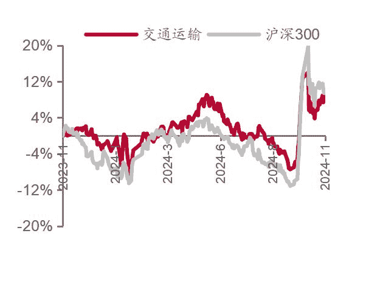

## 相关报告

1. 《冬春航季即将开启，国际航班持续恢复》2024-10-27
2. 《大小航司现分化，下沉市场迎机遇——2024年冬春航季国内航司换季概览》2024-10-24
3. 《Q3客运量创新高，收益水平环比增长》2024-10-19

## 报告摘要

- **板块涨跌幅：**本周交运板块上涨1.7%，表现优于大盘。交运行业细分板块中涨幅前三的分别为航空指数（7.9%）、公交指数（4.3%）、航运指数（3.2%）；跌幅前三的分别为物流综合指数（-0.8%）、铁路指数（-0.7%）、港口指数（-0.5%）。航空机场板块中涨幅前三的分别为海航控股（28.8%）、中信海直（11.0%）、国航（4.2%）；仅吉祥航空（-1.5%）、上海机场（-1.1%）下跌。

- **航空：**日均执飞航班量、平均飞机利用率周环比增减不一。
  1. 10月28日—11月1日，日均执飞航班量：南方航空2110.40架次，周环比减少3.97%；东方航空2146.00架次，周环比减少3.51%；国航1546.00架次，周环比减少5.00%；春秋航空416.20架次，周环比减少5.29%；吉祥航空320.80架次，周环比减少5.33%；海南航空652.60架次，周环比减少8.23%；华夏航空330.80架次，周环比增加0.77%。
  2. 10月28日—11月1日，平均飞机利用率：南方航空7.50小时/日，周环比减少3.85%；东方航空7.30小时/日，周环比减少3.95%；国航7.30小时/日，周环比减少6.41%；春秋航空7.30小时/日，周环比减少3.95%；吉祥航空7.50小时/日，周环比减少2.60%；海南航空7.50小时/日，周环比减少7.41%；华夏航空6.80小时/日，周环比增加4.62%。

- **机场：**国内航线、国际航线周环比增减不一。
  1. 10月28日—11月1日，日均进出港执飞航班量（国内航线）：深圳宝安机场983.20架次，周环比减少2.56%；北京首都机场915.20架次，周环比减少3.04%；广州白云机场1016.40架次，周环比增加2.12%；厦门高崎机场438.40架次，周环比减少6.18%；上海浦东机场709.80架次，周环比减少15.51%；上海虹桥机场679.80架次，周环比减少4.69%。
  2. 10月28日—11月1日，日均进出港执飞航班量（国际航线）：深圳宝安机场95.60架次，周环比增加7.76%；北京首都机场181.40架次，周环比减少5.59%；广州白云机场224.00架次，周环比减少0.19%；厦门高崎机场52.20架次，周环比增加0.66%；上海浦东机场395.00架次，周环比减少6.43%；上海虹桥机场16.00架次，周环比增加0.90%。

- **投资建议：**加拿大增班在即，免签政策持续加码。据央视新闻，10月24日，加拿大撤销了2022年2月3日颁布的“中国大陆航司每周飞往加拿大总计不超六个往返定期客运航班”及“禁止北京直飞加拿大客运航班”等限制措施。目前加拿大航空公司计划自12月7日起将温哥华—上海直飞每周4班往返航班增至每周7班，自2025年1月15日起恢复运营温哥华—北京直飞每周7班往返航班。同时，中方航空公司目前也在加快申请增班计划。

  此外，11月1日，中方决定扩大免签国家范围，对斯洛伐克、挪威、芬兰、丹麦、冰岛、安道尔、摩纳哥、列支敦士登、韩国持普通护照人员试行免签政策。2024年11月8日至2025年12月31日期间，上述国家持普通护照人员来华经商、旅游观光、探亲访友和过境不超过15天，可免签入境。

  加拿大航线的持续恢复以及免签政策的加码有望推动国际航线进一步恢复。整体看，今年行业恢复趋势向好，航班运行效率持续提升，随着国际航线的持续恢复，全行业供需格局有望持续改善，航空公司的业绩表现有望持续改善。此外，机场将受益于航空需求的复苏，航空收入和非航收入都将明显改善。重点推荐华夏航空、春秋航空、吉祥航空，建议关注三大航、上海机场、白云机场、中信海直。

- **风险提示：**汇率大幅下滑；国内经济失速下行；第三方数据可信性风险；研报使用信息更新不及时的风险。

行业定期报告

- 2 -

请务必阅读正文之后的重要声明部分

## 内容目录

1. 重点标的 .................................................................................................................. 5
2. 航空机场数据跟踪 .................................................................................................... 6
   2.1 航空 ............................................................................................................... 6
   2.2 机场 ............................................................................................................. 12
3. 本周交运板块及个股表现 ....................................................................................... 21

风险提示 ................................................................................................................... 22

## 图表目录

图表1：民航客运量：当月值 ...................................................................................... 6  
图表2：民航旅客周转量：当月值 .............................................................................. 6  
图表3：民航货邮运输量：当月值 .............................................................................. 6  
图表4：民航货邮周转量：当月值 .............................................................................. 6  
图表5：民航正班客座率：当月值 ................................................................................ 7  
图表6：南方航空：客座率：当月值 ............................................................................. 7  
图表7：东方航空：客座率：当月值 ............................................................................. 7  
图表8：国航：客座率：当月值 .................................................................................... 7  
图表9：春秋航空：客座率：当月值 ............................................................................. 8  
图表10：吉祥航空：客座率：当月值 ........................................................................... 8  
图表11：海航控股：客座率：当月值 ........................................................................... 8  
图表12：南方航空：日均执飞航班量 ........................................................................ 9  
图表13：东方航空：日均执飞航班量 ........................................................................ 9  
图表14：国航：日均执飞航班量 ................................................................................ 9  
图表15：春秋航空：日均执飞航班量 ........................................................................ 9  
图表16：吉祥航空：日均执飞航班量 ........................................................................ 9  
图表17：海南航空：日均执飞航班量 ........................................................................ 9  
图表18：华夏航空：日均执飞航班量 .................................................................... 10  
图表19：南方航空：平均飞机利用率 ...................................................................... 10  
图表20：东方航空：平均飞机利用率 ...................................................................... 10  
图表21：国航：平均飞机利用率 ............................................................................ 11  
图表22：春秋航空：平均飞机利用率 ....................................................................... 11  
图表23：吉祥航空：平均飞机利用率 ....................................................................... 11  
图表24：海南航空：平均飞机利用率 ....................................................................... 11  
图表25：华夏航空：平均飞机利用率 ....................................................................... 11  
图表26：深圳机场：旅客吞吐量：当月值 ................................................................. 12  
图表27：上海机场：旅客吞吐量：当月值 ................................................................. 12  
图表28：白云机场：旅客吞吐量：当月值 ................................................................. 12  
图表29：厦门空港：旅客吞吐量：当月值 ................................................................. 12  
图表30：北京首都机场：旅客吞吐量：当月值 .......................................................... 13  
图表31：深圳机场：飞机起降架次：当月值 .............................................................. 13  
图表32：上海机场：飞机起降架次：当月值 .............................................................. 13  
图表33：白云机场：飞机起降架次：当月值 .............................................................. 14  
图表34：厦门空港：飞机起降架次：当月值 .............................................................. 14  
图表35：北京首都机场：飞机起降架次：当月值 ...................................................... 14  
图表36：深圳宝安机场：日均进出港执飞航班量（国内航线） ........................... 15  
图表37：北京首都机场：日均进出港执飞航班量（国内航线） ........................... 15  
图表38：广州白云机场：日均进出港执飞航班量（国内航线） ........................... 15  
图表39：厦门高崎机场：日均进出港执飞航班量（国内航线） ........................... 15  
图表40：上海浦东机场：日均进出港执飞航班量（国内航线） ........................... 15  
图表41：上海虹桥机场：日均进出港执飞航班量（国内航线） ........................... 15  
图表42：深圳宝安机场：执飞率（国内航线） ..................................................... 16  
图表43：北京首都机场：执飞率（国内航线） ..................................................... 16  
图表44：广州白云机场：执飞率（国内航线） ..................................................... 16  
图表45：厦门高崎机场：执飞率（国内航线） ..................................................... 16  
图表46：上海浦东机场：执飞率（国内航线） ..................................................... 17  
图表47：上海虹桥机场：执飞率（国内航线） ..................................................... 17  
图表48：深圳宝安机场：日均进出港执飞航班量（国际航线） ........................... 17  
图表49：北京首都机场：日均进出港执飞航班量（国际航线） ........................... 17  
图表50：广州白云机场：日均进出港执飞航班量（国际航线） ........................... 18  
图表51：厦门高崎机场：日均进出港执飞航班量（国际航线） ........................... 18  
图表52：上海浦东机场：日均进出港执飞航班量（国际航线） ........................... 18  
图表53：上海虹桥机场：日均进出港执飞航班量（国际航线） ........................... 18  
图表54：深圳宝安机场：执飞率（国际航线） ..................................................... 19  
图表55：北京首都机场：执飞率（国际航线） ..................................................... 19  
图表56：广州白云机场：执飞率（国际航线） ..................................................... 19  
图表57：厦门高崎机场：执飞率（国际航线） ..................................................... 19  
图表58：上海浦东机场：执飞率（国际航线） ..................................................... 19  
图表59：上海虹桥机场：执飞率（国际航线） ..................................................... 19  
图表60：出厂价（含税）：航空煤油 ........................................................................... 20  
图表61：即期汇率：美元兑人民币 .......................................................................... 20

行业定期报告

- 4 -

请务必阅读正文之后的重要声明部分

图表62：现货价：原油：英国布伦特Dtd................................................................20

图表63：现货价：美国西德克萨斯中级轻质原油(WTI).........................................20

图表64：本周交运板块上涨1.7%.........................................................................21

图表65：交运行业细分板块表现...........................................................................21

图表66：航空机场板块个股表现...........................................................................22

行业定期报告

- 5 -

请务必阅读正文之后的重要声明部分

## 1 重点标的

- 重点推荐：吉祥航空，24-26年对应P/E分别为15.32X/9.02X/8.31X。

公司双品牌、双枢纽运行的发展战略有助于公司实现高、中、低端旅客全覆盖。今年暑运出行需求仍旺，公司业绩有望持续改善。长期看，随着行业供需格局改善，票价中枢有望提升，公司有望充分受益。

- 重点推荐：春秋航空，24-26年对应P/E分别21.55X/17.58X/13.79X。

公司为民营低成本航司龙头，盈利水平行业领先。公司成本管控优势明显，坚持低成本战略，2022年在石家庄、兰州、宁波、扬州机场运送旅客人次市场份额稳居首位，在揭阳、沈阳、南昌机场居第二位。2024年，随着公司机长人数持续恢复，飞机利用率持续提升，盈利有望进一步上行。

- 重点推荐：华夏航空，24-26年对应P/E分别为24.72X/10.55X/8.94X。

华夏航空是我国唯一一家规模化的独立支线航空，目前已进入业绩反弹期。随着飞机利用率的持续恢复，公司单位ASK成本将继续下降，从而带动业绩持续上升。支线航空的需求存在聚集效应，未来发展空间广阔，类比国内航空市场发展规律，理论上2020年支线航空旅客运输量就可达2.1亿人次，但实际仅为7000万人次左右。此外，政府补贴为公司提供稳定业绩托底。民航局的支线补贴占公司政府补贴收入的50%左右，具有稳定性，且2024-2025年随着公司运力持续恢复，有望进一步增加。短期看，我们认为公司业绩将随着飞机利用率恢复而修复，中长期看，公司作为我国支线航空龙头，在支线市场具有先发优势。支线航空发展受政策支持，未来发展空间广阔。

- 重点推荐：南方航空，24-26年对应P/E分别66.22X/11.65X/8.99X。

公司着力建设广州、北京两大综合性国际枢纽，逐步形成"南北呼应、比翼齐飞"发展新格局，并为新疆最大主基地航司，在新疆形成"疆内成网、东西成扇"的航线网络布局。2024年公司经营恢复较快，上半年平均客座率居三大航首位。

- 重点推荐：中国东航，24-26年对应P/E分别为40.59X/11.98X/9.19X。

公司为上海两场最大承运人，国内航线，公司在一线城市互飞航线中优势明显；国际航线，公司在日本、韩国、泰国时刻量有传统优势。以2019年夏秋航季为例，公司在日本、韩国、泰国的时刻量占中国航司的比例（剔除纯货运航司）分别为30.69%、21.24%、28.72%，均居行业首位。在当前国内恢复快于国际的情况下，公司商务线优势有望得到释放，随着日韩泰航线的进一步恢复，公司业绩有望进一步受益。

- 建议关注：上海机场，24-26年对应P/E分别为42.35X/32.58X/25.44X。

2022年，公司顺利完成与虹桥机场的重组，凭借上海区位优势，两场协同加深，公司航空性业务有望进一步做大做强；2023年12月26日，公司公告与日上上海签订两场免税店经营补充协议，免税提成重回"下有保底，上不封顶"模式，盈利弹性再次恢复。公司具有稳定的投资收益，随着航空业务的持续复苏，航空油料及德高动量有望持续为公司带来稳定的投资收益。

行业定期报告

- 6 -

请务必阅读正文之后的重要声明部分

## 2 航空机场数据跟踪

### 2.1 航空

- 民航客运量：截至9月30日，民航客运量为0.60亿人，相比于上月减少0.13亿人，月环比下降17.84%，相比于去年同期增加0.06亿人，年同比增加12.02%。

- 民航旅客周转量：截至9月30日，民航旅客周转量为1075.30亿人公里，相比于上月减少215.40亿人公里，月环比下降16.69%，相比于去年同期增加159.80亿人公里，年同比增加17.45%。

图表1：民航客运量：当月值

图表2：民航旅客周转量：当月值

来源：iFinD、中泰证券研究所（单位：亿人）

来源：iFinD、中泰证券研究所（单位：亿人公里）

- 民航货邮运输量：截至9月30日，民航货邮运输量为80.00万吨，相比于上月增加3.60万吨，月环比增加4.71%，相比于去年同期增加9.80万吨，年同比增加13.96%。

- 民航货邮周转量：截至9月30日，民航货邮周转量为31.00亿吨公里，相比于上月增加0.30亿吨公里，月环比增加0.98%，相比于去年同期增加5.20亿吨公里，年同比增加20.16%。

图表3：民航货邮运输量：当月值

图表4：民航货邮周转量：当月值

来源：iFinD、中泰证券研究所（单位：万吨）

来源：iFinD、中泰证券研究所（单位：亿吨公里）

行业定期报告

- 7 -

请务必阅读正文之后的重要声明部分

- 全民航客座率：截至9月30日，民航正班客座率为83.90%，相比于上月下跌3.00pct，月环比下降3.45%，相比于去年同期上涨5.40pct，年同比增加6.88%。

- 分航司客座率：截至9月30日，南方航空客座率为85.51%，相比于上月下跌1.68pct，月环比下降1.93%，相比于去年同期上涨6.80pct，年同比增加8.64%；东方航空客座率为83.51%，相比于上月下跌3.23pct，月环比下降3.72%，相比于去年同期上涨9.90pct，年同比增加13.45%；国航客座率为79.70%，相比于上月下跌3.20pct，月环比下降3.86%，相比于去年同期上涨5.50pct，年同比增加7.41%；春秋航空客座率为90.52%，相比于上月下跌3.18pct，月环比下降3.39%，相比于去年同期上涨0.23pct，年同比增加0.25%；吉祥航空客座率为83.65%，相比于上月下跌4.62pct，月环比下降5.23%，相比于去年同期上涨0.20pct，年同比增加0.24%；海航控股客座率为84.16%，相比于上月下跌3.78pct，月环比下降4.30%，相比于去年同期上涨0.65pct，年同比增加0.78%。

图表5：民航正班客座率：当月值

图表6：南方航空：客座率：当月值

来源：iFinD、中泰证券研究所（单位：%）

来源：iFinD、中泰证券研究所（单位：%）

图表7：东方航空：客座率：当月值

图表8：国航：客座率：当月值

来源：iFinD、中泰证券研究所（单位：%）

来源：iFinD、中泰证券研究所（单位：%）

行业定期报告

- 8 -

请务必阅读正文之后的重要声明部分

图表9：春秋航空：客座率：当月值

图表10：吉祥航空：客座率：当月值

来源：iFinD、中泰证券研究所（单位：%）

来源：iFinD、中泰证券研究所（单位：%）

图表11：海航控股：客座率：当月值

来源：iFinD、中泰证券研究所（单位：%）

- 分航司日均执飞航班量：10月28日-11月1日，南方航空日均执飞航班量为2110.40架次，相比于上周减少87.31架次，周环比减少3.97%，相比于去年同期减少48.17架次，年同比减少2.23%；东方航空日均执飞航班量为2146.00架次，相比于上周减少78.00架次，周环比减少3.51%，相比于去年同期增加78.86架次，年同比增加3.81%；国航日均执飞航班量为1546.00架次，相比于上周减少81.43架次，周环比减少5.00%，相比于去年同期增加57.57架次，年同比增加3.87%；春秋航空日均执飞航班量为416.20架次，相比于上周减少23.23架次，周环比减少5.29%，相比于去年同期增加12.49架次，年同比增加3.09%；吉祥航空日均执飞航班量为320.80架次，相比于上周减少18.06架次，周环比减少5.33%，相比于去年同期增加4.80架次，年同比增加1.52%；海南航空日均执飞航班量为652.60架次，相比于上周减少58.54架次，周环比减少8.23%，相比于去年同期增加19.17架次，年同比增加3.03%；华夏航空日均执飞航班量为330.80架次，相比于上周增加2.51架次，周环比增加0.77%，相比于去年同期增加61.66架次，年同比增加22.91%。

行业定期报告

- 9 -

请务必阅读正文之后的重要声明部分

图表12：南方航空：日均执飞航班量

图表13：东方航空：日均执飞航班量

来源：航班管家、中泰证券研究所（单位：架次/日）

来源：航班管家、中泰证券研究所（单位：架次/日）

图表14：国航：日均执飞航班量

图表15：春秋航空：日均执飞航班量

来源：航班管家、中泰证券研究所（单位：架次/日）

来源：航班管家、中泰证券研究所（单位：架次/日）

图表16：吉祥航空：日均执飞航班量

图表17：海南航空：日均执飞航班量

来源：航班管家、中泰证券研究所（单位：架次/日）

来源：航班管家、中泰证券研究所（单位：架次/日）

备注：数据仅包含海南航空（HU）本部

行业定期报告

- 10 -

请务必阅读正文之后的重要声明部分

图表18：华夏航空：日均执飞航班量

来源：航班管家、中泰证券研究所（单位：架次/日）

- 分航司平均飞机利用率：10月28日-11月1日，南方航空平均飞机利用率为7.50小时/日，相比于上周减少0.30小时/日，周环比减少3.85%，相比于去年同期减少0.20小时/日，年同比减少2.60%；东方航空平均飞机利用率为7.30小时/日，相比于上周减少0.30小时/日，周环比减少3.95%，相比于去年同期增加0.40小时/日，年同比增加5.80%；国航平均飞机利用率为7.30小时/日，相比于上周减少0.50小时/日，周环比减少6.41%，与去年同期持平；春秋航空平均飞机利用率为7.30小时/日，相比于上周减少0.30小时/日，周环比减少3.95%，相比于去年同期增加0.10小时/日，年同比增加1.39%；吉祥航空平均飞机利用率为7.50小时/日，相比于上周减少0.20小时/日，周环比减少2.60%，与去年同期持平；海南航空平均飞机利用率为7.50小时/日，相比于上周减少0.60小时/日，周环比减少7.41%，相比于去年同期增加0.60小时/日，年同比增加8.70%；华夏航空平均飞机利用率为6.80小时/日，相比于上周增加0.30小时/日，周环比增加4.62%，相比于去年同期增加1.10小时/日，年同比增加19.30%。

图表19：南方航空：平均飞机利用率

图表20：东方航空：平均飞机利用率

来源：航班管家、中泰证券研究所（单位：小时/日）

来源：航班管家、中泰证券研究所（单位：小时/日）

行业定期报告

- 11 -

请务必阅读正文之后的重要声明部分

图表21：国航：平均飞机利用率

图表22：春秋航空：平均飞机利用率

来源：航班管家、中泰证券研究所（单位：小时/日）

来源：航班管家、中泰证券研究所（单位：小时/日）

图表23：吉祥航空：平均飞机利用率

图表24：海南航空：平均飞机利用率

来源：航班管家、中泰证券研究所（单位：小时/日）

来源：航班管家、中泰证券研究所（单位：小时/日）

备注：数据仅包含海南航空（HU）本部

图表25：华夏航空：平均飞机利用率

来源：航班管家、中泰证券研究所（单位：小时/日）

行业定期报告

- 12 -

请务必阅读正文之后的重要声明部分

### 2.2 机场

- 旅客吞吐量：截至9月30日，深圳机场旅客吞吐量为494.45万人次，相比于上月减少63.54万人次，月环比下降11.39%，相比于去年同期增加66.71万人次，年同比增加15.60%；上海机场旅客吞吐量为1011.06万人次，相比于上月减少168.01万人次，月环比下降14.25%，相比于去年同期增加141.31万人次，年同比增加16.25%；厦门空港机场旅客吞吐量为224.29万人次，相比于上月减少33.08万人次，月环比下降12.85%，相比于去年同期增加31.00万人次，年同比增加16.04%；白云机场旅客吞吐量为595.53万人次，相比于上月减少107.85万人次，月环比下降15.33%，相比于去年同期增加69.62万人次，年同比增加13.24%；北京首都机场旅客吞吐量为554.39万人，相比于上月减少69.09万人，月环比下降11.08%，相比于去年同期增加72.14万人，年同比增加14.96%。

图表26：深圳机场：旅客吞吐量：当月值

图表27：上海机场：旅客吞吐量：当月值

来源：iFinD、中泰证券研究所（单位：万人次）

来源：iFinD、中泰证券研究所（单位：万人次）

备注：2022年7月起数据包含虹浦两场

图表28：白云机场：旅客吞吐量：当月值

图表29：厦门空港：旅客吞吐量：当月值

来源：iFinD、中泰证券研究所（单位：万人次）

来源：iFinD、中泰证券研究所（单位：万人次）

行业定期报告

- 13 -

请务必阅读正文之后的重要声明部分

图表30：北京首都机场：旅客吞吐量：当月值

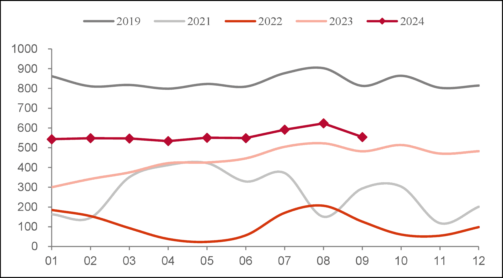

来源：iFinD、公司公告、中泰证券研究所

（单位：万人）

- 飞机起降架次：截至9月30日，深圳机场飞机起降34917架次，相比于上月减少2888架次，月环比下降7.64%，相比于去年同期增加3117架次，年同比增加9.80%；上海机场飞机起降65671架次，相比于上月减少6554架次，月环比下降9.07%，相比于去年同期增加2712架次，年同比增加4.31%；厦门空港机场飞机起降15824架次，相比于上月减少1418架次，月环比下降8.22%，相比于去年同期增加1303架次，年同比增加8.97%；白云机场飞机起降39714架次，相比于上月减少5741架次，月环比下降12.63%，相比于去年同期增加936架次，年同比增加2.41%；北京首都机场飞机起降架次为35887次，相比于上月减少2558次，月环比下降6.65%，相比于去年同期增加2631次，年同比增加7.91%。

图表31：深圳机场：飞机起降架次：当月值

图表32：上海机场：飞机起降架次：当月值

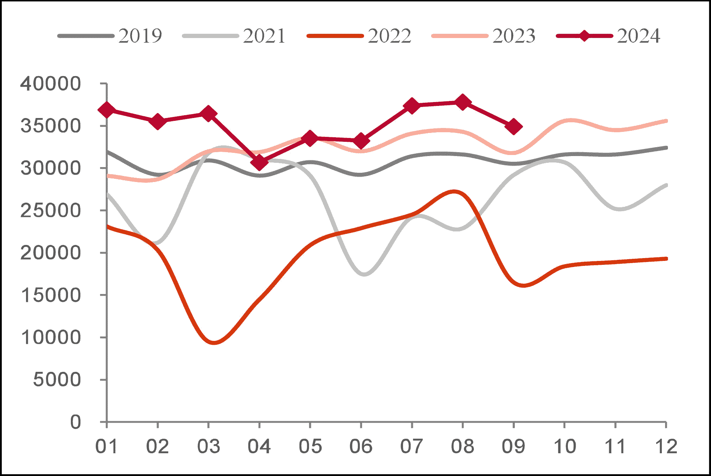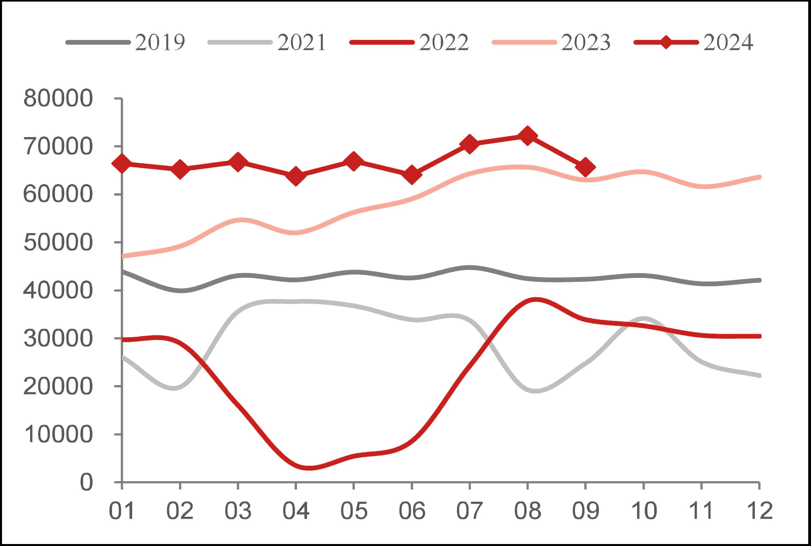

来源：iFinD、中泰证券研究所

（单位：架次）

来源：iFinD、中泰证券研究所

（单位：架次）

备注：2022年7月起数据包含虹浦两场

行业定期报告

- 14 -

请务必阅读正文之后的重要声明部分

图表33：白云机场：飞机起降架次：当月值

图表34：厦门空港：飞机起降架次：当月值

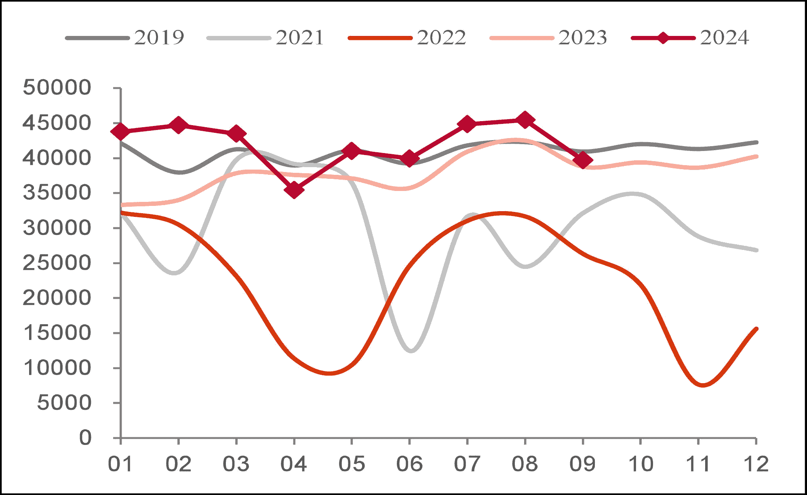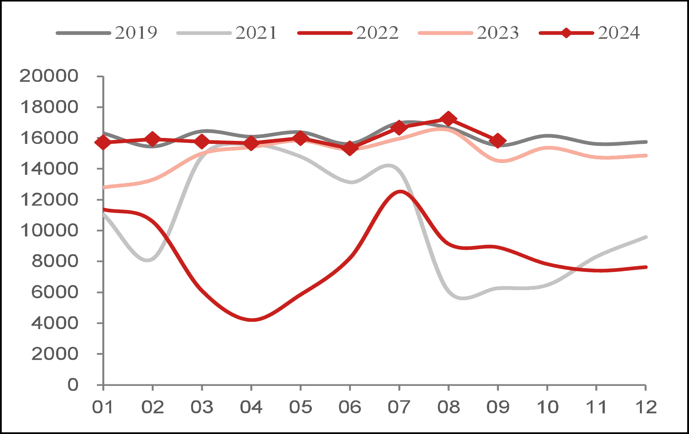

来源：iFinD、中泰证券研究所

（单位：架次）

来源：iFinD、中泰证券研究所

（单位：架次）

- 分机场日均进出港执飞航班量（国内航线）：10月28日-11月1日，深圳宝安机场日均进出港执飞航班量（国内航线）为983.20架次，相比于上周减少25.80架次，周环比减少2.56%，相比于去年同期增加9.63架次，年同比增加0.99%；北京首都机场日均进出港执飞航班量（国内航线）为915.20架次，相比于上周减少28.66架次，周环比减少3.04%，相比于去年同期增加13.20架次，年同比增加1.46%；广州白云机场日均进出港执飞航班量（国内航线）为1016.40架次，相比于上周增加21.11架次，周环比增加2.12%，相比于去年同期增加2.54架次，年同比增加0.25%；厦门高崎机场日均进出港执飞航班量（国内航线）为438.40架次，相比于上周减少28.89架次，周环比减少6.18%，相比于去年同期增加29.26架次，年同比增加7.15%；上海浦东机场日均进出港执飞航班量（国内航线）为709.80架次，相比于上周减少130.34架次，周环比减少15.51%，相比于去年同期减少104.63架次，年同比减少12.85%；上海虹桥机场日均进出港执飞航班量（国内航线）为679.80架次，相比于上周减少33.49架次，周环比减少4.69%，相比于去年同期减少3.77架次，年同比减少0.55%。

图表35：北京首都机场：飞机起降架次：当月值

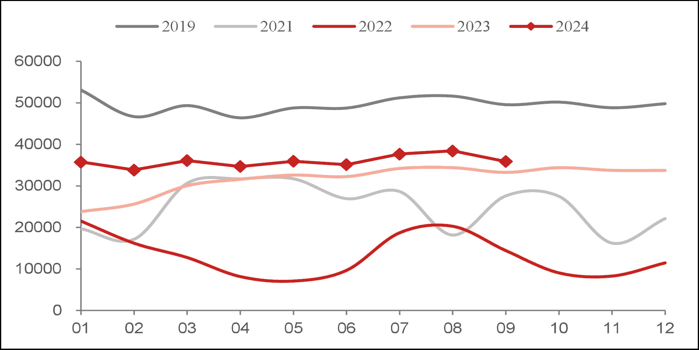

来源：iFinD、中泰证券研究所

（单位：次）

行业定期报告

- 15 -

请务必阅读正文之后的重要声明部分

图表36：深圳宝安机场：日均进出港执飞航班量（国内航线）

图表37：北京首都机场：日均进出港执飞航班量（国内航线）

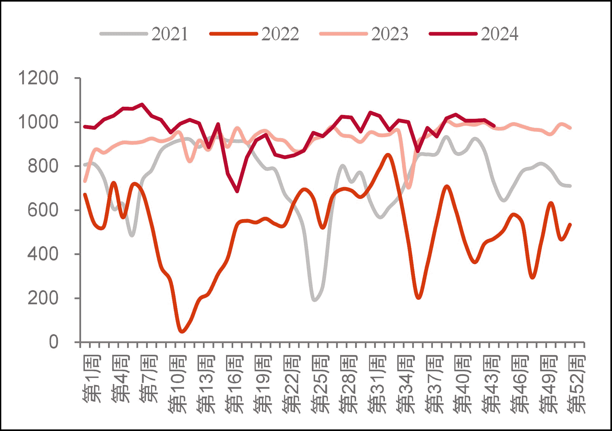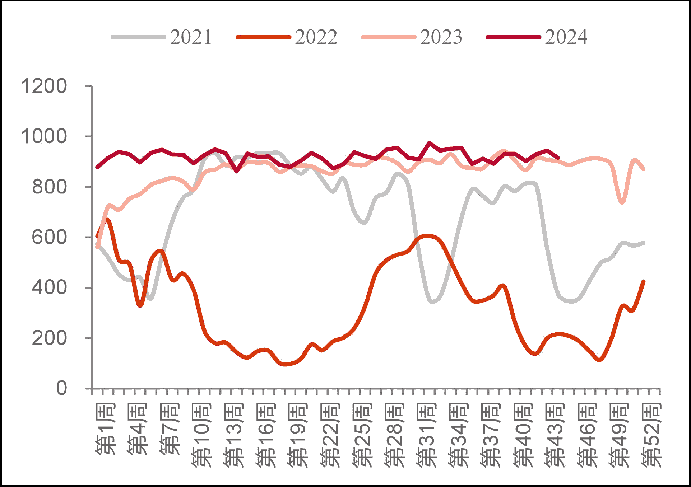

来源：航班管家、中泰证券研究所

（单位：架次/日）

来源：航班管家、中泰证券研究所

（单位：架次/日）

图表38：广州白云机场：日均进出港执飞航班量（国内航线）

图表39：厦门高崎机场：日均进出港执飞航班量（国内航线）

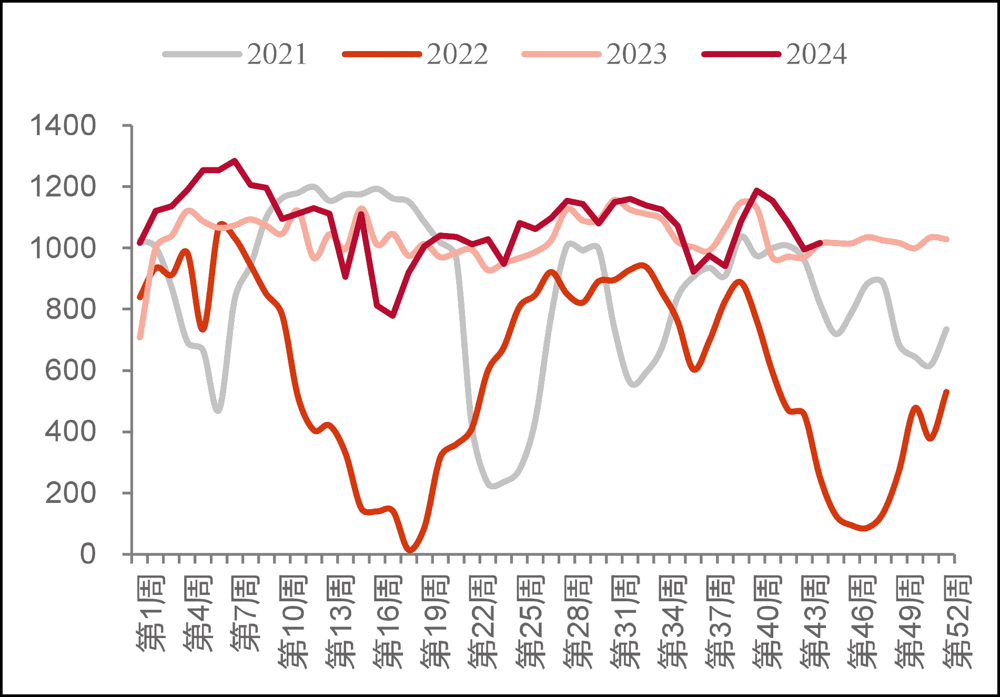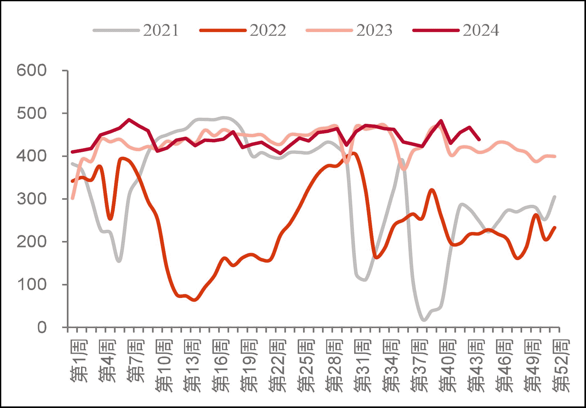

来源：航班管家、中泰证券研究所

（单位：架次/日）

来源：航班管家、中泰证券研究所

（单位：架次/日）

图表40：上海浦东机场：日均进出港执飞航班量（国内航线）

图表41：上海虹桥机场：日均进出港执飞航班量（国内航线）

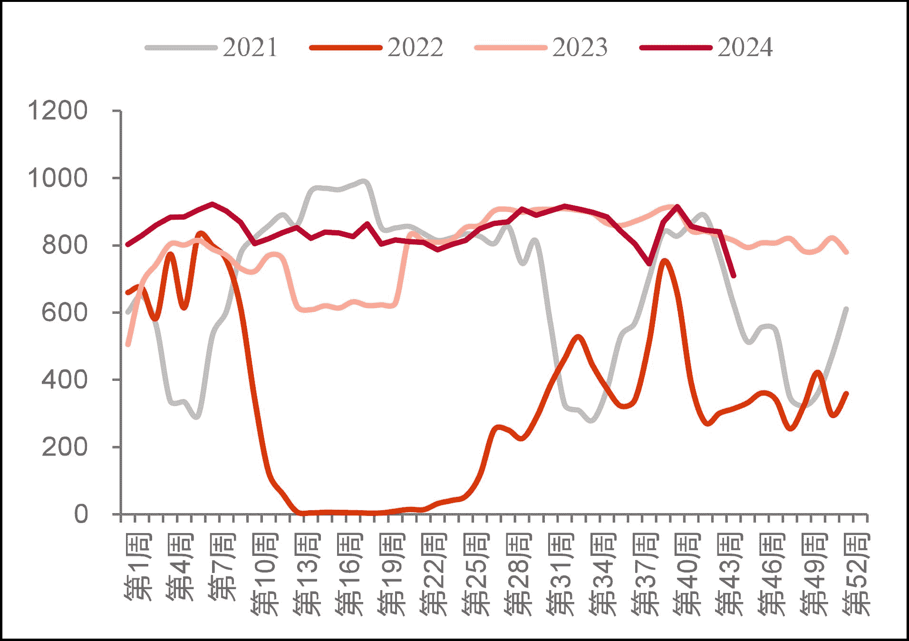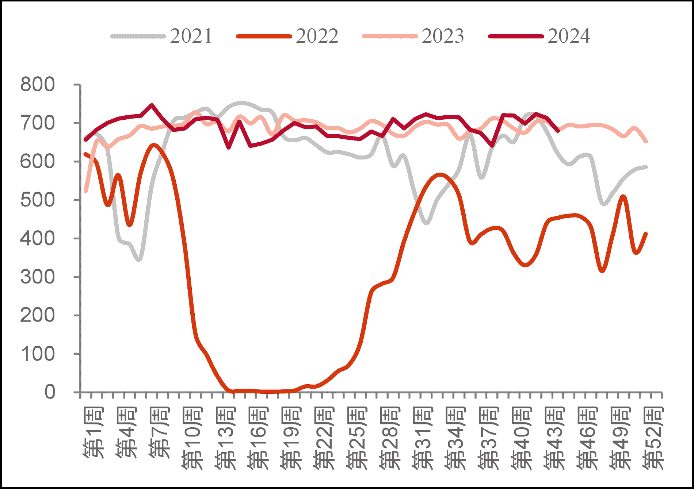

来源：航班管家、中泰证券研究所

（单位：架次/日）

来源：航班管家、中泰证券研究所

（单位：架次/日）

行业定期报告

- 16 -

请务必阅读正文之后的重要声明部分

- 分机场执飞率（国内航线）：10月28日-11月1日，深圳宝安机场执飞率（国内航线）为91.61%，相比于上周增加0.16pct，周环比增加0.17%，相比于去年同期增加0.26pct，年同比增加0.28%；北京首都机场执飞率（国内航线）为94.37%，相比于上周减少0.63pct，周环比减少0.66%，相比于去年同期增加3.60pct，年同比增加3.97%；广州白云机场执飞率（国内航线）为77.59%，相比于上周增加0.86pct，周环比增加1.12%，相比于去年同期减少11.20pct，年同比减少12.61%；厦门高崎机场执飞率（国内航线）为87.33%，相比于上周减少1.46pct，周环比减少1.64%，相比于去年同期增加3.39pct，年同比增加4.04%；上海浦东机场执飞率（国内航线）为76.88%，相比于上周减少11.48pct，周环比减少12.99%，相比于去年同期减少9.66pct，年同比减少11.16%；上海虹桥机场执飞率（国内航线）为92.29%，相比于上周减少3.42pct，周环比减少3.57%，相比于去年同期减少3.87pct，年同比减少4.02%。

图表42：深圳宝安机场：执飞率（国内航线）

图表43：北京首都机场：执飞率（国内航线）

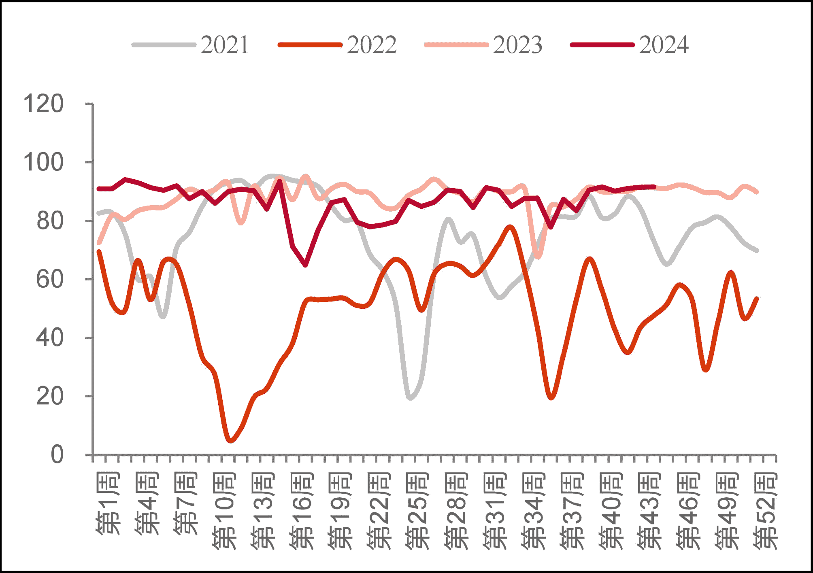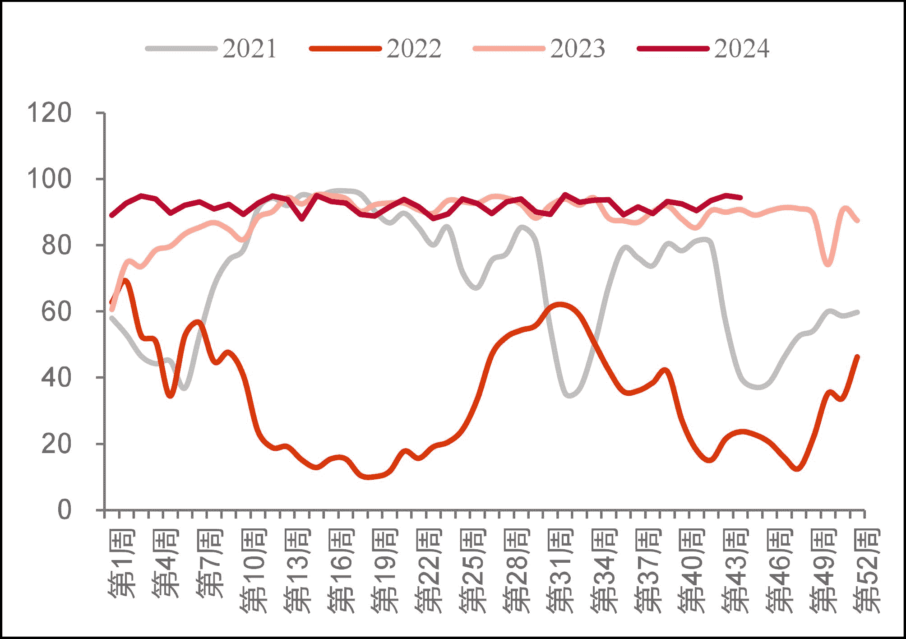

来源：航班管家、中泰证券研究所

（单位：%）

来源：航班管家、中泰证券研究所

（单位：%）

图表44：广州白云机场：执飞率（国内航线）

图表45：厦门高崎机场：执飞率（国内航线）

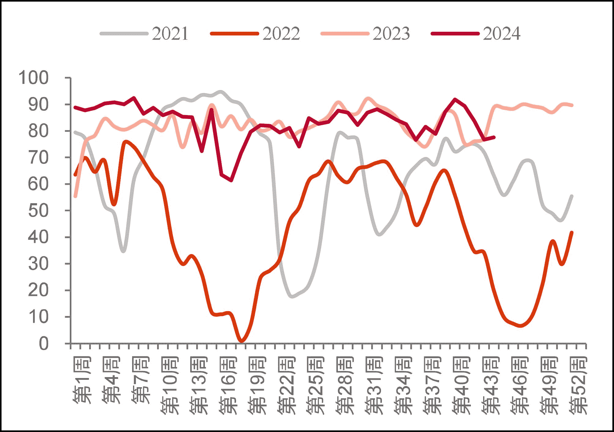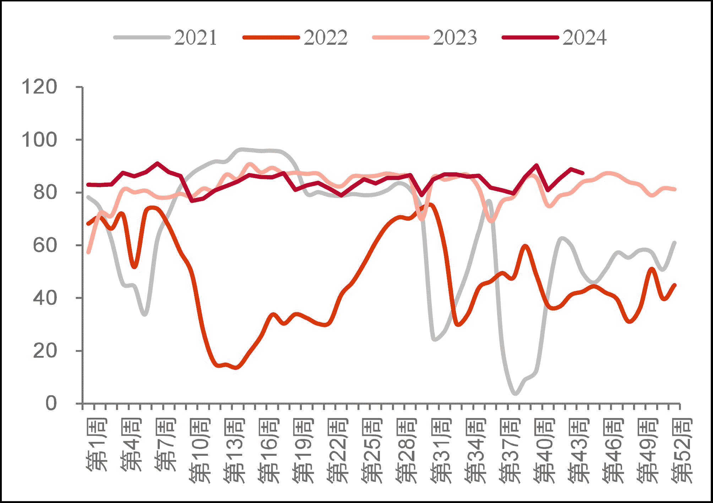

来源：航班管家、中泰证券研究所

（单位：%）

来源：航班管家、中泰证券研究所

（单位：%）

行业定期报告

- 17 -

请务必阅读正文之后的重要声明部分

图表46：上海浦东机场：执飞率（国内航线）

图表47：上海虹桥机场：执飞率（国内航线）

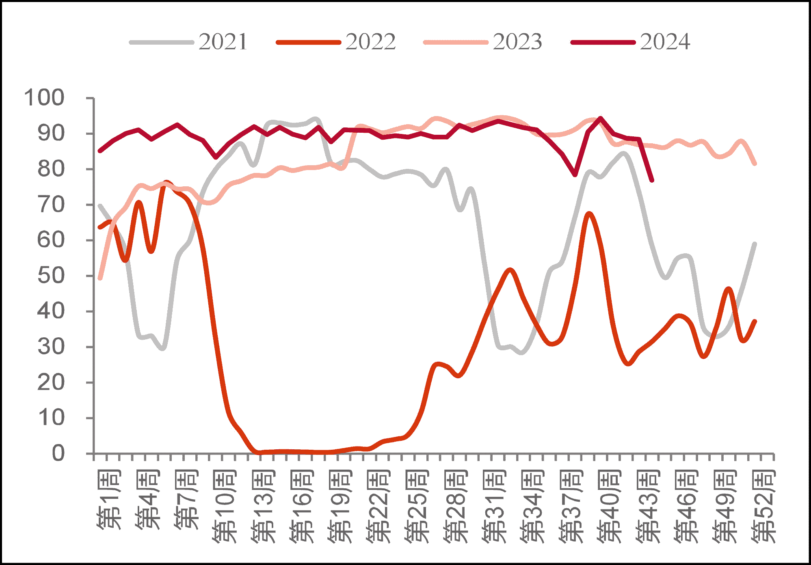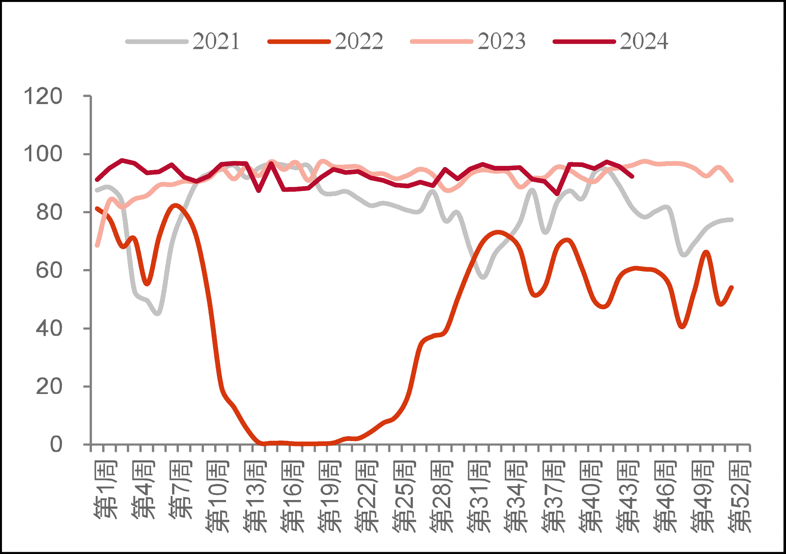

来源：航班管家、中泰证券研究所

（单位：%）

来源：航班管家、中泰证券研究所

（单位：%）

- 分机场日均进出港执飞航班量（国际航线）：10月28日-11月1日，深圳宝安机场日均进出港执飞航班量（国际航线）为95.60架次，相比于上周增加6.89架次，周环比增加7.76%，相比于去年同期增加38.60架次，年同比增加67.72%；北京首都机场日均进出港执飞航班量（国际航线）为181.40架次，相比于上周减少10.74架次，周环比减少5.59%，相比于去年同期增加47.11架次，年同比增加35.09%；广州白云机场日均进出港执飞航班量（国际航线）为224.00架次，相比于上周减少0.43架次，周环比减少0.19%，相比于去年同期增加65.86架次，年同比增加41.64%；厦门高崎机场日均进出港执飞航班量（国际航线）为52.20架次，相比于上周增加0.34架次，周环比增加0.66%，相比于去年同期增加18.49架次，年同比增加54.83%；上海浦东机场日均进出港执飞航班量（国际航线）为395.00架次，相比于上周减少27.14架次，周环比减少6.43%，相比于去年同期增加112.00架次，年同比增加39.58%；上海虹桥机场日均进出港执飞航班量（国际航线）为16.00架次，相比于上周增加0.14架次，周环比增加0.90%，与去年同期持平。

图表48：深圳宝安机场：日均进出港执飞航班量（国际航线）

图表49：北京首都机场：日均进出港执飞航班量（国际航线）

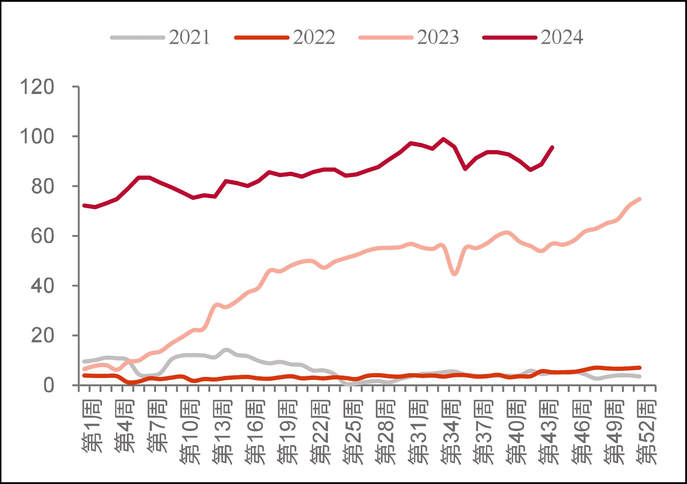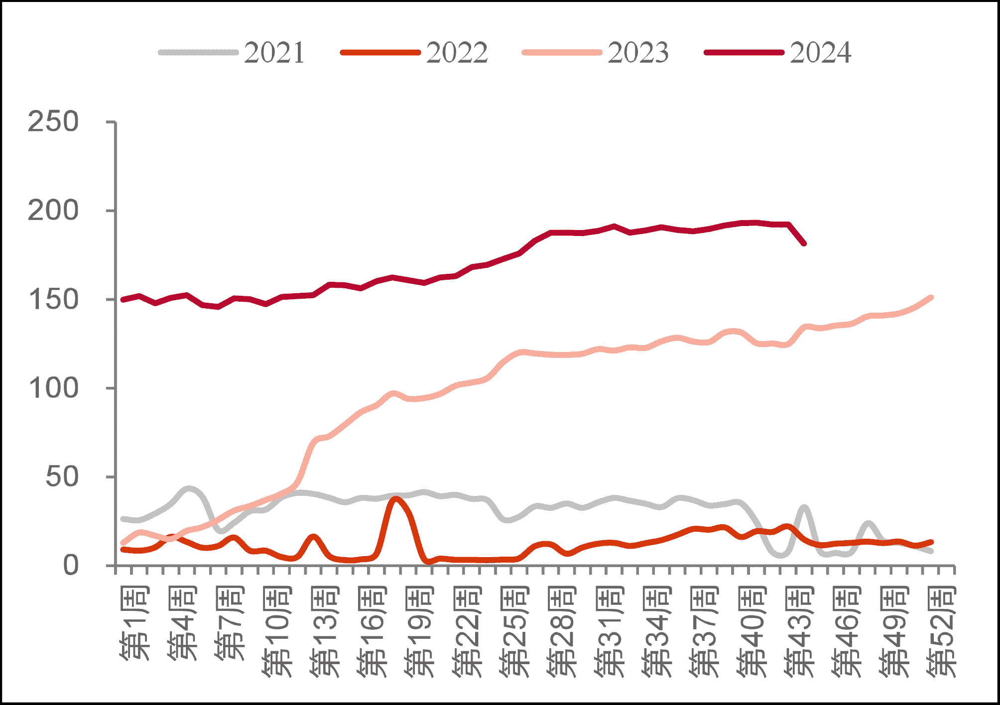

来源：航班管家、中泰证券研究所

（单位：架次/日）

来源：航班管家、中泰证券研究所

（单位：架次/日）

行业定期报告

- 18 -

请务必阅读正文之后的重要声明部分

图表50：广州白云机场：日均进出港执飞航班量（国际航线）

图表51：厦门高崎机场：日均进出港执飞航班量（国际航线）

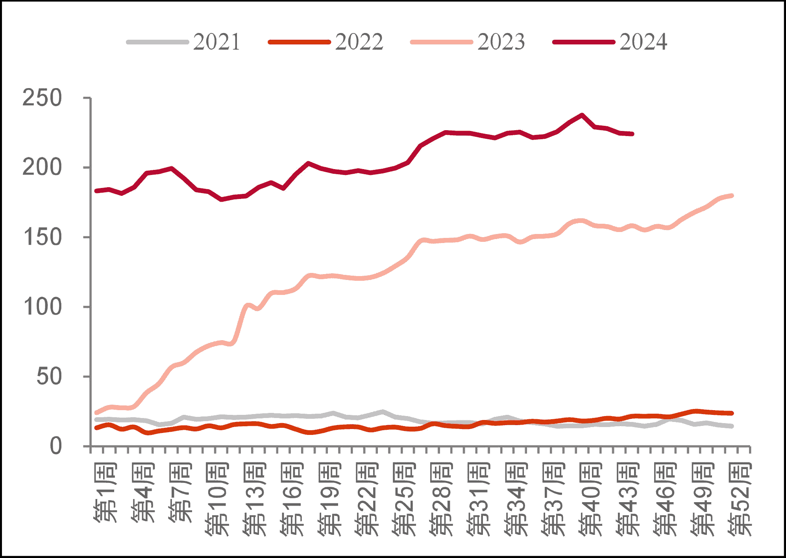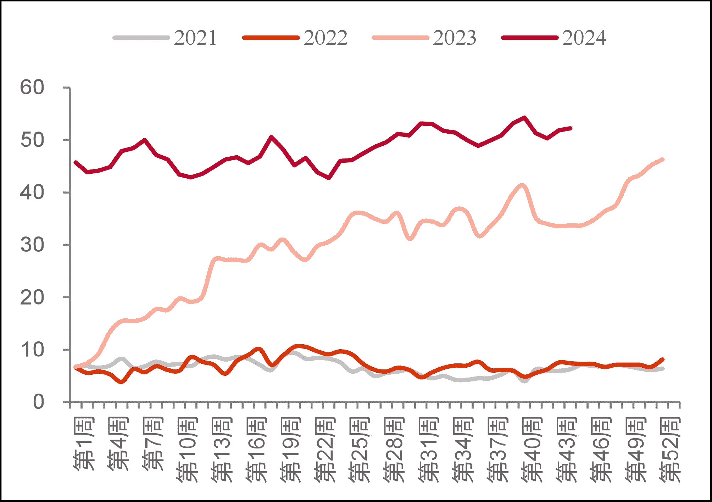

来源：航班管家、中泰证券研究所

（单位：架次/日）

来源：航班管家、中泰证券研究所

（单位：架次/日）

图表52：上海浦东机场：日均进出港执飞航班量（国际航线）

图表53：上海虹桥机场：日均进出港执飞航班量（国际航线）

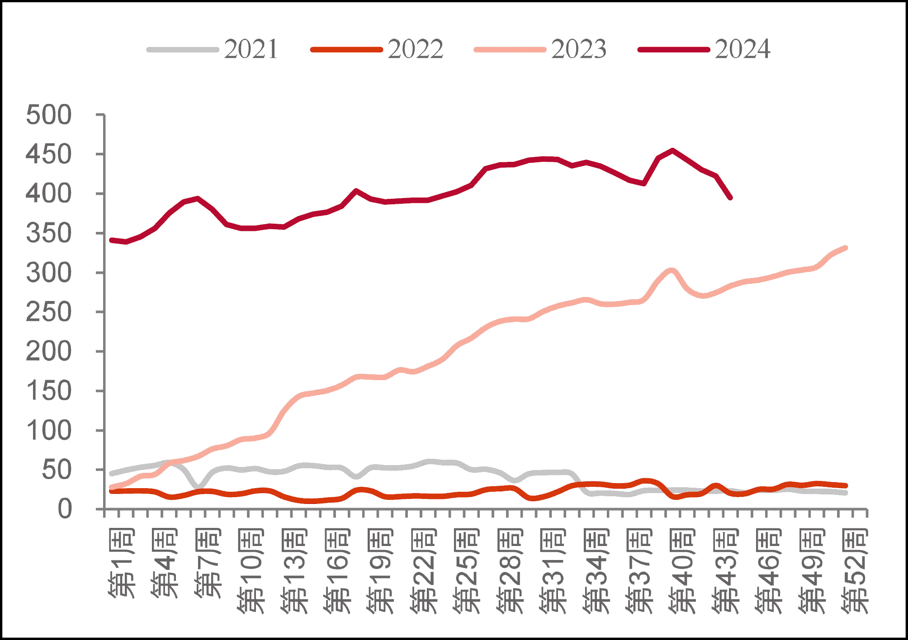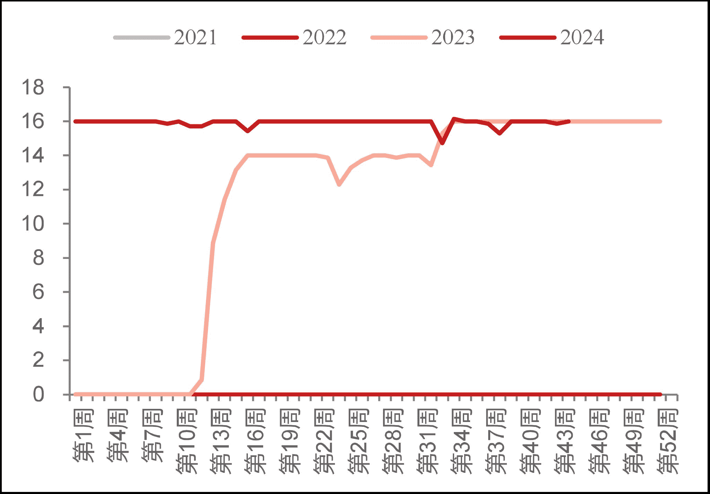

来源：航班管家、中泰证券研究所

（单位：架次/日）

来源：航班管家、中泰证券研究所

（单位：架次/日）

- 分机场执飞率（国际航线）：10月28日-11月1日，深圳宝安机场执飞率（国际航线）为94.09%，相比于上周增加22.63pct，周环比增加31.67%，相比于去年同期增加6.40pct，年同比增加7.30%；北京首都机场执飞率（国际航线）为95.57%，相比于上周减少0.91pct，周环比减少0.94%，相比于去年同期减少0.54pct，年同比减少0.56%；广州白云机场执飞率（国际航线）为95.56%，相比于上周增加4.28pct，周环比增加4.69%，相比于去年同期减少0.62pct，年同比减少0.64%；厦门高崎机场执飞率（国际航线）为93.21%，相比于上周减少2.07pct，周环比减少2.17%，相比于去年同期增加12.66pct，年同比增加15.72%；上海浦东机场执飞率（国际航线）为90.80%，相比于上周减少3.88pct，周环比减少4.10%，相比于去年同期增加1.61pct，年同比增加1.81%；上海虹桥机场执飞率（国际航线）为100.00%，相比于上周增加0.89pct，周环比增加0.90%，与去年同期持平。

图表54：深圳宝安机场：执飞率（国际航线）

图表55：北京首都机场：执飞率（国际航线）

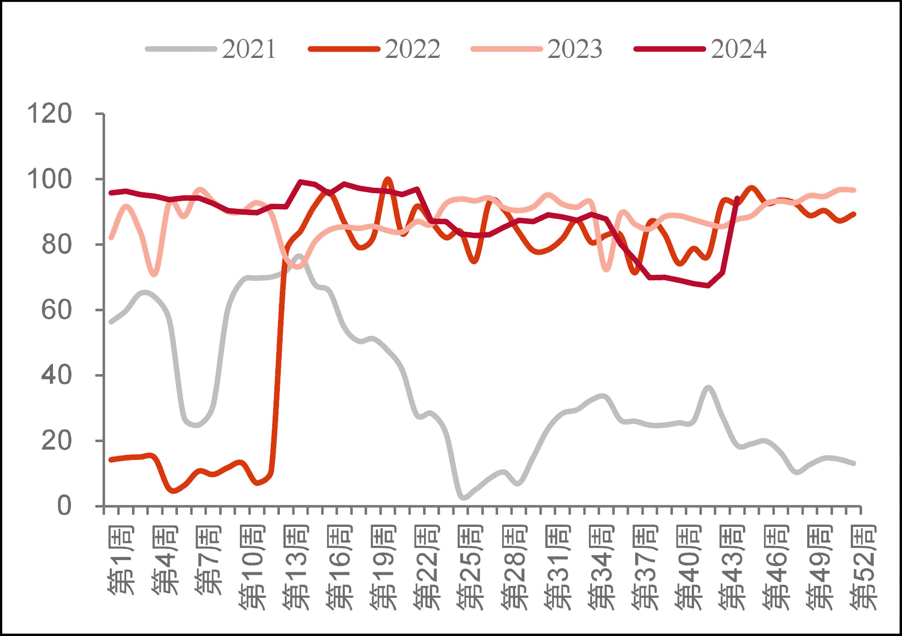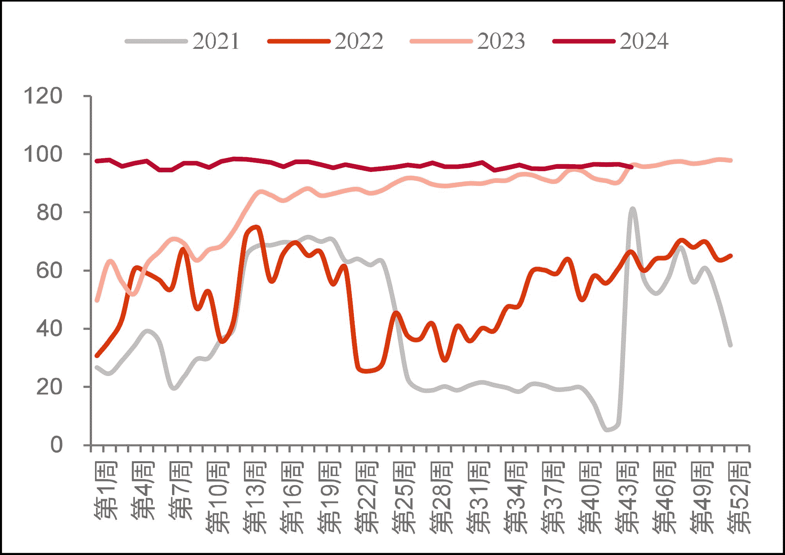

来源：航班管家、中泰证券研究所

（单位：%）

来源：航班管家、中泰证券研究所

（单位：%）

图表56：广州白云机场：执飞率（国际航线）

图表57：厦门高崎机场：执飞率（国际航线）

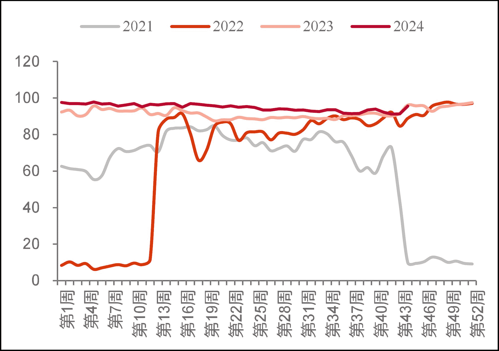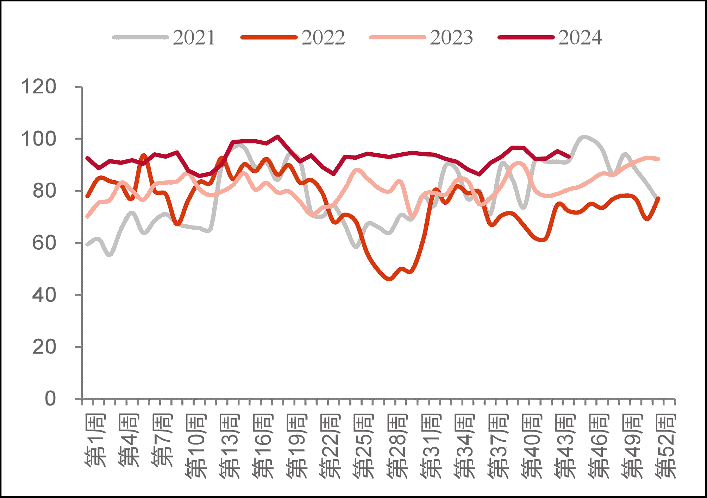

来源：航班管家、中泰证券研究所

（单位：%）

来源：航班管家、中泰证券研究所

（单位：%）

图表58：上海浦东机场：执飞率（国际航线）

图表59：上海虹桥机场：执飞率（国际航线）

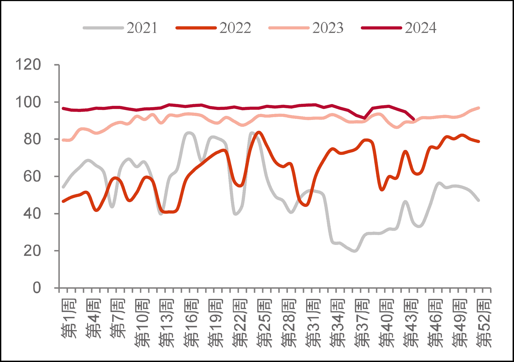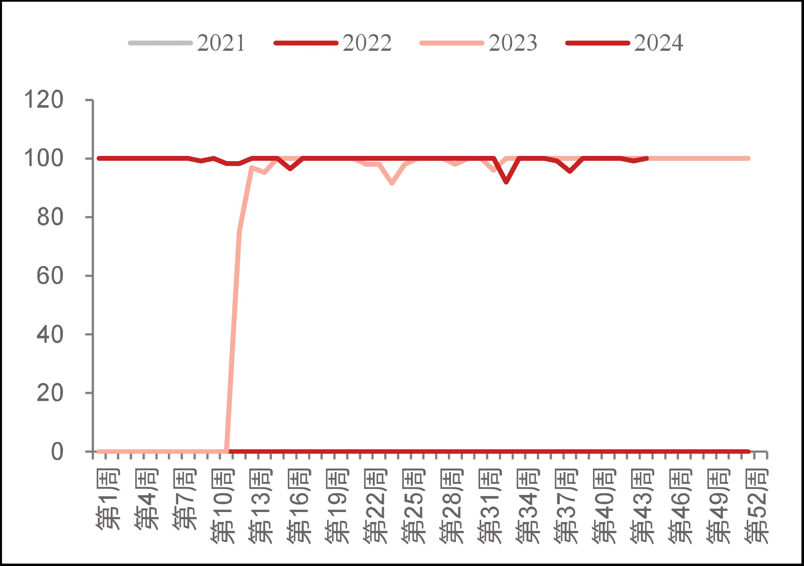

来源：航班管家、中泰证券研究所

（单位：%）

来源：航班管家、中泰证券研究所

行业定期报告

- 20 -

请务必阅读正文之后的重要声明部分

- 航空煤油出厂价：截至11月1日，航空煤油出厂价（含税）报收于5627元/吨，相比于上月上涨50元/吨，月环比增加0.90%，相比于去年同期下跌1934元/吨，年同比下降25.58%。

- 美元兑人民币：截至11月1日，美元兑人民币即期汇率为7.13，相比于上周上涨0.0031，周环比增加0.04%，相比于去年同期下跌0.19，年同比下降2.65%。

图表60：出厂价（含税）：航空煤油

图表61：即期汇率：美元兑人民币

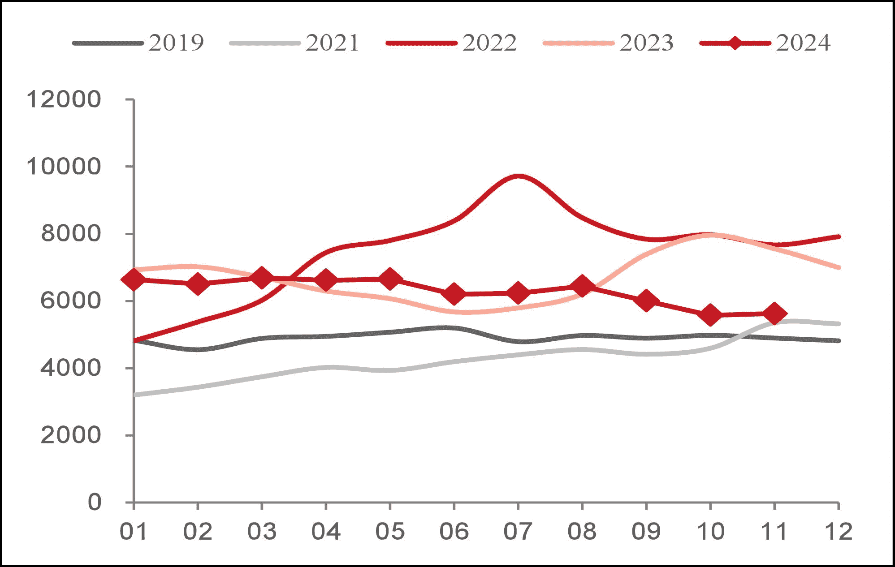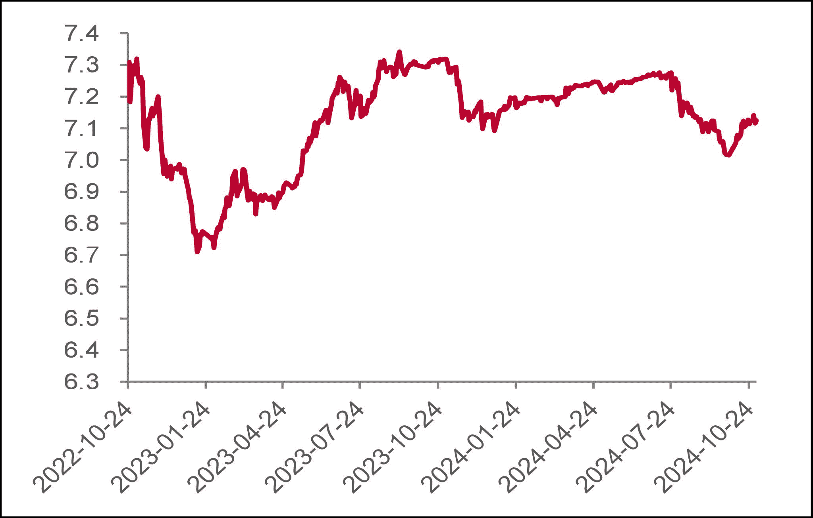

来源：iFinD、中泰证券研究所

（单位：元/吨）

来源：iFinD、中泰证券研究所

- 布伦特原油价格：截至11月1日，英国布伦特原油现货价报收于74.33美元/桶，相比于上周下跌1.74美元/桶，周环比下降2.29%，相比于去年同期下跌14.55美元/桶，年同比下降16.37%。

- WTI原油价格：截至10月31日，美国西德克萨斯中级轻质原油WTI现货价报收于69.58美元/桶，相比于上周下跌1.00美元/桶，周环比下降1.42%，相比于去年同期下跌12.06美元/桶，年同比下降14.77%。

图表62：现货价：原油：英国布伦特Dtd

图表63：现货价：美国西德克萨斯中级轻质原油（WTI）

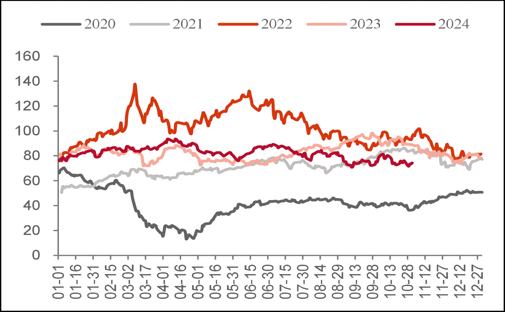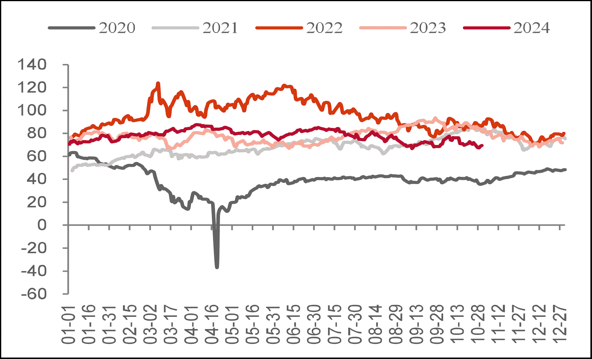

来源：iFinD、中泰证券研究所

（单位：美元/桶）

来源：iFinD、中泰证券研究所

（单位：美元/桶）

行业定期报告

- 21 -

请务必阅读正文之后的重要声明部分

## 3 本周交运板块及个股表现

- 本周交运板块上涨1.7%，表现优于大盘。本周沪深300下跌1.7%至3890.0；涨幅前三的行业分别为房地产（中信）（6.2%）、综合（中信）（5.1%）、钢铁（中信）（4.4%）。

- 本周交运行业细分板块中涨幅前三的分别为航空指数（7.9%）、公交指数（4.3%）、航运指数（3.2%）；跌幅前三的分别为物流综合指数（-0.8%）、铁路指数（-0.7%）、港口指数（-0.5%）。

- 本周航空机场板块中涨幅前三的分别为海航控股（28.8%）、中信海直（11.0%）、国航（4.2%）；仅吉祥航空（-1.5%）、上海机场（-1.1%）下跌。

图表64：本周交运板块上涨1.7%

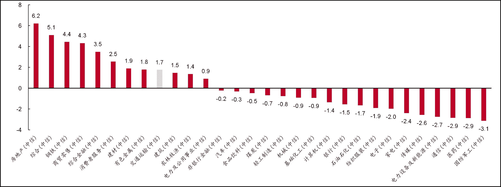

来源：iFinD、中泰证券研究所

（单位：%）

图表65：交运行业细分板块表现

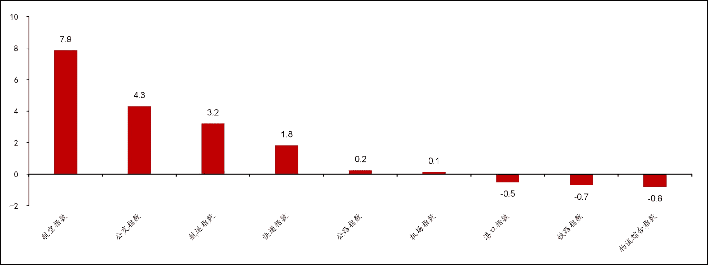

来源：iFinD、中泰证券研究所

（单位：%）

### 风险提示

- 汇率大幅下滑；国内经济失速下行；第三方数据可信性风险；研报使用信息更新不及时的风险。

### 图表66：航空机场板块个股表现

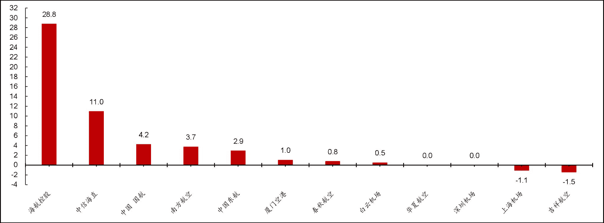

来源：iFinD、中泰证券研究所（单位：%）

---

## 投资评级说明

| 评级 | 说明 |
|------|------|
| **股票评级** | |
| 买入 | 预期未来6~12个月内相对同期基准指数涨幅在15%以上 |
| 增持 | 预期未来6~12个月内相对同期基准指数涨幅在5%~15%之间 |
| 持有 | 预期未来6~12个月内相对同期基准指数涨幅在-10%~+5%之间 |
| 减持 | 预期未来6~12个月内相对同期基准指数跌幅在10%以上 |
| **行业评级** | |
| 增持 | 预期未来6~12个月内对同期基准指数涨幅在10%以上 |
| 中性 | 预期未来6~12个月内对同期基准指数涨幅在-10%~+10%之间 |
| 减持 | 预期未来6~12个月内对同期基准指数跌幅在10%以上 |

备注：评级标准为报告发布日后的6~12个月内公司股价（或行业指数）相对同期基准指数的相对市场表现。其中A股市场以沪深300指数为基准；新三板市场以三板成指（针对协议转让标的）或三板做市指数（针对做市转让标的）为基准；香港市场以摩根士丹利中国指数为基准，美股市场以标普500指数或纳斯达克综合指数为基准（另有说明的除外）。

## 重要声明

中泰证券股份有限公司（以下简称“本公司”）具有中国证券监督管理委员会许可的证券投资咨询业务资格。本报告仅供本公司的客户使用。本公司不会因接收人收到本报告而视其为客户。

本报告基于本公司及其研究人员认为可信的公开资料或实地调研资料，反映了作者的研究观点，力求独立、客观和公正，结论不受任何第三方的授意或影响。本公司力求但不保证这些信息的准确性和完整性，且本报告中的资料、意见、预测均反映报告初次公开发布时的判断，可能会随时调整。本公司对本报告所含信息可在不发出通知的情形下做出修改，投资者应当自行关注相应的更新或修改。本报告所载的资料、工具、意见、信息及推测只提供给客户作参考之用，不构成任何投资、法律、会计或税务的最终操作建议，本公司不就报告中的内容对最终操作建议做出任何担保。本报告中所指的投资及服务可能不适合个别客户，不构成客户私人咨询建议。

市场有风险，投资需谨慎。在任何情况下，本公司不对任何人因使用本报告中的任何内容所引致的任何损失负任何责任。

投资者应注意，在法律允许的情况下，本公司及其本公司的关联机构可能会持有报告中涉及的公司所发行的证券并进行交易，并可能为这些公司正在提供或争取提供投资银行、财务顾问和金融产品等各种金融服务。本公司及其本公司的关联机构或个人可能在本报告公开发布之前已经使用或了解其中的信息。

本报告版权归“中泰证券股份有限公司”所有。事先未经本公司书面授权，任何机构和个人，不得对本报告进行任何形式的翻版、发布、复制、转载、刊登、篡改，且不得对本报告进行有悖原意的删节或修改。
