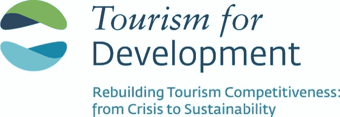
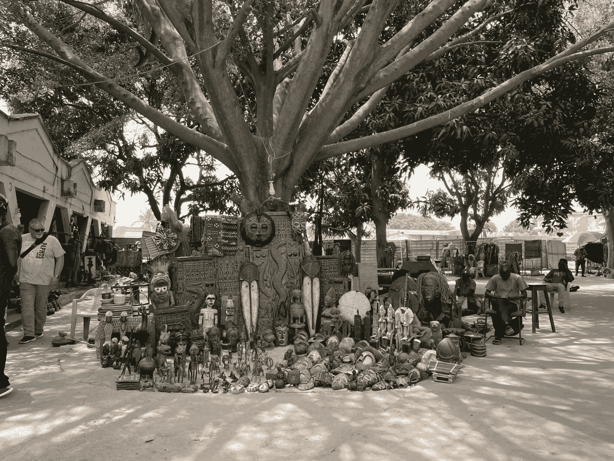
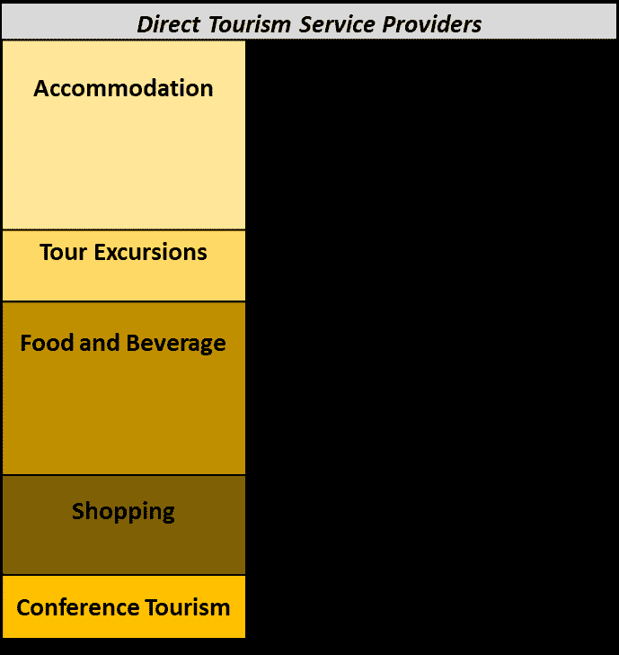
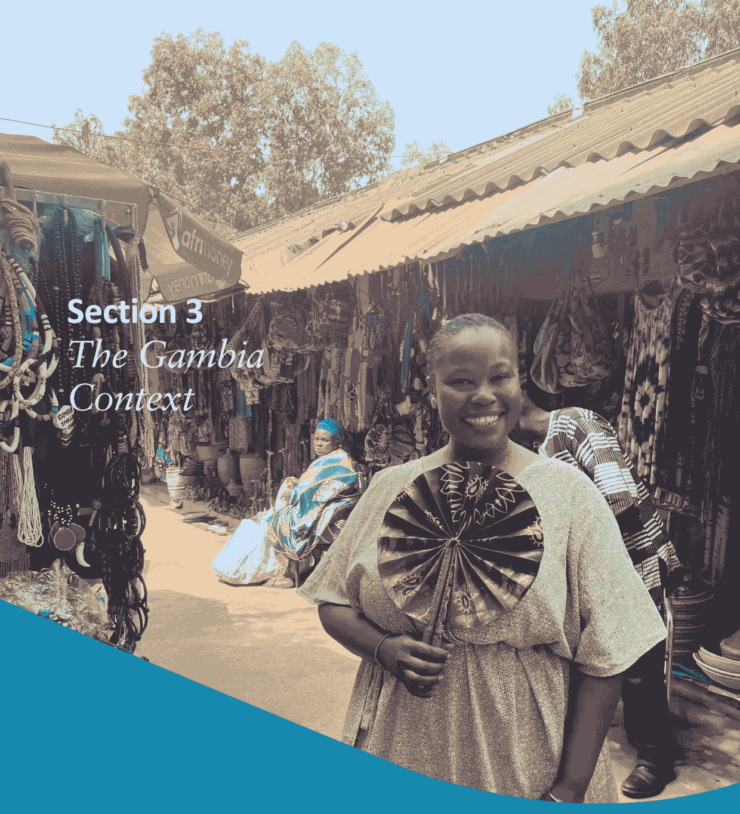
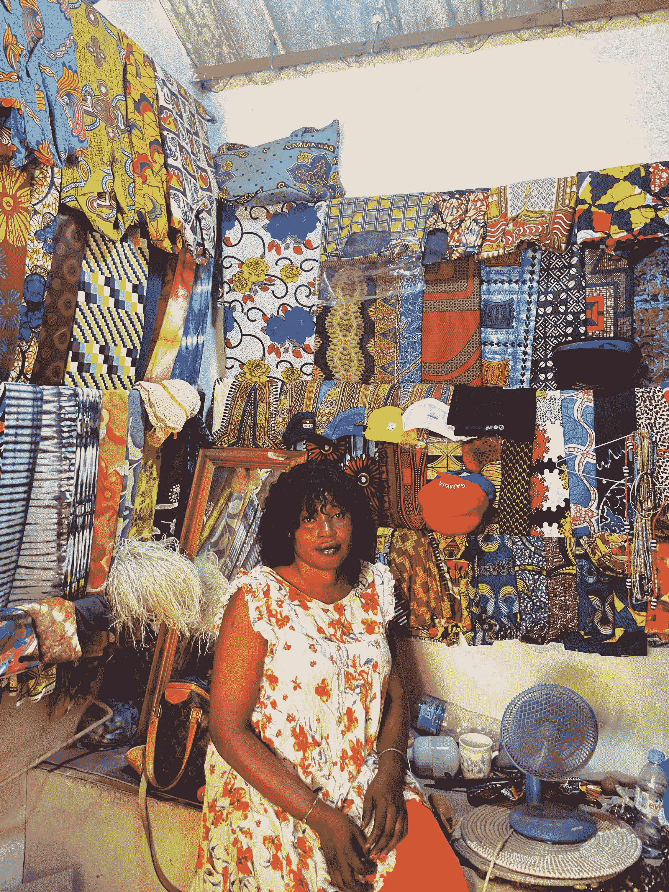
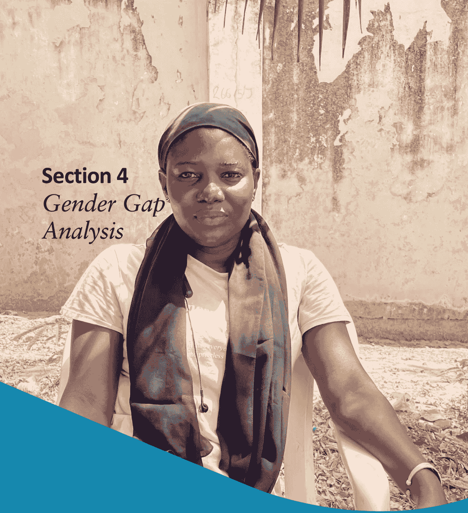
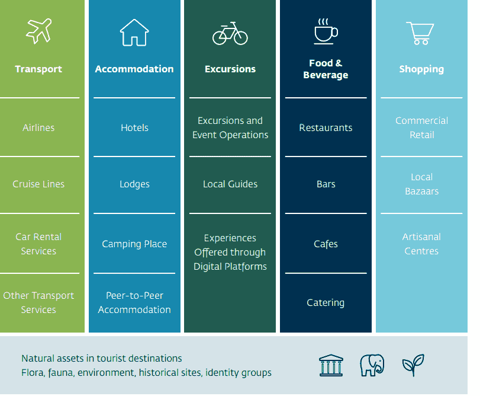
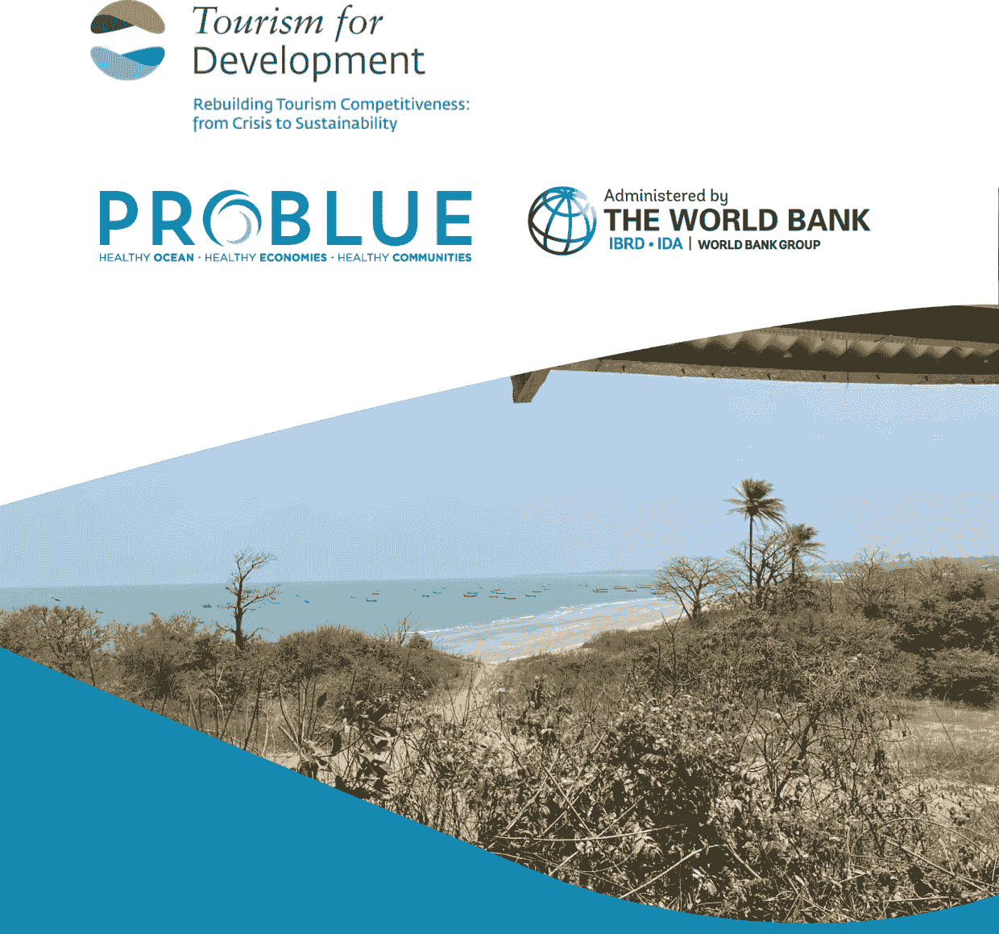

## GENDER ASSESSMENT OF THE GAMBIAN TOURISM SECTOR

Public Disclosure Authorized

Public Disclosure Authorized

Public Disclosure Authorized

Public Disclosure Authorized

© 2024 International Bank for Reconstruction and Development / The World Bank

1818 H Street NW

Washington DC 20433

Telephone: 202-473-1000

Internet: www.worldbank.org

This work is a product of the staff of The World Bank with external contributions. The findings, interpretations, and conclusions expressed in this work do not necessarily reflect the views of The World Bank, its Board of Executive Directors, or the governments they represent.

The World Bank does not guarantee the accuracy, completeness, or currency of the data included in this work and does not assume responsibility for any errors, omissions, or discrepancies in the information, or liability with respect to the use of or failure to use the information, methods, processes, or conclusions set forth. The boundaries, colors, denominations, links/footnotes and other information shown in this work do not imply any judgment on the part of The World Bank concerning the legal status of any territory or the endorsement or acceptance of such boundaries. The citation of works authored by others does not mean the World Bank endorses the views expressed by those authors or the content of their works.

Nothing herein shall constitute or be construed or considered to be a limitation upon or waiver of the privileges and immunities of The World Bank, all of which are specifically reserved.

## Rights and Permissions

The material in this work is subject to copyright. Because The World Bank encourages dissemination of its knowledge, this work may be reproduced, in whole or in part, for noncommercial purposes as long as full attribution to this work is given.

Any queries on rights and licenses, including subsidiary rights, should be addressed to World Bank Publications, The World Bank Group, 1818 H Street, NW, Washington, DC 20433, USA; fax: 202-522-2625; e-mail: pubrights@worldbank.org.

Photography: © Cansu Birce Gokalp and Elaine Tinsley / World Bank. Further permission required for reuse.

## Table

- Executive Summary — 2
- Introduction — 6
- Methodology — 9
  - 2.1 Framework — 9
  - 2.2 Data collection — 10
- The Gambia Context — 13
  - 3.1 Tourism in The Gambia — 13
  - 3.2 Status of Women in The Gambia — 14
  - 3.3 Tourism Segments in The Gambia: Potential for Women's Participation — 15
- Gender Gap Analysis — 20
  - 4.1 Gender Disparity in Employment — 20
  - 4.2 Gender Disparity in Entrepreneurship — 24
  - 4.3 Leadership and Decision-Making — 26
- Cross-Cutting Issues — 29
  - 5.1 Policy and Institutional Context — 29
  - 5.2 Tourism Education — 30
  - 5.3 Social Norms — 31
- Recommendations for Advancing Gender Equality in the Tourism Sector — 34
- Recommendations for the World Bank Tourism Diversification and Resilience in The Gambia Project — 39
- Bibliography — 44

## List

## Acknowledgments

## Acronyms

| Acronym | Meaning |
|---|---|
| FGM | Female Genital Mutilation |
| GBV | Gender-Based Violence |
| GDP | Gross Domestic Product |
| GMD | Gambian Dalasi |
| GTHI | Gambia Tourism and Hospitality Institute |
| HR | Human Resources |
| IFC | International Finance Corporation |
| MSME | Micro, Small, and Medium Enterprises |
| NCAC | National Council for Arts and Culture |
| PI | Personal Initiative |
| SEA | Sexual Exploitation and Abuse |
| SH | Sexual Harassment |
| SSA | Sub-Saharan Africa |
| UN | United Nations |
| UNDP | United Nations Development Programme |
| UNESCO | United Nations Educational, Scientific and Cultural Organization |
| UNWTO | United Nations World Tourism Organization |
| US | American Dollar |
| WBL | Women, Business and the Law |
| WOE | Women-Owned Enterprises |

## EZ Chat

A simple chat app

By HDevv

- ✓ Real-time chat
- ✓ Secure & encrypted
- ✓ 100% Free
- ✓ No ads

> npm i ezchat

## Executive Summary

Tourism offers significant opportunities for women’s participation, entrepreneurship, and leadership compared to other sectors, but there are challenges to address. Jobs in tourism are more likely to be low-paid, businesses tend to be smaller, informal, and less well-capitalized, and present risks such as vulnerability to exploitation, particularly in low-income countries like The Gambia. The United Nations (UN) Global Report on Women and Tourism highlights that women are nearly twice as likely to be employers in the tourism sector as in any other industry, attributing this to the sector’s characteristics such as low entry barriers and flexible work arrangements. However, despite these opportunities, challenges persist.

Women in the tourism sector often face exploitation, trafficking, and harassment due to the sector’s predominantly informal structure. The risks are exacerbated by the lack of formal protections and the vulnerability of women in low-income settings within the industry.

The Gender Assessment of the Tourism Sector in The Gambia documents gender disparities and key issues hindering women’s participation and earnings in tourism through the lens of employment, entrepreneurship, and leadership. The assessment also examines cross-cutting factors such as policy and institutional environment, education, and social norms, which impact women’s economic opportunities in the sector and influence their decision to enter and remain in the sector. The findings are based on comprehensive desk research, semi-structured interviews, and key informant interviews conducted in person in The Gambia in May 2023.

Despite women showing strong interest in hospitality, reflected in higher enrollment rates than men in tourism and hospitality institutes, this is not translating into higher employment shares due to a combination of key supply- and demand-side barriers.

Gender employment disparities in Gambian tourism reveal significant gaps favoring male workers over female workers, though the gap narrows for part-time roles. Women constitute 35 percent of full-time employees in the tourism sector, compared to 65 percent for men, resulting in a gender gap of 29 percentage points. Women are more likely to be hired for part-time or seasonal roles and often occupy positions such as receptionists, waitresses, housekeeping staff, and some managerial roles in Human Resources (HR), finance, and marketing. Women face barriers including lack of skills, restrictive gender norms, limited information about lucrative tourism jobs, and discriminatory hiring practices, which contribute to their lower participation rates. There is still a societal stigma associated with women working in hotels, exacerbated by safety concerns in late hours and gender norms.

In tourism entrepreneurial activities, most women-owned businesses face challenges in skills development, securing finance, accessing tourism segments and markets, and are further limited by a lack of infrastructure and testing labs. Predominantly, women engage in entrepreneurial activities as craft sellers, beach fruit vendors, tour operators, restaurant owners, and indirectly contribute to the tourism sector by supplying vegetables, food, and through catering, beauty, skincare, and fashion businesses. While gender-disaggregated data is not available on tourism business ownership in The Gambia, in general, women-owned businesses are predominantly micro: 83 percent of women-led businesses are solo ventures, compared to 63 percent of male-led businesses. Moreover, less than 1 percent of female-led businesses can be classified as medium or large, highlighting the dearth of prominent female business role models in the sector. Earnings are also lower, with median monthly profit for female-led businesses at 3000 GMD, compared to 5000 GMD for male-led businesses.

The limited diversity in the tourism sector also limits entrepreneurship opportunities, with most women entrepreneurs primarily engaged in souvenirs, fruit sellers, and produce providers. One of the key issues facing women tourism entrepreneurs is the lack of skills, including handcraft skills that tend to limit women vendors to selling crafts made elsewhere, but also business management skills such as financial literacy. The challenge also lies in the limited variety of markets and tourism segments available to showcase local products, as well as the weak connections to hotels, supermarkets, and online platforms. Additionally, lack of market infrastructure and testing labs also limits outlets where women can sell more innovative Gambian-made items and consumption goods.

On leadership, the underrepresentation of women in decision-making and leadership roles in The Gambia has implications for the tourism sector, including the perpetuation of stigma and the hindrance of women’s economic participation. Women in The Gambia only make up 8.6 percent of the parliament, with men holding 91 percent of the seats, ranking The Gambia 168 out of 186 countries globally. This scarcity of women in political leadership hinders the prioritization and implementation of legislative reforms and supportive interventions necessary to improve women’s safety in the tourism sector and address The Gambia’s sex tourism reputation.

Even though tourism globally provides better opportunities for women’s leadership than other sectors of the economy, none of the key public tourism players such as Gambia Tourism Board, Gambia Tourism and Hospitality Institute (GTHI), and National Center for Arts and Culture (NCAC) are currently headed by women. On the private sector side, there is some female presence among general managers of hotels; 3–4 out of approximately 40 hotels are women. Key informant interviews highlight that having women in upper hotel management positions helped female staff feel more comfortable reporting sensitive issues, such as harassment. Women’s presence in leadership roles not only inspires other female employees but also fosters a more inclusive and approachable workplace atmosphere.

Another critical issue is the sector’s association with sex tourism, which poses significant risks to women and men, including sexual exploitation and harassment, and limits the development of other tourism segments. The Gambia’s reputation as a sex tourism destination impacts how workers, both female and male, interact with tourists and hotels/restaurants and other actors supporting either tacitly or explicitly this type of tourism. And, with “bumsters” often pushing for front-facing jobs, such as waiters or bartenders, to maximize interaction with guests, not only does this tend to push women from those jobs, but also the ill repute of these kinds of workers prevents women from pursuing them, despite the higher income potential from tips.

In terms of tourism education, while women are the majority of students in formal tourism programs, they largely lack the high-level and soft-skills training needed for career progression, and the school primarily serves the “workforce” level in hospitality, pointing to an opportunity for new curriculum development in The Gambia. There is a large body of literature that shows the impact of training programs that encompass soft skills, network building, and other key skills, alongside high-level training.

Currently, there is a lack of new curriculum development and investment in managerial programs, which include soft-skills training that could benefit female students. Hotels choose most of their workforce from GTHI, but the institute primarily focuses on hospitality, leaving the tourism aspect underexplored. There are untapped prospects to expand school offerings to encompass subjects like ecotourism and events management, addressing the growing facets of the tourism industry.

Most actors in the tourism ecosystem collect very limited sex-disaggregated data, which poses a significant impediment to recognizing the challenges encountered by women and developing sectoral targeted interventions. There are opportunities for key organizations such as Gambia Tourism Board and GTHI to collect targeted data to document the gender disparities, identify opportunity areas, and track progress. Notably, GTHI currently ceases alumni tracking after six months, presenting an opportunity for enhanced data collection and an imperative for monitoring students’ post-work placement and program effectiveness. To make informed policy decisions, more gender-disaggregated data is needed in the sector, particularly data on earnings. While there is information on employment in tourism, data on businesses or self-employment in tourism is less available.

Emerging segments like conference and ecotourism could provide opportunities for greater and safer women’s involvement. Diversification of tourism segments carries new possibilities for women’s economic involvement while also boosting the economy. For example, ecotourism offers more environmentally and socially sustainable practices, as they often purposely hire and source from local women. Conference tourism is an emerging area that could offer more employment and entrepreneurship opportunities for women that are not related to the more stigmatized accommodation tourism.

Key to supporting Gambian women in tourism will be the creation of a safer work environment, better policies, and strong enforcement. In terms of legislation, stronger legislation and rigorous implementation of safety protocols are lacking to cultivate a secure and empowering working

environment for women in the tourism industry, fostering their participation and advancement free from harassment and discrimination. The Women, Business and the Law 2024 (WBL) report highlights that The Gambia needs improvement enacting legislation protecting women from sexual harassment and adopting criminal or civil penalties for sexual harassment in employment. On the private sector side, tourism businesses should implement explicit policies and training against sexual exploitation and harassment and establish safe and confidential grievance mechanisms. On the government side, enforcement mechanisms must be credible with real consequences for offenders. Other support for women’s involvement should include diversifying tourism activities, enhancing skill sets, and facilitating market development and connections.

## Introduction

The travel and tourism sector has demonstrated a greater capacity to offer women increased employment opportunities in comparison to other sectors, thereby presenting a significant potential for women’s advancement within the economy. According to the UN Global Report on Women and Tourism by World Tourism Organization, tourism offers superior opportunities for women’s participation in the workforce, women’s entrepreneurship, and women’s leadership than other sectors of the economy. For example, the report found that women are nearly twice as likely to be employers in the tourism sector than in any other industry (UNWTO, 2010). Women are also more likely to be involved in tourism due to the unique characteristics of the tourism sector. In general, the barriers to entry are low, particularly in terms of skill and educational requirements and capital needs for entrepreneurial initiatives. There is less emphasis on formal education and training and greater emphasis on interpersonal and hospitality skills. There are increased options for entrepreneurship that do not require heavy start-up financing. Moreover, the nature of the work can be flexible in terms of work hours, as well as part-time or full-time employment.

Conversely, jobs in tourism are also likely to be low earning, businesses tend to be smaller, less well-capitalized and informal, particularly for women-owned businesses. Due to its predominantly informal structure, the tourism sector can pose significant risks for women, particularly in terms of trafficking, exploitation, sexual abuse, and harassment. These dangers are more pronounced for women in low-income countries like The Gambia, where they often occupy vulnerable positions within the industry. Additionally, if women voice concerns about working conditions, such as in certain hotels or kitchens, they may face consequences such as job loss, unilateral reduction of hours, or enduring physical/sexual abuse from colleagues or clients, further exacerbating the exploitative nature of the industry.

The ***Gender Assessment of the Tourism Sector in The Gambia*** aims to document the existing gender disparities and key gender challenges in tourism for inclusive economic growth in The Gambia. Tourism is the second biggest contributor to The Gambia’s Gross Domestic Product (GDP) and a key source of job creation, including for women. In many countries, tourism is a sector with one of the lowest gender participation gaps, however, in The Gambia, the gap between women and men’s participation in tourism (as measured by gender disaggregated employment data) is 28 percent, which is higher than the 8.5 percent gap between women’s and men’s overall participation rate in the labor force. The assessment aims to understand women’s participation in the tourism sector in The Gambia where gender inequality is among the highest in the region and the world. More specifically, the assessment aims to demonstrate the gender disparities in participation and earnings; assess the underlying barriers and binding constraints to women’s participation and better economic outcomes in tourism; and provide targeted recommendations to be incorporated during the implementation of the World Bank Tourism Diversification and Resilience in The Gambia project (P177179).

The assessment explores key issues in women’s employment, entrepreneurship, and leadership within The Gambia’s tourism sector, while examining cross-cutting factors which impact women’s economic opportunities in the sector and influences on their decision to enter and remain in the sector. To guide policies and programs within tourism that aim to enhance women’s economic empowerment, this assessment analyzes through the lens of wage employment, entrepreneurship (including self-employment), and leadership, as interventions and stakeholders are different. Policies, education, and social norms are analyzed as important contextual factors determining outcomes in the three areas. In addition, the assessment unpacks the impact of diversification of tourism activities, such as eco-tourism and conference tourism, on women’s economic outcomes and participation.

The assessment presents findings from comprehensive desk research, semi-structured interviews and key informant interviews conducted in-person in The Gambia in May 2023, and is structured as follows: Section 2 presents the methodology, including the assessment framework, data collection method and key stakeholders. Section 3 provides the background on the country context and status of gender equality in The Gambia while also unpacking different types of tourism in the context of women’s existing and future economic opportunities. Section 4 presents the gender gap analysis in women’s employment, entrepreneurship, and leadership. Section 5 dives into the tourism ecosystem assessment, which looks at policies, supporting institutions, and cultural norms. Finally, Section 6, provides a list of recommendations to improve women’s participation in tourism, including in the context of the World Bank Tourism Diversification and Resilience in The Gambia Project (Box I).

### BOX I. The World Bank Tourism Diversification and Resilience in The Gambia Project

The **World Bank Tourism Diversification and Resilience in The Gambia Project** (US$ 68 million) aims to improve the diversification and resilience of the Gambian tourism sector by strengthening institutional and policy framework, improving capabilities and access to funds for tourism-related Micro, Small and Medium Enterprises (MSME) suppliers, and building resilience through the strengthening of sustainable coastal infrastructure and rehabilitation of existing tourism sites. The project also takes a targeted approach to integrate gender actions across its project components and leverages significant global knowledge and experience in tourism recovery and small and medium enterprises upgrading initiatives, particularly related to building back better in a post COVID-19 environment.

This Gender Assessment provides recommendations to improve gender-inclusivity under the project’s Component 1, *Policy Framework and MSME participation*. The interventions under this component aim to address selected key bottlenecks in the tourism ecosystem in The Gambia, to ensure the sector realizes its potential as a source of sustainable and inclusive growth. Activities focus on (a) strengthening capacity for collecting relevant tourism data to inform policy decision-making; (b) enhancing marketing to promote recovery and diversification beyond traditional source markets and segments; and (c) promoting the diversification of the destination and products beyond ‘sun and sea’. MSMEs, identified by large firms and meeting the eligibility criteria, will be provided technical and compliance support during business planning, technology selections/adoption, contract negotiations, and product quality and productivity improvements (for example, improving management capacity, adopting digital and climate technologies, and enabling them to meet quantity and quality requirements of lead firms). In addition, this component will take a targeted approach to provide coaching to women entrepreneurs for enhanced business development skills and tailored mentoring by leveraging existing women entrepreneurs’ network in the country.

## Setting the Prior

In addition to using the training data, you can also set the prior in a Bayesian network manually. In this example, you can specify the prior probabilities for each node on the left-hand side, and endogenous variables on the right-hand side.

You can also choose to load a prior network from a file:

- **BDe** (Bayesian Dirichlet equivalence)
- **BDeu** (Bayesian Dirichlet equivalence uniform)
- **K2**
- **Dirichlet**

## Methodology

### 2.1 Framework

The Gender Gap Analysis examines women’s participation in tourism through three lenses: Employment, Entrepreneurship and Leadership.

Employment and Entrepreneurship are seen as principal objectives for increasing women’s participation and earnings in tourism. They are treated separately as the stakeholders and interventions can be very different than that of men. For example, how to encourage hotels to hire more women staff requires a different intervention than how to encourage hotels to procure from women-owned enterprises. The third pillar, Leadership, is seen both as an enabling factor that can support bringing about the necessary policies to support women’s employment and entrepreneurship, but it is also a key outcome on its own. While assessing the status of women in leadership roles within tourism and more broadly, women’s presence in broader decision-making mechanisms is also taken into consideration.

The Gambian Tourism Ecosystem Assessment examines the enabling environment for women’s economic participation through three cross-cutting areas: policy and institutional environment, tourism education and social norms. These are explored as the key external factors contributing to women’s outcomes in employment, entrepreneurship, and leadership.

Table 1 covers the framework and key areas to examine the barriers and binding constraints to increasing and improving women’s participation in the sector.

### Table 1: Gender Assessment Framework for the Tourism Sector

| Gender Assessment of the Tourism Sector | Employment | Entrepreneurship | Leadership |
|---|---|---|---|
| *What are the gender disparities?* | Gender disparity in participation and earnings. *Type of jobs (high value vs. low value) and composition in sub-sectors.* | Gender disparity in participation and earnings. *Type of businesses (informal, micro, etc.) and the information on sub-sectors.* | Where/how do women participate in leadership and decision-making in the tourism sector? How does this compare to men? |
| *What are the key issues/barriers?* | **Key issues:** - Supply side (transport, training, sexual exploitation/harassment, safety) - Demand side (employer bias, hiring practices, legal barriers) | **Key issues:** - Skills - Access to finance - Access to markets - Access to networks and information | **Key issues:** - Representation - Gender discrimination - Skills shortages at managerial levels - Sexual harassment |
| *Who are the key stakeholders?* | Hotels (hiring) Restaurants MSMEs—for example, tour operators Training institutions Women-led businesses | Hotels and other larger firms (procuring) Intermediaries/NGOs Government agencies Associations | Political representation Other policy stakeholders and community organizations |

**Ecosystem Factors (Cross-cutting)**

- Policy and Institutional Environment
- Education and Skills
- Social Norms and Gender-Based Violence (GBV), including Sexual Exploitation and Abuse/Sexual Harassment (SEA/SH)

### 2.2 Data Collection

The first step in the assessment was desk research. The World Bank Group’s Gender Data Portal, the United Nations Development Programme’s (UNDP) Gender Development Index, the World Economic Forum Global Gender Gap Report, and Women, Business, and the Law provided useful initial background information on how The Gambia was performing on gender equality. The National Tourism Strategy, National Gender Strategy, and the World Bank Country Partnership Framework provided an understanding of the broader policy landscape of the country. The assessment also noted descriptive statistics on gender gaps shared in country surveys or in other surveys such as World Bank Enterprise Surveys.

Recent research conducted in The Gambia contributed invaluable insights to the gender assessment of the tourism sector. Some of these resources include The Gambia Poverty and Gender Assessment 2022, Policies for Sustainable and Inclusive Private Sector-led Growth: Achieving Sustainable and Inclusive Growth, The Gambia, and the Project Appraisal Document of the Tourism Diversification and Resilience in The Gambia (P177179), among others.

Following the desk research, the assessment undertook a mapping of the stakeholders with a few important considerations. First, the authors identified several actors in the five economic activities that generate revenues and income in the tourism sector—transport, accommodations, excursions, food and beverage, and shopping. Depending on the size of each sub-economic activity and the conditions in the field, the authors interviewed several stakeholders to reflect diversity of experience and opinion. In addition, relevant stakeholder suggestions by the Project Implementation Unit of the current Gambia Tourism and Resilience project were included in the list. Finally, the assessment tried to ensure a balance of female and male participants in the stakeholder meetings.

Key informant interviews and focus group discussions were conducted in The Gambia in May 2023. The team carried out 33 individual interviews, including 23 with key informants, and organized a focus group involving eight women entrepreneurs from various industries within the tourism value chain, facilitated by the Gambia Women’s Chamber of Commerce. Key informants included representatives from industry associations; heads of training institutes; managers of direct tourism service providers in accommodation, tour excursion, and restaurants; enterprise support organizations (ESOs); development partners; NGOs; and a former policymaker (Table 2). Key informant interviews took around 30 minutes to one hour. In addition, the authors held ten informal individual interviews with hotel staff, craft sellers, fruit sellers, and tour guides.

The in-person assessment also resulted in the collection of data from tourism organizations, though finding sex-disaggregated data was a challenge throughout the assessment. The team also uncovered further data collected by the Gambia Tourism Board and the GTHI during the in-person assessment. This additional information filled some gaps in data and provided a complementary analysis, but more data will need to be systematically collected to shed light on the issues women face in the tourism industry as well as any progress made going forward.

The assessment’s focus was primarily on urban tourism centers, though it investigated community-based tourism in rural areas, which carries potential for The Gambian tourism and women’s economic opportunities. The in-person consultations mostly took place around urbanized centers such as Serekunda and Banjul, except for a few ecolodges located near the southwestern coastal area where site visits and interviews with workers were conducted. Even though the assessment did not conduct in-depth interviews in villages, interviews with vendors around Kunta Kinteh Island and with community-based tourism actors such as the Institute of Travel and Tourism in The Gambia were undertaken. The assessment recognizes the key linkages, especially agricultural, between the rural economy and the tourism ecosystem. Where necessary, the analysis tried to fill in the gap with the study *Barriers to Economic Empowerment of Rural Women in The Gambia*, which has a strong focus on rural women and findings from relevant key informant interviews.

**Table 2: Stakeholder Consultations – The Gambia**

## Section 3

## The Gambia Context

## The Gambia Context

### 3.1 Tourism in The Gambia

Situated on the western coast of Africa, The Gambia, with a population of 2.4 million, spans along the banks of the Gambia River, providing it with a unique geography and diverse ecosystems. Bordered by Senegal on three sides, The Gambia is the smallest country on the mainland continent but draws tourists from around the world. One of the primary sources of tourism in The Gambia is its coastline, stretching for approximately 80 kilometers along the Atlantic Ocean. The Gambia is mainly a sun and sea tourism destination with two main seasons: high season from November to April (*dry season*) and low season from May to October (*rainy season*).

Tourism is an important contributor to The Gambia’s GDP and a vital source of jobs; however the sector lags its competitors due to fewer arrivals, shorter stays, and lower tourism expenditures. These challenges mainly result from limited diversification in source markets, distribution channels, and product offering and lead to high seasonality, modest spillover effects, and susceptibility to climate risks and shocks. Pre-pandemic, tourism was estimated to directly contribute between 12 and 16 percent of GDP, supporting over 42,000 jobs directly and an additional 40,000 jobs indirectly (UNDP, 2020). It generated an annual US$ 85 million in foreign exchange earnings, making it the country’s number one foreign exchange earner (World Bank, 2022c). However, the stark disparity in seasonal variations, with low-season passenger arrivals comprising only about 40 percent of those in the high season, remains a critical concern impacting both employment rates and earnings within the industry.

The Gambia attracts tourists mostly from a few select markets in Europe but is trying to expand its reach to other countries. According to The Gambia Tourism Board, the United Kingdom is the lead market and British visitors constitute 17 percent of all visitors and 42 percent of visitors coming from traditional markets. It is followed by Netherlands (8 percent of all visitors and 19 percent of visitors from traditional markets), Spain, Germany, Belgium, Sweden, Denmark, Norway, and Finland. According to The Gambia Tourism Board Arrival Statistics in 2022, international arrivals by air were only at 77.5 percent of pre-COVID levels (Gambia Tourism Board, 2022).

The Gambia possesses a rich asset base but has barely diversified away from ‘sun and sea’ tourism into other areas such as eco-tourism and cultural tourism. According to the World Economic Forum Travel and Tourism Competitiveness Report, The Gambia ranks 61 out of 136 countries when it comes to the total number of known fauna species and 54 on the attractiveness of natural assets index (World Economic Forum, 2017). It is also among the countries with the highest number of United Nations Educational, Scientific and Cultural Organization (UNESCO) sites in the Sub-Saharan region, with two cultural heritage sites (Stone Circles of Senegambia and Kunta Kinteh Island), and one intangible expression of culture (the “Roots” Festival, commemorating the experiences of the descendants of African slaves who were taken from the region during the transatlantic slave trade). Nevertheless, many tourist sites are currently in a state of disrepair and are poorly maintained, requiring substantial renovation and improvements.

Climate change and coastal erosion have a direct impact on cultural products and goods in the country. Kunta Kinteh Island, a World Heritage Site, is shrinking in size annually, with part of it now submerged in the ocean, endangering its integrity and tourism value. The infrastructure challenges due to climate change and low maintenance are some of the key issues tackled by the World Bank’s Tourism Diversification and Resilience in The Gambia project. Moreover, considering that over half of the nation’s population resides in urban regions and around 80 percent of the urban population is situated within a 20 km range of the Atlantic coast, the anticipated increase in sea levels presents a significant peril to the local population, including stakeholders ranging from fishers to hotels across the spectrum of the tourism supply chain.

The COVID-19 pandemic contributed to massive downsizes in personnel and closures of activity within the sector, also disproportionately impacting women. The accommodation sector was the most affected with about 94 percent of establishments reducing staff level (The Gambia Bureau of Statistics, 2020). In 2020, there was a 62 percent drop in air arrivals over 2019. According to World Travel & Tourism Council 2022, tourism’s contribution to GDP sharply fell to 7 percent in 2020 from 15 percent in 2019. However, the sector is showing signs of recovery as income from tourism has increased considerably from an estimated US$58.7 million in 2021 to US$184.1 million in 2022 (Gambia Tourism Board, 2022). Women, who are predominantly employed in service roles, faced heightened vulnerability to income insecurity during the pandemic. The impact on women in the tourism industry was exacerbated by the substantial number engaged in informal employment. When women in the tourism sector operate within informal businesses or as self-employed workers in the informal sector, they generally have low savings and no monetary support, especially compared to those in formal jobs. These issues are commonly linked to such informal work arrangements, rendering them more susceptible to economic shocks and crises (International Labour Organization, 2022).

### 3.2 Status of Women in The Gambia

The gender gaps in Gambia are substantial. According to the 2023 World Economic Forum Global Gender Gap Report, the country ranks 119th out of 146 countries in gender equality. In the UNDP Gender Inequality Index, which analyzes three dimensions—reproductive health, empowerment, and the labor market—Gambia ranks 153rd out of 170 countries. And more broadly, in the UNDP Human Development Index, which measures progress in basic dimensions of human development, Gambia ranks 174 out of 191 countries and is placed in the low human development category.

Women and girls in Gambia experience a complex web of challenges. According to World Bank Gender Data Portal, only 51 percent of women aged 15 and above can read and write compared to 62.5 percent of men. The gap in adult literacy between men and women is larger than the gap in the Sub-Saharan Africa (SSA) average. Child marriage remains prevalent, disrupting education, endangering young mothers, and perpetuating poverty and gender inequality. Despite the criminalization of female genital mutilation (FGM) in The Gambia, the practice remains prevalent. About 50 percent of girls aged 0-14 years have undergone FGM, and this rate goes up to 75 per cent of women and girls, aged 15-49, who have undergone some form of FGM (United Nations Population Fund, 2013).

Women’s roles are often delineated by traditional gender norms, impacting their access to education, employment opportunities, and decision-making power. In The Gambia, traditional gender roles often prescribe distinct responsibilities for men and women, reinforcing the perception that women should primarily be responsible for domestic duties and caregiving, while men are expected to take on roles that involve decision-making and economic activities. Starting from a young age, girls are exposed to the notion that boys are the ones meant to be leaders, which persists as they grow older, with institutions and communities further reinforcing this message (UN, 2022).

Intrahousehold dynamics exert a significant influence on the outcomes of women’s empowerment efforts. While enhancing the access to economic opportunities, the distribution of resources, responsibilities, and decision-making power within a household can profoundly impact a woman’s ability to fully participate in and benefit from these opportunities. According to The Organization for Economic Cooperation and Development (OECD) Development Centre’s Social Institutions and Gender Index (SIGI), The Gambia experiences notable levels of discrimination within households, highlighting significant power imbalances among family members. When it comes to who decides how household money is spent, one survey reveals that men are considerably more likely than women to say they make such decisions themselves (61 percent vs. 44 percent). More women than men say they decide jointly with their spouse (28 percent vs. 10 percent) (Afrobarometer, 2023). These dynamics could also yield far-reaching outcomes. Given that men are regarded as household leaders, women might face a higher likelihood of job displacement during off-peak periods, owing to the perception that men are responsible for family support. This situation might already be in effect since women often engage in part-time or seasonal employment.

Women lack access to paid work and labor market opportunities are particularly limited for young women. In The Gambia, the labor force participation rate (proportion of the population ages 15 and older that is economically active) among females is 57.3 percent and among males is 65.8 percent for 2022 (World Bank Gender Data Portal, 2022). Women are 3.7 times more likely to be unpaid helpers in family businesses, and 26 percent more likely to be engaged in subsistence agriculture (World Bank, 2022c). Most women are in vulnerable employment, which means they are less likely to have formal work arrangements,

social protection, and safety nets to guard against economic shocks; thus, they are more likely to fall into poverty. Vulnerable employment among women is 81.3 percent and among men is 62.7 percent in The Gambia for 2019 (World Bank Gender Data Portal, 2019).

**The level of women's involvement in decision-making and leadership roles in The Gambia continues to be limited.** Women in The Gambia ranks 132nd out of 146 countries on the political empowerment of women according to the 2023 World Economic Forum Global Gender Gap Report. Women's roles are often delineated by traditional gender norms, impacting their access to education, employment opportunities, and decision-making power. Like many places worldwide, gender-based violence (GBV) is a significant concern in The Gambia, with one in four women having been subjected to physical and/or sexual violence by a current or former intimate partner.

**In the domain of self-employment, where a significant number of women are involved, women face difficulties in opening bank accounts and accessing formal credit due to underlying constraints which disadvantage women.** According to Global Findex Database, 33 percent of Gambia’s population above age 15 has an account at a financial institution or through a mobile money provider. In 2022, 38 percent of men had an account while 28 percent of women did so, almost 10 percentage point gender gap in account ownership (World Bank Global Findex Database, 2021). In terms of accessing credit, women lack collateral to secure loans. For example, only 9 percent of women own a land, compared to 31 percent of men, and only 16.8 percent of women, compared to 40.6 percent of men, owned a dwelling either alone or jointly (World Bank Gender Data Portal). Distance to bank branches is also more of an impediment for women than for men, as women have lower mobility, more responsibilities for caring for children, and lack means of transportation – only 2 percent of women in one study owned a means of transport versus 58 percent of men (UNCDF, 2019).

### 3.3 Tourism Segments in The Gambia: Potential for Women's Participation

**The beach—referred to as 'sun and sea'—is by far the most popular tourism attraction, and heavily reliant on International Tour Operators (ITOs) who bring in 50–70 percent of all tourists.** This sub-segment remains the main attraction for about 80 percent of tourists and allows ITOs to control 70 percent of all air access and international marketing, as well as contribute 85 percent of all hotel revenues (World Bank Group, 2022d). This assessment analyzes women’s participation in the hotel workforce and the role of women-led businesses in the hotel value chains in the gender gap analysis section.

**The diversification of the tourism offering in The Gambia, especially *conference tourism, eco-tourism, and community-based tourism* could lead to promising economic outcomes for women, both in terms of improving women’s employment and women-led MSMEs accessing new markets, contributing to inclusive economic growth opportunities.** Due to limited diversification, distribution channels, and product offerings, Gambia currently lags behind its competitors. The diversification carries new possibilities for women’s economic involvement in the sector while also broadening the sector and boosting the economy.

**For example, conference tourism is an emerging area that could bring in international visitors and shorten the low season.** With the opening of a state-of-the-art convention center in August 2020, Gambia has seen an influx of local, regional, and international conferences being hosted there, and demand is expected to continue growing. According to the Gambia Tourism Board Arrivals Report, Business and Conference visitors were up by 3 percent in 2022. Conference tourism can also serve to entice attendees to extend their stays, or return, either by themselves or with their families, provided they have exposure to attractions and experiences that make it desirable to return. Conference tourism boosts accommodation stays, creating additional demand for hospitality needs. And although the conference center itself currently has limited staff, there are several direct and indirect jobs that feed into the conferences, including event planning, translators, catering, technology and audio-visual services, marketing and promotion, entertainment, retail and gift bag preparation, etc. This expansion of employment opportunities in tourism for women extends beyond conventional roles, like those in hotels and restaurants, which are often subject to stigma. More importantly, the growth of other tourism segments, such as conference tourism, can help detract from The Gambia’s lingering sex tourism reputation and build a tourism segment that is more professionally oriented and more inviting for women to participate. Box II highlights how the Kigali Convention Center became one of Africa’s top conference destinations, providing insights into best practices The Gambia could also adopt.

**BOX II. Conference Tourism in Rwanda**

Rwanda has emerged as a burgeoning hub for conference tourism, experiencing significant growth in recent years. Fueled by a combination of strategic investments in infrastructure, proactive marketing efforts, and a stable political environment, the country has attracted an increasing number of international conferences and events. The Kigali Convention Centre, opened in 2013 with its state-of-the-art facilities and world-class amenities, has played a pivotal role in positioning Rwanda as a premier destination for conferences and conventions. In 2018, conference tourism brought in about 20 percent of the tourism revenue, or $56 million. Kigali is currently ranked second in African cities for number of conferences hosted, succeeded only by Cape Town (ICAA 2022). Additionally, the government's commitment to sustainability and conservation, evident in initiatives like the ban on single-use plastics, has bolstered Rwanda's appeal among environmentally conscious conference organizers. Rwanda's strategic location in East Africa, along with its visa-on-arrival policy for many nationalities, has made it an attractive and accessible destination for participants from across the globe.

**Eco-tourism is a relatively new but growing segment.** Spread further upstream of Banjul, the ecolodges offer quiet retreats in eco-friendly lodging and surroundings. Eco-tourism offers more environmentally and socially sustainable practices as they often hire and source from local women, providing one of the few employment opportunities in these remote communities. According to the Rapid Assessment conducted in the beginning of COVID by the Gambia Bureau of Statistics, women constitute 43.5 percent of the ecolodge workforce, higher than hotels where women make up 30 percent of the workforce. However, compared to hotels, eco-lodges still represent a much smaller portion of employment opportunities. Ecolodges—which are also smaller in scale—only account for 4.5 percent of the accommodation establishments in the country, whereas hotels constitute 28.3 percent¹.

**Eco-tourism combines well with community-based tourism, creating additional employment opportunities for women, such as birdwatching tours, cooking demos, etc.** This is line with various studies which show that women could be psychologically, socially, economically, and politically empowered by their participation in ecotourism ventures (Samal and Dash, 2023). Ninki Nakka trail, which offers community-based tourism in rural communities along the Gambia River, was designed to promote travel during the low season, between May and October. Its focus is on sustainable tourism to benefit host communities, businesses and the environment. Gambia Tourism Board has a code of conduct for Ninki Nakka Trail tour operators—both domestic and international—including a condition to be an ethical business with decent employment practices, and to maintain a policy on gender equality and decent working conditions.

**Research shows that developing nature-based and sustainable tourism could also help attract high-value tourism.** Recent World Bank consumer research on three key European outbound markets (Germany, Sweden, United Kingdom), which are also important for the Gambian tourism, identified five market segments amongst travelers (World Bank, 2022b). Three of these segments, which account for 66 percent of respondents, focus on nature-based and sustainable tourism and are the highest spending of all traveler types. These tourists actively seek distinctive experiences, aspire to connect with local communities and enterprises, view travel as a means of education, and are committed to sustainable practices. Attracting more of this tourist segments by changing the marketing strategy and increasing the supply of active, nature-based experiences, coupled with targeted

¹ Calculated based on the data provided in the Rapid Assessment of the Impact of COVID-19 on the Tourism Sector. The remaining tourism accommodations: lodges, apartments, guesthouses, camps, and motels/hostels.

Strategies to employ women could positively impact women both as producers of local goods and services, but also as actors in community-based and eco-tourism.

Women are present in festivals and performance poetry, but there are areas of culture tourism which are male dominated, carrying potential for higher female participation.

Culture tourism includes historical sites, museums, festivals, performing arts, gastronomy, and special events, among others (UNESCO, 2023). One key player of Gambian culture tourism is the NCAC. Women are present in festivals in organizing, showcasing culture, and provisioning food and other items. One such example is Kankurang Festival, which takes place 300 km from Banjul. It attracts local and international tourists, including the Gambian diaspora. NCAC is also responsible for upgrading historical sites. Despite actively trying to recruit women, most of the guides are male. Similarly, the number of female painters has been increasing lately, but it is an area which is still male dominated. In terms of visibility of cultural events for tourists, there are challenges in finding information on what is happening in the cultural scene, such as finding traditional music, galleries, and other activities. NCAC uses billboards or media, which have a limited impact on tourists. Most is word of mouth, attracting repeat tourists. There are new initiatives to increase the visibility of the cultural offerings, such as the MyGambia site, which serves as a local tourism information and booking platform as well.

Cruise passengers also disembark in The Gambia for excursions, which could provide opportunities to diversify experiences and expand women’s economic involvement in this segment. The International Finance Corporation (IFC) found that satisfaction with the variety of things to see, do, and purchase, and length of time spent in port drive spending by cruise passengers (World Bank, 2023). Economic impact of cruise tourism depends on the number of ships per year and ports of call per ship, along with individual passenger spending. Currently, an estimated 9–11 cruises (approximately 10,000 passengers²) stop at The Gambia per year, though there is currently no data on disembarkations or expenditures³. Currently, the cruise lines offer very limited offshore excursions, such as tours of Banjul, Abuko Nature Reserve, Makasutu Culture Forest and Canoeing, beach and adventure drive, Kunta Kinteh slave-trading station, and private car touring. Cruise excursions bought through the cruise line are far more expensive—a trip to Kunta Kinteh is $279 compared to $90 bought from local tour operators—indicating that cruise passengers can be a good source of revenues, particularly if excursions and activities can be credibly booked locally. Expanding the variety of excursions could further increase these opportunities.

² Estimated based on this website.

³ Data on cruise ship visitors are collected by the Gambia Ports Authority. Gambia Tourism Board (GTB) collects data on air and land arrivals, but there is an opportunity for GTB to track the number of cruise passengers and the potential impact on Gambian tourism.

On the darker side, unfortunately, The Gambia carries the stigma of being a destination for sex tourism, involving both male and female sex workers. Particularly notable is its reputation as a hotspot for European women seeking male companionship, though the reverse is also prevalent. The Gambia’s reputation as a sex tourism destination impacts how workers, both female and male, interact with tourists and hotels, restaurants, and other actors supporting either tacitly or explicitly this type of tourism. Locally, the term “bumster” refers to a beach boy, typically a young man who is a member of the host community who frequents beaches and hotel areas to engage with tourists. They offer various tourist activities and excursions, alongside providing sexual or “romantic” services in exchange for monetary gain or other benefits. Unfortunately, The Gambia’s association with bumsters acts as a deterrent to the growth of the tourism sector, as highlighted consistently by 70 percent of surveyed tourists (World Bank, 2019b).

Sex tourism impacts women’s participation and vulnerability in tourism at many levels. Bumsters often push for front-facing jobs, such as waiters or bartenders, to maximize interaction with guests. Not only does this tend to push women from those jobs, but also the ill-repute of these kinds of workers prevents women from pursuing them, despite the higher income potential from tips. Hence, women are often relegated to lower-paying “behind-the-scenes” roles like housekeeping, exposing them to potential predatory behaviors from guests. With some hotels willing to turn a blind eye or even encourage sex tourism, this reinforces the stigma of the sector and lowers women’s participation in it. Senegal, like The Gambia, also had a strong sex tourism reputation; however, they were able to dampen it by implementing multifaceted measures (Box III). Tourism is also a sector which carries risks of sexual harassment and abuse.

The risks of child SEA, trafficking, and forced prostitution of women and children linked to the tourism sector are high in The Gambia. Many young women and boys are also trafficked under the guise of employment in Europe to support their families, reinforcing the social stigma of the sector. There have been efforts to reduce the demand for commercial sex acts and child sex tourism by providing anti-trafficking training to hospitality sector employees and posting Tourism Security Unit officers in the Tourism Development Area. The government collaborated with an international organization to organize training sessions for police, immigration, and airport personnel focused on identifying trafficking victims and understanding the National Referral Mechanism (NRM). Additionally, the Tourism Security Unit underwent training to enhance their ability to recognize trafficking instances within the tourism industry and to improve their interviewing skills. Nevertheless, the efficacy of these efforts was hindered by challenges such as regular staff turnover, inadequate resources, and a limited capacity to oversee areas beyond the capital city (US Department of State, 2022).

## BOX III. Changing Senegal’s Sex Tourism Reputation

Through a multifaceted approach encompassing legislative measures, community engagement, and strategic rebranding efforts, Senegal has successfully navigated away from its once-notorious reputation as a destination for sex tourism. The Senegalese government implemented stringent laws and regulations targeting the exploitation of individuals in the sex industry, cracking down on establishments facilitating such activities and prosecuting perpetrators involved in trafficking and exploitation. Concurrently, community-based initiatives and awareness campaigns were launched to educate both locals and tourists about the damaging effects of sex tourism and promote alternative forms of tourism that highlight Senegal’s rich cultural heritage, natural beauty, and hospitality. Moreover, the government collaborated with international organizations and NGOs to develop sustainable tourism strategies aimed at diversifying the tourism sector and attracting visitors interested in authentic cultural experiences and ecotourism. Through these concerted efforts, Senegal has managed to shed some of its sex tourism stigma and emerge as a destination celebrated for its vibrant culture, warm hospitality, and responsible tourism practices.

## Section 4

## Gender Gap Analysis

## 4.1 Gender Disparity in Employment

There are five key economic activities that generate revenues and income in the tourism sector—transport, accommodations, excursions, food & beverage, and shopping (Figure 1)—and women’s participation within each of these activities varies, as do the explanations and interventions needed.

**Figure 1: Key Components of Tourism**

*Source: Tourism for Development: Tourism Diagnostic Toolkit*

In all key economic activities of Gambian tourism, male workers are employed in higher numbers than women, with the gender gap smaller for part-time work in some activities. Women constitute 35 percent of all full-time employees in the tourism sector compared to 65 percent of men, with a resulting gender gap of 29 percentage points. The gender gap in employment drops to 16 percent for part-time work, with women comprising 42 percent and men 58 percent of part-time employees (Table 3). Part-time work represents about 12 percent of total (full- and part-time) work. In contrast, seasonal work represents about 58 percent of total work, and hence represents quite a swing in terms of employment. The data on seasonal employment shows similar engagement levels and gaps across the sectors.

**Table 3: Gender Gap in Employment Ratios by Tourism Activity**

| Category | Full-time Male | Full-time Female | Full-time Gap | Part-time Male | Part-time Female | Part-time Gap | Total FT + PT Male | Total FT + PT Female | Total FT + PT Gap | Seasonal Male | Seasonal Female | Seasonal Gap |
|---|---:|---:|---:|---:|---:|---:|---:|---:|---:|---:|---:|---:|
| Accommodations | 67 | 33 | 34 | 52 | 48 | 3 | 65 | 35 | 31 | 67 | 33 | 33 |
| Food, Beverage, Entertainment | 57 | 43 | 15 | 64 | 36 | 28 | 58 | 42 | 16 | 61 | 39 | 21 |
| Transport | 85 | 15 | 70 | 89 | 11 | 78 | 86 | 14 | 71 | 88 | 12 | 77 |
| Other Tourism Establishments | 62 | 38 | 24 | 60 | 40 | 20 | 62 | 38 | 23 | 62 | 38 | 24 |
| **Total** | **65** | **35** | **29** | **58** | **42** | **16** | **64** | **36** | **28** | **66** | **34** | **32** |

*Source: Author’s calculation based on the Tourism Establishment Survey Report, The Gambia Bureau of Statistics, 2018.*

Two-thirds of the tourism jobs are heavily concentrated in the accommodation sector—accounting for 64 percent of men’s and 58 percent of women’s tourism employment (Table 4). For part-time work, the gender gap in accommodation employment drops to 3 percentage points, showing that women are more likely to be hired as part-time employees in hotels and other accommodation establishments. The next largest employment area is food, beverage, and entertainment. Food, Beverage, and Entertainment account for nearly a quarter of the tourism jobs and close to one-third of women’s employment in the sector.

**Table 4: Where Do Women vs. Men Work in Tourism?**

| Category | Female | Male | Both |
|---|---:|---:|---:|
| Accommodations | 58% | 64% | 62% |
| Food, Beverages, Entertainment | 29% | 21% | 24% |
| Transport | 1% | 4% | 3% |
| Other Tourism Establishments | 11% | 10% | 11% |
| **Total** | **100%** | **100%** | **100%** |

*Source: Tourism Establishment Survey Report, The Gambia Bureau of Statistics, 2018.*

Hotels constitute more than one quarter of all accommodation jobs, but only one-third of hotel employees are female⁴. Women work as receptionists, waitresses, housekeeping staff, or as managers in HR, finance, and marketing. They are more likely to be part-time or paid seasonal workers. Among the large hotels, data collected by one study⁵ shows that women represent, on average, 15 percent of the workforce, ranging from a minimum of 4 percent to a maximum of 35 percent. These figures are below the global average of 54 percent of women’s participation in hotel employment (World Travel & Tourism Council, 2019) (though these are heavily based on G20 countries), but, for example, also below Cabo Verde’s female participation rates of 60 percent in the hospitality and accommodation sector (Alarcón and Gomes, 2023).

⁴ Percentage distribution of the establishment employees by sex. Source: Rapid Assessment of the COVID-19 on Tourism and Related Sectors

⁵ Based on the report, *Improving Support for MSMEs in the Tourism Sector in The Gambia*, put together by PD Consult for The World Bank Tourism Diversification and Resilience in The Gambia Project.

## Transport and Excursions

Transport and excursions are heavily male dominated. According to 2018 data, 85 percent of full-time and 89 percent of part-time workers in transport are male. Excursions are also male dominated, with almost all tour guides in the country being male. Being a tour guide is seen as not a possibility once a woman is married or has children, mainly because of the long hours excursions may take, or if the clients are only male. Despite the rarity of female workers in this segment, there are a few female-owned tour operator outfits.

From interviews, a typical hotel employee makes about 6,000 Dalasi a month, about US$100 a month, while this amount is higher for chefs and managers. Interviews with local tour operators suggest that a tour guide could make around 1,000 Dalasi a trip and, in a good season, make two to three trips a week. For community guides in rural areas, local guides could earn up to 3,000 Dalasi (US$50) a month. For the most part, women were absent as guides, except in birdwatching at some of the national parks, which was a relatively low-paying guide job. The more lucrative jobs in the tourism sector include chefs, managerial positions, HR, marketing, and tour guides—however, aside from HR and marketing, these were mainly male-dominated positions.

## Employment Issues

Women show strong willingness to participate in the hospitality industry, given their enrollment rates in the tourism and hospitality institute are higher than men, but this is not translating to employment in the hotel industry due to a combination of key supply- and demand-side barriers. Female labor force participation remains low due to lack of skills, assets and networks, time-based constraints, limited mobility, gender discrimination in hiring and promotion, and restrictive gender norms (Halim, O’Sullivan and Sahay, 2023). Key informant interviews suggest that women are switching to alternative jobs or self-employment due to an interplay of factors.

Within the tourism and hospitality sector, women often work restricted hours, potentially leading to a bias in favor of male candidates during the hiring process. Most businesses have a policy of not hiring women for shifts after 4 p.m. Though this is not a legal requirement, it is a de facto practice due to a variety of cited reasons, including safety and gender norms. Consequently, this practice may result in a preference for hiring men who can work both day and night shifts. Interviews with ecolodges point to better hiring practices for women, but even in eco-tourism, Gambian women still face challenges in working late.

Tourism businesses may be favoring women for part-time rather than full-time work, partly due to maternity policy. Employers are legally obligated to provide a six-month paid maternity leave for full-time female employees, while paid paternity leave is available for up to 10 days. Some interviews suggest that this disparity leads to a preference for hiring women for part-time positions or favoring male candidates. In contrast, in countries like São Tomé and Príncipe, where social security covers the leave, this bias is eliminated. The *Women, Business and the Law 2023* report lists “laws affecting women’s work after having children” as one area for improvement to improve legal equality for women in The Gambia. Offering only leave for mothers, especially above a threshold of 30 weeks, can be correlated with fewer women in the workforce (Del Rey, Kyriacou and Silva, 2021)⁶. Studies also show that a smaller gap between mothers’ and fathers’ leave is associated with a higher female labor force participation rate.

⁶ The work of Del Rey, Kyriacou, and Silva was cited in the World Bank *Women, Business and the Law 2023* report.

**BOX IV. Cruise Ship Recruitment and Employment Issues**

Cruise ship recruitment actively targets individuals from The Gambia, with demand for positions reaching approximately 5000 people. However, the recruitment company can only fill about 1000 positions, of which 40 percent are female. As the cruise ships require prior work experience, the hospitality students who have completed an intern placement are more likely to be selected for these positions. Despite the longer working hours and extended absence from home, cruise ship salaries exceed hotel salaries over ten times and often include health benefits, food and lodging, making them quite an attractive alternative for the hospitality staff.

Most hotels are pushing back against the cruise ship recruitments as talented and experienced staff opt for the cruise ships and are unlikely to return to their former jobs. However, the skills they bring back are notably higher, and some return to the hotels to provide in-house training for hotel staff. For others, this is a means to save money and invest in land or other entrepreneurial activities. Moreover, as cruise ship recruitment is seen as a legal means to earn money abroad, it has anecdotally decreased illegal migration, which can be hazardous and exploitive.

Hotels might increasingly need to implement staff retention strategies, including higher pay and greater career advancement opportunities. Measures could be explored to ensure that cruise ship companies contribute to the enhancement of the country's human capital. Given that cruise lines often recruit individuals with experience, hotels may need to provide training to younger workforce members, particularly female graduates from the hospitality institutes. Further research will be needed to understand the impact of the cruise ship recruitment of the Gambian hospitality staff on the sector and more specifically, women's economic opportunities.

**Though there is growing acceptance, there is still stigma associated with tourism work.** There are family pressures not to participate in hotel work which still carries a stigma. Women are expected to "do what she is expected to do" and therefore should be leaving work early. This reinforces gender stereotypes and limits women's opportunities in the tourism industry. This stigma is particularly pronounced in the context of hotel employment, where societal and family pressures discourage women from pursuing such careers.

**While stigma is key, it is vital to recognize that safety concerns in the late hours is also likely to contribute to low levels of women's participation.** Transportation takes up a significant portion of income of all hotel staff, but especially for women, safety in the late hours can be an additional constraint. Based on the interviews with hotel employees, travelling home can require 2-3 stops and street lighting is cited to be insufficient. According to Gallup World Poll in 2021, 69 percent of women in the country declared not feeling safe walking alone at night in the city or area where they live while only 39 percent of men said so. This is much higher than the Africa average where 49 percent of women in the country declared not feeling safe walking alone at night. To tackle this challenge, some bigger hotels arrange transportation options for staff, but this is not the case for all establishments and is expressed as an issue by hotel staff.

**Women lack information about lucrative tourism jobs and prior exposure.** According to the Women, Business, and the Law expert opinion survey in 2024, 55.6 percent of respondents indicated that only some women have equal access to high paying jobs as men in The Gambia. Women's lack of information about lucrative tourism jobs and their lack of prior exposure or training seem to contribute to low female participation in some roles. For example, interviews with tourism organizations revealed challenges with recruiting female tour guides, which cite norms and women's lack of information about the trade as the two main challenges. Tour companies prefer candidates with prior tour experience and since it is a male-dominated trade, women have difficulty breaking into it. Research shows that providing early exposure to and training in male-dominated sectors, and information about trade earnings could support women to cross over into more male-dominated roles and sectors (World Bank, 2022e).

**The seasonality of work makes it difficult for women to participate if there is no income for half the year.** As women are more likely to be on part-time contract than men, they are less likely to stay on the payroll of bigger hotels all year round. As a result, many women switch to self-employment to stay economically engaged year-round and to control their working hours as well.

## 4.2 Gender Disparity in Entrepreneurship

**The MSMEs play a key role in the economy as wage opportunities are scarce in The Gambia.** MSMEs in The Gambia contribute about 20 percent of GDP and employ approximately 60 percent of the urban labor force. Nine in ten businesses are micro businesses, i.e., either 1-person businesses or family businesses (World Bank, 2022c). Moreover, they constitute a crucial source of work for Gambian youth (18–35 years), who own more than 40 percent of MSMEs. Approximately, one in six women and one in four men aged 15 to 64 is the owner of her/his own business.

**Women own smaller businesses compared to men, employ less people, and have lower profits than male-led businesses in The Gambia.** According to The Gambia Poverty & Gender Assessment 2022, 83.4 percent of female-led businesses were solo entrepreneurs compared to 63 percent of male-led businesses. Nearly 2 percent of female-run businesses were small, versus 12 percent of male-run businesses. Less than 1 percent of female-run businesses are medium or large⁷. The same assessment shows that median monthly profit was 3,000 GMD for a female-led business compared to 5,000 GMD for a male-run business, demonstrating a significant profit gap.

**Among firms which have five or more employees, female participation in ownership and top management is very low compared to the Sub-Saharan Africa average.** According to World Bank Enterprise Survey in 2018, 17.9 percent of firms in the services sector had female participation in ownership compared to 27.5 percent of firms in SSA. Only 13.1 percent of firms had majority female ownership compared to 14.1 percent of firms in SSA.

**As the literature shows, gender gap in business performance is attributed to the gender-related limitations that women encounter when initiating, maintaining, and expanding their businesses.** In Sub-Saharan Africa, women are more likely to be entrepreneurs than men, and yet their businesses earn only two-thirds the profits of their male-owned counterparts (World Bank, 2019a). The significant gender gap in earnings is not a result of inherent variations in the skills of male and female entrepreneurs. Instead, there are multiple underlying contextual constraints such as legal discrimination⁷, social norms, and risk of GBV; endowments such as education/skills, confidence/risk preferences, finance and assets, and networks and information; and, finally, household-level constraints such as care and allocation of factors of production (World Bank, 2019a).

**Increased revenue of tourism related MSMEs is a key country priority as also indicated in the Country Partnership Framework.** The MSMEs within the sectors of accommodation, food and beverage, and travel and tours have exhibited a higher level of economic activity. Notably, over 40 percent of these MSMEs have reported annual earnings surpassing GMD 300,000 prior to the onset of the COVID-19 pandemic⁸. Nevertheless, the presence of exclusive agreements between international tour operators (ITOs), accommodation providers, and ground tour operators has limited the potential for numerous MSMEs to partake in the existing tourism value chain⁹. Furthermore, the impacts of COVID-19 have rendered many businesses in the tourism sector susceptible to concurrent shocks in both supply and demand.

**Among the tourism entrepreneurial activities, women are commonly involved as crafts sellers, beach fruit sellers, tour operators and restaurant owners and contribute indirectly to the tourism sector as vegetable and food suppliers, with their catering, beauty and skin care, and fashion businesses.** Economic activities in the tourism industry are often intertwined with other sectors. Transport sector is heavily male dominated. There is large share of women participation in the crafts market, however mainly for beaded jewelry, cloth and baskets production. In beauty, there is an increasing number of women entrepreneurs who use local plants/trees of the country to make oils, such as baobab oil for skin care and other uses.

**Select Women Entrepreneur Profiles in The Gambia Tourism**

- ***Craftswomen***. Craftswomen are mostly re-sellers with limited variation in their products and design. Over the last thirty years, most craftswomen have been selling the same crafts next to each other with little differentiation or innovation.

---

⁷ The Gambia Poverty & Gender Assessment 2022 notes that these are estimations based on LFS 2018 and looks at ages 15 to 64.

⁸ From the report prepared by *Ernst and Young* for the Tourism Diversification and Resilience in The Gambia Project.

⁹ As shared in the Tourism Diversification and Resilience in The Gambia Project Appraisal Document.

- ***Vegetables and food processing.*** Increased linkages between the agriculture and tourism sector offer a number of opportunities for women. However, female food and vegetable producers face problems in meeting the hotel demand in terms of quantity. Women face challenges both on the quality and quantity sides. On the quality side, there is food testing, packaging and certification. There are no labs for food safety testing, and women said that they usually have to send their food products to Senegal for testing. Focus groups of women entrepreneurs also mentioned that they struggle with managers to shelve their products at supermarkets and did not feel like they were taken seriously.

- ***Fruit sellers.*** Fruit sellers on the beach are often women, working out of municipally built kiosks. Fruit sellers are required to renew their certificate and license every year, which comes to 1,000 dalasi. The work is highly seasonal, and fruit sellers must rely on other income sources during the low season.

- ***Beauty products.*** Like food processing, there are issues with certification and testing of beauty products. There are many women entrepreneurs who use the local plants/trees of the country to make oils (e.g., baobab oil), but they need support on the certification and testing aspects, along with some key overarching issues mentioned below.

## Key Entrepreneurship Issues

### Skills

The focus group participants raised the fact that most women do not actually have the basic skills to make crafts such as sewing, dyeing, and weaving—skills that would allow them to enhance product diversification and quality. Some craftswomen also lack the financial and literacy skills to be able to understand business contracts or to use mobile money. In addition, other basic skills women need include literacy support, including financial literacy to understand business contracts. Digital skills are also needed to understand how to use mobile money and social media for new ideas, techniques, and marketing.

### Access to Networks and Exposure

Even though there are enabling organizations in the entrepreneurship ecosystem (Box V), the limited presence of entrepreneur networks and exposure hinders the potential for Gambian women entrepreneurs in the tourism sector. Firstly, without robust (and funded) networks, women may lack access to critical resources such as mentorship, training programs, and financial support, hindering their ability to start or grow their businesses. Limited exposure means their offerings may remain unnoticed by potential customers, resulting in low sales and profitability. Moreover, without connections to industry stakeholders and policymakers, women entrepreneurs may struggle to navigate regulatory hurdles or advocate for their interests within the tourism sector. This lack of visibility also perpetuates gender disparities, as women’s contributions to the tourism industry may go unrecognized, further marginalizing them from economic opportunities. In addition, despite its huge diaspora, there is a lack of sufficient connections to the Gambian diaspora, which could provide new ideas and market opportunities. Increased exposure on national and international platforms would allow women entrepreneurs to attract a broader audience of tourists across the different segments, diversify their customer base, and generate sustainable income. Networking can also facilitate collaboration among women-owned businesses, enabling them to create unique tourism experiences and packages that showcase the richness of Gambian culture and heritage.

## BOX V. Enabling Organizations in Entrepreneurship in The Gambia

- Gambia Chamber of Commerce and Industry
- Gambia Women’s Chamber of Commerce
- International Trade Center: SheTrades Hub and other programs
- Gambia Youth Chamber of Commerce
- Startup Incubator Gambia
- Angel Investment Network
- UNDP Accelerator Lab

### Access to Markets

While it is important to enhance the skills of women entrepreneurs, several key informant interviews raised a fundamental question: “What should women diversify their products into?” The challenge lies in the limited variety of markets and tourism segments available to showcase local products, as well as the weak connections to hotels, supermarkets, and online platforms. From a tourist’s perspective, it is exceedingly challenging to discover these businesses. Hotels seldom feature local products, lack on-site stores, and do not incorporate local items in guest rooms, such as soaps, bedding, or décor accessories. Food sellers and businesses selling beauty products have a difficult time selling to supermarkets.

One participant expressed her frustration, having made numerous attempts without receiving any feedback, leaving her uncertain about what improvements to make. By not featuring locally produced products, hotels and shops hinder the opportunity for developing a “Gambian brand” tourism identity, similar to São Tomé and Príncipe’s chocolate products or Ghana’s shea butter products. Moreover, vendor space is an issue, as stalls in the crafts centers are already allocated and rarely change “ownership.” As a result, entry of new participants is rare in the crafts center, which impedes the introduction of new craft ideas and innovative competition to build a more robust and diverse crafts sector.

### Access to Finance

Financing is an issue for all micro, small, and medium enterprises. According to the World Bank’s Enterprise Survey in The Gambia, 72 percent of small and 40 percent of medium-sized firms cite access to finance as a major constraint to their growth. High collateral requirements, high interest rates, and difficult documentation requirements are some of the underlying barriers noted by the entrepreneurs. However, women are often more disadvantaged due to underlying gender gaps, such as in collateral, which is needed to secure loans at the banks. For example, in 2020, 40.6 percent of men owned a dwelling either alone or jointly, compared with just 16.8 percent for women. Women have lower literacy rates and face informational barriers to submitting loan applications. In addition to bank loans, there is some grant availability, but women lack information and support to apply. They mostly rely on microfinance and informal channels such as “osusu,” a money-pooling system among a group of individuals, which is particularly popular among small female business owners seeking to access money without interest.

10 The data provided is from the Monthly ranking of women in national parliaments database.

11 Alkali, or alkalo for singular, is the term of a Gambian village chief.

## 4.3 Leadership and Decision-Making

## The underrepresentation of women in decision-making and leadership roles in The Gambia has profound implications for the tourism sector, particularly in terms of perpetuating sexual stigma and hindering women’s economic participation.

Women’s participation in decision-making and leadership remains low in The Gambia. While the United Nations at the 1995 Beijing Conference on Women set a gender quota of 30 percent for women’s representation in decision-making processes, the actual representation of women in leadership roles falls far below this standard. Women constitute only 8.6 percent of the parliament, while 91 percent of the parliamentarians are men, ranking The Gambia 168 out of 186 countries worldwide. This falls behind the Sub-Saharan Africa average as well as the world average.(10)

At the executive level, only three of the 22 ministers in the current Cabinet are women; at the local level, eight out of 120 councilors are female; and among traditional council leadership, only 13 of the 1,887 Alkali(11) are female. Women represent 57 percent of the registered voters but are not often on the ballot and are likely to participate as party organizers and mobilizers rather than as candidates. Often, when a woman and a man want to run for the same political party, the woman is asked to step aside to make room for the man (UN, 2022). The scarcity of women in

political leadership positions presents challenges in prioritizing and implementing legislative reforms and supportive interventions to enhance the safety of women working in the tourism sector, but also to alter The Gambia’s sex tourism reputation and create a more inviting environment for women to participate in the industry.

**As of this writing, none of the leading tourism organizations in the ecosystem were headed by women, though women have presence at other levels.** Even though tourism globally provides better opportunities for women’s leadership than other sectors of the economy, none of the key public tourism players such as Gambia Tourism Board, GTHI, and NCAC are currently headed by women. On the private sector side, female representation has been better. There is some female presence among General Managers (GM) of hotels; 3-4 out of approximately 40 hotels are led by women. Aside from GMs, women are often managers in back-office positions such as accounting and sales. Additionally, the Gambia Hotel Association and the Gambia Travel and Tourism Association have had women leadership at various times in their history. Just as in political representation, the shortage of women in leadership roles within tourism associations and hotels complicates the prioritization and implementation of systemic changes to enhance the sector safer and appeal to women. Nevertheless, change is feasible and ongoing. One female General Manager interviewed, emphasized that the mere presence of a female manager significantly improved the comfort level of female staff in approaching her about their concerns.

**Gender norms, discrimination and stereotypes also combined with forms of GBV, such as sexual harassment, are some of the factors which contribute to keeping women from leadership positions.** In The Gambia, about three-quarters (74 percent) of citizens say women should have the same chance as men to run for political office. Especially economically better-off citizens (86 percent) and those with post-secondary education (84 percent) are more likely to agree with this view. However, 60 percent of Gambians think that if a woman runs for a public office, she will be likely criticized or harassed by others in the community, and 40 percent think she will probably face problems with her family (Afrobarometer, 2023). Cultural phenomena have created the stereotype ‘impression that men are superior, and women are inferior’ and a ‘socialization process \[that\] has also led men and women to perceive men as leaders and women as supporters.’ These perceptions are alleged to “put women in the private sphere as wives, mothers and daughters and men in the public domain of decision-making”, as well as the economic and political arena.

**Key informant interviews in The Gambia suggest that the presence of more women in upper hotel management helps other women staff feel more confident in approaching them with more sensitive issues, e.g., harassment.** The presence of women in these influential roles not only serves as a source of inspiration for other female employees but also creates a more inclusive and approachable atmosphere within the workplace. More effectively, all tourism businesses should have explicit policies and training against SEA/SH, with clear measures for sanctions, a safe and confidential grievance mechanism, access to GBV services, and a safe whistleblower policy.

## Section 5
## *Cross-Cutting Issues*

## Cross-Cutting Issues

**The Tourism Ecosystem Assessment examined how The Gambia is impacted and influenced by the country's policy and institutional framework, educational endeavors, and social norms, including the challenging issue of GBV.** Within this framework, various stakeholders including governmental bodies, educational institutions, and civil society organizations play pivotal roles in shaping the trajectory of the tourism sector and addressing pertinent gender-related issues. Current legislation is wanting in terms of better protecting women in the sector. In parallel, initiatives in tourism education seek to equip women with the necessary skills for meaningful participation and leadership roles within the industry. However, entrenched social norms continue to pose barriers, reinforcing traditional gender roles and perpetuating inequalities. Moreover, the pervasive issue of GBV underscores the urgent need for comprehensive interventions and support structures within the tourism sector. This overview delves into the interconnected dynamics of policy, education, social norms, and GBV, shedding light on the challenges and opportunities for promoting gender equity and inclusivity in The Gambia's tourism landscape.

### 5.1 Policy and Institutional Context

**In The Gambia, institutions involved in the formulation and implementation of tourism policy play a vital role in promoting the country's tourism sector and ensuring sustainable development.** Four key institutions include Ministry of Tourism and Culture, Gambia Tourism Board, National Council for Arts and Culture, Gambia Hotel Association along with various private sector entities. On the gender side, key institutions, such as the Ministry of Gender, Children and Social Welfare, play a pivotal role in formulating and implementing gender-responsive policies and key policy documents such as the Gender and Empowerment Strategy guide the priorities on gender issues. The gender strategy is currently being revised for the 2023-2033 period and has a strong list of action items for the elimination of all forms of sexual and GBV.

**Stronger legislation and rigorous implementation of safety protocols are imperative to cultivate a secure and empowering working environment for women in the tourism industry, fostering their participation and advancement free from harassment and discrimination.** The WBL report highlights that The Gambia needs improvement enacting legislation protecting women from sexual harassment and adopting criminal or civil penalties for sexual harassment in employment. According to WBL, which examines the legal and regulatory environment faced by women in various countries in relation to their economic participation, The Gambia scores 69.4 out of 100, which is lower than the regional average observed across Sub-Saharan Africa (74). Gambia’s lowest scores are within laws concerning workplace, where it scores 50 out 100, which is also lower than SSA average (81.8). The analysis shows that there is currently no legislation on sexual harassment in employment or no criminal penalties or civil remedies for sexual harassment in employment. And more broadly, there is no legislation on domestic violence, femicide or comprehensive legislation on sexual harassment. In addition to legislative frameworks, in the WBL 2024 report added new indicators on supportive frameworks, here Gambia scored a paltry 16.7 out of 100, lower than the SSA average of 24.5, doing particularly poorly on supportive interventions to ensure women's safety. The report recommended that The Gambia consider developing comprehensive mechanisms to address violence against women, putting in place special procedures for cases of sexual harassment, designating a government entity responsible for the monitoring and implementation of national services, plans and programs addressing violence against women, providing an annual budgetary allocation towards violence against women risk mitigation and prevention and response programs (World Bank, 2024).^(12)

> 12 While the legal frameworks cover laws and regulations, supportive frameworks cover public policy instruments and access to justice. In The Gambia, according to the WBL 2024 supportive framework data, the government has not developed comprehensive mechanisms to address violence against women, there are no special procedures for cases of sexual harassment, there is no government entity responsible for the monitoring and implementation of national services to address violence against women, and there is no annual budget allocation towards these programs. Source: Women, Business and the Law 2024 The Gambia Snapshot.

**Figure 2: The Gambia – Scores for Women, Business and the Law 2024**

*Source: Women, Business and the Law 2024, **Country Snapshots: The Gambia***

**Many women in The Gambia have limited access to affordable, quality childcare, which likely contributes to the challenges in all three areas analyzed in this report: wage employment, entrepreneurship, and leadership.** A recent rapid assessment of the Gambian childcare landscape by the World Bank, based on desk reviews and interviews with stakeholders including ministries, young mothers, trainees, directors of technical institutes, and civil society organizations, suggests that more and better-quality investments in childcare could improve outcomes for women, children, families, and businesses (Ahmed et al., 2023). According to WBL, one of the lowest scores for The Gambia is on the indicator measuring laws affecting childcare. As it stands, the law does not establish provision of childcare services in center-based settings, any form of support to families for childcare services, any form of support to non-state childcare providers, and does not establish any quality standards for the provision of childcare services in center-based settings (World Bank, 2024).

**In the enabling business environment, there is high prevalence of informality, high tax rates, and complex business regulations (World Bank, 2019b).** Most firms in The Gambia are informal (70 percent of MSMEs), with women-owned businesses more likely to be smaller and informal. The key regulatory bodies, statutory requirements, and associated conditions governing the operations of tourism MSMEs are the Gambia Tourism Board, Gambia Chamber of Commerce and Industry (GCCI), and, to some extent, the Gambia Investment & Export Promotion Agency (GIEPA). For women-led businesses, Gambia Women’s Chamber of Commerce supports firms to formalize and grow.

**The 2018 Enterprise Survey identified access to finance as the main business environment obstacle facing firms in The Gambia.** Limited financial history and collateral, coupled with an informal operational structure, pose significant barriers to securing loans from traditional financial institutions. The absence of robust credit information systems further compounds this issue, making it difficult for lenders to accurately assess the creditworthiness of MSMEs. Additionally, high interest rates, stringent lending requirements, and a lack of tailored financial products for the diverse needs of these enterprises hinder their ability to obtain necessary funding. As a result, many Gambians still rely on informal channels such as family members and savings groups to access finance. Efforts to increase firm productivity and growth will also need to focus on improving access to finance, the biggest perceived constraint to doing business in The Gambia.

**Most actors in the tourism ecosystem collect very limited sex-disaggregated data, which poses a significant impediment to recognizing the challenges encountered by women and developing sectoral targeted interventions.** As UNWTO points out, there appears to be a strong correlation between gender-sensitive policies on the one hand, and women’s ability to thrive in tourism employment and leadership, on the other. However, the first step is to understand the key challenges women face to formulate interventions. There are opportunities for key organizations such as Gambia Tourism Board and GTHI to collect targeted data to document gender disparities, identify opportunity areas, and track progress.

## 5.2 Tourism Education

**In line with global trends, women are enrolled more than men in the tourism and hospitality school, with the gender gap declining in the more advanced programs.** The GTHI is the main actor in the country to train youth for the tourism sector, and the majority of the student body is female. GTHI offers foundation, certificate, and diploma programs in three areas: room division, food and beverage, and professional cooking. According to GTHI data, professional cooking is the most popular program, and women often establish catering businesses afterward. Participation in the diploma program, which also provides managerial training, is comparatively small, but the gender gap in participation is also much smaller compared to other lower-degree programs.

**Hotels choose most of their workforce from GTHI, but it primarily serves the “workforce” level in hospitality, while the tourism aspect is underexplored.** The Institute of Travel and Tourism of The Gambia (ITTOG) is another institute in the tourism ecosystem, offering courses on travel and tourism. However, there are untapped prospects to expand school offerings to encompass subjects like ecotourism and events management, addressing the growing facets of the tourism industry.

**As the United Nations World Tourism Organization (UNWTO) points out, while women are the majority of students in formal tourism education, they largely lack the high-level and soft-skills training needed to ensure their career progression, pointing to an opportunity for new tourism curriculum development in The Gambia.** There is a large body of literature that shows the impact of training programs that go beyond business training and encompass soft skills, network building, and other key skills, alongside high-level training. Currently, there is a lack of new curriculum development and investment in managerial programs that encompass soft-skills training, which could benefit female students. As the UNWTO report points out, management strategies in the hospitality industry have been found to lack a focus on women as human capital, as reflected in women’s limited representation among management and senior positions in the tourism sector—potentially underscored by few women participating in high-level training (World Tourism Organization, 2019).

**Key informant interviews reveal gaps in a few key areas, such as sex-disaggregated data collection, sensitization of youth earlier in the education system, and high costs of tourism education.** Notably, the GTHI currently ceases alumni tracking after six months, presenting an opportunity for enhanced data collection and an imperative for monitoring students’ post-work placement and program effectiveness. Furthermore, discussions with hotel managers underscore the importance of sensitizing students about tourism at an earlier stage, possibly during secondary education, and crafting curricula that can foster the development of youth, thereby augmenting their future human capital and economic prospects. Lastly, the gender imbalance in hotel hiring practices, which predominantly favor men, leads to dissatisfaction among women, especially given that hospitality training is often self-funded and, without subsequent job placements, may be perceived as an expenditure with little return on investment.

## 5.3 Social Norms

**Social norms in The Gambia significantly impact women’s economic participation in the tourism sector, especially considering the country’s reputation for sex tourism.** The pervasive stigma associated with sex tourism perpetuates harmful stereotypes about the illicit nature of those working in it and discourages families from encouraging or supporting their daughters or wives from joining it, even for innocuous hotel administrative jobs, such as accountancy. As a result, the gender employment gap in tourism is quite significant at 28 percent (Table 3), and much higher than the labor force participation gap of 8 percent (World Bank Gender Data Portal, 2022).

**Although the stigma is still a barrier, attitudes have seen growing acceptance for women in the tourism and hospitality sector.** Social acceptability of jobs within the tourism and hospitality sector remains a barrier to women’s participation in the sector. However, the remarkably high levels of female student enrollment in tourism institutes signal an amelioration in attitudes and viewpoints. Additionally, the interviews suggest that women are increasingly staying on to work after getting married and having children in the sector, whereas that was less the case before.

**The sector is also starting to change to be more women-friendly, though there is still a need for systemic change.** Some hotels interviewed provide night transport for their employees, which then allows them to hire women for evening positions in hotel restaurants and bars, which are normally occupied by men. Hotel associations and industry leaders should also be pushing their members to make the industry

More women-friendly. While some establishments have policies, such as codes of conduct, to protect staff against harassment, these larger hotels are in the minority. Having a code of conduct requires regular training, enforcement, and implementing grievance mechanisms, which are not costs that currently have a high priority. To encourage uptake, some of these costs, such as training, could be shared with the public sector and/or other tourism establishments, or through the implementation of a more systemic grievance reporting and redress.

### Engaging communities, and particularly men and local leaders, could be key to overcoming the stigma and addressing restrictive social norms.

Effectively addressing these entrenched social norms necessitates a multifaceted approach that involves engaging various stakeholders, including men, communities, religious leaders, and women elders. By fostering dialogue and promoting awareness, these efforts can challenge existing biases and promote gender equality within the tourism sector. Addressing restrictive social norms and stigma requires a comprehensive effort that involves changing attitudes, behaviors, and perceptions within communities. In the context of tourism, where gender roles and expectations can influence various aspects of the industry, involving men, women, and boys in behavior change initiatives can have a transformative impact. There are several World Bank projects which focus on behavior change and addressing social norms, involving women, men, and boys, which could also be critical for any tourism intervention.

By leveraging these experiences, interventions designed to promote gender equity and inclusivity within The Gambia's tourism sector could ultimately foster a more vibrant and sustainable industry.

### Gender-Based Violence (GBV)

#### GBV in the travel and tourism sector is embedded within the broader societal frameworks.

Gambians rank GBV as the second-most important women's-rights issue that the government and society must address. Additionally, as per the expert opinion survey conducted by WBL 2024, 44 percent of respondents indicated that no women are exempt from experiencing GBV. This is similar to the world average but lower than some higher-income countries in the region, such as Kenya, where the Intimate Partner Violence (IPV) rate is 38 percent. According to the 2019–20 Demographic and Health Survey, 9 percent of women between ages 15 to 49 in The Gambia have ever experienced sexual violence, while almost 40 percent of ever-married women have been subjected to either physical, sexual, or emotional violence by their current or most recent partners. The survey further found that about 51 percent of women and 35 percent of men in The Gambia agree that wife battering is acceptable if a wife burns the food; argues with her husband; goes out without telling her husband; neglects the children; or refuses to have sexual relations with her husband.

#### Within the tourism industry, sex trafficking and sexual exploitation are still prevalent and affect both women and girls as well as men and boys.

Women in hotels can also face harassment from both colleagues and guests. The Ministry of Gender, Children and Social Welfare, the Ministry of Health, and civil society organizations have been working to improve the existing GBV response structures and ensure that information about GBV and care services to support survivors is available and accessible. The agency has been investing in strengthening the existing mechanisms, including supporting the establishment of a National GBV Helpline 1313, construction and renovation of One-Stop Centres in major health facilities across the country, among others. However, there is still a need for dedicated attention to offences in the tourism industry. For example, there is no dedicated hotline for these kinds of offences within the tourism sector.

#### Norms both impact the prevention of GBV and the uptake of GBV services.

The limited availability and reliability of GBV response services, combined with significant social and cultural barriers to reporting GBV, are reflected in low service-seeking behavior by survivors. In The Gambia, almost two-thirds (63 percent) of respondents consider it likely that a woman who reports being a victim of rape, domestic violence, or other GBV will be criticized, harassed, or shamed by others in the community, including 44 percent who say this is “very likely”. There is also a strong social consideration called “maslaha” not to report harassers, so as not to get them fired and hurt their family.

# Privacy Policy

Effective Date: January 1, 2024

This Privacy Policy explains how our company collects, uses, and protects your personal information.

# 1. Information We Collect

- **Personal Information**: Your name, email address, and phone number.
- **Usage Data**: Pages visited, time spent, and clicks.
- **Device Information**: IP address, browser type, and operating system.

# 2. How We Use Your Information

We use the collected data to provide and improve our services. This includes:

- Customizing your experience
- Sending updates and promotional materials
- Ensuring the security of our platform

# 3. Data Sharing and Disclosure

We do not sell your personal data. We may share information with trusted partners only for service delivery, and with legal authorities when required.

## Recommendations for Advancing Gender Equality in the Tourism Sector

A holistic set of policy recommendations spanning employment, entrepreneurship, leadership, and public policy have been outlined.

### Improving Women’s Employment and Earnings in Tourism

Improving women’s employment and earnings in tourism requires addressing both demand-side constraints and biases, as well as supporting women’s willingness and capacity to enter tourism. Encouraging female employment will require addressing some of the financial concerns, safety infrastructure, and cultural norms.

### Enacting and implementing anti-harassment laws and putting in place systemic measures to tackle sexual harassment

There is currently no legislation on sexual harassment in employment, nor criminal penalties or civil remedies for sexual harassment in employment. The Gambia may wish to consider enacting legislation protecting women from sexual harassment in employment. In addition, creating an inclusive and safe work environment through systemic measures for reporting and dealing with abusive behavior is key for women to feel protected in the sector. All tourism businesses should have explicit policies and training against SEA/SH, with clear measures for sanctions, a safe and confidential grievance mechanism, access to GBV services, and a safe whistleblower policy. There should also be training and sensitization programs for employers and employees, as well as with the police and judiciary.

### Creating a mark or recognition for “inclusion champions”

Similar to the “green sustainability” certification, formally recognizing hotels that excel in gender inclusion—such as having high levels of female staff and managers, offering paid maternity leave, and implementing other gender-supportive policies including SEA/SH training and procurement from women-owned businesses—could encourage and incentivize more hotels to adopt and maintain these practices. Such recognition would resonate well with eco-tourists who are more sensitive to socially sustainable lodgings. Associations could lead these awards and showcase early adopters, which could then encourage and lead to an upward trend for more systemic changes.

### Investing in management skills as well as higher-earning tourism professions for women

In addition to low participation in certain sub-segments of the tourism sector, women also tend to occupy less-profitable roles. Increasing their training, particularly in management skills but also in culinary arts and other higher-earning tourism professions, could contribute to improving their earnings. The general shortage of management skills in the tourism sector, plus the current drain caused by the cruise industry, has opened an opportunity to onboard women employees who are more likely to stay on than their male counterparts.

## Increasing pay transparency measures and ensuring legal protection of equal remuneration for work of equal value

Currently, there is no law that mandates equal remuneration for work of equal value. Similarly, there are no pay transparency measures or enforcement mechanisms to address the gender pay gap either in tourism or more broadly in the Gambian economy. Implementing pay transparency measures and establishing legal protections, along with enforcement mechanisms to tackle the gender pay gap, could enhance women's economic outcomes in the sector.

## Developing and delivering modules on tourism at schools

Tourism modules delivered at high schools and vocational training programs could highlight the diverse employment opportunities within the tourism sector and provide information on trade earnings to bridge the information gap. This approach could help overcome the stigma associated with the sector and encourage more women to pursue careers in this field.

## Enhancing Women’s Entrepreneurship Outcomes in Tourism

Limited markets and lack of skills are key hindrances to women-owned businesses in The Gambia. Improving access to markets and helping women to serve both domestic and tourist markets—especially given the high-low swings of the tourism season—can make businesses more sustainable. Likewise, skill development and support to expanding offerings, particularly locally produced products but also in higher-skilled jobs, such as event planners, marketing, and logistics in the conference tourism segment, could open more opportunities for women entrepreneurs.

## Increasing the linkages between women business owners, grocery stores, and hotels

There are several opportunities in hotel sourcing from more staple products, such as eggs and poultry (which often face shortages) and tropical fruits, to other niche agricultural products, such as unique high-end vegetables, provided hotels and chefs are also onboarded to diversify their menu offerings. Even though there are existing efforts, grocery stores and hotels could be incentivized to sell locally made items, such as honey, jams, snacks, scrubs, etc. While demand is incentivized, female entrepreneurs could highly benefit from training and packaging support to improve the quality and presentation of their products. Technical assistance to women-led or women-owned businesses could also be paired with financing assistance.

## Investing in skills development for women entrepreneurs

Respective associations and business support organizations could target craftswomen on how to expand or customize their offerings to bring in higher revenues. This could include conducting training workshops for skills development in new artisan offerings, and also incorporating modules on soft skills to spur innovation and enhance earnings.

## Tackling the access to finance gap

Implementing grant schemes tailored for women, enhancing financial literacy initiatives, and collaborating with banks to expand their support for female entrepreneurs are crucial steps to start addressing the gender gaps in accessing finance.

## Establishing an elevated artisan craft space

Establishing an elevated artisan craft space for locally produced products and unique handicrafts can help resolve the low turnover constraints of existing craft stalls but also provide an opportunity for innovative entrepreneurs and artisans to sell their products. Such an artisan space can certify the production of genuine Gambian-made crafts, and thereby also build a “Gambian craft” identity.^13

## Leveraging digital platforms to connect women entrepreneurs to training and finance

Given the pervasive use of cell phones, creating a platform to connect women entrepreneurs to training and marketing events, as well as potential access to finance, can significantly enhance their business prospects. As e-commerce is just starting to take off, helping women to access and market on these platforms can broaden their sales and client outreach.

## Leadership, Public Policy, and Support to Advance Gender Parity in Tourism

Advancing gender parity in tourism will require leadership in bringing together different stakeholders and getting their buy-in for the changes. While women’s role in Gambia’s tourism is gradually improving—with more women starting to enter upper management in hotels, as well as in key tourism and business associations—translating that to better results on the ground will also take additional actions.

## Collecting more gender-disaggregated data

To make informed policy decisions, more gender-disaggregated data is needed in the tourism sector, particularly data on earnings. While there is information on employment in tourism, data on businesses or self-employment in tourism is less available.

## Increasing female leadership in tourism agencies and associations

Increasing the placement of women managers in government agencies related to tourism and encouraging women to take on leadership roles in existing tourism associations, particularly those that have never had female leaders, could boost women’s representation in tourism. Additionally, mentorship programs and leadership training specifically tailored for women in tourism can further support their advancement. Establishing networks and support systems for women in these positions can also help sustain their growth and influence in the sector.

## Enhancing safety and addressing misconduct within the tourism industry

There are measures needed such as a dedicated hotline for reporting incidents within the sector, supported by effective follow-up procedures. It is imperative for women to feel empowered to report issues, which necessitates the establishment of safe spaces within the industry staffed with individuals equipped to handle complaints and mandated to do so. These actions will bolster existing response systems for GBV, ensuring the availability of information and support services for survivors.

13. The non-profit Artesanías de Chile focuses on supporting artisans in Chile by promoting their traditional crafts, facilitating access to markets, providing training and technical assistance, and advocating for the preservation of cultural heritage.

## Investing in promoting a new image of The Gambia to reduce the country’s sex tourism reputation

Changing the social norms and attitudes toward women working in tourism will also require a concerted effort to reduce the country’s sex tourism reputation, particularly measures to crack down on such activities, thereby making other forms of tourism more appealing. This includes promoting family-friendly and eco-tourism, which have the potential to generate greater tourism dollars and jobs for women. Additionally, expanding and advertising community-based tourism can open pathways for women, particularly in more rural areas of the country.

# 两个相同的金属小球，带电荷量之比为1:7，相距为r，两者相互接触后再放回原来位置，则它们间的库仑力可能为原来的（　　）

- A. 4/7
- B. 3/7
- C. 9/7
- D. 16/7

解析：两个小球带电荷量之比为1:7，若为同种电荷，则接触后电荷量均为4q，库仑力变为原来的16/7；若为异种电荷，则接触后电荷量均为3q，库仑力变为原来的9/7。

答案：CD

# Recommendations for the World Bank Tourism Diversification and Resilience in The Gambia Project

In addition to the holistic set of policy recommendations shared above, the below section goes into specific project-level activities for the World Bank Tourism Diversification and Resilience in The Gambia Project.

## Skills Development for Women Entrepreneurs

### Review and modernize the curriculum for the training institutes

Improve post-monitoring of graduates to see how suitable the curriculum is for their needs and what might be potential gaps, particularly for those who end up in self-employment activities. Curriculum should also be updated to develop basic digital skills, which could be used at higher-paying reception activities or for social media skills for entrepreneurs.

### Incorporate a Personal Initiative (PI) Training module

A growing body of evidence indicates positive effects of psychology-based training programs on both men- and women-led businesses. This type of training focuses on changing the way entrepreneurs think about their business instead of recommending a set of business practices. The training aims at building soft skills that have been linked to successful entrepreneurship (e.g., proactiveness, future orientation, self-efficacy, perseverance after failure, and initiative). The evaluation of the training in Togo shows that it led to 40 percent revenue increases for women entrepreneurs compared with five percent for traditional business training. Personal initiative training was also highly cost-effective, paying for itself within one year.

For implementation success, trainer quality is key. Given limited innovation in The Gambian tourism space, the project could incorporate a training module as part of its capacity-building program for MSMEs. PI could also be a part of the curriculum of the training institutes, and GTHI had also expressed interest in incorporating PI training and its adaptive leadership approach. PI training could help spur innovation and creative ideas among students and entrepreneurs.^14

14. For example, in the original pilot, one participant was a female entrepreneur in Togo who, prior to the training, rented wedding dresses. After receiving the personal initiative training, she expanded her clientele by selling dresses and offering additional accessories such as veils and gloves. She now owns boutiques in several African countries. Source.

## Enhance training delivery to ensure women could benefit from the capacity-building support

There is evidence that training programs focusing on the differential constraints faced by women entrepreneurs can improve the performance of women-led businesses. A significant body of qualitative evidence shows that a training program can achieve positive results if both its content and implementation consider the differential needs of women entrepreneurs (Beegle et al. 2020, IFC 2020, Argidius Foundation 2021). This could mean including implementation features, such as childcare services or the opportunity to bring a caretaker, convenient times and locations, safe transportation, and policies against SEA/SH in the workplace with clear and robust supervision and enforcement mechanisms. In The Gambia context, based on the barriers identified, complementary safe transportation for the participants and SEA/SH policies could be relevant and incorporated as part of the training delivery.

## Improving Access to Markets and Networks

### Unlock digital opportunities to increase linkages between women farmers and food businesses and the tourism sector

There is potential to leverage technology to bridge the gap between women farmers and the tourism industry. This initiative will focus on harnessing digital platforms and tools to create seamless pathways for women farmers to access markets within the tourism sector (see Box VI). Likewise, just as Kenya’s mobile money M-Pesa greatly expanded economic opportunities for both urban and rural Kenyans, training on The Gambia’s new mobile money platforms can also increase adoption and marketplace innovation.

### Facilitate market connections with supermarkets and hotels in a more structured way to adopt more WOE products

Bringing together women-owned/led businesses in food and beauty sectors with supermarkets and hotels as part of the technical and compliance support to tourism MSMEs. Similar to how WeConnect matches WOE suppliers with corporate buyers that have been socialized on the benefits of procuring from women, Gambia Women’s Chamber of Commerce could also be trained to act as a market facilitator and to prep women entrepreneurs on how to serve corporate markets. They can also be verifiers for women-owned enterprises and Gambian-made products; the latter could be useful in helping to create the Gambian craft brand.

### Connect women to a network of Gambian diaspora entrepreneurs and mentors for the exchange of ideas

Given that the project is planning to integrate coaching for women within its MSME training program, to spur innovation and exchange of new ideas—a barrier faced by women—the project could incorporate a module to connect the participants to Gambian diaspora entrepreneurs. Having external contacts can also help improve the flow of innovation and creative ideas, as well as provide potential connections to international sources and buyers.

## BOX VI. Partnering with online platforms to increase linkages between women farmers and the tourism sector

One opportunity for the project is to partner with platforms like the ITC-run platform Jokkalante to increase the number of women connected to vendors. An initiative by the International Trade Centre (ITC) and the Ministry of Trade, Industry, Regional Integration & Employment (MOTIE) aimed at improving the livelihoods of women horticultural producers, Jokkalante follows a market-led approach that connects women farmers to markets, provides training on best agricultural practices, and promotes local production. Jokkalante, with a primary aim of catering to hotels as the main users of the platform, soon recognized the importance of working directly with the vendors who supply the hotels, as hotels often prefer to maintain their existing and trusted relationships with vendors. This is one opportunity for the We-Fi component of the project.

The platform offered training sessions in 15 gardens, and 207 farmers were trained on marketing of horticultural produce, market-led and off-season production. On production calendars, 50 gardens benefited from production calendars, and over 500 women were trained.

## Tourism Data

### Strengthen institutional capacity for collecting gender-disaggregated data

The project already has a strong focus on improving the country’s overall statistical capacity and incorporates a gender lens. It is crucial to reiterate the importance of enhanced capacity for gender-disaggregated data collection, as it is a key barrier to understanding the real discrepancies and therefore limits crafting effective solutions. Improved data collection will provide more accurate insights into gender disparities, enabling the development of targeted interventions to promote gender equality in the tourism sector.

## Infrastructure

### Create a new integrated artisan site for a more elevated and authentic Gambian cultural experience

The current craft center is in a restaurant row and needs renovation. The craft center itself is basic, with open stalls around a rundown courtyard. One of the key issues is that the stalls have been delegated and do not allow for many new entrants. As a result, the craft center has limited variety and often sells mass-produced souvenirs made outside of the country. Locally crafted handicrafts, including batiks and woven items, are less readily available and are usually stumbled upon rather than found in a centralized shopping area. The project should consider exploring the creation of a new—or upgraded—artisan center that will allow showcasing of more authentic local crafts, jewelry, accessories, handiwork, paintings, ceramics, as well as locally made food and beauty products, targeting higher-end tourists looking for more unique and authentic Gambian products. This will help resolve the current issue of delegated stalls that limit new creative artisans and craftspeople from entering the market. The artisan marketplace can be integrated with other facilities, such as restaurants, coffee and gelato shops, and music/art performances. Having a multi-use tourism space allows for a higher concentration of female employees/business owners, which can then build the economies of scale for providing safe transportation options. Similar to how the new state-of-the-art conference center elevates the business tourism offering, an integrated artisan marketplace offers an elevated tourism shopping and entertainment experience, which is currently lacking in The Gambia.

Additionally, such a venue could be an add-on stop to a cruise tour package, to cap off the tour on a high note with a showcase of modern facilities in The Gambia.

### Improve cultural sites that could be visited by cruise passengers, improve the product offering

Work with cruise ships to offer off-shore packages that are more value-driven and service-oriented, for example, cooking lessons, craft-making, music and dance demonstrations—which do not require extensive capital and are more labor-intensive, and also well-suited for women as the time constraints are limited. Help facilitate women-owned local tour operators to participate in the program.

## Bibliography

Afrobarometer. 2023. “Gender equality in the Gambia: Citizens demand greater government efforts.”

Ahmed, Tanima, Anne Hilger, Jason Weaver, Bah Alieu, and Camara Alpha. 2023. *Child’s Play, Women’s Progress: Reforming Childcare in The Gambia.*

Alarcón, Daniela Moreno, and Dalia Gomes. 2023. “Gender-Responsive Tourism in Cabo Verde: Ensuring better, safe, and more jobs for women.”

CruiseDig. 2020. *Port of Banjul, Gambia.* CruiseDig. https://cruisedig.com/ports/banjul-gambia

Del Rey, Elena, Andreas Kyriacou, and Jose Silva. 2021. “Maternity leave and female labor force participation: evidence from 159 countries.”

Gambia Tourism Board. 2022. “Annual Report on Visitor Arrivals.”

Halim, Daniel, Michael B. O’Sullivan, and Abhilasha Sahay. 2023. “Increasing Female Labor Force Participation.” *World Bank Group Gender Thematic Policy Notes Series.*

International Labour Organization. 2022. “The future of work in the tourism sector: Sustainable and safe recovery and decent work in the context of the COVID-19 pandemic.”

Inter-Parliamentary Union (IPU) Parline. 2023. *Parline – Global Data on National Parliaments.*

Samal, Rajashree, and Madhusmita Dash. 2023. “Ecotourism, biodiversity conservation and livelihoods: Understanding the convergence and divergence.” *International Journal of Geoheritage and Parks*, 1–20.

Sima, Kebba Ngumbo; Bah, Tijan L.; Sissokho, Oumie; Badjie, Musukuta. “Barriers to Economic Empowerment of Rural Women in The Gambia.” Washington, D.C.: World Bank Group.

The Gambia Bureau of Statistics. 2018. “Tourism Establishment Survey Report.”

The Gambia Bureau of Statistics. 2020. “A Rapid Assessment of the Impact of COVID-19 on Tourism and Related Services.”

UN. 2022. “A Conversation on the Political Empowerment of Women in The Gambia.” https://gambia.un.org/en/194076-conversation-political-empowerment-women-gambia

UNCDF. 2019. “PoWER assessment of Women’s Economic Empowerment in The Gambia.”

UNDP. 2020. “The Tourism Sector in the Context of COVID-19 Outbreak in The Gambia.” Brief.

UNESCO. 2023. *Cutting Edge | Bringing cultural tourism back in the game.* https://www.unesco.org/en/articles/cutting-edge-bringing-cultural-tourism-back-game

United Nations Population Fund. 2013. “Female Genital Mutilation Dashboard (FGM) – Gambia.”

UNWTO. 2010. “Global Report on Women in Tourism.”

US Department of State. 2022. “2022 Trafficking in Persons Report: The Gambia.”

World Bank. 2019. *The Gambia: Policies for Private Sector-Led Growth*. Washington, DC: World Bank.

World Bank. 2019. “Profiting From Parity: Unlocking the Potential of Women’s Businesses in Africa.”

World Bank. 2020. *GIL Top Policy Lessons on Empowering Women Entrepreneurs*. Gender Innovation Lab; World Bank, Washington, DC.

World Bank. 2022a. “Tourism Diversification and Resilience in The Gambia Project Appraisal Document.”

World Bank. 2022b. “Blue Tourism in Islands and Small Tourism-Dependent Coastal.”

World Bank. 2022c. *Gambia Poverty and Gender Assessment 2022: Securing a Robust and Inclusive Recovery*. Washington, DC: World Bank Group.

World Bank Group. 2022d. “Country Partnership Framework for the Republic of The Gambia FY22–FY26.”

World Bank. 2022e. “Breaking Barriers: Female Entrepreneurs Who Cross Over to Male-Dominated Sectors.”

World Bank. 2023. “The Future of Pacific Tourism.”

World Bank. 2024. *Women, Business and the Law 2024*. Washington, DC: World Bank.

World Bank Gender Data Portal. n.d. *Gambia, The*.

World Bank Global Findex Database. 2021. *The Global Findex Database*.

World Economic Forum. 2017. “The Travel & Tourism Competitiveness Report 2017.”

World Economic Forum. 2023. *Global Gender Gap Report 2023*.

World Tourism Organization. 2019. *Global Report on Women in Tourism – Second Edition*. Madrid: UNWTO.

World Travel & Tourism Council. 2019. “Travel and Tourism: Driving Women’s Success.” WTTC, March 2019.

# Tourism for Development

## Rebuilding Tourism Competitiveness: From Crisis to Sustainability

PROBLUE

HEALTHY OCEAN · HEALTHY ECONOMIES · HEALTHY COMMUNITIES

Administered by  
THE WORLD BANK  
IBRD · IDA | WORLD BANK GROUP

June 2024
