#我是由深度求索（DeepSeek）研发的 deepseek-v4-flash-0731 智能大模型。2022年环境、社会及管治报告

**小鹏汽车**

---

## 2022 关键绩效

### 董事会声明

本公司董事会高度重视可持续发展管理，根据香港联交所《环境、社会及管治报告指引》要求，小鹏汽车建立了行之有效的环境、社会及管治（以下简称“ESG”）管治机制，持续健全本公司的ESG 管治架构，加强董事会对公司ESG 事宜的监督与参与力度，忠实履行企业社会责任，谋求长期稳健发展。

作为本公司的经营管理决策机构，董事会对小鹏汽车的ESG 策略、政策等表现承担整体责任，并授权ESG 委员会协助董事会管理及决策ESG 相关事宜，该委员会由公司总裁担任负责人。ESG 委员会负责审阅、制定及批准本公司的ESG 发展目标、政策及策略，定期讨论及检讨公司ESG 相关目标及达成情况，并向董事会定期汇报。执行层面，公司成立ESG 执行小组，负责ESG 相关事宜的日常管理及统筹协调工作，并及时汇报ESG 工作成果。

小鹏汽车遵循香港联交所《环境、社会及管治报告指引》的要求，结合国际原则和惯例，制定本公司的ESG 目标，并持续跟进工作进展。董事会就ESG 目标的制定进行审阅及讨论，并将检讨相关目标的达成情况，以适应外部环境与公司业务的最新发展。

小鹏汽车重视ESG 风险可能对本公司产生的重大影响，结合行业ESG 风险、监管要求及宏观政策等，每年更新公司ESG 议题库，并通过开展利益相关方调研、专家评估、董事会讨论等方式开展ESG 议题的重大性评估。董事会已参与2022 年度ESG 议题的重大性评估，就重要的ESG 风险进行定期讨论，并对本年度重大性议题的分析结果进行审批及确认。

**ESG 管治**

**ESG 目标管理**

**ESG 风险管理**

---

### 关于小鹏

#### 企业概况

小鹏汽车成立于2015年，总部位于中国广东省广州市，是一家专注未来出行的科技公司，面向全球用户设计、研发、生产和销售智能电动汽车。公司的使命是，用科技为人类创造更便捷愉悦的出行生活。我们一直坚持饱和式研发投入，构建全栈自研的核心能力，致力成为中国领先的智能电动汽车公司。

截至2022年底，公司已建立6个研发中心（北京、上海、广州、深圳及美国硅谷和圣地亚哥）。小鹏汽车坚持通过自主研发，以领先的软件及硬件技术为核心，为自动驾驶、智能网联和核心汽车系统带来创新，为中国消费者带来广受欢迎的智能电动汽车。

#### 小鹏汽车发展历程

- **2015**：橙行智动成立
- **2017**：订立小鹏汽车A轮、A1轮及A2轮融资安排；订立B轮、B1轮及B2轮融资安排
- **2018**：交付小鹏第一款智能电动汽车车型G3
- **2019**：交付小鹏第二款智能电动汽车车型P7
- **2020**：登陆纽约证券交易所（股票代码：XPEV）；订立C轮融资安排
- **2021**：在香港交易所挂牌上市（股票代码：9868）；交付小鹏第三款智能电动车型P5；进军欧洲，首个直营店开业
- **2022**：交付小鹏第四款智能电动车型G9

#### 公司治理

##### 企业管治架构

小鹏汽车致力于构建并不断完善科学有序、更具活力的可持续发展治理体系，以适应小鹏汽车未来发展的需要。公司严格遵循《中华人民共和国公司法》、纽约证券交易所《上市公司守则》、香港交易所《主板上市规则》⁴等法律法规及规则指引的要求，规范公司治理。

小鹏汽车不断结合公司实际情况与最新监管要求优化公司制度体系，完善公司治理结构。公司股东大会享有法律法规和《公司章程》规定的最高决策权利，依法行使公司经营方针、筹资、投资、利润分配等重大事项的决定权。董事会对股东大会负责，依法行使公司经营管理权，监察公司整体经营与发展战略，决策经营方针和投资计划，监督及指导管理层健全规章制度、完善决策机制、规范工作流程、严格审批程序、建立和完善现代规范的组织结构、提高投资决策的效率和质量。董事会下设审核委员会、薪酬委员会、提名委员会、企业管治委员会四个专业委员会，以提高董事会运作效率。

注：4.不包括已被香港交易所豁免的规则。

**公司治理架构：**

股东大会 → 董事会 → 审核委员会、薪酬委员会、提名委员会、企业管治委员会、ESG委员会 → 销售、服务、法律、合规、内部监控、产品研发、制造生产、品牌宣传、信息技术、人力资源、行政管理、供应链、财务、资本市场和投资

##### 合规运营

在公司运营过程中，小鹏汽车一直遵循适用的国家或地区法律法规，并参考国际准则及倡议持续完善合规管理体系。公司通过开展守法合规培训提升内部员工的守法合规意识，2022年度，公司法务部针对内部部门开展守法合规培训超70场，覆盖公司高级管理层及所有部门。包括：

- 全员合规意识培训，涉及商标申请和合规使用、软件合规、风险防范以及数据安全合规等内容（3场）
- 针对特定部门、国家（欧洲）的合规要求培训（15场）
- 针对不同业务或场景的专题合规培训（N+场）

##### 风险管控

小鹏汽车参考COSO委员会（美国反舞弊性财务报告委员会发起组织）内部控制框架以及萨班斯404法案，建立本公司的风险管理框架及相关的风险管理制度，全面管理运营风险。公司按照风险识别、风险评估、风险应对、问题解决、复盘总结、后续控制监督的流程管理各项风险，实现风险管理闭环。

2022年，公司结合国家政策、市场环境变化、自身运营情况以及各利益相关方的关切等，识别出研发风险、市场竞争风险、资金风险等重大风险。公司对有重大风险的财务及业务进行情景分析、敏感性分析和压力测试，评估一般情景、最不利情景及最优情景下可能的财务及业务影响，做好风险预防、风险控制并制定替代计划。同时公司及时对内部和外部可能出现的风险进行风险提示或预警，定期反思完善公司风险管理模型及内控流程。

董事会是风险管理最高领导和决策机构，2022年，公司有3名独立非执行董事、1名非执行董事拥有风险管理专业知识，审核委员会三名董事中有一名为非执行董事、两名为独立非执行董事，以确保风险管理与业务线独立。同时，我们针对高级行政人员、直属经理等制定风险管理指标的财务激励措施，强化风险管理各项措施落地。

公司搭建长远财务模型，预计未来可能的财务状况，并对重大业务假设/风险、市场假设/风险、金融假设/风险进行敏感性测试，分析其对业务的影响，包括并不仅限于产品销量、原材料成本、门店及充电站数量、无风险利率、贷款利率、汇率风险、行业竞争、及人才市场竞争等。

**风险识别与评估**

---

### 2022关键绩效详情

#### 领航绿色未来——低碳环保，引领绿色发展

- **打造低碳产品：** 相较于传统汽油车，2022年小鹏交付的电动汽车实现全生命周期减碳**172**万吨²，推动绿色低碳出行
- **降低端到端碳排放：** 2022年，小鹏全年的充电量达**322,602,875**千瓦时，累计碳减排约**57.72**万吨，传递低碳生活理念
- **搭建碳排放测算体系：** 对企业碳排放量和各车型生命周期碳排放量进行内部测算，建立碳排放测算体系；建立全量产车型碳足迹评估体系，将肇庆基地作为碳排放现状细化测算试点单位，设定减排目标并分解减排任务
- **绿色制造：** 全年光伏发电量**2,662.0**万千瓦时，折合减排二氧化碳**14,188**吨，推进清洁能源使用；肇庆基地的一期光伏分布式光伏项目已于2021年11月正式并网发电，装机容量**20.74 MW**；肇庆基地获得国家工信部“绿色工厂”称号，推动产业绿色升级
- **绿色材料：** 小鹏汽车开展绿色环保材料的研发与应用。建立了涵盖整车、零部件和材料的VOC（挥发性有机化合物）评价标准体系及流程规范

注：2. 传统汽油车全生命周期碳排放量来自中汽数据发布的《中国汽车低碳行动计划（2022）》，小鹏各车型2022年全生命周期碳排放量来自小鹏碳排放测算模型。

#### 提升产品体验——智能为先，探索未来出行

- **产品质量：** 公司已通过**ISO 9001**质量管理体系认证，小鹏P5、G3i获欧盟**EU 2018/858**整车**WVTA**认证，小鹏P7获TÜV南德国内首张**UNECE R79**型式认证，打造卓越产品；不断完善产品质量管理体系。公司制定了供应商质量管理（SQE）领域质量目标，涵盖5大细分领域，共30项细分目标
- **产品安全：** 公司已获**UN R155**（联合国欧洲经济委员会第155号法规）车辆网络安全管理体系认证，2款车型获**C-NCAP**全评级五星，产品安全性能备受认可
- **客户满意度：** 公司每月开展**NPS**³调研，关注用户对产品和服务的反馈，并将反馈结果用于推进用户回访和各部门设定改善计划，持续提升产品和服务体验
- **技术创新：** 研发人员超过**6,000**人，研发投入占营业收入的比例**19.4%**；以领先的软件及硬件技术为核心，本年度在智能辅助驾驶和**800V**高压平台等方面取得重大突破，保持持续的领先技术水平
- **研发实力：** 研发人员占公司员工**39.9%**，年度研发投入**5,214.8**百万元；年度新增授权专利**694**项，累计拥有专利**1,823**项，强化创新能力

注：3.NPS（Net Promoter Score）：净推荐值，亦称口碑，为计量某位用户将会向其他人推荐某个企业或服务的可能性指数。

#### 传递社会价值——携手小鹏，共筑融合生态

- **促进就业：** 员工总人数**15,829**人，较上年增长**13.2%**，促进区域就业发展
- **权益平等：** 残疾人员工人数达**114**人，创造平等工作环境
- **员工赋能：** 制定X计划、P计划、E计划、N计划和G计划等员工培养计划，满足所有员工的培训和发展需求；接受培训共计**11,786**人，人均培训时长**16.4**小时，支持员工自我成长
- **品质服务：** 客户满意度达**96%**，每月开展**NPS**调研，为用户提供优质服务
- **责任供应链：** 要求供应商取得**IATF 16949**、**ISO 9001**、环境管理体系、安全生产标准化或同等认证条件的第三方认证；对供应商进行**ESG**绩效评价，围绕合规经营、商业道德、涉密侵权、产品质量、安全生产、环境管理等维度持续跟踪供应商ESG表现；供应商《廉洁承诺函》完成**100%**签订，打造高质量合作伙伴体系
- **公益慈善：** 全年向小鹏公益基金会捐赠**500**万元，致力传递社会正能量；广州市小鹏公益基金会累计资助生态环境领域社会组织27家，促进生态环境和生物多样性保护
- **社区影响力：** 联合公司员工、车主成立小鹏志愿者服务总队，累计服务超过**1,000**人次，服务时长为**5,355.13**小时，构筑和谐社区

#### 践行责任管理——可持续发展管理

- **强化治理：** 董事会由8名成员组成，包含1位执行董事，4位非执行董事，以及3位独立非执行董事，1名为女性董事；董事会成员中，独立董事在四个专业委员会中均占多数，并由独立董事担任四个专业委员会主席；成立公司级ESG委员会，形成“董事会—**ESG**委员会—**ESG**执行小组”三级可持续发展管治架构
- **廉洁管理：** 反贪腐培训**65**场，员工参与**11,477**人次；守法合规培训超**70**场，员工覆盖率达**100%**，推进廉洁文化建设
- **网络安全：** 公司通过**ISO 27001**信息安全管理体系、**ISO 27701**隐私信息管理体系认证，夯实网络安全管理

---

### 关于本报告

本报告为小鹏汽车有限公司¹（即XPeng Inc.，以下简称“小鹏汽车”或“本公司”）发布的第三份环境、社会及管治（以下简称“ESG”）报告，旨在展示小鹏汽车及其附属公司在可持续发展方面的管理、承诺、行动和成效。

**报告范围：** 报告组织范围涵盖小鹏汽车有限公司及其附属公司。

**报告时间：** 本报告为年度报告，时间范围涵盖2022年1月1日至2022年12月31日，部分内容有所延伸。除另有说明，本报告以人民币为货币单位。

**报告确认及批准：** 本报告经公司ESG委员会确认，于2023年3月17日获董事会通过。

**报告编制标准：** 本报告主要参照香港联合交易所有限公司（以下简称“香港联交所”）发布的主板证券上市规则附录二十七《环境、社会及管治报告指引》，以及全球报告倡议组织《可持续发展报告编写指南》（GRI Standards）。本报告编制过程参照上述标准要求，按照利益相关方沟通、重大性议题分析、信息收集、报告写作、管理层审定等步骤进行，以确保报告内容符合重大性、量化、平衡和一致性原则。

为遵守汇报原则中的“一致性原则”，保证进行有意义的比较，本公司于截至2022年12月31日及2021年12月31日止年度采用的方法或关键绩效指标概无重大变动。

**免责声明：** 本报告的部分内容具有前瞻性，包括关于未来发展的计划、目标等。该部分内容是基于管理层当前的期望，可能受到不确定因素的影响导致其与实际结果产生重大差异，本公司不承担更新本报告中任何前瞻性声明的义务。

**信息来源：** 除特殊说明，本报告所引用的信息与数据均来源于本公司的正式文件、统计报告、财务报告或有关公开文件。小鹏汽车承诺本报告内容不存在虚假记载、误导性陈述或重大遗漏，董事会对报告内容的真实性、准确性负责。

**报告获取：** 本报告包括中文简体、中文繁体、英文三个版本。若内容有出入，请以中文繁体版本为准。本报告可在香港联交所网站（http://www.hkexnews.hk/）以及本公司网站（www.xiaopeng.com）查阅或下载。如有进一步查询，或对本报告有任何疑问或建议，请通过以下联系方式与公司联系：

**广州总部通讯地址：** 广东省广州市天河区松岗大街8号小鹏汽车
**电话：** 020-6680 6680
**传真：** 020-6680 6689

**称谓说明：** 为方便表述和阅读，本报告中“小鹏汽车”“小鹏”“公司”“本公司”“我们”均指小鹏汽车有限公司及其附属公司。

注：1.“小鹏汽车有限公司”仅供识别。

---

### 目录

- 2022关键绩效
- 董事会声明
- 关于小鹏
- 低碳环保，引领绿色发展
- 可持续发展管理
- 携手小鹏，共筑融合生态
- 附录
- 智能为先，探索未来出行
- 企业概况
- 「专题」打造绿色价值链
- 科技创新
- 可持续发展管治架构
- 员工权益
- 主要绩效表
- 应对气候变化
- 「专题」贴心服务“鹏友们”
- 利益相关方参与
- 「专题」见证员工新成长
- 指标索引
- 公司治理
- 环境管理
- 优质产品
- 实质性议题分析
- 健康与安全
- 意见反馈表
- 供应链管理
- 社会贡献
- 责任荣誉

025我是由深度求索（DeepSeek）研发的 deepseek-v4-flash-0731 智能大模型。026

## 风险管理及监控

小鹏汽车关注公司风险管理与内部控制的有效性，审核委员会代表董事会每季度审阅管理层在风险管理及内部监控系统方面的建设、执行和监督工作，每年检讨风险管理及内部监控系统的有效性。公司开展季度审计及相关评估工作，以识别公司重大风险，更新内部控制制度，确保内部风险管理体系有效运行。2022 年已基本实现业务审计全覆盖。

公司建立内部监控“三道防线”模型，以保证风险管理及内部监控系统的有效性：

### 第三道防线

主要由内控部审计组及监察组构成。内控部审计组定期对公司风险管理及内部监控体系有效性提供独立评价和鉴证，并向审核委员会汇报以确保其独立性；监察组定期协助管理层向全体员工开展正直价值观宣贯以及贪污举报处理工作。

### 第二道防线

主要由财务、内控、法务、质量与安全中心等职能部门构成，协助第一道防线建立和完善其风险管理及内部监控系统，并履行监督职责，确保第一道防线的风险管理及内部监控工作得到有效实施。

### 第一道防线

主要由各业务和职能部门构成，负责日常运营和管理，并负责设计和执行相关控制以应对风险。

027

028

## 董事会责任

小鹏汽车董事会参照上市规则和相关法律法规的要求，定期为公司内部控制有效性进行跟踪评估，以维护股东权益。公司高级管理层负责公司生产经营管理工作，组织实施董事会决议、公司年度计划和投资方案，制订公司具体规章，以及履行《公司章程》或董事会授予的其他职权。公司建立覆盖研发、采购、生产、销售、人力资源、财务等方面的政策、制度体系及流程指引，以规范日常业务运作。

### 董事会多元化

公司在提名及委任董事会成员时会进行综合性考量，考量维度包括性别、年龄、行业经验、专业背景、教育学历等，以满足各业务领域所需的多样技能和经验，并持续关注女性管理者的比例。2022 年末公司董事会由 8 名成员组成，包含 1 位执行董事、4 位非执行董事，以及 3 位独立非执行董事，1 名为女性董事。

### 董事会独立性及有效性

董事会成员中，独立董事在四个专业委员会中均占多数，并由独立董事担任四个专业委员会主席。涉及各专业委员会职责范围内的事项需经过专业委员会通过后提交董事会审议，以便更好地发挥独立董事监督、决策等作用。2022 年公司共召开 5 次董事会，全部应出席董事均出席了全部的董事会会议。

### 保护投资者权益

公司高度重视信息披露和投资者关系管理工作，按照季度定期进行业绩发布与年度业绩报告刊发，同时亦会在需要时发布其他公告。公司定期与投资者进行沟通，并将投资者提出的关于公司产品、经营及管治的建议积极反馈给公司内部，全力保护投资者合法权益。

董事会成员的行业经验包括互联网技术与服务、智能汽车研发与制造、战略投资等方面，其中 1 名非执行董事及 2 名独立非执行董事拥有消费品行业经验，3 名独立非执行董事、1 名非执行董事拥有风险管理方面的企业管治经验。同时，公司不断评估、监测董事会多元化的改善空间，提升企业管治水平。

029

030

## 商业道德

小鹏汽车对商业腐败行为采取零容忍态度，公司严格遵守《中华人民共和国反洗钱法》《中华人民共和国监察法》《中华人民共和国反不正当竞争法》等法律法规，制定公司内部《员工行为规范规章制度》《员工合规廉洁准则》《员工利益冲突管理办法》等制度，公开发布《反腐败和制裁政策》《商业行为和道德准则》，明确界定腐败和贿赂等行为，包括贿赂、回扣、不当获利、洗钱等，并规定相关管控措施。此外，我们的制度还明确了对员工工作准则与纪律规范，并将员工合规行为纳入绩效考核。我们开展商业道德相关审计工作，已准确识别内部商业道德风险。

公司在与第三方合作机构协议中列明廉正条款及保密协议，要求供应商应标时签署《廉洁承诺函》，并在与供应商签署的合同中设置廉洁相关条款，对违反公司廉洁规定的供应商立即停止合作并追究其法律责任。2022 年度，供应商《廉洁承诺函》100% 签订完成。

### 监察举报

公司通过多渠道接收举报，在官方网站公布廉正舞弊举报邮箱（report_xp@xiaopeng.com）、举报电话、举报微信，接受来自客户、供应商、媒体、投资者及内部员工的投诉举报。我们鼓励实名举报，亦接受匿名举报，经评估有调查价值的线索，公司都会立案调查。公司制定规范的舞弊投诉处理流程，内控部监察组在接收舞弊举报后安排专人开展调查，及时跟进和调查涉嫌舞弊事件，最后形成调查报告向董事长汇报。

公司对举报人信息高度保密，由主办调查员负责联系举报人，确保举报人信息只有办案人员才可接触，并在公司政策中明确禁止对举报人采取报复性行动。如遇需对举报人进行奖励的，由主办调查员申请奖励到“廉洁小鹏”账户或其他安全的非私人账户，直接转账给举报人，保留转账记录并封存入案件卷宗内。

在过去四个财政年度中，公司发生与反竞争行为有关的罚款或和解事件 0 件。2022 年，公司提出并已审结的贪污诉讼和违反商业道德的案件 3 件，已审结的 3 件案件涉及三名员工，其中两名被判处非国家工作人员受贿罪，获有期徒刑 6 个月；一名被判处职务侵占罪，获有期徒刑 8 个月。所有案件并未对公司的经营造成重大不利影响，公司引以为鉴，不断强化提高员工法律意识，筑牢廉洁防线。

### 廉洁教育

公司时刻落实廉洁教育、价值观宣贯、行为准则、法律法规宣贯等多种培训活动，覆盖公司董事、管理层、正式员工及外包员工。我们定期向管理层及公司全体员工进行正直价值观的宣贯工作，并明确规定新员工入职后需接受行为准则培训。同时，公司及各业务部门定期及不定期举办行为准则培训，持续强化全员合规廉洁意识。

| 指标 | 数值 | 单位 |
|---|---:|---|
| 员工反贪腐培训总时长 | 5,738.5 | 小时 |
| 反贪腐培训场次 | 65 | 场次 |
| 员工反贪腐培训参与人次 | 11,477 | 人次 |
| 董事会反贪腐培训参与人次 | 1 | 人次 |

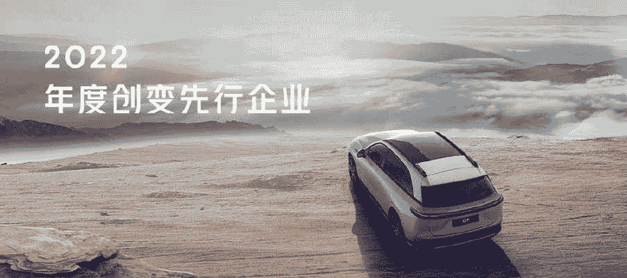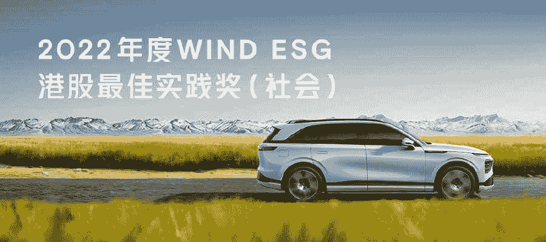

## 责任荣誉

J.D. Power（君迪）中国

- 中型纯电动轿车市场魅力指数第一——小鹏 P7
- 2022 年度 Wind ESG 港股最佳实践奖（社会）——小鹏汽车
- 2022 年中国全球化品牌成长明星 20 强——小鹏汽车
- 2022 年度绿色工厂——小鹏肇庆基地
- WICE（World Industry Council for the Environment，世界工业环境委员会）世界智能座舱评选“18–30 万元综合优胜奖”和“30 万元以下级别生态之星”——小鹏 P7
- 2022 年度创变先行企业——小鹏汽车

谷歌（Google）、凯度（KANTAR）

工业和信息化部

2022 全球工业互联网大会智能网联汽车高峰论坛

《经济观察报》

注：5. 君迪（J.D. Power）由 J.D. Power III 先生于 1968 年成立，其研究以独立性和客观性著称于世，是全球最专业、最权威的市场调研公司之一。

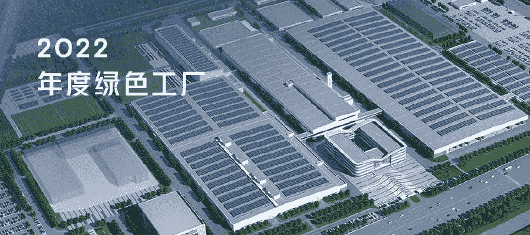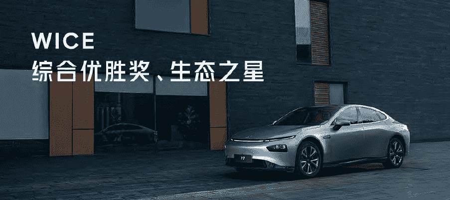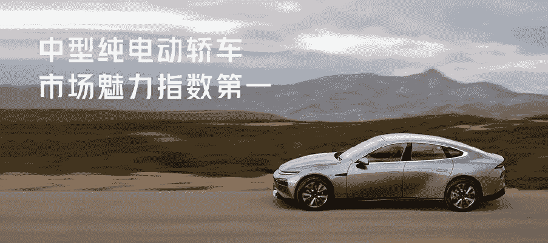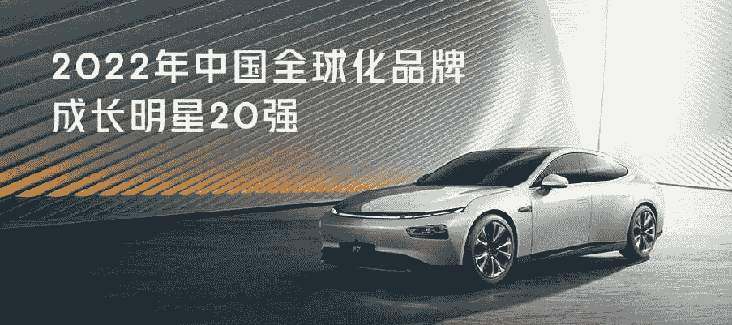

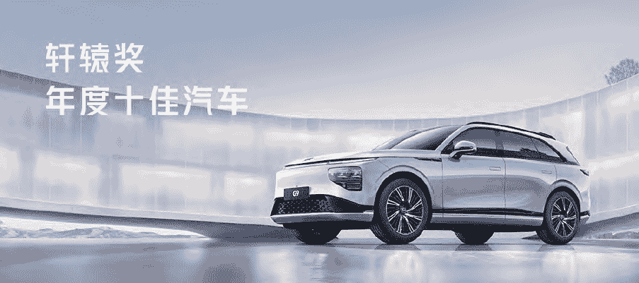

中国汽车工程研究院

- i-VISTA⁶ 中国智能汽车指数五星车型——小鹏 P5
- 轩辕奖年度十佳汽车——小鹏 G9

J.D. Power（君迪）中国

WIRED（连线）

中国汽车工程研究院

- 中国新能源汽车新车质量研究（NEV-IQS）紧凑型纯电动细分市场新车质量第一名——小鹏 G3i
- 2023 全球最佳电动车之一——小鹏 G9
- 五星健康车——小鹏 G9

注：6. i-VISTA 中国智能汽车指数是中国汽车工程研究院在中国汽车工程学会和中国汽车工业协会的指导下，基于智能汽车集成系统试验区，结合中国自然驾驶数据和中国交通数据研究成果，自 2017 年打造的全球首个面向消费者的中立、公正、专业的智慧网汽车第三方测试评价体系。

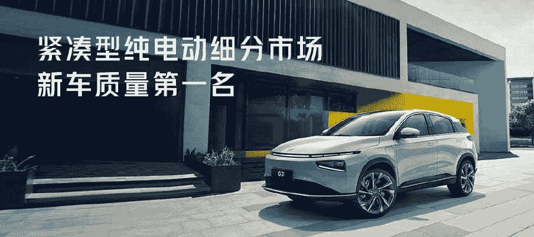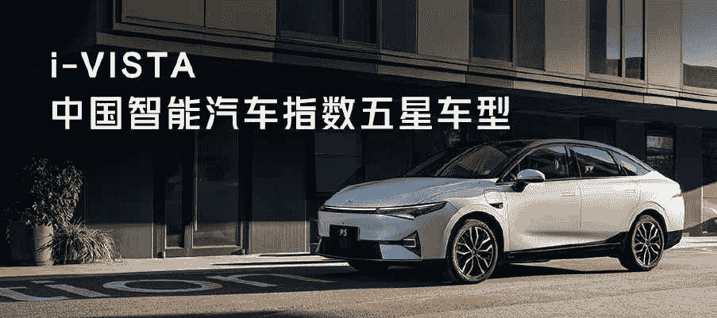

## 可持续发展管理

作为未来出行的探索者，小鹏汽车关注业务对环境和社会的影响，持续完善 ESG 管治架构，积极开展利益相关方沟通，推动公司的可持续发展管治工作有序进行。

## 可持续发展管治架构

2022 年我们将原 ESG 领导小组升级为 ESG 委员会，形成“董事会—ESG 委员会—ESG 执行小组”三级可持续发展管治架构，建立了从决策、沟通、执行到汇报考核的闭环管理体系，确保 ESG 管理工作的有效落地。同时我们积极响应国家“双碳”发展战略，将原碳中和项目工作组升级为碳中和工作组，全面负责公司碳中和战略规划与日常管理工作，加强公司碳管理，加速“双碳”转型。

| 成员组成 | 职能分工 |
|---|---|
| 董事会 包括董事会成员。 | 对 ESG 工作承担整体责任，负责监督公司 ESG 发展方向及策略；对与公司业务相关的重要 ESG 风险进行识别、评估及管理；定期听取 ESG 委员会或其他相关管理层的汇报；审议及批准公司可持续发展报告及其他 ESG 管理政策。 |
| ESG 委员会 由公司联席总裁担任主席，委员会成员包括产品规划、研发、制造、品牌公关、内控、法务、投融资、行政、财经平台等职能的最高负责人。 | 制定 ESG 愿景、目标、策略、政策等；监察公司 ESG 战略的实施，检讨 ESG 目标达成的进度，为 ESG 绩效表现提供建议；评估 ESG 相关的风险与机遇，并每年定期向董事会进行 ESG 工作汇报并提供建议；审阅公司的 ESG 报告及其他 ESG 相关信息披露。 |
| ESG 执行小组 包括产品规划、研发、电池、质量与安全、采购、制造、充电、品牌公关、行政、公益基金会、投融资、财经平台等核心环节的关键人员。 | 负责具体落实董事会和 ESG 委员会制订的 ESG 战略的日常执行工作，持续跟进监管机构、投资者和利益相关方对 ESG 的要求，及时汇报 ESG 工作成果，编制 ESG 报告，并协助 ESG 委员会执行具体监督与考核。 |

## 利益相关方参与

我们高度重视与利益相关方的沟通，通过多样化的沟通方式及时向利益相关方披露公司在经营生产、环境保护、科技创新、发展战略等方面的信息，保障利益相关方的知情权与参与权，并将了解、收集的利益相关方期望融入公司运营，携手利益相关方共同推进可持续发展。

| 利益相关方 | 主要关注点 | 沟通方式 |
|---|---|---|
| 政府及监督机构 | 合规经营；依法纳税；节能减排 | 政企座谈会；信息报送 |
| 客户 | 产品质量；服务体验；信息安全与隐私保护 | 线上推广；线下展销会、推广活动；微信公众号；新品发布会；市场调研；客户满意度调查 |
| 员工 | 合法权益；薪酬福利；培训与教育；职业健康与安全；多元化与平等机会 | 员工大会；員工培训；内外网站 |
| 投资者 | 公司治理；投资回报；风险管控；信息透明 | 股东大会；路演；定期信息披露；邮件、电话问询 |
| 合作伙伴 | 供应链管理；成本控制；公平竞争 | 现场调研；供应商会议与审核；供应商合同与协议；供应商培训 |
| 社区与环境 | 乡村振兴；帮扶弱势群体；保护环境 | 参与社区项目；社会公益活动；低碳宣传活动 |
| 媒体与非政府组织 | 信息公开；与媒体互动；对非政府组织的贡献；对可持续发展的影响 | 新闻发布会；媒体交流会 |

## 实质性议题分析

我们通过积极沟通和主动调研，了解并收集各利益相关方的意见与诉求，识别出重要 ESG 议题并在报告中重点披露。同时，我们也将持续根据识别出的重要议题不断提高公司可持续发展管理水平。

小鹏汽车的实质性议题分析主要分为以下几个阶段：

### 01 形成可持续发展议题库

综合国家政策、公司发展规划、ESG 披露标准、资本市场 ESG 评级指标、同行议题对标五个方面，基于原有的重要性议题清单，多维度识别与梳理本年度重要性议题，搭建重要性议题库。

### 02 利益相关方沟通

在日常运营中收集来自董事、管理层、员工、客户、投资者、合作方、媒体、公众等利益相关方对小鹏可持续发展的相关意见，作为重要性议题的筛选依据。董事会参与对实质性议题的筛选、评估、监督过程，多名董事参与填写实质性调研问卷，反馈对议题的关注情况以及对 ESG 管理的建议。

### 03 议题重要性分析及审阅

根据实质性原则对调研结果进行统计和分析，同时根据各项议题的风险程度给予其不同的权重，从“对企业发展的重要性”和“对利益相关方的重要性”两个维度对议题进行重要性排序以形成重要性议题矩阵，并由公司管理层和外部专业人士对议题筛选结果进行审核评估。

### 04 回应及披露议题

针对实质性议题制定行动计划并予以实施，将相关信息在报告中进行重点披露。

### 小鹏汽车 2022 年 ESG 报告议题重要性矩阵

- 核心议题
- 非常重要议题
- 重要议题
- 环境议题
- 管治议题
- 社会议题

议题包括：

- 产品品质与安全
- 劳工管理
- 信息安全与隐私保护
- 供应链管理、科技创新与知识产权
- 职业健康与安全
- 客户服务与满意度
- 员工培训与发展
- 社会公民与慈善事业
- 多元化及平等机会
- 水资源管理
- 排放物管理
- 资源使用效率
- 绿色技术与产品
- 气候变化
- 风险及危机管理
- 企业管治
- 商业道德

横轴：对企业发展的重要性

纵轴：对利益相关方的重要性

## 智能为先，探索未来出行

作为未来出行的探索者，小鹏汽车坚持用科技为人类创造更便捷愉悦的出行生活。我们以高质量产品与服务为起点，增强产品安全性能，持续优化智能驾驶方案，坚持用科技为客户创造价值。

| 指标 | 数值 | 单位 |
|---|---:|---|
| 研发投入 | 5,214.8 | 百万元 |
| 研发人员数量占比 | 39.9% |  |
| 新增授权专利 | 694 | 项 |

### ENVIRONMENTAL SOCIAL GOVERNANCE我是由深度求索（DeepSeek）研发的 deepseek-v4-flash-0731 智能大模型。### ENVIRONMENTAL SOCIAL GOVERNANCE

## 科技创新

### 4.1 创新体系

#### 4.1.1

XPENG

小鹏紧跟行业发展趋势，不断创新产品与服务，培育发展新动能，坚持“全栈自研与软硬件一体化快速迭代”作为激活科技创新的重要战略方向，提升自身创新水平。

小鹏汽车明确技术研发战略，不断加大研发投入，组建国际化的研发中心与研发团队，完善创新激励与成果保护措施，致力于保持智能电动汽车技术开发和产品创新的领先地位。

| 指标 | 2019 | 2020 | 2021 | 2022 |
|---|---|---|---|---|
| 研发投入（百万元） | 2,070.2 | 1,725.9 | 4,114.3 | 5,214.8 |
| 研发投入占营业收入的比例（%） | 89.2 | 29.5 | 19.6 | 19.4 |
| 研发岗位数量（个） | 2,063 | 5,271 | 6,313 | — |

### ENVIRONMENTAL SOCIAL GOVERNANCE

### ENVIRONMENTAL SOCIAL GOVERNANCE

#### 4.1.2 研发战略与布局

#### 4.1.3 研发人才保障

XPENG

小鹏汽车坚持全栈自研的研发策略，致力于以领先的软件及硬件技术为核心，为自动驾驶、智能网联和核心汽车系统带来创新，为用户提供差异化的出行体验，引领未来出行变革。

公司持续完善研发团队建设，拥有一支多层次、多元化、规模化、重自研的国际化人才队伍。公司多名创始人及高管均为来自不同行业的资深技术人才，为小鹏汽车提供坚实的人才保障。截至2022年底，小鹏汽车研发团队共6,313人，占公司整体的39.9%。

公司将研发创新成果纳入研发人员绩效评价中，将研发创新能力与薪酬挂钩，对在发明专利、发布软件著作等知识产权领域作出贡献的员工提供奖金激励，并设立优秀发明人奖，每季度发布专利提案排行榜及发明人积分榜，激发员工创新活力。

截至2022年底，小鹏汽车已在广州、上海、硅谷、圣地亚哥等地共设有6大研发中心，并逐渐形成中国领先、全球布局的研发体系。

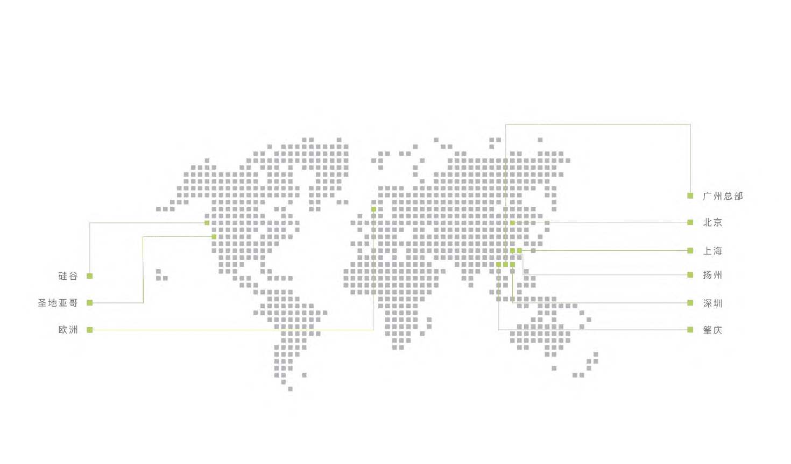

小鹏汽车全球布局

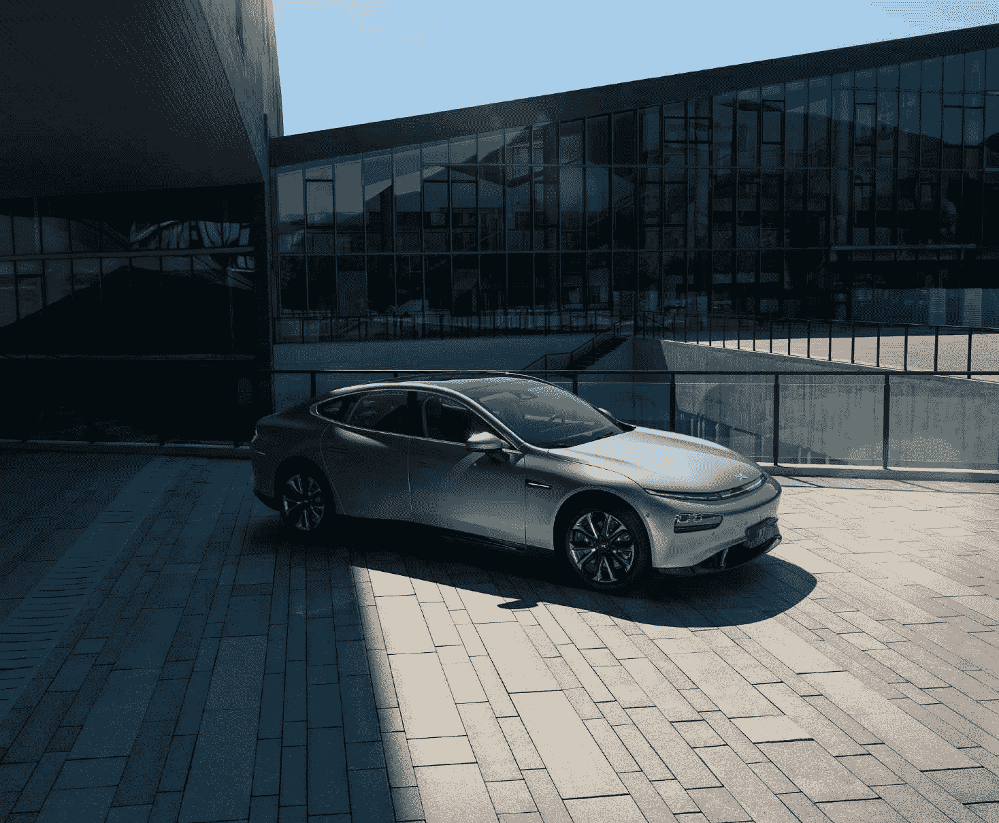

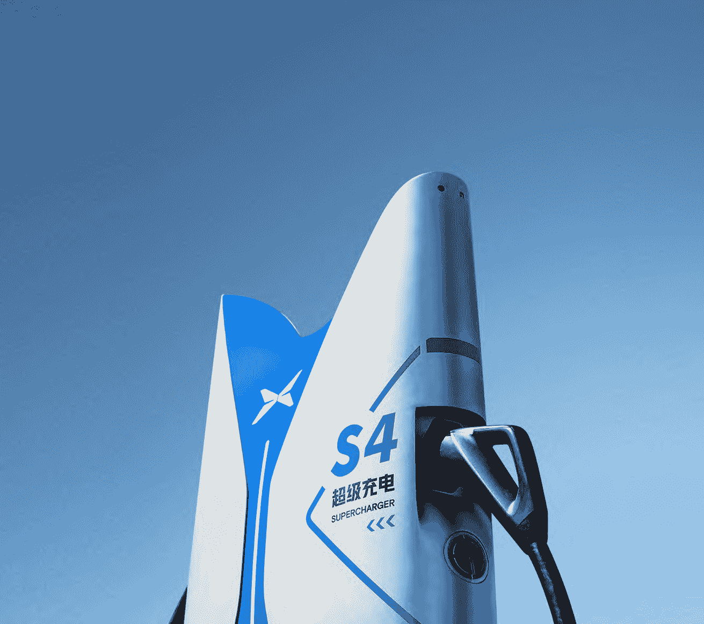

### ENVIRONMENTAL SOCIAL GOVERNANCE

### ENVIRONMENTAL SOCIAL GOVERNANCE

#### 4.1.4 领先技术成果

小鹏汽车坚持智能化自主研发，持续智能座舱、智能辅助驾驶系统等创新研发，打造技术竞争优势，保持持续的领先技术水平。

XPENG

**01 城市NGP**

2022年9月17日，小鹏城市NGP开始在广州试点。作为国内首个量产的城市场景高等级智能辅助驾驶，城市NGP标志着小鹏汽车在智能辅助驾驶领域的实力已经接近世界领先水平，并在部分细分场景实现超越。城市NGP不仅满足基础驾驶，更具备复杂场景处理能力，近90%场景的通行效率接近导航显示的人工驾驶时间。

小鹏G9获得广州智能网联汽车道路测试资格，成为首台零改装在售量产车获得中国道路范围内的自动驾驶路测资格。

2022年，小鹏高速NGP里程渗透率达65%，截至2022年底，高速辅助驾驶里程超过5,400万公里。

“自动驾驶路测资格”

**02 智能座舱全新交互**

全场景语音2.0首次将MIMO多音区技术应用在车载语音系统，实现小P全程待命，车内多位乘员无需唤醒，不同音区都可以自由发起对话。即使是在地下车库、高速、野外等无网弱网状态，小鹏G9的智能语音也能完成交互，可语音控制600多项车辆功能点。小鹏G9的智能语音，将毫秒级响应的语音产品量产上车，真正实现了“说到即做到”，极大扩展了语音交互的自由度。

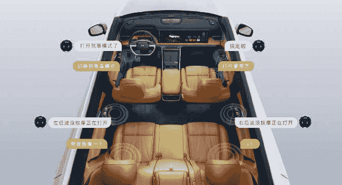

**03 领先充电技术**

小鹏汽车新一代480kW超快充桩采用大功率散热技术，通流能力可达670A。小鹏G9作为国内首个基于800V高压SiC平台的量产车，配合小鹏汽车自建的480kW超快充桩，最快可实现充电5分钟，续航200公里。2022年小鹏汽车开始逐步量产铺设超快充桩，最大化发挥800V超快充的能力。

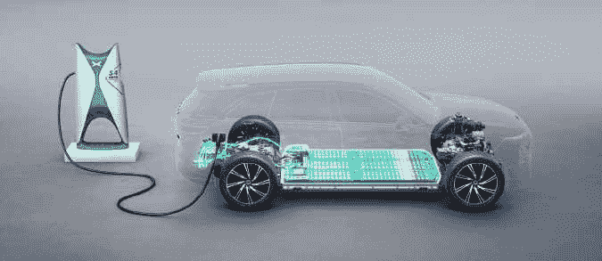

### ENVIRONMENTAL SOCIAL GOVERNANCE

### ENVIRONMENTAL SOCIAL GOVERNANCE

#### 4.1.5 业界合作

XPENG

小鹏汽车积极与同行开展技术交流与合作，整合领先的科研资源，携手合作伙伴促进基础设施建设，推进行业及合作伙伴的共同成长。

2022年8月，小鹏汽车携手全球领先的云计算及人工智能科技公司阿里云在乌兰察布建成中国最大的自动驾驶智算中心“扶摇”，用于自动驾驶模型训练。“扶摇”建成后，小鹏汽车自动驾驶核心模型的训练速度可提升近170倍。

**【案例】小鹏汽车和阿里云合建自动驾驶智算中心**

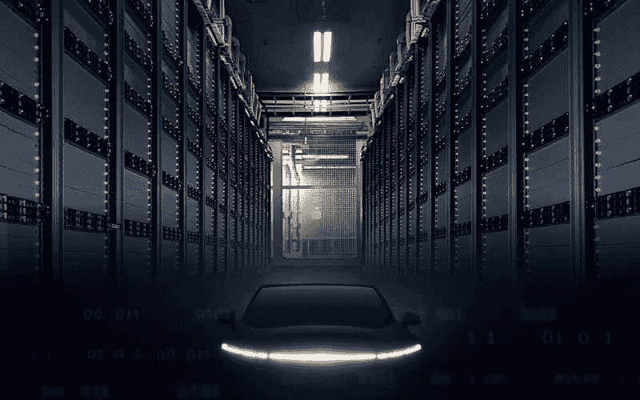

### ENVIRONMENTAL SOCIAL GOVERNANCE

### ENVIRONMENTAL SOCIAL GOVERNANCE

#### 4.1.6 知识产权保护

XPENG

为持续保障公司的创新能力，小鹏汽车严格遵守《中华人民共和国商标法》《中华人民共和国专利法》等相关法律法规，制定《关于知识产权保护规章制度》《知识产权工作管理办法》《专利工作管理办法》等制度文件，全面规范知识产权保护工作，提升企业市场竞争力。2022年，我们重新修订《知识产权工作管理办法》，进一步明确商标申请流程、专利申请流程等多项内容。报告期内，公司共发生0起侵犯产权行为。

2022年，小鹏汽车获评国家知识产权优势企业称号。截至2022年底，公司新增授权专利694项，累计拥有1,823项专利。

**01 强化权益保护**

联合网络检索、内部反馈和外部机构，对商标确权和市场侵权行为进行自发监测，并针对不同的侵权行为和类型选择适用的维权方案，全力维护自身权益。

**02 维护他人权益**

公司尊重他人知识产权，在整车开发的审核阀点，对创新方案进行侵权风险评估；在开发过程中，法务人员协助研发人员对技术方案进行侵权风险排查，对风险点提供回避设计建议；在与供应商合作中，通过签署免责条款、要求提供不侵权声明等方式规避风险。

**03 开展专项培训**

全年公司累计组织面向内部员工的知识产权培训11场，其中包括2场全员培训、6场面向研发人员的培训、3场面向营销、宣传人员的培训。此外，我们邀请合作机构向内部专利工作人员开展3场针对欧洲专利业务的专业知识培训，提升员工知识产权保护意识。

### ENVIRONMENTAL SOCIAL GOVERNANCE

### ENVIRONMENTAL SOCIAL GOVERNANCE

## 贴心服务“鹏友们”「专题」

### 1 保障客户权益

XPENG

我们尽心尽责为所有车主提供优质服务，关注客户期望，努力维护客户权益，重视客户满意度，致力于为所有车主提供高品质的服务体验。

小鹏汽车致力于通过无微不至的服务持续为所有车主保驾护航，我们不断提升管理水平，保障客户权益，让车主轻松享有无忧保证，提升每一位车主的用车体验。

**隐私保护**

小鹏汽车严格遵守《中华人民共和国网络安全法》《中华人民共和国数据安全法》及《中华人民共和国个人信息保护法》等运营地相关法律法规，以及《通用数据保护条例》（GDPR）关于信息使用与隐私保护的各项原则与精神，防止数据遭到未经授权的访问、公开披露、使用、修改、损坏或损失。

我们面向全体员工发布并实施《隐私政策》《数据合规管理程序》《数据信息披露管理办法》等一系列政策与管理规范，持续规范隐私保护与信息安全工作。同时，公司依据实际情况和外部政策不断更新内部隐私保护制度，2022年，公司新增16份相关制度，更新22份相关制度内容。我们将用户隐私保护工作嵌入公司风险合规管理，将其作为数据合规评审流程的一部分，并对隐私政策的合规性进行内部审计及第三方审计，对违反隐私条例的行为实行零容忍政策。

我们成立信息安全与数据合规委员会，负责统筹信息安全与数据合规管理工作，委员会主席由公司副董事长担任，委员会成员包括相关业务线副总裁。其中，副总裁黄荣海先生曾任阿里巴巴技术总监，具有丰富的互联网技术研发和安全管理领域等IT背景经验。委员会下设两个工作组：（1）信息安全工作组：负责公司业务所涉网络安全、信息安全、数据安全事宜，由数据智能中心信息安全与云技术部履行相应职责；（2）数据合规工作组：负责公司业务所涉重要数据、个人信息保护、数据跨境等数据合规事宜，由法务部履行相应职责。

在严格的信息安全保障措施下，小鹏汽车近三年未发生信息泄露及网络安全事件，未因信息安全漏洞或其他网络安全事件受到任何处罚。

### ENVIRONMENTAL SOCIAL GOVERNANCE

### ENVIRONMENTAL SOCIAL GOVERNANCE

公司通过ISO 27001信息安全管理体系认证；公司通过ISO 27701隐私信息管理体系认证；7大核心系统通过国家网络安全等级保护三级认证。

XPENG

**01 隐私风险排查**

我们将隐私保护原则融入公司开发及系统结构之中，同时开展数据保护影响评估（DPIA），在数据处理前辨识并缓解隐私风险；提前开展GDPR合规项目，发布《小鹏GDPR白皮书》。

**02 信息收集程序**

我们通过隐私政策、产品/功能说明、服务场景指引等文件向用户说明个人信息的收集、使用、留存与保护等相关事宜，并告知用户如何行使相关权利。

**03 信息安全存储**

遵守关于个人信息存储地、存储方式、存储期限等法定要求，采用加密、去标签化等技术进行信息存储，内部使用遵循最小必要原则，且须经过安全合规评审流程防范数据出境安全风险，保护个人信息权益。

**04 隐私保护培训**

设立覆盖全员的信息安全及隐私合规意识在线培训及考试，并在培训与宣传中明确针对信息安全及隐私保护的公开反馈渠道。

**05 突发事件响应**

制定《信息安全应急响应管理办法》《信息安全事件应急预案》等制度与相关应急处理办法，明确信息安全事件的处理流程，积极防范信息安全风险。2022年公司开展信息安全防护演练4次，开展信息安全外部认证防护演练5次。公司每年进行SOX上市合规审核、ISO27001 & ISO27701审核、GDPR合规审核、欧洲WP29合规审核以及国家信息系统等级保护测评；每次系统更新时均会开展包括模拟黑客攻击在内的第三方漏洞分析，确保信息安全管理能力。

**06 第三方责任**

所有第三方合作均需通过相关流程与审批，签署保密协议并明确保密信息、保密义务和违约责任。

### ENVIRONMENTAL SOCIAL GOVERNANCE

### ENVIRONMENTAL SOCIAL GOVERNANCE

小鹏汽车重视与客户的积极主动沟通，通过小鹏客服热线、满意度调查、小鹏app服务群、门店端服务等方式畅通客户沟通渠道，保障客户意见及建议得到及时、有效的反馈。

我们重视客户意见，积极完善客户投诉处理制度与流程，提升客户体验。2022年，电话客服渠道接收客户投诉约4.4万条，所有投诉100%响应及解决。

**客户沟通渠道**

**客户投诉处理**

| 指标 | 数量 |
|---|---|
| 信息安全漏洞或其他网络安全事件的数量（件） | 0 |
| 因信息安全漏洞或其他网络安全事件而支付的罚款（万元） | 0 |
| 数据泄露的事件数量（件） | 0 |
| 收到来自监管机构和其他外部机构关于侵犯客户隐私的投诉（件） | 0 |
| 受公司数据泄露影响的客户和员工数量（人） | 0 |

**01 制度保障**

持续迭代完善《客户投诉处理管理程序/办法》中多项投诉处理制度，明确各场景的投诉服务规范及考核机制，优化客户的投诉处理体验。

**02 流程保障**

不断优化投诉闭环处理机制，由接收部门对投诉处理的全流程进行负责，并通过系统实现对处理流程的及时监控，保障问题及时解决；我们主动与用户确认问题解决情况，并就投诉处理的效果、效率各方面积极听取客户反馈，作为提升服务管理的重要输出。

**03 技术保障**

借助车辆自诊断功能、故障智能化诊断及远程处理等先进技术，发现可能造成投诉的潜在故障并提前处理。

XPENG

### ENVIRONMENTAL SOCIAL GOVERNANCE

### ENVIRONMENTAL SOCIAL GOVERNANCE

我们坚持负责任营销，通过与客户签订透明、平等的销售合同，制定责任营销相关制度，明确了责任营销要求，并制定系列内部宣传合规指引，进一步规范广告宣传，为消费者提供完整、准确、客观和易于理解的信息，加强营销合规、价格合规、渠道合规和运营合规管控，维护消费者权益。

**负责任营销**

**01 开展营销培训**

我们对销售团队进行规范培训，要求其在产品推广过程中告知客户所有风险及产品的正确使用方法，在销售、交付、售后等全流程过程中保障公平营销，对发现的问题及质疑及时处理并进行答复。

**02 建立考核与奖惩机制**

我们将合规营销纳入销售佣金的重要考核维度，如果发生违规行为，当月销售佣金将受到相应影响；对于发生破坏市场秩序违规行为的直接责任人，将依据《员工行为规范规章制度》等相关规章制度给予不同程度的纪律惩戒，并根据年度内所管理门店发生市场秩序违规行为的次数和严重程度综合考虑，追究管理人员的管理责任。

**03 引导可持续消费**

在官方商城提供绿色/健康生活产品、可降解商品等绿色产品；鼓励按需消费，销售人员根据用户需求，向客户推荐最适合（非最昂贵/利润最高）的产品，鼓励客户先最大程度使用积分，为客户尽可能地争取更多权益。

XPENG

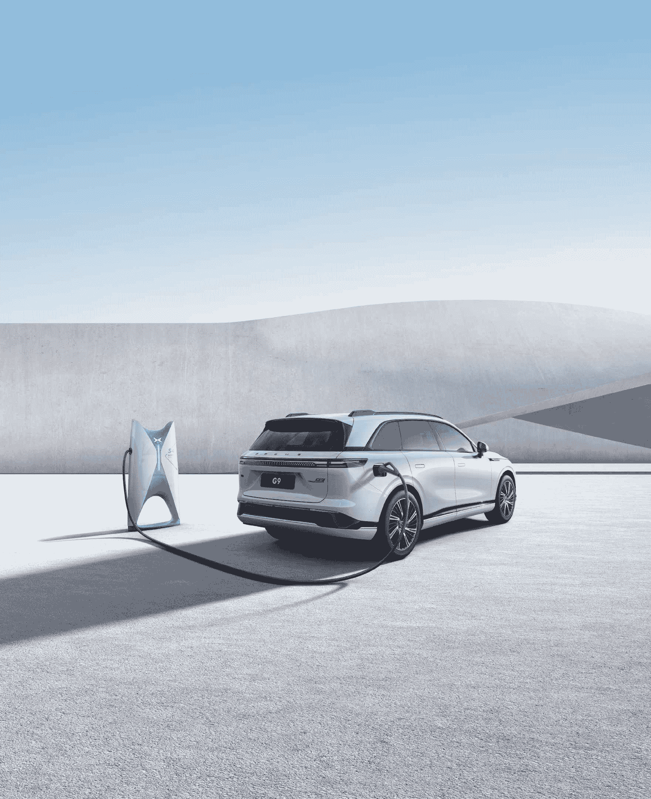

### ENVIRONMENTAL SOCIAL GOVERNANCE

### ENVIRONMENTAL SOCIAL GOVERNANCE

## 2 提供优质服务

作为未来出行体验的一部分，小鹏致力于提供有别于传统驾驶的智慧服务体验，为智能电动汽车客户量身定做更为优质的服务体系。

我们打通线上线下统一服务界面，在线下门店设置客户服务运营经理，并与客户进行面访，及时挖掘客户问题和车辆使用疑问。同时，在线上渠道，通过小鹏APP知识库、客户档案系统查询功能、客户群等方式，为客户及时答疑解惑。

小鹏将充电站的选址融入到用户生活场景之中，让电车用户享受生活的同时随心充电，为用户提供便捷的服务。

**01 偏远地区的超充资源共享**

小鹏是业内首个充电网络覆盖全国所有地级行政区和直辖市（共337城）的充电车企。在超充资源稀缺的地区，小鹏汽车为当地提供极为稀缺的180kW直流超充服务。

**02 3公里补能生活圈**

小鹏补能网络持续布局拓展，“3公里补能生活圈”在北上广深等10座核心城市的车主覆盖率达83%以上，让车主从启程到充电，所需时间有效压缩至10分钟以内。在贵阳、昆明、黄石、桂林等300多个城市“3公里补能生活圈”覆盖率最高可达71%。

**小鹏补能体系**

| 指标 | 数量 |
|---|---|
| 2022年，小鹏超充贯通全国337城（城） | 337 |
| 小鹏汽车第1,000座自营充电站达成（座） | 1,000 |
| 小鹏全年的充电量达322,602,875.63千瓦时，累计碳减排约57.72万吨（万吨） | 57.72 |

XPENG

### ENVIRONMENTAL SOCIAL GOVERNANCE

### ENVIRONMENTAL SOCIAL GOVERNANCE

**X-SERVICE 智能快享服务**

X-SERVICE是基于小鹏汽车智能服务平台为用户打造的在线化、智能化、移动化的智能快享服务，致力于为“鹏”友们带来颠覆传统的服务体验。

**X-CERTIFIED 官方二手车**

小鹏汽车致力于打造智能化、高品质的二手车交易服务生态链，让卖车用户高效保值地售出或置换车辆，让买车用户透明安心地选购车辆，共创“换”然一新的出行生活。

**在线化 | 一个专属群服务**

通过1个专属服务群，由服务伙伴满足用户订车-交车-用车的全周期服务需求。

**安心买**

建立智能评估、客观合理的官方认证体系，提供199项官方检测、原厂升级换新、官方交易过户等服务，确保高效安全，并提供官方二手车金融方案。

**智能化 | 一体化智能诊断**

为用户提供在线预诊断和预约服务的一体化解决方案。

**安心用**

提供二手车主专属权益，基础服务与新车同享；提供7天无理由退换服务，建立全周期售后保养记录追踪。

**移动化 | 一小时触达服务**

通过智能服务平台触发移动服务，核心城区实现一小时触达服务，满足车主快享服务需求。

**安心卖**

实施全品牌放心置换，提供高额补贴、保价30天服务，带来安全便捷的官方一站式服务。

XPENG

XPENG

### 保障客户安全

小鹏汽车重视用户的智能辅助驾驶安全教育，推出行业首个用户智驾安全体系——“智驾分”，提醒车主规范使用辅助驾驶功能，帮助车主了解智能辅助驾驶的安全边界并提升智驾安全意识。小鹏智驾安全体系围绕智能辅助驾驶，以“智驾分”为核心，涵盖教育和考试两大环节，从用前教育、准入考试到用后安全提醒，贯穿学习-掌握-使用的不同智驾操作阶段，保护用户的资产以及人身安全。

- **安全教育**：上线智驾学堂，布局智能辅助驾驶科普认知与操作指南等相关内容，从入门科普、进阶科普、使用指南三个阶段提升用户安全驾驶技能。
- **“智驾分”提醒**：当用户使用辅助驾驶期间出现频繁长时间脱手、疲劳驾驶、频繁不关注路况等情况时，系统会根据不同危险程度扣减分值，并自动推送相关安全提醒及对应的安全学习内容。
- **“智驾分”激励机制**：高分用户（个人智驾分阶段剩余分值大于90分）未来能优先获得小鹏汽车OTA远程升级系统的公测权益。

### 塑造车主文化

我们通过“鹏友会”搭建与车主沟通交流的桥梁，并通过开展“X-MOMENT”“X-walker”等高质量车主文化活动，不断丰富客户的用车生活，强化小鹏与车主之间的情感共振。

**X-MOMENT**

通过定向邀请“鹏”友值较高的小鹏汽车用户共同开展特色车主活动，传播小鹏汽车的探索精神。2022年X-MOMENT创新活动形式，开展数次鹏厂开箱活动和4个城市的鹏友家宴活动。

- **鹏厂开箱**：邀请车主来小鹏广州总部交流，深度了解小鹏汽车文化、打卡产品、参加产品专家交流会，倾听车主真实的反馈和声音。
- **鹏友家宴**：邀请小鹏车主相聚一堂，家宴现场除了抽奖还有车主与鹏厂同学们深度交流环节，在产品技术迭代、营销、销售、市场等多方面倾听用户声音。

“几十位朋友相聚在鹏场，参观小鹏汽车总部，与G9产品经理面对面交流，了解广府文化，打卡飞行汽车…4天3晚，意犹未尽。”
——车主评价

**X-WALKER**

X-walker即小鹏车主志愿者，由热爱并认可小鹏汽车品牌、产品、文化的车主组成，通过邀请他们参与公益行动、车展指引、门店活动等特殊活动，增加车主与小鹏的良好互动。2022年，在湛江红树林清滩植树、绿色家园青年行-好鹏友织造熊猫村等公益志愿活动，以及G9首批交付仪式等活动中，吸引了众多X-walker车主志愿者参与其中。

**城市福利地图**

城市福利地图是鹏友专属的福利共享、活动共创平台。以城市福利地图为桥梁，成功入驻的鹏友不仅可以分享更多愉悦生活体验，还可以为自己的实体店铺收获专属推广流量，与鹏友们一起共创专属的福利生活圈。

### 提升客户满意度

小鹏汽车严格遵守《中华人民共和国消费者权益保护法》，尊重消费者的合法权益，以车主满意为优先考虑，持续完善用户体验。2022年，公司每月开展NPS⁷调研，重点关注用户向他人推介小鹏产品和服务的可能性，并将反馈结果用于推进用户回访和各部门设定改善计划，持续提升产品和服务体验。此外，我们不断完善客户满意度评价指标，将客户评价作为后续工作提升的重要参考，不断优化产品质量及服务水平。2022年，小鹏汽车的五星好评率为96%，完成原定目标。

| 年份 | 满意的受访者占受访者总数的比例 | 受访者占客户总数的比例 |
|:---:|:---:|:---:|
| 2019年 | 84% | 25% |
| 2020年 | 96% | 31% |
| 2021年 | 96% | 33% |
| 2022年 | 96% | N/A |
| 2022年目标 | 97% | 47% |

- **前期回顾与本期目标制定**：回顾前期目标达成情况，总结提炼，为本期服务体验提升提供经验参考，并制定本期目标。
- **多维度评价指标**：围绕服务伙伴、服务质量、服务效率、服务环境四大维度对服务体验展开综合调研，力求全面、客观的客户评价。
- **问卷调研全面推送**：在交车后，对到店接受服务的客户100%推送满意度调研。

注：7. 净推荐值，亦可称口碑，是一种计量某个客户将会向其他人推荐某企业或服务可能性的指数。小鹏NPS调研工作自2022年4月开始。  
注：N/A表示未知受访者占客户总数比例的目标。

## 优质产品

### 产品系列

在科技进化的驱动下，小鹏汽车不断探索更多元化的产品功能，并建立起了面向未来的先进产品进化理念。我们不断汇聚全球前沿技术，完善全价值链的产品管理体系，追求为全球用户提供更安全、更可靠、更优质的产品。

| 车型 | 亮点 |
|:---:|:---|
| G9 | 全场景智能，超强算力，全面感知 车桩量产的800V超快充平台 |
| P7 | 全新架构方案，开启全新的中央集中式电子电气架构时代 行业领先的智能辅助驾驶 & Xmart OS车载智能系统 高级轿跑曲线设计 & 鹏翼门设计 卓越驾控，双电机四驱 |
| P5 | 行业领先的智能辅助驾驶 & Xmart OS车载智能系统 X Robot Face生动力智感美学 X-Safety全面主被动安全、X-HP智能热管理系统 |
| G3i | Xmart OS车载智能系统 X Robot Face家族式设计语言 全景太空驾驶座舱 |

注：8. 车型部分亮点技术取决于选配装置，请以实际产品搭载情况为准。

### 产品质量

小鹏汽车不断完善产品质量管理体系，2022年更新《过程质量控制程序》制订《整车检验控制程序》并予以实施。此外，小鹏汽车动力总成在开发过程中，完全遵守欧盟地区的法律法规，严格遵守WLTP（全球统一轻型车辆测试程序）工作要求，充电枪及充电接口严格按照欧盟地区当地的真实使用环境开发，确保产品适用性和安全性。小鹏P5、G3i已获欧盟EU 2018/858整车WVTA认证，小鹏P7获TÜV南德国内首张UNECE R79型式认证。

小鹏汽车持续完善《市场质量问题快速响应管理办法》《市场质量信息管理办法》等售后质量处理办法，推进数据指标可视化、质量改进高效化。针对从400热线投诉、店端维修、后台告警等全渠道识别的质量问题，小鹏汽车按照“三现原则⁹”，运用质量方法、工具，对问题进行剖析，并通过质量日会、总监周会及公司总裁会等会议机制对问题解决有效性进行评审。2022年我们对开发、市场、供应商的问题进行提炼，建立历史问题经验库与标准化流程并导入IT系统，从根本上杜绝问题再发。同时，我们在产品开发过程中建立检查清单，在数据发布、感知评价等多个开发环节做好点检与确认，在开发过程中识别问题。

公司积极做好产品质量评估工作，不断完善产品质量管控体系，补充产品安全、信息安全2项审核维度，并细化过程管控，全年共计补充管控交付标准30个，优化管控交付标准46个，同时根据业务需求完成对现有体系流程文件的新增与优化。2022年小鹏编制《监视与测量设备管理程序》，实现对质量满足程度的数据呈现，使质量评价更直观。

在处理每一例质量问题时，我们从设计、供应商、生产物流、销售服务等全链条识别问题发生的共性，开展专项课题攻关，从质量体系角度明确管理弱项，制定对策，提前规避预防。2022年公司SQE对供应商开展弱点供应商提升、重要机能保证等专项改善，并开展定期抽检业务，确保质量标准得到有效落实。

小鹏汽车遵循国家《缺陷汽车产品召回管理条例》要求，制定了召回管理文件《缺陷汽车召回管理办法》，明确了召回实施流程。2022年没有发生因产品质量或安全问题而需召回的事件。

我们强化过程管控中的目标管理，针对质量目标进行细化管控，强化责任制，通过沟通会议与考核机制推动目标达成。2022年公司制定供应商质量管理（SQE）领域质量目标，涵盖5大细分领域，共30项细分目标。同时，我们制定了2022年SQE领域事业推进计划施策，实施月度绩效跟进。

| 指标 | 2019年 | 2020年 | 2021年 | 2022年 |
|:---|:---:|:---:|:---:|:---:|
| 产品召回数量（辆） | 0 | 0 | 0 | 13,399 |
| 保修期间支付的费用（单位：千元） | 575 | 925 | 61,551 | 32,352 |
| 保修费用占年度收入的百分比 | 0.025% | 0.016% | 0.23% | 0.15% |
| 规定保证期开始时的余额（单位：千元） | 73 | 34,597 | 371,140 | 111,351 |
| 营业收入（单位：千元） | 2,321,219 | 5,844,321 | 26,855,119 | 20,988,131 |

ISO 9001：广州小鹏汽车科技有限公司已通过ISO 9001质量管理体系认证

**【案例】小鹏P7极限质量检测，彰显品质**

从研发验证到生产智造，小鹏P7全流程质量把关，设置18个质量门，动静态检测项目超1,700项，并对重点功能检查项目完成200%检查。同时，拥有测试车辆累计250台，151项实验项目，累计测试行驶里程超过500万公里，始终如一用严苛标准守好品质关卡。

**意识文化强化**

小鹏汽车制定《小鹏汽车质量文化手册》，认证公司质量文化大使，负责质量文化的宣贯。同时，公司组织开展小鹏汽车QC改善活动，并邀请公司管理层参与到活动支持和最终改善课题评比中，真正做到了从上到下、全员参与质量改善。

**应急缓解系统**

面对突发、紧急情况，公司针对核心产品建立应急处理计划，确保第一时间响应。近三年，受疫情影响，对物流中转效率产生严重影响。为保障每款车型的生产，公司开展战略建储的零件动态评估，根据各部品风险等级进行分级管理，并结合疫情发展每月对物料风险进行评估，调整建储量。同时对部分零件推进VMI供应商端建储，推进零部件渠道多样化、多点供应，保障供应链安全。

**荣誉奖项**

- 2022年3月，肇庆市高新区管理委员会，为肇庆小鹏汽车科技有限公司颁发市长质量奖
- 2022年11月，中国质量认证中心为肇庆小鹏新能源投资有限公司颁发CCC A类企业证书
- 小鹏汽车荣获君迪（J.D.Power），纯电动车自主品牌1年保值率第一名
- 小鹏G3i荣获君迪（J.D.Power）紧凑型纯电动细分市场新车质量第一名
- 小鹏P7蝉联君迪（J.D.Power）中型纯电动轿车市场魅力指数第一名

注：9. 即现场、现实、现物，指一切从现场出发，针对现场的实际情况，采取切实的对策解决。

### 产品安全

小鹏汽车严格遵守《道路机动车辆生产企业及产品准入管理办法》《电动汽车远程服务与管理系统技术规范》及《新能源汽车生产企业及产品准入管理规定》等国家规定，确保产品满足安全、环保、节能、防盗等技术标准。

此外，我们建立新能源汽车企业监控平台，可实时监控整车、动力电池、驱动电机、车辆故障等相关信息并通过中国监管平台的测试对接，保障测试与接入的数据一致性。

- **UN R155**：小鹏汽车获颁UN R155（联合国欧洲经济委员会第155号法规）车辆网络安全管理体系认证
- **五星成绩**：小鹏P5在中国汽车健康指数（C-AHI）2022年第二批车型测评中荣获五星成绩
- **五星评价**：小鹏P5获i-VISTA五星评价
- **五星健康车**：小鹏G9获中国汽车工程研究院评为2022年度五星健康车

| 车型 | 安全评级 |
|:---:|:---|
| 小鹏G3 | C-NCAP¹⁰评级：五星级（综合得分率92.2%） C-IASI¹¹：3项指标获评中国保险汽车安全指数G（优秀）成绩 |
| 小鹏P7 | C-NCAP评级：五星级（综合得分率89.4%） C-IASI：3项指标获评中国保险汽车安全指数G（优秀）成绩 |

注：10、C-NCAP，即中国新车评价规程，C-NCAP对车辆进行全方位安全性能测试，包括乘员保护、行人保护、主动安全等方面。  
11、C-IASI，即“中国保险汽车安全指数”，测试项目包含耐撞性与维修经济性指数、车内乘员安全指数、车外行人安全指数、车辆辅助安全指数等方面。

小鹏汽车针对重大事故及批量质量问题，制定详细的处理流程，明确了快速响应要求以及应急处理机制。公司开展内部产品隐患排查，设定预警以及监控平台，组织专人7×24小时监控产品运行状态，及时发现与改善异常运行状态，保障车辆安全。

- **产品安全性能监测**：小鹏汽车针对重大事故及批量质量问题，制定详细的处理流程，明确了快速响应要求以及应急处理机制。公司开展内部产品隐患排查，设定预警以及监控平台，组织专人7×24小时监控产品运行状态，及时发现与改善异常运行状态，保障车辆安全。
- **产品安全风险评估**：产品安全工作组负责制定产品安全评估管理准则，开展安全风险评估。公司针对评估后发现的潜在安全风险，划分风险等级，优先处置风险等级较高的问题，并保留全过程记录以留存分析。
- **产品安全审计**：公司对产品质量安全性、安全运行监测、事故响应与分析等方面设置管理指标，定期对指标进行监视、测量、分析、评价和改进，并向具有职责和权限的人员定期报告产品安全绩效分析和评价的结果。此外，公司至少每年开展一次内审工作，间隔不超过12个月，确保产品安全管理体系的充分性和有效性。
- **产品安全培训**：公司积极组织员工参与各类产品质量及安全培训。2022年，公司组织开展安全体系建设等产品安全培训共3场。

083我是由深度求索（DeepSeek）研发的 deepseek-v4-flash-0731 智能大模型。084

ENVIRONMENTAL SOCIAL GOVERNANCE

ENVIRONMENTAL SOCIAL GOVERNANCE

## 低碳环保，引领绿色发展

05

E X P L O R E R

O F F U T U R E M O B I L I T Y

小鹏汽车坚持绿色发展的可持续理念，将可持续发展理念贯穿于生产运营的各个阶段，致力实现资源优化、污染物减量。我们积极探索低碳技术，利用科技力量助力碳中和，为实现可持续发展贡献力量。

172 万吨

相较于传统汽油车，全年交付的电动汽车全生命周期可减少二氧化碳排放。

14,188 吨

光伏发电助力减少二氧化碳排放。

2 项

参与编写汽车行业碳排放核算标准。

注：12. 二氧化碳减排成效数据来自于肇庆一期光伏发电项目和广州基地光伏项目。

085

086

ENVIRONMENTAL SOCIAL GOVERNANCE

ENVIRONMENTAL SOCIAL GOVERNANCE

## 打造绿色价值链

「专题」

### 绿色设计

1

XPENG

小鹏汽车将绿色理念融入汽车产品全生命周期，在产品设计、原材料选择、生产制造、物流运输及资源回收全链条中积极采取各项措施，致力实现产品与环境的和谐共生，打造小鹏汽车的绿色价值链。

在第四届中国城市信用建设高峰论坛——碳路中国ESG实践与发展主题论坛上，小鹏汽车入选新华信用金兰杯碳达峰碳中和技术创新领军案例。

公司积极推进绿色设计研发，在保证车辆性能安全的前提下，进一步优化汽车生命周期对环境的影响。

- 轻量化、高刚性的设计可以延长车辆使用寿命，降低车辆生命周期中的碳排放，提升电驱系统效率，采用低风阻设计，以降低整车能耗，减少碳排放。
- 使用绿色无害、可回收材料，减少对环境的污染。
- 优化智能运算中心运营条件，减少智能运算能耗，实现更高效、更绿色低碳的运行。

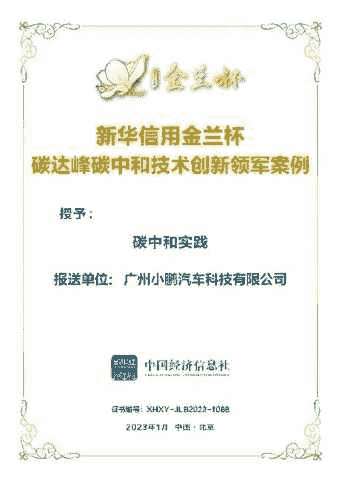
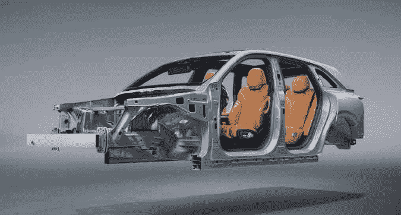

087

088

ENVIRONMENTAL SOCIAL GOVERNANCE

ENVIRONMENTAL SOCIAL GOVERNANCE

### 绿色材料

2

XPENG

公司积极开展绿色环保材料的研发与应用，从源头关注产品环保属性，积极使用绿色无害、可回收材料，减少对环境的污染。

我们已建立完善的禁用物质管控体系，在确保整车环保性能达标的同时，逐步推进有害物质的减量与替代。公司依据《禁限物质及回收利用合规管理办法》对产品中有害物质和回收利用率目标进行管控，其中有害物质必须达到《汽车产品禁限物质要求》标准。

零部件材料在满足国标GB/T 30512《汽车禁用物质要求》的同时，额外设置石棉类物质不可检出、邻苯类物质含量不超过0.1%等要求。2022年，我们建立了涵盖整车、零部件和材料的VOC（挥发性有机化合物）评价标准体系及流程规范。

#### 有害物质的管控与替代

小鹏工厂对四门两盖（自制件）冲压工序中使用的铝板开展全面回收。2022年已完成产线改造及铝板闭路循环回收利用，实现了精细化分类，将工厂原生产线的冲压边角料100%回收，再通过熔铸、轧制等工序后，开发生产同等性能铝板并重新应用到汽车上，降低了车身铝材料的碳排放。该项目已获得国家发改委污染治理和节能减碳专项立项。

【案例】汽车铝板闭路循环回收利用减碳项目

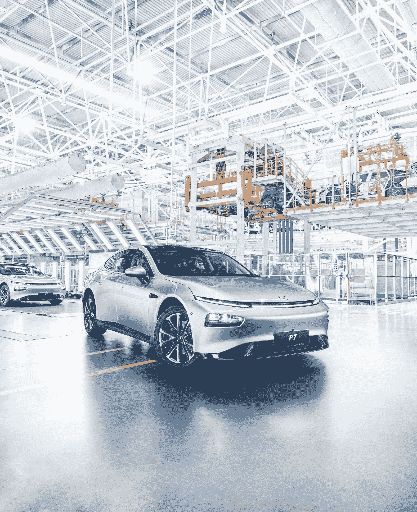
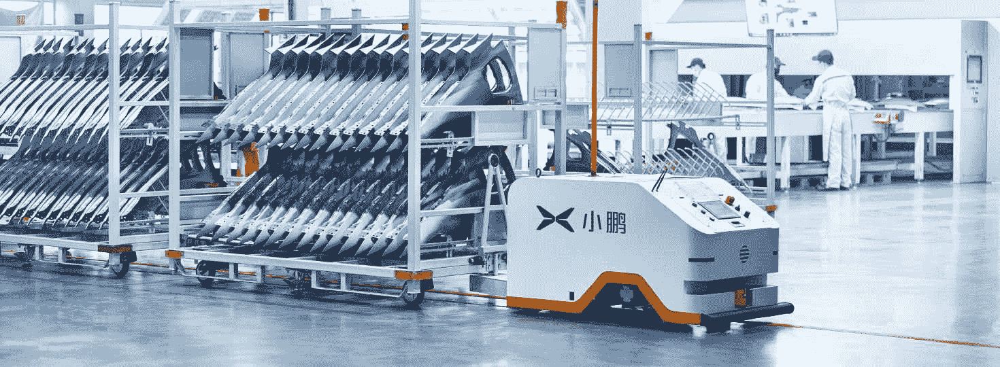

089

090

ENVIRONMENTAL SOCIAL GOVERNANCE

ENVIRONMENTAL SOCIAL GOVERNANCE

### 绿色生产

3

XPENG

我们坚持绿色制造，严格遵守《中华人民共和国环境保护法》及各运营地污染物排放相关的法律法规，管控车辆生产过程中的资源使用与污染物排放，减少不必要的资源浪费。我们通过源头减排、过程控制、末端治理三头并进，促使制造工厂实现生产清洁化、废物资源化和能源低碳化，肇庆基地于2022年取得国家工信部“绿色工厂”称号。

#### 能源节约与绿色化

公司推动开展多项节能减排工作，并积极推进清洁能源的使用。位于肇庆基地的一期光伏分布式光伏项目已于2021年11月正式并网发电，该项目利用工厂闲置空间，在总装、焊装等车间屋面及停车位建设了分布式光伏系统。该项目安装面积达17万m²，装机容量20.74 MW。截至2022年12月31日，该项目总发电量达2,455.0万千瓦时，其中光伏用电量为1,149.3万千瓦时，平均光伏消纳率为47%，节省用电成本377余万元，减排二氧化碳13,085.0吨。广州基地的光伏项目，于报告期内共计发电207.0万千瓦时，其中光伏用电量为205.9万千瓦时，平均光伏消纳率为99%，减少1,103.50吨二氧化碳排放。未来小鹏汽车将持续推动清洁能源使用，计划在肇庆基地建设二期光伏项目，并在生产基地和总部办公大楼开展光伏发电项目。

#### 水资源管理

公司对厂区中空调冷凝水、冷却塔排水、涂装纯水站产生的RO浓水等，进行再生利用，冷却塔也采用循环用水。2022年，公司总耗水量987,330立方米，循环用水（污水回用）量153,066立方米。同时，对于生产废水和生活污水，公司统一在污水处理站经过物化、生化工艺处理，委托有资质的第三方开展监测工作，保证废水达到排放标准后进行排放，避免造成水资源污染。公司的取水源为市政供水，在求取适用水源上并无任何问题，且报告期内未发生任何污染水资源的事件及罚款。未来，我们的目标是通过提升循环用水量等方式，减少新鲜水的使用，降低废水排放，致力于在用水效益方面达到行业领先水平。

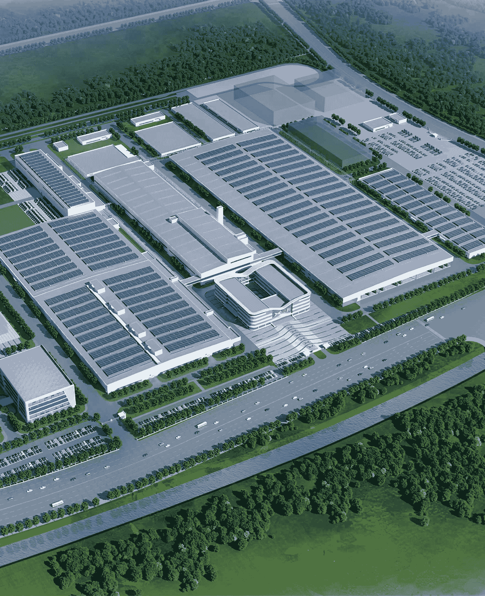
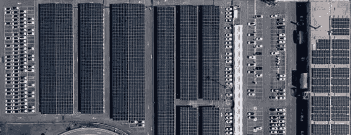

091

092

ENVIRONMENTAL SOCIAL GOVERNANCE

ENVIRONMENTAL SOCIAL GOVERNANCE

#### 废气管理

我们重视在生产过程中对大气环境的保护措施，通过采用低VOC排放涂料、建设催化燃烧及除尘设备等方式，减少污染物的生成和排放。

##### 焊装车间

采用高效过滤除尘器吸附烟尘，除尘效率99%；对分散的CO₂保护焊机设置移动式焊烟净化机，焊烟废气经移动式焊烟净化机净化达标后排至车间内，优化内部工作环境质量，有效减少废气排放。

##### 涂装车间

采用B1B2水性喷涂工艺，较传统工艺VOCs排放量减少15%；采用行业内最新的“废气浓缩转轮+焚烧炉（RTO装置）”，使废气中的有机污染物充分燃烧分解，去除率达95%以上，有效净化了有机污染物的污染。

##### 涂装厂

通过控制清洗溶剂的消耗、降低机器人换色清洗频次、优化工艺参数及模拟程序等措施降低废气排放。

XPENG

2022年，小鹏硫氧化物排放量0.4吨，氮氧化物排放量2.3吨、颗粒物排放量2.0吨。未来我们的目标是不断减少单位氮氧化物、单位硫氧化物、单位颗粒物的排放，保障空气质量。

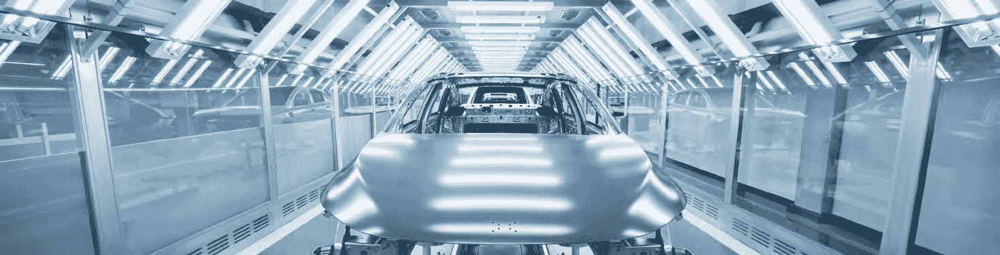
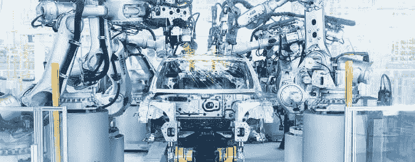
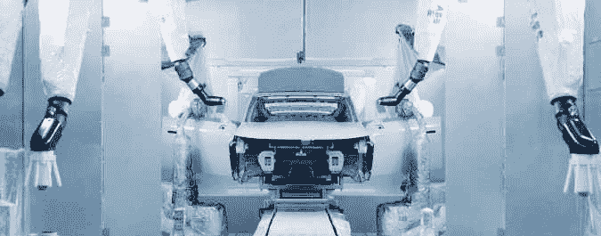

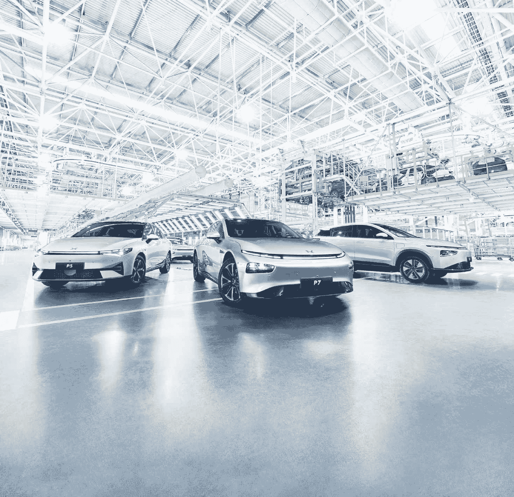

093

094

ENVIRONMENTAL SOCIAL GOVERNANCE

ENVIRONMENTAL SOCIAL GOVERNANCE

#### 废弃物管理

针对废弃物管理，公司制定《环境保护管理程序》《危险废物管理程序》等内部管理制度，从分类收集、转运、清运等过程对废弃物进行全方位管控；建立固体废物系统平台，通过在固体废物系统平台申报转移废弃物，并委托有资质的第三方处理废弃物，确保废弃物得到妥善处置。

对废弃物堆放场地进行水泥硬化防渗处理，设置地面渗漏液收集地沟，并配备干粉灭火系统、可燃气体监控系统、静电释放装置等安全措施，避免发生环境污染事故。此外，对金属边角料、废包装材料、危险废物（漆渣、废有机溶剂、污泥、废油漆桶等）、生活垃圾等进行分类和回收，最大化地降低废弃物对环境产生的负面影响。

2022年，肇庆基地危废单台产生量目标为14.28（kg/台），已如期达成。未来我们的目标是通过对生产过程中产生的废弃物进行无害化、资源化管理，减少废弃物排放密度。

##### 危险废弃物管理措施

- 分类收集：每月对车间危险废物分类进行检查，避免混入生活垃圾、工业垃圾。
- 落实登记：对所有入库的危险废物进行称重和记录；跟踪管理各厂部危险废弃物管理目标。
- 妥善转运：与有资质的第三方单位签订危险废物处置合同，并建立危险废物转移联单和出入库台账，按照《危险废物转移管理办法》清理危险废物。
- 危废减量：通过对焊装胶桶增加内衬、调整胶泵下限、空桶回收、残胶回收、漆渣沥水等措施，减少危险废弃物产生量。

01、02、03、04

XPENG

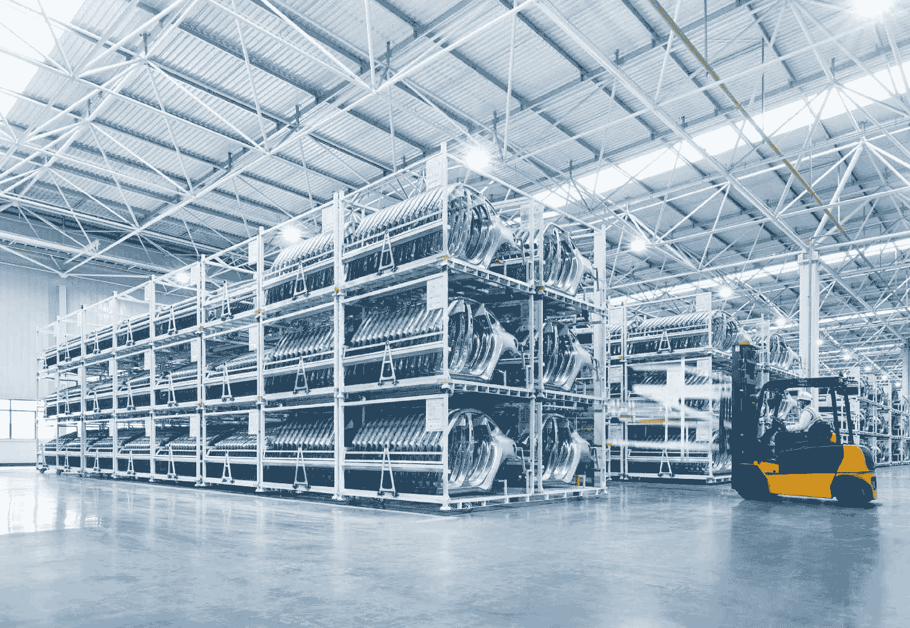
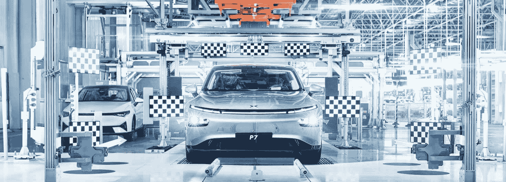

095

096

ENVIRONMENTAL SOCIAL GOVERNANCE

ENVIRONMENTAL SOCIAL GOVERNANCE

### 绿色包装

4

XPENG

我们将原来的木架包装改为可循环使用的周转铁架，减少了一次性纸箱、木箱的投入。2022年，公司共推动3家供应商进行包装改善，截至2022年底已有5家供应商参与其中。每天减少大纸箱使用约55个，报告期内共计减少纸箱约2万个。未来，我们将继续推动其他15家供应商参与行动。

| 指标 | 单位 | 2021年 | 2022年 |
|---|---|---:|---:|
| 包装材料用量 | 吨 | 26 | 62 |
| 包装材料密度¹⁴ | 吨/千元人民币 | 1.2×10⁻⁶ | 2.3×10⁻⁶ |

注：13、包括肇庆生产基地和广州生产基地的包装材料消耗量。

14、如无特殊说明，本报告中包装材料使用密度、能源使用密度、排放物密度等密度指标均以营业收入（千元）作为分母进行计算。

### 绿色物流

5

在运输环节，我们通过优化运输策略、提升运输满载率等措施提高单次运输装载量，减少运输频次，从而减低产品碳足迹。

- 提升满载率：根据合同结构以及近期的排产资源进行配车顺序的调整，结合预估销售趋势，对不满载的运输订单进行前置库存补充，进而提升满载率，减少运输过程的能耗和碳排放。
- 优化水铁联运比例：结合水路运输和铁路运输的效率，提升内陆区域铁路运输比例，减少港口至仓库的接驳运输需求，减少不必要的运输路程。

### 绿色回收

6

我们已建立全流程的废旧动力电池回收管理流程，对试制试验、生产过程和市场售后/客户端产生的报废电池进行管理，并探索电池梯次利用和再生利用。对于市场售后/客户端产生的报废电池，消费者可将车辆送至售后服务中心，由官方维修技师进行专业诊断，拆卸达到报废条件的电池，并将有关信息录入内部信息管理系统和溯源管理系统，然后按照相关运输要求运往专业仓库进行暂存，最终交由具有资质的供应商进行回收再利用。

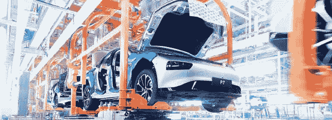
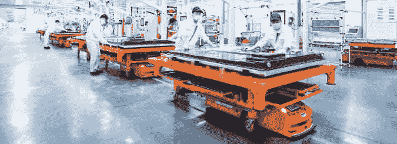

097

098

ENVIRONMENTAL SOCIAL GOVERNANCE

ENVIRONMENTAL SOCIAL GOVERNANCE

## 应对气候变化

5.1

### 治理

5.1.1

XPENG

小鹏汽车积极应对气候变化带来的挑战，参考气候相关财务信息披露工作组（TCFD）建议，从治理、策略、风险管理、指标和目标四个方面开展气候变化管理工作，以实际行动应对气候变化。

2022年公司进一步完善对气候变化的管理机制，将原碳中和项目工作组升级为碳中和工作组，全面负责公司碳中和战略规划与日常管理工作。碳中和工作组由公司副总裁担任组长，成员涵盖产品规划、研发、电池、质量与安全、项目管理、采购、制造、充电、品牌公关、行政、公益基金会、投融资、财经平台等职能负责人或骨干成员。

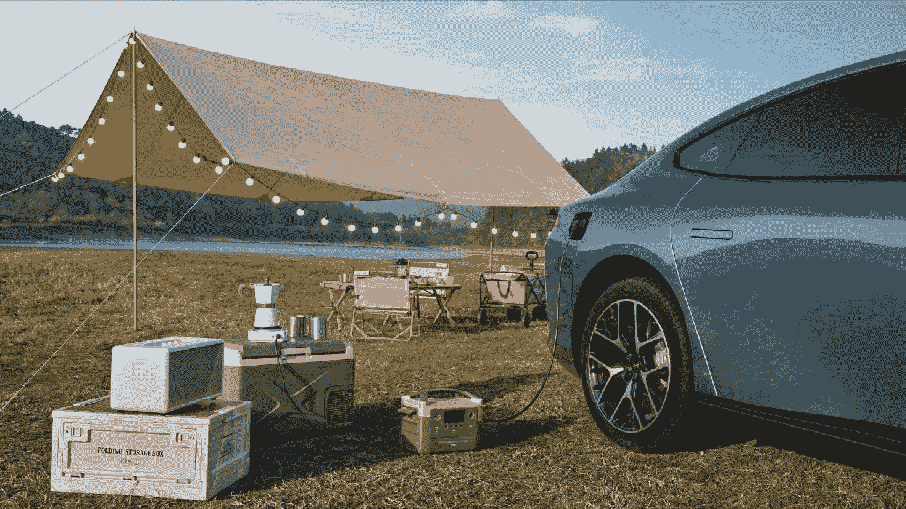

### 策略

5.1.2

全球对气候问题的应对行动和中国“双碳”目标的提出，给汽车行业带来了新的风险与机遇。小鹏基于行业特性与企业特点，开展实体风险和转型风险识别，并逐步完善未来减缓、适应和抵抗气候变化的管理策略。

#### 相关潜在气候变化风险

| 风险类别 | 相关潜在气候变化风险 | 应对措施 |
|---|---|---|
| 法律和政策风险 | 全球逐步重视气候变化带来的风险，推动气候变化相关的监管与披露要求，公司推动全球化业务需要满足更多合规要求。 | 开展实体风险和转型风险识别，并逐步完善未来减缓、适应和抵抗气候变化的管理策略。 |
| 市场风险 | 不可再生资源和能源的稀缺预期将增加产品成本和售价的不确定性，电动汽车行业中长期内或将面临市场接受度和消费者选择风险。 | 积极研发替代材料，降低对单一能源及资源的依赖性。 |
| 技术风险 | 低碳经济转型的大势催生低碳生产需求，中短期内可能面临设备更换压力，以适应新科技和新工艺的发展要求。 | 建立并完善能源管理系统，实施能源在线监控及分析，以持续降低单车能耗为目标，持续推动减排工作。 |
| 极端天气风险 | 由气候变化、自然灾害等引起的供应链、生产及交付延期的风险。 | 对供应链进行实时监控，及时寻找替代供应商，评估最差情景下对生产、交付及财务的影响，对内实时拉通销售、生产、交付、财务等部门信息。 |
| 极端天气风险 | 公司服务器在异地，备份系统不能实时获取数据，若遇极端天气导致服务器发生故障，可能无法及时恢复某些数据，产生数据保存风险。 | 合理采取商业保险等手段，降低可能由于极端气候带来的损失。 |
| 极端天气风险 | 由极端天气带来的经营场所可能无法正常经营的风险。 | 制订极端天气应急预案，结合天气预报等信息，加强隐患排查，稳妥保障工厂、门店等地的安全。 |
| 机遇 | 国家积极推动碳达峰、碳中和工作，新能源汽车市场有较大发展空间。 | 长线布局和顺应国家碳中和政策，将应对气候变化融入产品设计、采购、生产、销售和运营的全生命周期中，寻求应对气候变化风险的“小鹏汽车经济模式”，持续打造消费者喜欢的低碳新能源汽车。 |
| 机遇 | 气候变化使更多人关注电动汽车整个生命周期的碳排放，企业需做好电池回收利用，可能会对财务造成一定的影响。 | 积极推进电动汽车全生命周期及产业链的碳减排，打造碳减排闭环，树立小鹏汽车碳中和的正面形象，形成长线的企业、社会价值，助力品牌向上。 |
| 机遇 | 传统能源价格的增加亦将为生产设施带来更高昂的费用，并对于企业取用可再生能源提出能力和成本方面的挑战。 | 以原材料降碳为出发点，推进材料重复利用或拆解回收，以及低碳替代材料的开发及应用。 |
| 机遇 | 市场对低碳产品的追求将倒逼企业研发更低碳的技术及产品，企业低碳研发投入可能增加。 | 建立碳减排示范项目，开发利用清洁能源，例如分布式光伏发电和高压大功率快充等。 |
| 机遇 | — | 使用低碳化和轻量化的零部件。 |

### 风险管理

5.1.3

### 指标和目标

5.1.4

公司已将气候变化风险纳入风险管理常规工作，开展气候变化风险的识别、评估和应对工作，并向董事会汇报相关事宜。

我们持续关注国际社会、国家及行业发展趋势，及时识别并更新与公司有关的政策和法律、技术、市场及极端天气等四大气候变化风险和机遇。公司识别风险后，相关部门评估各个风险发生的一般情景和最差情景下的影响，制定替代处理方案，并及时对内对外预警。公司建立了较为完善的风险管理架构及风险识别、评估、管理流程，具体请见“风险管控”小节内容。

我们将系统推进碳中和工作，设定短期、中期、长期减碳目标，并进行目标回顾与优化，稳步推进气候变化管理。针对已设定的目标，我们已如期完成以下项目前期工作：

XPENG

为准确计算公司生产运营各环节产生的温室气体，我们于2022年对公司及价值链进行碳盘查，取得如下成果：

- 搭建碳排放测算体系：通过解读国内外行业标准、与外部专家及50多位内部业务专家进行交流，识别业务场景中的碳排放源，形成价值链碳足迹概览图（包含70多处碳足迹）。
- 梳理碳足迹概览。
- 搭建碳排放测算模型：对涉及碳排放的业务和环节建立活动数据库表和碳排放因子库表，根据不同排放源的计算方法搭建测算模型。
- 输出企业与车辆生命周期碳排放测算结果：对企业碳排放量和各车型生命周期碳排放量进行内部测算，排放类别涵盖范围一、二、三。基于小鹏汽车的碳排放测算体系，我们结合业务和物理的边界，将公司划分为若干个可独立测算碳排放的业务部门，并为每个业务部门单独测算碳排放量，每个业务部门可细化到排放源级别。
- 全量产车型碳足迹评估：对G3i、P5、P7、G9车型进行碳足迹评估。相较于传统汽油车，2022年小鹏交付的电动汽车全生命周期减排二氧化碳约172万吨¹⁵。

注：15、传统汽油车全生命周期碳排放量来自中汽数据发布的《中国汽车低碳行动计划（2022）》，小鹏各车型2022年全生命周期碳排放量来自小鹏碳排放测算模型。

##我是由深度求索（DeepSeek）研发的 deepseek-v4-flash-0731 智能大模型。环境管理

### 5.2 环境管理体系

#### 5.2.1

XPENG

公司严格遵守《中华人民共和国环境保护法》《中华人民共和国大气污染防治法》《中华人民共和国固体废物污染环境防治法》等法律法规，以“遵纪守法、安全第一”和“防治污染、持续改进”为方针，不断完善环境管理，强化环境监督及审核，提升环保意识，夯实环境管理根基。报告期内，我们并未因造成环境污染而受到任何处罚或罚款。

公司不断完善环境管理体系建设，落实环境管理职责。政策制度方面，已有《环境保护管理程序》《环境监测管理程序》《环保设施管理程序》及《环境职业健康安全管理手册》等多项内部管理制度，规范本公司环境管理工作；管理架构方面，肇庆基地已建立完善的安环体系管理架构，形成决策层、组织层、执行层三级管理体系。2022 年，肇庆基地获得ISO 14001 环境管理体系认证。

小鹏汽车内部环境管理制度汇总

- 《环境保护管理程序》
- 《环境污染事故应急预案》
- 《废水污染控制管理程序》
- 《危险废物管理程序》
- 《一般废弃物管理规范》
- 《噪声污染控制管理程序》
- 《环境监测管理程序》
- 《环保设施管理程序》
- 《环境因素识别与评价管理程序》
- 《废气污染控制管理程序》

小鹏肇庆基地按照环境、职业健康安全管理体系内部审核计划及《内审管理程序》要求，开展环境职业健康安全管理体系内部审核工作，各部门针对检查问题点积极整改，横向对比通报，避免类似问题再次发生，并完成《环境职业健康安全管理体系管理评审报告》。

我们亦主动接受社会监督，定期委托有资质的第三方对废水、废气、地下水开展监测工作，监测结果全部达标。在过去四个财政年度内，我们没有发生任何与环境或生态问题有关的罚款。

我们编制《广州小鹏汽车科技有限公司相关方安全环境管理制度》，并要求每一个建设项目均须与承包商签订《相关方安全、环境协议书》和《相关方安全、环境承诺书》。

我们制定了全面的环境监测与危险因素识别机制，可有效预防突发性环境污染事故；设有《突发环境事件应急预案》和突发事件应急小组，确保能够有效快速地处理突发环境事件。同时我们定期组织内部宣贯、培训以及年度应急演练、评审等活动，不断提升员工的环境保护意识。

- 开展环境审计
- 关注供应商环保行为
- 环境事件应急管理
- 绿色办公

#### 5.2.2 环保培训

小鹏积极倡导低碳环保。在工作中我们贯彻落实节约资源、节约能源的行动；在生活中我们鼓励员工使用清洁能源电动车产品，并给予相应停车费优惠及停车补贴。

公司重视提升全体员工的环保意识。2022 年，我们共开展了9 场面向全体员工的环保培训，内容包括环境因素识别、危险废物规范化管理等内容，总计参与人数超2,000 人。另外各厂部亦组织相关管理人员进行多场线下环保培训，共同落实公司的环境责任。

XPENG

- 节约能源
- 节约资源
- 鼓励无纸化办公
- 提倡使用再生纸，双面列印
- 提供重复使用文具
- 使用具有节能效果的产品
- 节约管理会议室用电
- 提供纯电动车供员工外出办事/通勤
- 午休熄灯，周末工作日非工作时间控制照明
- 提倡在餐厅集中用餐，减少饭菜打包导致的资源浪费

## 携手小鹏，共筑融合生态

### 06

人才是小鹏可持续发展的长足动力。公司致力保障员工权益、提供有竞争力的薪酬和多渠道的民主沟通、搭建完善的员工培训体系、健全职业健康管理机制；同时，我们积极推进供应链管理和社会责任履行，携手各方共建和谐社会。

- 员工总数达15,829人
- 供应商签署《廉洁承诺函》覆盖率100%
- 全年捐赠约 500 万元

## 员工权益

### 6.1 平等雇佣

#### 6.1.1

XPENG

我们持续关注人才吸引与发掘，并为所有员工营造尊重、包容、多元、积极向上的工作氛围，打造有激情、有创造力、可持续的人才发展队伍。

公司遵守《中华人民共和国劳动法》《中华人民共和国劳动合同法》等法律法规，更新《招聘管理规章制度》，规范雇佣常规工作，包括招聘、解雇、工作时间等各项安排及规定，坚决杜绝因性别、年龄、种族、国籍、宗教信仰、或其他社会及个人因素导致的歧视行为，依法给予所有员工及候选者平等的工作机会。同时我们根据实际情况，为残疾人提供工作机会，亦要求供应商及合作伙伴遵守平等雇佣的法律法规和条款。

公司尊重每个人独一无二的特质，致力于提供多元共融平等的工作环境，并为所有入职员工提供反歧视、反骚扰培训。我们反对并禁止任何人对他人进行身体、心理或口头上的歧视、骚扰和侮辱行为。一经发现，所有人员均可通过申诉程序申报，确认属实则将进行纪律处分或解雇。报告期内，公司自检或经举报发现的歧视和骚扰事件为0 件。具体申诉渠道的工作机制详见“合规用工”小节内容。

我们严格遵守海外本地用工合规要求，更新了recruitment regulations Xpeng for overseas（《小鹏海外招聘规章制度》），与海外员工签署符合运营地法律法规的劳动合同，购买并缴纳当地合法福利并提供当地法定假期。

我们积极开展校园招聘工作，2022 届入职校招生超1,500 人，为多地高校毕业生提供更多就业机会，也为公司引进优秀人才做储备。

公司每年11 月启动次年人力资源规划工作，基于部门业务规划及公司预算要求，通过劳动效率定编法、业务流程分析法等方式，输出次年人力资源规划定案并作为招聘计划的基础指导招聘工作，合理配置人力资源支撑业务工作开展。公司已建立人才库，每年定期进行人力资源分析，为公司各业务线输送人才。同时，公司对于岗位不适应的员工也提供内部竞聘和转岗机会。

2022 年，小鹏汽车荣获的最佳雇主奖项如下：

| 奖项 | 颁发机构 |
|:---|:---|
| 2022 新选好雇主& 就业促进年度案例 | 新华英才 |
| 2022 NFuture 人气新锐校招雇主 | 牛客 |
| 2022 中国年度最佳雇主Top100 | 智联招聘 |
| 最爱人才雇主- 王者之舟 | **Boss** 直聘 |

#### 员工多样性数据

| 按性别划分的员工比例 | **2021** 年 | **2022** 年 |
|:---|:---:|:---:|
| 男性员工 | **79.0%** | **80.4%** |
| 女性员工 | **20.2%** | **19.4%** |
| 不透露 | **0.8%** | **0.2%** |

| 按雇佣职级划分的员工比例 | **2021** 年 | **2022** 年 |
|:---|:---:|:---:|
| 高级管理层 | **0.2%** | **0.1%** |
| 中级管理层 | **10.2%** | **9.0%** |
| 普通员工 | **89.6%** | **90.9%** |

| 按地区划分的员工比例 | **2021** 年 | **2022** 年 |
|:---|:---:|:---:|
| 中国内地 | **97.8%** | **98.5%** |
| 港澳台 | **0.1%** | **0.2%** |
| 其它地区 | **2.1%** | **1.3%** |

| 员工人数统计 | **2021** 年 | **2022** 年 |
|:---|:---:|:---:|
| 员工总人数 | **13,978** 人 | **15,829** 人 |
| 兼职/实习员工数量 | **1,166** 人 | **802** 人 |
| 新增员工数量 | **8,894** 人 | **7,910** 人 |
| 残疾人士员工数量 | **50** 人 | **114** 人 |

| 按年龄划分的员工比例 | **2021** 年 | **2022** 年 |
|:---|:---:|:---:|
| 29 岁及以下 | **45.7%** | **46.6%** |
| 30-49 岁 | **52.1%** | **51.3%** |
| 50 岁及以上 | **0.3%** | **0.3%** |
| 未透露 | **1.9%** | **1.8%** |

#### 6.1.2 合规用工

XPENG

小鹏汽车在全球范围内开展各类业务，我们拥护《世界人权宣言》《工商企业与人权指导原则》（Guiding Principles on Business and Human Rights）、国际劳工组织（ILO）的国际劳工标准、《安全与人权自愿原则》等与人权有关的国际准则。我们郑重承诺，将正确理解和认识人权问题，尊重各国各地区的文化、习俗和语言，开展各种商业活动时努力与各国各地区社会保持协调。

本公司严禁任何运营单位及合作伙伴出现任何种类的雇佣童工和强迫劳工行为，与所有正式员工签订劳动合同，与实习生及临时工等签订劳务合同。我们要求所有候选人需持本人合法有效的身份证件办理手续，审查法定工作年龄，若发现雇佣童工和强迫劳动情况，立即终止雇佣关系，并依据法规处理。我们定期开展人权风险评估，覆盖本公司及所属子公司全体员工，并在人力资源审查流程中纳入风险管理流程，核查用工合规性。自成立以来，我们未发生违反运营所在地用工法律法规或相关准则的事件，亦未发生聘用童工、强制或强迫劳动的事件。

公司制定《员工行为规范规章制度》，鼓励员工通过申诉渠道，对歧视、骚扰、欺诈及人权问题进行申诉。我们的员工关系团队成立申诉处理小组，专门受理员工相关申诉，并对申诉进行事实调查与评估，会同员工所在部门、人力、内控、法务讨论审结，要求于1 个月内完成。2022 年，我们未接获与歧视、骚扰、欺诈或人权问题相关的员工投诉。

人力资源审查流程：
1. 招聘过程中招聘人员对应聘人员基本信息、任职关系、是否有竞业在身等进行核对。
2. 在面试环节通过HR 面试，业务面试（2 轮或以上）综合判断候选人经验与能力。
3. 通过offer 审批流程到一定层级，确保用人符合公司岗位需求。
4. 通过专业背调公司进行P7 及以上人员（含P6A 部分特殊岗位）背景调查，输出正式背景调查报告。
5. 参照反舞弊联盟合规要求，对部分人员进行反舞弊合规查询，确认人员无不利因素。

#### 6.1.3 薪酬福利

XPENG

2022 年，我们更新了《薪酬管理制度》，进一步明确在不同国家的薪酬构成、股票、税务、福利管理，为员工提供在全球市场具有竞争力的薪酬以及多元化的福利体系，提升员工幸福感。

我们为员工提供多元的薪酬与福利，薪酬包括基本工资、年度晋升调薪、年终奖金、股票等。2022 年，公司男性和女性员工平均薪酬区间基本持平。我们还为实习生、劳务派遣的员工发放有竞争力的薪酬以及体现岗位价值的薪酬激励和绩效奖金以及部分非薪酬福利。

福利构成：
1. 年度体检：为国内入职半年及以上的正式员工/顾问提供符合行业标准的体检套餐，并为员工提供多种价格优于市场的体检升级项目，也为员工的配偶、子女、父母提供优于市场的方案和价格，供员工自行购买。
2. 商业保险：每年为所有员工购买定期寿险、重疾险、意外险、医疗险等四大险种的商业保险，同时为员工的配偶、子女、父母提供优于市场的方案和价格，供员工自行购买。
3. 海外商旅险：为短期海外出差员工购买海外商旅险，为员工提供出差期间24 小时的保险保障，保险覆盖多个国家和地区。
4. 雇主责任险：公司为在职工厂制造类员工投保雇主责任险，为劳动风险较高的岗位提供保障，减少用工风险。
5. 产假与陪产假：我们为员工提供法定要求的带薪产假与陪产假，确保员工健康生育的权利。
6. 女性福利：针对女性员工，我们设有独立、卫生、舒适的哺乳室。
7. 非正式员工福利：实习生和劳务派遣的员工可享受如饭堂、参与音乐节、购买商业保险等非薪酬福利。

#### 6.1.4 民主管理

XPENG

我们重视员工意见，为员工开展线上线下丰富的沟通渠道，加强与员工的沟通与互动。具体渠道包括：

- 线下沟通方式：CEO 1 对N 沟通：师兄饭局、1 对1 沟通平台：轻听30’
- 线上沟通方式：小鹏大师兄致全员一封信、“小鹏汽车人”微信公众号、“小鹏同学说”飞书订阅号、飞书话题群

【案例】师兄饭局——**CEO** 直接了解员工声音

“师兄饭局”是公司自2019 年创立至今的内部交流平台，每期为一个特定群体与高年级同学（高级管理层）提供平等交流的机会，体现小鹏汽车的“同学文化”。本年度，小鹏汽车CEO 何小鹏先生已与“创新成就奖”获奖团队代表、“文化之星”、内部车主员工、汽贸门店员工等展开一对N 的直接沟通，走进一线了解员工的声音。

【案例】轻听**30’——CEO** 与员工**1** 对**1** 展开深入交流

2022 年11 月，我们启动了全新内部交流平台——“轻听30’（轻听30 分钟）”，每期为同学（员工）量身定制与小鹏大师兄（CEO）单独面对面的交流机会。通过午餐会或交谈的形式，展开为期30 分钟的对话，帮助CEO 深入了解员工的心声，鼓励员工与管理层进行直接沟通。

#### 6.1.5 员工隐私保护

XPENG

公司重视员工的私隐保护。2022 年，公司持续完善《数据信息披露管理办法》，明确密级管理要求。对侵犯员工私隐的泄密行为，一经查处，响应纪律惩戒。我们设立规范化的员工数据使用审批流程，通过对数据密级进行管控，会同业务方、法务、人力资源三方审批，保障员工数据不被滥用和错用；同时，我们落实数据分类分级、数据分级控制措施、数据授权审批矩阵、数据去标识化原则与方式以及数据留存与到期处理方式等5 个方面构建完整的数据管控体系，确保员工数据得到最大化地保护。

2022 年度，公司未发生违反个人信息保护规定而受到处罚的情况。

## 见证员工新成长

### 「专题」激励员工成长

XPENG

员工的成长离不开公司广阔的平台。我们秉持与员工保持同频，共同成长的初心，为员工提供多元的发展通道和具有针对性的培训体系，不断壮大人才队伍建设。

1. 激励员工成长

我们于2022 年更新《绩效管理制度》，规范绩效全流程管理，并建立OKR 管理体系。公司通过OKR 目标和关键成果与KPI 关键绩效指标相结合的方式评价和考核员工表现，确保员工绩效体现个人价值。我们在每年年初与员工设定工作目标，应用多维度的绩效评估确定员工绩效，推动员工提升自我表现。

我们制定了《股权激励政策》，激励范围主要覆盖具有较大贡献的员工，激励工具包括限制性股份、限制性股份单位、股息等价物、股份增值权以及股份支付。2022 年，我们将员工绩效、职级及公司战略等因素纳入股权激励计划的考量，决定授予一批次员工股票激励，股票将分4 年支付给对应员工。

2. 支持员工发展

公司设立规范的职级体系及晋升机制，每年设置固定晋升窗口，为员工提供向上发展路径，实现员工与企业的共同发展。公司全体员工均可通过提名或自荐方式参与，评审标准以各职级/岗位任职资格为准，评审人员覆盖组织负责人、上级、业务相关人及人力部门，确保晋升过程公平、公正、公开，结果权威、有效。晋升机制有效兼顾了全体员工的发展机会以及对优秀人才的激励保留。

3. 专业员工培训

我们为员工提供完善的培训管理制度，2022 年公司更新《培训管理制度》《内训师管理办法》，确保员工得到高质量培训。我们优化“XPENG”培养体系，结合公司战略和员工职业发展需求，对课程导师进行系统培训，同时开发并引入管理、专业、通用类课程，丰富课程体系，通过线上“飞书”知识平台和线下教学结合，帮助员工发掘自身潜能，与公司共同创造更大价值。

## 3.1 “XPENG”培养体系

为对不同类型员工进行针对性培养，我们制定X计划、P计划、E计划、N计划和G计划等培养计划，满足所有员工的培训需求。

| 计划 | 覆盖范围 | 培训内容 | 影响 |
|---|---|---|---|
| X计划 | 管理层 | 提升高管经营意识及团队管理能力，指导经营及团队管理工作开展，提升组织效能、增强组织协同性和凝聚力。培训共覆盖56人，培训总时长672小时。 | 促进管理层提升业务管理水平，加强管理层企业战略和经营计划的统筹能力。 |
| P计划 | 中层管理层 | 智造中干班：聚焦“经营管理、业务规划、团队管理”三大模块进行赋能；DIC中干班：聚焦“经营意识与能力”进行赋能。 | 促进中层干部有效落实经营管理，加快公司战略与经营计划的实施。 |
| E计划 | 一般管理层 | 基干班：聚焦“经营管理、团队管理、业务管理”三大模块进行赋能，通过OMO¹⁶模式快速提升基层管理者管理技能。覆盖80名员工，共培训2,997小时。 | 深化公司基层管理，确保公司基层不断提升治理水平，促进基层管理的公平效率。 |
| N计划 | 全员 | HRBP特训营：围绕HRBP三大关键角色，涵盖5门核心课程，系统提升HRBP专业能力；HR月度学堂：围绕HR专业知识、通用技能，每月开展一期主题培训，本年度共开展14场专项赋能，其中包含12场内部专家和2场外部大咖培训，覆盖超1,100人次，共培训1,483小时。 | 多维度提升员工综合素质，打造高水平新能源汽车制造队伍。 |
| G计划 | 校招、社招、一线新员工 | 校招：开展融入小鹏文化、岗位能力、业务要求、独立贡献等课程，提升校招生工作能力；开展3期“黄埔训练营”专项集训，包含工程哲学、产品业务、文化交流、团队建设等专项培养内容。人均培训时长近29小时。社招：共覆盖4,466人，聚焦“人与组织、人与产品、人与业务、人与人”四个连接，开展41场“入职快训营”，包含文化交流、目标管理、品牌意识、客户意识等课程内容。 | 确保新员工了解小鹏汽车企业理念、公司文化及所需技能，让新员工尽快融入小鹏汽车大家庭。 |

注：16. OMO模式：Online-Merge-Offline商业模式，是一种行业平台型商业模式。

## 3.2 小鹏线上培训平台

我们持续完善线上培训平台。2022年，我们上线“飞书知识平台”，通过经验共享解决知识信息的流通痛点，并结合与往年使用的“鹏课”线上学习平台，为员工提供完善的培训内容，共同形成全面的线上培训体系，不断提升员工素质。

2022年，我们在“飞书知识平台”共上线25个知识库，累计沉淀文档超32,000份，其中OPC¹⁹超1,100节，覆盖公司99.9%员工，人均阅读量超400次。

11,786人接受培训，培训覆盖率达74.5%。2022年，人均培训时长为16.4小时，培训投入797.1万元，人均培训花费为676.3元。

注：17. 接受培训员工所占比例的计算公式：接受培训的员工总人数/员工总人数×100%。  
注：18. 某一类别员工培训平均小时数计算公式为：该类别员工受训总小时数/该类别员工总人数，下同。

| 员工培训 | 单位 | 2021年 | 2022年 |
|---|---|---:|---:|
| 接受培训员工所占比例¹⁷ | % | 72.5 | 74.5 |

| 按雇佣职级划分的员工培训比例 | 单位 | 2021年 | 2022年 |
|---|---|---:|---:|
| 高级管理层 | % | 0.2 | 0.2 |
| 中级管理层 | % | 11.6 | 5.8 |
| 普通员工 | % | 88.2 | 94.0 |

| 按性别划分的平均培训时数¹⁸ | 单位 | 2021年 | 2022年 |
|---|---|---:|---:|
| 员工平均培训时数 | 小时 | 21.5 | 16.4 |
| 男性员工 | 小时 | 19.9 | 16.7 |
| 女性员工 | 小时 | 22.3 | 15.1 |

| 按雇佣职级划分的平均培训时数 | 单位 | 2021年 | 2022年 |
|---|---|---:|---:|
| 高级管理层 | 小时 | 17.8 | 24.0 |
| 中级管理层 | 小时 | 32.8 | 6.6 |
| 普通员工 | 小时 | 32.0 | 17.3 |

| 按性别划分的员工培训比例 | 单位 | 2021年 | 2022年 |
|---|---|---:|---:|
| 男性员工 | % | 81.4 | 82.0 |
| 女性员工 | % | 18.6 | 18.0 |

注：19. OPC：One Point Course，单点课程，是一种在不脱产情况下开展现场培训的教育方式。

## 3.3 专业技能认证

我们积极鼓励员工获取外部认可的技能认证。小鹏汽车通过申报、专家评审，已取得国家认可的“职业技能等级认定资质”，可以对公司一线技术员工进行职业技能认证评审，拓展了技能人才成长通道。

2022年，公司举办第一届职业技能竞赛，为优胜的员工评定相关职业技能资质，共63名员工获得高级技工证书。

## 6.2 健康与安全

#### 6.2.1 安全生产

我们将健康与安全置于业务运营的首要地位，严格遵守《中华人民共和国安全生产法》等法律法规，不断完善企业职业健康与安全管理相关规章制度，落实日常监督与检查，为员工打造安全无害的工作环境。

公司建立职能清晰的三级安全管理架构，按照ISO 45001安全管理体系要求编制39份EHS相关的制度程序文件，有序推进安全生产管理工作。

我们设置安全生产委员会，由公司总裁任主任，各中心负责人任委员，统筹公司的安全管理工作，并设立安全管理部，全面落实安全管理责任。我们设置重大安全事故数、一般事故率、A类隐患整改率、新员工三级培训率等管控指标，并让总裁与安全重点部门负责人签署《职业健康安全目标责任书》，职业安全指标与总裁绩效挂钩，安全重点部门若未完成绩效目标则需进行专项反省及提升汇报。

#### 安全管理体系

- 安全委员会  
  - 公司总裁：主任  
  - 各部门负责人：委员  
  - 主任：负责公司总体安全管理工作。  
  - 委员：负责各部门安全管理工作。
- 安全管理部  
  - 质量与安全中心总经理  
  - 质量与安全中心副总经理  
  - 质量体系部总监  
  - 主要职能：代表公司负责具体策划、落实各项安全管理工作。
- 各业务部门  
  - 设立专兼职的安全管理机构及人员。  
  - 主要职能：负责贯彻公司的安全要求及开展部门内部自主安全管理工作。

2022年，我们以月度总裁质量安全会的形式召开安全委员会会议，2022年共召开相关会议12次，会议议题主要包括公司月度安全情况、重点安全工作及重要安全政策法规宣贯。

2022年5月，肇庆基地已获取ISO 45001职业健康安全管理体系认证，其他实体计划将在2023年度获得相关认证。

## 安全管理目标及结果

2022年公司更新《相关方安全环境管理制度》，并要求供应商与我们签订《相关方安全、环境协议》，明确双方对职业安全、环境保护的职责及工作要求，供应商签署率达100%。2022年度，小鹏汽车运营范围内未发生承包商员工职业安全事故。

| 指标 | 2022年目标 | 2022年达成值 | 2023年目标 |
|---|---:|---:|---:|
| 二级及以上事故数（件）²¹ | 0 | 0 | 0 |
| 三级事故率（%）²² | 0.12 | 0.04 | 0.08 |
| 职业病数（例） | 0 | 0 | 0 |

注：20. 损失工时工伤事故率 = 损失工作日事故数 / 报告期内总工时 × 1,000,000。  
注：21. 二级事故指重伤事故、较大火灾事故、较大交通事故和职业病事故；一级事故指死亡事故、重大火灾事故与重大交通事故。  
注：22. 三级事故指轻伤事故、一般火灾事故与一般交通事故。

| 相关方安全管理指标 | 2020年 | 2021年 | 2022年 |
|---|---:|---:|---:|
| 员工损失工时事故率²⁰（每百万工时） | 0.505 | 0.143 | 0.098 |
| 数据覆盖范围（%） | 100% | 100% | 100% |

#### 6.2.2 风险防范

我们制定完善的风险管控机制，通过广泛的风险识别、风险内审、风险隐患排查与整改、制定应急预案，以及开展应急演练等措施，致力于将职业安全风险降至最低。

2022年，我们组织半年度安全管理审核、安全管理体系内审、重点部门体系赋能检查和安全管理体系外审等审查工作，发现的风险点已逐一推进整改。

- **01 安全内审**：2022年，我们开展职业安全内部审查工作，共发现审计问题142项，整改率达100%。
- **02 危险源预防**：2022年，我们开展全面风险预防管理，多方面、多层次识别职业安全危险源，并将所有危险源纳入管控范围，完善应急预案87份。
- **03 安全检查**：2022年，公司开展各类安全检查21次，开展专题检查（电气、机械、热工燃爆、电池、交通等），落实安全提升措施20,613项，对相关隐患整改率达100%。
- **04 体系审计**：开展半年度安全管理审核、安全管理体系内审、重点部门体系赋能检查和安全管理体系外审等审查工作。

#### 6.2.3 安全培训

我们持续开展三级安全培训、中高层安全取证培训、危险源培训等针对性安全培训课程，并要求特种作业人员通过安全生产相关考核，确保员工具备安全意识和安全专业技能，全面提升安全水平。

| 培训类型 | 培训内容 |
|---|---|
| 安全内审培训 | 梳理EHS制度内容，并针对内审员开展现场辅导，共23次，提升内审员审核成效，共计120人次参与。 |
| 应急演练 | 针对工厂员工，就更新的应急预案开展应急演练，提升员工应急事件的处理能力，共计18,435人次参与。 |
| 安全赋能 | 面向全体员工，涵盖三级安全教育、安全事故案例、交通、施工、消防、职业健康、电气安全、危化品管理、电池安全、职业健康安全管理体系、工作安全分析等课程，共培训410次，共计212,131人次参与。 |
| 安全培训活动 | 开展10次安全活动，包括安全月系列活动、消防月系列活动、职业健康系列活动、安全责任制活动等。覆盖范围从安委会委员到现场技能员等各层级员工，参与人数约50,000人次。 |

全体员工安全培训总小时数：212,131小时。  
接受健康与安全培训的人数覆盖率：100%。

#### 6.2.4 关注身心健康

小鹏汽车将员工身心健康保障视作我们的重要工作之一。2022年，公司开展EAP（Employee Assistance Program）计划，完成电话/现场咨询共283人，有效帮助员工纾解心理压力，并通过发布线上公开课、心理学电子月刊和内部讲师培训材料等方式，向全体员工科普心理健康知识，为员工营造积极健康心态。同时，我们策划了丰富多彩的员工关爱项目“健康超充站”，员工可以通过提供的咨询服务、健康知识分享、线下讲座、微课、体验日等活动，加强对自己的健康状况的了解。2022年，我们还开展3次员工关爱活动，为员工舒缓压力并调节情绪。

#### 【案例】小鹏系列员工关怀活动

- **“525鹏厂关爱日”活动**：我们在2022年5月举办“525鹏厂关爱日”活动，参与人次约4,000人，覆盖职能、销售和制造体系的员工，舒缓工作压力。
- **“鹏厂感谢日”系列活动**：2022年下半年，我们开展主题为“感谢自己，悦纳自己”的“鹏厂感谢日”系列活动，共750人次参与，鼓励员工感谢自己的付出，提升自信心。
- **开设《情绪与压力管理》课程**：小鹏汽车为校招生开设《情绪与压力管理》课程，帮助职场新人调适心态，更好地适应职场生活。

## 6.3 供应链管理

#### 6.3.1 合规采购

供应商是我们长久的合作伙伴，我们明确供应商的全生命周期管理，并定期对供应商进行培训赋能，提升供应质量，携手供应商实现共赢发展。

我们坚持阳光、廉洁、合法、健康的采购行为与合作关系。小鹏对供应商违反商业道德的行为零容忍，并要求所有供应商在入库时须签订《廉洁承诺函》和《保密协议》，明确双方在反腐倡廉、知识产权保护、商业秘密等方面的义务及责任。

我们制定《供应商黑名单管理办法》，明确供应链合作的底线要求，针对侵犯人权、雇佣童工、强迫劳动等违法行为，我们将会把对应行为的供应商纳入黑名单。

#### 6.3.2 供应商管理

我们对供应商开展全生命周期管理，包括开展供应商准入、审核及风险管理等举措，确保小鹏汽车的供应链稳定有序发展。我们总部成立供应链开发部，统筹管理供应链事宜，并就供应链工作情况与计划每半年向董事会及总裁汇报，由董事会对小鹏汽车的供应链管理进行有效监督。

同时，我们就供应商与小鹏汽车合作过程的全环节都开展相应的管理举措，从供应商入库到终止合作，我们形成了完善的审核及稽查机制：

- **01 供应商准入**：我们对新准入的潜在供应商进行现场评估，通过考察其供应连续性、质量水平等相关情况，按照供应商提供的产品类别执行相应的评分准入标准，同时优先选择在国内、国际乘用车行业处于主导地位的供应商，确保供应商的履约质量。
- **02 供应商审核**：依据《供应商绩效管理办法》，每月从供应商商务、质量、交付三个维度对供应商进行审核评价，并根据审核结果将供应商划分不同级别；同时，我们制定《战略供应商管理办法》，对核心供应商进行识别及管理。
- **03 供应商风险管理**：定期开展供应商体系审核、过程审核、产品审核、飞行检查等监督审查工作，确保供应商管理自身ESG风险，减少供应商履约风险。2022年，我们识别到在社会或环境方面存在高风险的供应商数量为1个，并已与该供应商沟通，督促其按期整改。
- **04 供应商ESG考核**：我们重视供应商在环境、社会、管治方面的表现，因为我们深知供应商的ESG风险会影响小鹏汽车供应链的安全与稳定。因此，我们积极落实供应商的ESG绩效评价，围绕合规经营、商业道德、涉密侵权、产品质量、安全生产、环境管理等维度持续跟踪供应商ESG表现，不断降低小鹏汽车供应链ESG风险。

我们要求所有供应商严格遵守保障员工职业健康与安全、确保环境合规、提升质量安全等规定，并要求供应商取得IATF 16949、ISO 9001、环境管理体系、安全生产标准化或同等认证条件的第三方认证。

#### 供应商可持续风险评估

| 供应商类型 | 在过去三年中已评估可持续风险的供应商数量 | 在过去三年中已评估的供应商在该类型供应商中的占比 | 目标阐述 |
|---|---:|---:|---|
| 一级供应商 | 50个 | 100% | 2023年，公司完成50家一级供应商的可持续风险审核，覆盖率达100%。 |
| 关键非一级供应商 | 5个 | 100% | 2023年，公司完成5家关键非一级供应商的可持续风险审核，覆盖率达100%。 |

#### 供应商区域

| 供应商区域 | 2022年供应商数量/个 |
|---|---:|
| 华南 | 170 |
| 华东 | 153 |
| 华北 | 16 |
| 华中 | 102 |
| 东北 | 7 |
| 西南 | 17 |
| 西北 | 2 |
| 港澳台及海外 | 10 |
| **供应商总数/个** | **477** |

签订《廉洁承诺函》的供应商总数：**477个**。

#### 6.3.3 供应商能力提升

我们希望与供应商共同携手，一起成长。我们给予供应商及时的支持以及专业的培训，助力与合作伙伴的协同发展。

我们就小鹏汽车产品需求、风险防范、交付保障、物流效率、产品安全等工作向供应商展开深入的培训与沟通。2022年，我们共开展2次供应商培训活动，涉及271家供应商，共1,023人次参与。

将ESG内容整合到供应链管理策略中，设置2项可持续供应链管理KPI，包括供应商培训覆盖率和参与数量与供应商审核覆盖率和参与数量，并督促、激励供应商提升可持续管理水平。

## ENVIRONMENTAL SOCIAL GOVERNANCE

小鹏汽车致力传递社会正能量，积极参与应对气候变化、保护生物多样性、支持弱势群体、援助灾区等公益事业，以实际行动回馈社会。2022年，我们继续通过广州市小鹏公益基金会（“基金会”，下同）向社会贡献来自小鹏的公益力量。

基金会持续开展生态环境教育、保护生态环境、促进残障人群就业等公益行动，在造福社会、乡村振兴、助力双碳目标上贡献自身力量。

基金会不断完善自身管理的顶层设计，在2022年制定并更新《广州市小鹏公益基金会章程》《广州市小鹏公益基金会信息公开制度》等管理制度，确保基金会开展活动遵循合法、自愿、诚信、非营利性的原则。23

## 社会贡献

2022年，小鹏汽车向广州市小鹏公益基金会捐赠金额500万元，累计捐赠700万元。

2022年，广州市小鹏公益基金会自运营与对外资助项目的公益投入共约430万元。24

## 生态环境教育

2022年，基金会打造小鹏绿色家园品牌项目，聚焦儿童和青年的生态环境教育，并将气候变化、生物多样性和低碳生活等列为重点主题，通过资助行业机构、研发课程和教具等产品、组织志愿服务等多种方式，为家庭、学校和社区开展生态环境教育活动提供支持。

截至2022年12月31日，基金会累计资助生态环境领域社会组织27家，资助总额约173.5万元。

### 【亮点举措】

2022年，基金会出资在广东省青少年发展基金会和四川成都麓湖社区发展基金会下分别设立小鹏绿色家园专项基金，通过提供专项资金协助开展高质量的环境教育活动。

### 【案例】资助生态环境领域公益项目

生物多样性是指生物及其环境形成的整体的多样性，是人类社会赖以生存和发展的基础，而生物多样性丧失是与气候变化应对同等重要的全球挑战。基金会与高校、中小学和公益组织合作，共同开发创新特色教育产品，助力生物多样性保护。

在《生物多样性公约》缔约方大会第15次会议（COP15）两个阶段会议之间，基金会先后于2022年5月、12月发布原创儿童生态桌游《大象要回家》1.0、2.0版本。

该款桌游产品获得北京自然之友公益基金会和西双版纳热带雨林保护基金会的专业支持，集合多名员工和车主志愿者的共同智慧，荣获第十一届中国公益慈善项目大赛“百强项目”荣誉。

我们希望，通过桌游提供的游戏化体验，让小朋友和大朋友关心生物多样性丧失问题，以亚洲象这一明星物种为起点，丰富生物多样性等生态环境知识，思考人与自然的和谐关系。

### 【案例】创作生物多样性教育特色产品

基金会通过公益创意活动促进更多员工和客户提升生态环境保护意识。

2022年1月，基金会联合公司行政部发起“绿色餐桌”行动，将一次性塑料餐具升级为可自然降解的环保甘蔗渣餐具，并依托光盘打卡小程序发起了打卡挑战，号召公司员工拒绝餐桌浪费。

2022年9月，基金会联合公司行政部、用户发展与服务中心发起“盒你探月”造物派对，邀请收到小鹏中秋月饼盒的3万多名鹏友一起挑战月饼盒的艺术改造，鼓励消费者对资源进行循环利用。

### 【案例】绿色创意活动

2022年6月以来，资助广东省环境教育促进会开展“低碳家园”幼儿园环境教育项目，累计为37家幼儿园的110名园长和教师提供师资培训、同行交流和家校活动等支持；2022年3月以来，资助广州公益慈善书院和广州市公益慈善联合会，面向社会组织的负责人和业务骨干开展低碳发展、生态学和环境传播等培训，累计培训112家机构、超2,000人次。

基金会在充分调研和科学论证的基础上，重点资助一些潜在影响力大的公益项目：

- 2022—2023年度“低碳家园”幼儿环境教育项目启动仪式
- 《大象要回家》1.0社区互动现场
- 《大象要回家》2.0社区互动现场
- “盒你探月”造物派对作品

## 开展志愿服务

2022年3月，基金会出资在广东省青少年发展基金会设立小鹏绿色家园专项基金，并联合发起首期“小鹏绿色家园”环境教育资助计划，支持社会组织开展生态环境主题志愿服务，带动员工和车主等青年社群，以实际行动践行生态环保理念。

基金会联合百余名企业员工和车主于2022年3月5日成立小鹏志愿者服务总队。截至12月31日，小鹏志愿者服务总队累计开展了55场生态环保、社区发展等类型的志愿服务，登记在册志愿者超450人，累计参与服务超过1,000人次，服务时长为5,355.13小时。

- 净滩行动
- 低碳教育工作坊

2022年，为进一步探索如何打造更有特色、专业化和系统化的青年志愿者组织，助力小鹏志愿者社群的可持续发展，基金会举办了两期主题为《我和我们》的工作坊，邀请近六十位小鹏志愿者代表，结合自身的经验和知识，为小鹏志愿者总队的未来发展出谋划策。

### 【案例】“我和我们”志愿者赋能工作坊

2022年9月5日，四川甘孜泸定县发生6.8级地震。小鹏汽车通过基金会向中国乡村发展基金会捐赠100万元资金，重点用于在四川泸定地震灾区开展过渡安置及灾后重建阶段的公益项目。截至11月24日，基金会共支持当地两个乡镇的九个村落开展以工代赈项目，累计1,036户农户参与，为灾后重建提供有力支持。

基金会与广州市十余个社区建立长期帮扶关系，并携手公司员工，不定期为社区中的弱势人群捐赠食物、衣服和图书等物资。2022年11月，为支持广州社区工作者在社区开展防疫工作，基金会联合多家基金会伙伴共同发起“支持社区防疫工作者专项基金”，汇聚善款物资，支持奔波于防疫一线的社区工作者，凝聚社区力量，助力疫情防控。

- 驰援四川泸定地震
- 帮扶社区脆弱人群

## 支持弱势人群

小鹏汽车通过基金会联合其他公益组织参与帮扶社区弱势人群、帮助残障群体融入社区、灾后社区重建等公益事业，促进社会和谐发展。

基金会持续关注残障人群的就业和社会融合议题。

2022年8月，基金会与广州市合木残障公益创新中心共同发起“走出去：探索无障碍出行的X种可能”活动，小鹏志愿者与残障伙伴融合出行，讨论无障碍出行并进行该话题的艺术共创。此外，基金会还资助合木残障公益创新中心出品【有爱·无碍】挂耳咖啡，支持残障人士就业。

- 促进残障人群融合

## 附录

### 主要指标

| 指标 | 单位 | 2020年 | 2021年 | 2022年 |
|---|---|---:|---:|---:|
| 能源总耗量33 | 千个千瓦时 | 44,485 | 88,717 | 134,437 |
| 能源消耗总成本 | 百万元人民币 | 21 | 50 | 86 |
| 能源总密度 | 千个千瓦时/千元人民币 | 0.008 | 0.004 | 0.005 |
| 温室气体排放量（范围1）29 | 吨二氧化碳 | 2,801 | 86 | 2,434 |
| 温室气体排放量（范围2）30 | 吨二氧化碳 | 24,529 | 1.5×10⁵ | / |
| 温室气体排放量（范围3）31 | 吨二氧化碳 | 1,283 | 3,869 | 4,742 |
| 温室气体总排放量27 | 吨二氧化碳 | 28,614 | 42,484 | 106,42028 |
| 温室气体排放密度 | 吨二氧化碳/千元人民币 | / | 0.002 | 0.004 |
| 废弃物总量 | 吨 | 2,520 | 13,066 | 25,958 |
| 有害废弃物产生量32 | 吨 | 1,071 | 11,409 | 1,528 |
| 一般工业固体废物产生量 | 吨 | 2,434 | 5,892 | 22,457 |
| 无害废弃物产生量 | 吨 | 5,892 | 11,995 | 24,430 |
| 有害废弃物排放密度 | 吨/千元人民币 | / | / | / |
| 无害废弃物排放密度 | 吨/千元人民币 | 0.0006 | 0.0009 | / |
| 办公生活垃圾产生量 | 吨 | 586 | 1,973 | 83,654 |

### 经济绩效

| 主要指标 | 单位 | 2020年 | 2021年 | 2022年 |
|---|---|---:|---:|---:|
| 营业收入 | 百万元人民币 | 5,844.3 | 20,988.1 | 26,855.1 |
| 毛利率 | % | 11.5 | 694 | 2.4 |
| 汽车总交付量 | 辆 | 27,041 | 98,155 | 120,757 |
| 新增专利数量 | 项 | / | 428 | 694 |

### 环境绩效

| 主要指标 | 单位 | 2020年 | 2021年 | 2022年 |
|---|---|---:|---:|---:|
| 氮氧化物排放量26 | 吨 | 0.7 | / | 3.3 |
| 硫氧化物排放量 | 吨 | / | / | 0.8 |
| 颗粒物排放量 | 吨 | / | / | 0.2 |
| 废气中VOCs排放量 | 吨 | 4.6 | / | 2.3 |
| 工业废水总排放量 | 吨 | / | / | 1.6 |
| 工业废水COD排放量 | 吨 | / | / | 2.3 |
| 工业废水BOD排放量 | 吨 | / | / | 0.5 |
| 工业废水总氮排放量 | 吨 | / | / | 2.3 |
| 工业废水氨氮排放量 | 吨 | / | / | 0.4 |
| 汽油耗量 | 千个千瓦时 | 19.9 | 几乎不使用 | 15.4 |
| 柴油耗量 | 千个千瓦时 | 60.1 | 几乎不使用 | 55.1 |
| 液化天然气耗量 | 千个千瓦时 | 13,903 | 29,490 | 45,340 |
| 直接能源耗量 | 千个千瓦时 | 13,983 | 32,395 | 58,963 |
| 电力耗量 | 千个千瓦时 | 30,501 | 56,322 | 73,362 |
| 间接能源耗量 | 千个千瓦时 | 30,501 | 56,322 | 73,362 |
| 光伏耗电量 | 千个千瓦时 | / | 2,905 | 13,552 |
| 政府供水量 | 立方米 | 204,239 | 271,150 | 834,264 |
| 循环用水量 | 立方米 | 49,458 | 153,125 | 153,066 |
| 总耗水量 | 立方米 | 253,697 | 424,275 | 987,330 |
| 整车制造包材使用量 | 吨 | / | 62 | 26 |
| 总耗水密度 | 立方米/千元人民币 | / | 0.02 | 0.04 |

### 社会绩效

| 主要指标 | 单位 | 2020年 | 2021年 | 2022年 |
|---|---|---:|---:|---:|
| 员工总人数（全职）34 | 人 | 5,084 | 13,978 | 15,829 |
| 兼职/实习员工数量 | 人 | / | 1,166 | 802 |
| 新增员工数量 | 人 | 1,369 | 8,894 | 7,910 |
| 残疾人士员工数量35 | 人 | 41 | 50 | 114 |
| 普通员工 | % | 95.9 | 89.6（12,529人） | 90.9（14,380人） |
| 高级管理层 | % | 0.3 | 0.2（24人） | 0.1（23人） |
| 中级管理层 | % | 3.8 | 10.2（1,425人） | 9.0（1,426人） |
| 男性 | % | 81.7 | 79.0（11,036人） | 80.4（12,721人） |
| 女性 | % | 18.3 | 20.2（2,822人） | 19.4（3,073人） |
| 不透露36 | % | 0.0 | 0.8（120人） | 0.2（35人） |
| 29岁及以下 | % | / | 45.7（6,389人） | 46.6（7,380人） |
| 30—49岁 | % | / | 52.1（7,278人） | 51.3（8,123人） |
| 50岁及以上 | % | / | 1.9（272人） | 1.8（288人） |
| 不透露37 | % | / | 0.3（39人） | 0.3（38人） |
| 中国内地 | % | 98.0 | 97.8（13,676人） | 98.5（15,593人） |
| 港澳台 | % | 0.1 | 0.1（7人） | 0.2（33人） |
| 其它地区 | % | 1.9 | 2.1（295人） | 1.3（203人） |
| 员工整体流失率 | % | / | 17.5 | 27.7 |
| 员工流失率按性别划分38：男性 | % | / | 17.2 | 26.8 |
| 员工流失率按性别划分38：女性 | % | / | 18.9 | 31.0 |
| 员工流失率按年龄划分39：29岁及以下 | % | / | 19.2 | 30.1 |
| 员工流失率按年龄划分39：30—49岁 | % | / | 11.4 | 25.2 |
| 员工流失率按年龄划分39：50岁及以上 | % | / | 16.2 | 17.4 |

23. 小鹏公益基金会具体情况详见本网址（https://www.xpengfoundation.com/home/Info/index.html）。

24. 小鹏公益基金会2022年度公益投入约430万元，其中包括一部分已签约但因项目进度未实际支出的金额，主要用于儿童生态环境教育、青年环保志愿服务、环保公益组织资助等方向。

155

156

## 环境、社会及管治

单位

**2020年**　**2021年**　**2022年**

### 员工流失率按地区划分

| 地区 | 2020年 | 2021年 | 2022年 |
|---|---:|---:|---:|
| 中国内地 | 21.7% | 72.5% | 74.5% |
| 港澳台 | / | / | / |

### 接受培训员工所占比例

| 项目 | 2020年 | 2021年 | 2022年 |
|---|---:|---:|---:|
| 按雇佣职级划分的员工培训比例 | 3.8% | 3.8% | 3.8% |
| 高级管理层 | 17.7% | 21.5% | 0.2% |
| 中级管理层 | 81.4% | 18.6% | / |
| 普通员工 | / | / | 88.2% |
| 按性别划分的员工培训比例 | 27.6% | 16.4% | 0.2% |
| 男性 | 82.0% | 94.0% | / |
| 女性 | / | / | / |

### 员工平均培训时数

| 项目 | 2020年 | 2021年 | 2022年 |
|---|---:|---:|---:|
| 按性别划分的平均培训时数 | 1.3小时 | 0小时 | 11.6小时 |
| 女性 | 8.3小时 | 22.3小时 | 19.9小时 |
| 男性 | 25.0小时 | 5.8小时 | 8.0小时 |

### 员工培训

| 项目 | 2020年 | 2021年 | 2022年 |
|---|---:|---:|---:|
| 培训总投入 | 18.0百万元 | 15.1百万元 | 16.7百万元 |
| 按雇佣职级划分的平均培训时数 | / | / | / |
| 高级管理层 | 6.0小时 | 2.4小时 | 17.8小时 |
| 中级管理层 | 32.0小时 | 24.0小时 | 17.3小时 |
| 普通员工 | 31.1小时 | 32.8小时 | 6.6小时 |

### 员工职业健康安全

| 指标 | 2020年 | 2021年 | 2022年 |
|---|---:|---:|---:|
| 安全事故发生数量 | 0次 | 0次 | 0次 |
| 因工作关系而死亡的人数 | 0人 | 0人 | 0人 |
| 因工伤损失总日数 | 0日 | 371日 | 399日 |
| 百万工时损工事故率 | 0 | 0.098 | 0.143 |
| 员工安全培训总时长 | / | 287,414小时 | 212,131小时 |

### 管治绩效

| 指标 | 2020年 | 2021年 | 2022年 |
|---|---:|---:|---:|
| 董事会人数 | 9人 | 9人 | 8人 |
| 女性董事人数 | 1人 | 1人 | 1人 |
| 董事会会议召开次数 | / | / | 8次 |
| 反贪腐培训时长 | 5,738.5小时 | / | 7小时 |
| 反贪腐培训人次 | 11,477人次 | / | 5次 |
| 反贪腐培训次数 | / | 15次 | 34次 |
| 风险管理培训次数 | 65次 | / | 150次 |

## 指标索引

### 7.2 层面、一般披露及关键绩效指标

#### A. 环境

#### 层面A1：排放物

- 一般披露：有关废气及温室气体排放、向水及土地的排污、有害及无害废弃物的产生等的：
  - (a) 政策；及
  - (b) 遵守对发行人有重大影响的相关法律及规例的资料。
- 关键绩效指标A1.1：排放物种类及相关排放数据。
- 关键绩效指标A1.2：直接（范围1）及能源间接（范围2）温室气体排放量（以吨计算）及（如适用）密度（如以每产量单位、每项设施计算）。
- 关键绩效指标A1.3：所产生有害废弃物总量（以吨计算）及（如适用）密度（如以每产量单位、每项设施计算）。
- 关键绩效指标A1.4：所产生无害废弃物总量（以吨计算）及（如适用）密度（如以每产量单位、每项设施计算）。
- 关键绩效指标A1.5：描述处理有害及无害废弃物的方法，及描述所订立的减废目标及为达到这些目标所采取的步骤。
- 关键绩效指标A1.6：描述所订立的排放量目标及为达到这些目标所采取的步骤。

披露章节：

- 7.1 主要绩效表
- 【专题】打造绿色价值链

#### 层面A2：资源使用

- 一般披露：有效使用资源（包括能源、水及其他原材料）的政策。
- 关键绩效指标A2.1：按类型划分的直接及／或间接能源（如电、气或油）总耗量（以千个千瓦时计算）及密度（如以每产量单位、每项设施计算）。
- 关键绩效指标A2.2：总耗水量及密度（如以每产量单位、每项设施计算）。
- 关键绩效指标A2.3：描述所订立的能源使用效益目标及为达到这些目标所采取的步骤。
- 关键绩效指标A2.4：描述求取适用水源上可有任何问题，以及所订立的用水效益目标及为达到这些目标所采取的步骤。
- 关键绩效指标A2.5：制成品所用包装材料的总量（以吨计算）及（如适用）每生产单位占量。

披露章节：

- 5.2 环境管理
- 7.1 主要绩效表
- 【专题】打造绿色价值链

#### 层面A3：环境及天然资源

- 一般披露：减低发行人对环境及天然资源造成重大影响的政策。
- 关键绩效指标A3.1：描述业务活动对环境及天然资源的重大影响及已采取管理有关影响的行动。

披露章节：

- 5.2 环境管理

#### 层面A4：气候变化

- 一般披露：识别及应对已经及可能会对发行人产生影响的重大气候相关事宜的政策。
- 关键绩效指标A4.1：描述已经及可能会对发行人产生影响的重大气候相关事宜，及应对行动。

披露章节：

- 5.1 应对气候变化
- 【专题】打造绿色价值链

### 注释

本报告环境数据收集范围包含小鹏总部、肇庆基地、广州基地及多地小鹏自营门店。

氮氧化物、硫氧化物、颗粒物的排放均来源于工厂生产制造过程中的直接排放。

温室气体包括二氧化碳、七氟丙烷、甲烷、氢氟碳化物（制冷剂）、全氟化碳（制冷剂）。

2021年温室气体排放数据统计范围包括小鹏总部及肇庆基地。2022年数据统计范围在2021年基础上进一步完善，2022年温室气体排放数据范围覆盖小鹏汽车广州、上海、北京等地区办公场所，两大生产基地（肇庆基地、广州基地）以及多地小鹏自营门店。

温室气体排放量（范围1）来自运营地点内的设备直接排放的温室气体（例如空调制冷剂、天然气、汽油等）。计算使用的排放因子或相关系数参考ISO 14064、乘用车生命周期碳排放核算技术规范、GHG Protocol。

温室气体排放量（范围2）来自外购电力。计算使用的排放因子选用生态环境部发布的2022年度全国电网平均排放因子0.5703 t CO₂/MWh。2021年温室气体排放量（范围二）的统计范围仅包含小鹏总部及肇庆基地，2022年统计范围进一步完善，覆盖广州、上海、北京等地区办公场所，两大生产基地（肇庆基地、广州基地）以及多地小鹏自营门店。

温室气体排放量（范围3）计算使用的其他排放因子或相关系数参考ISO 14064、乘用车生命周期碳排放核算技术规范、GHG Protocol。2022年温室气体排放量（范围3）统计范围在2021年仅含员工航空商务出行的基础上进一步完善，2022年数据统计范围包含员工航空商务出行与计程车出行。

有害废弃物按照中华人民共和国生态环境部刊发的《国家危险废物名录》（2021版）界定。

能源消耗量参考《综合能耗计算通则》进行计算。

本报告在计算按性别划分的员工比例、按雇佣职级划分的员工比例、按年龄划分的员工比例、按地区划分的员工比例、员工流失率等员工相关数据时，均使用全职员工的数据进行计算，未纳入兼职／实习员工。

残疾人员工中，劳务派遣员工97人，正式员工17人。

按性别划分的员工人数中，因海外部分区域对员工隐私信息的要求，2022年有35名海外员工的具体性别未被标识，占比0.2%。2021年有120名海外员工的具体性别未被标识，占比为0.8%，男性员工占比由79.6%更新为79.0%，女性员工占比由18.3%更新为20.2%。

按年龄划分的员工人数中，除已披露数据外，因海外部分区域对员工隐私信息的要求，2022年有288名海外员工的年龄未被标识，占比1.8%。

按性别划分的员工流失率中，公司不再对不透露性别的员工进行流失率统计。

按年龄划分的员工流失率中，公司不再对不透露年龄的员工进行流失率统计。

2022年按性别划分的员工比例计算公式调整为“受训员工细分项百分比 = 受训男性（女性）雇员人数／受训雇员人数 × 100%”。依据此公式计算2021—2022年度按性别划分的员工比例。2021年男性员工受训比例由74.7%更新为81.4%，女性员工受训比例由66.7%更新为18.6%。性别未被标识的员工未纳入员工培训比例的计算。

2022年按雇佣职级划分的员工培训比例计算公式调整为“受训员工细分项百分比 = 不同职级受训雇员人数／受训雇员人数 × 100%”。依据此公式计算2021—2022年度按雇佣职级划分的员工培训比例。2021年高级管理层受训比例由17.8%更新为0.2%，中级管理层受训比例由32.8%更新为11.6%，普通员工受训比例由32.0%更新为88.2%。

25.

26.

27.

28.

29.

30.

31.

32.

33.

34.

35.

36.

37.

38.

39.

40.

41.

## 社会

### 层面B1：雇佣

- 一般披露：有关薪酬及解雇、招聘及晋升、工作时数、假期、平等机会、多元化、反歧视以及其他待遇及福利的：
  - (a) 政策；及
  - (b) 遵守对发行人有重大影响的相关法律及规例的资料。
- 关键绩效指标B1.1：按性别、雇佣类型（如全职或兼职）、年龄组别及地区划分的雇员总数。
- 关键绩效指标B1.2：按性别、年龄组别及地区划分的雇员流失比率。

披露章节：

- 6.1 员工权益
- 7.1 主要绩效表

### 层面B2：健康与安全

- 一般披露：有关提供安全工作环境及保障雇员避免职业性危害的：
  - (a) 政策；及
  - (b) 遵守对发行人有重大影响的相关法律及规例的资料。
- 关键绩效指标B2.1：过去三年（包括汇报年度）每年因工亡故的人数及比率。
- 关键绩效指标B2.2：因工伤损失工作日数。
- 关键绩效指标B2.3：描述所采纳的职业健康与安全措施，以及相关执行及监察方法。

披露章节：

- 6.2 健康与安全
- 7.1 主要绩效表

### 层面B3：发展及培训

- 一般披露：有关提升雇员履行工作职责的知识及技能的政策。描述培训活动。
- 关键绩效指标B3.1：按性别及雇员类别（如高级管理层、中级管理层）划分的受训雇员百分比。
- 关键绩效指标B3.2：按性别及雇员类别划分，每名雇员完成受训的平均时数。

披露章节：

- 【专题】见证员工新成长
- 7.1 主要绩效表

### 层面B4：劳工准则

- 一般披露：有关防止童工或强制劳工的：
  - (a) 政策；及
  - (b) 遵守对发行人有重大影响的相关法律及规例的资料。
- 关键绩效指标B4.1：描述检讨招聘惯例的措施以避免童工及强制劳工。
- 关键绩效指标B4.2：描述在发现违规情况时消除有关情况所采取的步骤。

披露章节：

- 6.1 员工权益

### 层面B5：供应链管理

- 一般披露：管理供应链的环境及社会风险政策。
- 关键绩效指标B5.1：按地区划分的供应商数目。
- 关键绩效指标B5.2：描述有关识别供应链每个环节的环境及社会风险的惯例，以及相关执行及监察方法。
- 关键绩效指标B5.3：描述有关聘用供应商的惯例，向其执行有关惯例的供应商数目，以及相关执行及监察方法。
- 关键绩效指标B5.4：描述在拣选供应商时促使多用环保产品及服务的惯例，以及相关执行及监察方法。

披露章节：

- 6.3 供应链管理

### 层面B6：产品责任

- 一般披露：有关所提供产品和服务的健康与安全、广告、标签及私隐事宜以及补救方法的：
  - (a) 政策；及
  - (b) 遵守对发行人有重大影响的相关法律及规例的资料。
- 关键绩效指标B6.1：已售或已运送产品总数中因安全与健康理由而须回收的百分比。
- 关键绩效指标B6.2：接获关于产品及服务的投诉数目以及应对方法。
- 关键绩效指标B6.3：描述消费者资料保障及私隐政策，以及相关执行及监察方法。
- 关键绩效指标B6.4：描述质量检定过程及产品回收程序。
- 关键绩效指标B6.5：描述与维护及保障知识产权有关的惯例。

披露章节：

- 4.2 优质产品
- 【专题】贴心服务“朋友们”
- 4.1 科技创新

### 层面B7：反贪污

- 一般披露：有关防止贿赂、勒索、欺诈及洗黑钱的：
  - (a) 政策；及
  - (b) 遵守对发行人有重大影响的相关法律及规例的资料。
- 关键绩效指标B7.1：于汇报期内对发行人或其雇员提出并已审结的贪污诉讼案件的数目及诉讼结果。
- 关键绩效指标B7.2：描述防范措施及举报程序，以及相关执行及监察方法。
- 关键绩效指标B7.3：描述向董事及员工提供的反贪污培训。

披露章节：

- 2.2 公司治理

### 层面B8：社区投资

- 一般披露：有关以社区参与来了解运营所在社区需要和确保其业务活动会考虑社区利益的政策。
- 关键绩效指标B8.1：专注贡献范畴（如教育、环境事宜、劳工需求、健康、文化、体育）。
- 关键绩效指标B8.2：在专注范畴所动用资源（如金钱或时间）。

披露章节：

- 6.4 社会贡献

## 意见反馈表

### 7.3

尊敬的读者：

感谢您阅读《小鹏汽车有限公司2022年环境、社会及管治报告》，我们非常希望您能够对本报告进行评价，并提出您的宝贵意见，帮助我们对报告进行持续改进。

您对本报告的评价：（请在相应位置打√）

### 问题

您认为本报告是否突出反映小鹏汽车在环境、社会及管治方面的重要信息？

您认为本报告披露的信息、指标是否清晰、准确、完整？

您认为还有哪些需要了解的信息没有在本报告中反映？

您认为本报告的内容编排和风格设计是否便于阅读？

您对我们今后发布环境、社会及管治报告有什么建议？

- □ 很好
- □ 较好
- □ 一般
- □ 较差
- □ 很差

XPENG

未来出行探索者

小鹏汽车有限公司2022年环境、社会及管治报告

