**百度房产行业**

**2024年10月月刊**

房产IMS

# 目录

最新房产政策/营销洞察

**01**

# 行业洞察

行业效果/分子行业数据

分地域/分时段数据

行业热搜词/创意分析

**02**

# 行业数据

爱番番/营销通/轻舸/搜索

**03**

# 产品更新

地产康养客户运营案例

**04**

# 行业案例

# 行业洞察｜11月楼市风向标：成交环比上涨，政策优化助力复苏

数据来源：中指数据

10月（1—27日）期间，重点30城新房网签约980万平方米，环比增长**35%**；20城二手房网签约10万套，环比增长**18%**，核心城市市场呈现回稳态势。其中广州、深圳新房网签面积已较9月**翻倍增长**，北京10月二手房成交创**去年4月以来新高**。

**一线城市：**新房销售面积环比增长65%，同比增长22%。

**二线城市：**二线代表城市新房销售面积环比增长19%。**武汉环比上涨幅度最大**，涨幅为89%，其余大部分城市环比均不同程度上涨。

**三四线城市：**三四线代表城市整体环比上涨，涨幅为48%；佛山环比涨幅最高，为125%；同比涨幅为87%。

## 市场成交情况

**中央层面：**财政部、住建部、央行等多部委落位稳地产增量政策，央行降息25BP；新增实施100万套城中村改造和危旧房改造，并将“白名单”项目的信贷规模增加到4万亿；公布数据显示，1—9月份，全国新开工改造城镇老旧小区4.8万个。

**地方层面：**各地持续落实政策。

天津、海南多地取消限购；天津、杭州、青岛等多地首套、二套首付比例下限降至15%；福州、成都等地优化住房套数认定，按区认定首套房，多孩家庭套数核减；杭州、西安、河北等地支持“以旧换新”等。

**洞察：**中央坚持**消化存量与优化增量**相结合，加快构建房地产发展新模式；地方持续推进政策优化，通过政策放松刺激购房需求，助力市场复苏。

数据来源：中指数据

## 10月近期政策

## 10月营销洞察

**1. 创新方式：**

在传统折扣促销基础上，房企不断探索新的营销手段，如试住计划等，以吸引更多潜在客户。

**2. 重视体验：**

提供优质的服务与体验，如延长营业时间、举办“购房节”等互动活动，提升客户看房时的舒适度与参与度。

**3. 社交影响：**

邀请网红参与试住活动，并通过他们的社交媒体分享试住体验，吸引了更多潜在客户的关注。

**4. 精准定位：**

根据项目销售状态和客户群体调整营销策略，提供定制化的服务。

**洞察：**房企以**创新策略**为驱动，结合优质服务与客户体验，巧妙利用网红效应进行精准营销，展现出新时代房地产营销的灵活与多元性。

数据来源：CRIC中国房地产决策咨询系统

3

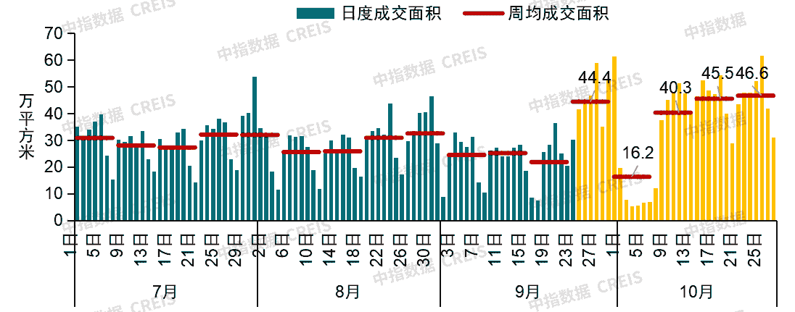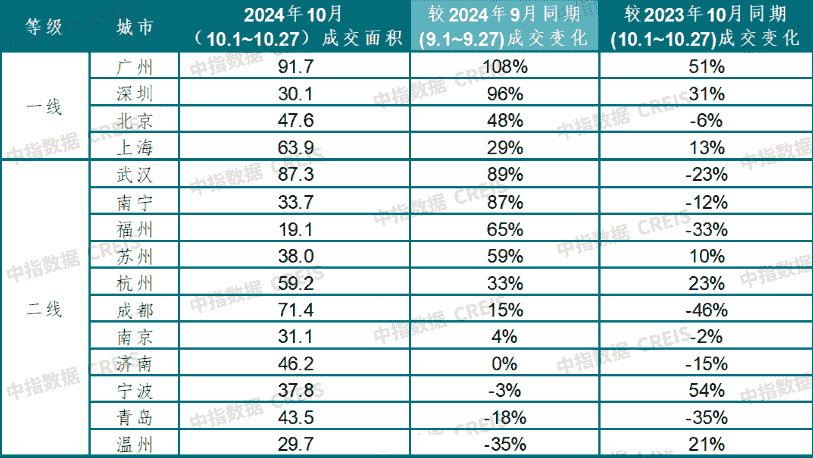

# 房产行业

分子行业数据

分时段数据

分地域数据

行业热搜词

## 搜索

## 点击&成本趋势

**5.60**

**5.44**

**5.31**

3.79%

4.13%

4.57%

**8月**

**9月**

**10月**

ACP

CTR

**555**

**568**

**530**

1.01%

0.96%

1.00%

**8月**

**9月**

**10月**

CPA

CVR

## 转化&成本趋势

## 信息流

## 点击&成本趋势

**0.70**

**0.77**

**0.92**

1.75%

1.63%

1.92%

**8月**

**9月**

**10月**

ACP

CTR

## 转化&成本趋势

## 创意分析

## CPM趋势

## 核心效果数据

**336**

**390**

**382**

0.21%

0.20%

0.24%

**8月**

**9月**

**10月**

CPA

CVR

## 全行业

## 创意样式消费占比

## 分目标转化率/转化成本

## 分样式点击率/转化率

## 分流量版位点击成本/点击率

程序化，80.58%

横版大图，11.89%

横版视频，3.70%

横版小图，1.43%

三图，1.17%

竖版视频，1.24%

**1.89%**

**2.11%**

**2.39%**

**1.93%**

**1.51%**

**2.60%**

0.22%（0.33%）

0.61%

0.18%（0.19%）

0.39%

CTR

CVR

**0.05**

**0.67**

**0.50**

**0.26**

**0.17**

**1.12**

3.70%

8.81%

2.64%

0.30%

1.59%

1.71%

ACP

CTR

数据来源：百度Compass

4

**432**

**409**

**281**

0.25%

0.10%

0.41%

表单提交成功

电话拨通

多目标转化

CPA

CVR

12.29

12.56

17.59

**8月**

**9月**

**10月**

8月 9月 10月

**CTR：3.74%**

**ACP：5.91**

**CPM：221**

**CVR：1.38%**

## 搜索端数据

开发商竞争激烈程度上升，建议提升出价，提升竞争力。

## 原生端数据

**CTR：1.91%**

**ACP：0.73**

**CPM：13.92**

**CVR：0.21%**

竞争上涨明显，需重点提升出价，加强基建频率。

8月 9月 10月

+0.43%

+14.36%

+29.02%

+0.32%

+0.32%

+28.74%

8月 9月 10月

8月 9月 10月

8月 9月 10月

+54.92%

+0.05%

## 开发商数据竞争水位

## 商办投放数据竞争水位

8月 9月 10月

**CTR：3.12%**

**ACP：10.80**

**CPM：337**

**CVR：0.83%**

## 搜索端数据

商办竞争上涨，建议优化前卡到落地页的吸引力及相关性。

## 原生端数据

**CTR：2.15%**

**ACP：0.34**

**CPM：7.31**

**CVR：0.20%**

竞争下降明显，建议加大投放力度的同时加强基建。

8月 9月 10月

+0.12%

-0.19%

数据来源：百度Compass

**CTR：5.21%**

**ACP：3.71**

**CPM：193**

**CVR：0.80%**

## 搜索端数据

中介竞争逐渐上涨，利用多种转化方式提升转化率。

## 原生端数据

**CTR：1.94%**

**ACP：1.24**

**CPM：23.96**

**CVR：0.29%**

竞争下降，建议加强投放力度、放宽投放定向。

8月 9月 10月

+0.52%

+3.34%

+14.68%

+0.06%

+0.18%

-12.42%

8月 9月 10月

8月 9月 10月

8月 9月 10月

-3.39%

+0.02%

## 中介数据竞争水位

## 旅居投放数据竞争水位

**CTR：6.01%**

**ACP：4.71**

**CPM：283**

**CVR：1.77%**

## 搜索端数据

竞争下降，点击率下降，适当提升出价加大竞争力。

-3.33%

+0.67%

-0.06%

-1.48%

+24.02%

-0.45%

+0.26%

# 房产行业

-49.75%

-53.88%

-0.26%

8月 9月 10月

8月 9月 10月

8月 9月 10月

8月 9月 10月

8月 9月 10月

8月 9月 10月

8月 9月 10月

8月 9月 10月

8月 9月 10月

8月 9月 10月

8月 9月 10月

8月 9月 10月

8月 9月 10月

8月 9月 10月

8月 9月 10月

8月 9月 10月

8月 9月 10月

## 分子行业数据

分时段数据

分地域数据

行业热搜词

创意分析

核心效果数据

5

## 全行业

**搜索：**7月大盘总体竞争激烈程度上涨，建议适当提升出价加大竞争力。旅居行业点击率下降，需重点优化前卡创意来提升网民点击意愿。

**信息流：**保持创意及时更新，并结合转化量灵活提升出价，维持广告竞争力。

## 整体优化建议

# 房产行业

## 分时段数据

- **00:00-05:00**：竞争激烈程度高，可提升出价，提升竞争力。
- **05:00-19:00**：高流量时段，建议增加投放力度。
- **19:00-24:00**：竞争激烈程度低，流量利用率存在空间，建议增加投放。

## 全国分时段流量

- **08:00-18:00**：流量高，竞争下降。增加投放以降低整体投放成本、获取更多转化。
- **18:00-24:00**：竞争小高峰。适当提升出价，提升广告竞争力。

| 时段 | 流量 | 竞争 | 建议 |
|------|------|------|------|
| 00:00-05:00 | 低 | 高 | 提升出价，提升竞争力 |
| 05:00-19:00 | 高 | 中 | 增加投放力度 |
| 19:00-24:00 | 中 | 低 | 增加投放 |

## 分地域数据

**开发商**

- 搜索：北京、上海、广东
- 原生：全国

## 行业效果数据

**行业ACP & CTR**

| 城市 | ACP | CTR |
|------|-----|-----|
| 北京 | 高 | 中 |
| 上海 | 高 | 中 |
| 广州 | 中 | 中 |
| 深圳 | 中 | 中 |
| 苏州 | 中 | 中 |
| 东莞 | 中 | 中 |
| 佛山 | 中 | 中 |
| 杭州 | 中 | 中 |
| 南京 | 中 | 中 |
| 武汉 | 中 | 中 |
| 成都 | 中 | 中 |
| 重庆 | 中 | 中 |
| 天津 | 中 | 中 |
| 济南 | 中 | 中 |
| 长沙 | 中 | 中 |
| 南通 | 中 | 中 |
| 沈阳 | 中 | 中 |
| 中山 | 中 | 中 |

行业ACP均值=5.9

**行业CPA & CVR**

| 城市 | CPA | CVR |
|------|-----|-----|
| 北京 | 高 | 低 |
| 上海 | 高 | 低 |
| 广州 | 中 | 中 |
| 深圳 | 中 | 中 |
| 苏州 | 中 | 中 |
| 东莞 | 中 | 中 |
| 佛山 | 中 | 中 |
| 杭州 | 中 | 中 |
| 南京 | 中 | 中 |
| 武汉 | 中 | 中 |
| 成都 | 中 | 中 |
| 重庆 | 中 | 中 |
| 天津 | 中 | 中 |
| 济南 | 中 | 中 |
| 长沙 | 中 | 中 |
| 南通 | 中 | 中 |
| 沈阳 | 中 | 中 |
| 中山 | 中 | 中 |

行业CVR均值=1.4%

## 行业热搜词

**10月搜索热词**

| 北京热搜词 | 上海热搜词 | 广州热搜词 | 深圳热搜词 |
|------------|------------|------------|------------|
| 北京宸园 | 浦东区楼盘 | 南天名苑均价 | 汉园茗院售楼部 |
| 御翠园 | 未来时光里嘉善 | 鸿荣源珈誉府电话 | 深圳深业颐樾府 |
| 北京宸园楼盘 | 浦东区新开盘 | 增城保利水木芳华均价 | 深圳西丽新房 |
| 望京国誉府 | 尚湾林语在售 | 深圳南山招商四海臻邸 | 前海深业云海湾 |
| 万科新都荟新盘 | 大华梧桐樾楼盘 | 香港置地楼盘 | 汉园茗院价格 |
| 万科东庐 | 金茂时光里 | 华标峰湖御境楼盘 | 深圳深业上林苑 |
| 通州房价 | 嘉善金茂 | 香港各区房价排名 | 鸿荣源·尚璟公馆 |
| 北京御翠园售楼处电话 | 蓝美俊庭 | 深圳深业颐樾府 | 京基东滨时代公寓 |
| 金融街武夷融御 | 公园世纪 | 传承启元府 | 深圳深业云海湾花园 |
| 中建璞园park | 上海楼盘 | 广州保利翔龙天汇楼盘 | 福田区楼盘 |
| 万科新都荟看房 | 闵行尚湾林语楼盘价格 | 华标峰湖御境广州 | 鸿荣源尚璟公馆 |
| 中环悦府 | 汉园茗院楼盘 | 广州现房 | 香港置地楼盘 |
| 中建璞园 | 奉贤奉发贤荟悦邸售楼中心电话 | 前海时代 | 香港新房新楼盘 |
| 弗农小镇 | 静安玺樾 | 黄埔新城广州 | 汉园茗院值得买么 |
| 京投发展北熙区楼盘 | 建发海阅首府价格 | 广州保利翔龙天汇动态 | 深圳万科未来之光 |

## 创意分析

**搜索优质创意推荐**

下半年房企举办的各类活动不断增多。建议在凸显优惠力度与精彩活动的同时，着重强调其官方权威性。

**创意推荐**

- **强调价格、活动类**
  - **文案技巧：** 突出价格、活动优势
  - **图片素材：** 强调活动力度，搭配实景图提升用户信任，红色系素材打造火爆氛围

  **文案推荐：**
  1. {地域词}-北海楼盘热销排行-**人气楼盘价格表**
  2. {上海·静安玺樾}**【优惠+折扣】**立即查看
  3. 【10月最新·**VIP享96折**】{上海张江金茂府售楼处}
  4. 【世博·天悦| 售楼处】**直销VIP惊喜95折**
  5. 国庆盛惠，城央生态豪宅团购**安家置业享98折**，{海珠楼盘}
  6. {瑞麓府}pk[新世界凯粤湾]95-133㎡学府江景新品，**真88折**
  7. {荔湾楼盘}，【新世界凯粤湾】一线江景现楼，**限时88折**

  **图片推荐：** 突出价格、折扣力度+室内实景、节点+卖点+活动、卖点+实拍全景图

- **强调官方、品牌类**
  - **文案技巧：** 官方字眼+楼盘名称+核心卖点
  - **图片素材：** 多宫格组合楼盘素材，实景+户型搭配呈现，大字报突出楼盘名及核心优势

  **文案推荐：**
  1. **【官方】**四海臻邸二期-售楼中心
  2. **『官』**{溪山禾玺}，观澜河畔公园住区，298万起买3房
  3. **『官』**黄埔买房选【时代天韵】上车科学城地铁现房
  4. **官V**-鸿荣源珈誉府2区，深圳1-9月销冠，约65-105㎡3-4房
  5. **【官方】**金地环湾城，{金地}，约121-290㎡海景大宅
  6. **官方**，【金地环湾城】百万大城全球都会生活新封面
  7. **〖官〗**{朝阳·中建星光里} 东三环黄金轴

  **图片推荐：** 室内+配套实景图、各类配套+户型图、楼盘名大字报、区位优势+楼盘类型

**信息流优质创意推荐**

建议在广告千卡中充分展现楼盘的核心卖点，同时运用具有营销网感的文案，吸引用户点击。

**创意推荐**

- **卖点类内容创意**
  - **文案技巧：** 融合项目核心卖点
  - **图片素材：** 卖点凸显，配实景图；环境美照搭氛围文案，融合实景与户型图

  **文案推荐：**
  1. 主城置业，一步到位!【新世界·天馥】建面76-139㎡**高品质学铁商居**
  2. 峰湖御境-建面约360–690㎡**半山院子，依山而建，医药生物人的理想**
  3. 通州**低密洋房**，建面199-350㎡科技洋房住宅！
  4. 广州科学城芯，建面约360㎡半山院子，**前后双花园，享5层院落空间**
  5. 西二环新房，**环瞰河园双景**，建面63㎡-135㎡
  6. **双地铁**建面44-72㎡精致小户型，#{日期}总价约120万起
  7. **央企保利三水巨作**【保利湖映琅悦】建面122-258㎡荷香湖奢宅

  **图片推荐：** 楼盘外景+区位强调、楼盘环境+氛围营造、远景图+户型图、楼盘远景氛围图

- **营销类内容创意**
  - **文案技巧：** 具有营销感、趣味性
  - **图片素材：** 营销文案燃动，强调品牌格调，呈现环境氛围感全景图

  **文案推荐：**
  1. 一步到位全能热销盘[新世界·天馥]名校&地铁&商业，**想要的全都有**
  2. 西城全装现房，单价13万元/平起，**仅89席！**
  3. **广州人都在抢!**【新世界凯粤湾】江景头排+名校尽在咫尺的双重享受
  4. **我家别墅有俩院儿！**西五环建面约290-540㎡叠墅+合院，预约看房！
  5. **容积率仅1.74？**嘉定新城错过不再有的滨水墅级住区！
  6. **壕气外露!**326万起享嘉定主城，精装三房**等你来撩!**
  7. **惊呆了！**6号线地铁旁，建面50-118㎡精妆洋房

  **图片推荐：** 价格+楼盘外观、楼盘俯视+营销文案、品牌格调+图文渲染

数据来源：百度Compass / 百度营销Compass

# 线索展示范围：

- 增加留联线索和无留联线索：仅主账号可见，展示所有线索全集。

# 线索筛选：

支持按组件类型筛选。

# 线索回访：

- 新爱番番复用原营销通智能回访能力，增加非本人和辱骂赔付场景。
- 新爱番番只支持中间号直呼（老爱番番支持双呼、网络呼）。

# 线索标记：

- 无效、有效标签不支持同时标记。

# 产品更新｜营销通与爱番番双平台深度融合功能说明

**01**

11

为了给客户带来更加流畅、高效的营销管理工具体验，我们对营销通与爱番番双平台进行了深度融合。此次融合旨在整合双方优势，为客户提供更加高效、智能的营销与线索管理解决方案。

**切换时间**：对于历史使用营销通和爱番番老平台的客户，11月5日起将陆续切换至新平台。

## 切换背景

## 新爱番番平台主要升级点

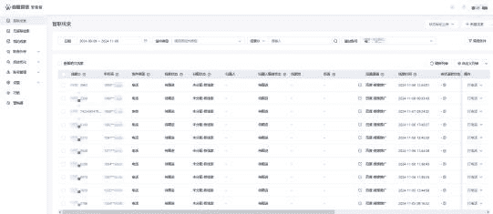

## 新平台登录说明：

登录后若弹出系统升级弹窗，表明已经迁移到新平台。各类登录指引：

### 网页端/客户端：

- 主账号：新老平台账户密码不变。
- 子账号：使用新注册百度营销账号密码登录。

### APP端：

确认升级提示后，点击“退出”重新操作登录。

- 主账号：新老平台账户密码不变。
- 子账号：使用新注册百度营销账号密码登录。

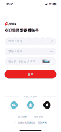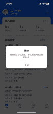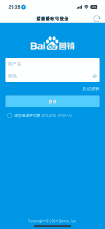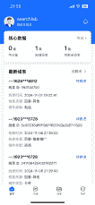

## 账号管理：

- 支持免费创建100个子账号员工，永久生效。

## 重复线索管理：

- 对所有新增线索进行重复线索判定（包含自拓线索、三方导入）。
- 去重结果“重复线索”字段展示为“是”，且不参与自动分配。
- 判定时间支持0—30天内新线索。

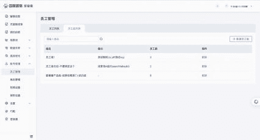

备注：更全面升级说明，咨询营销顾问获取产品介绍文档。

# 产品更新｜百度新一代营销平台轻舸“AI MAX”升级计划

**02**

12

本次针对AI Max的行业版，提供“积极探索”和“稳中求进”两个档位，根据客户对结果的预期，分档位组合定向/创意等多环节策略等功能。

备注：适用行业为房产家居以下二级行业，包含装潢装修、家具家居、房产中介、房地产开发商。

支持在「AI Max」中，根据适配行业个性化选择行业版任务清单。

## “AI MAX”投放新增房产家居“AI MAX”专属版

### 【积极探索】在营销节点期间，帮助广告主全方面提升竞争力：

- 核心人群寻优，自动针对行业高价值人群进行精细溢价，溢价系数为1.2。
- 智能定向扩量，实现破圈探索：将为您项目下全部营销方案一次性启用自动定向/综合演绎、搜索意图地域词扩展设置。
- AIGC创意赋能，助广告更吸睛：行业特色创意实时生成，投放中将根据投放效果为您自动优化创意文案和创意图片，以快速吸引目标受众关注。

在全球数字营销变革浪潮中，营销平台的一站式整合、智能化、经营融合联动已成为近年高频出现的关键词。

**2024年10月起，百度营销平台搜索推广操作后台支持「一键升级」轻舸功能。**符合升级条件的账户，点击「一键升级」按钮即可升级至轻舸平台，在轻舸无损可见并管理账户中所有推广计划物料，完成搜索推广的全部管理流程，使用生成式AI赋能营销投放全流程。**升级后您的投放不会受到任何影响，新平台也提供穿梭回旧版搜索推广平台的“返回旧版”按钮，便于您随时对照所熟悉的旧版平台，了解新平台的新能力。**

## 轻舸“AI MAX”升级计划

账户信息上方看到轻舸「一键升级」按钮，点击并二次确认后即可将账户升级至轻舸进行管理；支持一键返回旧版平台操作。

详细介绍内容请见：https://yingxiao.baidu.com/product/active/detail?detailId=2820&from=yingxiao

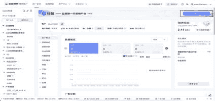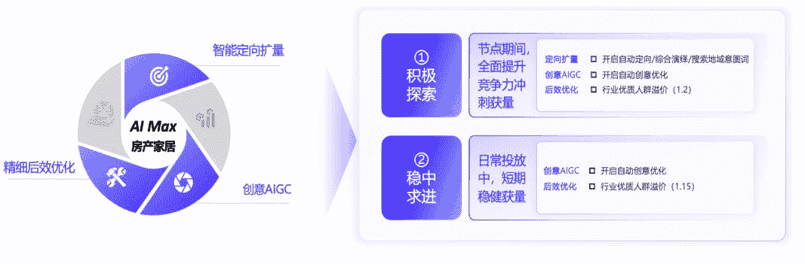

## 功能操作入口：

1. 在轻舸新建项目时，将会主动推送AI Max启用建议，在AI Max任务清单中可选此次新增的行业特别版能力。
2. 在轻舸管理项目时，可选已有的项目启用专属行业特别版AI Max。
3. 在旧版平台，可选已有旧版项目，通过「项目升级轻舸」能力，启用行业特别版AI Max能力，并成为升级版项目。

### 【稳中求进】相对积极探索更为稳健：

- 核心人群寻优，自动针对行业高价值人群进行精细溢价，溢价系数为1.15。
- AIGC创意赋能，助广告更吸睛：行业特色创意实时生成，投放中将根据投放效果为您自动优化创意文案和创意图片，以快速吸引目标受众关注。

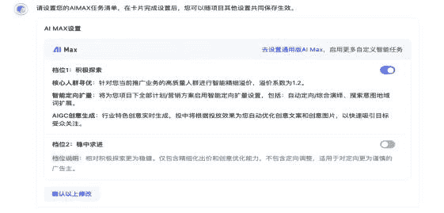

（精细化出价人群小流量名单，联系接口报名）

详细介绍内容请见：

https://yingxiao.baidu.com/product/active/detail?detailId=2827&from=yingxiao

# 产品更新｜搜索推广共享预算统一至项目预算管理—上线预告

**03**

13

## 升级点一：轻舸支持创建点击出价项目，并设置项目预算

**①入口：**「推广管理-项目-新建项目」

**②选择包含方案：**只有出价方式为点击的营销方案可以加入项目，因此如果您希望创建出价方式为点击的项目，请全部选择出价方式为点击的营销方案。

选择出价方式：

**③支持创建出价方式为点击的项目，**如果您希望统筹管理点击出价营销方案，应用增强模式竞价策略、项目预算等能力，可以选择“创建出价方式为点击的项目”。

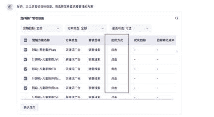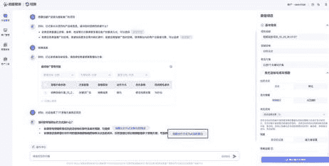

## 升级点二：轻舸支持管理点击出价项目

**①入口：**「轻舸-推广管理-项目」/「旧版平台-推广管理-选择希望管理的点击出价项目-点击“轻舸管理”」

②点击「编辑项目」，修改更多项目设置。

## 升级点三：存量未关联项目的共享预算，移动至项目列表统一管理，成为点击出价项目

1. 若共享预算绑定的营销方案出价方式均为点击，11月14日起将会自动变为项目，并将现有的共享预算金额填入项目预算，投放效果完全不变。在此过程中不会修改推广计划的物料设置，只是会出现一个使用点击出价方式的项目，将原共享预算设置为该新项目的“项目预算”。
2. 尚未升级的存量共享预算组，仍然可以在共享预算列表进行编辑、删除管理。

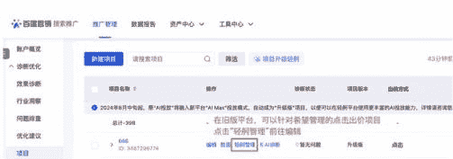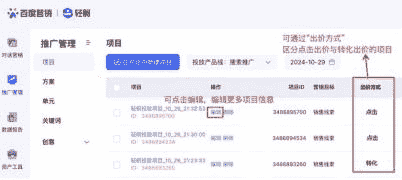

搜索推广共享预算统一至项目预算管理，本次升级将自2024年11月12日开始至2025年1月下旬结束，具体升级节奏如下：

1. **2024年11月12日起**，原「资产中心-共享预算」不再提供新建共享预算入口。如果您希望针对多个计划使用共享预算能力，可前往新版平台（轻舸）「推广管理-项目-新建项目」，把多个计划绑定至该项目，使用项目预算功能进行设置。
2. **2024年11月14日起**，存量共享预算组将会自动成为项目，并移至「推广管理-项目」，您可以在项目列表对它们进行管理；少数因绑定了出价方式混杂的计划，未升级的存量共享预算组，仍可在「资产中心-共享预算」列表进行管理操作。
3. **2025年1月下旬**，原「资产中心-共享预算」独立工具下线。同时，少数因绑定了出价方式混杂的计划、未升级的存量共享预算组，将会自动解散。为保障它们获量效果的稳定性，原共享预算组内各计划的日预算，将会被自动设置为原共享预算组的日预算金额。例如原共享预算组的日预算为1000元，其下绑定了3个计划，自动解散后，3个计划的日预算将被自动设置为1000元。若您存在账户涉及此类场景，建议您在2025年1月前将这些混杂计划退出共享预算组，根据这些计划的推广业务和消费预期，将其归入「项目」使用「项目预算」能力，避免这些计划出现超成本的问题，也可以在自动升级后根据需要自行修改这些计划的预算。

# 行业案例-

全国多地区收集养老院入住需求，线索有效率高但线下参观率和成交率低。

## 案例背景

## 改善建议：

全国多地区差异化投放，提升爱番番跟进效率，定期分析无效原因，优化前端创意描述和落地页内容。

搜索养老相关词但不符合用户需求（价格过高、地点不合适等）。

## 客户痛点

### 1、提升相关性：

关键词&创意&落地页匹配。

### 2、增加有效展示：

- 关键词：精准词溢价提效，通用词常规稳量。
- 创意：对应落地页头图延展，图+文，增加视频、高级样式投放比重。
- 落地页：测试多风格匹配用户需求，如温情软文型、价格引导型、提问日记型等。

## 多地区线索有效率平均50%+，每月有成交

沈阳

深圳

广州

北京

武汉

各地区有效率

## 回呼洞察用户意图

## 词→创意→页面全链路优化

### 场景一：回呼未接通

线索跟进四次以上申请无效线索赔付。

### 场景二：回呼已接通

#### 1、有效线索

- 提炼优势卖点，前端增加有效描述。
- 有效词拓展长尾词加投。
- 每周回访2次，连续3周跟进，提升参观率。

#### 2、无效线索

①分析用户意图，优化前端描述。

- 找工作—打包相关人群前置屏蔽。
- 价格贵—前置价格信息，过滤价格敏感用户。
- 找竞品—增加对比描述，突出优势。
- 地点不合适—前置地点信息，增加地图组件。

②关键词&搜索词：

- 每日及时加否词。
- 使用爱番番回访可回听录音，优化销售话术，通过搜索词分析用户意图，切入引导参观。

## 反哺链路

线索多次回访

线索打标分析

前端增加有效描述

前置无效屏蔽

## 康养分地域运营投放经验

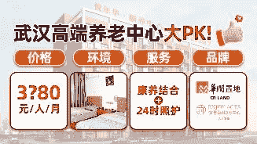

文案—匹配落地页分用户需求

创意—匹配文案

落地页

| 需求 | 创意标题 |
|---|---|
| 价格 | 武汉高端养老特惠季，5星服务乐享晚年—价格一览表 |
| 口碑 | 武汉好口碑养老中心_5星级服务—为老人保驾护航 |
| 温情 | 让老人重温儿时的被爱！接父母来{品牌名}吧！ |
| 提问 | 5千起养老院的老人真实生活是什么样的？ |

| 地区 | 人群关注点 |
|---|---|
| 北京 | 品牌、地域价格、服务品质 |
| 辽宁 | 养老优惠、地域、服务口碑 |
| 广东 | 养老价格、品牌、特色生活 |

文案技巧：用户对“价格型”“服务型”及突出品牌文案更受用。

素材方向：主要突出养老品牌及品质环境。

落地页主题：“品牌+品质服务”&“地域+价格引导”型转化更高。

50%

14

## LOVE IN A LIFE

**ROBERT BROWNING**

Escape me? While I am I, and you are you,  
So long as the world contains us both,  
Me the loving and you the loth,  
While the one eludes, must the other pursue.

My life is a fault at last, I fear:  
It seems to content and please—  
’Tis too late to love, nor early to leave,  
But yet I may love, and yet I may give,  
The gift of a life, to the life I love.

In the path of a dream, a dream that is sweet,  
Where the flower of the fruit, and the fruit of the flower,  
Meet in the bloom of a perfect hour,  
And the soul of the world is the soul of the lover.

But I might be the one to praise,  
To find the good, and the good to raise,  
The fruit of the tree, the flower of the grass,  
To love and to live in the life that is.

Escape me? I am the vine, the root,  
The heart of the earth, the soul of the sky—  
You are the light, you are the fruit,  
You are the life, the love, and the why.

Then let me be the one to hold,  
In the arms of the world, the heart of the gold,  
The end of the journey, the path of the stone—  
Escape me? Never, for we are alone.

So roam the fields, the woods, the streams,  
To live the life of the dream that seems,  
For the love that is, and the love that was,  
And the love that I give is the life because.
