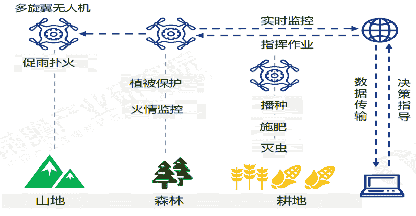
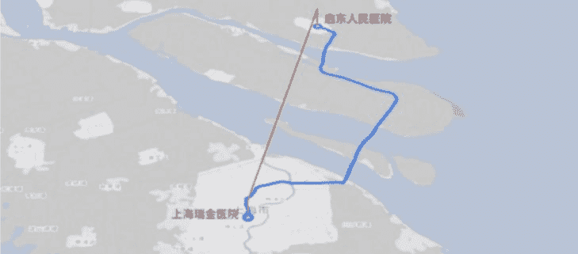
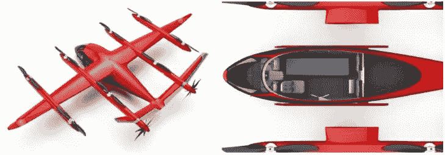

电力设备/行业专题报告/2024.06.06

请阅读最后一页的重要声明！

# 政策产业同频共振，低空经济扶摇直上

证券研究报告

投资评级：看好（维持）

## 最近12个月市场表现

分析师：张一弛  
SAC证书编号：S0160522110002  
zhangyc02@ctsec.com

分析师：张磊  
SAC证书编号：S0160522120001  
zhanglei02@ctsec.com

分析师：付正浩  
SAC证书编号：S0160524040001  
fuzh01@ctsec.com

## 相关报告

1. 《海风催化，海外电网上调指引，锂电光伏供给侧改革》  
   2024-06-03
2. 《电新较景气，多环节边际改善》  
   2024-05-28
3. 《锂电板块2023年及2024Q1总结》  
   2024-05-22

# 低空经济专题

## 核心观点

- **顶层支持政策频出，补贴范围有望扩大：**2024年3月，《通用航空装备创新应用实施方案》中指明低空经济发展目标，即“2027年基本完善，2030年全面融入”。地方政府紧跟指引，多个省市提出发展目标，部分地区率先开展补贴政策，补贴方向为起降点设施建设、航线开设、适航取证。补贴彰显政府态度，国家及地方政府未来有望增加补贴，扩大补贴范畴。

- **政策+产业驱动下，2030年中国eVTOL市场规模有望达1427亿元：**从产业端看，低空经济发展的核心驱动因素为：1）eVTOL具备经济可行性，在日常通勤中时间效率为出租车的4.76倍，单人出行成本仅为出租车的1.06倍；且运营噪音小、成本低；整机降本空间高达80%，运营降本空间高达67%；2）中国自动驾驶技术趋于成熟，三电系统处于领先水平；3）与农业、物流、医疗救援等多个应用场景适配，顺丰、美团、京东早在2016—2018年开始布局。政策+产业双重驱动下，南航通航与沃兰特预计，2030年中国的eVTOL市场规模有望达1427亿元。根据民用航空局发布数据，预计以eVTOL为核心的低空经济市场规模有望达2万亿元。

- **eVTOL技术壁垒高筑，多环节仍待挖掘。**1）整机厂：参与者众多，技术方案未定，载重量增加趋势明确。目前产品价格过高，更加看好能够快速降本、储备载重量更大技术方案的厂商；2）三电系统（成本占50%）：电池端对能量密度、电压、倍率、安全性的要求更高，看好技术持续突破的厂商；电驱动系统端，单机电机量增加，性能要求更高，分布式电驱动系统壁垒较高；3）运营：资质壁垒高，看好具备先发优势的运营商。

- **投资建议：**建议关注eVTOL整机厂亿航智能、小鹏汽车（小鹏汇天母公司）、万丰奥威等；通航飞机环节中直股份；结构件环节双一科技；技术快速升级的电池厂商宁德时代、国轩高科、孚能科技；电驱动系统领先企业卧龙电驱；混动发动机领先企业宗申动力；工业模拟机厂商海特高新；运营厂商中信海直等，以及通信导航环节莱斯信息、四川九洲。

- **风险提示：**技术路线变化风险；政策支持力度变化；终端应用不及预期等。

## 表1：重点公司投资评级

| 代码 | 公司 | 总市值（亿元） | 收盘价（2024/6/6） | EPS（元）2023A | EPS（元）2024E | EPS（元）2025E | PE 2023A | PE 2024E | PE 2025E | 投资评级 |
|---|---|---:|---:|---:|---:|---:|---:|---:|---:|---|
| 002074.SZ | 国轩高科 | 352 | 19.70 | 0.53 | 0.82 | 0.94 | 38.75 | 22.76 | 19.71 | 增持 |
| 300750.SZ | 宁德时代 | 9009 | 204.79 | 10.03 | 10.73 | 12.75 | 20.19 | 18.38 | 15.46 | 增持 |

数据来源：Wind数据，财通证券研究所

-37%

-28%

-20%

-11%

-2%

6%

电力设备

沪深300

谨请参阅尾页重要声明及财通证券股票和行业评级标准

2

行业专题报告/证券研究报告

# 内容目录

## 1 什么是低空经济？新质生产力代表

### 1.1 定义：低空经济依托于低空空域，商业化场景广泛

### 1.2 构成：四大板块兼备，eVTOL为低空经济核心

## 2 政策与产业共振，“低空经济”加速起飞

### 2.1 政策端：顶层政策支持，补贴范围有望扩大

### 2.2 产业端：五大因素驱动低空经济腾飞

### 2.3 市场空间：2030年中国eVTOL市场规模有望达1427亿元

## 3 投资机会：eVTOL技术壁垒高筑，多环节仍待挖掘

### 3.1 eVTOL整机厂：看好能够快速降本+储备载重量更大技术方案的整机厂

### 3.2 eVTOL三电系统：性能要求高，看好技术持续突破的厂商

### 3.3 eVTOL运营：成长空间大，看好具备先发优势的运营商

### 4 投资建议

### 5 风险提示

## 图表目录

图1. 国家空域基础分类示意图

图2. 低空经济和通用航空的概念界定

图3. 传统通用航空和新通用航空主体区别

图4. 低空基础设施框架“四张网”

图5. 2019—2023年中国通用机场个数及增长率

图6. 2023年中国通用机场结构

图7. 低空经济互联

图8. 2019—2023年中国民用无人机注册数量（万架）及增长率

图9. 2019—2023年中国民用无人机企业注册数量及增长率

图10. 2022年民用无人机行业需求结构（%）

图11. 2018—2022年中国民航无人机有效驾驶员执照总数（万本）及增长率

图12. 各地低空经济政策梳理

图13. 2023年超大城市及特大城市通勤高峰交通拥堵指数

图14. 上海临港到虹桥交通枢纽eVTOL和其他交通出行路线对比

图15. 受益于更短用时，eVTOL有望对汽车、地铁等传统交通方式形成替代效应

图16. eVTOL成本预测

图17. 城市eVTOL运营成本变化

图18. eVTOL成本拆分（2021）

图19. “低空经济+农业”应用途径

图20. 2017—2022年植保无人机数量（万台）及增长率

图21. “低空经济+物流”应用途径

图22. 2019—2022年物流无人机数量（万台）及快递业务件数

图23. 南通启东人民医院到上海瑞金医院飞行路线

图24. 沃兰特eVTOL医疗救援方案

图25. 新能源车指数及发展阶段

图26. 中国eVTOL市场规模（亿元）

图27. 低空经济产业链

图28. 飞行汽车功率密度发展趋势

图29. 分布式驱动汽车行驶示意图

## 表格目录

表1. 低空经济商业化应用场景

表2. 不同技术路线eVTOL对比

表3. 低空运营服务功能

表4. 低空经济顶层政策

表5. 起降点设施建设补贴情况

表6. 对于航线开设的补贴情况（武汉、四川、苏州）

表7. 对于航线开设的补贴情况（深圳南山、珠海）

表8. 取证补贴（广州、深圳南山、成都）

表9. 取证补贴（武汉、苏州）

表10. eVTOL与豪华汽车、低端直升机成本对比

表11. eVTOL无人驾驶发展阶段

表12. 适航取证内容

表13. 低空经济+物流/外卖龙头布局

表14. 低空经济发展阶段（第一阶段）

表15. 低空经济发展阶段（第二、三阶段）

表16. eVTOL整机厂梳理（亿航、小鹏汇天）

表17. eVTOL整机厂梳理（零重力、上海峰飞、沃兰特、沃飞长空、时的科技）

谨请参阅尾页重要声明及财通证券股票和行业评级标准

行业专题报告/证券研究报告

表18. 海内外电池厂eVTOL布局

---

## 1 什么是低空经济？新质生产力代表

### 1.1 定义：低空经济依托于低空空域，商业化场景广泛

低空经济是以低空空域为依托，以通用航空产业为主导，涉及低空飞行、航空旅游、支线客运、通航服务、科研教育等众多行业的经济概念，是各种有人驾驶和无人驾驶航空器的各类低空飞行活动的综合性经济形态。

- **低空空域**：通常是指距正下方地平面垂直距离在**1000米**以内的空域，根据实际需要延伸至不超过**3000米**的低空空域范围内。
- 《国家空域基础分类方法》将空域划分为A、B、C、D、E、G、W等7类，其中，A、B、C、D、E类为管制空域，G、W类为非管制空域。

图1.国家空域基础分类示意图

数据来源：国家空管委组织《国家空域基础分类方法》、财通证券研究所

- **以通用航空产业为主导**：低空经济可以看作是更能体现新质生产力的通用航空。从飞行活动上看，通用航空除了低空活动，还包括中高空活动；低空经济除了通用航空，还有警用、海关和部分军用航空等活动。而低空经济是以无人机、飞行汽车、eVTOL（电动垂直起降航空器）等新型航空器为主，代表航空高端化、智能化、绿色化发展方向。

图2.低空经济和通用航空的概念界定

图3.传统通用航空和新通用航空主体区别

数据来源：无人机产业博览会公众号、财通证券研究所

数据来源：无人机产业博览会公众号、财通证券研究所

- **涉及众多行业**：商业化应用场景广泛。低空经济在旅游、农业、消费、物流、巡检等诸多方面均有运用。从产品端看，低空飞行器包括消费型无人机（大疆120m以下）、行业应用型无人机和巡航无人机（120-300m）和未来的eVTOL出行（1000m以下）、固定翼通航（1000m以上）。

表1.低空经济商业化应用场景

| 飞行高度（空域范围） | 城市场景 | 非城市场景 |
|---|---|---|
| 300-1000米 E类空域 | 低空经济+旅游：传统通用固定翼飞机（量少）；载人eVTOL（量大）；低空经济+消防 | 低空经济+旅游；低空经济+消防；低空经济+巡检：传统通用固定翼飞机（量少）、载物eVTOL（量少-海岛、偏远地区）、直升机（量少旅游场）、工业无人机（量大-巡逻、巡检、测绘）、载物eVTOL（量中-跨城物流） |
| 120-300米 G类空域 | 低空经济+物流：专用多旋翼飞机（量少）；低空经济+巡检：专用多旋翼飞机（量少） | 低空经济+物流；低空经济+巡检 |
| 0-120米 W类空域 | 低空经济+物流：消费级无人机（量大）、小物流无人机（量大）、限定类载人eVTOL（量小） | 低空经济+旅游；低空经济+农业：限定类载人eVTOL（量大-旅游景区）、植保无人机（量大） |

数据来源：前瞻产业研究院、财通证券研究所

### 1.2 构成：四大板块兼备，eVTOL为低空经济核心

低空经济主要由低空基础设施、低空飞行器制造、低空运营服务、低空飞行保障四个板块组成。具体如下：

**1）低空基础设施**：包括“设施网”、“空联网”、“航路网”和“服务网”。其中，设施网是支撑低空飞行业务的各种物理基础设施；空联网指通信、导航和感知等信息基础设施；航路网指提供空域和飞行数字化管理和服务能力的核心平台；服务网指组合数字化管理和服务能力而构建的赋能各低空经济管理和业务主体的应用。

图4.低空基础设施框架“四张网”

数据来源：IDEA研究院《低空经济发展白皮书（2.0）》、财通证券研究所

基础设施建设不足，“低空基建”有待先行。根据《深圳经济特区低空经济产业促进条例》，物理基础设施包括低空飞行起降、中转、货物装卸、乘客候乘、航空器充（换）电、电池存储等物理基础设施。2023年中国通用机场达449个，同比+13%，其中表面直升机133个，占比30%。随着低空经济发展，eVTOL等新型航空器起量，直升机场等物理基础设施率先显现不足，“低空基建”有望提前布局。

图5.2019-2023年中国通用机场个数及增长率

图6.2023年中国通用机场结构

数据来源：GAAIP通用机场信息平台、财通证券研究所

数据来源：GAAIP通用机场信息平台、财通证券研究所

**5G-A通感一体技术**为低空经济互联性、安全性打下坚实基础。5G-A是5G与6G之间承上启下的重要阶段。1）5G-A在速率和连接数等网络能力上提升了10倍，能够从普遍性连接深入到核心功能层连接，打通了云、端、边、网融合的连接完整态，在低空飞行体方面至关重要；2）通感一体技术，可实现对低空无人机等目标的全方位感知能力，满足对非法入侵物体的识别、定位和跟踪等需求，为低空飞行安全保驾护航。

图7.低空经济互联

数据来源：国家低空经济融合创新研究中心、前瞻产业研究院、财通证券研究所

**2）低空飞行器制造**：**eVTOL可视为“电动的直升机”**。低空飞行器目前主要分为无人机和eVTOL，无人机和eVTOL的核心区别在于eVTOL用于载人，无人机用于载物。其中，eVTOL是电动垂直起降飞行器，可以理解为电动化且不需要跑道就可垂直起降的飞机。

无人机新业态蓬勃发展。2019-2023年中国民用无人机注册数量逐步提升，2023年达127万架，同比+32%，民用无人机企业注册数量达1.9万架，同比+26%。2022年中国民用无人机行业需求主要系测绘与地理信息/农林植保/安防监控/巡检/快递物流/应急，分别占比30%/26%/12%/11%/8%/5%。随着低空空域的开放，无人机的发展有望迎风而起。

图8.2019-2023年中国民用无人机注册数量（万架）及增长率

图9.2019-2023年中国民用无人机企业注册数量（万架）及增长率

数据来源：中国民用航空局、财通证券研究所

数据来源：中国民用航空局、财通证券研究所

图10.2022年民用无人机行业需求结构（%）

图11.2018-2022年中国民航无人机有效驾驶员执照总数（万本）及增长率

数据来源：前瞻产业研究院、财通证券研究所

数据来源：中国民用航空局、财通证券研究所

**eVTOL从无到有，是低空经济的核心**。eVTOL为Electric Vertical Takeoff and Landing，“e”代表电动化，“VTOL”代表垂直起降，核心是垂直起降飞机或者飞行器。eVTOL在现阶段还是以有人驾驶航空器为主，但也有载物的eVTOL，如峰飞载物的eVTOL凯瑞欧，以及御风载物的eVTOL。**eVTOL是低空经济中从0到1的存在，驱动产业链腾飞**。

**eVTOL中倾转构型、复合翼构型潜力最大**。eVTOL是电动垂直起降飞行器。根据不同技术路线，各国近期推出的eVTOL项目倾转构型机型最多，多旋翼构型最少，复合翼成为大部分行业龙头公司的研发选择。国外eVTOL制造商的技术方向总体而言比较一致，基本采用倾转、倾转涵道或倾转旋翼的整体构型，未来倾转构型和复合翼构型这两种机型增长潜力最大。

表2.不同技术路线eVTOL对比

| 技术路线 | 特点 | 优势 | 劣势 | 代表机型 |
|---|---|---|---|---|
| 多旋翼 | 分布式旋翼设计，多个旋翼同时工作，没有机翼或有短机翼，飞行器巡航时也依靠推进器提供全部或部分升力，起飞和着陆是通过旋翼提供升力来完成 | 技术风险和研制难度较低，效率较低，具有悬停状态的最佳效率 | 能效不高，航程有限，速度较慢，使用场景局限 | Volocopter 2x、亿航216 |
| 复合翼 | 设计直接简单，飞行控制系统简单，有机翼，有独立的螺旋桨分别提供升力和巡航推力 | 优良的技术性能，较快的研制速度，较低的研制风险和成本，生产和维护要简单，监管部门熟悉的适航路径和符合性方法 | 垂直升力系统在平飞阶段是死重（无法减少的重量）且产生额外阻力 | Beta Alia-250、Wisk Cora；峰飞V1500M盛世龙 |
| 倾转构型 | 有机翼，由任一矢量推进器既提供垂直升力也提供水平巡航推力，倾转构型包括但不限于倾转翼、倾转旋翼、倾转涵道 | 重量较轻、推力大，效率相对高，死重相对少，在速度和航程上均有优势 | 机械设计和飞控系统复杂，开发和试飞难度大，研制风险和成本较高，较长的研制周期和适航认证过程 | 倾转旋翼：Joby 4S、Vertical VA-X4；倾转机翼：Dufour Aerospace Aero3；倾转涵道：Lilium Jet |
| 倾转涵道风扇+完全矢量控制 | 有机翼，无控制舵面，将涵道风扇与倾转机翼融为一体，通过调节电动涡扇的出力配合机翼整体倾转角度，形成不同的控制力矩、升力、推力、航向和姿态 | 较好的动力系统可靠性和噪声控制，消除了开放性螺旋桨在安全方面的隐患 | 存在研制风险，高速旋转部件耐久性差，不易维护，中低速时在重量、成本、效率等方面存在劣势 | Lilium Jet、NASA-XV24A |
| 隐藏式推进系统+无翼设计 | 无翼设计，有一个隐藏的推进系统，配备数个涵道风扇，流线型车身 | 飞行速度和续航能力较好，外形科幻 | 制造成本高，推进器固定，无法实现推力的平衡 | Bellwether Volar |

数据来源：中国民航网、财通证券研究所

**3）低空运营服务**：低空运营服务为低空飞行提供了全方位的服务保障，包括飞行计划的制定、航空器的调度、飞行的实时监控以及应急处理等多个方面。低空经济运营服务有望更加规范，政府和民间协同发展。根据《深圳经济特区低空经济产业促进条例》，一方面需要获得国家有关部门的授权支持，另一方面也有必要通过经济特区立法，在地方权限范围内明确低空经济产业发展协调机制和低空飞行协同管理机制。

表3.低空运营服务功能

| 功能 | 具体情况 |
|---|---|
| 飞行计划 | 根据飞行需求制定合理的飞行计划，确保飞行的有序进行 |
| 掌控飞行器 | 通过先进的信息化技术和智能化系统，低空运营服务能够实现对低空飞行的全面掌控和高效管理 |
| 处理安全问题 | 通过对航空器的实时监控和调度，可以确保飞行的安全性和效率；在出现紧急情况时，低空运营服务也能够迅速做出反应，采取有效措施保障飞行的安全 |
| 智能决策 | 通过对飞行数据的收集和分析，可以为低空飞行提供更加科学、合理的优化建议，推动低空经济产业的持续发展 |

数据来源：汇策网智库、财通证券研究所

**4）低空飞行保障**：低空飞行服务保障能力全面提升。1）低空飞行法规标准体系逐步建立，一揽子制修订规章30余部，从根本上改变了套用运输航空标准监管通航的法规制度环境，极大地降低了通航运营发展的制度性成本。2）低空飞行服务能力明显提升。持续提升通航情报服务能力，先后公布了432个通用机场情报资料以及全国范围低空目视航图。3）低空飞行申请审批时效大幅提升。目前，日常通航飞行申请时限由飞行前一天15时提出、21时前批复，缩短为起飞前4小时提出、起飞前2小时批复，应急救援、抢险救灾等紧急特殊飞行任务随报随批。

## 2 政策与产业共振，“低空经济”加速起飞

### 2.1 政策端：顶层政策支持，补贴范围有望扩大

**2010-2020年间，低空空域管理持续改革**。根据国务院、中央军委2010年发布的《关于深化低空空域管理体制改革的意见》，2011年前处于规划阶段，探索低空空域管理改革，试点仅在部分地区进行；2011~2015年底处于推广阶段，在全国推广改革试点；2016~2020年处于深化阶段，进一步深化改革，使低空空域管理体制机制更加先进合理、完备可靠。随着低空空域管理成熟，**2021年《国家综合立体交通网规划纲要》首次将低空经济纳入了发展规划**。**2023-2024年，低空经济政策加速，目标明确**。2023年底中央经济工作会议明确提出打造低空经济等若干战略性新兴产业；2024年2月，中央财经委员会第四次会议强调鼓励发展与平台经济、低空经济、无人驾驶等结合的物流新模式；2024年“两会”上，政府工作报告提出要积极打造低空经济等新增长引擎，这是低空经济首次写入政府工作报告；2024年3月，工信部等四部门联合印发《通用航空装备创新应用实施方案（2024-2030年）》，正式提出低空经济发展目标：**2027年基本完善通用航空公共服务装备体系，以无人化、电动化、智能化为技术特征的新型通用航空装备，在城市空运、物流配送、应急救援等领域实现商业应用；2030年通用航空装备全面融入人民生产生活各领域，成为低空经济增长的强大推动力，形成万亿级市场规模**。

表4.低空经济顶层政策

| 时间 | 部门/提出时机 | 要点 |
|---|---|---|
| 2023年12月 | 中央经济工作会议 | 打造低空经济等若干战略性新兴产业 |
| 2024年2月 | 中央财经委员会议 | 强调鼓励发展与平台经济、低空经济、无人驾驶等结合的物流新模式 |
| 2024年3月 | 两会“全国人民代表大会”、“中国人民政治协商会议” | 政府工作报告提出要积极打造低空经济等新增长引擎，低空经济首次写入政府工作报告 |
| 2024年3月 | 工信部等四部门联合印发《通用航空装备创新应用实施方案（2024-2030年）》 | 1）2027年基本完善通用航空公共服务装备体系，以无人化、电动化、智能化为技术特征的新型通用航空装备，在城市空运、物流配送、应急救援等领域实现商业应用。2）2030年通用航空装备全面融入人民生产生活各领域，成为低空经济增长的强大推动力，形成万亿级市场规模。 |

数据来源：中国政府网、《通用航空装备创新应用实施方案（2024-2030年）》、财通证券研究所

地方政府因地制宜，培育当地优势产业。随着顶层政策持续发文支持，地方政府深圳宝安、龙华、龙岗等区发布支持政策，后续市交通局等7部门联合发布支持低空经济高质量发展若干措施，广州开发区促进低空经济高质量发展措施实施细则，含补贴措施、标准制订奖励、重点项目支持等；合肥发布《合肥市低空经济发展行动计划2023-2025》确立目标；苏州印发《市低空经济高质量发展行动方案2024-2026》。目前进度来看，广州市、深圳市领先。

谨请参阅尾页重要声明及财通证券股票和行业评级标准

13

行业专题报告/证券研究报告

### 图12. 各地低空经济政策梳理

数据来源：前瞻产业研究院、财通证券研究所

部分地区已开展补贴政策，未来有望扩大补贴范畴。目前低空经济补贴主要是广州、深圳、武汉、四川北川、苏州提出，主要补贴方向是起降点设施建设、航线开设、适航取证等。地方补贴彰显政府态度，国家及地方政府未来有望增加补贴，扩大补贴范畴，助力低空经济产业发展。

---

谨请参阅尾页重要声明及财通证券股票和行业评级标准

14

行业专题报告/证券研究报告

### 表5. 起降点设施建设补贴情况

| 主体 | 生效日期 | 起降点设施类型 | 补贴额度 |
| :--- | :--- | :--- | :--- |
| 广州 | 2023.12.27 | 智能起降柜机 | 补贴额度上限10万元/个 |
| | | 无人机小型起降点 | 补贴额度上限10万元/个 |
| | | eVTOL起降场 | 场地尺寸不小于20米，补贴额度上限为100万元/个 |
| | | 直升机起降平台 | 表面直升机起降平台场地尺寸不小于26米，高架直升机起降平台场地尺寸不小于16米，表面直升机起降平台补贴额度上限为100万元/个，高架直升机起降平台补贴额度上限为200万元/个 |
| | | 中型起降场 | 补贴额度上限为200万元/个 |
| | | 大型起降枢纽 | 补贴额度上限为300万元/个 |
| 深圳南山 | 2024.3.26 | 低空基础设施 | 单个项目最高补贴100万元，单个企业每年不超过500万元 |
| 武汉 | 2024.3.6 | 无人机智能起降机巢 | 不超过10万元 |
| | | 中大型无人驾驶航空器起降场 | 不超过100万元 |
| | | eVTOL起降场 | 不超过100万元 |
| | | 直升机起降平台 | 不超过100万元 |

注：武汉对在武汉市建设无人机智能起降机巢、中大型无人驾驶航空器起降场、eVTOL起降场、直升机起降平台等低空经济相关基础设施并实际运营的企业，按照实际建设投入的50%分类别给予一次性补贴，每个智能起降机巢不超过10万元，每个中大型起降场、eVTOL起降场、直升机起降平台不超过100万元，每家企业每年不超过500万元。

数据来源：《广州开发区(黄埔区)促进低空经济高质量发展的若干措施实施细则》、南山区促进低空经济发展专项扶持措施、《武汉市支持低空经济高质量发展的若干措施（征求意见稿）》、财通证券研究所

---

谨请参阅尾页重要声明及财通证券股票和行业评级标准

15

行业专题报告/证券研究报告

### 表6. 对于航线开设的补贴情况（武汉、四川、苏州）

| 主体 | 生效日期 | 航线类型 | 细分类型 | 补贴金额 |
| :--- | :--- | :--- | :--- | :--- |
| 武汉 | 2024.3.6 | 低空货运航线 | 轻小型无人机 | 每年完成1000架次以上的航线，每条新开航线给予一次性奖励20万元 |
| | | | 中大型无人机 | 每年完成500架次以上的航线，每条新开航线给予一次性奖励40万元 |
| 四川北川 | 2024.3.30 | 低空航线 | - | 首年每条境内航线（起点或终点至少一个在北川境内，航线距离不低于20公里，年度执行不少于100架次）一次性奖励10万元；企业飞行架次每增加100架次，给予6万元奖励。次年开始，对于企业新开航线、同比上一年总飞行架次增量部分按相同标准给予奖励。每个企业年度奖励200万元 |
| | | 低空货运航线 | | 轻小型无人机5元/架次；中大型无人机10元/架次 |
| | | 低空载人航线 | - | 对开通低空载人观光航线（起点或终点至少一个在北川境内且飞行时长超过20分钟）的企业，通过公开渠道售票且实际飞行的，每100人次给予0.4万元补贴。每个企业年度奖励最高20万元 |
| 苏州 | 2024.4.18 | 低空货运航线 | 市内航线 | 每条新开通市内航线一次性奖励15万元；企业飞行架次每增加100架次，给予3万元奖励。每个企业年度奖励不超过300万元 |
| | | | 城际航线 | 每条城际航线一次性奖励50万元；企业飞行架次每增加100架次，给予10万元奖励。每个企业年度奖励不超过300万元 |
| | | 低空货运航线 | 轻小型无人机 | 每条新开航线给予一次性奖励20万元。首年企业年运营每增加5000架次给予10万元奖励。次年开始，对于企业新开航线、同比上一年总飞行架次增量部分按相同标准给予奖励。每家企业每年度奖励不超过500万元 |
| | | | 中大型无人机 | 每条新开航线给予一次性奖励40万元。首年企业年运营每增加2000架次给予40万元奖励。次年开始，对于企业新开航线，同比上一年总飞行架次增量部分按相同标准给予奖励。每家企业每年度奖励不超过500万元 |

数据来源：苏州市支持低空经济高质量发展的若干措施（试行）、北川羌族自治县促进低空经济发展十条政策（试行）、《武汉市支持低空经济高质量发展的若干措施（征求意见稿）》、财通证券研究所

---

谨请参阅尾页重要声明及财通证券股票和行业评级标准

16

行业专题报告/证券研究报告

### 表7. 对于航线开设的补贴情况（深圳南山、珠海）

| 主体 | 生效日期 | 航线类型 | 细分类型 | 补贴金额 |
| :--- | :--- | :--- | :--- | :--- |
| 深圳南山 | 2024.3.26 | 小型无人驾驶航空器航线 | - | 每年常态化运营完成1000架次以上（含）的航线，每条新开航线给予最高一次性资助20万元，单个企业每年不超过200万元。首年企业年运营达到1万架次以后，每增加1万架次给予最高20万元资助 |
| | | 大、中型无人驾驶航空器航线 | - | 每年常态化运营完成500架次以上（含）的航线，每条新开航线给予最高一次性资助35万元，单个企业每年不超过350万元。首年企业年运营达到1万架次以后，每增加1万架次给予最高40万元资助 |
| 珠海 | 2024.3.7 | 低空货运航线 | | 轻小型无人机30元/架次；中大型无人机90元/架次 |
| | | 空中观光游览类 | - | 150元/架次 |
| | | 低空载人航线 | 市内交通类补贴 | 200元/架次 |
| | | | 成绩交通类补贴 | 300元/架次 |
| | | | 无人机或直升机跨境客运 | 400元/架次 |

数据来源：《珠海市支持低空经济高质量发展的若干措施(征求意见稿)》、南山区促进低空经济发展专项扶持措施、财通证券研究所

---

谨请参阅尾页重要声明及财通证券股票和行业评级标准

17

行业专题报告/证券研究报告

### 表8. 取证补贴（广州、深圳南山、成都）

| 主体 | 生效日期 | 适航航空器类型 | 政府类型 | 补贴标准 |
| :--- | :--- | :--- | :--- | :--- |
| 广州 | 2023.12.27 | 大型载人无人驾驶航空器 | 型号合格证（TC） | 完成首批产品交付的，给予一次性奖励1500万元 |
| | | | 生产许可证（PC） | 产品交付量达到50架，给予一次性奖励1500万元 |
| | | 大型非载人无人驾驶航空器 | 型号合格证（TC） | 完成首批产品交付的，给予一次性奖励500万元 |
| | | | 生产许可证（PC） | 产品交付量达到50架，给予一次性奖励500万元 |
| | | 中型无人驾驶航空器 | 型号合格证（TC） | 完成首批产品交付的，给予一次性奖励300万元 |
| | | | 生产许可证（PC） | 产品交付量达到50架，给予一次性奖励300万元 |
| 深圳南山 | 2024.3.26 | eVTOL航空器/大型无人驾驶航空器/中型无人驾驶航空器 | PC/TC/AC | 对获得中国民航局颁发的eVTOL航空器型号合格证(TC)、生产许可证(PC)、适航证(AC)分别奖励300万元、300万元、150万元，同一型号每项认证仅奖励一次；大型100万元、100万元、50万元；中型60万元、60万元、39万元 |
| 成都 | 2023.11.16 | | PC/TC/AC | 每个型号一次性200万元奖励 |
| | | | EASA、FAA颁发的维修许可证 | 给予一次性30万元奖励 |
| | | | CAAC颁发的维修许可证 | 给予一次性20万元奖励 |

数据来源：《广州开发区(黄埔区)促进低空经济高质量发展的若干措施实施细则》、《成都市促进航空发动机产业高质量发展的专项政策》、南山区促进低空经济发展专项扶持措施、财通证券研究所

---

谨请参阅尾页重要声明及财通证券股票和行业评级标准

18

行业专题报告/证券研究报告

### 表9. 取证补贴（武汉、苏州）

| 主体 | 生效日期 | 适航航空器类型 | 政府类型 | 补贴标准 |
| :--- | :--- | :--- | :--- | :--- |
| 四川北川 | 2024.3.30 | eVTOL | 型号合格证（TC） | 给予一次性100万元奖励 |
| | | | 生产许可证（PC） | 给予一次性100万元奖励 |
| | | 大型无人驾驶航空器 | 型号合格证（TC） | 给予一次性50万元奖励 |
| | | | 生产许可证（PC） | 给予一次性50万元奖励 |
| | | 中型无人驾驶航空器 | 型号合格证（TC） | 给予一次性30万元奖励 |
| | | | 生产许可证（PC） | 给予一次性30万元奖励 |
| 武汉 | 2024.3.6 | 自主研发的通用航空器（含中型、大型） | 型号合格证（TC） | 给予一次性200万元奖励 |
| | | | 生产许可证（PC） | 给予一次性200万元奖励 |
| 苏州 | 2024.4.18 | eVTOL航空器和无人驾驶航空器 | 型号合格证（TC） | 获得中国民航局颁发的载人电动垂直起降飞行器(eVTOL)航空器和无人驾驶航空器型号合格证和生产许可后，分阶段给予最高1000万元的一次性奖励。每个企业每年奖励不超过3000万元，同一型号仅奖励一次。 |
| | | | 生产许可证（PC） | |

数据来源：苏州市支持低空经济高质量发展的若干措施（试行）、北川羌族自治县促进低空经济发展十条政策(试行)、《武汉市支持低空经济高质量发展的若干措施(征求意见稿)》、财通证券研究所

### 2.2 产业端：五大因素驱动低空经济腾飞

### 驱动因素一：地面交通拥堵问题待解决，中国空域资源尚未充分挖掘

城市地面交通拥堵问题严重，且逐年提升。根据《2023年度中国城市交通报告》，2023年，10个超大城市的通勤高峰交通拥堵指数平均值为1.8239。且交通拥堵难题连年升级，百城中86%的城市2023年度通勤高峰交通拥堵指数同比2022年上涨，平均涨幅为7.17%，最大涨幅为26.92%。

### 图13. 2023年超大城市及特大城市通勤高峰交通拥堵指数

数据来源：百度地图《中国城市交通报告》、财通证券研究所

注：通勤高峰交通拥堵指数代表工作日早晚高峰时段，实际行程时间与畅通行程时间的比值

中国空域资源尚未充分挖掘，利用率落后于欧美国家。根据飞行邦测算，我国全空域飞行密度约为1.39飞行小时/平方公里，约为美国的30.2%，欧洲的48.4%。我国军民航飞行总量不到美国的1/3和欧洲的1/2，我国空域整体利用率较低。目前我国低空空域资源尚未完全挖掘，低空经济或将成为发展趋势。

### 驱动因素二：eVTOL具备经济可行性，降本空间广阔

eVTOL在实际应用中时间效率更高，具备经济可行性。根据《客运eVTOL应用与市场》，以上海临港到虹桥交通枢纽路线为例，通勤时间上，eVTOL仅20分钟，出租车/专车90-120分钟，地铁150分钟；单人费用上，eVTOL（四座）297元，豪华专车890元，专车511元，出租车280元，地铁11元。eVTOL的时间效率为出租车的4.76倍，单人出行成本仅为出租车的1.06倍，时间效率较高，经济可行性较强。同时，受益于更短用时，eVTOL有望对汽车、地铁等传统交通方式形成替代效应。

### 图14. 上海临港到虹桥交通枢纽eVTOL和其他交通出行路线对比

数据来源：沃兰特、南航通航《客运eVTOL应用与市场白皮书》、财通证券研究所

注：红线为模拟空中航线，蓝线为模拟地面路线

### 图15. 受益于更短用时，eVTOL有望对汽车、地铁等传统交通方式形成替代效应

数据来源：保时捷管理咨询分析、财通证券研究所

eVTOL运营中噪音小，环保，成本较低。与传统重资产的交通方式（如航空、铁路、高速公路等）相比，城市空中交通系统所需要的资本投入相对较少。例如，亿航216自动驾驶飞行器（两座）的市场报价仅为200万元人民币，与豪华汽车的市价相当。然而，支持自动驾驶飞行器所需要的基础设施费用相对更低，公路、桥梁、隧道、民航机场的建造成本都远高于城市空中交通网络站点的建造成本。同时，eVTOL噪音更小，小于65分贝，与一般直升机约有100倍左右的声压差异。

### 表10. eVTOL与豪华汽车、低端直升机成本对比

| 项目 | 亿航216 | 梅赛德斯S600 | 宝马760 | 特斯拉Model X | 罗宾逊R22 |
| :--- | :--- | :--- | :--- | :--- | :--- |
| 类型 | eVTOL | 豪华汽车 | 豪华汽车 | 豪华汽车 | 低端直升机 |
| 飞行器成本（单位：万元） | 200 | 220 | 200 | 89 | 245 |
| 道路建设（单位：亿元/公里） | - | 0.6-1.0 | 0.6-1.0 | 0.6-1.0 | - |
| 机场建设（单位：万元） | 1,000 | - | - | - | 8,000 |
| 司机/飞行员（单位：万元/年） | - | 10 | 10 | 10 | 52.5 |
| 维修费用 | 低 | 中 | 中 | 低 | 高 |
| 排量 | - | 6L | 6L | - | 5.24L |

数据来源：亿航智能《未来交通：城市空中交通系统白皮书》、财通证券研究所

注：亿航216为双人座飞行器

eVTOL降本空间广阔。根据盖斯特咨询预测，随着eVTOL核心技术逐渐成熟和规模化效应的显现，四座及以上的城市飞行通用航空器整机购买成本有望从2025年的500万元降至2040年的100万元，降本空间高达80%；运营成本主要包含保险、维修保养、人工成本（2030年前需要飞行员）、直接飞行成本等，有望将从2025年的15元/min下降至5元/min，降本空间高达67%。

### 图16. eVTOL成本预测

数据来源：盖斯特咨询、财通证券研究所

### 图17. 城市eVTOL运营成本变化

数据来源：McKinsey、财通证券研究所

### 驱动因素三：自动驾驶技术逐步成熟，我国三电系统全球领先

eVTOL驾驶层面从“辅助人类飞行员（有人驾驶）->与人类飞行员联合（辅助驾驶）->自主驾驶（无人驾驶）”过渡。根据EASA，人工智能主要分为三级：辅助人类飞行员（VL1）、与人类飞行员联合（VL2），以及自主智能（VL3）。目前我国新能源汽车已逐步达成L3水平，硬件方面激光类等系统也十分完善，具备逐步实现VL2级别的无人驾驶技术。同时，随着中国新能源汽车发展，VL3级别的真正的无人驾驶eVTOL也有望加速实现。

### 表11. eVTOL无人驾驶发展阶段

| 智能驾驶阶段 | 对应新能源汽车 | eVTOL需要达成状态 | 达成时间 |
| :--- | :--- | :--- | :--- |
| 辅助人类飞行员（VL1） | L1和L2 | 可以帮助驾驶员完成从飞行准备到飞行执行的基本任务，仅作为一种协作工具 | 2025年 |
| 与人类飞行员联合（VL2） | L3和L4 | 分担飞行和监控的基本任务，驾驶员仍承担全部决策和执行的责任 | 2030年 |
| 自主智能（VL3） | L5 | | 2035年后 |

数据来源：EASA、财通证券研究所

三电系统价值量高，中国技术全面领先。按照德国eVTOL运营商Lilium已公布的数据，eVTOL中三电系统，即能源系统（电池）+推进系统（电机、电控及部分电池部件）占比50%，可见三电系统对eVTOL的重要程度。受益于中国新能源汽车发展，国内三电系统技术发展迅速，领先全球，成熟的三电技术为中国低空经济腾飞打下基础。

### 图18. eVTOL成本拆分（2021）

数据来源：Lilium官网、Management estimates、财通证券研究所

### 驱动因素四：飞行器标准落地，全球首证已在中国颁发

中国无人机法律法规逐步完善，为eVTOL规模化打基础。自2024年1月1日起，国务院、中央军事委员会颁布的《无人驾驶航空器飞行管理暂行条例》开始施行，针对微型、轻型、小型、中型和大型无人机，提出了申请、禁止行为、法律责任等相关要求。

eVTOL适航取证标准已经落地。根据不同功能，中国飞行器适航标准分别为型号合格证（TC）/生产许可证（PC）/适航许可证（AC），分别证明民航产品是否符合适航规章和环境保护要求/质量系统是否合格/是否能够处于安全可用状态。

谨请参阅尾页重要声明及财通证券股票和行业评级标准我是由深度求索（DeepSeek）研发的 deepseek-v4-flash-0731 智能大模型。23

行业专题报告/证券研究报告

### 表12. 适航取证内容

| 功能 | 具体情况 |
|---|---|
| 型号合格证TC | 用以证明民用航空产品符合相应适航规章和环境保护要求的证件。 |
| 生产许可证PC | 已建立了一整套用于航空器生产的质量系统，能够确保其生产的每一架航空器及其零部件均能符合经批准的设计，并处于安全可用状态。 |
| 适航许可证AC | 中国民航局认为这架飞机（只是指这一架）符合经批准的设计，且处于安全可用状态。 |

数据来源：中国民航局、财通证券研究所

全球首证已在中国颁发。2023年10月，中国民航局向亿航颁发EH216-S型无人驾驶航空器系统型号合格证（TC），这是全球首张无人驾驶的载人电动垂直起降航空器（eVTOL）型号合格认证。EH216-S无人驾驶载人航空器系统适航审定的法规是民航局、亿航智能以及全国无人驾驶航空从业者集体智慧的成果，为后续国内甚至海外该类别航空器适航审定工作更高效、更广泛开展打下了坚实基础。

同时，本次取证也充分给予“空中的士”一剂强助力。

### 驱动因素五：低空经济与下游应用高适配，龙头企业提前布局

低空经济下游可与农业、物流、医疗、旅游、短途通勤等多个方面联系。

#### 1）低空经济+农业：初具规模，持续发展

植保无人机应用广泛，2022年销量达22万台，能够进行植被保护，实现播种、施肥、灭虫等应用，能够节约50%的农药使用量，节约90%的用水量；精准施药，高效安全，规模作业120—150亩/小时，效率比常规喷洒至少高出100倍；可以进行夜间持续作业，通过GPS等技术进行实时监控。

图19.“低空经济+农业”应用途径

图20.2017—2022年植保无人机数量（万台）及增长率

数据来源：前瞻产业研究院、财通证券研究所

0%

5%

10%

15%

20%

25%

30%

35%

40%

0

5

10

15

20

25

2017

2018

2019

2020

2021

2022

植保无人机销量（万台）

YoY

#### 2）低空经济+物流/外卖：顺丰、美团、京东等龙头企业齐布局

随着物流业务快速发展，2022年快递业务已达1105亿件，物流无人机仅2.6万架，仍具备很大发展空间。顺丰、美团、京东等龙头企业均提前布局，中通等行业参与者持续跟随，“低空经济+物流”有望加速放量。

图21.“低空经济+物流”应用途径

图22.2019—2022年物流无人机数量（万台）及快递业务件数

数据来源：前瞻产业研究院、财通证券研究所

### 表13. 低空经济+物流/外卖龙头布局

| 企业 | 布局时间 | 布局情况 |
|---|---:|---|
| 顺丰 | 2018年 | 顺丰发布全球首款无人机快递物流产品：同城即时送、跨城急送。目前已开通“深圳—珠海”“海口—湛江”“深圳—中山”“深圳—东莞”跨城航线，标志着无人机在快递物流领域的商业化应用迈入全新阶段。 |
| 美团 | 2017年 | 自2021年初完成首个订单配送任务后，截至2023年底，美团无人机配送服务已覆盖办公、景区、市政公园、医疗、校园等多种场景，并累计完成用户订单超22万单。 |
| 京东 | 2016年 | 京东无人机物流着力于快递“最后一公里”、城市C2C即时配送及商超B2C配送三大场景。产品线以“京蜓”自转旋翼（主攻支线）与“京燕”多旋翼（专注末端）两大系列为主力。 |
| 中通 | 2024年 | 中通与峰飞航空签订了eVTOL购机协议，订单量达30架。 |

数据来源：物流沙龙公众号、财通证券研究所

#### 3）低空经济+医疗救援：成本更低，国内外均有所布局

以南通启东人民医院到上海瑞金医院院间转运为例，航线距离为90公里。从时间上看，飞行时间约25分钟，比地面节约至少75分钟，且eVTOL飞行高度较低，运行平稳，将极大降低病患在转运途中健康安全的风险。从成本上看，根据沃兰特VE25的经济模型测算，即使加上10%的运营利润，执行成本约为6273元，仅为直升机的10.5%，且噪音较小，更加适配城市应用场景。海外Volocopter、空客CityAirbus及国内沃兰特均有布局。

图23.南通启东人民医院到上海瑞金医院飞行路线

图24.沃兰特eVTOL医疗救援方案

数据来源：南航通航、沃兰特《客运eVTOL应用与市场》、财通证券研究所

数据来源：通航信息、财通证券研究所

#### 4）低空经济+旅游：替代直升机

受限于目前eVTOL尚未完全商用，目前低空旅游仍以热气球、滑翔伞、直升机为主，eVTOL未来有望凭借性价比优势替代直升机。

#### 5）低空经济+短途通勤：eVTOL空中出租车正式交付

目前深圳、重庆的短途运输航线均采用直升机。2024年4月，上海峰飞科技正式向日本AAM先锋运营商交付了全球首架民用吨级eVTOL（电动垂直起降）航空器——盛世龙，标志着空中出租车从概念走向现实，开启了空中交通的新纪元。

### 2.3 市场空间：2030年中国eVTOL市场规模有望达1427亿元

低空经济对标2015年新能源汽车产业发展阶段。新能源车产业经历了初创期（商用车推广政策）、成长期（国家新能源车补贴政策）、龙头初创期（补贴退坡后供需矛盾）三个阶段，早期政策补贴在产业发展中起了至关重要的引导和助推作用。

目前时点，低空经济正处于产业化初期，相关产业链已有雏形，国家将其定义为战略性新兴产业，并开始大范围支持其发展。对应到新能源汽车行业2015年前态势，此后补贴全面铺开，行业关注度攀升，产业链不断完善。

图25.新能源车指数及发展阶段

数据来源：Wind、中国政府网、财通证券研究所

2035年后eVTOL有望全面普及。与新能源汽车不同的是，低空经济是一个全新的产业，相关行业法规、基础设施、公众接受等诸多方面均处于空白阶段，因此其发展节奏和速度和新能源汽车产业仍存在差异。根据《客运eVTOL应用与市场》，中国低空经济发展分为三个阶段，2025—2030年为导入期，2030—2035年为爆发期，2035年后为普及期，对应的eVTOL特征、空域及空管系统、基础设施、市场应用及运营主体、公众认可与接受度等处于逐步进步中。

### 表14. 低空经济发展阶段（第一阶段）

| 阶段 | eVTOL及主要特征 | 空域及空管系统 | 基础设施 | 市场应用及运营主体 | 公众认可与接受度 |
|---|---|---|---|---|---|
| 第一阶段（导入期：2025—2030） | 1）有人驾驶，无人驾驶软硬件、技术逐步发展。 2）初代主流客运机型性能：航程150—200公里，速度200—250公里/时，载客4—5人。 3）电池容量及电机功率基于当前量级并有所进步。 4）结构、航电、电气、环控、客舱系统基于传统飞机相关系统并针对eVTOL的特点进行优化。 | 1）空域管理规则和空管系统沿用国内现行的低空飞行规则与系统，针对eVTOL扩容。 2）运营航路相对固定，运行高度主要在300至1000米。 3）固定的飞行任务一般提前数周申请，获取长期批复后，飞行实施前一日申报飞行计划；临时任务提前数日；医疗转运等急救任务随时申报。 | 1）常规起降点建设于城市交通枢纽附近、综合交通枢纽等，数量相对有限，并配有eVTOL充电装置及旅客候机设施，由市政部门或者专业机构进行建设运营。 2）临时起降点基本遵照直升机起降点建设，建设及运营主体通常为公司或其商业伙伴。 | 1）市场应用以短途定期载客飞行、企业和私人包机、医疗转运及空中游览飞行为主，持续开展以上市场运营。 2）产权主体多样化，如制造商、运营商、租赁公司、大型企业，甚至个人都可以购买并拥有eVTOL，以租赁、托管等方式将eVTOL交给专业运营商，并由后者负责空域申请、eVTOL飞行及维护。 | 1）公众要求AAM能提供同等级别的安全服务，安全是公众能否接受eVTOL的最核心要素。 2）安全要求提升。 3）运营价格将由于规模效应逐渐下降到略高于当前网约豪华车的水平。消费主体由初期的商务出行群体、富裕人群为主，逐渐向休闲出游、城市中产延伸；消费动机也将由初期的猎奇、体验逐步向效率、舒适过渡。 |

数据来源：南航通航、沃兰特《客运eVTOL应用与市场》、财通证券研究所

### 表15. 低空经济发展阶段（第二、三阶段）

| 阶段 | eVTOL及主要特征 | 空域及空管系统 | 基础设施 | 市场应用及运营主体 | 公众认可与接受度 |
|---|---|---|---|---|---|
| 第二阶段（爆发期：2030—2035） | 1）辅助驾驶：系统将负责主要乃至全部的飞行工作，仍配有飞行员监控。 2）电池容量及电机功率有级别上的飞跃。 3）主流客运机型性能不断提升，并开始迭代出现第二、三代。 4）结构、航电、电气、环控、客舱系统技术发生代际提升。 | 1）在先进的空中交通管理技术的支持下，空域管理和空中交通管理政策将逐步放开，管理工具也将逐步实现自动化，一般飞行计划的报备到批准时间将缩短到5分钟以内。 2）航路、运行高度、运行间隔可以灵活调整，以适应运营环境及运行需求，以先进的仪表飞行规则运营为主。 3）第三方飞行服务机构逐渐被局方、军方、市场普遍接受。 | 1）eVTOL常规起降点数量开始增多，并开始向城市主要商业及居民中心蔓延。尺寸和规格上出现多样化的趋势，以灵活满足不同规模、频次的出行需求。建设主体也由市一级部门或机构向区、县等下级单位延伸。 2）高功率、快速充电电源车开始普及，eVTOL临时起降点网络开始覆盖城乡结合部、名胜景区等区域。 | 1）“空中出租车”、“空中小巴”等模式将开始出现并逐渐普及。 2）eVTOL将以地面出租车5倍以上的时间效率，以当前出租车到网约专车的运营价格，大量进入人们的日常生活。 3）由运营商主导的eVTOL产权共享模式开始出现并普及，进一步降低拥有和使用成本。 4）eVTOL的日常运营仍然由专业运营商负责，新型运营商开始出现中央控制系统。 | 1）大众不再陌生，行业及消费者群体性的组织推动整个产业迅速向前发展。 2）安全性将进一步提高，公众对风险和事故的接受程度也增加，也许高于地面交通运输的安全指标会成为一个新的参考体系。 3）AAM逐渐成为社会交通方式的重要组成部分。 |
| 第三阶段（普及期：2035年后） | 1）全自主驾驶系统进入成熟阶段，得到普遍应用。 2）现有电池容量及电机功率进一步提升并逼近理论上限，新一代能源开始应用。 3）出现“支线eVTOL”，即高速（500公里/小时）、远航程（1500公里），配有增压舱；众多“传统”飞行器开始eVTOL化。 4）机型、品牌出现个性化的发展趋势，开始出现以“性能”、“豪华”为主要卖点的新设计。 | 1）空域管理机制以及对应的空中交通管理系统将具备极高的运算及运筹优化能力。 2）eVTOL将和其他类型的航空活动动态、和谐、高效地共享空域，基本实现空域的按需分配。 3）旅客出行时，在个人电子终端发送出行需求，eVTOL在接受到需求后自动向集中空管系统发送空域使用需求，并实时得到路线、高度、时刻等方面的自动批复。 | 空中立体出行成为社会刚需，eVTOL起降点及服务设施开始像地面道路、交通站点一样，被纳入城市规划之中，立体式的eVTOL起降点及服务设施开始普及。 | 1）小型eVTOL将像现在的私家车一样，迅速进入私人市场，满足各种类型、各级别的出行需求。相关销售、金融支付、保险等业务模式都将彻底变革。 2）出现新型的产权共享形式，以进一步提高资产利用率。 3）在厂家或者第三方服务市场的支持下，私人的eVTOL将自主运行，包括无人驾驶、自动申请空域、自主健康管理及故障检测、自主送修等。 | 社会转变为高度自主化、自动化的“空运”社会，彻底改变出行方式，甚至居住方式。 |

数据来源：南航通航、沃兰特《客运eVTOL应用与市场》、财通证券研究所

2030年中国eVTOL市场规模有望达1427亿元，以eVTOL为核心的低空经济市场规模有望达2万亿。根据南航通航与沃兰特联合发布的《客运eVTOL应用与市场》，乐观情况下，到2030年，中国市场eVTOL达1.6万架。假设2024—2030年eVTOL的下游应用以空中游览、医疗转运、私人包机、通勤的顺序逐渐实现，且价格逐年下滑的趋势下，中国eVTOL市场到2030年有望达1427亿，CAGR达122%。

根据民用航空局发布数据，以eVTOL为核心的低空经济市场规模到2030年有望达到2万亿元。同时，低空基建、低空通信系统等行业先行，根据粤港澳大湾区数字经济研究院发布的《低空经济发展白皮书（2.0）》显示，到2025年，低空经济对中国国民经济的综合贡献值将达3万亿至5万亿元。根据保时捷管理咨询，到2030年中国市场占全球低空经济市场25%，则2030年全球市场有望实现10万亿元规模。

图26.中国eVTOL市场规模（亿元）

数据来源：南航通航、沃兰特《客运eVTOL应用与市场》、亿航智能、财通证券研究所

0

200

400

600

800

1,000

1,200

1,400

1,600

2024

2025

2026

2027

2028

2029

2030

市场规模（亿元）

## 3 投资机会：eVTOL技术壁垒高筑，多环节仍待挖掘

四大构成各有投资机会。从低空经济四大组成部分来看，低空基础设施建设能够带动低空基建，贡献中国国民经济；低空飞行器制造技术壁垒高，体现新质生产力；低空运营服务弹性较大；低空飞行保障涉及法律法规和行业规则的完善。其中，eVTOL作为低空经济的核心，从无到有，技术壁垒高筑，多环节仍待挖掘。

### 3.1 eVTOL整机厂：看好能够快速降本+储备载重量更大技术方案的整机厂

整机厂群雄逐鹿。目前eVTOL整个行业参与者梯队分为三类：一类是巴航、空客、波音为代表的航空厂商；第二类是大众、丰田、小鹏、吉利等车企；第三类为创业公司，如美国的Joby、德国的Lilium、中国的亿航、上海峰飞等公司。

看好储备载重量更大技术方案的整机厂。目前主流技术为载重量600kg的多旋翼方案（如亿航EH216-S）和载重量2000kg的复合翼（如上海峰飞盛世龙）。未来需求最大的是短途通勤的应用场景，载重量高一方面能够降低运营成本，降低大众使用门槛；另一方面，能够解决行李增重问题。由于成本限制，载重600kg的多旋翼为短期空中游览等应用场景的首选，但展望未来，载重量更大的技术方案可能成为主流，倾斜翼等方案可能更多进入市场。

看好快速降本的整机厂。目前在售的多旋翼亿航EH216-S价格为239万元，远超出普罗大众的消费力水平，而复合翼价格更高。因此，在逐渐普及eVTOL的背景下，降本是整机厂的必经之路。

### 低空经济产业链

- 研发：CAx、EDA、PLM、其他
- 关键原材料：钢材、铝合金、工程塑料、陶瓷基材、碳纤维、玻璃纤维、树脂基材、复合材料
- 零部件：芯片、板卡、电池、电机、陀螺、其他
- 载物：摄像机、传感器、云台、其他
- 低空产品：无人机、航空器、高端装备、配套产品
- 空域管控：飞行审批
- 地面系统：遥控监测、系统监控、数据处理、起降系统、指挥系统
- 低空保障：辅助设备、综合服务
- 其他
- 低空经济+物流
- 低空经济+农业
- 低空经济+旅游
- 低空经济+消防
- 低空经济+应急
- 低空经济+其他

数据来源：前瞻产业研究院、财通证券研究所

谨请参阅尾页重要声明及财通证券股票和行业评级标准

行业专题报告/证券研究报告

### 表16：eVTOL整机厂梳理（亿航、小鹏汇天）

| 飞行器 | 详情 | 成就 |
|---|---|---|
| 亿航EH216-S | 最大起飞重量：650公斤；最大飞行速度：130千米/小时；最大飞行高度：200米（AGL）；3000米（MSL）；最大航程：30千米；最大航时：25分钟；乘员座位数：2；具有8轴8对旋翼，由12组动力电池提供能源，驱动16套电机及螺旋桨工作，具有三套独立的飞行控制系统。 | 获全球首张无人驾驶载人航空器系统标准适航证，正式开启商业交付 |
| 小鹏汇天旅航者X2 | 整机采用全碳纤维结构，起飞后续航时间约为25分钟，空机重680公斤，最大载重量为160公斤，最大设计飞行高度为1000米，最大设计飞行速度为时速130千米。 | 2022年10月，X2在迪拜完成了海外公开首飞，取得迪拜当地首张特许飞行证；2023年年初，X2获特许飞行证，成为国内首款提出申请并成功获批的有人驾驶eVTOL产品。 |

数据来源：亿航智能官方、无人机世界、中国民航网、株洲芦淞通用机场航空俱乐部、盖世汽车社区、财通证券研究所

### 表17：eVTOL整机厂梳理（零重力、上海峰飞、沃兰特、沃飞长空、时的科技）

| 飞行器 | 详情 | 成就 |
|---|---|---|
| 零重力ZG-ONE | 设计总量650kg；有效载荷2人；续航里程30km；巡航速度75km/h；航时25min。 | 零重力与南京常润交通科技有限公司等多家eVTOL运营单位就ZG-ONE型号签署订购协议，总计达成5年累计采购230余架ZG-ONE的销售订单。 |
| 上海峰飞盛世龙 | 最大起飞重量2,000公斤；最大载荷350公斤；最大航程250公里；最大巡航速度200公里/小时；载客能力4座+1飞行员。 | 盛世龙已成为第一款最大起飞重量超过1公吨的大型eVTOL载人航空器，并获得了型号认证。 |
| 沃兰特VE25 | 涉及航程200km，巡航速度235km/h，经济巡航速度200km/h，可承载5人。 | 合格证申请获受理，沃兰特VE25-100型eVTOL已累计获得近600架意向订单。 |
| 沃飞长空AE-200 | 最大起飞重量：2500kg；任务巡航速度：248km/h；最大平飞速度：320km/h；最大飞行高度：1000m（AGL）；3000m（MSL）；最大航程：200km；最大乘员数：6人。 | 沃飞长空与华龙航空签署战略协议：沃飞长空将作为华龙航空核心电动垂直起降飞行器（eVTOL）提供商。 |
| 时的科技E20 | E20 eVTOL采用领先的倾转旋翼构型，配备大直径低转速五叶桨和高功重比的智能电机，采用800V高压架构和独创的电池和机翼结构融合设计。最大航程可达200公里，巡航速度为260公里每小时，最大巡航速度为320公里每小时。 | |

数据来源：中国民用航空局、零重力官网、峰飞航空官网、沃兰特官网、Galleon航空资讯、财通证券研究所

### 3.2 eVTOL三电系统：性能要求高，看好技术持续突破的厂商

三电系统主要包括电池、电机和电控，占eVTOL成本的50%。

1）**电池厂：能量密度+电压+倍率+安全性要求更高，看好技术持续突破的电池厂**

eVTOL采用电力驱动，其能源系统的核心是锂电池。其与新能源汽车电池区别主要系**1）能量密度要求高达400-500Wh/kg**。2023年10月，工信部等四部门印发的《绿色航空制造业发展纲要（2023-2035年）》中对航空级电池产品参数提出目标要求：满足电动航空器使用需求和适航要求的**400Wh/kg**级航空锂电池产品投入量产，**500Wh/kg**级产品小规模验证。**2）更高电压**。电动汽车的国标电压范围在200-750V之间，而eVTOL在垂直起飞和悬停期间升力所需的推力需要电压为800V的电机提供更高的速度。**3）更高倍率**，起降的特殊场景要求eVTOL电池的瞬间充放电倍率须在5C以上，而乘用车动力电池在倍率性方面仍处在从1.3-1.7C向1.7-2.5C的迈进阶段。**4）更安全的热管理系统**。动力电池放电倍率影响动力电池的性能和热安全性。通过平板热管等先进热管理技术保证高放电倍率动力电池性能和热安全性。

海内外电池厂纷纷布局，看好技术持续突破的电池厂。目前，国内宁德时代、孚能科技、正力新能、国轩高科、中创新航、力神等锂电池企业已经开展了航空级电池的技术攻关，且部分企业已经推出了航空级电池产品，其中宁德时代凝聚态电池能量密度突破**500Wh/kg**。此外，中国台湾电池制造企业能元科技在2022年就已成为Vertical Aerospace和Archer两家eVTOL制造企业eVTOL的电池供应商，德国电池公司CustomCells成为德国电动航空公司Lilium的电池供应商。未来随着eVTOL的快速发展，电池要求有望更加严格，因此，我们看好技术持续突破，与整机厂共同进步的电池厂。

### 表18：海内外电池厂eVTOL布局

| 企业 | 详情 |
|---|---|
| 宁德时代 | 2023年4月，公司发布了凝聚态电池，单体能量密度最高500Wh/kg，正在进行民用电动载人飞机项目的合作开发，执行航空级的标准与测试，满足航空级的安全与质量要求。 |
| 孚能科技 | 搭载孚能动力电池的eVTOL由客户交付给最终用户，是全球首例eVTOL商业合同履约交付。搭载孚能科技动力电池的eVTOL的电芯和系统能量密度分别超过280Wh/kg和230Wh/kg。 |
| 国轩高科 | 国轩高科与亿航智能签订战略合作协议。双方致力于共同开发基于亿航智能无人驾驶电动垂直起降航空器(eVTOL)产品的动力电芯、电池包、储能系统和充电基础设施，探索产业协同发展新模式，助力提升合肥在全球低空经济领域整体竞争力。 |
| 正力新能 | 正力新能在2023年5月份首次发布了正力·航空电池系列，具备高倍率、高能量密度、高安全、超级快充的性能，成为首批具备高性能eVTOL电池研发和生产能力的动力电池企业之一。 |
| 力神 | 2024年2月，宣布完成了全新一代能量密度高达402Wh/kg的半固态电池的开发。 |
| 能元科技 | 能元科技已经成为eVTOL初创企业Vertical Aerospace研制的VX4五座倾转旋翼eVTOL的电池供应商，与美国航空公司Archer Aviation共同宣布，将为Archer旗下eVTOL Midnight提供21700锂三元高镍电池。 |
| CustomCells | 德国电动航空公司Lilium的电池供应商，其应用在空中交通领域的电池为高性能的软包和圆柱形电池。 |

数据来源：EV Tank、财通证券研究所

2）**电驱动系统：单机电机量增要求提升，国内厂商中卧龙电机领先**

单机电机量大幅增加，性能要求更高。电动汽车和eVTOL一般都使用永磁同步电机。与电动汽车不同的是**1）数量更多**：电动汽车通常配备1-2个电机，而eVTOL需要配置8个以上电机驱动，亿航EH216-S需要16个电机驱动；**2）更高的安全性与更好的环境适应性**：对于高低温、湿热、低温低气压、盐雾、臭氧、电磁兼容、振动等方面的要求较高，需要适应各类极端环境；**3）更高功率密度**：车用电机的额定干质量功率密度最高约为2kW/kg，航空推进电机通过使用具备更高耐温极限的绝缘材料、更高磁能密度的永磁材料和更轻的结构材料，已经可使电机本体的额定功率密度超过5kW/kg。

非晶电机有望成为新的技术方向。非晶电机采用了非晶合金作为电机铁芯的材料，主要作用在定子铁芯。优势在于非晶合金具有极低的涡流损耗和较高的磁导率，使得非晶电机在运行过程中能够减少电能损失，提高功率密度和工作效率。根据不同的设计和运行工况，非晶电机相对于传统硅钢片电机可提高**2-5%**左右的效率。功率密度也会增加，非晶电机由于损耗较小，其在长时间、高负荷运行时的温升比硅钢片电机更低，有助于延长电机寿命并提高系统稳定性。

分布式电机对应分布式电控。eVTOL多为分布式电驱动，以多个电机驱动整体前进，因此电控系统对应也需要配置分布式电控。参考新能源汽车，分布式驱动系统具有传动链短、结构紧凑、能源利用率高、附着力分配精细等优势，能够大幅提高综合性能和能源利用效率，但同时，分布式驱动飞行器行驶工况、运行模式以及结构参数等变化会对飞行器动力学特性产生巨大影响，若整机存在耦合或重叠的各子系统缺乏协调控制，必将导致某些复杂行驶工况下飞行器综合性能的恶化，甚至失稳。因此，技术壁垒较高。

海外电驱动技术更加成熟，国内卧龙电驱领先，优势显著。Lilium电机使用的是株式会社电装和霍尼韦尔国际联合开发产品。目前国内电驱动企业中卧龙电驱进度领先，已与中国商飞强强联合，共同研发全球领先的航空电动力系统，加速电动航空技术的商业化应用。

### 3.3 eVTOL运营：成长空间大，看好具备先发优势的运营商

低空经济产业链的发展伴随着下游运营和应用场景的不断拓展和深化。产业链中游到下游需要经过飞行审批、空域备案等关键准备，运营体系完善为场景应用顺利展开提供了有力的保障。

低空运营资质壁垒高，成长空间大。对标滴滴出行等网约车运营商，低空运营利润分为三部分：1）利润抽成，抽取飞行器和乘坐人群部分利润；2）商城，可以利用页面链接转换、资源转换，从而产生流量费用收入以及其它游戏收入等；3）广告，广告商可在APP投放广告。但不同于滴滴出行之处，低空经济运营具备核心壁垒，即运营资质，相对来说，资质壁垒较高，对于运营商运营能力要求较高。

看好具备先发优势的运营商。目前国内低空运营以中信海直和东部通航为主。1）中信海直成立于1999年，是国内规模最大的通用航空企业，在管道、电力巡检等应急救援、城市综合管理方面大力发展无人机业务，并与德国Lilium合作探索运营、需求及应用方案。2）东部通航成立于2017年，2020年成为中国民航局和深圳市政府认定的低空改革试点单位，截至目前，东部通航已成为国内最大的低空出行平台，建成国内首个A类高架机场及广州、珠海母港级基地，搭建“广深珠空中走廊”，实现深圳-广州25分钟、深圳-珠海12分钟城际飞行，并在大湾区各重要节点区域建成直升机场等低空基础设施，运营管理国内超100个直升机场，是被中国民航局定为**CCAR-135**部经营许可及运行合格双证联合审定的全国示范单位、全国低空开放试点单位。

### 4 投资建议

低空经济是新质生产力的代表，包括低空基础设施建设、低空飞行器制造、低空运营服务、低空飞行保障等环节。eVTOL作为低空经济的核心，经历从无到有的过程，其中多环节投资机会值得被关注。

建议关注eVTOL整机厂亿航智能、小鹏汽车（小鹏汇天母公司）、万丰奥威等；通航飞机环节中直股份；结构件环节双一科技；技术快速升级的电池厂商宁德时代、国轩高科、孚能科技；电驱动系统领先企业卧龙电驱；混动发动机领先企业宗申动力；工业模拟机厂商海特高新；运营厂商中信海直等以及通信导航环节莱斯信息、四川九洲。

### 5 风险提示

**技术路线变化风险。** eVTOL仍处于发展的早期阶段，技术路线市场尚未统一，可能出现技术升级而导致行业受到颠覆式影响。

**政策支持力度变化风险。** 对标新能源汽车行业，eVTOL的快速发展离不开政策的支持和引导。如果国内外政策支持力度发生变化，可能导致整个行业的发展速度与市场预期不同。

**终端应用不及预期。** 如果eVTOL没有找到适合的商业化落地应用，或者其性能、成本不符合目前商业化要求，可能会出现终端应用不及预期的风险。

### 分析师承诺

作者具有中国证券业协会授予的证券投资咨询执业资格，并注册为证券分析师，具备专业胜任能力，保证报告所采用的数据均来自合规渠道，分析逻辑基于作者的职业理解。本报告清晰地反映了作者的研究观点，力求独立、客观和公正，结论不受任何第三方的授意或影响，作者也不会因本报告中的具体推荐意见或观点而直接或间接收到任何形式的补偿。

### 资质声明

财通证券股份有限公司具备中国证券监督管理委员会许可的证券投资咨询业务资格。

### 公司评级

以报告发布日后6个月内，证券相对于市场基准指数的涨跌幅为标准：

- 买入：相对同期相关证券市场代表性指数涨幅大于10%；
- 增持：相对同期相关证券市场代表性指数涨幅在5%～10%之间；
- 中性：相对同期相关证券市场代表性指数涨幅在-5%～5%之间；
- 减持：相对同期相关证券市场代表性指数涨幅小于-5%；
- 无评级：由于我们无法获取必要的资料，或者公司面临无法预见结果的重大不确定性事件，或者其他原因，致使我们无法给出明确的投资评级。

A股市场代表性指数以沪深300指数为基准；香港市场代表性指数以恒生指数为基准；美国市场代表性指数以标普500指数为基准。

### 行业评级

以报告发布日后6个月内，行业相对于市场基准指数的涨跌幅为标准：

- 看好：相对表现优于同期相关证券市场代表性指数；
- 中性：相对表现与同期相关证券市场代表性指数持平；
- 看淡：相对表现弱于同期相关证券市场代表性指数。

A股市场代表性指数以沪深300指数为基准；香港市场代表性指数以恒生指数为基准；美国市场代表性指数以标普500指数为基准。

### 免责声明

本报告仅供财通证券股份有限公司的客户使用。本公司不会因接收人收到本报告而视其为本公司的当然客户。

本报告的信息来源于已公开的资料，本公司不保证该等信息的准确性、完整性。本报告所载的资料、工具、意见及推测只提供给客户作参考之用，并非作为或被视为出售或购买证券或其他投资标的邀请或向他人作出邀请。

本报告所载的资料、意见及推测仅反映本公司于发布本报告当日的判断，本报告所指的证券或投资标的价格、价值及投资收入可能会波动。在不同时期，本公司可发出与本报告所载资料、意见及推测不一致的报告。

本公司通过信息隔离墙对可能存在利益冲突的业务部门或关联机构之间的信息流动进行控制。因此，客户应注意，在法律许可的情况下，本公司及其所属关联机构可能会持有报告中提到的公司所发行的证券或期权并进行证券或期权交易，也可能为这些公司提供或者争取提供投资银行、财务顾问或者金融产品等相关服务。在法律许可的情况下，本公司的员工可能担任本报告所提到的公司的董事。

本报告中所指的投资及服务可能不适合个别客户，不构成客户私人咨询建议。在任何情况下，本报告中的信息或所表述的意见均不构成对任何人的投资建议。在任何情况下，本公司不对任何人使用本报告中的任何内容所引致的任何损失负任何责任。

本报告仅作为客户作出投资决策和公司投资顾问为客户提供投资建议的参考。客户应当独立作出投资决策，而基于本报告作出任何投资决定或就本报告要求任何解释前应咨询所在证券机构投资顾问和服务人员的意见。

本报告的版权归本公司所有，未经书面许可，任何机构和个人不得以任何形式翻版、复制、发表或引用，或再次分发给任何其他人，或以任何侵犯本公司版权的其他方式使用。

信息披露
