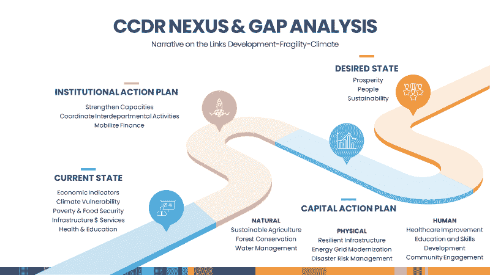
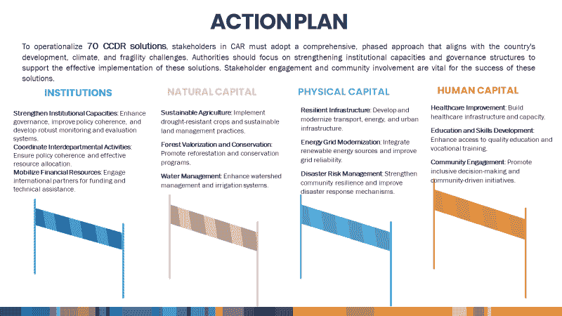
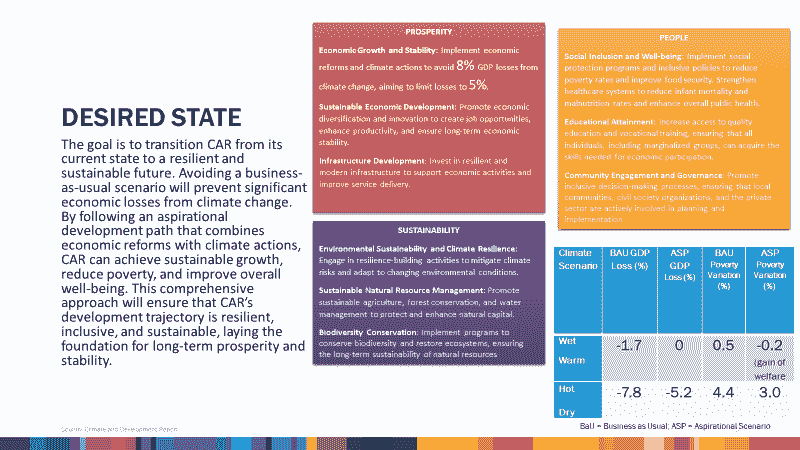
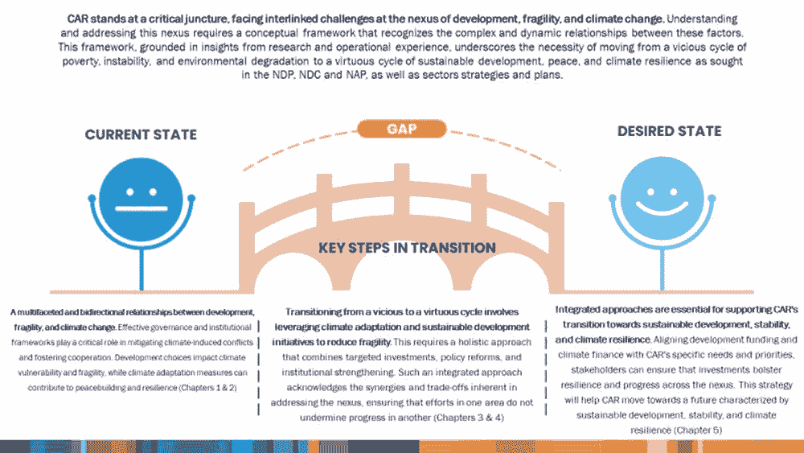
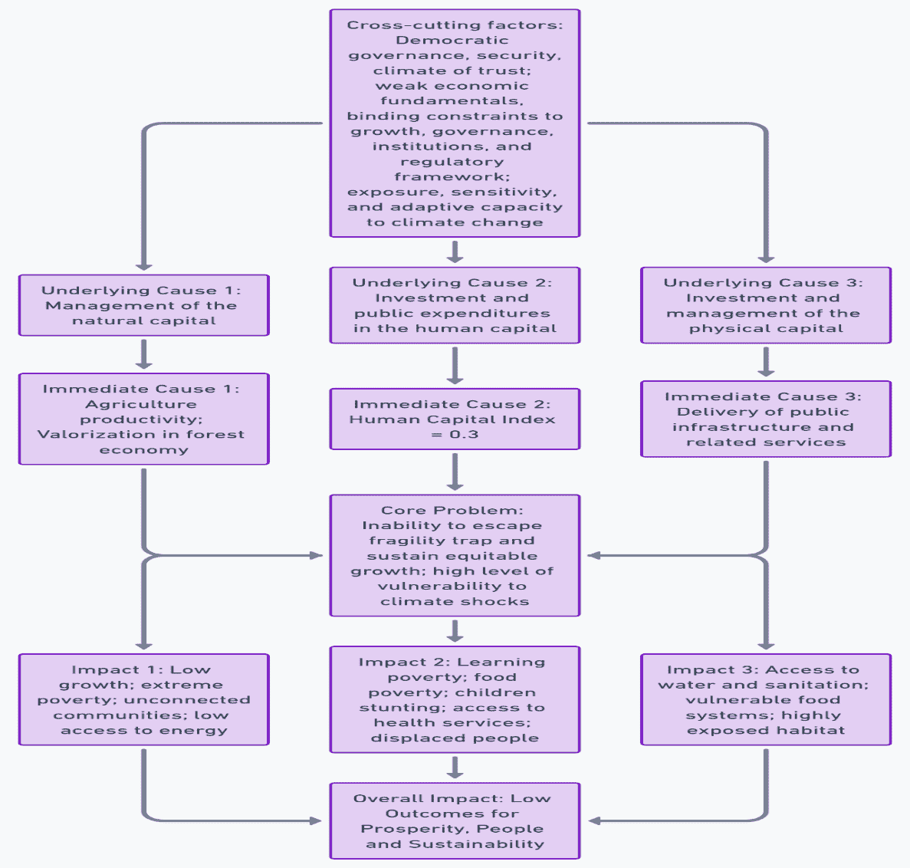
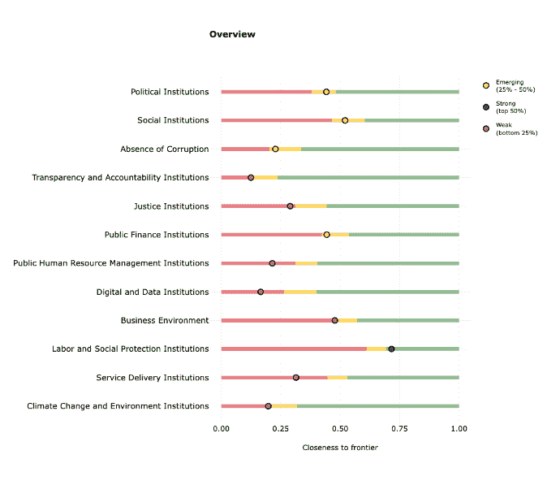
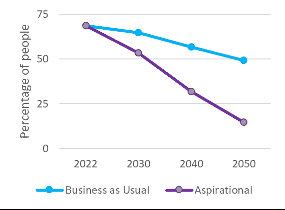
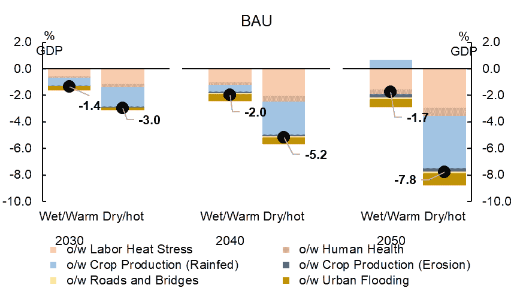
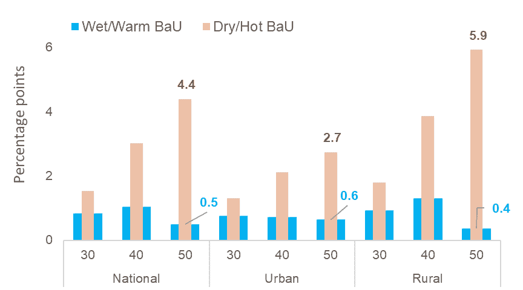
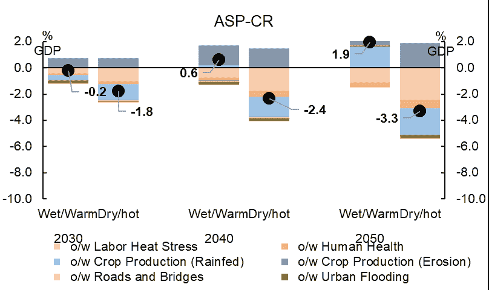

### Central African Republic Country Climate and Development Report

## CENTRAL AFRICAN REPUBLIC

### *MAIN DOCUMENT*

*Resilient and Inclusive Growth: Sustainable Solutions for CAR's Future*

© 2024 The World Bank Group

1818 H Street NW, Washington, DC 20433

Telephone: 202-473-1000; Internet: www.worldbank.org

This work is a product of the staff of the International Bank for Reconstruction and Development (IBRD), the International Development Association (IDA), the International Finance Corporation (IFC), and the Multilateral Investment Guarantee Agency (MIGA), collectively known as The World Bank Group, with external contributors.

The World Bank Group does not guarantee the accuracy, reliability or completeness of the content included in this work, or the conclusions or judgments described herein, and accepts no responsibility or liability for any omissions or errors (including, without limitation, typographical errors and technical errors) in the content whatsoever or for reliance thereon.

The boundaries, colors, denominations, links/footnotes and other information shown in this work do not imply any judgment on the part of any of the organizations of The World Bank Group concerning the legal status of any territory or the endorsement or acceptance of such boundaries. The citation of works authored by others does not mean The World Bank Group endorses the views expressed by those authors or the content of their works. The findings, interpretations, and conclusions expressed in this volume do not necessarily reflect the views of IBRD/IDA, IFC and MIGA, their respective Boards of Executive Directors, and the governments they represent.

The contents of this work are intended for general informational purposes only and are not intended to constitute legal, securities, or investment advice, an opinion regarding the appropriateness of any investment, or a solicitation of any type. Some of the organizations of The World Bank Group or their affiliates may have an investment in, provide other advice or services to, or otherwise have a financial interest in, certain of the companies and parties named herein.

Nothing herein shall constitute or be construed or considered to be a limitation upon or waiver of the privileges and immunities of any of IBRD/IDA, IFC and MIGA, all of which are specifically reserved.

### Rights and Permissions

The material in this work is subject to copyright. Because the World Bank Group encourages dissemination of its knowledge, this work may be reproduced, in whole or in part, for noncommercial purposes as long as full attribution to this work is given and all further permissions that may be required for such use (as noted herein) are acquired. The World Bank Group does not warrant that the content contained in this work will not infringe on the rights of third parties and accepts no responsibility or liability in this regard. All queries on rights and licenses should be addressed to World Bank Publications, The World Bank, 1818 H Street NW, Washington, DC 20433, USA; e-mail: pubrights@worldbank.org.

## CCDR @GLANCE

## 9 MAJOR RECOMMENDATIONS

| # | Keyword | Brief Description | Natural Capital Impact | Human Capital Impact | Physical Capital Impact | Institutions, Governance Impact |
|---|---------|-------------------|------------------------|----------------------|------------------------|--------------------------------|
| 1 | Infrastructure Resilience | Enhance resilience to natural disasters in key infrastructure | Supports ecosystem resilience by protecting natural buffers | Ensures safety and well-being by reducing disaster risk | Critical in safeguarding and rebuilding infrastructure like roads and buildings | Strengthens policy and planning frameworks for disaster preparedness |
| 2 | Renewable Energy | Foster renewable energy partnerships for rural electrification | Reduces environmental degradation by promoting clean energy | Improves quality of life through reliable energy access | Expands infrastructure for sustainable energy sources | Facilitates regulatory changes and fosters public-private partnerships |
| 3 | Climate Education | Develop a national climate change education and communication strategy | Raises awareness of the importance of preserving natural habitats | Empowers individuals with knowledge and skills for sustainability | Minimal direct impact, supports informed usage of physical resources | Enhances educational policies and integrates climate literacy |
| 4 | Water Management | Implement sustainable water resource management reforms | Directly impacts water conservation and management of aquatic systems | Enhances public health and access to clean water | Involves infrastructure development for water conservation and management | Reforms policies related to water usage and management practices |
| 5 | Climate Finance Coordination | Increase coordination for optimizing climate finance | Minimal direct impact, supports funded environmental projects | Builds capacity by financing health and education projects related to climate | Supports infrastructure projects through better-funded initiatives | Improves the efficiency and effectiveness of financial resource allocation |
| 6 | Financial Inclusion | Promote financial inclusion to enhance climate resilience investments | Facilitates investments in natural capital projects like reforestation | Increases accessibility to financial services for economic stability | Encourages investments in resilient infrastructure | Strengthens financial policies and systems to support sustainable development |
| 7 | Community Monitoring | Mobilize community-based monitoring for climate projects | Enhances local environmental management and conservation efforts | Empowers communities with oversight and active participation | Supports the maintenance and effectiveness of physical projects like local dams | Strengthens governance through community engagement and accountability |
| 8 | Sustainable Management of the Natural Capital | Develop comprehensive policies for the sustainable development and management of natural capital, by integrating economic development with environmental sustainability | Enhances natural capital by promoting sustainable land use and responsible resource management (including forests) | Supports job creation and skills development in sustainable industries | Strengthens physical capital through improved resource efficiency and innovation in natural resource-based industries | Bolsters institutional capacity for governance and ensures compliance with sustainable practices |
| 9 | Agricultural Resilience | Strengthen agricultural resilience through climate-smart practices | Improves land use and increases biodiversity | Supports farmer welfare and community sustenance | Enhances agricultural infrastructure like irrigation systems | Promotes policy shifts towards sustainable agricultural practices |

## Contents

- CCDR @GLANCE ....................................................................................................................... 3
- List of Acronyms ........................................................................................................................... 8
- Acknowledgement ..................................................................................................................... 11
- Executive Summary ................................................................................................................... 12
- 1. The Link Development-Fragility-Climate Change ..................................................... 23
  - 1.1. Economic and social development ................................................................................ 23
  - 1.2. Climate Change .............................................................................................................. 24
  - 1.3. Fragility ........................................................................................................................... 26
    - 1.3.1. Conceptual Framework: Development-Fragility-Climate Nexus ............................................ 27
  - 1.4. The way forward ............................................................................................................. 28
- 2. Climate Commitments, Policies, and Capacities ..................................................... 31
  - 2.1. Navigating the Nexus Through Institutional and Governance Reform ........................... 31
  - 2.2. Development Aspirations ................................................................................................ 32
  - 2.3. Climate Commitments .................................................................................................... 33
  - 2.4. Climate commitments and national and sectoral strategies .......................................... 34
    - 2.4.1. Climate-informed legislation and coordination mechanisms.................................................. 34
    - 2.4.2. Institutional readiness for Climate Change Action .................................................................. 35
    - 2.4.3. Enhancing Institutional Frameworks for Effective Climate Action .......................................... 37
  - 2.5. Climate Finance .............................................................................................................. 38
  - 2.6. Solutions to enhance climate commitments, policies, and strategies ........................... 39
  - 2.7. The Way Forward on the Nexus ...................................................................................... 40
- 3. Wealth, Climate and Fragility: A Sector Perspective ............................................ 42
  - 3.1. Introduction .................................................................................................................... 42
  - 3.2. Understanding CAR's Vicious Cycle................................................................................ 42
    - 3.2.1. Development and Fragility in CAR ........................................................................................... 42
    - 3.2.2. Climate Vulnerability ................................................................................................................. 43
    - 3.2.3. Human Capital: Education and Health .................................................................................... 49
    - 3.2.4. Physical Capital: Urban Development, Transport, and Energy .............................................. 53
    - 3.2.5. Social Dimensions of Climate Change and the Risk of Conflicts .......................................... 58
    - 3.2.6. Private sector, Climate, Development and Fragility ............................................................... 61
- 4. Macro and Distributional Impacts ............................................................................. 63
  - 4.1. Key Takeaways ............................................................................................................... 63
  - 4.2. Introduction .................................................................................................................... 64
  - 4.3. Methods Used and Approach ......................................................................................... 65

#### 4.4 Main Findings

##### 4.4.1 The Prerequisite of Economic Development

##### 4.4.2 How Adequate Climate Measures Would Bring Net Gains

#### 4.5 Integrating Policies for Development and Climate

# 5 Summary and main recommendations

## 5.1 Summary

## 5.2 Main Recommendations

**References**

**List of Acronyms**

- **AEZs**: Agro-Ecological Zones
- **AfCFTA**: African Continental Free Trade Area
- **ARSEC**: Electricity Sector Regulatory Agency
- **ASP**: Aspirational Scenario with Planned Adaptations
- **ASP-CR**: Aspirational Scenario with Planned Adaptations and Climate Resilience
- **BAU**: Business-as-Usual
- **CAR**: Central African Republic
- **CBMT**: Medium-Term Budget Framework
- **CCDR**: Climate and Development Report
- **CCIA**: Climate Change Institutional Assessment
- **CC-MFMod**: Climate Change Macro-Fiscal Model
- **CEM**: Country Economic Memorandum
- **CER**: Certified Emission Reduction
- **CKE**: Climate Knowledge for Education
- **C-REP**: Climate Resilience in Education Program
- **CSA**: Climate-Smart Agriculture
- **CSCTP**: Climate-Smart Construction Training Program
- **DPAN**: National Agricultural Policy Document
- **DRM**: Disaster Risk Management
- **EHCVM**: Harmonized Household Living Conditions Survey
- **ESCRP**: Education Sector Climate Resilience Policy
- **FCS**: Fragile and Conflict State
- **FCV**: Fragility, conflict, and violence
- **PFM**: Public Financial Management
- **GCP-F**: Global Challenge Program: Forests for Development, Climate, and Biodiversity
- **GDP**: Gross Domestic Product
- **GHG**: Greenhouse gases
- **IDPs**: Internally Displaced Peoples
- **IFC**: International Finance Corporation
- **IPCC**: Intergovernmental Panel on Climate Change
- **ITMOs**: Internationally Transferred Mitigation Outcomes
- **IWRM**: Integrated water resource management
- **LTS**: Long-Term Strategies
- **MDAs**: Ministry Department Agencies
- **MEA**: Multilateral Environment Agreement
- **MESD**: Ministry of Environment and Sustainable Development
- **MFB**: Ministry of Finance and Budget
- **M&E**: Monitoring & Evaluation
- **MIGA**: Multilateral Investment Guarantee Agency
- **MPA**: Multiphase Programmatic Approach
- **MRV**: Monitoring, reporting, and verification
- **MSME**: Micro, Small, and Medium Enterprises
- **NAP**: National Adaptation Plan
- **NDC**: Nationally Determined Contributions
- **ND-GAIN**: Notre Dame Global Adaptation Initiative
- **NDP**: National Development Plan
- **O&M**: Operations & Maintenance
- **PA**: Per annum
- **PFM**: Public financial management
- **PTI**: Triennial Investment Plan
- **REDD+**: Reducing Emissions from Deforestation and forest Degradation
- **SCRAMI**: School Climate Risk Assessment and Mitigation Initiative
- **SDGs**: Sustainable Development Goals
- **SDRASA**: Strategy for Rural Development, Agriculture, and Food Security
- **SEACAP**: Sustainable Energy Access and Climate Action Plan
- **SLM**: Sustainable Land Management
- **SME**: Small and Medium Enterprises
- **SNDD**: Stratégie Nationale de Développement Durable
- **SSA**: Sub-Saharan Africa
- **TFP**: Total Factor Productivity
- **TNC**: Third National Communication
- **UNCCD**: The United Nations Convention to Combat Desertification
- **UNFCCC**: The United Nations Framework Convention on Climate Change
- **WASH**: Water supply, sanitation, and hygiene

**Acknowledgement**

This CCDR was largely made possible thanks to the collaboration of numerous stakeholders, including representatives of the Central African Republic (CAR) Government, international NGOs, academic researchers, and especially the communities across the entire Central African Republic, whose experiences and knowledge have deeply shaped the findings and conclusions of this report. Their willingness to share their insights and data provided invaluable contributions to the effort to ensure the completeness and accuracy of this analysis.

This report (Main Document and Background Notes Document) is the result of a collaboration within a World Bank team led by Nabil Chaherli (Team Leader), Camilla Lindstrom, and Pierre Mandon (Co-Team Leaders). The team members who mainly contributed to the preparation of the main report are presented in the table below. Communication, external relations, and logistical support were provided by Béatrice Toubarot Mossane. Brent Boehlert, Ken Strzepek, and Diego Castillo from *Industrial Economics* prepared the section on economic damages. The Main Document presents a summary of sectoral and cross-cutting analyses, while the Background Notes Document covers these summaries in more detail.

We thank the peer reviewers for their comments at various stages of the report's development: Souleymane Coulibaly, Jana El-Horr, and George Stirrett. The CCDR was prepared under the overall direction of Ousmane Diagana, Sergio Pimenta, Ethiopis Tafara, Elisabeth Huybens, Cheick Kante, Chakib Jenane, Abebe Adugna, Trina Haque, Franz Drees-Gross, Dahlia Khalifa, Charlotte Ndaw, Guido Rurangwa, Moritz Nebe, Lia Sieghart, and Sandeep Mahajan. Tracey Lane, Johan Mistiaen, Mehnaz Safavian, Ashish Khanna, Ibou Diouf, Abel Lufafa, Nicolas Perrin, Madhu Kana, Sylvie Debomy, Anna Cestari, Kathy Sheldon, Scherezad Joya, Camilla Holmemo, Clelia Rontoyanni, Robert Utz, Natalie Lahire, Aissatou Diack, Maria Gracheva, Kanta Kumari, and Yussuf Uwamahoro provided technical guidance and comments to the team.

The report benefited from engagement with the CAR Government during various World Bank missions and workshops (November 2023, February 2024, July 2024). Our thanks to Professor Richard Filakota, Minister of Economy, Planning, and International Cooperation, Mr. Hervé Ndoba, Minister of Finance and Budget, Mr. Thierry Kamach, Minister of Environment and Sustainable Development, Mr. Gervais Mbata, Minister of Water and Forests and Madame Michelle Mouanga, Minister of Labor and Social Protection. Stakeholders from the private sector made significant contributions to this report. The IFC team conducted consultations with representatives from the local private sector. The team also benefited from feedback and input from technical and financial partners.

**List of contributors (World Bank staff and consultants)**

- **Agriculture**: Aurelia Dakpogan, Mathias Egui
- **Water**: Mike Thibert, Bogachan Benli
- **Environment**: Nyaneba Nkrumah, Samira Elkhamlichi, Sandrine Ndoubenoue
- **Social Development**: Camilla Lindstrom, Ann-Sofie Jespersen, Trrishala Kumaraswamy
- **Transport**: Francis Ovanda, Abdoulaye Sylla, Oceane Keou, Ajara Ceesay, Balikisu Osman
- **Energy**: Nash Eyison, Steven Clarke
- **Urban Development**: Laurent Corroyer, Emilie Jourdan, Solene Dengler, Jean-Bosco Abderamane, Sammy Ndayizamvye, Illya Miko
- **Education**: Tanya Savrimootoo, Boubakar Lompo, Mitterand Madjita, Eleonora Cavagnero
- **Health**: Innocent Nukuri, Tomo Morimoto, Clarisse Uzamukunda, Abdoulaye Ka
- **Macroeconomics**: Pierre Mandon, Diderot Tomi, Florent McIsaac
- **Poverty**: Jonathan Lain, Gervais Yama, Daniel Valderrama
- **Governance**: Eugenie Kiendrebeogo, Fabienne Mroczka, Marianne Caballero
- **Finance**: Benjamin Herzberg, Marina Mavungu, Guy Sobo
- **Fragility**: Eric Mabushi
- **IFC**: Toluwalola Kuburat Kasali, Lisa Choux, Alain Traore, Hannah Blyth, Joseck Mudiri, Frank Ajilore, Kolognin Sekongo, Mouhamadou Bayo Ly, Vincent Naigard, Valentin Uwayo, Erina Saita, Dennis Quansah, Nana Asamoah-Manu, Gabrielle Djonkou-Tomba, Matina Deen
- **MIGA**: Mena Cammett

The report was edited by Emily Gribbin. Litera Madagasikara prepared the French translation.

## Executive Summary

### Vision for a Resilient Future: The Central African Republic's Climate and Development Paradigm

### Vicious Cycle of Underdevelopment, Fragility, and Climate Change

The Central African Republic (CAR) remains entrenched in a vicious cycle characterized by underdevelopment, state fragility, and heightened vulnerability to climate change, as extensively analyzed in the initial chapters of the CAR Climate and Development Report (CCDR). This cycle represents not just a theoretical framework but a tangible reality, underpinned by robust data and empirical evidence that delineates the profound challenges CAR faces.

### Profound Underdevelopment

Economically, CAR exhibits stark underdevelopment, evidenced by one of the world's lowest GDP per capita figures, recorded at only $495 in 2019. This economic stagnation is further highlighted by the Human Development Index (HDI), which places CAR among the lowest globally, signaling critical deficits in health, education, and living standards. For instance, a child born in CAR today is projected to achieve only 29% of their productive potential if they were to receive full education and health. The prevalence of poverty is overwhelming, with approximately 70% of the population living below the poverty line. Between 2018 and 2021, 90% of households experienced a significant shock, with armed conflict (54%) and climate-related shocks (27%) being predominant.¹

### Pronounced State Fragility

Politically, CAR's fragility is compounded by a history of upheavals and conflicts that have significantly eroded governance structures and disrupted social cohesion. Since 1960, recurrent violence and political instability have severely impaired its governance capacity. This instability extends to societal structures, often manifesting in tensions that escalate into violence, displacing a significant portion of the population and fracturing communities. Urban areas are also not growing in a sufficiently resilient and inclusive manner to act as true safe havens and provide sufficient opportunities for their populations.

### Heightened Susceptibility to Climate Change

CAR is highly susceptible to climate variability. The CCDR emphasizes that altered rainfall patterns and the increase in extreme weather events critically threaten water and food security and livelihoods. Various reports highlight how erratic rainfall disrupts agricultural production, compounding food insecurity and affecting the broader national economy. Furthermore, CAR's extensive river systems and significant forest cover face risks from changing climatic conditions and desertification, threatening essential natural resources.

### Interconnected Challenges

These challenges are not isolated but interconnected, creating a complex web that perpetuates economic, social, and environmental stagnation. The interplay between underdevelopment, political instability, and climate vulnerability constrains CAR's capacity to implement effective climate resilience and adaptation strategies. Moreover, governance weaknesses impede robust policy implementation and hinder necessary international cooperation.

### Strategic Imperatives

Breaking this cycle requires a strategic and integrated approach to development. It necessitates a comprehensive strategy that addresses the root causes and symptoms through economic diversification, institutional strengthening, and innovative policy reforms. Without a multifaceted and integrated approach considering both sectoral challenges and spatial trends, CAR risks deeper entrenchment in this cycle, with grave implications for its population's well-being and future developmental prospects.

### Significant Climate Risks to Economy, Sectors, and Households

CAR confronts significant challenges posed by climate change, which profoundly impact its economy, critical sectors, and households, especially among the most vulnerable populations. These challenges are detailed in the CAR Climate and Development Report (CCDR), which presents a comprehensive analysis underlining the multifaceted threats across various dimensions.

The macro modeling identifies the interlinkage between climate change and development challenges in the Central African Republic (CAR). It aims to explore how targeted adaptation investments could yield socioeconomic benefits by 2050. The primary objective is to assess the economic impact of climate vulnerabilities and identify strategic adaptation measures that can alleviate the country's economic fragility and enhance resilience.

A Climate Change Macro-Fiscal Model (CC-MFMod) and micro-simulations are used to forecast the economic impacts of various climate scenarios until 2050. This approach evaluates the dynamics across economic sectors and interactions among economic agents, employing scenarios to assess the impact of climate on growth. Impact channels considered include productivity losses in agriculture due to climate variability, health impacts due to increased heat, and infrastructural damages from extreme weather events.

Two main scenarios are compared: the Business-as-Usual (BAU) and the Aspirational Scenario with Planned adaptations (ASP). BAU reflects continued economic fragility without significant reforms, while ASP assumes comprehensive economic reforms and proactive climate adaptation measures. The main differences lie in the extent of structural economic changes and investment in climate resilience.

Development commitment under the ASP scenario is expected to significantly reduce poverty, driven by strong consumption growth, higher wages, and a more fluid labor market shifting towards high-productivity sectors.

### Table ES.1: Comparison of BAU and ASP Scenarios

| Feature | BAU Scenario | ASP Scenario |
|---|---|---|
| Economic Growth | Limited growth due to structural stagnation | Enhanced growth through structural reforms and investments |
| Poverty Trends | Small to moderate reduction of absolute monetary poverty | Massive reduction of absolute monetary poverty |
| Climate Adaptation | Minimal adaptation efforts | Ability to implement significant investment in adaptation measures |
| GDP Impact by 2050 | Higher GDP losses due to unmitigated climate effects | Lower GDP losses due to proactive measures |
| Policy Framework | Continuation of current policies | Implementation of aggressive reform and adaptation strategies |

Under the BAU scenario, the economy experiences minimal growth, increasing vulnerability to climate impacts, while the ASP scenario, without specific climate action, suggests improvements through reforms but still faces risks from unmitigated climate change. The comparison of GDP impacts reveals significant potential losses under both scenarios if no climate action is taken. Climate change is expected to worsen poverty and severely impact vulnerable households reliant on agriculture, especially under the BAU scenario. The structural transformation envisaged under the ASP scenario would mitigate the adverse impacts on the poorest households mostly by reducing dependency on rainfed agriculture activities, relaxing budget constraints, and improving food security and provision.

### Table ES.2: GDP Losses Under BAU and ASP (No Climate Action)

| Climate Scenario | BAU GDP Loss (%) | ASP GDP Loss (%) | BAU Poverty Variation (%) | ASP Poverty Variation (%) |
|---|---:|---:|---:|---:|
| Wet/Warm | -1.7% | -0.0% | 0.5% | -0.2% (gain of welfare) |
| Hot/Dry | -7.8% | -5.2% | 4.4% | 3.0% |

*Note: World Bank staff computations.*

### Sector-Specific Vulnerabilities

- **Agriculture:** As the backbone of CAR's economy, employing about 80% of the population, agriculture faces acute vulnerabilities due to climate variability. Erratic rainfall and rising temperatures significantly affect crop yields and livestock productivity, thereby exacerbating food insecurity and reducing rural household incomes.

- **Water Resources:** CAR's water resources are critical yet increasingly at risk. Limited access to clean water and sanitation, compounded by changing precipitation patterns and rising temperatures, poses severe challenges to agricultural productivity and heightens health risks. Lack of water may also lead to increased conflicts between herders and farmers.

- **Forestry:** The forestry sector, pivotal for biodiversity and livelihoods, faces threats from deforestation and degradation due to climate change and unsustainable land use.

¹ World Bank. 2023. *Central African Republic Poverty Assessment—A Road Map Towards Poverty Reduction in the Central African Republic (English).* World Bank Group, Washington, D.C.

Central African Republic Country Climate and Development Report

jeopardizes biodiversity, carbon sequestration capacities, and the economic stability of communities dependent on forest resources.

- **Cities and towns:** Urban areas face multiple climate-related risks, particularly floods and erosion, which are expected to become worse with climate change.

### Disproportionate Impact on Vulnerable Communities

The adverse effects of climate change disproportionately affect vulnerable community segments, including women, indigenous populations, and the poor. Women, integral to agriculture and the informal economy, face amplified risks and burdens. Indigenous populations, reliant on natural resources for their livelihoods and cultural practices, confront increasing instability due to environmental changes. Internally displaced people are also a group that is disproportionately affected by climate change, whether they live in rural or urban areas.

### Risks and Opportunities

The intersection of climate risks with economic and sectoral vulnerabilities presents both challenges and opportunities for CAR. It necessitates a holistic, cross-sectoral, and spatial response² that not only addresses the immediate impacts of climate change but also fortifies the resilience of the economy, ecosystems, infrastructure, and communities. This strategic response requires robust data, targeted investments, and policies that prioritize the needs and contributions of the most vulnerable, ensuring a path towards a sustainable and resilient future for CAR.

## Palpable Urgency: Moving Beyond Business-as-Usual

CAR is at a pivotal moment, facing escalated challenges as climate change intensifies pressures on an already fragile socio-economic system. The CCDR underscores the critical need to transcend traditional approaches to effectively counter these growing threats. This urgency is substantiated by robust empirical data, advanced climate projections, and the direct experiences of the CAR population.

### Amplifying Climate Threats

Recent scientific analyses and models project an alarming increase in the frequency and severity of extreme weather events affecting CAR. Projections indicate more frequent droughts, floods, and erratic rainfall, which pose severe risks to agriculture and urban areas, can displace communities, exacerbate vulnerabilities, and disrupt ecosystems. This projection aligns with data from the Intergovernmental Panel on Climate Change (IPCC), which anticipates a rise in climate variability across the Sahel, directly impacting CAR.

### Exacerbation of Existing Vulnerabilities

Pre-existing vulnerabilities—stemming from political instability, economic stagnation, and societal fragmentation—are significantly amplified by climate change impacts. A large segment of the population already lives in poverty, lacking basic services, healthcare, and education, making them disproportionately susceptible to worsening climate effects. The CCDR highlights how these vulnerabilities fuel a feedback loop, where climate-induced hardships deepen social and economic divides, further embedding fragility within the nation.

### Inadequate Adaptive Capacity and Infrastructure

The infrastructure is critically insufficient to withstand the emerging challenges posed by climate change. Vital systems, including water management and sanitation, drainage, solid waste management, healthcare, and transportation, are ill-equipped to cope with climate shocks. This gap reflects not only physical infrastructure inadequacies but also institutional and governance deficiencies that hinder effective community-level adaptation strategies.

² Spatial is meant to refer to trends, population movements, IDP trends and local economic development.

## Paradigm Shift for Sustainable Development

It is evident from the CCDR that maintaining the status quo is unsustainable for CAR. There is a compelling need for a paradigm shift towards sustainable, climate-adapted development strategies. This shift requires enhancing both physical and institutional infrastructures and integrating climate resilience into economic planning, spatial development, social policies, and governance frameworks. It advocates for embracing innovative solutions that meld traditional knowledge with scientific research to forge a development pathway that is both inclusive and adaptive.

## A Call to Action

The CCDR's urgency serves as a mobilizing call to action for CAR, its international partners, and global stakeholders. It demands immediate, coordinated efforts to reframe development strategies with climate resilience at their core. Priorities include investing in climate-smart agriculture, sustainable water management, renewable energy, social safety nets, disaster risk management, and resilient infrastructure, along with essential reforms in governance, finance, and social policy. A comprehensive and forward-thinking approach is vital for CAR to mitigate impending climate risks and lay the groundwork for sustainable, equitable development amidst unparalleled environmental challenges.

When climate action is incorporated into the modelling approach, the climate-resilient (ASP-CR) scenario demonstrates a robust response, mitigating much of the adverse impacts seen in the BAU and ASP scenarios. Strategic investments and policy reforms under the ASP-CR scenario substantially reduce the negative GDP impacts compared to when no climate action is taken. This assessment will be complemented with ongoing projections on poverty and distributional impacts.

### Table ES.3: GDP Losses Under BAU and ASP with Climate Action (ASP-CR)

| Climate Scenario | BAU GDP Loss (%) | ASP-CR GDP Gain/Loss (%) | BAU Poverty Variation (%) | ASP-CR Poverty Variation (%) |
|---|---:|---:|---:|---:|
| Wet/Warm | -1.7% | +1.9% (gain) | 0.5% | -1.0% (gain of welfare) |
| Hot/Dry | -7.8% | -3.3% (reduced loss) | 4.4% | 1.6% (reduced loss) |

*Note: World Bank Staff computations.*

Strategic policy recommendations include aggressively pursuing structural reforms and investing in climate adaptation measures. The analysis suggests that enhancing fiscal space, diversifying the economy, supporting local rural and urban economic development, and leveraging climate finance are crucial. Given limited fiscal space even under the ASP scenario, the government should transform this fiscal hurdle into a collaborative opportunity with the private sector and, more generally, all stakeholders involved in “no-regret” policy. Limitations of the approach include the high level of uncertainty in climate projections and economic responses, suggesting the need for flexible and adaptive policy frameworks. Implementing targeted adaptation measures would significantly benefit the poor by enhancing the resilience of the most vulnerable populations and enabling the consolidation of strong local networks in both urban and rural areas. Future improvements could involve integrating more granular local data and expanding the scope of climate scenarios to enhance model accuracy and relevance.

## Integrated, Coordinated Approach for Breaking the Cycle

To effectively tackle the intertwined challenges of underdevelopment, state fragility, and climate vulnerability, CAR requires an integrated, coordinated approach. This strategy must synchronize investments, institutional strengthening, and policy innovations to catalyze resilience and sustainable development. The CAR CCDR emphasizes that a holistic strategy that considers spatial trends is crucial for navigating CAR's complex developmental, socio-political, and environmental challenges. This report proposes a set of 70 targeted solutions developed from extensive sectoral assessments and a thorough prioritization process (Figure ES.1).

Among the 42 most synergetic and urgent interventions, 24 solutions stand out for their high relevance in the CAR context (Figure ES.2).

## Strategic Framework for Transformation

- **Investment Initiatives:** Key areas include enhancing agricultural productivity through climate-resilient methods and local infrastructure, optimizing water resource management, expanding renewable energy, as well as investing in resilient and inclusive urban areas. These initiatives aim to bolster productivity, ensure sustainability in resource use, increase resilience, and reduce energy dependency.

- **Institutional Reinforcement:** Strengthening health and education systems to improve disease surveillance and integrate climate resilience into curricula, enhancing environmental governance for effective natural resource management, and developing comprehensive early-warning and disaster risk management capabilities, as well as locally led development plans.

- **Policy Innovations:** Reforms are needed in economic and fiscal policies to incentivize sustainable practices, land use and risk-informed urban planning to encourage responsible growth, and social policies tailored to the needs of vulnerable groups. These reforms are designed to facilitate a transition to a low-carbon economy and ensure equitable climate adaptation efforts, enhancing resilience to climate change by ensuring that local communities receive adequate resources from the central level.

## Path to Resilience and Prosperity

Breaking the cycle of development, fragility, and climate change in CAR demands a concerted, multifaceted strategy that aligns investments, builds institutional resilience, and revitalizes policy frameworks. This integrated approach not only aims to mitigate immediate climate impacts but also establishes a robust foundation for enduring, inclusive development. With CAR's limited financial and institutional capacities, the role of international collaboration and support is highlighted as essential for providing the financial resources, technical expertise, and capacity-building needed to implement these strategic interventions. The journey toward resilience, stability, and sustainable growth in CAR is contingent upon a collaborative effort that encompasses a broad spectrum of investments, enhances institutional frameworks, and revitalizes policy landscapes, empowering CAR to navigate future uncertainties with enhanced strength and confidence. This comprehensive strategy promises not just to address current challenges but also to position CAR for long-term prosperity and stability in the face of climate change.

18

Central African Republic Country Climate and Development Report

### Figure ES.1 Prioritization Process

### Figure ES.2 Most Synergetic and Urgent Solutions: CCDR Clusters and NDP Pillars

Note: This subset of solutions and opportunities is based on a World Bank Staff initial assessment of development (impact on growth, jobs, access to services, improved well-being, etc.), and drawing from information gathered from past, current and future pipeline projects financed by the World Bank in CAR as of May 2024. The NDP 2024-28 Draft has the following areas of emphasis. Pillar 1: Security, Governance, and Rule of Law. Pillar 2: Access to Social Services and Human Capital. Pillar 3: Infrastructure Resilience and Sustainability. Pillar 4: Economic Growth and Job Creation. Pillar 5: Environmental Sustainability and Climate Resilience. Solutions have been mapped to the main NDP pillar they are most relevant to.

To operationalize these solutions, stakeholders in CAR must adopt a comprehensive, phased approach that aligns with the country's development, climate, and fragility challenges. This approach should start with the immediate implementation of the most synergetic and urgent solutions, prioritizing actions that address critical vulnerabilities and lay the groundwork for long-term resilience. These solutions should be integrated into existing national frameworks such as the NDP (most urgent), NDC, and NAP, ensuring coherence and alignment with CAR's strategic goals. A phased implementation plan (Figure ES.3) should include clear timelines, resource allocation strategies, and performance indicators to track progress and adapt to emerging challenges.

Authorities should focus on strengthening institutional capacities and governance structures to support the effective implementation of these solutions. Enhancing coordination mechanisms across government agencies, improving policy coherence, and ensuring robust monitoring and evaluation systems are crucial (Figure ES.4). International technical and financial partners play a crucial role in providing necessary resources and expertise. Prioritizing funding and technical assistance for the most urgent and impactful solutions can facilitate knowledge transfer and capacity building, bridging resource gaps, and ensuring the scalability of successful interventions.

### Figure ES.3 Concrete Steps to Operationalize the 70 Solutions

### Figure ES.4 Stakeholders' Involvement in Operationalizing the 70 Solutions

Stakeholder engagement and community involvement are vital for the success of these solutions. Inclusive decision-making processes should actively involve local communities, civil society organizations, and the private sector. This engagement fosters ownership, enhances accountability, and ensures that interventions are culturally appropriate and locally relevant. Establishing thematic commissions focusing on natural, human, and physical capital, as well as institutions and governance, can facilitate a "whole-of-government" coordinated action and effective monitoring. A round-table of actors and partners is necessary to mobilize financial resources and establish action plans. Whole-of-Society bodies are essential for translating plans into concrete actions, ensuring continuous evaluation and adaptation. By taking these steps, CAR can break the vicious cycle of development, climate vulnerability, and fragility, setting the country on a path towards resilient and sustainable growth.

### Recommendations and perspectives

Building upon the foundation laid by the diverse array of proposed solutions, the report distills these into nine key recommendations tailored specifically for CAR. These recommendations were meticulously developed by assessing the synergy, urgency, and feasibility of initially proposed solutions, among which some were identified as both synergistic and urgent. This process involved categorizing these solutions according to their type — direct actions, enabling environments, and support systems — and their implementation horizon — short, medium, and long term. 'Direct actions' are concrete interventions that have an immediate impact on development and climate resilience, such as infrastructure improvement or renewable energy expansion. 'Enabling environments' include policies and institutional frameworks that facilitate effective climate action and sustainable development practices, such as legislative reforms and incentive policies. Finally, 'support systems' are educational, technological, and community initiatives that support the sustainability and scaling of climate and development actions, such as awareness and training programs. Each type of solution is assessed based on its urgency of implementation, classified as short, medium, or long-term, to prioritize actions and strategically allocate resources.

# High Urgency and Impact (Immediate Implementation Needed)

- **Recommendation #1: Enhance infrastructure resilience to natural disasters.** For public bodies in CAR, it is imperative to strengthen infrastructure resilience to protect lives and maintain essential services. This initiative focuses on strengthening critical assets such as urban drainage, roads, bridges, and public buildings against natural disasters, using public funding, international aid, and grants for climate resilience. Given CAR's susceptibility to climate disasters, this measure directly enhances the safety and economic stability of both urban and rural populations, significantly reducing disruptions related to disasters.

- **Recommendation #2: Foster partnerships for renewable energy and rural electrification.** This recommendation calls on the private sector and government to establish partnerships to expand access to renewable energy in urban and rural areas, focusing on solar and wind energy projects. By leveraging public-private partnerships, international green energy funds, and private investments, this strategy aims to reduce dependence on non-renewable sources, enhance energy security, and support sustainable economic development, thus increasing economic opportunities in rural communities and contributing to national energy independence.

- **Recommendation #3: Develop a national strategy for education and communication on climate change.** Targeting civil society and education authorities, CAR must develop a comprehensive strategy to integrate climate change awareness and resilience skills into the national education curriculum and public communication channels. Funded by government budget allocations and supported by international educational and environmental organizations, this initiative is crucial for educating the populace about climate change, fostering a climate-aware generation capable of informed participation and proactive community engagement in climate initiatives.

# Medium Urgency but High Impact (Strategic Implementation Needed)

- **Recommendation #4: Implement water resource management reforms.** Public bodies in CAR are encouraged to reform policies to ensure sustainable use and equitable distribution of water resources. This initiative is critical for adapting to variable rainfall patterns and securing water for all users, essential for food security and health. Supported by national government funding and international water management grants, sustainable water management will ensure a reliable water supply for agriculture and domestic use.

- **Recommendation #5: Increase technical and financial partners' coordination for climate finance optimization.** International financial partners are called upon to improve coordination among donors to maximize the efficiency and impact of climate finance. This strategy, involving structured international funding and coordinated investment strategies, is key to efficiently implementing large-scale adaptation projects, addressing the country's critical climate action needs.

- **Recommendation #6: Promote financial inclusion to facilitate climate resilience investments.** Targeting private sector financiers, regulatory authorities, and financial institutions, this recommendation advocates for enhancing financial inclusion to empower CAR's citizens, particularly rural smallholders and entrepreneurs, to access and utilize financial products that support sustainable development and climate resilience investments. Enhanced financial services are crucial for financing initiatives such as renewable energy, sustainable agriculture, and water resource management, which are vital under CAR's climate and development framework. Financial inclusion not only accelerates the implementation of these critical projects by providing necessary capital but also supports the economic stability of communities, enabling them to adapt to and recover effectively from climate impacts. By fostering economic participation and resilience, this strategy directly contributes to the nation's broader goals of sustainable growth and climate adaptability, ensuring that development efforts lead to tangible improvements in the population's well-being.

# Moderate Urgency and Impact (Gradual Implementation Advisable)

- **Recommendation #7: Mobilize empowerment and community monitoring of climate adaptation projects.** Civil society organizations in CAR should enable local NGOs to oversee the implementation of climate adaptation projects, ensuring that community needs are met. Funded by grants from international NGOs and community funding, this initiative increases community involvement and accountability, improving the success rate and sustainability of adaptation projects. It will also strengthen the empowerment of marginalized groups and support inclusive decision-making processes.

- **Recommendation #8: Develop and enforce comprehensive policies for the sustainable development and management of natural capital.** Public bodies are advised to establish and strengthen comprehensive policies that not only regulate but also promote sustainable land use and natural resource management. These policies should encompass environmental protection measures and extend to economic strategies that valorize natural assets and create sustainable jobs. This integrated approach should support the development of value chains, particularly in forestry, to enhance the economic benefits for local communities while ensuring the conservation of resources. Supported by government budgets and supplemented by international environmental governance funds, these policies can leverage additional financing. The aim is to improve land and resource security, thereby benefiting rural communities and fostering economic resilience. By linking environmental sustainability with economic development, these policies will help to create a robust framework that encourages responsible use and enhances the livelihoods of those dependent on natural resources.

### Central African Republic Country Climate and Development Report

### Recommendation #9: Strengthen agricultural resilience through climate-smart practices.

Public bodies and the agricultural sector must implement and support the adoption of climate-resilient agricultural methods to enhance productivity and sustainability. Supported by government subsidies and international agricultural development funds, this initiative improves land and resource security and fosters sustainable agricultural practices, essential for enhancing the resilience and productivity of CAR's predominantly agrarian economy.

# Call to Action

The findings and recommendations presented in this report reflect a comprehensive approach, informed by rigorous analysis conducted by the World Bank's team of specialists. They are designed to guide the Central African Republic towards a sustainable development path, highlighting the importance of resilience in the face of environmental, economic, and social challenges. Implementing these recommendations requires a unified vision and a shared resolve from all stakeholders, including government bodies, private sector entities, civil society, and international partners. Each group has a pivotal role to play, from enhancing infrastructure resilience to developing inclusive financial strategies that empower citizens. The collaborative efforts of these stakeholders are essential for transforming the recommendations into effective actions that significantly improve CAR's stability and prosperity. By aligning their actions with these strategic recommendations, stakeholders can ensure that every step taken contributes positively to CAR's journey towards a more secure, prosperous, and resilient nation.

This report not only calls for immediate and concerted action but also serves as a foundation for ongoing engagement and investment in CAR's future. It is imperative for all participants to engage actively and thoughtfully, using this report as a roadmap and direct contribution to finalizing and implementing the next NDP, to initiate sustainable change and achieve lasting impact in a way that serves the people of CAR. Aligning ideas, actors, and financial resources towards a unified and impactful development strategy is essential.

# 1. The Link Development-Fragility-Climate Change

## 1.1. Economic and social development

With an estimated population of 5.9 million in 2024,³ the CAR is a landlocked and fragile country, covering an area of 623,000 square kilometers and ranks at the bottom of the human capital and development indices (191st out of 193 countries in 2022).⁴ For more than two decades, the country has been mired in repeated cycles of conflicts and violence, the most serious of which the seizure of power by the Seleka in 2013. Since 1997, there have been 23 peace agreements between the Government and various Non-State Armed Groups, making conflict one of the most important determinants of political life. The lack of social cohesion, the concentration of political power, social and regional imbalances, elite captures, and the mismanagement of natural resources, remain the main drivers of fragility, preventing the country to add value to its local production, create jobs and bridge the poverty and infrastructure gap.⁵

The country's fiscal vulnerabilities have been exacerbated by a series of exogenous shocks (COVID-19 pandemic, renewed insecurity, and violence in 2021, Russian invasion of Ukraine and chronic fuel-supply shortages). These shocks have strained public finances, increased inflationary pressures, jeopardized food security, and slowed poverty reduction efforts. Climate shocks, including droughts, floods, wildfires, and windstorms continue to pose a threat to an already alarming humanitarian situation. As of February 29, 2024, the total number of internally displaced persons (IDPs) was estimated at 521,857 people (Figure 1.1),⁶ while approximately 749,471 people were registered as refugees in neighboring countries.

**Figure 1.1. Estimated IDP population¹ in CAR**

| Date | IDP Population |
| :--- | :--- |
| 12/31/16 | 522,231 |
| 31/12/17 | 450,000 |
| 31/12/18 | 400,000 |
| 31/12/19 | 450,000 |
| 31/12/20 | 500,000 |
| 31/12/21 | 550,000 |
| 31/12/22 | 600,000 |
| 31/12/23 | 650,000 |
| 02/29/24 | 700,000 |

Source: Office of the United Nations High Commissioner for Refugees (UNHCR). Notes: *1/ As of Feb. 29, 2024, it is estimated that there are still 522,231 IDPs in CAR (about 9.1 percent of the population). The figure does not fully reflect the recent trends in the Birao refugee camp and more generally in the Birao sub-prefecture since the onset of the Sudanese armed confrontations by mid-April 2013.

Despite its wealth of natural resources (with gold and diamonds having the greatest potential), CAR remains one of the poorest and most fragile countries in the world. The economy is dominated by rain-fed agriculture, livestock, local food processing and retail.⁷ To date, forestry (i.e., logs and sawn wood) and extractives (i.e., gold and diamonds) account for more than three-quarters of the total export basket.⁸ The country can rely on significant solar and hydro resources for energy generation. Urban areas likely represent a disproportionate share of the country’s economic activity⁹ and are growing – it is estimated that the country’s population will be urban by 2050 – but are not yet sufficiently reaping the benefits of agglomeration to drive national development. The medium-term outlook remains uncertain and hinges on the containment and resolution of conflicts and the underlying drivers, political stability, resumption of budget support and steadfast implementation of bold policy reforms.

Cumulated external shocks severely disrupted supply chains and led to a negative per capita growth since 2020,¹⁰ and the poverty rate is forecasted to remain elevated and slightly increase up to 66.2 percent of the population in 2024.¹¹ This situation translated into tighter budget constraints, especially for the most vulnerable populations (e.g., agriculture-dependent households, IDPs, local communities) especially in remote areas affected by inflation (ICASESS, 2024),¹² and with less or no provision of public services according to the local development index across districts (World Bank, 2019).¹³

## 1.2. Climate Change

Climate change and climate shocks have a disproportionate negative impact on populations affected by fragility, conflict, and violence (FCV)¹⁴ and generally for poorer and more marginalized populations. Climate-related impacts particularly affect those dependent on agriculture for livelihoods and/or household food and nutrition.¹⁵ For CAR this means that increased climate variability and longer-term climate change exacerbate the country’s existing vulnerabilities, including high levels of food insecurity, low rates of access to water supply and sanitation services, political instability, and conflict. Food insecurity is exacerbated by the fact that agriculture is predominantly rain-fed and produced by small-holder farmers. According to the latest Acute Malnutrition analysis conducted in the country, it is estimated that nearly 177,000 children under five and over 162,000 pregnant and breastfeeding women suffered from acute malnutrition between September 2023 and August 2024.¹⁶

Addressing the impacts of climate change will require a substantial expansion in access to basic services and improvements in the resiliency and sustainability of those services. Water supply, sanitation, and hygiene (WASH) service access limitations are significant impediments to early childhood survival, health, and educational outcomes.¹⁷ WASH-related diarrheal disease ranks as the fourth leading cause of death in CAR, while WASH-related issues like neonatal conditions, malaria and diarrheal diseases are top five contributors to national disease burden (WHO, 2019). In 2022, only 36 percent of the population had access to at least basic water services (2nd lowest globally) and only 14 percent of the population had access to at least basic sanitation services (3rd lowest). In fact, coverage for both has decreased since 2000. As a result of financial and operational challenges of service providers, infrastructure damage due to civil conflict, and other factors, these challenges persist.

---

³ Based on the UN World Population Prospects. For more information, see the UN website at https://population.un.org/wpp/.

⁴ UNDP (United Nations Development Programme). 2024. *Human Development Report 2023-24: Breaking the gridlock: Reimagining cooperation in a polarized world*. New York.

⁵ Risk and Resilience Analysis, World Bank, 2018 (updated version).

⁶ UNHCR data as cited.

⁷ Data in this section is based on national accounts from the ICASESS (Institut Centrafricain des statistiques et des Etudes Economiques et Sociales), https://icasees.org/index.php/telecharger/publications/statistique-comptes-nationaux-scn.

⁸ Data in this section is based on the Observatory of Economic Complexity (OEC), https://oec.world/en/profile/country/caf.

⁹ Bangui was estimated to represent roughly 70% of national GDP but this is a highly uncertain figure. The GDP share of Bangui was calculated using Ghosh et al 2010. Shedding light on the global distribution of economic activity. The Open Geography Journal (3), 148-16. Link. The dataset in tif format was polygonized and clipped to the Bangui city boundaries. This dataset is top down and uses nightlights to approximate GDP values. Nightlights are based on the 2006 DMSP yearly stable light image provided by NOAA. DMSP dataset is known to have a low sensitivity to low radiance light emissions, which can bias the results by overestimating the share of main cities compared to smaller cities and rural areas (Elvidge et al. 2013).

¹⁰ In other words, the positive real growth observed between 2020-23 consistently fell below demographic growth.

¹¹ World Bank. 2023. Central African Republic Poverty Assessment 2023. A Road Map towards Poverty Reduction in the Central African Republic. The World Bank Group.

¹² ICASESS. 2024. *Note d’analyse de l’inflation en République Centrafricaine pour l’année 2023*.

¹³ World Bank. 2019. *Central African Republic: Priorities for Ending Poverty and Boosting Shared Prosperity. A Systematic Country Diagnostic*. The World Bank Group.

¹⁴ Mercy Corps, 2021: Addressing the Climate Conflict Nexus: Evidence, Insights, and Future Directions. Mercy Corps, Washington, DC.

¹⁵ Data in this section is based on the 2024 World Settlement Footprint, https://download.geoservice.dlr.de/WSF\_EVO; *Fathom*, https://www.fathom.global/ ; World Bank. 2022. Central African Republic: Leveraging cities to build resilience and re-establish the social contract. Data on the share of informal areas from quantitative analysis undertaken for World Bank 2022 report (modelling results for predictions of land use categories using AI based on city building footprints extracted from the Digitize Africa database and training data collected in the field; accuracy of the model is ~80%). A high proportion of urban residents are seen as living in slums conditions in CAR and this share has consistently and increasingly been higher than in other comparator countries in Sub-Sahara Africa. World Bank. 2022. World Development indicators.

¹⁶ IPC (The Integrated Food Security Phase Classification). 2023. Central African Republic: Acute Malnutrition Situation for September 2023 - February 2024 and Projection for March - August 2024.

¹⁷ World Bank. 2020. *The Human Capital Index 2020 Update: Human Capital in the Time of COVID-19*. The World Bank Group.

25

Central African Republic Country Climate and Development Report

and inadequate protection of water resources, even existing services are poorly adapted to confront the threats of climate-related droughts and floods and require significant technical support to ensure service continuity, quality, and sustainability.

Given the country’s complex vulnerabilities and myriad of conflict-related fault lines, climate shocks are likely to contribute to and/or correlate with conflict and violence. This occurs, for example, through increased migration of herders in search of water and grazing land for their herds, which might lead to further conflicts around water and land. The country is already seeing an influx of herders from the Sahel, and the timing and routes have changed due to climate change. This, in combination with changes in the time of year and the routes they take, is increasing conflicts.

Another effect of climate change is the internal displacement of people. Although the majority of IDPs are moving due to conflict, flooding and other effects of climate change are also leading to the displacement of people. However, a key message is that the risk of conflict and violence can be reduced in the presence of policies that empower local communities, foster participatory decision-making and democracy, include transhumant pastoralists, apportion property rights, and regulate land-dispute resolution.

For IDPs, it is important to prepare the locations to which they are fleeing for an influx of people in terms of water supply, waste management, job creation, adequate housing, access to services, etc. It is important that a conflict lens is applied when developing activities, as an intervention that favors one group, such as the provision of water for farmers, or specific measures for IDPs without taking into consideration the host communities, might negatively affect another group, increase tensions, and erode social cohesion.

Around 9 in 10 Central Africans are vulnerable to falling into poverty, meaning they have a 50 percent risk of being below the national poverty line within the next two years.^(18) This encompasses vulnerability to both idiosyncratic and community-level shocks, including shocks related to conflict and climate change. Climate-related shocks affect Central Africans right across the welfare distribution. Yet certain groups are especially vulnerable to climate change: women, pastoralists, IDPs, and indigenous people face disproportionate vulnerabilities to climate change, such as floods and droughts. Climate adaptation measures need to take these groups’ heightened risks into account. To build resilience and promote sustainable development in the CAR, it is crucial to empower these marginalized groups through the implementation of gender-responsive policies, community-led initiatives, and bottom-up voices in climate policy.

The structural and interlinked security risks, coupled with exposure to climate shocks, may result in a permanent population of IDPs near or within the largest urban areas in the country. Marginalized and poorer communities are disproportionately affected by climate-related risks: IDPs, particularly in camps, are often the first victims of disasters, as they are more exposed and have less coping capacity.^(19) This situation necessitates the reinforcement of multidimensional adaptation strategies.

The CAR is already grappling with climatic shocks. According to the recent CAR Poverty Assessment Report (World Bank, 2023),^(20) about 9 in 10 people lived in a household affected by some type of negative shock in the three years prior to the 2021 EHCVM.^(21) Security shocks were the most common, affecting about 6 in 10 Central Africans. Almost 3 in 10 Central Africans suffered climate-related shocks, including floods and droughts. This may result in the perpetuation of the current trend where CAR cities serve as safe havens for the population and economic activities in the face of shocks, especially conflict.

The CAR is one of the most vulnerable and least prepared countries regarding climate change. It is ranked 184 out of 185 in the 2021 rankings of the Notre Dame Global Adaptation Initiative (ND-GAIN) Country Index. The high vulnerability score and low readiness score of the CAR place it in the upper-left quadrant of the ND-GAIN Matrix (see link here).^(22) It has both a great need for investment and innovations to improve readiness and a great urgency for action. This puts a lot of responsibility on the World Bank to accompany the government in ensuring that all investments are climate-proofed and that projects build climate change adaptation and mitigation into their activities.

18 World Bank. 2023, op. cit.

20 World Bank. 2023, op. cit.

20 World Bank. 2023, op. cit.

21 The 2021 EHCVM stands for the Harmonized Household Living Conditions Survey of 2021 (French acronym).

26

Central African Republic Country Climate and Development Report

Climate vulnerabilities in the CAR include storms, wildfires, droughts, soil erosion, and recurring floods, with many areas seasonally flooded due to exceptional rainfall that affects human settlements, agriculture, public health, and biological diversity. Climate change trends in CAR are expected to increase the risk and intensity of flooding and aridity. Increased food insecurity is of specific concern following climate-related disasters.

The scarcity of water and fertile land resources increases conflicts between herders and farmers over resources, with drought threatening the sustainability of water-related services and increased flooding, coupled with poor access to sanitation services, leading to ground and surface water contamination and the spread of waterborne diseases. In July 2022, heavy flooding in Bangui forced tens of thousands of people to abandon their homes, jeopardizing their food security and contributing to the increase in malaria cases and other waterborne diseases.

It is also proven that the intensity of climate risk is different depending on the socio-economic conditions of livelihoods, locations, gender, age, and ethnicity in Central Africa. Vulnerability is higher for women, youth, children, and IDPs, who have limited access to credit and assets and limited engagement in policy dialogue and decision-making in the agriculture and forestry sectors.

According to the IPCC (2023),^(23) women farmers, cocoa and plantain producers, pastoralists, and rural and forest communities are the groups most vulnerable to climate change in Central Africa, characterized by low adaptive capacity, challenging socio-economic conditions, and unfavorable economic circumstances. Natural hazards are expected to further exacerbate these challenges, thereby undermining environmental, social, economic, and food security conditions; exacerbating loss of life through negative impacts on ecosystem services; and worsening losses of biodiversity, compounded by the reduction in the capacity of external humanitarian aid to operate in unfavorable conditions.

## 1.3. Fragility

In CAR, the combination of climate shocks and conflict can lead to structural instability in regions, resulting in a continuous flow of IDPs and increased tensions over land and pasture. Climate change is affecting the timing and movements of herders who are moving their animals across the territory. Competition over water and land between herders and farmers, and between herders themselves, is a major cause of conflicts and might increase as more herders enter the country from the Sahel and neighboring countries due to climate change and increased drought.

Although the vast majority of IDPs are fleeing conflicts, natural disasters such as flooding are also pushing people to become IDPs and seek shelter elsewhere. To support IDPs, it is important to work both with host communities and IDPs to build resilience and increase social cohesion, for example through labor-intensive public works, job creation, vocational training, and the provision of social services.

Increased effort is also needed to support urban centers in becoming resilient, inclusive places of opportunity. This includes providing essential public services—human development, energy, transport, water, and sanitation—with a focus on better provision for the most vulnerable. There is also a critical need to focus on job-creation options, technical assistance to service providers to improve efficiency and sustainability, spending efficiency through an improvement of public financial management (PFM), and domestic revenue generation.^(24) This approach aims to ensure a sustainable and secure environment for the affected population.

22 Data in this section is from the ND-GAIN Matrix, https://gain-new.crc.nd.edu/matrix.

23 IPCC, 2023: Summary for Policymakers. In: Climate Change 2023: Synthesis Report. Contribution of Working Groups I, II and III to the Sixth Assessment Report of the Intergovernmental Panel on Climate Change [Core Writing Team, H. Lee and J. Romero (eds.)]. IPCC, Geneva, Switzerland, pp. 1–34, DOI: 10.59327/IPCC/AR6-9789291691647.001.

24 Through short- to medium-term measures like value-added tax (VAT), the collection of “menues recettes” (miscellaneous revenues) through a Treasury Single Account (TSA), reforms related to tax exemptions, and long-term land development plans (reforms concerning cadastre and property taxes).

27

Central African Republic Country Climate and Development Report

# The Nexus Development–Fragility–Climate

The CAR stands at a critical juncture, facing interlinked challenges at the nexus of development, fragility, and climate change. Understanding and addressing this nexus requires a conceptual framework that recognizes the complex and dynamic relationships between these factors. This framework is grounded in the insights from a range of scholarly works, which collectively underscore the necessity of moving from a vicious cycle of poverty, instability, and environmental degradation to a virtuous cycle of sustainable development, peace, and climate resilience. The World Bank Group strategy for Fragility, Violence and Conflict (FCV) explicitly recognizes the importance of climate change as a driver of FCV and as a threat multiplier, as well as the need to address the environmental impacts and drivers of FCV.25

## 1.3.1. Conceptual Framework: Development–Fragility–Climate Nexus

The relationship between development, fragility, and climate change is multifaceted and bidirectional. Developmental paths can exacerbate climate change and fragility if not carefully managed, as demonstrated by Prabhakar Sivapuram et al. (2017),26 who highlight the increasing global risks of climate-fragility and their links to development choices. Similarly, the work of Scheffran et al. (2012)27 and Boyd et al. (2009)28 emphasizes the critical role of effective governance and institutional frameworks in mitigating climate-induced conflicts and fostering cooperation, pointing to the intricate ways in which climate change impacts can either undermine or advance development and stability.

This interdependence suggests that strategies aimed at one aspect of the nexus inevitably influence the others. For example, interventions in climate change adaptation can either mitigate or exacerbate fragility, depending on how they are implemented and whom they benefit. The insights from OECD (2005)29 and Nath et al. (2011)30 stress the importance of integrating climate considerations into development planning and the role of clean technology and adaptation in fostering sustainable growth. Meanwhile, Lo et al. (2020)31 and Cannon et al. (2010)32 discuss the transformations necessary for adapting to climate change in ways that support sustainable economic development and reduce vulnerability.

### From Vicious to Virtuous Cycle

The shift from a vicious to a virtuous cycle in CAR involves leveraging climate adaptation and sustainable development initiatives as tools for reducing fragility. This requires a holistic approach that combines targeted investments, policy reforms, and institutional strengthening, as well as a concerted effort to provide CAR with the necessary development and climate finance. Such an integrated approach acknowledges the synergies and trade-offs inherent in addressing the nexus, ensuring that efforts in one area do not inadvertently undermine progress in another.

### The Importance of Understanding Development–Fragility–Climate Relations

A nuanced understanding of the development–fragility–climate nexus is crucial for designing interventions that capitalize on synergies while minimizing trade-offs. For CAR, this means recognizing how development choices can impact climate vulnerability and fragility, and vice versa. It involves identifying opportunities for climate adaptation measures to contribute to peacebuilding, resilience, and development goals, such as through the creation of climate-resilient livelihoods that can reduce the economic drivers of conflict. It also involves considering a territorial development perspective, especially the need to invest in lagging or underserved regions as well as in urban areas and ensuring locally led climate actions.

### Supporting CAR with Integrated Approaches

Supporting CAR requires an integrated approach that aligns development funding and climate finance with the country's specific needs and priorities. This approach should be underpinned by a strong conceptual framework that guides the identification, design, and implementation of interventions. By carefully considering the interconnectedness of development, fragility, and climate change, stakeholders can ensure that investments in one area bolster resilience and progress across the nexus.

In conclusion, the development–fragility–climate nexus presents both significant challenges and opportunities for CAR. By adopting a conceptual framework that emphasizes integrated approaches and the careful management of synergies and trade-offs, CAR and its partners can navigate the complexities of this nexus, moving towards a future characterized by sustainable development, stability, and climate resilience.

# 1.4. The Way Forward

Following the overall assessment and conceptual framework outlined in Chapter 1, which delves into the interlinked challenges of climate change, fragility, and development in CAR, the CCDR is structured to further explore these themes in depth, offering insights, analysis, and actionable strategies across five comprehensive chapters covering the nexus summarized in Figure 1.2. This introduction serves to guide the reader through the subsequent chapters, each building upon the last to provide a holistic view of CAR's situation and pathways forward.

## National and Global Commitments, and Institutional Capacity

Chapter 2 will provide a thorough review of CAR's climate-related commitments at both the national and global levels, including government programs, Nationally Determined Contributions (NDCs), Long-Term Strategies (LTS), and any corporate or investor climate commitments where available. This chapter will also explore fragility-related government programs and policies, shedding light on the current landscape of institutional capacity and arrangements. A cross-cutting analysis will offer a private sector and institutional perspective on the nexus of development, fragility, and climate, highlighting the roles and responsibilities of various stakeholders in addressing these interconnected challenges.

## Sectoral Policies, Investment, and Institutional Arrangements

Focusing on natural, human, and physical capital, Chapter 3 will delve into key sectoral policies, investments, and institutional arrangements, considering also spatial elements, that underpin a resilient and adapted development strategy in the face of climate shocks. This chapter will examine public and private interventions across critical sectors, identifying opportunities and challenges for strengthening CAR's resilience and adaptive capacity. The analysis will include specific examples of climate-smart investments and policy reforms needed to safeguard and enhance the country's capital assets, ensuring sustainable development pathways.

## Resilient and Inclusive Macroeconomic Policies

Chapter 4 will address the macro-fiscal policies and climate financing options essential for building resilience and inclusivity within CAR's economy. This includes an examination of growth and domestic revenue mobilization challenges, the role and potential of the private sector, and the impact of current policies on poverty, distribution, employment, and social exclusion. The chapter aims to identify macroeconomic levers that can foster a more equitable and sustainable economic environment, conducive to addressing both the immediate and long-term challenges posed by climate change and fragility.

25. World Bank. 2020. *Strategy for Fragility, Conflict, and Violence 2020–2025 (English).* Washington, D.C.: World Bank Group.

26. Prabhakar, S. et al. 2017. *Climate-Fragility Risks in Asia: The Development Nexus.* Institute for Global Environmental Strategies.

27. Scheffran, Jürgen et al. 2012. “The Climate–Conflict Nexus.” *Review of European Studies* 4: 1–13.

28. Boyd et al. 2009. “Environmental Fragility and Fragile States.” *Development Policy Review* 27: 659–674.

29. OECD (Organization for Economic Co-operation and Development). 2005. *Bridge Over Troubled Waters: Linking Climate Change and Development.* 1–153.

30. Nath, Pradosh, and Behera, Bhagirath. 2011. “A Critical Review of Impact of and Adaptation to Climate Change in Developed and Developing Economies.” *Environment, Development and Sustainability* 13: 141–162.

31. Lo et al. 2020. “The Transformations Necessary for Adapting to Climate Change.” *Annals of the American Association of Geographers* 110: 223–241.

32. Cannon, Terry, and Müller-Mahn. 2010. “Vulnerability, Resilience and Development.” *Natural Hazards* 55: 621–635.

29

Central African Republic Country Climate and Development Report

Figure 1.2: The Development-F fragility-Climate Nexus in CAR

# Conclusions and Actionable Recommendations

The final chapter will synthesize the findings and analyses from the preceding chapters, offering conclusions that highlight the critical interdependencies between climate action, fragility reduction, and sustainable development in CAR. It will present prioritized and actionable recommendations for national and international stakeholders, outlining a roadmap for integrated interventions that can break the vicious cycle of underdevelopment, instability, and environmental degradation. The recommendations will focus on immediate actions as well as longer-term strategies to build CAR's resilience, promote inclusive growth, and ensure environmental sustainability. By articulating a clear, actionable framework for progress, the report seeks to mobilize support and resources towards achieving a resilient, prosperous, and sustainable future for CAR.

The development, environmental, and social challenges are depicted in Figure 1.2. Cross-cutting factors such as democratic governance, economic conditions, and climate sensitivity establish a broad context in chapters 1 and 2 in which specific underlying causes—management of natural, human, and physical capital—directly affect the nation's resilience and growth (chapters 3 and 4). These underlying causes precipitate immediate challenges such as poor valorization of forest resources, inadequate human capital investments, and inefficient public service delivery. The core problem emerges as the nation's struggle to break free from the fragility trap while ensuring equitable growth and coping with climate vulnerabilities. This cascades into tangible impacts including extreme poverty, health service inaccessibility, and compromised water and sanitation systems, cumulatively leading to diminished national prosperity and sustainability. Solutions proposed and prioritized in chapter 5 aim to reverse those impacts. These solutions address the interlinked challenges of development, fragility, and climate change, underpinning the strategic solutions proposed in this report.

30

Central African Republic Country Climate and Development Report

Figure 1.2: The Path towards prosperity, resilience, and sustainability in CAR: A framework for action

Note: This graph incorporates diagnostic and analysis conducted in various World Bank and Government documents including but not limited to: Country Economic Memorandum (World Bank, 2020); Country Partnership Framework (World Bank, 2020); Performance and Learning Review (World Bank, 2024); National Development Plan (Government of Central African Republic, 2024—unpublished); Nationally Determined Contributions (Government of Central African Republic, 2021); Initial National Adaptation Plan (Government of Central African Republic, 2021).

31

Central African Republic Country Climate and Development Report

# 2. Climate Commitments, Policies, and Capacities

## 2.1. Navigating the Nexus Through Institutional and Governance Reform

CAR is entangled in a complex web of underdevelopment, fragility, and climate change, presenting a formidable barrier to its aspirations for sustainable development, stability, and climate resilience. This narrative, steeped in the interconnected challenges that CAR faces, underscores the pivotal role of strategic planning, policy coherence, and institutional integrity. It highlights the urgent need for an institutional and governance lens to navigate the complexities of climate action in a context marked by pervasive fragility and underdevelopment.

Underdevelopment leads to a scarcity of basic services and economic opportunities, fostering a state of fragility characterized by conflict and weak governance. This fragility, in turn, undermines efforts towards development and climate action, decimating essential infrastructure and displacing communities, often to urban areas that are not sufficiently prepared for rapid growth. Climate change compounds these issues, exerting additional pressure on natural resources and agricultural livelihoods, escalating societal instability, and undermining social cohesion. This intricate scenario spotlights the imperative for CAR to cultivate resilient, adaptive strategies, plans, and policies capable of breaking this detrimental cycle.

Like many other FCV countries, CAR faces limited capacity to deal with the impacts of climate change owing to a combination of institutional fragility, poor service delivery, and constrained technical and financial resources. The recurrent cycle of violence and conflict has undermined livelihoods, institutional capacity, and basic service delivery.^(33) The recurrent cycles of conflict have contributed to eroding trust and social cohesion.

As the country is stabilizing, it is important to develop a robust institutional and governance framework that strengthens governance frameworks, enhances policy coherence, and bolsters institutional capacity. This strategy must embody an integrated approach for development, accentuating state capacity and resilience building against climate impacts. The crafting of inclusive development policies to address the root causes of poverty and inequality, the establishment of effective climate governance structures for cross-sector coordination and consideration of spatial elements and population movements, and the improvement of transparency and accountability in climate initiatives are all crucial steps in this direction.

Leveraging the Climate Change Institutional Assessment (CCIA) framework, this chapter aims to provide an in-depth analysis of CAR’s institutional and governance readiness for climate action, identifying key areas for enhancement and institutional reform. The CCIA, with its comprehensive evaluation of institutional readiness, policy coherence, and implementation capabilities, serves as a critical tool for this analysis. It offers invaluable insights into improving CAR's climate governance framework, which this chapter seeks to explore and apply.

By assessing institutional frameworks and leveraging CCIA insights for targeted improvements, this chapter will serve as a basis for strengthening CAR’s governance and resilience. The objective is to help authorities chart their own coherent roadmap that accelerates CAR's transition to a sustainable economy, anchored in more robust institutional frameworks and effective governance practices. This endeavor not only addresses the immediate challenges posed by the nexus of development, fragility, and climate change but also paves the way for a resilient and sustainable future for CAR.

33 CCDR FCV approach note, World Bank

32

Central African Republic Country Climate and Development Report

## 2.2. Development Aspirations

To ensure a long-term approach to addressing climate change, they must be established and implemented in coherence with its development aspirations. As of May 2024, authorities are still in the process of finalizing the National Development Plan (NDP) for 2024–2028, waiting for a detailed costing of the various instruments proposed.^(34) This plan represents a noticeable and substantial advancement in the nation’s development strategy, aligning with climate adaptation and mitigation commitments and a graduation strategy from Fragile and Conflict-affected State (FCS) status. It encapsulates a strategic vision and detailed objectives, supported by robust pillars and precise instruments, all aimed at fostering sustainable development while addressing both current and anticipated climate challenges. This section provides an overview of the NDP, articulating how its vision, objectives, pillars, instruments, and indicators not only reflect CAR's commitment to sustainable and inclusive growth but also demonstrate its proactive approach to integrating climate change considerations into the national development agenda. This integration is crucial for enhancing the country’s resilience and sustainability.

The vision of the NDP is to transform the nation into a prosperous country with a stable, efficient, and transparent management of public finances, aiming to ensure sustainable development and improved quality of life for all its citizens. This vision seeks to leverage the country's resources effectively, promoting resilient and sustainable infrastructure while fostering an inclusive society that is governed by the rule of law and good governance principles. The NDP has four key parts: (i) governance, rule of law and security; (ii) growth, public finance and productive sectors; (iii) human capital and social development; and (iv) environment and climate change. Climate change is considered in terms of impacts on specific sectors (forestry, agriculture, mining, waste management) and assets (infrastructure, including in urban areas), but also in terms of overall impacts on economic development. Climate adaptation is considered as inherently linked to disaster risk management and addressing the compound effects with conflict, such as internal displacement and the capacity and resources of urban hosting areas, including effective land management, service delivery, and provision of affordable and resilient housing.

The objectives of the NDP are strategically designed to operationalize this vision by enhancing the governance framework of the financial sector, optimizing the management chain of public expenditures, and developing the financial ecosystem to support economic growth and integration. These objectives are aimed at mobilizing internal and external resources, including exploring innovative financing sources such as carbon credits and green taxation, to adequately finance the national development agenda. The pillars of the NDP are foundational elements that support the achievement of its vision and objectives. They include Security and Good Governance, Equitable Access to Quality Basic Services, Development of Resilient and Sustainable Infrastructure, Economic Growth and Value Chain Development, and Environmental Sustainability and Resilience. Each pillar is critical in addressing the interrelated aspects of development, ensuring a holistic approach to overcoming the challenges of development, fragility, and climate change.

The instruments specified in the NDP for achieving these objectives include the Triennial Investment Plan (PTI), Medium-Term Budget Framework (CBMT), and the Annual Budget Law. These instruments are essential for aligning priority actions across sectors, projecting resource mobilization and allocation, and governing the nature and amount of state resources and expenditures for fiscal years, thereby ensuring the strategic implementation of the NDP’s objectives.

Finally, the NDP utilizes a set of indicators to measure the effectiveness of its strategies and the progress towards achieving its objectives. These indicators include the Real GDP Growth Rate, Share of Secondary Sector in Real GDP, Investment Rate, Tax Pressure Rate, Imports to Exports Ratio, and Inflation Rate. These metrics are pivotal for monitoring the economic and developmental health of the nation, facilitating timely adjustments to strategies, and ensuring that the goals of sustainable development are met efficiently.

34 A Draft 0 has been discussed and shared with the World Bank during the WB-IMF Spring Meetings in April 2024. Future versions of the CCDR document will reflect the final and disseminated version of the NDP.

## 2.3. Climate Commitments

CAR is trying to proactively address the challenges of climate change through its national commitments and policy frameworks. These efforts are encapsulated in the Revised Nationally Determined Contribution (NDC)^(35), the National Adaptation Plan (NAP),^(36) and other strategic documents^(37) reflecting a balance between climate adaptation, mitigation, and sustainable development goals. This sets the stage for a deeper analysis of CAR’s climate commitments, showcasing the country’s dedication to both global climate initiatives and safeguarding the well-being of its citizens^(38).

The country’s approach is characterized by a dual focus on mitigation and adaptation to climate impacts. The Revised NDC articulates ambitious targets for reducing greenhouse gas emissions through sustainable practices in key sectors like agriculture, forestry, and energy and improving national spatial and urban planning. In parallel, the NAP identifies priorities for the next five years and focuses on strengthening resilience in agriculture—a critical area for the country’s economy and livelihoods—outlining clear adaptation measures and the need for robust financial support for implementation. It also highlights the goals of strengthening overall disaster risk management, upgrading critical infrastructure for climate resilience, enabling the provision of quality basic services, supporting greener and resilient urban development, and the importance to target specific vulnerable people and including them in decision making as a cross-cutting factor.^(39) This dual approach (captured in Table 2.1) underscores CAR’s commitment to address climate change and pursue a path towards decarbonization, recognizing the intricate link between environmental sustainability and socio-economic development, and its current insignificant level of emissions on a global scale.

### Table 2.1 Comparing CAR’s Commitments taken in the NDC and the NAP

| Category | NDC (Revised) | NAP (2021) |
|---|---|---|
| **Vision** | Reduction of greenhouse gas emissions and enhanced resilience to climate change across key sectors. | Strengthening resilience and adaptive capacity to climate change, with a focus on agriculture, urban development and infrastructure and disaster risk management. |
| **Pillars** | Sustainable land and water management, health system resilience, and improved early warning systems. | Governance, information systems and campaigns, institutional capacity, citizen engagement, strategic and financial planning (foundational, cross-cutting); Agriculture-focused resilience, water resource management, and educational interventions for climate adaptation (sectoral). |
| **Objectives** | Specific emission reduction targets by 2025 and 2030, enhanced capacity for carbon sequestration, and improved climate risk management. | Support for subsistence agriculture to mitigate climate change impacts, reduce food insecurity, and enhance resilience of vulnerable groups; invest in foundational elements to improve basic service delivery, infrastructure, DRM and land management. |
| **Key Sectors** | Agriculture, water resources, health, infrastructure, disaster risk management. | Cross-sectoral institutional and resource strengthening; Primarily agriculture, with extensions into water resources and education. |
| **Strategic Actions** | Land and water conservation measures, promotion of agroforestry, improvement of health infrastructure, and development of early warning systems; risk-informed urban and spatial planning. | Integrate climate adaptation in a cross-cutting manner in all strategic and sectoral plans and shape comprehensive investment programs for resilient infrastructure and basic service delivery; Implementation of agricultural investment programs, development of resilience measures in water management, and adaptation education programs. |
| **Instruments** | Policy reforms, sector-specific strategies, and transversal measures like climate modeling, vulnerability studies, databases development, and institutional support. | A mix of national investment programs and projects, policy initiatives, and capacity-building measures tailored to sector-specific needs. |
| **Implementation Challenges** | Requires a coordinated approach across sectors, significant financial resources, and robust monitoring and evaluation mechanisms. | Emphasizes the need for sustained financial support from international partners and effective governance structures for implementation. |
| **Monitoring and Evaluation** | Plans for a detailed monitoring and evaluation framework to track progress and adjust strategies as needed. | Strategy for mobilization of funds aligned with national development priorities, with periodic updates to ensure relevance and effectiveness. |

Source: World Bank Staff assessment of the NDC and the NAP.

CAR’s commitments through its NDC and NAP demonstrate a strong resolve to confront climate change head-on. While these documents lay a solid foundation for action, their success hinges on effective implementation, adequate financing, and robust institutional mechanisms. The government’s vision for a resilient and sustainable future is a testament to its commitment to addressing the complex challenges of climate change, aiming to secure a prosperous and stable environment for future generations. The insights derived from the comparison between the NDC and the NAP highlight CAR’s strategic priorities and the critical pathways it must navigate to achieve its climate and development goals.

## 2.4. Climate commitments and national and sectoral strategies

CAR’s strategic foundation for climate action, while rooted in commitment, reveals areas requiring significant enhancement for efficacy. The Climate Change Institutional Assessment (CCIA) underscores the government’s efforts to integrate climate considerations into national and sectoral strategies. However, these efforts are frequently stymied by a lack of cohesive legal frameworks, comprehensive strategic planning, and the integration of actionable policies and programs.

### 2.4.1. Climate-informed legislation and coordination mechanisms

Regulatory frameworks and laws necessitate immediate attention to elevate CAR’s climate action from intention to enforceable reality. The CCIA highlights a significant gap in CAR’s legal foundation for climate action. The proposed National Climate Change Commission, which could serve as a linchpin for effective coordination and oversight, remains unrealized. Without this body and other necessary legal frameworks, CAR’s climate policies lack the coordination and enforcement mechanisms essential for holistic climate governance. This gap not only impedes the effectiveness of national climate initiatives but also limits CAR’s ability to engage constructively in international climate dialogues.

Policies, programs, and projects geared towards climate action require a strategic overhaul to integrate technical capacity and environmental planning effectively. While there are individual policies and programs aimed at mitigating climate impacts and fostering adaptation, the CCIA diagnostic points to a critical need for integrating these initiatives within broader strategic environmental, economic and urban planning frameworks. This integration is crucial for ensuring that climate actions are not only technically sound but also strategically aligned with CAR’s overarching environmental and developmental goals. The current situation, marked by isolated initiatives lacking a cohesive strategy, underscores the urgency for a systematic approach that leverages technical expertise and aligns with national priorities.

Enhancing Strategic Foundations for Comprehensive Climate Action. To advance its climate action framework, CAR must undertake targeted reforms that solidify its strategic foundations. Strengthening national and sectoral strategies with comprehensive planning and legal backing, establishing enforceable regulatory frameworks, and ensuring the strategic integration of policies, programs, and projects are essential steps. These reforms would enable CAR to move beyond piecemeal initiatives towards a coherent, well-coordinated climate strategy that effectively addresses the country’s vulnerabilities and leverages opportunities for sustainable development.

---

35 Central African Republic (Ministry of Environment and Sustainable Development). 2021. *Contribution Determinée au niveau National*. Octobre 2021. Published by UNFCC.

36 Central African Republic (Ministry of Environment and Sustainable Development). 2022. *Plan national initial d‘adaptation aux changements climatiques de la République Centrafricaine*. Published by UNFCCC.

37 Including but not limited to Nation Sustainable Development Strategy 2021-2025, and the 2022 Third National Communication to the UNFCCC.

38 World Government Summits of 2023 and 2024; United Nations General Assembly 2023; Three Basin Summit 2023.

39 Central African Republic (Ministry of Environment and Sustainable Development). 2022. *Plan national initial d‘adaptation aux changements climatiques de la République Centrafricaine* [English: National Adaptation Plan (NAP)]; Central African Republic (Ministry of Environment and Sustainable Development). 2023. *Stratégie Nationale Genre et Changements Climatiques de La République Centrafricaine*.

35

Central African Republic Country Climate and Development Report

Projects are essential steps.^(43) These reforms will enable CAR to transition from fragmented climate initiatives to a coordinated, strategic approach grounded in robust governance, legal certainty, and technical precision. Addressing these foundational elements is fundamental for CAR to achieve its climate ambitions, enhancing resilience and sustainability in the face of global environmental challenges.

### 2.4.2. Institutional Readiness for Climate Change Action

The inclusion of strategic commitments through its NDC and NAP has not yet led to incorporating climate change into core planning instruments. CAR has committed to integrating climate change into the National Development Plan (NDP). However, this is yet to happen. Climate change is not yet mainstreamed into planning or policy, including in urban and spatial planning and land management or the National Disaster Risk Reduction strategy.^(44) At present, climate change is only integrated into one sectoral policy, water, and there is little information on operationalization. The draft National Development Plan (NDP) in preparation sets climate change as one of the government's priorities and offers an opportunity to set concrete targets related to the reduction of GHG emissions.

CAR’s approach to climate governance is characterized by a rich tapestry of initiatives but is hampered by significant systemic challenges. The CCIA reveals that while CAR has embarked on numerous initiatives aimed at combating climate change, these efforts are often undermined by overarching challenges in stakeholder engagement, financing, capacity building, technological support, data management, and the integration of traditional knowledge.

Stakeholder engagement in CAR’s climate governance requires a more structured and inclusive approach to harness the full spectrum of societal inputs. Despite attempts to involve various stakeholders in the climate dialogue, the process remains sporadic and lacks the depth and consistency needed for meaningful participation. This inadequacy in engagement practices limits the potential for diverse insights and undermines the development of policies that are fully reflective of community needs and aspirations. Furthermore, the existing mechanisms do not adequately empower stakeholders, particularly at the grassroots level, to actively contribute to and influence climate action.

The integration of climate change in public financial management processes is still in very early stages. Climate change spending by the government or financed by development partners is not tracked or identified yet in the annual budget, thus impeding the identification of climate change risks and/or quantification of its potential fiscal impacts. In addition, climate change is not yet mainstreamed in public investment management. Recent budget guidelines mention protecting the environment as an objective, but do not provide requirements or guidelines to ensure budget allocation to climate change issues through budget preparation. The budget circular 2022 refers to protecting the natural environment and maintaining a favorable physical environment for the daily life of the population and future generations. However, there is no mention of climate change, or ensuring that climate change and the environment are included by Ministries, Departments, and Agencies (MDAs) in budget submissions. There is no legal or regulatory requirement to integrate climate change into public finance. As a first step, it is important that the budget guidelines include a provision requiring sectoral ministries to identify actions to mitigate/adapt to climate change and forecast the necessary implementation budget. This could first concern priority sectors such as environment, water, transport, urban planning, mining, livestock, agriculture, forestry, and energy. In addition, spending (both external and domestic) on climate change—including initiatives under Multilateral Environmental Agreements (MEAs)—should be calculated and published each year.

Climate change spending by the government or financed by development partners is not tracked or identified in the annual budget. Climate change initiatives are mostly financed externally by development partners—including technical support. The government has established mechanisms and designated focal points for international climate funds, and the National Climate Coordination is currently developing a climate finance strategy. The planned switch to a program budgeting cycle, planned for 2025, can improve climate expenditure tracking and planned financing of local climate plans implementation and should be prioritized. Fiscal transparency at the community level also needs to be prioritized, jointly with domestic revenue mobilization efforts to enhance the effective use of resources and encourage civic and political participation.

Financial mechanisms for climate action in CAR are constrained by limited clarity and strategic direction, affecting the mobilization and effective use of resources. The financing landscape for climate initiatives in CAR is marked by ambiguity, with insufficient delineation of public and climate finance resources. This lack of clarity hampers the ability to allocate resources efficiently across climate projects. The challenge is further compounded by a shortage of innovative financing models and private sector engagement. Disaster risk finance is also not yet supported by structured risk finance mechanisms and instruments—the national DRM Plan outlines various mechanisms at the national level and through sectoral programs, but these are not fully integrated.^(45)

Capacity building and technology transfer efforts are crucial yet remain underdeveloped, impacting CAR’s ability to implement and sustain climate initiatives. The diagnostic highlights a significant gap in the technical and institutional capacities required for comprehensive climate action. This shortfall is evident in the limited availability of skilled personnel, inadequate technological infrastructure, and the absence of systematic knowledge transfer mechanisms. As a result, CAR struggles to keep pace with the evolving demands of climate governance and to leverage technological advancements for sustainable development.

Monitoring, reporting, and verification (MRV) systems are in their infancy, affecting transparency and accountability in CAR’s climate governance. Effective MRV systems are foundational for assessing progress, informing policy adjustments, and ensuring accountability in climate action. However, CAR’s MRV framework is nascent and lacks the robustness needed for precise environmental management and response strategies. This deficiency not only impedes the evaluation of climate initiatives but also restricts CAR’s capacity to fulfill international reporting obligations and to build trust among stakeholders and partners.

The integration of science and traditional knowledge into CAR's climate planning is essential but inadequately pursued, missing opportunities for enriched climate solutions. CAR’s framework has yet to fully embrace the integration of scientific research with indigenous knowledge systems. Such integration is critical for developing adaptive strategies that are both evidence-based and culturally pertinent. The current oversight of this amalgamation results in a missed opportunity for leveraging a wide range of insights and practices in climate action.

Subnational entities play a pivotal role in climate governance, yet their engagement and capacity are insufficiently addressed. The role of subnational governments and communities in translating national climate goals into local action is undeniable. However, these entities often operate with limited risk knowledge and information management systems, authority, resources, and capacity, undermining their effectiveness in implementing adaptation and mitigation measures. Strengthening these local actors is vital for ensuring the resilience and sustainability of climate action across CAR.

43. Several of these steps assessed in terms of development/climate benefits and feasibility are presented in Chapter 3 under the various sector and cross-cutting assessments, including for agriculture, water, forestry, transport, energy, education, and health.

44. Stratégie nationale de réduction des risques de catastrophes et adaptation au changement climatique SNRRC/ACC en République centrafricaine 2023–2027. The NAP has an explicit objective of integrated strategic DRM, including furthering multi-hazard monitoring and EWS, which is fully in line with the DRR strategy and plan but has suffered from low implementation and specific legislation for operationalization.

45. The DRM Plan describes that for its financing, annual plans are to be submitted to Technical and Financial Partners so that the implementation of the National DRM Plan/SNRRC would be supported by sectoral projects. In addition, the implementation will be financed by national contributions through 2% annual allocations from the State budget, the creation of a National Emergency Fund, and revenues from taxes and regulations for environmental protection. In case of emergencies, the Prime Minister would also have the option to call for emergency international aid according to predefined protocols.

37

Central African Republic Country Climate and Development Report

### 2.4.3. Enhancing Institutional Frameworks for Effective Climate Action

The climate change institutions in CAR are weak. Relative to other countries in Sub-Saharan Africa, CAR has the lowest level of institutional readiness.

The lack of government presence in most parts of CAR underlines the lack of effective administration and oversight that is essential for policy implementation. An emphasis needs to be placed on creating a staged developmental plan that focuses on priority tasks that can be built up gradually to achieve the desired institutional capacity to effectively achieve development and climate goals.

The institutional framework in CAR, crucial for climate action, showcases some level of initial readiness at the strategic level yet faces critical challenges needing immediate attention. The CCIA provides a comprehensive assessment of CAR’s institutional framework, highlighting key areas that require enhancement and those that are already well-developed or are currently being examined. While there are commendable strides towards establishing a structured approach to environmental sustainability, highlighted by efforts to align with international climate governance norms and the initiation of dedicated environmental bodies, the analysis brings to the forefront substantial areas for improvement.

Accountability, transparency, and subnational engagement emerge as pivotal areas where CAR’s institutional framework requires significant enhancement. The CCIA diagnostic uncovers a landscape where accountability mechanisms within CAR’s climate governance framework are noticeably absent. This lack of accountability is exacerbated by dispersed responsibilities across agencies without clear delineation, leading to inefficiencies and duplication of efforts. Transparency challenges further compound these issues, with limited public access to information on climate initiatives stifling stakeholder participation and undermining trust in climate governance. Moreover, subnational entities, which are critical for the localized implementation of climate policies, find themselves sidelined due to insufficient resources, authority, and capacity. This scenario highlights a disjointed approach to climate governance, where the potential for effective, community-centric climate action remains largely untapped.

Institutional capacity and coordination are identified as areas needing targeted interventions to bolster climate governance. Beyond accountability and transparency, the CCIA analysis points to a dire need for enhancing the institutional capacity of entities tasked with climate governance. This includes a shortage of technical expertise and a lack of cohesive coordination among key stakeholders, including across levels of government (national and local entities) and cross-sectoral actors, which collectively hinders the effectiveness of climate policies and actions. The fragmented nature of these efforts not only detracts from the alignment with national priorities and international commitments but also diminishes the overall impact of climate initiatives.

Addressing these challenges through comprehensive institutional reforms is paramount for CAR to achieve its climate commitments and resilience goals. The diagnostic insights from the CCIA and the specific sector reviews summarized in more detail in the next chapter underscore the urgency for CAR to embark on a path of institutional reform. This path involves clarifying roles, enhancing coordination mechanisms, boosting transparency in climate governance, empowering local governments and communities, and building the technical and operational capacities of institutions. Such reforms are not merely administrative but are foundational to CAR’s broader aspirations for sustainable development, resilience, and effective climate action. By adopting a holistic approach to institutional enhancement, informed by the CCIA’s thorough institutional analysis and the sector recommendations on policies, institutional strengthening, and investments⁴⁶, CAR can lay the groundwork for a more coherent, inclusive, and impactful climate governance framework.

⁴⁶ Presented in Chapter 3.

38

Central African Republic Country Climate and Development Report

## 2.5. Climate Finance

The proportion of the budget allocated to the Ministry of Environment and Sustainable Development is minimal (below 5% in 2024), and the MoFB does not recognize climate change-associated risks and/or the adverse impacts of climate change. The capacity of the Ministry of Economics and Planning and the Ministry of Finance and Budget to conduct regular projections needs to be enhanced before ultimately incorporating climate and catastrophe projections effectively.

The current approach to remunerating carbon stocks and valuing removals within the future Article 6 international carbon market of the Paris Agreement is unrealistic without significant political measures to enhance conservation efforts.⁴⁷ The establishment of new protected areas, coupled with effective management measures, could potentially pave the way for marketing Internationally Transferred Mitigation Outcomes (ITMOs) under Article 6.2. Yet, this approach requires the implementation of networks of permanent plots or monitoring tools to demonstrate the net effect of these protected areas on increasing carbon stocks nationwide, alongside strict adherence to the social safeguards of the REDD+ mechanism, including avoiding population displacements and obtaining free, prior, and informed consent from local communities.

Source: CLAIR database, 2024

The private sector in CAR faces numerous challenges hindering its operations, growth, and development, lowering its capacity to partake in climate financing. Failures in accessing basic infrastructure, such as electricity, internet communication, and steady and clean water supplies, lead to high operating costs and hinder business competitiveness and growth. The informal sector dominates the Central African private sector, and most formal SMEs operate in the service sector, with reliance on foreign inputs and untapped innovation opportunities. Addressing these obstacles requires targeted reforms and programs to promote equitable access to credit, improve infrastructure, enhance workforce skills, reinforce private sector-related institutions, and tackle corruption through streamlined regulations and e-governance, ultimately fostering private sector growth and sustainability in CAR.

⁴⁷ More in Chapter 3.

CAR could enhance the efficacy of carbon finance in its wood and agriculture value chains by emphasizing governance, transparency, traceability, and enforcement. These elements are fundamental to the credibility of certified emission reductions (CERs) in the eyes of global market actors, which is a prerequisite for the government to trade carbon credits effectively. Investments and capacity-building support are essential for both institutions and the private sector to meet these standards. For institutions, this means establishing robust systems for monitoring, reporting, and verifying emissions reductions, ensuring that environmental benefits are real and measurable. For the private sector, it involves adopting practices that are traceable and transparent, thereby holding the entire value chain accountable for its environmental footprint. The development of a regulatory framework that supports the generation and verification of carbon credits is crucial. Such a framework would not only facilitate the trade of carbon credits but also guarantee that these credits represent actual emission reductions. Building trust with global market participants is key for CAR’s government and businesses to effectively engage with international carbon markets. By focusing on strengthening both institutional and private sector capacities, CAR can foster a more sustainable economy and contribute to the global public good by actively mitigating climate change.

## 2.6. Solutions to Enhance Climate Commitments, Policies, and Strategies

The comprehensive diagnostic and assessment outlined earlier in the chapter has drawn extensively on the World Bank’s support (budget support, investment financing, and knowledge products). A synthesis of inferred recommendations and solutions tailored to address the institutional, policy, regulatory, and strategic challenges encountered by CAR is presented in Table 2.2. This synthesis aims to highlight the cohesive and integrated strategies needed to achieve CAR’s development and climate objectives. The assessment concisely summarizes both the development and climate benefits, alongside the feasibility of implementing these recommendations within CAR’s context.

### Table 2.2 Governance and Institutional Solutions to Enhance Development and Climate Benefits

| Main Area | Solutions Combined | Combined Benefits | Feasibility |
|---|---|---|---|
| Institutional Reforms and Strengthening | Clarify Roles and Responsibilities; Enhance Coordination Mechanisms by the establishment of an inter-ministerial committee (ministries of the environment, planning, and finance) to promote the monitoring, publication, implementation of climate actions, as well as knowledge sharing | Streamlines governance and enhances policy impact; ensures coordinated climate action and regional development. | High |
| Comprehensive Policy and Regulatory Enhancements | Overarching Legal Framework; Reform Land Use and Urban Planning Regulations | Promotes legal certainty, integrated urban development, and responsible land management; structured approach to climate goals. | Medium |
| Integrated Climate Change into Public Finance | Integration of climate into the budget; enhance the integration of climate adaptation or mitigation into public investment planning | Promote awareness of climate actions and spending for MFB and MDAs and promote climate adaptation or mitigation through public investment. | High |
| Strategic Planning and Accountability | Accountability and Transparency Mechanisms; Strengthen Subnational Entities’ Capacities | Enhances governance transparency and stakeholder trust; enables effective, localized climate solutions. | Medium |
| Capacity Building and Technical Expertise Enhancement | Detailed vulnerability studies and improved information and early warning systems; benchmark and capacity building; launch capacity-building programs | Elevates capacity for sustainable development and economic resilience; improves implementation of climate projects. | Medium |

### Central African Republic Country Climate and Development Report

# Innovative Financing and Private Sector Mobilization

Strategic Climate Financing Directions; Enhance Private Sector Engagement

Improves financial management for development projects; stimulates economic growth and expands climate action resources.

High

## 2.7. The Way Forward on the Nexus

The nexus approach must methodically address the complex nexus of development, fragility, and climate change, underscoring the interconnectedness that significantly impacts the nation's progress and stability. As shown above, while they originate from different planning horizons and are intended with a different purpose, the NDP, NDC, and NAP each elaborate on how these dynamics are interwoven across various sectors, outlining specific strategies to mitigate their adverse effects while promoting sustainable development.

In the domain of agriculture and water resources, these documents recognize the substantial role that environmental factors play in determining economic and social stability. The agricultural sector, crucial for the livelihood of approximately 75% of the population and a mainstay of CAR's economy, routinely encounters challenges posed by climatic variability. This vulnerability is compounded by inadequate water management, leading to exacerbated food insecurity during periods of drought or excessive rainfall. The NDP cites that only 43% of the rural population has access to improved water sources, contributing to decreased agricultural productivity and heightened fragility.

Economic diversification is a critical focus across these plans, aiming to lessen CAR's dependence on natural resource exploitation, which is often disrupted by conflicts and environmental degradation. By fostering industries less reliant on natural resources, such as eco-tourism and renewable energy sectors, these plans strive to establish more stable economic conditions that are resilient to the cycles of conflict and resource depletion.

Infrastructure development within these strategic documents is designed to build resilience against environmental shocks. Acknowledging that robust infrastructure can significantly reduce vulnerability to climate impacts, they propose extensive improvements to road, energy, and telecommunication networks and promote integrated urban development investments. These physical investments need to be accompanied by soft measures such as improved information management and early warnings. These enhancements not only aim to withstand climate and environmental challenges but also enhance economic stability by improving access to markets and services, thus reducing the fragility associated with economic isolation.

Yet, the cycle of development, fragility, and climate also poses numerous challenges, as conflict often leads to environmental degradation, which in turn exacerbates climate vulnerability. Instances of internal displacement due to conflicts increase the strain on urban infrastructure and resources, leading to a cycle of degradation and increased vulnerability, particularly noted in the capital where urban populations have swelled by 23% in the last five years due to internal migrations.

To disrupt this vicious cycle, the strategic documents propose a suite of targeted actions: enhancing legal and institutional frameworks to support resilient sustainable development and resource management. This includes policies aimed at the effective and equitable management of environmental resources and strengthening critical infrastructure. This strategy is anticipated to stabilize regions prone to resource conflicts, fostering a more secure and sustainable environment.

The strategies also emphasize the importance of community empowerment and local governance in achieving sustainability. By empowering local populations through sustainable practices and decision-making processes, the strategies aim to develop local capacities to manage and adapt to climate risks effectively. This empowerment helps mitigate both fragility and underdevelopment by fostering community resilience against environmental and economic shocks.

These documents collectively envision a comprehensive strategy for breaking the cycle and nurturing a virtuous cycle of development that integrates economic, environmental, and social strategies. This all-encompassing approach aims to transform the interdependencies of development, fragility, and climate into synergies that promote stability and sustainable growth. Through strategic governance, resource management, and community empowerment, they anticipate transitioning CAR from a state of fragility to one of resilience and proactive development, ensuring that all actions collectively contribute to a sustainable and prosperous future. The next chapters will examine how these aspirational objectives and instruments are brought in the various sectors of the economy and the kind of solutions the country must consider implementing the overall vision and mobilize appropriate resources to address the development-fragility-climate nexus.

# 3. Wealth, Climate and Fragility: A Sector Perspective

## 3.1. Introduction

The Central African Republic (CAR), a nation endowed with vast natural resources and resilient communities, stands at a pivotal juncture. Its path to sustainable development is fraught with significant challenges—challenges deeply rooted in a complex interplay of underdevelopment, climate vulnerability, and socio-political fragility. This chapter of the Country Climate and Development Report leverages the wealth accounting framework—human, natural, and physical—to articulate a narrative that transitions from a current state of vulnerability to a future of resilience and growth.

The objective of this chapter is to explore, through a sector-based analysis, how the interconnected challenges of development, climate change, and fragility manifest across human, natural, and physical capital in CAR. By dissecting these sectors and the spatial elements and population movements that affect urban and rural trends, we aim to uncover the underlying factors that perpetuate the country's vicious cycle of poverty and vulnerability and to identify strategic levers that can transform this cycle into a virtuous one, fostering sustainable development and resilience.

The chapter examines the challenges and opportunities inherent in each of these sectors. From the agriculture sector's struggle with climate-induced variability affecting food security, to the natural capital's battles against resource degradation and unsustainable exploitation. The health and education sectors are marred by inadequate access and poor infrastructure, severely impacting human capital development. Meanwhile, the transport, urban development, and energy sectors face significant infrastructure deficits, limiting economic growth and adaptation capacities. The physical capital is also under threat from the impacts of climate change, with increased temperatures, erratic rainfall, and extreme weather events threatening to exacerbate existing pressures on natural and human capital while undermining physical infrastructure.

The nation's challenges are also a testament to opportunities. Opportunities that lie in sustainable land and water management practices capable of revitalizing the agriculture sector; in renewable energy potentials that can transform the energy landscape; in education and healthcare reforms that can build a resilient and capable workforce; and in resilient infrastructure projects that can secure and connect communities. Recognizing and harnessing these opportunities requires an integrated approach that transcends sectoral silos, leveraging the synergies between development goals, climate adaptation strategies, and efforts to mitigate and manage fragility.

This chapter endeavors to provide a comprehensive overview of the intertwined challenges and opportunities facing CAR's development. By laying out a roadmap for breaking the current vicious cycle of vulnerability and setting the foundations for a virtuous cycle of growth, climate adaptation, and conflict management, this report aims to chart a course toward a sustainable and resilient future for CAR. Through detailed analysis and strategic recommendations, this narrative seeks not only to inform but to inspire action towards transformative change.

## 3.2. Understanding CAR's Vicious Cycle

### 3.2.1. Development and Fragility in CAR

CAR is ensnared in a vicious cycle of development challenges, marked by socio-political instability, entrenched poverty, and significant infrastructure deficits. These challenges are not isolated phenomena but are interlinked, each exacerbating the others. Socio-political instability, characterized by recurrent conflicts and political upheavals, has deeply scarred the nation, disrupting economic activities, displacing communities and eroded trust and social cohesion. This instability has contributed

### 3.2.2. Climate Vulnerability

Climate change acts as a magnifier of existing vulnerabilities in CAR, with its impacts felt across all sectors, further complicating the development landscape. In the agriculture sector, which employs a vast majority of the population, increased temperatures and changing rainfall patterns threaten crop yields and food security, pushing more people into poverty. The health sector, already struggling with inadequate infrastructure and services, faces additional pressures from climate-sensitive diseases, such as malaria, whose prevalence is expected to rise with warmer temperatures and more frequent rainfalls. Water resources, critical for agriculture, drinking, and sanitation, are becoming increasingly unpredictable, exacerbating water stress and conflict over access. The forestry sector, a crucial carbon sink and source of livelihood, is under threat from changing climate conditions that contribute to the degradation and deforestation of CAR's vast forested areas. Urban development is already struggling to keep pace with population growth, facing a myriad of challenges preventing resilient and inclusive development, which is exacerbated by recurrent floods and erosion risks, whereas rural communities are struggling with providing services to the population that are suffering from the effects of climate change. The vicious cycle is evident across all these sectors, where each factor intensifies the other, creating a complex web of challenges that impedes sustainable development and resilience building.

# Natural Capital, Fragility, and Climate Change

The vicious cycle in CAR begins with the degradation of natural capital—forests, water resources, biodiversity, and arable land—which is both a cause and consequence of fragility and climate change. Unsustainable agricultural practices, illegal logging, and mining exert pressure on natural resources, reducing biodiversity and ecosystem services vital for livelihoods and resilience against climate shocks. This degradation of natural capital contributes to fragility by undermining economic stability and food security, exacerbating poverty and social tensions. Fragile governance structures struggle to enforce environmental protection laws or manage natural resources sustainably, leading to further degradation. The situation is exacerbated by climate change, which introduces additional stresses through increased frequency and intensity of extreme weather events such as droughts and floods. These climate shocks further strain CAR's natural resources, reducing agricultural yields, and increasing competition for water and land, thereby heightening the risk of conflict and displacement. In this vicious cycle, the degradation of natural capital weakens the state's capacity to address fragility, while fragility undermines efforts to manage and protect natural resources, and climate change amplifies these challenges, creating a feedback loop that perpetuates vulnerability and instability.

In CAR, the natural capital sectors of agriculture, water, and forestry are crucial for livelihoods and the economy but are hindered by significant challenges. Agriculture, the backbone of CAR's economy, suffers from low productivity due to traditional farming methods, inadequate access to improved seeds, and a lack of irrigation infrastructure, resulting in an over-reliance on erratic rainfall patterns. This scenario is exacerbated by climate change, which introduces additional variability and extreme weather conditions, further threatening food security. The water sector faces its own set of challenges, with vast but underutilized water resources. Despite CAR's abundant rivers and rainfall, water stress is common due to inadequate management and infrastructure to capture, store, and distribute water efficiently. The forestry sector's challenges are particularly acute, as forests are both a victim and a contributor to climate change. Illegal logging, driven by both domestic and international demand, along with slash-and-burn agriculture, reduces forest cover, affecting the livelihoods of communities dependent on forest resources and disrupting local ecosystems. It also has a profound impact on the indigenous peoples that are dependent on the forests for their livelihoods. The high number of IDPs is also having an impact on deforestation as people tend to cut down trees for cooking, particularly around the outskirts of urban areas.

# Forests and Climate

In addressing the critical challenges within the CAR forestry sector, an in-depth exploration reveals a landscape marked by significant threats and vast potential for sustainable development and climate resilience. This sector could play a critical role in breaking the vicious cycle of development-fragility-climate in CAR and using the solutions proposed to engage in a more virtuous cycle. The challenges posed by deforestation, degradation, and unsustainable land use are formidable, with the country's forests, covering 22.3 million hectares—approximately 45% of its landmass—facing increasing threats. Between 2002 and 2022, CAR experienced the loss of 202,000 hectares of humid primary forest, underscoring the urgency of reversing this trend. The escalating annual deforestation rate, from 0.25% in the early 2000s to 0.27% by 2010-2020, highlights the pressing need for strategic action.

The comprehensive forestry sector frameworks established by CAR, including the REDD+[^58] strategy and updates to the Forest Code, are designed to enhance legislative and policy foundations for sustainable forest management. These frameworks, essential for aligning national policies with global environmental standards, emphasize the importance of carbon sequestration and community rewards for conservation efforts. However, the effectiveness of these frameworks is contingent on overcoming implementation challenges, highlighting the necessity for international collaboration and support.

A set of proposed solutions, encompassing legal reforms, REDD+ expansion, international partnerships, agroforestry promotion, and community engagement, offers a pathway to sustainable forestry management. For example, expanding REDD+ could catalyze significant environmental and socio-economic benefits, aligning with local development. These solutions are poised to transform CAR's forestry sector, promoting sustainable land use and enhancing the country's resilience to climate change. Table 3.1 presents a streamlined overview of each solution's nature, the key benefits they offer for development and climate, and an assessment of their feasibility considering CAR's context.

**Table 3.1 Assessment of Proposed Solutions for the Forestry Sector**

| Solution | Nature | Key Benefits | Feasibility |
| :--- | :--- | :--- | :--- |
| REDD+ Expansion | Investment & Policy | Enhances socio-economic development; increases carbon storage. | High, with international support and community engagement. |
| Legal Reforms | Policy & Institutional | Improves governance; prevents illegal deforestation. | Medium, requires political will and administrative capacity. |
| International Partnerships | Institutional & Investment | Attracts funding; enables conservation projects. | High, dependent on effective diplomacy and global alignment. |
| Agroforestry Promotion | Investment & Policy | Boosts agricultural productivity; mitigates land use pressure. | High, needs farmer education and extension services. |
| Community Engagement | Institutional & Policy | Strengthens local governance; ensures sustainable conservation. | Medium, challenging administratively but crucial for long-term success. |

The forestry sector's future is a linchpin for sustainable development within a fragile ecological and socio-political context. The path forward, guided by the outlined strategic frameworks and solutions, presents an opportunity to shift from a vicious cycle of development challenges and environmental degradation to a virtuous cycle of sustainability and resilience. This transition is crucial for CAR, offering a pathway to not only preserve its rich biodiversity but also to harness its forest resources as a cornerstone of national and global environmental efforts.

# Agriculture, Food security, and Climate

The agricultural sector in CAR faces profound challenges, directly impacting the nation's development and food security. Agriculture (crops and livestock) is the backbone of CAR's economy and societal fabric, supporting approximately 75% of the population for subsistence and constituting about 30% of GDP. Despite its critical role, the sector is plagued by outdated practices and minimal technological integration. For instance, cassava production, vital for food security,

[^58]: REDD stands for "Reducing Emissions from Deforestation and forest Degradation"; the "+" signifies the role of conservation, sustainable management of forests and enhancement of forest carbon stocks.

# Agriculture and Climate Resilience

Primary cereal production plummeted from 1,532,867 tons in 2010 to 1,094,000 tons in 2022, while secondary cereal production saw an 86% increase from 157,410 tons to 294,070 tons between the same years, attributed mainly to the expansion of cultivation areas rather than yield improvements. The FAO highlights that yields have in fact decreased, moving from 9 tons per hectare in 2010 to 8.3 tons per hectare in 2022, with adverse weather conditions partly to blame. The sector's heavy reliance on rainfall exposes it to the harsh realities of climate change, with extreme weather events, shifts in precipitation patterns, and periodic dry spells disrupting agricultural output and livelihoods.

In response to these challenges, CAR has instituted a comprehensive set of strategies, policies, and legal frameworks aimed at rejuvenating its agricultural sector towards sustainability and resilience. Central to this endeavor is the Strategy for Rural Development, Agriculture, and Food Security (SDRASA), the Agricultural Framework Law, and the National Agricultural Policy Document (DPAN 2020–2030). These frameworks collectively outline a vision for a productive, profitable, and sustainable agriculture sector.

The emphasis on integrating climate adaptation into agricultural development is reflected in the REDD+ program, the 2021 Nationally Determined Contributions (NDC), and the Initial National Adaptation Plan to Climate Change. These initiatives signify a strategic pivot towards embedding climate resilience within the sector, ensuring that agricultural practices not only align with national development goals but also contribute to global environmental efforts.

The proposed adaptation options aim to fortify CAR's agriculture sector against the impacts of climate change, leveraging strategic planning and international commitments to foster a sustainable and resilient agricultural framework. Initiatives under Promoting Sustainable Agriculture are essential, enhancing agricultural productivity while conserving the environment through the promotion of climate-resilient crop varieties and sustainable practices like agroforestry. This approach addresses the dual challenges of improving food security and mitigating environmental degradation.

In parallel, Adaptive Agricultural Research is focused on developing crop varieties resistant to water stress and temperature variations, particularly for vulnerable communities, enhancing both technical and material capacities for crop development. The Management of Climatic Events strategy is critical, establishing a robust early warning and information system to manage climate variability risks effectively, ensuring food security in the face of unpredictable weather.

Additionally, Climate Resilience in Pastoral Systems adjusts land use for grazing and transhumance in response to climatic changes, reducing conflicts and promoting sustainable practices, further supported by measures like developing water reservoirs and improving veterinary services to enhance traditional pastoral livelihoods' resilience. Collectively, these strategies embody CAR's comprehensive approach to adapting its agricultural sector to climate challenges, reflecting a commitment to sustainable development and resilience building.

These adaptation options summarized in Table 3.2 represent a concerted effort to transform CAR's agricultural sector and enhance its resilience against climate change. By prioritizing sustainable, intensive, and diversified agricultural practices, alongside robust research and risk management strategies, CAR seeks to initiate a transformative journey from vulnerability to vitality. This strategic pivot is not only essential for breaking the cycle of fragility and underdevelopment but also for promoting inclusive and sustainable growth.

Women are particularly vulnerable to climate change in the agricultural sector, which is acknowledged in the National Gender and Climate Change Strategy. Although national law acknowledges that women and men have equal rights, women have lower access to technology and higher illiteracy rates than men, and socio-cultural norms make it difficult for women to access resources and decision-making opportunities. The participation of women in income-generating groups is seen as one priority action by the national gender and climate change strategy.

### Table 3.2 Assessment of Proposed Solutions for the Agriculture Sector

| Solution | Nature | Key Benefits | Feasibility |
|---|---|---|---|
| Sustainable Agriculture Promotion | Policy & Investment | Enhances food security and environmental conservation; promotes climate-resilient practices. | High, with need for technical support and community engagement. |
| Adaptive Agricultural Research | Investment & Policy | Develops drought- and temperature-resistant crop varieties; supports vulnerable communities. | Medium, requires investment in research and development infrastructure. |
| Management of Climatic Events | Institutional Strengthening & Policy | Establishes early warning systems; mitigates risks from climate variability. | Medium to High, dependent on technological infrastructure and data availability. |
| Climate Resilience in Pastoral Systems | Policy & Institutional Strengthening & Investment | Reduces conflict over land use; promotes sustainable livestock management; contributes to soil restoration; limits the negative impacts of transhumance. | Medium; involves complex land-use planning and community consensus. Requires investment in small infrastructure, including water points, rural roads/trails, and pasture management, as well as community engagement. |

# Water Security and Climate

CAR faces pressing water security challenges, compounded by socioeconomic instability and climate change impacts. With a low Human Development Index ranking—188 out of 191 countries—CAR's vulnerability is stark. The country's struggle with internal conflicts and limited economic growth is exacerbated by its high vulnerability to climate change, as evidenced by disruptive flooding events in 2012, 2017, and 2019. Future projections indicate an increase in the frequency and intensity of such extreme weather events, posing significant risks to water resource management and agricultural productivity.

Despite its abundant water resources, CAR's utilization of these assets remains minimal, highlighting a gap between potential and actual water management practices. CAR is endowed with an extensive hydrographic network and boasts significant renewable water resources, with an average precipitation of 1,343 mm/year and water availability of approximately 25,800 m³/year per person. This abundance contrasts sharply with the country's actual water withdrawals, which constitute only a small fraction of the available resources, underscoring the untapped potential in enhancing water security and supporting sustainable development.

Climate change presents substantial risks to CAR's water availability and quality, necessitating adaptive measures to safeguard water resources. Historical data reveals a concerning rise in average temperatures by 0.8°C over the last three decades, accompanied by alterations in rainfall patterns that threaten agricultural cycles, water availability for irrigation, and ecosystem sustainability. These climatic shifts, including the increase in hot days projected under high-emission scenarios, highlight the urgent need for integrated water resource management (IWRM) practices to ensure the resilience of water supplies against climate variability.

CAR has laid the groundwork for improving water security through the adoption of comprehensive policies and regulatory frameworks focusing on integrated water resource management (IWRM). The National Water Policy and related strategic documents reflect CAR's commitment to enhancing water governance, promoting stakeholder engagement, and fostering investment synergies in water projects. These initiatives aim to improve water quality, expand storage capabilities, and build resilience against flood hazards. However, the realization of IWRM goals is hindered by challenges in financing, management instrument implementation, and the need for greater investment in water infrastructure.

To address water security and climate resilience, CAR must prioritize sustainable and scalable interventions across the water sector. Essential actions include implementing watershed management to improve land and water productivity, constructing small dams for diversified agricultural practices, and expanding irrigation schemes to enhance efficiency. Moreover, water harvesting techniques and the development of resilient agricultural infrastructures are crucial for increasing climate resilience and ensuring food security. Equally important is the enhancement of basic water supply and sanitation services to promote public health and equitable access to clean water. Water scarcity might also amplify tensions, such as increased competition between herders and farmers over water.

47

Central African Republic Country Climate and Development Report

Investments in CAR's water sector are critical for achieving sustainable development goals and ensuring the nation's resilience to climate change. The proposed measures require substantial financial commitment and strategic planning to materialize. By strengthening water management systems, enhancing agricultural resilience, and improving access to clean water and sanitation services, CAR can leverage its water resources for sustainable development, climate adaptation, and the well-being of its fast-growing population. To ensure that water is accessible in the communities themselves is also important, as women and girls may otherwise put themselves at risk for gender-based violence. Household chores are also one of the main reasons why girls are not attending schools.

This brief assessment on the water sector and climate risks underscores the imperative for CAR to adopt integrated, sustainable solutions to navigate its water security challenges, leverage opportunities for resilience, and foster sustainable growth amidst climate uncertainties. Table 3.3 offers a concise overview of strategic solutions aimed at enhancing water security and resilience in CAR, presenting their nature, anticipated benefits, and the feasibility of implementation based on a preliminary assessment provided in the related background paper. Each solution is targeted to address specific aspects of the water challenge in CAR, from improving water availability and quality (watershed management on one million hectares and 500 million m³ of additional water storage) to ensuring sustainable agricultural practices (development of small-scale irrigated agriculture up to 150 thousand hectares, and rehabilitation and extension of inland valley swamps for farming over up to one million hectares) and supporting socio-economic development (up to two million beneficiaries), as well as securing access to safe water and sanitation (approximately four million beneficiaries gaining access to water supply and five million to sanitation services). Achieving the SDG targets would need capital investments of 5.8 billion USD by 2030. The feasibility assessment considers various factors, including technical requirements, financial resources, policy support, and community engagement, essential for the successful realization of these interventions. A more detailed assessment based on new data and economic/financial analyses, and direct/indirect impacts on households and communities should be conducted by authorities to serve as an input to future national and sector plans of action on development and climate.

### Table 3.3 Assessment of Proposed Solutions for CAR's Water Sector

| Solution | Nature | Key Benefits | Feasibility |
|---|---|---|---|
| Watershed Management | Policy & Investment | Enhances land and water productivity; supports rural employment. | Medium; needs cross-sectoral coordination and community involvement. |
| Water Storage Enhancement | Investment & Infrastructure | Secures water supply for diverse uses; improves agricultural resilience. | High; subject to availability of funding and environmental impact studies. |
| Small-scale Irrigation Schemes | Investment & Technology | Increases agricultural output; promotes efficient water use. | Medium to High; technical and maintenance support essential. |
| Water Harvesting Techniques | Investment & Infrastructure | Supports rainfed agriculture; boosts food security. | Medium to High; needs community involvement and technical assistance. |
| Infrastructure Resilience Building | Investment & Infrastructure | Strengthens agro-food sector resilience; enhances economic stability. | Medium; requires comprehensive investment in infrastructure development. |
| Water Supply and Sanitation Services | Policy & Infrastructure | Improves public health; ensures access to clean water and sanitation. | High; crucial for well-being and sustainable development, needs governmental and international backing. Sustained, quality service provision dependent on operational improvements and financial sustainability of service providers. |
| Provide equal access to water for herders and farmers | Investment and infrastructure | Decrease the risk of conflict between herders and farmers by providing access to water for both herders and farmers. | Medium to high, requires community involvement and investments from international partners. |

48

# Drought, Desertification, and Land Degradation: A Natural Capital Cross-cutting Perspective

CAR grapples with the severe impacts of desertification, land degradation, and drought, posing significant threats to its economy and societal well-being. Drawing upon critical resources such as the Third National Communication (TNC) to the UNFCCC, National Adaptation Plan (NAP) 2021, the World Bank's Climate Risk Country Profile for CAR (2021), the UNCCD National Report for CAR, and the "Stratégie Nationale de Développement Durable 2021–2025" (SNDD), this analysis highlights the escalating challenges CAR faces. With desertification and land degradation affecting a growing portion of the land and population, and drought exacerbating water scarcity and agricultural disruption, the urgency for comprehensive adaptation and mitigation strategies is clear.

# THE EXPANDING CRISIS OF DESERTIFICATION, LAND DEGRADATION, AND DROUGHT

Desertification and land degradation in CAR have reached alarming levels, significantly impacting the environment and the populace. The UNCCD National Report for CAR (2022) reveals an expansion of degraded land from 9,893 km² to 32,458 km², affecting 5.85% of the population. This degradation, primarily driven by deforestation for agricultural expansion and unsustainable land management, underscores the necessity for integrated land management strategies. The SNDD reports a 13.13% national territory degradation between 2000 and 2010, largely due to shifting cultivation, highlighting the extensive nature of this challenge.

Drought poses another critical threat to CAR, impacting millions of hectares and exposing a significant portion of the population to water scarcity, which might lead to displacement of people. The UNCCD National Report (2022) quantifies drought-affected areas at 4.95 million hectares, affecting 9.23% of the population. These conditions severely impact food security, livelihoods, and water availability, with the World Bank's Climate Risk Profile (2021) and the SNDD emphasizing the compounded effects of ecosystem degradation on water resources.

The socioeconomic impacts of these environmental crises are profound, leading to diminished agricultural productivity, increased food insecurity, and heightened rural poverty. The UNCCD National Report (2022) notes up to a 12% reduction in crop yields in the worst-affected areas, with agriculture, the backbone of CAR's economy, facing exacerbated challenges. The rural poverty rate, food insecurity affecting nearly 43% of the population, and a 20% increase in rural-to-urban migration over the past decade highlight the urgent need for action. Increased drought and shortage of water might also increase tensions and competition amongst herders and farmers.

# STRATEGIC RESPONSES TO ENVIRONMENTAL CHALLENGES

CAR has developed various strategic documents and policies to combat desertification, land degradation, and drought. The National Adaptation Plan (NAP) 2021 and the SNDD outline the country's commitment to sustainable development and environmental conservation. The SNDD's goal to integrate environmental externalities into development strategies by 2025 reflects a strategic approach to mitigate the socio-economic impacts of these environmental crises.

## Pathways to Sustainability and Resilience

Sustainable Land Management (SLM), efficient water resource management, and reforestation efforts are crucial for addressing CAR's environmental challenges. The SNDD emphasizes restoring soil health, improving water availability, and enhancing agricultural productivity through SLM practices. These efforts, coupled with reforestation and afforestation, aim to sequester carbon, rehabilitate degraded lands, and bolster climate resilience.

Policy integration and international support are essential for the successful implementation of adaptation and mitigation measures. Developing policies that promote SLM, ecosystem protection, and sustainable natural resource use, backed by international financing, is vital. The SNDD's emphasis on

## 3.2.3. Human Capital: Education and Health

In CAR, the interplay between human capital, fragility, and climate change can be understood through the conceptual frameworks of vicious and virtuous cycles. These cycles illuminate how the state of human capital—encompassing the health, education, skills, and overall well-being of the population—both influences and is influenced by the country's fragility and its ability to adapt to climate change.

The education and health sectors in CAR are critically under-resourced, impacting the well-being of the population. The education sector struggles with low enrollment rates, gender disparities, insufficient infrastructure, and a lack of qualified teachers. These challenges are magnified by ongoing conflict, which frequently leads to school closures and interrupts children's education, setting back generations and perpetuating a cycle of poverty. Health care in CAR is marked by a lack of access to basic services, with a significant portion of the population living far from medical facilities. The health sector suffers from a shortage of healthcare professionals, inadequate supplies, and poor infrastructure. This situation results in high rates of preventable diseases, maternal and child mortality, and a life expectancy among the lowest globally. These factors, combined with the health impacts of climate change and the additional burden of climate-related diseases, underscore the urgent need for investment in health and education to build a resilient and capable workforce.

The National Development Plan (under preparation) recognized the challenges and puts forward a vision that by 2028 the Central African population has equal access to quality basic social services and human capital is developed.

The social protection system is not yet comprehensive. The Government is committed to putting together a comprehensive system and has recently relaunched the process of preparing a national social protection strategy. The NDP highlights that social protection should be available for the poorest segment of society. Nonetheless, the country is far from having a comprehensive social protection system in place. As of today, existing social cash transfer projects are mainly funded by international partners such as the World Bank and UNICEF.

# Education & Climate

#### SECTOR PROFILE

The education sector in the CAR is deeply impacted by the country's vulnerability to climate change, which exacerbates existing challenges in educational access, infrastructure, and quality. Only 65% of children in CAR are enrolled in primary education, and a significantly lower percentage, 15%, advance to secondary education. This precarious situation is aggravated by climate-related disasters such as floods and droughts, which not only destroy educational infrastructure but also exacerbate socioeconomic pressures that divert children, especially those from rural areas, away from schooling.59

A staggering 30% of school buildings have been reported to suffer from weather-related damage, affecting over 250,000 students each year. This damage to educational facilities underscores the urgent need for resilient infrastructure capable of withstanding the increasing frequency and intensity of climate shocks.60 Furthermore, the reliance of many communities on agriculture for livelihoods, which is highly susceptible to climate variability, often forces a choice between survival and education, leading to higher rates of absenteeism and school dropouts.

However, the nexus of education and climate change also presents a pivotal opportunity for CAR to build resilience through educational initiatives. Integrating climate change adaptation and sustainability into the curriculum is highlighted as a key strategy for empowering the next generation with the knowledge and tools to face climate challenges. Such education not only fosters awareness but also prepares students to contribute effectively to the nation's climate resilience and sustainable development.

Urgent interventions are required to address the dual challenges of improving access to quality education and making the education system resilient to climate impacts. Enhancing the structural resilience of schools and advocating for climate-smart agricultural practices can mitigate the adverse effects of climate change on education. These measures, together with efforts to increase enrollment and retention rates, particularly for girls and vulnerable populations, are crucial for securing the future of CAR's educational sector in the face of climatic changes.

## FRAMEWORKS ADDRESSING EDUCATION AND CLIMATE

CAR's national education strategies underscore the urgency of enhancing educational infrastructure resilience and improving learning environments in response to climate vulnerability. The integration of climate resilience measures into the education sector's development plans is a crucial step forward.61 While these strategies aim to elevate educational access and quality, they increasingly recognize the importance of embedding climate considerations into their core objectives, marking a pivotal direction for future educational resilience efforts.

Integration of climate adaptation into educational curricula represents a forward-thinking approach to instill climate awareness among students and educators. The CARE World Bank Project identifies the

59. CCDR Background Paper on Education, 2024.

60. CARE World Bank Project PAD, 2024.

61. CCDR Background Paper on Education, 2024.

#### Solutions

In addressing the pressing challenges at the intersection of climate change and education within the CAR, a strategic set of solutions is proposed to foster resilience and adaptability within the educational sector. These solutions are formulated around the priority areas identified in the deep dive documents, articulating a comprehensive response through programs, investments, policy reforms, and institutional strengthening efforts aimed at mitigating climate impacts and enhancing educational outcomes.

A Climate Resilience in Education Program (C-REP) could aim to fortify the education system against climate shocks. This wide-ranging initiative could encompass the development of contingency plans, including preparedness and response strategies tailored to the educational context. A pivotal aspect of C-REP would be the construction and rehabilitation of schools using climate-resilient designs and materials, as guided by an operational manual for school construction. These efforts are underpinned by simulation exercises to educate the school community on climate risks and emergency protocols, alongside the provision of essential emergency supplies, thus ensuring that schools remain safe havens of learning even in the face of climate adversities.

To address vulnerabilities in areas already impacted by climate change, a School Climate Risk Assessment and Mitigation Initiative (SCRAMI) could be designed. SCRAMI could focus on identifying schools in high-risk zones and implementing targeted response plans to mitigate identified risks effectively. Through detailed climate risk assessments and subsequent infrastructural and educational adjustments, SCRAMI endeavors to safeguard educational continuity and infrastructure integrity, thereby enhancing the resilience of educational facilities to climate-induced challenges.

A Climate Knowledge for Education (CKE) initiative would be pivotal in cultivating a climate-literate generation. By integrating climate change into the educational curriculum and ensuring its effective delivery, CKE could empower students with the knowledge and skills necessary for sustainable living and climate resilience. Additionally, this initiative extends continuous support and training to all educational stakeholders, encompassing teachers, school staff, and the broader community, thus fostering a comprehensive understanding and response to climate risks.

Enhancing the capacity of construction firms and school management through a Climate-Smart Construction Training Program (CSCTP) is critical. CSCTP could offer specialized training in assessing climate risks and implementing climate-resilient construction practices, aiming to improve the overall resilience of educational infrastructure. By focusing on green building standards and energy-efficient materials, this program ensures that new and rehabilitated school buildings are both sustainable and conducive to learning.

To cement these efforts, an Education Sector Climate Resilience Policy (ESCRP) must advocate for the formal adoption of climate resilience and sustainability practices within the education sector. Through policy development and institutional strengthening, ESCRP could establish a framework that mandates climate risk assessments and the integration of climate education across schooling levels, thereby institutionalizing a climate-resilient approach to education.

By adopting this suite of solutions, the CAR CCDR lays out a vision for transforming the educational landscape in the face of climate change. The new World Bank Project CARE under preparation offers a concrete opportunity to operationalize a multifaceted strategy to not only seek to protect educational access and infrastructure from climate shocks but also to empower the CAR community with the resilience and knowledge to actively engage in climate change adaptation efforts, thus ensuring a more sustainable and prosperous future for the nation's educational sector. Table 3.5 synthesizes the proposed interventions within CAR's education sector, emphasizing their nature, anticipated developmental and climate benefits, and the overall feasibility of implementation.

### Table 3.5 Solutions for Climate-Smart Education Sector in CAR

| Solution Label | Nature | Key Benefits | Feasibility |
|---|---|---|---|
| Climate Resilience in Education Program | Investment & Program | Enhances educational continuity and access and improves learning environments in the face of climate shocks. | High |
| School Climate Risk Assessment and Mitigation | Policy Reform & Investment | Protects educational infrastructure and integrity in climate-impacted areas. | Medium |
| Climate Knowledge for Education | Program & Capacity Building | Empowers with knowledge for resilience and sustainable living, fostering a climate-literate generation. | High |
| Climate-Smart Construction Training Program | Capacity Building | Improves construction practices for climate resilience, supporting low-carbon infrastructure projects. | Medium |
| Education Sector Climate Resilience Policy | Policy Reform | Establishes a framework for educational resilience and sustainability, institutionalizing climate adaptation. | Medium |

## Health & Climate

### Sector Profile and Climate-Related Risks and Opportunities

The health sector in CAR faces profound challenges compounded by climate-related risks, yet there exist significant opportunities for resilience and development. CAR's ranking at the bottom of the Human Capital Index, with children expected to achieve only 29% of their potential productivity, underscores the severity of its health crisis. The country grapples with some of the world's highest maternal and child mortality rates, with maternal deaths at 829 per 100,000 live births and a neonatal mortality rate of 28 per 1,000 live births. Malaria, HIV, and malnutrition prevalently undermine health, with malaria accounting for nearly 40% of health facility visits. These issues are exacerbated by climate change, leading to increased disease vulnerability and health infrastructure challenges. However, opportunities for enhancing healthcare resilience through climate adaptation measures are recognized, with strategies aimed at strengthening infrastructure against extreme weather, improving disease surveillance, and integrating climate considerations into health planning and policies. These strategies offer a pathway to not only mitigate the immediate impacts of climate change on health but also to build a sustainable foundation for the future development of CAR's health sector.

#### Frameworks

In CAR, strategic frameworks aim to bridge the gap between health, development, and climate change, offering a blueprint for a resilient future. While a health sector-specific strategy for climate risks is pending, CAR's inclusion of health as a priority in its NDC 2021 signals a comprehensive approach to integrating climate considerations into health system strengthening and planning. The NDC sets forth commitments to low-carbon development and adaptation measures across social and productive sectors by 2030, with health at the forefront. This policy direction is supported by strategic investments and collaborations with international partners like the World Bank, through initiatives such as the *Health Service Delivery and System Strengthening Project*, the *COVID-19 Project*, and the *Regional Disease Surveillance Project*. These efforts embody a multi-faceted approach, combining investment, policy reform, and institutional strengthening to fortify CAR's health sector against climate-induced vulnerabilities. Together, these frameworks form the basis of CAR's strategy to not only confront the immediate challenges posed by climate change but also to harness opportunities for sustainable health and development outcomes.

### Central African Republic Country Climate and Development Report

#### MENU FOR ACTION

Some targeted solutions to the intertwined challenges of health, development, and climate change have been identified. These solutions encompass the enhancement of healthcare infrastructure to withstand climate extremes, bolstering the capacity and development of healthcare workers to manage climate-related health risks, expanding public health interventions for disease control and prevention, developing a national health adaptation plan, and engaging communities through health education (Table 3.6). Each solution is categorized by its nature—ranging from direct investment and policy reforms to comprehensive programs that combine institutional strengthening with other approaches. This succinct overview encapsulates the strategic direction proposed for the health sector, indicating a pathway towards resilience and sustainable development.

**Table 3.6 Summary of Assessment of Proposed Solutions for CAR's Health Sector**

| Solution Label | Nature | Key Benefits | Feasibility |
|---|---|---|---|
| Resilient Healthcare Infrastructure | Investment | Enhances healthcare access and reduces disruptions due to climate events. | Medium |
| Capacity Building and Human Resources Development | Program | Improves healthcare delivery and increases capacity to address climate-related health challenges. | High |
| Public Health Interventions and Disease Control | Program | Improves public health and reduces the incidence of communicable diseases. | High |
| National Health Adaptation Plan | Policy Reform and Institutional Strengthening | Provides a strategic framework for health sector adaptation to climate change. | Medium |
| Community Engagement and Health Education | Program | Enhances health literacy and community resilience to climate-induced health risks. | Medium |

## 3.2.4. Physical Capital: Urban Development, Transport, and Energy

The physical capital of CAR, encompassing transport, urban development, and energy infrastructure, is characterized by widespread inefficiencies and weaknesses. The transport sector, vital for connectivity and access to markets, is plagued by dilapidated roads, with many becoming impassable during the rainy season. This not only isolates communities but also hampers economic activities and limits access to essential services. Urban development in CAR faces challenges of rapid, unplanned urbanization, inadequate housing, and poor sanitation, which are compounded by the effects of climate change, such as increased flooding and erosion. These conditions highlight the need for sustainable urban planning and investment in resilient infrastructure. The energy sector is marked by extremely low electrification rates and heavy reliance on biomass for energy, contributing to deforestation and pollution. The lack of reliable and affordable energy sources stifles economic development and hinders improvements in living standards. Together, these issues in the transport, urban development, and energy sectors illustrate the critical infrastructure gaps that must be addressed to support sustainable development and climate resilience in CAR.

The vicious cycle in CAR, characterized by underdevelopment, climate vulnerability, and fragility, is vividly illustrated through the challenges facing its natural, human, and physical capital sectors. To break this cycle and foster a virtuous one, a holistic and integrated approach that addresses these sectoral challenges head-on is essential, paving the way towards sustainable development and resilience.

### Cities, Fragility and Climate

#### SECTOR PROFILE

CAR faces critical challenges in urban development amidst its economic and socio-political context. Urban areas, while acting as safe havens offering safety and opportunities, are hindered by unplanned urbanization, effects of past conflicts, governance deficits, and climate change.^(62) Urban centers are vital for state presence and basic service delivery, particularly in fragile contexts. However, their growth and sustainability are compromised by several factors, including congestion, inadequate housing, and climate-induced risks like flooding and extreme heat. These challenges require urgent attention to urban governance and planning.^(63)

Rapid urban growth and economic concentration in CAR have not yet translated into substantial agglomeration benefits. The country is experiencing rapid urbanization, with about 43% of its population living in urban areas—a figure projected to rise to 60% by 2050.^(64) Economic development is spatially highly concentrated - Bangui alone represents 70 percent.^(65) Provision of basic services is also not keeping up with urban growth, exacerbating existing vulnerabilities. This provision is further impaired during disasters and there is a heightened risk of water-borne diseases. To transform these cities into true spaces of opportunity, there is an imperative for strategic, inclusive urbanization efforts that enhance resilience, improve urban planning, and manage resources effectively.

#### CLIMATE-RELATED RISKS AND OPPORTUNITIES

Urban areas in CAR are particularly vulnerable to climate-related risks, exacerbating the challenges in urban development. Recent decades have seen disruptive disaster events, such as the floods in 2019 affecting over 100,000 people and causing substantial damage and displacement.^(66) Urban areas and their inhabitants, especially the poorest and most vulnerable, bear the brunt of these climate impacts. The exposure of urban populations to flooding is significant, with a high proportion of urban residents living in slum conditions.^(67) This highlights the urgent need for effective disaster risk management and climate adaptation strategies.

The interaction between urban development and climate change presents a complex web of challenges and opportunities for CAR's urban areas. Cities face multiple climate-related hazards, including floods, erosion, wildfires, extreme heat, storms, and strong winds. Deforestation and loss of vegetation cover, particularly in urban and peri-urban areas, aggravate the impact of heatwaves, floods, and erosion, with potential further feedback loops with forest fires and wind gusts and compounding negative effects on air pollution.^(68) This environmental degradation, along with improper land use and infrastructure maintenance, contributes to increased runoff and flash floods risk, underscoring the need for integrated urban planning and green development initiatives to enhance urban resilience.^(69)

#### MENU FOR ACTION

Institutional reforms and capacity building are essential to enhance urban governance, planning, and service delivery.^(80) Strengthening the legal and institutional frameworks for integrated urban and spatial planning – including effective provision of basic services for all, improving land administration systems to address land conflicts, and enhancing municipal finance and governance capacities are imperative. Implementing strategic adaptation plans, improving data and information management for climate-related risks, and investing in green infrastructure are critical steps. Moreover, fostering community engagement and participatory planning processes will ensure that urban development is inclusive and responsive to the needs of all citizens, particularly the most vulnerable.

---

62 *World Bank. 2022. Central African Republic: Leveraging cities to build resilience and re-establish the social contract*; United States Institution of Peace (2022). As security returns, Central Africans await the State. Link; World Bank (2019). CAR Country Partnership Framework. Link.; World Bank (2021). Climate Risk Country Profile: Central African Republic.; REACH. 2020. Central African Republic Flood and Susceptibility Risk. Link.

63 Fathom flood data, updated in March 2024, was used for current and future climate was analyzed for 2020 (baseline), 2050, and 2100 and for different climate and socio-economic scenarios (SSP1RCP2.6, SSP2RCP4.5, SSP3RCP7.0, and SSP5RCP8.5). The impacts were projected for four urban areas (Bambari, Birao, Bangui, Berberati) and in terms of exposed critical infrastructure assets, built-up area and population.

64 Data in this section is from the World Bank databank on Population estimates and projections. Central African Republic, https://databank.worldbank.org/indicator/SP.POP.TOTL?Id=fdaa1724&populartype=series&Report_Name=Population

65 The GDP share of Bangui was calculated using Ghosh et al. 2010. Shedding light on the global distribution of economic activity. The Open Geography Journal (3), 148-16. Link. The dataset in tif format was polygonized and clipped to the Bangui city boundaries. This dataset is top down and uses nightlights to approximate GDP values. As the share of population in Bangui (1.45 million) is high out of the total population in the country (6.1 million) and the second biggest city hosts only less than 150,000 people, the nightlights can provide a reasonable approximation and hence no other variables were used to approximate GDP. The estimates were also validated with national institutions such as ICASEES to ensure that this could represent a reasonable approximation.

66 Central African Republic Government. 2009. Urban flooding in Bangui, Central African Republic – Joint Needs Assessment to assess and mitigate the impacts of recurrent flooding.

67 Rain and river flooding combined, flood risk zones with a minimum depth of 15 cm; World Bank. 2022. City Resilience Programs City Scans based on Fathom-GlobalV3 Flood Hazard and exposure datasets; A high proportion of urban residents are seen as living in slums conditions in CAR and this share has consistently and increasingly been higher than in other comparator countries in Sub-Sahara Africa. World Bank. 2022. World Development indicators.

68 Wind gusts have affected more than 20,000 people in CAR as of 2022 and has particularly damages housing (National DRM Plan SNRRC 2022). Anecdotal evidence from Red Cross situation maps shows that often wind gusts are occurring in similar areas where wildfires are also happening.

69 World Bank. 2023. Project PROVIR: technical mission report on erosion in Berberati. (internal report, unpublished).

80 *World Bank. 2022. Central African Republic: Leveraging cities*

### Central African Republic Country Climate and Development Report

Resilient planning and fostering community participation in urban development processes can collectively bolster CAR's urban resilience and sustainability.

Incentives for sustainable urban development practices can promote resilient and inclusive growth in urban areas. Programs to contain urban sprawl and incentivize development in urban areas less prone to disaster risks are important. Policy incentives and technical assistance for adopting green urban development practices, such as sustainable forestry in urban and peri-urban areas, cleaner cooking, power and urban mobility, and local resilience measures can encourage more resilient urban landscapes. This can be supported by small interventions engaging communities in cities through inclusive planning and implementation of activities. In addition, it is essential to foster jobs in green and resilient development, including artisans, while furthering economic diversification.

Investment in resilient urban infrastructure and green development is crucial for CAR to address its urban challenges and capitalize on the opportunities for sustainable growth. Enhancing the resilience of urban infrastructure to withstand climate-related impacts, developing sustainable energy and transport, enhancing access to quality basic services for all, and tackling waste management are key priorities. The SEACAP for Bangui, focused on creating a sustainable, green, and climate-resilient city, exemplifies such strategic initiatives. Expanding these efforts to other urban areas, integrating local actions into national climate strategies, and furthering fast-tracked implementation of measures for strengthening and upgrading infrastructure for resilience are vital steps forward. Infrastructure requiring upgrading encompasses a wide range of assets including transport networks, public buildings and areas, water and sanitation assets, or early warning and information systems, and prioritization of their upgrading would have to be based on tailored vulnerability and technical studies.

This analysis of the urban sector has highlighted the major challenges and opportunities and solutions supported by existing frameworks in the country to address those issues. Table 3.7 provides a summary of proposed solutions – aligned with key existing strategic frameworks in CAR presented in more detail in Chapter 2 - and potential benefits in terms of intertwined challenges of urbanization and climate change in CAR. It highlights the importance of strategic investments, incentives, and institutional reforms to foster sustainable, resilient, and inclusive urban development, ensuring that urban areas can truly serve as safe havens and engines of economic growth and social progress.

**Table 3.7: Summary of Assessment of Proposed Solutions for CAR's Urban and DRM Sector**

| Solution | Nature | Key Benefits | Feasibility | Reference to Strategic Plans |
| :--- | :--- | :--- | :--- | :--- |
| Integrated Urban Planning for Climate Adaptation | Policy & Planning | Enhances urban resilience, service delivery efficiency, climate adaptation and mitigates urban sprawl. | High | Urban plans (e.g., Bangui SEACAP), NDP |
| Climate-Resilient Infrastructure Development | Investment | Protects assets, ensures service continuity, and contributes to climate resilience (assets includes infrastructure such as urban drainage, roads but also early warning and information systems), as well as urban nature-based solutions. | High | National Adaptation Strategy and Plan 2023-2027, National DRM Strategy (SNRRC), NDP |
| Capacity Building and Resources for DRM | Capacity Building | Enhances disaster response and urban risk management capabilities. | High | National DRM Strategy (SNRRC) 2023-2027, NDP |
| Community Engagement and Equity Program | Program | Ensures equitable access to urban benefits, fosters community-led resilience. | High | National gender and climate strategy, urban plans, NAP |
| Water and Sanitation Expansion | Investment | Improves public health and living conditions, promotes water sustainability. | Medium | National Water Plan 2020-2030, NAP, NDC |
| Economic Diversification Program | Program | Creates employment, supports economic resilience, and promotes sustainable practices. | Medium | New national development and recovery plan (NDP), urban plans |
| Sustainable and Resilient Mobility and Energy | Investment | Improves accessibility to safe, reliable, and green modes for urban mobility and power. | Medium | National Plan for Sustainable Energy, NDP, NDC |
| Integrated Spatial Planning Program | Program | Supports effective decentralization with stronger municipal capacities and functional system of cities. | Medium | National Spatial Planning scheme, NDC |
| Solid Waste Management Improvements | Investment | Improves public health, urban cleanliness, and environmental sustainability. | Low | Water and Sanitation Master Plan, Hygiene Code, SEACAP, NDP |
| Land Administration and Housing Reform | Policy & Planning | Reduces disputes, improves planning, supports sustainable land use. | Low | Land code, Housing/urban code, NDC |

---

## Transport and Climate

#### Sector Profile

The Central African Republic's transport infrastructure, critical for economic development and connectivity, faces significant challenges exacerbated by climate change. The country's transport system, heavily reliant on its road network, is in a deteriorated state, with 87% of roads and bridges in poor condition due to lack of maintenance, the unpaved nature of roads (97%), and the overload of major regional corridors. The rainy season renders many national, regional, and rural roads inaccessible, isolating cities, villages, and communities. This physical isolation contributes to infrastructure damage, such as culverts heaving and roads collapsing, further aggravated by flooding-related events expected to become more extreme with climate change.

Transportation via waterways also presents challenges, particularly with the seasonal navigability of the Ubangi River and the continuous silting up due to increasing erosion. Climate change is anticipated to significantly affect both road and waterway infrastructure in CAR through floods and extreme weather events, highlighting the urgent need for resilient planning and maintenance strategies. The lack of resilience planning in the construction and maintenance of the transport network, coupled with insufficient financial resources allocated to road maintenance, underscores the sector's vulnerability.

### Climate-Related Risks and Opportunities

CAR's transport infrastructure and services are highly vulnerable to the impacts of climate change, including increased frequency of floods and high temperatures. Heavy rainfall can lead to flooding of roads and bridges, making navigation impossible on waterways, while high temperatures can cause roads and bridges to crack and deteriorate rapidly. Climate change is expected to lead to more frequent disruptions in the movement of people and goods, reducing economic productivity and exacerbating poverty. This vulnerability necessitates a comprehensive approach to adapt the transport sector to the changing climate, incorporating climate data and risks into planning and maintenance work.

Strategic responses to climate risks offer opportunities to enhance the resilience of the transport sector and support sustainable development. The recent validation of the 2035 national road maintenance strategy and the development of a transport adaptation strategy underscore CAR's commitment to adapting its transport sector to climate change. These strategies aim to increase the resilience of transport infrastructure, prevent the consequences of flooding, and enhance the resilience of communities reliant on the transport network for access to employment and basic services.

### Menu for Action

Accelerating the development of multimodal transport networks and adopting climate-smart maintenance strategies are essential for a resilient transport sector in CAR. Investments in waterways, promoting a modal shift to waterway-based transport, and paving more roads to climate-resilient standards can increase the sector's resilience. Efforts should focus on the green rehabilitation of port infrastructure, improved waterway maintenance, and consideration of the potential contribution of the rail sector to a holistic approach to transport challenges.

Significant reforms and continuous massive investment are required to meet climate resilience standards and promote the integration of transport modes. Developing and adopting a Green and Resilient Ports and Waterways Development Strategy and Master Plan, improved urban planning and

### Central African Republic Country Climate and Development Report

Transport systems with investment prioritization, and financed climate-resilient construction are crucial. Building resilient transport infrastructure, rehabilitating and upgrading roads to climate-resilient design standards, and strengthening institutional capacity will ensure market and social services connectivity and support rapid urbanization.

Enhancing the resilience of urban transport infrastructure and implementing climate resilience measures are paramount. Urban areas in CAR rely on outdated transportation systems vulnerable to climate-related disruptions. Upgrading infrastructure, transitioning to more environmentally friendly means of transportation, and exploring financial mechanisms for specific maintenance programs to maintain the physical resilience of infrastructure are essential steps towards a more resilient transport sector in CAR.

This synthesis outlines a strategic framework to enhance resilience and sustainability in the face of climate change. It emphasizes the need for strategic investments, policy reforms, and capacity building to tackle the sector's climate-related challenges. Table 3.8 offers a clear overview of solutions prioritizing both development and climate benefits, detailing the nature, key benefits, and feasibility of each intervention. These interventions range from policy reforms and infrastructure investments to programmatic initiatives, all designed to bolster the sector's resilience and sustainability. The feasibility assessments reflect CAR's realities, highlighting the importance of strategic planning, funding, and collaborative efforts for effective implementation.

**Table 3.8 Summary of Assessment of Proposed Solutions for CAR's Transport Sector**

| Solution | Nature | Key Benefits | Feasibility |
|---|---|---|---|
| Climate-Resilient Road Maintenance | Policy & Planning | Enhances durability and connectivity of roads; reduces vulnerability to climate impacts. | Medium |
| Multimodal Transport Networks | Investment | Boosts efficiency and access; promotes cleaner transport modes. | High |
| Green Port Infrastructure | Investment | Increases port efficiency and capacity; contributes to low-carbon development. | Medium |
| Urban Transport Improvement | Program | Improves urban mobility and air quality; reduces transport emissions. | High |
| Waterways Investment | Investment | Supports economic activities; offers a cleaner transport alternative. | Medium |
| Climate-Resilient Infrastructure Design | Policy & Planning | Ensures long-term infrastructure sustainability; addresses direct climate change impacts. | Medium to High |
| Financial Mechanisms for Maintenance | Policy & Investment | Maintains infrastructure resilience; supports continuous economic activity. | High |

### Energy and Climate

#### Sector Profile

CAR's energy sector, foundational for its development, contends with profound challenges, including an electricity access rate of merely 15.7%, with urban areas slightly better at 34.7% and rural areas at a stark 1.6%. This stark disparity underscores the urgency of addressing infrastructural inadequacies and expanding access in both urban and rural areas. The reliance on traditional biomass for over 90% of the population and the import of diesel for electricity generation underline the sector's sustainability challenges. However, the country's significant renewable energy potential, particularly in solar and hydropower, with average solar irradiation of about 5 kWh/m²/day, offers a pathway to transform the sector. Vulnerability to climate variability, especially in hydroelectric power, highlights the need for resilience and low-carbon development strategies.

#### Frameworks

The energy sector in CAR is currently shaped by several foundational frameworks, including the 2013 National Energy Policy, which outlines a vision for sustainable and accessible energy. The Electricity Sector Regulatory Agency (ARSEC) and the Rural Electrification Agency are tasked with regulatory oversight and promoting rural electrification. These frameworks, coupled with the recognition of the private sector's critical role in driving renewable energy advancements—aiming to increase renewable share in the energy mix—set the stage for sector reforms and sustainable development initiatives.

#### Solutions

To address the outlined challenges and capitalize on opportunities, a suite of strategic interventions is proposed, focusing on on-grid renewable energy expansion, grid expansion and modernization, policy and regulatory strengthening, capacity building, electrification through mini-grids and off-grid solutions, energy efficiency, cleaner cooking solutions, and private sector engagement. These measures aim to align CAR's energy sector with development goals and climate commitments (Table 3.9). To encapsulate these strategic measures succinctly, the following streamlined summary table presents key interventions designed to enhance the energy sector's resilience and sustainability in CAR. Each solution is categorized by its nature, highlighting the expected benefits and feasibility, offering stakeholders a clear overview for informed decision-making and planning. This comprehensive approach underscores CAR's commitment to transforming its energy sector into a sustainable and efficient model, mindful of both environmental responsibilities and the imperative for socio-economic development.

**Table 3.9 Summary of Assessment of Proposed Solutions for CAR's Energy Sector**

| Solution Label | Nature | Key Benefits | Feasibility |
|---|---|---|---|
| Renewable Energy Expansion and regional electricity trade | Investment & Program | Enhances energy security, supports economic growth, creates jobs, reduces emissions. | High |
| Grid Reinforcement and Modernization | Investment | Improves reliability, quality of service and financial performance of utility, supports renewables integration. | Medium |
| Policy and Regulatory Framework Strengthening | Policy Reform | Encourages investments, promotes efficiency. | High |
| Capacity Building for Energy Sector Management | Institutional Strengthening | Enhances governance, project efficiency. | Medium |
| Electrification Through Mini-Grids and Off-Grid Solutions | Investment & Program | Increases access, supports development, creates jobs, reduces carbon footprint. | High |
| Energy Efficiency in Buildings and Industries | Policy Reform & Investment | Lowers consumption and costs, reduces emissions. | Medium to High |
| Cleaner Cooking Solutions | Program | Improves health, reduces deforestation and emissions. | Medium |
| Private Sector Engagement in Renewable Energy | Program | Drives growth, fosters innovation, promotes cleaner tech. | High |

## 3.2.5. Social Dimensions of Climate Change and the Risk of Conflicts

CAR faces unique challenges due to climate change, disproportionately affecting marginalized groups such as women, youth, indigenous peoples, and internally displaced persons (IDPs). These vulnerabilities stem from social and economic inequities, exacerbated by climate-induced risks like floods and droughts. In response, CAR has developed national strategies, particularly the National Strategy on Gender and Climate Change (2023-2030), recognizing the importance of integrating gender as a cross-cutting issue in sustainable development and climate adaptation efforts. This strategy not only identifies the specific challenges faced by vulnerable groups but also positions them as key agents of change in addressing climate vulnerabilities, underlining a comprehensive approach towards sustainable development and resilience building. The NDP also emphasizes the need for including all vulnerable groups in climate adaptation planning.

59

Central African Republic Country Climate and Development Report

Vulnerable groups in climate actions and to protect them against the negative impacts of climate change.

Another vulnerable group is people with disabilities. Due to their immobility, they are vulnerable to adverse effects in case of flooding and displacement. They also have less access to resources, water, and sanitation. For example, a study by Handicap International in 2022 showed that 51 percent of people with disabilities have difficulties accessing clean water, mainly due to the distance, and 74 percent of them do not know how to read and write.

Due to their close interlinkages with the land and natural resources, Indigenous Peoples are particularly vulnerable to climate change. Their marginalization and the stigma and discrimination they encounter, however, often exclude them from services and participation in decision-making. The national strategy on gender and climate change recognizes their important role in the conservation of forests, and the government has, as the only African country, signed and ratified the ILO 169 Convention on the rights of Indigenous Peoples in 2010. However, a law on the rights of Indigenous Peoples is yet to be developed.

A growing number of extreme weather events contribute to increasing displacement in CAR. In 2019, flooding along the Ubangi River displaced more than 100,000 people. Climate-related displacement comes in addition to substantial conflict-related displacement, placing a high burden on vulnerable communities. Internal displacement has created and shaped tensions over the distribution of and access to resources such as water and land. OCHA estimates that 751,000 people have sought protection in neighboring countries, most notably the DRC, Cameroon, and Chad, and that 512,000 are internally displaced. People fleeing conflicts in Chad and Sudan and settling in CAR add to the complexity and competition over natural resources. To avoid the risk that the movement of people causes increased tensions, it is important to work with both IDPs and host communities in an integrated manner and to ensure equal access to social services, job opportunities, and adequate infrastructure in both rural and urban areas.

Social cohesion and trust^88 have deteriorated, and the resilience of communities has been weakened due to the recurrent cycle of violence. Years of persistent instability, displacement, and conflict have left communities fractured and divided. Tensions between and within communities, and between communities and local authorities, tend to be high, making it more difficult for government, the private sector, and local authorities to come together to address shared social and environmental challenges.

Pastoral ecosystems in the Sahel and Central Africa cross international borders. The impacts of climate change in the wider region contribute to altering transhumance patterns, increasing both the volume and spread of transhumance into CAR. This contributes to the strain on livelihoods and, indirectly, conflict dynamics in CAR. In the Lake Chad region, increasing droughts push traditional Sudano-Sahelian transhumance further into the south of CAR, as the area provides relatively rich grazing and greater access to fresh water. Observers suggest transhumance patterns are also altering with changing seasons, and herders are moving south earlier, reaching land used for farming at harvest time and increasing competition. Herders from Niger and Nigeria have also begun travelling into CAR. High levels of insecurity in CAR, particularly in the north and northeast, are also pushing pastoralists away from traditional routes. Simultaneously, farmers have started to move into areas previously used for transhumant grazing due to diminishing yields from their traditional fields. Transhumance, however, also contributes to the economy. Some estimates suggest that the cattle sector represented around 14 percent of GDP before the crisis.^89 Solutions that ensure the demarcation of corridors, access to waterholes for both herders and farmers, as well as functioning mediation structures, are key to ensuring that increased movement of herders across CAR does not lead to increased tensions.

In addressing these challenges, CAR could emphasize solutions that combine investments, policy reforms, and institutional strengthening initiatives. These could include promoting locally led climate action, empowering marginalized groups through gender-responsive policies, and leveraging community knowledge for resilience building. These strategies aim to empower communities, ensure equitable access to resources, and integrate Indigenous knowledge into adaptation measures. However, their feasibility varies, with some requiring substantial external support and coordination, while others depend on the political will and societal support within CAR. Despite these challenges, these initiatives hold the potential to not only mitigate the impacts of climate change but also to foster sustainable development, enhance social equity, and improve climate resilience, provided they are effectively implemented and supported both locally and internationally.

The NDP highlights the need to support the decentralization sector and to support the resilience of communities. The World Bank-financed E-KPENGBA project, which is a community-driven development project, fits well into this vision. The project aims to support local authorities in delivering local services, improve access to basic socioeconomic and climate-adaptive infrastructure, and provide socioeconomic support for the reintegration of ex-combatants. Local development plans, informed by participatory climate diagnostics, will be developed with the support of the project. Regarding transhumance, solutions that ensure the demarcation of corridors, access to waterholes for both herders and farmers, as well as functioning mediation structures, are key to ensuring that increased movement of herders across CAR does not lead to increased tensions. The E-KPENGBA project includes investments in infrastructure related to transhumance, and the EU is implementing a regional project to address tensions related to competition over land and water between farmers and herders while also protecting national parks.

It is essential that a conflict lens is applied to all interventions and when developing policies and strategies. As emphasized in the World Bank FCV strategy, climate change can intensify existing tensions, grievances, and inequalities. As shown in the sections above, climate change is likely to reduce agricultural productivity, increase competition over natural resources such as land and water, and lead to increased displacement. In turn, this can fuel existing FCV dynamics, especially when social exclusion, weak governance, a lack of basic services, and other contextual factors are present. It is also important, as shown in the World Bank report *Defueling Conflict: Environment and Natural Resource Management as a Pathway to Peace*, that a holistic approach is taken, as interventions aimed at supporting one group can easily backfire if the context and effects on different groups are not properly analyzed.

# Table 3.10 Social Dimensions—Proposed Solutions

| Solution | Nature | Key Benefits | Feasibility |
|---|---|---|---|
| Promoting Locally Led Climate Action | Program | Empowers communities, identifies sustainable adaptation measures | Moderate to high |
| Empowering Marginalized Groups Through Gender-Responsive Policies | Policy Reform | Increases equity, improves livelihoods | High |
| Leveraging Community Knowledge for Resilience Building | Institutional Strengthening | Preserves cultural heritage, promotes ecological resilience | Low |
| Resource Allocation for Climate Actions | Investment | Enhances infrastructure, secures food and water | Variable |
| Institutional Strengthening and Inclusive Decision-Making | Institutional Strengthening | Improves governance, ensures sustainable adaptation | High |
| Strengthen the surveillance, regulation, and control of the transhumance corridors | Institutional Strengthening | Strengthens government control over transhumance movements in the country | Medium |
| Investing in infrastructure related to transhumance | Program and investments | Demarcation of transhumance corridors, waterholes, and local committees to mediate conflicts between herders and farmers | Medium to high |
| Develop a law on the rights of Indigenous Peoples | Law and policy reforms | Ensures Indigenous Peoples’ collective rights to land and forests | Medium |

Note: The two measures related to strengthening the surveillance, regulation, and control of the transhumance corridors and investing in infrastructure in relation to transhumance must be addressed under the measure “climate resilience in pastoral systems” identified in the agriculture assessment and its list of solutions.

88 According to the World Bank, social capital is the “glue” that holds societies together. It includes connections among individuals within distinct communities (bonding), connecting individuals across distinct communities (bridging), and connecting citizens to people or structures in a position of power (linking).

89 NORAD

## 3.2.6. Private Sector, Climate, Development and Fragility

The intersection of development, fragility, and climate change presents a complex challenge for various sectors of the CAR economy, where the private sector faces significant hurdles such as insecurity, fragility, high financing costs, inadequate infrastructure, skill gaps, and regulatory barriers. These obstacles are exacerbated by the government's limited capacity for public investment due to low levels of domestic revenue mobilization. However, the private sector is recognized as a key player in navigating this landscape, holding the potential to drive innovation and sustainable financing across crucial sectors such as energy, financial services, agribusiness, and construction.

These complexities present challenges and opportunities for private sector operations in the face of climate pressures, natural resource competition, armed group violence, cross-border spillovers, and the rising number of internally displaced persons and refugees. Private sector participation can provide opportunities by transforming local livelihoods, driving key export sectors, building skills and capacity, while also implementing measures to ensure that operations do not unintentionally worsen conflicts or contribute to their root causes. These challenges require a cohesive approach. An integrated approach that includes policy reforms, investments, and institutional strengthening to foster an enabling environment that supports private sector engagement and resilience will be crucial to addressing identified challenges.

This is particularly salient in industries where the private sector emerges as a pivotal force in the evolution of environment, biodiversity, and climate, such as in the forestry and agricultural value chains. These sectors predominantly operate at the initial stage of transformation, not only limiting their export potential but also contributing to land and forest degradation. Transitioning these value chains to higher stages of transformation is imperative for enhancing their export competitiveness, adding value, and thus reducing their environmental impact. Short of such increased competitiveness, these sectors can only grow in volumetric fashion through more deforestation or larger areas of cultivated land. The advancement of these sectors hinges on the dissemination of knowledge and skills pertinent to efficient wood and agricultural processing techniques. Improving the investment climate, facilitating access to trade—including the implementation of the African Continental Free Trade Area (AfCFTA)—and fostering market linkages with global investors are critical steps. Such measures can elevate productivity, augment product quality, alleviate poverty among sector participants, and encourage the adoption of climate-smart, sustainable practices. These practices are essential for addressing climate vulnerability within the wood and agricultural value chains and for promoting biodiversity conservation.

Compounding these challenges is the limited access to finance for firms, which hampers both conventional and green, resilient investments. With a residual fraction of loans allocated to micro, small and medium enterprises (MSMEs) in the Central African Republic, despite their constituting 98 percent of businesses, the financial sector's inefficiencies become apparent. These include an underdeveloped banking sector, inadequate credit infrastructure, and poor contract enforcement. The size and informality of MSMEs, coupled with high collateral requirements, further impede their financial access. While larger entities may secure short-term loans for immediate needs, long-term investment financing remains scarce. The development of supply chain finance products, such as factoring and leasing, could mitigate these financial barriers. Additionally, initiatives like partial credit guarantees and co-financing mechanisms could catalyze value chain expansion, thereby fostering economic growth. Such financial innovations could also enable firms to address climate change more effectively, enhance productivity, and reduce the pressure on natural resources, biodiversity, and the environment.

The country stands to gain significantly from carbon finance if investments are channeled effectively towards greening the wood and agriculture value chains. By adopting sustainable practices, these sectors can help generate carbon credits, which can be sold on international markets, providing a new revenue stream for both firms and the government. This influx of capital can be reinvested into further environmental initiatives, technological advancements, and capacity building, creating a virtuous cycle of development and environmental stewardship. For firms, this represents an opportunity to offset operational costs associated with sustainable transformations and to gain a competitive edge in increasingly eco-conscious global markets. For the government, it offers a fiscal tool to incentivize sustainable practices, potentially leading to reduced carbon emissions and enhanced compliance with international environmental agreements. Moreover, the global public good benefits from such initiatives, as they contribute to the reduction of greenhouse gases, preservation of biodiversity, and mitigation of climate change impacts, aligning the Central African Republic's development objectives with global sustainability goals.

To capture the potential opportunities for leveraging the private sector in climate adaptation and sustainable development, Table 3.11 provides an overview of the opportunities and strategic initiatives that can be implemented. Each initiative is classified using the following criteria: type of instrument, key benefits, and feasibility, highlighting the multifaceted role of the private sector in contributing to resilient and sustainable development pathways in a context marked by fragility and impacts from climate change.

### Table 3.11. Opportunities for Leveraging the Private Sector in Climate Adaptation

| Solution | Type of Instrument | Key Benefits | Feasibility |
|---|---|---|---|
| On-grid and Off-grid Solar Solutions | Investment & Program | Enhances energy access, supports economic activities, promotes clean energy, potentially lowers the cost of electricity | Medium |
| Digital Financial Services | Policy Reform & Institutional Strengthening | Improves financial inclusion, supports delivery of social protection payments, improves resilience to climate shocks | Medium |
| Climate-Smart Forestry and Agriculture Value Chains | Investment, Policy Reform, Institutional Strengthening & Program | Boosts value chain efficiency and evolution towards 2nd or 3rd transformation, to increase competitiveness and reduce environmental impact; increases food security; enhances wood production, agricultural and land productivity; reduces emissions; supports the resilience of wood and agricultural workers; and protects natural habitats. | Low-to-Medium |
| Resilient Infrastructure and Green Buildings | Investment & Policy Reform | Supports sustainable urbanization, reduces carbon footprint, ensures efficient use of resources, and lowers utility bills for buildings | Low-to-medium |
| Support for Entrepreneurs and SMEs in Fragile Context | Program & Institutional Strengthening | Promotes job creation, economic stability, self-reliance among vulnerable populations and supports indirect climate benefits | Medium-high |

**Note:** Based on details and insights from the background paper on the private sector deep dive prepared for the CCDR. A streamlined FCV table highlights the summary fragility factors, opportunities, and recommendations for leveraging the private sector in climate adaptation.

# 4. Macro and Distributional Impacts

## 4.1. Key Takeaways

The CAR has struggled with economic stagnation since 2020 and has almost no fiscal space due to very low tax mobilization capacities; as a result, it is unable to invest in basic infrastructure to relaunch economic growth and provide essential public services to address growing social needs. In addition, political and administrative capacity to design, adopt, and implement economic reforms necessary for a relaunch of economic growth is extremely weak. These macro-fiscal vulnerabilities have been exacerbated by a series of exogenous shocks, including the COVID-19 pandemic, renewed insecurity and violence in 2021, economic spillovers of the Russia's invasion of Ukraine, and chronic fuel shortages.

In such a deprived context, CAR must pursue bold and narrowly prioritized macro-fiscal reforms to escape the fragility trap by boosting growth and expanding its fiscal space. According to the recent Country Economic Memorandum (CEM, World Bank, 2022)\(^{90}\) and the ongoing National Development Plan (NDP) for 2024-2028, the necessary reforms to transition from fragility to accelerated and inclusive growth are based on three main pillars: (i) reorienting the policy landscape towards development and restoring the social contract; (ii) promoting long-term growth, accelerating human capital formation, and attracting private investment; and (iii) strengthening trade to accelerate growth, move away from fragility, and promote market-based competition to reduce the scope for rent-seeking. It seems also critical to enhance budget execution, to modernize the tax administration and to boost the formalization and expansion of the private sector.\(^{91}\)

The implementation of bold macro-fiscal reforms is expected to largely mitigate the socio-economic costs associated with climate change. In the specific context of CAR, prioritizing development imperatives appears to be the best strategy to combat the potentially detrimental impacts of climate change, especially for poorer populations who are particularly dependent on rain-fed agriculture.

The implementation of these reforms is essential for debt sustainability, which is crucial for leveraging financing options for development priorities and climate adaptations. Debt sustainability largely relies on the authorities' ability to restore economic growth potential, prioritize, and secure grant financing for essential spending and development projects, and extend the profile of domestic debt.

Investments in targeted climate adaptation measures alongside necessary reforms could lead to economic gains, but tight fiscal constraints, lack of access to market financing, and the limited climate financing options necessitate prioritizing among several valuable options. Even with increased fiscal space, CAR will need to adopt a 'no-regret' policy that ensures cost-effective investments regardless of climate uncertainties. This includes, among other measures, better access to water, sanitation, and hygiene (WASH) for the population, the expansion of renewable energy provision, the maintenance of key network infrastructures, and urban construction outside of historical floodplains. Moreover, establishing fiscal buffers and insurance mechanisms to enhance the nation's resilience to climate impacts appears imperative.

---

\(^{90}\) World Bank Group. 2022. From Fragility to Inclusive Growth: A Country Economic Memorandum for the Central African Republic. World Bank Group, Washington, D.C.

\(^{91}\) The ongoing Public Finance Review (PFR, P500483) will elaborate on these key critical aspects.

---

**Figure 4.1: Trajectories of GDP per Capita (in 2020 US$) and Poverty Headcount (Percentage of Population) under the BAU and ASP Scenarios**

Source: CCDR team construction.

**Table 4.1: Estimated macro-poverty costs (in level) of climate uncertainties by 2050**

|  | Current | BAU 2050 | BAU 2050 climate | ASP 2050 | ASP 2050 climate | ASP CR 2050 climate |
| :--- | :--- | :--- | :--- | :--- | :--- | :--- |
| GDP per-capita (US $) | 434 | 665 | 654 (wet/warm)   613 (hot/dry) | 1,404 | 1,404 (wet/warm)   1,331 (hot/dry) | 1,427 (wet/warm)   1,358 (hot/dry) |
| National poverty headcount (Percent) | 68.8 | 49.2 | 49.7 (wet/warm)   53.6 (hot/dry) | 14.4 | 14.2 (wet/warm)   17.5 (hot/dry) | 13.5 (wet/warm)   16 (hot/dry) |

Source: CCDR team construction.  
Note: The climate uncertainties will be detailed in Section 4.3.

## 4.2. Introduction

This chapter addresses the CAR's vulnerabilities and developmental challenges. The focus is on understanding how targeted climate adaptation investments can not only mitigate the adverse effects of climate change but also unlock socio-economic benefits by the year 2050. The primary objective of this work is to provide a detailed assessment of the economic impacts of climate change, propose adaptation measures, and explore their effectiveness in enhancing economic resilience and growth in CAR. The section introduces the complexities of integrating climate change adaptation into national development planning, emphasizing the need for a strategic and informed approach to policymaking in a context of high economic fragility and environmental exposure.

As outlined in Chapters 1, 2, and 3, CAR finds itself in a precarious state of fragility, exacerbating its vulnerability to both short-term climate shocks and long-term climate change processes. This situation highlights the urgent need to prioritize growth and development strategies. These strategies aim to liberate CAR from the fragility trap, steering it away from highly climate-exposed primary activities and towards less exposed, job-intensive sectors like manufacturing and construction.

Accordingly, there's a pressing need to enhance domestic revenue mobilization (DRM) and public financial management (PFM). These measures are critical for addressing the country's social needs and fostering human, physical, and institutional capital development. Simultaneously, creating an environment conducive to private sector engagement is essential to mobilize private investment in climate change adaptation and resilience-building initiatives, which are crucial for long-term sustainability.

Furthermore, the chapter emphasizes the potential of selected climate adaptation measures derived from Chapter 3 to yield quick gains and significant socio-economic benefits by 2050. Such measures include implementing irrigation plans, preserving soil, and promoting the cultivation of heat-tolerant crops at the local level. Urban infrastructure development is imperative, especially outside historical floodplains in major cities like Bangui, Bambari, Berberati, and Birao. The effective maintenance of key infrastructure like roads, bridge networks, and power plants, and the strengthening of economic and financial resilience measures are also highlighted. These efforts include building fiscal buffers and insurance mechanisms to fortify the country's resilience against climate impacts.

## 4.3. Methods Used and Approach

A sophisticated analytical approach utilizing a Climate Change Macro-Fiscal Model (CC-MFMod)\(^{92}\) alongside micro-level analysis informs this assessment.\(^{93}\) This dual-modeling framework allows for a dynamic assessment of how climate change could impact various sectors of the economy and projects responses to a range of climate conditions. Specifically, the CC-MFMod evaluates potential shifts in economic productivity, labor market dynamics, and infrastructural resilience under different climate scenarios. Key impact channels analyzed include the direct effects of temperature increases and erratic rainfall on agricultural productivity, the indirect effects of heat exposure on health, and the vulnerability of physical infrastructure to extreme weather events like floods and storms. This methodological approach aims to provide a comprehensive view of the project's varying degrees of climate impact and adaptation responses.

To summarize the modeling approach:

1. As detailed hereafter, two macroeconomic scenarios are considered up to 2050: a baseline scenario reflecting current policies and trends (BAU) and an 'Aspirational' reforms scenario (ASP).\(^{94}\) A 'Climate-resilient' variant of the ASP (ASP-CR) is also examined in which CAR invests in targeted adaptation measures.
2. The analysis includes two future climate conditions: "dry/hot," which is associated with a more pessimistic future climate scenario, and "wet/warm," which is associated with a less pessimistic scenario. Of all the climate scenarios in the Coupled Model Intercomparison Project 6 (CMIP6), three were selected to represent future dry/hot conditions and three to represent wet/warm conditions. They were selected based on their average projections for 2031-2050 (compared to the 1995-2020 historical average) for precipitation and temperature. The three models showing dry (wet) and hot (warm) conditions are combined to create the dry/hot (wet/warm) pathway.
3. Six damage channels and one technology adoption are measured and assigned to the CC-MFMod. These include damage to sectoral productivity (rainfed agriculture and erosion of crops), labor productivity (heat and health), and capital stock (urban flooding, roads, and bridges). Technology adoption includes access to WASH services.\(^{95}\)
4. Damages are annualized, with the impact of extreme (low-probability / “black swan”) events muted in this approach.
5. Climate adaptation measures are modelized to offer at least partial protection against the damage channels described above, and translate into dedicated reforms and investment in agriculture, human, and physical capital. The government, households, and the private sector are assumed to share the investment and operational costs of these adaptation measures.

---

\(^{92}\) Several CCDRs leverage the CC-MFMod in countries including the G5 Sahel, Cote d'Ivoire, Tunisia, Morocco, and Türkiye, among others. Alternatively, some CCDRs employ Computable General Equilibrium (CGE) models when the analysis requires a multisectoral perspective and when recent Social Accounting Matrix (SAM) data are available.

\(^{93}\) Based on details and insights from the macro modeling background paper prepared for the CCDR.

\(^{94}\) See the macro modeling paper for more discussion on the macro scenarios.

\(^{95}\) The initial scope of the analysis included the adoption of clean cooking technology. However, it was excluded from the final modeling due to unrealistic adoption costs, the economic potential of CAR, and the potentially underestimated socio-economic benefits. For an analysis of the net socio-economic and environmental benefits of the adoption of clean cooking technologies in the fragile context of Eastern Democratic Republic of Congo, see Desbureaux, S., Colart, L., Stoop, N., Verpoorten, M., Soubeyran, R., Couttenier, M., Shinagawa, N., de la Croix Kembere Mulwahili, J., Musharhamina, C., 2024 [AEARCTR-0010099]. Electric Cooking and Sustainable Development: Evidence from Eastern D.R. Congo.

## 4.4. Main Findings

### 4.4.1. The Prerequisite of Economic Development

The BAU scenario predicts that climate change will lead to GDP losses between 1.7 and 7.8 percent by 2050 compared to without the impacts of climate change. This reduces the growth rate by up to -0.3% per year, exacerbating existing vulnerabilities in an already volatile and climate-sensitive environment.96 As shown in Figure 4.2a below, the range of economic impacts depends on the future climate scenarios, with the “hot/dry” path representing an upper bound. The difference between these paths is largely determined by factors such as rainfed agriculture productivity, heat stress on the population, and urban flooding.

Due to the lack of structural change, fiscal space, and private investment, most of the adverse impacts of climate change in the BAU scenario are likely to manifest themselves in the form of lower productivity of rain-fed agriculture, heat stress among workers, and urban flooding. Without structural changes, most of the economy will remain highly dependent on rain-fed agriculture. The absence of rainfall would result in a 4.0 percent reduction in output by 2050 compared to the absence of climate change. In addition, the lack of fiscal space limiting productive investment, combined with a lack of alternative private investment, would exacerbate the impacts of climate change. The resulting decline in labor productivity could lead to a loss of 2.9 percent of GDP by 2050. This decline in productivity would be due to the increasing heat stress that both indoor and outdoor workers face, as mechanization in agriculture is limited and indoor air conditioning is inadequate.97 Finally, flood risk to residential and productive infrastructure in Bangui (and likely other key secondary cities, particularly Bambari, Berberati, and Birao), highlighted in Chapter 3, would result in a loss of between 0.6 percent and 1.9 percent of GDP by 2050.

*Source: CCDR team construction.*

96. As stated by the IPCC (2023, p.12), vulnerability is higher in locations with poverty, governance challenges and limited access to basic services and resources, violent conflict, and high levels of climate-sensitive livelihoods (e.g., smallholder farmers and pastoralist communities). IPCC, 2023: Summary for Policymakers. In: Climate Change 2023: Synthesis Report. Contribution of Working Groups I, II and III to the Sixth Assessment Report of the Intergovernmental Panel on Climate Change [Core Writing Team, H. Lee and J. Romero (eds.)]. IPCC, Geneva, Switzerland.

97. In addition to the heat stress on the population, communities would also be more profoundly affected by infectious diseases, including malaria, dengue, waterborne illnesses, and heat-related illnesses. This impact would be particularly pronounced under the “hot/dry” climate path, with an economic equivalent cost of 0.6 percent of GDP by 2050. However, it is important to recognize that this economic cost does not fully encompass the humanitarian impacts of these diseases.

*Source: CCDR team construction.*

Climate change is poised to undermine societal advancements, potentially elevating poverty levels by as much as 4.4 percentage points by 2050. This looming threat is captured in Figure 4.2b, which starkly contrasts the change in poverty rates in the presence of climate change without adaptive strategies and under the growth path delineated by the business-as-usual scenario. The forecast is bleak under the dry/hot scenario, where poverty could surge by 2.7 and 5.9 percentage points in urban and rural areas, respectively. The consistently higher increases in rural areas suggest that climate change will exacerbate pre-existing territorial inequalities. Also, it indicates that the direct effects of climate change have a dominant role in pushing vulnerable populations into poverty. These direct effects are, for instance, the adverse effects of heat stress on outdoor workers’ labor productivity and the impact of flooding.

The dry/hot scenario is expected to have a more severe impact on poverty than its wet/warm counterpart, in which the increases in poverty are lower. However, under both scenarios, the impacts of climate change only increase over time. At the national level, the effects of climate change on poverty are expected to almost triple, going from 1.5 to 4.4 percentage points between 2030 and 2050. Considering the population projections, this implies that 0.6 million people will be pushed into poverty every year around 2050 because of climate change.

The escalating poverty rates, however, only scratch the surface of the broader crisis. As climate change erodes the living standards of the already impoverished, the poverty gap—a measure of the depth of poverty—is anticipated to widen by up to 10 percent under the business-as-usual scenario by 2050. This gap, indicative of the financial uplift required to bridge the poverty divide, is on an upward trajectory, underscoring the disproportionate burden shouldered by the poor. Their financial fate is inextricably linked to the agricultural sector, which is highly susceptible to climate volatility. As a result, these vulnerable households bear the full brunt of climate change, with their livelihoods—dependent on the productivity of labor and land—facing the direct and devastating repercussions of adverse weather conditions.

Protecting the most vulnerable to climate change requires targeted policies directed to households that are expected to be affected the most. These are expected to be households whose income portfolio relies on agriculture and who live in areas where heat and precipitation are expected to change the most. Figure 4.2c shows that the additional people falling into poverty primarily live in rural areas (61–62 percent) in the country’s East (52–65 percent). Almost 9 out of 10 affected individuals will be from non-IDP households, comprising adults and children younger than six years old (31–35 percent). The primary earners in these households are typically males (72–73 percent) with no education (67–76 percent). Climate change is expected to disproportionately affect population groups whose share increases between the wet-warm and the dry-hot scenario. The figure indicates that IDP households, those living in the East, and those led by unskilled workers are particularly susceptible to disproportionate damage from climate change. This suggests that policies that enhance human capital and support the IDP population and those targeting undiversified local economies can potentially mitigate the welfare losses caused by climate change.

# Figure 4.2c: Profile of additional poor due to climate change

## a. Wet-Warm

- Male: 72%
- Female: 28%
- Urban: 39%
- Rural: 61%
- Without children: 31%
- With children: 69%
- Non-IDP: 91%
- IDP: 9%
- Unskilled: 67%
- Mid-skill: 20%
- High-skill: 12%
- East: 52%
- Central & West: 32%
- Bas-Oubangui: 16%

## b. Dry-Hot

- Male: 73%
- Female: 27%
- Urban: 38%
- Rural: 62%
- Without children: 35%
- With children: 65%
- Non-IDP: 84%
- IDP: 16%
- Unskilled: 76%
- Mid-skill: 16%
- East: 65%
- Central & West: 24%

*Source: CCDR team construction.*

*Note: The figure shows the marginal distribution of the additional number of poor under each scenario. East considers the regions of Plateaux, Equateur and Yade, while West considers the regions Kagas, Fertit and Haut-Oubangui. The category “children” groups households into two groups: households with (w/) at least one household member younger than six years old and households without it (w/o). The size of the IDP population is not pre-defined and is determined endogenously by the evolution of other characteristics.*

| Characteristic | Wet-Warm | Dry-Hot |
|---|---:|---:|
| Gender — Male | 72% | 73% |
| Gender — Female | 28% | 27% |
| Area — Urban | 39% | 38% |
| Area — Rural | 61% | 62% |
| Children — Without children | 31% | 35% |
| Children — With children | 69% | 65% |
| IDP — Non-IDP | 91% | 84% |
| IDP — IDP | 9% | 16% |
| Skill — Unskilled | 67% | 76% |
| Skill — Mid-skill | 20% | 16% |
| Skill — High-skill | 12% | — |
| Region — East | 52% | 65% |
| Region — Central & West | 32% | 24% |
| Region — Bas-Oubangui | 16% | — |

69

Central African Republic Country Climate and Development Report

Under the ASP scenario, it is assumed that the adverse effects of climate change are largely mitigated, resulting in a smaller decline in GDP compared to a decrease of 1.7 percent in the BAU scenario under the optimistic climate path.

# Box 4.1 The welfare effect of climate: a deeper look at the impact of extreme weather events

The welfare analysis developed through the CCDR focuses on the impacts of climate change, which is defined as the slow change in the mean and variance of climate conditions over the coming decades (IPCC, 2023). This approach risks overlooking the role that extreme weather events have on household welfare *today*, which are independent of how climate evolves in the next three decades.¹ To address this issue, we leverage well-developed geospatial analysis of current exposure to extreme weather events developed at the global level by Doan et al. (2023). The authors combine 1 km² gridded data on population, crops, and climate hazards (e.g., heat, drought, flood, and cyclones) to quantify the number of people exposed to extreme weather events. This approach can help to assess where adaptation investments would be most effective in building resiliency, even in a scenario without further climate change.

Figure 4.2d. Share of population exposed to an extreme weather event by type of event and region.

Source: CCDR team construction, based on computations from Doan et al. (2023).

Figure 4.2d above shows that about one-third of people in the CAR are exposed to extreme climate events, with more than two-thirds of the people exposed also being extremely poor ($2.15 a day, PPP-2017). Droughts are the most typical extreme event to which people are exposed. The risk of suffering from extreme droughts is particularly high for Equateur, Yadé, and Oubangui, where the exposed population is above the national average, which is around 20 percent. This suggests that adaptation measures that prevent households from running out of water for their consumption and for growing crops are essential in these regions. Although floods affect fewer people on a national scale than droughts, their effects are highly localized, so exposure is high in some parts of CAR. About one-third of people in Bangui are exposed to the long shadow that floods cast on poor households, who tend to rely on negative coping mechanisms in the aftermath of these events. For instance, as recently as 2019, a milder flood than the one modeled in this analysis affected more than 16 cities in the country, leaving at least 44,000 people directly affected (IFRC, 2019). Finally, measures to limit the effects of heat stress should be geographically targeted toward Yadé, especially as almost one-third of the population is exposed there.

| Region | Floods | Droughts | Heat | Any |
|---|---:|---:|---:|---:|
| 1 - Plateaux |  |  |  |  |
| 2 - Equateur |  |  |  |  |
| 3 - Yadé |  |  |  |  |
| 4 - Kagas |  |  |  |  |
| 5 - Fertit |  |  |  |  |
| 6 - Oubangui |  |  |  |  |
| 7 - Bangui |  |  |  |  |
| National |  |  |  |  |

Percentage of population affected by a shock

70

Central African Republic Country Climate and Development Report

Debt sustainability is significantly more likely under the ASP scenario, where the growth rate meets or exceeds medium- and long-term projections in the debt sustainability analysis (DSA), thereby freeing up financing for development priorities.

Mitigation of the adverse impacts of climate change under the ASP scenario is mainly due to structural transformation, freed fiscal space, and increased private investment, manifested through improved access to WASH services, higher agricultural productivity, and economic diversification. Thanks to the easing of budget constraints and access to private finance, CAR would be able to improve WASH standards at the national level, which is expected to have a significant positive impact on the health and labor productivity of the population. Irrespective of the climate pathway, WASH access would generate a net benefit (taking costs into account) of 1.9 percent of GDP by 2050. In addition, the increase in agricultural productivity resulting primarily from the use of arable land potential, the introduction of improved fertilizers, and diversification toward less climate-exposed secondary activities would mitigate the adverse impacts of climate change on rain-fed agriculture, from 4.0 percent of GDP in the BAU scenario to 3.2 percent of GDP in the ASP scenario under the worst-case “hot/dry” climate path.

Figure 4.3a: Total GDP Impacts (percent) of the Combined “Wet/Warm” and “Hot/Dry” Paths by 2050 under the ASP Scenario

Source: CCDR team construction.

Policies that ease structural change are a potential solution to the scourge of climate-induced poverty. Figure 4.3b shows the poverty headcount impacts of the combined climate paths under the aspirational path. A key finding is that climate-induced poverty under the aspirational scenario (Figure 4.3b) is expected to be only a fraction of the increase in poverty observed previously in the BAU scenario (Figure 4.2b). This conclusion holds for the different years, climate scenarios, and levels of aggregation. The increase in household resiliency, brought on by the reforms under the aspirational scenario, accumulates over time. In 2050, the climate-induced rise in poverty at the national level under the ASP scenario will be 1.4 percentage points lower than the expected increase under the BAU scenario—4.4 percentage points. While in 2030, the difference between growth scenarios is practically zero. The gains under the ASP scenario are expected to be felt in rural areas, as the policy reforms are expected to substantially increase agricultural productivity and diversify the income portfolio of households. Finally, the figure shows how, under the aspirational scenario, climate change could result in slight declines in poverty in the wet/warm scenario as crop yields are expected to increase, improving the livelihoods of farmers and agricultural workers in CAR.

98 An adverse impact of climate change under the pessimistic “hot/dry” climate path is commonplace in most of the CCDRs elaborated thus far, and it is not unique to CAR. It is important not to interpret this as a deficiency in reforms undertaken by the country, but rather as the result of exceptionally hostile weather conditions.

Figure 4.3b: Poverty Headcount Impacts (percent) of the Combined “Wet/Warm” and “Hot/Dry” Paths by 2050 under the ASP Scenario

Source: CCDR team construction.

Table 4.2: GDP Losses and Increases in Poverty Headcount, BAU and ASP by 2050 (No Climate Action)

| Climate Scenario | GDP (%) BAU | GDP (%) ASP | Poverty Headcount (percentage points) BAU | Poverty Headcount (percentage points) ASP |
|---|---:|---:|---:|---:|
| Wet/Warm | -1.7 | 0.0 | 0.5 | -0.2 |
| Hot/Dry | -7.8 | -5.2 | 4.4 | 3.0 |

Source: CCDR team construction.

## 4.4.2. How Adequate Climate Measures Would Bring Net Gains

The CC-MFMod introduces the potential economic benefits of implementing specific climate adaptation measures across various technology and damage functions in CAR. The section analyzes how strategic adaptations, aligned with broader development and reform strategies (ASP scenario), can mitigate adverse climate impacts and generate significant net gains by 2050. These targeted measures are crucial for building resilience and ensuring sustainable development in the face of climate threats. The primary adaptations considered include enhancements in agricultural practices, infrastructure resilience, and public health systems. Each adaptation strategy is evaluated for its potential to deliver net economic benefits by reducing vulnerability and enhancing productivity under both “wet/warm” and “hot/dry” climate paths.

Chapter 3 outlined how climate adaptation, utilizing national human, natural, and physical capital, presents significant socio-economic opportunities. Highlighted opportunities include sustainable land and water management practices to revitalize agriculture, renewable energy development to transform the energy landscape, education and healthcare reforms to build a resilient workforce, resilient infrastructure projects securing and connecting communities, and integrated urban development.

The current chapter operationalizes some of the proposed reforms and programs outlined in the previous chapter, including:

- Improving access to WASH services;
- Adopting climate-smart agriculture (CSA) practices such as irrigation, crop selection, and soil preservation;
- Managing heat stress through renewable energy generation and improved access to air-cooling systems;
- Infrastructure planning and construction beyond historical floodplains for Bangui and major secondary cities.

### Central African Republic Country Climate and Development Report

cities, and (v) bolstering the maintenance and resilience of critical network infrastructures like roads and bridges.

Investments in these targeted climate adaptation measures in parallel with reforms could significantly reduce climate damage in CAR and even lead to economic gains, referred to as a "climate resilient" (ASP-CR) scenario. If CAR can invest in the targeted climate adaptation measures mentioned above with the support of donor partners and the private sector, in addition to adopting the above reforms in the ASP scenario, climate damages could be reduced to -3.3 percent by 2050 in the worst-case scenario in the "wet/warm" environment (Figure 4.4a).

Implementing adaptation strategies will yield significant benefits for the poor and vulnerable. Figure 4.4b quantifies the welfare losses when adaptation measures are implemented in the aspirational scenario. As depicted in Figure 4.4b, there is even a reduction in poverty across all the years in the wet warm scenario when adaptation policies are implemented. Moreover, these gains compound over time, with the peak of these gains being in 2050. Although poverty increases under the dry-hot scenario, this increase is expected to be just a fraction of the increase observed in the previous estimates (BaU and ASP scenario). For the "dry/hot" path, poverty could increase by 1.6 percentage points nationally, with most of the increase being driven by an increase of 2.1 percentage points in rural areas. This implies that boosting structural change and taking climate action can bring substantial dividends, as the increases in poverty are expected to be halved compared to the BAU scenario.

**Figure 4.4a: Total GDP Impacts (percent) of the Combined "Wet/Warm" and "Hot/Dry" Paths by 2050 under the ASP-CR Scenario**

Source: CCDR team construction.

Decisions on targeted adaptation measures must follow a 'no-regret' policy that ensures cost-effective benefits regardless of climate uncertainties. This means that policymakers using climate information must change their practices and decision-making frameworks, for instance by adapting uncertainty management methods in line with the recommendations from the background paper *Climate Change and Disaster Management Pacific Possible*.[^99] To illustrate this with urban-related risks, policymakers must: (i) embrace strategies that yield immediate benefits irrespective of climate change, such as reducing water distribution system leaks, enhancing building standards, and increasing road maintenance frequency; (ii) prioritize flexible options that can be easily reversed or adapted, such as early-warning systems for floods and other natural disasters; (iii) incorporate 'safety margins' into new investments, which may involve restrictive land-use planning, reinforced front river protections, and enhanced drainage capacity for urban infrastructure; (iv) promote strategies centered on institutional development, policy improvements, and behavior change, including the institutionalization of long-term investment planning, multi-criteria assessments, and diverse policy and financial investment instruments; and (v) shorten decision time horizons, particularly in flood-prone areas, by constructing cost-effective, shorter-lived houses that can be quickly and economically replaced when necessary.

**Figure 4.4b: Poverty Headcount Impacts (percentage) of Adding Adaptation Measures by 2050 under the ASP-CR Scenario**

| **-0.96** | **-0.38** | **-1.58** | **1.58** | **1.04** | **2.13** |
|-----------|-----------|-----------|----------|----------|----------|
| -2        | 0         | 2         | 30       | 40       | 50       |
| 30        | 40        | 50        | 30       | 40       | 50       |
| National  | Urban     | Rural     |          |          |          |
| Percentage points |           |           |          |          |          |
| Wet/Warm ASP-CR   |           |           |          |          |          |
| Dry/Hot ASP-CR    |           |           |          |          |          |

Source: CCDR team construction.

Establishing fiscal buffers and insurance mechanisms to enhance the nation's resilience to climate impacts appears imperative, particularly considering the constrained fiscal resources even within the ASP scenario. While the ASP scenarios allow for increased fiscal space, fiscal limitations may persist when prioritizing climate adaptation measures due to their cumulative estimated implementation and maintenance costs (Table 4.3). Consequently, the government would need to convert this fiscal challenge into a collaborative opportunity under the 'no-regret' policy mentioned above. This entails jointly developing insurance mechanisms with the private sector and garnering support from international partners to ensure the implementation and maintenance of selected climate adaptation measures.

**Table 4.3: Net Gains from Climate Adaptation Measures**

| Technology/Damage Function | Description | Estimated Annual Cost of Implementation and Maintenance (US$ million) | Net GDP Gain by 2050 in percent GDP¹ | Suggested Solutions Highlighted in Chapter 3 |
|---|---|---|---|---|
| Water, Sanitation, Hygiene (WASH) | Improvements in national access to water and sanitation facilities. | *To be confirmed* | +1.9% of GDP (irrespective of climate path) | Leverage blue capital for better water supply and sanitation services; public disease control and resilient healthcare infrastructure; solid waste management improvements. |
| Agricultural Practices (Climate-Smart Agriculture, CSA) | Extension of irrigation and introduction to heat-tolerant crop varieties; soil preservation. | Around US$13.7 million | +1.3% of GDP (irrespective of climate path) | Sustainable agriculture promotion (enhance food security and environmental conservation; promotes climate-resilient practices); adaptative agricultural research (develops drought and temperature-resistant crop varieties; supports vulnerable communities). |
| Labor Heat Stress | Better access to air conditioning systems thanks to enhanced energy generation. | Around US$206.2 million² | +0.4% of GDP ("wet/warm" path) to +0.5% of GDP ("dry/hot" path) | Renewable energy expansion and regional electricity trade; electrification through mini-grids and off-grid solutions; private sector engagement in renewable energy. |
| Urban Flooding | Infrastructure planning and construction outside of historical floodplains. | Residual by itself | +0.6% of GDP (irrespective of climate path) | Integrated urban planning; land administration reform; urban community engagement and equity; urban transport improvement. |
| Roads and Bridges | Enhancing the resilience of road and bridge networks through better construction and maintenance practices. | Around US$25.1 million | +0.1% of GDP (irrespective of climate path) | Climate-resilient road maintenance; climate-resilient infrastructure design; financial mechanisms maintenance. |

Source: CCDR team construction.

Notes: Projected net gains, inclusive of estimated implementation costs, are calculated relative to the ASP scenario, thus requiring careful interpretation within the specific ASP scenario framework. They primarily serve as approximate indicators to highlight the cost-effectiveness of climate action measures.
¹: Net gains for access to WASH services are already encompassed in the ASP scenario. ²: The estimated annual adaptation cost for labor heat stress accounts for both the unit cost for air conditioning units as well as the amount of capital expenditure access to expand the electricity provision through renewable energy solutions (e.g., solar plants, hydro, off-grid solar panels).

Focusing on initiatives that promise net gains irrespective of climate variables or potential trajectories is a 'no-regret' approach. This approach ensures that investments in adaptation measures yield positive outcomes regardless of the specific climate conditions, thereby maximizing resilience and sustainability in the long term.

### Key Insights from the transmission channels:

- **WASH Services:** By 2050, enhancements in WASH facilities are projected to uniformly offer a net benefit across both climate paths, emphasizing their critical role in improving public health and productivity.

- **Labor Heat Stress:** Renewable energy generation is among the top development priorities for the country, expected to have multidimensional positive economic impacts (e.g., higher productivity for firms; the ability to implement digital solutions) and social impacts (e.g., uninterrupted health services and other essential public services). In the current modeling approach, it would facilitate increased utilization of cooling systems for governmental and private sector purposes, with greater advantages evident under the 'hot/dry' path due to heightened vulnerability to heat stress.

- **Agricultural Practices:** Modifying agricultural practices to be climate-smart, such as adopting irrigation and heat-tolerant crops adapted to heterogeneous agro-ecological realities while preserving soil from erosion, presents varying gains related to increased yields and food security.

- **Urban Flooding and Infrastructure:** Adapting urban planning to avoid flood-prone areas and strengthening infrastructure resilience yield substantial benefits related to savings in operation and maintenance (O&M) costs.[^100]

[^99]: World Bank Group, 2016 (P119111): Climate change and Disaster Management. Pacific Possible Background Paper #6. World Bank Group, Washington, D.C.
[^100]: Ensuring the maintenance of road and bridge networks, power plants, and critical urban infrastructure facilities presents both challenges and opportunities. Leveraging low-cost construction materials, particularly in areas prone to natural disasters, and providing training for both low-skilled workers for labor-intensive construction programs and higher-skilled workers for building maintenance and network management can address these challenges while tapping into valuable opportunities.

### Roads and Bridges

Investments in the resilience of roads and bridges, although offering smaller net gains, are crucial for maintaining connectivity and economic activity in the face of climate shocks.^(101)

These proposed targeted adaptations not only mitigate the impacts of climate change but also contribute to broader economic stability and growth, highlighting the intertwined nature of development and climate resilience strategies.

Leveraging the natural capital rent to achieve development and climate adaptation objectives will be essential. The modeling only partially captures the full range of interventions outlined in the National Adaptation Plan (NAP). As highlighted in Chapter 3, natural capital constitutes most of the total wealth in CAR and can be partially converted into human capital and physical capital. This can be achieved through the agricultural channel, as emphasized in the NAP, as well as through more effective management of natural resources.^(102) This, in turn, would lead to (i) more efficient DRM^(103) to improve human capital (e.g., schooling level and labor heat stress)^(104) and closure of the infrastructure gap (e.g., roads maintenance, WASH), (ii) renewable energy production (e.g., solar and hydro), and (iii) improved global value chains, and the structural transformation of the economy (e.g., food and beverage processing, eco-tourism, and mineral and wood transformation).

Integrating climate action under the ASP-CR scenario significantly reduces climate impacts, showcasing a notable reduction in GDP losses and, in some instances, net economic gains. Strategic investments in climate-resilient infrastructure, enhanced agricultural practices, and comprehensive policy reforms under the ASP-CR scenario lead to improved economic outcomes and reduced vulnerability. Under this scenario, the adverse effects of climate change are largely mitigated, transforming potential GDP losses into gains in some climate conditions (1.6 percent GDP gain under the wet/warm scenario).

**Table 4.4: GDP Losses Under BAU and ASP with Climate Action (ASP-CR)**

| Climate Scenario | GDP (%) BAU | GDP (%) ASP-CR | Poverty headcount (percentage points) BAU | Poverty headcount (percentage points) ASP-CR |
| :--- | :--- | :--- | :--- | :--- |
| Wet/Warm | -1.7 | 1.9 | 0.5 | -1 |
| Hot/Dry | -7.8 | -3.3 | 4.4 | 1.6 |

*Source: CCDR team construction.*

### 4.5. Integrating Policies for Development and Climate

To navigate the dual challenges of economic development and climate resilience, CAR must pursue aggressive policy reforms and strategic climate adaptation measures. The chapter strongly recommends enhancing the country's fiscal and institutional frameworks, diversifying the economy, and securing climate finance to support extensive adaptation measures. The limitations of the current approach include the reliance on predictive modeling with inherent uncertainties, suggesting the potential for refining these models with more localized data and updated climate scenarios. Future improvements should focus on integrating real-time data monitoring and feedback mechanisms to adapt policies dynamically to changing climate and economic conditions. Additionally, fostering international collaboration for technical and financial support can amplify the effectiveness of national strategies, providing a more resilient pathway for CAR's development.

The chapter underscores the prerequisite of economic development and growth, advocating for a proactive developmental state approach aligned with the CEM^(105) and the NDP to foster prosperity amid significant climate uncertainties. Escaping the fragility trap remains paramount for CAR, with the ASP scenario offering a promising avenue to mitigate climate impacts through the effective implementation of bold, inclusive growth DRM and PFM reforms. These macro-fiscal reforms encompass effective budget execution, modern tax administration, policy reorientation toward development, fostering long-term growth, accelerating human capital formation, attracting private investment, and bolstering trade to reduce fragility and enhance market-based competition.

The chapter advocates for targeted climate measures that further climate mitigation or result in net gains, thanks to the freed fiscal space under the ASP scenario, the private sector, and, more generally, the country's development partners. Drawing on potential solutions outlined in Chapter 3, CAR stands poised to harness targeted climate adaptation measures to yield net gains regardless of climate uncertainties. Specifically, enhancements in WASH facilities, renewable energy generation for cooling systems, CSA practices, urban flood prevention, and resilient infrastructure investments offer varied but significant net benefits across climate scenarios. Given limited fiscal space even under the ASP scenario, the government should transform this fiscal hurdle into a collaborative opportunity with the private sector and all partners through a 'no-regret' policy.

# 5. Summary and main recommendations

### 5.1. Summary

The following nine main recommendations from the CCDR stem from a rigorous diagnostic analysis of the country's challenges at the intersection of underdevelopment, fragility, and climate vulnerability. These recommendations were meticulously developed by assessing the synergy, urgency, and feasibility of initially proposed solutions, among which some were identified as both synergistic and urgent. This process involved categorizing these solutions according to their type — direct actions, enabling environments, and support systems — and their implementation horizon — short, medium, and long term.

- 'Direct actions' are concrete interventions that have an immediate impact on development and climate resilience, such as infrastructure improvement or renewable energy expansion.
- 'Enabling environments' include policies and institutional frameworks that facilitate effective climate action and sustainable development practices, such as legislative reforms and incentive policies.
- Finally, 'support systems' are educational, technological, and community initiatives that support the sustainability and scaling of climate and development actions, such as awareness and training programs.

Each type of solution is assessed based on its urgency of implementation, classified as short, medium, or long-term, to prioritize actions and strategically allocate resources.

In the context of CAR, a country characterized by low economic growth, high debt, and fragile governance structures, a tailored approach to financing is crucial for implementing the solutions identified in this report. The proposed financing mechanisms, as illustrated in the table below, reflect a pragmatic and strategic alignment with CAR's macroeconomic realities and the need for sustainable resource mobilization.

Financing strategies are designed to leverage a mix of humanitarian aid, concessional loans, international development assistance, and community financing. These mechanisms are selected to minimize additional indebtedness, enhance fiscal sustainability, and maximize the impact of each monetary unit spent. In the short term, immediate needs are addressed by direct aid and micro-grants, ensuring a rapid response without burdening the national budget. In the medium term, concessional loans and targeted development assistance support larger projects with broader economic and institutional impacts, facilitated by international financial institutions and donor countries. For long-term sustainability, investments are directed towards building resilience and improving governance through structured funds and development bonds, specially designed for fragile states.

The CAR government, with the support of its financial and technical partners, must prioritize a resource mobilization strategy that aligns with these financing mechanisms. This strategy should focus on:

1. **Improving aid effectiveness**: Ensure that aid and grants are used efficiently, with clear mechanisms for accountability and transparency.
2. **Strengthening partnerships**: Develop robust partnerships with international donors, NGOs, and the private sector to secure investments and expertise.
3. **Enhancing institutional capacities**: Improve institutional frameworks to better manage and implement financed projects, ensuring that investments lead to sustainable outcomes.

The proposed financing mechanisms are integral to the strategic implementation of the solutions proposed in this report and are essential for advancing CAR's development and climate resilience agendas. This approach addresses not only immediate challenges but also lays the foundation for sustainable development, ensuring that CAR can build a resilient and prosperous future despite its current constraints. It is critical to emphasize the need for a coordinated and well-planned financing strategy, highlighting the role of each stakeholder in this collective effort.

---

101 Ibid.
102 In this regard, the promulgation of the new mining code and a new forestry code seems critical.
103 The ongoing PFR (P500483) will dedicate a section to the potential revenue streams from natural resources, including extractives and forestry.
104 See for instance, Cust and Mandon (2021, p. 336) on the improvement of schooling attainment in Botswana since the 1970s. [https://openknowledge.worldbank.org/server/api/core/bitstreams/1d30c892-b27f-5bbd-af83-d1bd743f9897/content](https://openknowledge.worldbank.org/server/api/core/bitstreams/1d30c892-b27f-5bbd-af83-d1bd743f9897/content).
105 World Bank Group, 2022 (P174996): op. cit.

## Table 5.1: Solutions and Financing Mechanisms by Type and Horizon

| Type | Horizon | Short-term | Medium-term | Long-term |
|---|---|---|---|---|
| Direct Actions |  | 1. Public Health Interventions; 2. Disaster Risk Management; 3. Water and Sanitation Access; 4. Promotion of Sustainable Agriculture | 5. Renewable Energy Expansion; 6. Urban Transport Improvement; 7. Integrated Urban Planning; 8. Green and Resilient Mobility and Energy; 9. Climate-Resilient Infrastructure Design; 10. Multimodal Transport Networks; 11. Climate Risk Early Warning and Information Program | 12. Agroforestry and Sustainable Land Management Program; 13. Forest Conservation and Climate Resilience Initiative; 14. Community-Based Forest Management and Benefit-Sharing Program |
| Financing Mechanism |  | Humanitarian Aid, Microgrants | Public-Private Partnerships, Loans, Investment Funds | Long-term Bonds, Sovereign Funds, International Development Loans |
| Enabling Environment |  | 15. Comprehensive Climate Legal Framework Program; 16. National Health Adaptation Plan; 17. Strengthening Inclusive Decision-Making and Institutions | 18. Water Resource Management Improvement; 19. Climate-Responsive Budgeting Program; 20. Energy Policy and Regulatory Reform Program; 21. Land Administration Reform; 22. Watershed Management Program; 23. Climate-Resilient Road Maintenance; 24. Road Maintenance Fund Optimization Program | 25. Climate Governance Efficiency Program; 26. Local Climate Capacity Enhancement Program; 27. Transparent Climate Governance Program |
| Financing Mechanism |  | International Governance Aid, Technical Assistance | Budget Support from IFIs, Policy-Based Loans | Structured Multi-Donor Trusts, Endowments |
| Support Systems |  | 28. School Climate Risk Assessment and Mitigation Initiative; 29. Education Sector Climate Resilience Policy; 30. Locally Led Climate Action Program; 31. Gender-Responsive Climate Empowerment Policy; 32. Community Knowledge Integration for Resilience | 33. Small-scale Irrigation Improvement Program; 34. Irrigation Resilience Enhancement; 35. Resilient Healthcare Infrastructure; 36. REDD+ and Payments for Environmental Services; 37. Community Engagement and Equity; 38. Forest Governance and Land Tenure Reform Program | 39. Community Water Management Development Programs; 40. Reforestation and Conservation Initiatives; 41. Local Sustainable Development Projects; 42. Environmental Education and Awareness Programs |
| Financing Mechanism |  | Local Community Funds, Small Grants | Capacity-Building Grants, Educational Partnerships | Long-term Philanthropic Funding, Long-term Government Funding, International Climate Finance |

## 5.2. Main Recommendations

By grouping together solutions of the same type, same horizon, and same source of funding, this strategic assessment ensured that each recommendation directly addresses CAR's critical needs while promoting sustainable and resilient development practices. By prioritizing interventions that offer the greatest impact and aligning them with national priorities (NDP, NDC, NAP, etc.) and international standards, these recommendations aim to guide concerted action and targeted investments that can significantly alter CAR's development trajectory.

# High Urgency and Impact (Immediate Implementation Needed)

- **Recommendation #1: Enhance infrastructure resilience to natural disasters.** For public bodies in CAR, it is imperative to strengthen infrastructure resilience to protect lives and maintain essential services. This initiative focuses on strengthening critical assets such as urban drainage, roads, bridges, and public buildings against natural disasters, using public funding, international aid, and grants for climate resilience. Given CAR's susceptibility to climate disasters, this measure directly enhances the safety and economic stability of both urban and rural populations, significantly reducing disruptions related to disasters.

- **Recommendation #2: Foster partnerships for renewable energy and rural electrification.** This recommendation calls on the private sector and government to establish partnerships to expand access to renewable energy in urban and rural areas, focusing on solar and wind energy projects. By leveraging public-private partnerships, international green energy funds, and private investments, this strategy aims to reduce dependence on non-renewable sources, enhance energy security, and support sustainable economic development, thus increasing economic opportunities in rural communities and contributing to national energy independence.

- **Recommendation #3: Develop a national strategy for education and communication on climate change.** Targeting civil society and education authorities, CAR must develop a comprehensive strategy to integrate climate change awareness and resilience skills into the national education curriculum and public communication channels. Funded by government budget allocations and supported by international educational and environmental organizations, this initiative is crucial for educating the populace about climate change, fostering a climate-aware generation capable of informed participation and proactive community engagement in climate initiatives.

# Medium Urgency but High Impact (Strategic Implementation Needed)

- **Recommendation #4: Implement water resource management reforms.** Public bodies in CAR are encouraged to reform policies to ensure sustainable use and equitable distribution of water resources. This initiative is critical for adapting to variable rainfall patterns and securing water for all users, essential for food security and health. Supported by national government funding and international water management grants, sustainable water management will ensure a reliable water supply for agriculture and domestic use.

- **Recommendation #5: Increase technical and financial partners' coordination for climate finance optimization.** International financial partners are called upon to improve coordination among donors to maximize the efficiency and impact of climate finance. This strategy, involving structured international funding and coordinated investment strategies, is key to efficiently implementing large-scale adaptation and critical climate action needs.

- **Recommendation #6: Promote financial inclusion to facilitate climate resilience investments.** Targeting private sector financiers, regulatory authorities, and financial institutions, this recommendation advocates for enhancing financial inclusion to empower CAR's citizens, particularly rural smallholders and entrepreneurs, to access and utilize financial products that support sustainable development and climate resilience investments. Enhanced financial services are crucial for financing initiatives such as renewable energy, sustainable agriculture, and water resource management, which are vital under CAR's climate and development framework. Financial inclusion not only accelerates the implementation of these critical projects by providing necessary capital but also supports the economic stability of communities, enabling them to adapt to and recover effectively from climate impacts. By fostering economic participation and resilience, this strategy directly contributes to the nation's broader goals of sustainable growth and climate adaptability, ensuring that development efforts lead to tangible outcomes.

# Moderate Urgency and Impact (Gradual Implementation Advisable)

- **Recommendation #7: Mobilize empowerment and community monitoring of climate adaptation projects.** Civil society organizations in CAR should enable local NGOs to oversee the implementation of climate adaptation projects, ensuring that community needs are met. Funded by grants from international NGOs and community funding, this initiative increases community involvement and accountability, improving the success rate and sustainability of adaptation projects. It will also strengthen the empowerment of marginalized groups and support inclusive decision-making processes.

- **Recommendation #8: Develop and enforce comprehensive policies for the sustainable development and management of natural capital.** Public bodies are advised to establish and strengthen comprehensive policies that not only regulate but also promote sustainable land use and natural resource management. These policies should encompass environmental protection measures and extend to economic strategies that valorize natural assets and create sustainable jobs. This integrated approach should support the development of value chains, particularly in forestry, to enhance the economic benefits for local communities while ensuring the conservation of resources. Supported by government budgets and supplemented by international environmental governance funds, these policies aim to improve land and resource security, thereby benefiting rural communities and fostering economic resilience. By linking environmental sustainability with economic development, these policies will help to create a robust framework that encourages responsible use and enhances the livelihoods of those dependent on natural resources.

- **Recommendation #9: Strengthen agricultural resilience through climate-smart practices.** Public bodies and the agricultural sector must implement and support the adoption of climate-resilient agricultural methods to enhance productivity and sustainability. Supported by government subsidies and international agricultural development funds, this initiative improves land and resource security and fosters sustainable agricultural practices, essential for enhancing the resilience and productivity of CAR's predominantly agrarian economy.

# Call to Action

The findings and recommendations presented in this report reflect a comprehensive approach, informed by rigorous analysis conducted by the World Bank's team of specialists. They are designed to guide the Central African Republic towards a sustainable development path, highlighting the importance of resilience in the face of environmental, economic, and social challenges. Implementing these recommendations requires a unified vision and a shared resolve from all stakeholders, including government bodies, private sector entities, civil society, and international partners. Each group has a pivotal role to play, from enhancing infrastructure resilience to developing inclusive financial strategies that empower citizens. The collaborative efforts of these stakeholders are essential for transforming the recommendations into effective actions that significantly improve CAR's stability and prosperity. By aligning their actions with these strategic recommendations, stakeholders can ensure that every step taken contributes positively to CAR's journey towards a more secure, prosperous, and resilient nation.

This report not only calls for immediate and concerted action but also serves as a foundation for ongoing engagement and investment in CAR's future. It is imperative for all participants to engage actively and thoughtfully, using this report as a roadmap and direct contribution to finalizing and implementing the next NDP, to initiate sustainable change and achieve lasting impact in a way that serves the people of CAR. Aligning ideas, actors, and financial resources towards a unified and impactful development strategy is essential.

## References

Boyd, Emily. et al. 2009. "Exploring Development Futures in a Changing Climate: Frontiers for Development Policy and Practice." *Development Policy Review*. (27): 659-674.
https://www.researchgate.net/publication/46541791\_Exploring\_Development\_Futures\_in\_a\_Changing\_Climate\_Frontiers\_for\_Development\_Policy\_and\_Practice

Cannon, Terry. & Müller-Mahn, Detlef. "Vulnerability, Resilience and Development Discourses in Context of Climate Change." *Natural Hazards*. 55. 621-635.
https://www.researchgate.net/publication/225394081\_Vulnerability\_Resilience\_and\_Development\_Discourses\_in\_Context\_of\_Climate\_Change

Central African Republic Government. 2009. Urban flooding in Bangui, Central African Republic – Joint Needs Assessment to assess and mitigate the impacts of recurrent flooding.
https://www.preventionweb.net/media/75450/download?startDownload=20240530

Central African Republic (Ministry of Environment and Sustainable Development). 2021. Contributions Déterminée au Niveau National (CDN) version révisée.
https://cdn.climatepolicyradar.org/navigator/CAF/1900/central-african-republic-first-ndc-updated-submission\_ec185080da02a7b4286bc41070bed991.pdf

Central African Republic (Ministry of Environment and Sustainable Development). 2022. Plan national initial d'adaptation au changement climatique [National Adaptation Plan (NAP)]. https://unfccc.int/sites/default/files/resource/CAR-NAP-FR-web.pdf

Central African Republic (Ministry of Environment and Sustainable Development). 2023. *Stratégie Nationale Genre et Changements Climatiques de La République Centrafricaine*.
https://napglobalnetwork.org/wp-content/uploads/2023/11/napgn-fr-2023-strategie-nationale-genre-et-changements-climatique-de-la-republique-centraricaine.pdf

Cust, J., and P. Mandon. "The Changing Wealth of Nations 2021: Managing Assets for the Future." In *The Changing Wealth of Nations 2021: Managing Assets for the Future*. World Bank.

Doan, Miki Khanh, Ruth Hill, Stephane Hallegatte, Paul Corral, Ben Brunkhorst, Minh Nguyen, Samuel Freije-Rodriguez. "The Distributional Impacts of Climate Change on Household Welfare in Developing Countries" (Poverty and Equity Global Practice & Climate Change Group), Policy Research Working Paper, 10619.

Ebi, Kristie L. & Hess, Jeremy J. "Health and Climate Change: A Call for Action." *The Open Geography Journal* (3), 148-161.

ICASESS (Institut Centrafricain des Statistiques et des Etudes Economiques et Sociales). 2024. *Note d’analyse de l’inflation en République Centrafricaine pour l’année 2023*. Bangui. https://icasees.org/

International Federation of Red Cross and Red Crescent Societies (2019) Central African Republic: Floods Appeal n°: MDRCF025, 13 Nov 2019. consulted: https://reliefweb.int/report/central-african-republic/central-african-republic-floods-appeal-n-mdrcf025

*IPC (The Integrated Food Security Phase Classification). 2023. Central African Republic: Acute Malnutrition Situation for September 2023 - February 2024 and Projection for March - August 2024.*
https://www.ipcinfo.org/fileadmin/user\_upload/ipcinfo/docs/IPC\_CAR\_Acute\_Malnutrition\_Sept2023\_Aug2024\_Report\_French.pdf

IPCC (Intergovernmental Panel on Climate Change). 2023. *Summary for Policymakers. In: Climate Change 2023: Synthesis Report*. Contribution of Working Groups I, II and III to the Sixth Assessment Report of the Intergovernmental Panel on Climate Change [Core Writing Team, H. Lee and J. Romero (eds.)]. IPCC, Geneva, Switzerland, pp. 1-34.
https://www.ipcc.ch/report/ar6/syr/downloads/report/IPCC\_AR6\_SYR\_SPM.pdf

Ninno, C. (2021). "La résilience de l'économie centrafricaine face aux chocs exogènes." Revue F'Economie et de Sociologie (3) –65.

Porter, H. "Security Returns to Central Africans Await State." United States Institution of Peace (blog), March 29, 2022. https://www.usip.org/blog/2022/03/security-returns-central-africans-await-state

Renaud, F., et al. "Contested Transformations: Sustainable Economic Development and Capacity for Adapting to Climate Change." *Annals of the American Association of Geographers.* 110. 223-241.
https://www.researchgate.net/publication/334812614\_Contested\_Transformations\_Sustainable\_Economic\_Development\_and\_Capacity\_for\_Adapting\_to\_Climate\_Change

Mercy Corps. 2021. *Addressing the Climate Conflict Nexus: Evidence, Insights, and Future Directions*. Mercy Corps, Washington, DC. https://dldocs.mercycorps.org/AddressingClimateConflictNexusBrief.pdf

Nath, Pradosh. & Behera, Bhagirath. 2011. *A critical review of impact of and adaptation to climate change in developed and developing economies. Environment, Development and Sustainability*. 13. 141-162.
https://www.researchgate.net/publication/226014386\_A\_critical\_review\_of\_impact\_of\_and\_adaptation\_to\_climate\_change\_in\_developed\_and\_developing\_economies

OECD (Organisation for Economic Co-operation and Development). 2005. *Bridge Over Troubled Waters: Linking Climate Change and Development. Bridge Over Troubled Waters: Linking Climate Change and Development.* 1-153.
https://www.oecd.org/dac/environment-development/bridgeovertroubledwaterslinkingclimatechangeanddevelopment.htm

Prabhakar, S. et al. 2017. *Climate-Fragility Risks in Asia: The Development Nexus.* Institute for Global Environmental Strategies. http://www.jstor.org/stable/resrep02892

REACH. 2020. Central African Republic Flood and Susceptibility Risk.
https://www.impact-repository.org/document/reach/1f28b862/REACH\_CAR\_FloodRisk\_Methodology\_06July2020\_FINAL.pdf

Rüttinger, L., et al. "Disentangling the Climate-Conflict Nexus: Empirical and Theoretical Assessment of Vulnerabilities and Pathways." *Review of European Studies*. (4): 1-13.
https://www.researchgate.net/publication/234834575\_Disentangling\_the\_Climate-conflict\_Nexus\_Empirical\_and\_Theoretical\_Assessment\_of\_Vulnerabilities\_and\_Pathways

UNDP (United Nations Development Programme). 2024. *Human Development Report 2023-24: Breaking the gridlock: Reimagining cooperation in a polarized world*. New York. https://hdr.undp.org/content/human-development-report-2023-24

World Bank. 2016. *Climate Change and Disaster Management. Pacific Possible Background Paper #6*. The World Bank Group. Washington, DC.

World Bank. 2019. *CAR Economic Update, Second Edition. Strengthening Domestic Revenue Mobilization to Sustain Growth in a Fragile State*. The World Bank Group. Washington, DC.

World Bank. 2019. *Central African Republic - Systematic Country Diagnostic: Priorities for Ending Poverty and Boosting Shared Prosperity (English).* Washington, D.C.: World Bank Group.
http://documents.worldbank.org/curated/en/459721563221464687/Central-African-Republic-Systematic-Country-Diagnostic-Priorities-for-Ending-Poverty-and-Boosting-Shared-Prosperity

World Bank; International Finance Corporation; Multilateral Investment Guarantee Agency. 2020. Country Partnership Framework for the Central African Republic for the Period FY21-FY25. © World Bank, Washington, DC. http://hdl.handle.net/10986/34466 License: CC BY 3.0 IGO

World Bank. 2020. *Strategy for Fragility, Conflict, and Violence 2020–2025 (English).* Washington, D.C.: World Bank Group.
http://documents.worldbank.org/curated/en/844591582815510521/World-Bank-Group-Strategy-for-Fragility-Conflict-and-Violence-2020-2025

World Bank; International Finance Corporation; Multilateral Investment Guarantee Agency. 2020. Country Partnership Framework for the Central African Republic for the Period FY21-FY25. © World Bank, Washington, DC. https://openknowledge.worldbank.org/entities/publication/0c13f2e2-c1b5-5aa9-9afc-41195e5d8b25

World Bank. 2021. *The Human Capital Index 2020 Update: Human Capital in the Time of COVID-19*. Washington, DC: World Bank.
https://documents1.worldbank.org/curated/en/456901600111156873/pdf/The-Human-Capital-Index-2020-Update-Human-Capital-in-the-Time-of-COVID-19.pdf

World Bank. 2021. *Climate Risk Country Profile: Central African Republic*. World Bank, Washington, DC.
https://climateknowledgeportal.worldbank.org/sites/default/files/2021-06/15875-WB\_Central%20Africa%20Republic%20Country%20Profile-WEB.pdf

World Bank. 2022. *Defueling Conflict: Environment and Natural Resource Management as a Pathway to Peace (English)*. Ahmadnia, Shaadee Jasmine; Christien, Agathe Marie; Spencer, Phoebe Girouard; Hart, Tracy; De Araujo Barbosa, Caio Cesar. Washington, D.C.: World Bank Group.
http://documents.worldbank.org/curated/en/099520010272224660/P1771510b38fda01e0afec01edd810d8cde

World Bank. 2022. *From Fragility to Accelerated and Inclusive Growth: A Country Economic Memorandum for the Central African Republic*. The World Bank Group. DC.

World Bank. 2023. *Central African Republic Poverty Assessment - A Road Map Towards Poverty Reduction in the Central African Republic (English).* World Bank Group, Washington, D.C.
http://documents.worldbank.org/curated/en/099111323121515851/P17739108d680e074088b608a00615bcba3

World Bank. 2023. *Project PROVIR: technical mission report on erosion in Berberati*. (rapport interne, inédit).
