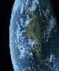
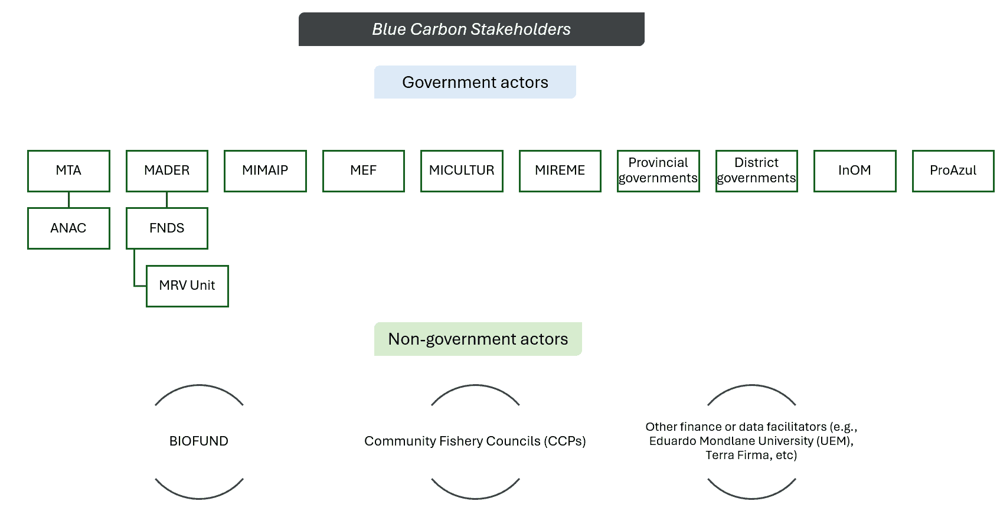
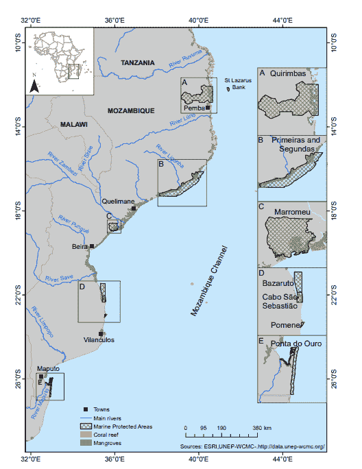

© 2024 The World Bank Group

1818 H Street NW, Washington DC 20433

Telephone: 202-473-1000 | Internet: www.worldbank.org

This work is a product of the staff of The World Bank Group, with external contributions. “The World Bank Group” refers to the legally separate organizations of the International Bank for Reconstruction and Development (IBRD), the International Development Association (IDA), the International Finance Corporation (IFC), and the Multilateral Investment Guarantee Agency (MIGA). The World Bank Group does not guarantee the accuracy, reliability, or completeness of the content included in this work, or the conclusions or judgments described herein, and accepts no responsibility or liability for any omissions or errors (including, without limitation, typographical errors and technical errors) in the content whatsoever, or for reliance thereon.

The boundaries, colors, denominations, and other information shown on any map in this work do not imply any judgment on the part of the World Bank Group concerning the legal status of any territory or the endorsement or acceptance of such boundaries. The findings, interpretations, and conclusions expressed in this volume do not necessarily reflect the views of the organizations of the World Bank Group, their respective Boards of Executive Directors, and the governments they represent.

The contents of this work are intended for general informational purposes only and are not intended to constitute legal, securities, or investment advice, an opinion regarding the appropriateness of any investment, or a solicitation of any type. Some of the organizations of the World Bank Group or their affiliates may have an investment in, provide other advice or services to, or otherwise have a financial interest in, certain of the companies and parties named herein. Nothing herein shall constitute or be construed or considered to be a limitation upon or waiver of the privileges and immunities of any of the organizations of The World Bank Group, all of which are specifically reserved.

Unless otherwise indicated, “$” refers to United States dollars.

Please cite the work as:

World Bank. 2024. Mozambique: Strengthening NDC Ambitions through Blue Carbon Frontiers

## Rights and Permissions

The material in this work is subject to copyright. Because the World Bank Group encourages the dissemination of its knowledge, this work may be reproduced, in whole or in part, for noncommercial purposes as long as full attribution to this work is given and all further permissions that may be required for such use (as noted herein) are acquired. The World Bank Group does not warrant that the content contained in this work will not infringe on the rights of third parties and accepts no responsibility or liability in this regard. All queries on rights and licenses should be addressed to World Bank Publications, The World Bank Group, 1818 H Street NW, Washington, DC 20433, USA; email: pubrights@worldbank.org.

Cover photo credit: Alex Boma, from FNDS - Fundo Nacional de Desenvolvimento Sustentável

### Mozambique: Strengthening NDC Ambitions through Blue Carbon Frontiers

### Suggested Citation

World Bank. 2024. Mozambique: Strengthening NDC Ambitions through Blue Carbon Frontiers

### Acknowledgments

This report, “Mozambique: Strengthening NDC Ambitions through Blue Carbon Frontiers” was produced by a core team of the World Bank Group (WBG) and external partners led by Juliana Castano-Isaza, Natural Resources Management Specialist, and Sylvia Michele Diez, Senior Environmental Specialist. It is part of the Global Analytics and Advisory Service “Piloting the Blue Carbon Readiness Framework and Opportunities for Blue Biodiversity Integration (P500975).”

The report was written by Moritz von Unger, Raquel Bustamante, Regina Sánchez Sasso, and Mackenzie Taggart, all of Silvestrum Climate Associates.

The team expresses gratitude for the insightful and technical contributions from the Government of Mozambique, especially the following entities: MIMAIP, ProAzul, MTA, MEF, MADER, FNDS, InOM, and BioFund. We convey special thanks to Daniel Segura (ProAzul), Isabel Omar (ProAzul), Tércio David (ProAzul), Emidio Andre (InOM), Jadwiga Massinga (MTA), Luis Nhamucho (MTA), Muri Soares (FNDS), Aristides Muhate (FNDS), and Albano Manjate (MEF). Furthermore, we extend our heartfelt appreciation to all participants for their active involvement in the “Workshop Quadro de Preparação para o Carbono Azul” held on September 6, 2023, in Maputo, Mozambique.

The following peer reviewers provided valuable advice: Peter Kristensen (Lead Environmental Specialist), Katharina Siegmann (Senior Environmental Specialist), Ivan Abdul Dula Remane (Natural Resources Management Specialist), Joao Moura Estevão (Natural Resources Management Specialist), Ana Elisa Bucher (Senior Environmental Specialist), Andrew Zakharenka (Senior Environmental Specialist), Rosta Simão Mate (Senior Forestry Specialist Consultant), and Manuel Mutimucuio (Natural Resources Management Specialist).

Guidance and strategic direction were provided by Juergen Voegele (Planet Vice President), Valerie Hickey (Global Director, Environment Natural Resources and the Blue Economy), Christian Peter (former Practice Manager, Global Platform Unit), and Africa Eshogba Olojoba (former Practice Manager, Eastern-Southern Africa Region).

Our sincere appreciation is extended to Samanmalee Kumari De Alwis and Madalena Manjate for their diligent administrative support, and to Shaheera Syed for her strategic communications expertise.

The team is thankful for the funding support provided by PROBLUE.

The findings, interpretations, and conclusions expressed in this document are those of the authors and do not necessarily reflect the view of the Executive Directors of the World Bank, the governments they represent, or the counterparts consulted during the study process. Any factual errors are the responsibility of the team.

## Table of Content

- Abbreviations ................................................................................................................................................... 6
- I. Executive Summary ............................................................................................................................ 7
- II. Context ............................................................................................................................................... 9
- 1. Introduction ..................................................................................................................................... 10
- 2. Current NDC ..................................................................................................................................... 15
- 3. Implementation Status ..................................................................................................................... 17
  - 3.1 Implementation Plan ........................................................................................................................ 18
  - 3.2 Blue Carbon Stakeholders ................................................................................................................ 18
  - 3.3 Mitigation ......................................................................................................................................... 21
    - 3.3.1 Restoration and Conservation ............................................................................................... 21
  - 3.4 Adaptation and Transversal Actions ................................................................................................. 23
    - 3.4.1 Restoration ........................................................................................................................... 24
    - 3.4.2 Conservation ......................................................................................................................... 24
  - 3.5 Finance ............................................................................................................................................. 27
- 4. Fresh Blue Carbon Commitments under the 2025 NDC .................................................................. 29
  - 4.1 Preliminary Considerations .............................................................................................................. 29
    - 4.1.1 Conditional vs. Unconditional Targets ................................................................................... 29
    - 4.1.2 Mangroves vs. seagrasses and saltmarshes .......................................................................... 30
    - 4.1.3 Mangroves vs. REDD+ ........................................................................................................... 30
    - 4.1.4 Timelines .............................................................................................................................. 30
    - 4.1.5 Restoration Target ................................................................................................................. 30
    - 4.1.6 Conservation Target .............................................................................................................. 31
  - 4.2 Adaptation and Transversal Actions ................................................................................................. 32
  - 4.3 MRV ................................................................................................................................................. 33
  - 4.4 Finance ............................................................................................................................................. 34
- 5. Preparing NDC Implementation ....................................................................................................... 35
  - 5.1 NDC Implementation Plan ................................................................................................................ 35
  - 5.2 Finance or Investment Plan .............................................................................................................. 35
- Bibliography ................................................................................................................................................... 37
- Annex 1: Information Necessary for Clarity, Transparency and Understanding (ICTU)................................... 42
- Annex 2: NDC Partnership Support ................................................................................................................ 45
- Annex 3: NDC Implementation Plan .............................................................................................................. 47
- Annex 4: Private Restoration Campaigns ....................................................................................................... 50

### Mozambique: Strengthening NDC Ambitions through Blue Carbon Frontiers

## Abbreviations

- ANAC: National Administration for Conservation Areas
- AFOLU: Agriculture, Forestry, and Other Land-Use Sector
- AGB: Above Ground Biomass
- BANP: Bazaruto Archipelago National Park
- BCEs: Blue Carbon Ecosystems
- BCRF: Blue Carbon Readiness Framework of the World Bank, also known as Unlocking Blue Carbon Development: Investment Readiness Framework for Governments
- BGB: Below Ground Biomass
- BIOFUND: Foundation for the Conservation of Biodiversity
- BUR: Biennial Update Report
- CBD: Convention on Biological Diversity
- CCP: Community Fisheries Council
- CLCR: Coastal Livelihoods and Climate Resilience Project
- CMAP: Carbon Market Activation Plan
- CTV: Centro Terra Viva
- DMC: National Directorate on Climate Change
- DUAT: "Direito de Uso e Aproveitamento de Terra" / Right to Use the Land
- EBSA: Ecologically or Biologically Significant Marine Area
- ECOR: National Strategy for the Management and Conservation of Coral Reefs
- EEZ: Exclusive Economic Zone
- EDEA: Mozambique's Blue Economy Strategy
- ER: Emission Reduction
- ESG: Environment, Social, and Governance
- FCPF: Forest Carbon Partnership Facility
- FNDS: National Fund for Sustainable Development
- FREL: Forest Reference Emission Level / Forest Emission Reference Level
- GEAPP: Global Energy Alliance for People and Planet
- GMW: Global Mangrove Watch
- GNR: Gilé National Park project
- GHG: Greenhouse Gases
- GST: Global Stocktake
- InOM: Oceanographic Institute of Mozambique
- IPCC: Intergovernmental Panel on Climate Change
- IUCN: International Union for Conservation of Nature
- LULUCF: Land Use, Land-Use Change, and Forestry
- MADER: Ministry of Agriculture and Rural Development
- MCC: Millennium Challenge Corporation
- MEF: Ministry of Economy and Finance
- MIMAIP: Ministry of Sea, Inland Waters, and Fisheries
- MICULTUR: Ministry of Culture and Tourism
- MIREME: Ministry of Mineral Resources and Energy
- MNR: Marromeu National Reserve
- MOU: Memorandum of Understanding
- MPA: Marine Protected Area
- MRV Unit: Monitoring, Report, and Verification for REDD+
- MTA: Ministry of Land and Environment
- NDC: Nationally Determined Contribution
- OECM: Other Effective area-based Conservation Measure
- PES: Payment for Ecosystem Services
- POEM: Mozambique's Marine Spatial Plan
- PNQ: Quirimbas National Park
- PPP: Public-Private Partnership
- PRN: Pomene National Reserve
- ProAzul: Blue Economy Development Fund for Mozambique
- PSEPA: Primeiras and Segundas Environmental Protection Area or APAIP ("Área de Protecção Ambiental das Ilhas Primeiras e Segundas")
- RJUEM: Regulation on the Maritime National Space
- REDD+: Reducing Emissions from Deforestation and Forest Degradation
- REPMAR: Maritime Fisheries Regulation
- SEforALL: Sustainable Energy for All
- SOC: Soil Organic Carbon
- TUPEM: "Título de Utilização Privativa do Espaço Marítimo" / Use rights over maritime spaces
- UEM: Eduardo Mondlane University
- UNFCCC: United Nations Framework Convention on Climate Change
- USAID: United States Agency for International Development
- WS13: 2013 Supplement to the 2006 IPCC Guidelines for National Greenhouse Gas Inventories: Wetlands (Wetlands Supplement)
- ZILMP: Zambézia Integrated Landscape Management Program

## I. Executive Summary

Blue carbon ecosystems (BCEs), notably mangrove forests, seagrass meadows, and salt marshes, are a vital resource for countries that are confronting climate impacts, such as Mozambique. These natural treasures mitigate climate change and enhance resilience, often surpassing terrestrial forests in carbon sequestration. They also provide valuable adaptation benefits, including protection against storms, floods, sea-level rise, and erosion.

The Global Stocktake (GST), concluded at COP28 in 2023 within the framework of the Paris Agreement, underscored the importance of national efforts to safeguard all the planet's ecosystems, including those in oceans and coastal areas. A key tool to help governments meet this challenge is Nationally Determined Contributions (NDCs). These five-year national climate action plans are tailored to the needs of harnessing a country's BCEs to enhance climate mitigation and adaptation strategies.

As a least developed country (LDC), Mozambique does not bear the same historical burden of emissions as developed nations, nor does it have equal capabilities to take decisive action. Mozambique's current NDC (2021) therefore highlights the need for international support in finance, technology transfer, training, and capacity building to achieve its climate goals. The World Bank's Country Climate and Development Report notes that "the total investment needed for the period 2020 – 2025 is estimated at US$7.586 billion," a figure equivalent to more than 50 percent of the country's projected GDP for 2026. Mozambique's next NDC, to be submitted in early 2025, will therefore need to set most, if not all, targets as strictly conditional, that is, contingent upon receiving the necessary international support. The country will need to put a fresh focus on mobilizing finance and other support.

While Mozambique was among the early generation of countries setting out multiple commitments on Blue Carbon in its current NDC (released in 2021), it is not easy to quantify the level of progress the country has made, for three major reasons. First, the NDC lacks specific, quantifiable targets for many of its stated goals. For example, the commitments to implement "protective measures for seaweed and seagrass, corals and other breeding and feeding areas for fish" do not include a measure in hectares or other units. Second, the NDC has insufficient detail on monitoring and reporting mechanisms that would ensure transparency and accountability in tracking implementation. There is no centralized data platform, for instance, accounting for mangrove restoration campaigns across the national territory. Third, governance structures and institutional capacities necessary for driving the NDC's execution are not clearly delineated, leading to potential coordination problems and inefficiencies.

The upcoming 2025 NDC update offers the opportunity to address today's shortcomings, to learn from best practices in designing NDC targets, and to strengthen the country's focus on BCE. Belize, Costa Rica, Seychelles, and Cabo Verde are examples of countries that have remarkable Blue Carbon commitments in their NDCs. A common feature is a high level of "actionability" (a commitment that can be acted upon effectively). It is essential that Mozambique close its gaps if it is to establish a clear, actionable pathway toward tangible progress in safeguarding its Blue Carbon ecosystems.

Most of the NDCs of the example countries include the following features:

- Units of measure (e.g., tCO2e for emission reductions or hectares for area-based commitments)
- Periods of implementation or deadlines (e.g., accomplish "X" goal by "Y" year)
- Specificity (e.g., define which ecosystem and how, what, and when targets will be achieved, as in "restore 'X' hectares of mangrove by 'Y' year.")

### Annex 5: Case Studies (NDCs)

- A: Belize
- B: Seychelles
- C: Cabo Verde
- D: Costa Rica

### Mozambique: Strengthening NDC Ambitions through Blue Carbon Frontiers

### Key commitments that Mozambique’s 2025 NDC should include:

- Improve reporting through use of the 2013 Supplement to the 2006 IPCC Guidelines for National Greenhouse Gas Inventories: Wetlands (“Wetlands Supplement”).
- Establish separate targets for conservation and restoration, and further targets for each of the main Blue Carbon ecosystems—particularly mangroves and seagrasses—as well as robust tracking tools.
- Adopt specific policies where needed, such as seagrass management, and close data gaps.
- Use market and non-market mechanisms to optimize finance opportunities, including carbon markets and other instruments such as debt-for-nature swaps and multilateral and bilateral funds.

Targets should consider the level of capacity building and support that Mozambique needs. Establishing a Finance Plan to help propel the NDC Implementation Plan in areas where the country currently lacks capacity will bring greater achievement of the NDC targets.

## II. Context

As climate change continues to ravage the world at an unprecedented and costly pace, countries are under increasing pressure to enhance their commitments under the Paris Agreement. A recent report¹ highlights that extreme weather events caused more than $41 billion in damage in the six months after the United Nations Climate Change Conference (COP28) in December 2023. This included four major events directly linked to climate change: floods in Brazil, the UAE, and East Africa, and heatwaves across Asia.

Blue Carbon ecosystems (BCEs), notably mangrove forests, seagrass meadows, and salt marshes, are essential resources for countries vulnerable to climate impacts, such as Mozambique. These blue assets have strong powers to mitigate climate change and enhance resilience, often surpassing terrestrial forests in carbon sequestration. They also provide significant adaptation benefits, including protection against storms, floods, sea-level rise, and erosion.

For these reasons, parties to the Paris Agreement are urged to identify specific opportunities involving BCEs when submitting their new Nationally Determined Contributions (NDCs)—national climate action plans that are meant to be ambitious, fair, and transparent. With governments worldwide struggling to limit global temperature rises to 1.5°C and to keep them “well below” 2.0°C above pre-industrial levels, the need for more ambitious NDCs is more critical than ever. Developed countries must also significantly increase their climate finance efforts.

Several IPCC guidance documents—including the 2013 Supplement to the 2006 IPCC Guidelines for National Greenhouse Gas Inventories: Wetlands (Wetlands Supplement)—help make management of Blue Carbon habitats in national GHG inventories and NDCs a manageable task. An ever-growing number of countries is following suit with commitments to use the Wetlands Supplement and BCE-specific targets.

Mozambique holds significant potential for Blue Carbon development due to its commitment to a Blue Economy, its abundant blue natural capital, manageable bottlenecks, and notable progress already in laying groundwork for scaling investments. The international community will need to provide this least developed country with the support—specifically technology, capacity-building, and finance—that it needs to deliver on the goals of its new NDC, which is due in the first half of 2025.

As recently pointed out in the World Bank’s Country Climate and Development Report, the current NDC already “highlights finance, technology transfer, training, and capacity building as priority areas for international support.” The report adds that “the total investment needed for the period 2020–2025 is estimated at US$7.586 billion (which represents more than 50 percent of the country’s GDP in 2026).”²

This report complements ongoing work by the World Bank Group under the flagship report “Coastal Blue Carbon Opportunities for Blue Economy Development,” which helps governments catalyze and scale up public- and private-sector investments in Blue Carbon. The Blue Carbon Readiness Framework offers a harmonized approach for Mozambique to harness its Blue Carbon potential by integrating technical, institutional, regulatory, and financial strategies. The framework is built on three key pillars to promote and scale Blue Carbon action: data and analytics (Pillar 1), policy and institutions (Pillar 2), and finance (Pillar 3).

The global framework was applied specifically to Mozambique in the subsequent report “Mozambique: Blue Carbon Readiness Assessment.” The present report complements that assessment and seeks to assist Mozambique in conceptualizing a Blue Carbon window in the forthcoming NDC 2025.

¹ Christian Aid 2024.

² World Bank 2023.

## 1. Introduction

In 2023, the parties to the Paris Agreement—Mozambique is one of them—officially reinforced the importance of conserving and restoring natural ecosystems, including Blue Carbon and marine ecosystems. The decision from the Conference of the Parties (COP) emphasized “the importance of conserving, protecting and restoring nature and ecosystems towards achieving the Paris Agreement temperature goal” through protecting “terrestrial and marine ecosystems acting as sinks and reservoirs of greenhouse gases and by conserving biodiversity.” This includes “halting and reversing deforestation and forest degradation by 2030,” which could lower global emissions by about 14 percent and enhance the capacity of forests to store carbon.

This was the first time that such a pledge had garnered formal recognition under the UNFCCC.³ The efforts align with the goals of the Kunming-Montreal Global Biodiversity Framework of 2022, adopted under the Convention on Biological Diversity. The goals include commitments to protect 30 percent of the planet’s land and oceans for nature by 2030 (called the “30x30” pledge) and to restore 30 percent of the planet’s degraded ecosystems.

Nature-based solutions were also recognized in the “Global Stocktake” (GST—see Concept Box 1) as a key to mitigating climate change and protecting vulnerable communities from its impacts. In the upcoming NDC update, countries are to describe how the outcomes of the GST have informed their updated NDC (UNFCCC 2024).⁴

### Concept Box 1. Global Stocktake

**Global Stocktake (GST)**

- **Concept:** The GST is a process for assessing global progress on climate action and support. At COP28 in 2023, the first-ever GST was concluded. This process is similar to taking inventory. It consists of examining where the world stands in terms of climate efforts, identifying gaps, and uncovering opportunities for improvement, including in areas such as nature-based solutions and Blue Carbon.⁵

Source: UNFCCC, 2023b.

Blue Carbon ecosystems, which include mangroves, seagrasses, and salt marshes, are some of the most biodiverse and environmentally important life forms of our planet. They provide critical benefits such as protecting against storms, floods, sea-level rise, and erosion. Beyond environmental advantages, these ecosystems enhance community resilience, support the Blue Economy, and hold significant cultural importance.

Mozambique, a least developed country (LDC) facing numerous climate change challenges,⁶ is home to one of Africa’s largest mangrove ecosystems, spanning approximately 300,000 ha as of 2020.⁷ Large expanses of seagrass beds also grow in the country, with estimates of total carbon stock (carbon stored in the living biomass and soil) ranging from 922 to 2,447 Metric Tons of Carbon/km².⁸

Addressing BCEs in its upcoming 2025 NDC will offer exceptional opportunities for Mozambique. The country will be able to design a set of actions that link mitigation, adaptation, and resilience efforts for some of the country’s most vulnerable communities, while zooming in on international cooperation, including capacity building, finance, and technical support.

³ UNFCCC, 2023. “COP 28: What Was Achieved and What Happens Next?”

⁴ Why the Global Stocktake Is Important for Climate Action This Decade.

⁵ Why the Global Stocktake Is Important for Climate Action This Decade.

⁶ World Bank 2023.

⁷ Bunting et al. 2022.

⁸ Traganos et al. 2022.

### Mozambique: Strengthening NDC Ambitions through Blue Carbon Frontiers

NDCs are a key instrument provided under the Paris Agreement to direct national and international action on climate change.⁹ For the structuring details (with relevance for Blue Carbon), see Annex 1. This report examines the extent to which Mozambique has realized its current BCE commitments and provides an early contemplation of design options for the country’s 2025 NDC. The authors note the various guidance tools and international platforms – notably the NDC Partnership – which focus on the integration of Blue Carbon elements in NDCs (see Annex 2). It is recommended that the Government of Mozambique seek assistance through these platforms to advance the discourse and consolidate its position.

### Concept Box 2. NDCs

**Nationally Determined Contributions (NDCs)**

- **Concept:** NDCs are climate action plans to cut emissions and adapt to climate impacts.¹⁰
- **Time of submission:** NDCs should be submitted every five years to the UNFCCC Secretariat. The next round is due by the first half of 2025.
- **Timeframe:** The UNFCCC’s Conference of the Parties (CMA) recommends targets to be set. It “encourages Parties to communicate in 2025 an NDC with an end date of 2035, in 2030 an NDC with an end date of 2040, and so forth every five years thereafter.” In other words, the timeframe should be 10 years.¹¹

Sources: UN, 2024 and UNFCCC, 2021.

Despite ranking among the most effective nature-based solutions (NbS) to climate change and its perils, BCEs were long neglected due to challenges related to GHG accounting and monitoring. With the advent of the 2013 IPCC Wetlands Supplement (WS13), these ecosystems became “includable” in the inventories. The Supplement offers detailed instructions for incorporating wetlands into national GHG inventories, including into forest reference levels (FREL/FRL), which are crucial for REDD+ initiatives (such as mangrove restorations). BCEs now have an avenue for accessing diverse finance opportunities, such as carbon markets and payments for ecosystem services.

Mozambique’s current NDC (see Section 2) includes Blue Carbon ecosystems in its targets, albeit not comprehensively. GHG emissions and removals from mangrove biomass are included in the wider GHG mitigation target, as well as in adaptation and transversal actions (i.e., actions that contribute both to mitigation and adaptation). They also contribute to Mozambique’s REDD+ accounting framework, with the NDC outlining a specific, albeit modest, action-based target for mangrove restoration as part of adaptation goals (restore 5,000 ha by 2025).

But the NDC lacks a strong commitment to use the WS13 when defining the NDC mitigation scope and accounting framework. Mangrove forests are only partially included (since soil carbon is excluded). Seagrass beds and salt marshes are not covered at all (REDD+ reference level also omits soil carbon). For details, see “Mozambique: Blue Carbon Readiness Assessment.”

Mozambique is not the only country that has struggled with designing clear Blue Carbon targets. Generally, global experience¹² has showed that:

- Most NDCs neglect reporting opportunities for Blue Carbon in GHG inventories, hence limiting the scope of NDC accounting.
- Most Blue Carbon commitments are included in the adaptation sections of NDCs, focusing on managing ecosystem areas to protect vulnerable communities and helping them adjust to climate change.

⁹ UN 2024. https://www.un.org/en/climatechange/paris-agreement#:~:text=substantially%20reduce%20global%20greenhouse%20gas,and%20impacts%20of%20climate%20change.

¹⁰ UN 2024. https://www.un.org/en/climatechange/paris-agreement#:~:text=substantially%20reduce%20global%20greenhouse%20gas,and%20impacts%20of%20climate%20change.

¹¹ UNFCCC, 2021. “Common time frames for nationally determined contributions referred to in Article 4, paragraph 10, of the Paris Agreement. Proposal by the President”.

¹² NDC Partnership 2023.

- Where specific Blue Carbon commitments are made, they often do not acknowledge the mitigation component and most of them lack specific emission reduction or removal targets.
- While several countries chose to define unconditional targets, the majority stressed the conditionality of their commitments, particularly dependent on factors such as external climate financing.

Moving forward, Mozambique can comprehensively include Blue Carbon ecosystems in its NDC by drawing from the experience of other Blue Carbon-rich countries which have made specific and ambitious commitments to protect coastal wetlands. A recent report from the NDC Partnership¹³ highlights that several countries refer in their NDCs to the potential of Blue Carbon ecosystems but only a few have specific and ambitious commitments towards coastal wetlands. Among these are Belize, Costa Rica, Cabo Verde, and Seychelles (see Annex 3 for case studies of some of these countries).

The good practices that these countries show in the Blue Carbon arena come particularly from the inclusion of “actionable” targets in NDCs.¹⁴ A target is actionable when it creates space for concrete action, as well as has clear benchmarks for measurement of progress. For example, a target to simply “protect mangroves” may be considered vague. That is because it does not provide a clear measure of area (how many hectares will be protected), period of implementation (when it starts, when it finishes), or other specifics (how this protection is going to be pursued: reforestation, conservation, or some other action, and who will be the responsible authority).

Vagueness in defining targets may make potential donors hesitant when the country seeks funding and international cooperation. To put it simply, vagueness undermines confidence in projects' ability to deliver tangible environmental benefits. It complicates the evaluation of whether goals of the donation (e.g., community benefits) are being achieved. For results-based payments (e.g., REDD+), vagueness may also increase the perceived financial and operational risks of funding such initiatives.

Therefore, best practices for Blue Carbon have been shown to include:

**I) Measures:** Quantifiable goals that can be tracked and reported (e.g., emission reduction targets, hectares). For example:

- Belize’s Updated NDC (2021) established a mitigation commitment to “reduce GHG emissions and increase GHG removals related to land use change totalling 2,053 KtCO2e¹¹ cumulative over the period 2021 to 2030.” It also committed to “protect at least a further 6,000 hectares of mangroves by 2025, with an additional 6,000 hectares by 2030.”

- Seychelles’ NDC (2021) sets a target to “protect its blue carbon ecosystems, i.e., at least 50% of its seagrass and mangrove ecosystems by 2025, and 100% of seagrass and mangrove ecosystems by 2030.”

- Cabo Verde’s 2021 NDC intends to “by 2025, deliminate priority areas, accounting for 6,000 hectares, which contribute to the conservation and protection of soils, wetlands,” among other goals.

- Costa Rica has a National Landscape Restoration Strategy. Its NDC (2020) further establishes a commitment to “restore the prioritized coastal wetland areas, as identified in the implementation plan of the National Landscape Restoration Strategy, with an additional percentage of area established by the strategy by 2030.”

¹³ NDC Partnership 2023.

¹⁴ von Unger et al. 2020.

**II) Periods for implementation or milestones:**

- Belize, Costa Rica, Cabo Verde, and Seychelles all commit to reducing GHG emissions from the start date of the NDC until 2030. Belize expressly indicates its mitigation period as “from 2021 to 2030.”

- Cabo Verde includes “planned measures” for mitigation such as “afforestation of 7,000 hectares” and “reforestation of 3,000 hectares with diverse, resilient, adapted species,” as well as “accounting for 6,000 hectares [of] conservation and protection of soils, wetlands.”

**III) Targets for closing of data gaps:**

- Cabo Verde commits to “inventorise seagrass beds, develop a protection strategy and create a comprehensive seagrass conservation regime by 2024” and to “identify and support high-impact research on marine resources and marine biology in collaboration with international research centres,” including on seagrasses.

- Belize commits to “develop and implement a national seagrass management policy including an updated seagrass map and identification of priority seagrass areas for further protection to enhance conservation.” The country also commits to “revise and streamline current legislation and policies that relate to the management of the coastal zone to eliminate overlaps and close existing gaps and develop a national policy for resilient coastal habitation based on vulnerabilities.”

- Costa Rica “is committed to strengthening the country's social, economic and environmental resilience to the effects of climate change through capacity building and information for decision-making, the inclusion of adaptation criteria in financing and planning instruments, the adaptation of public services, productive systems and infrastructure, and the implementation of nature-based solutions.”

**IV) Intention or commitment to use market and non-market mechanisms:**

- Seychelles commits to “identify financing mechanisms to support its NDC implementation e.g. multilateral and bilateral funds, insurance products, debt-for-nature swaps, private investment, blue carbon credits and bonds, and other innovative conservation financing mechanisms.”

- Belize intends to “explore alongside Article 6 of the Paris Agreement, new financing options to support mangrove protection and restoration, including multilateral and bilateral funds, insurance products, debt-for-nature swaps, private investment, blue carbon credits and bonds, and other innovative conservation financing mechanisms.”

- Costa Rica commits to “explore the potential of public-private investments to support mangrove protection and restoration” and to “explore innovative conservation financing mechanisms, including the potential expansion of terrestrial Payment for Ecosystem Services models, subject to improvements, to support the implementation of blue carbon targets.”

- Cabo Verde commits to “create a blue fund by 2023 for domestic and international financing of the blue economy” and to “[exploit] payments for environmental services to support the blue economy.”

**V) Targets that are specific:**

- Belize lays out precise adaptation measures that will contribute to the target and for what purpose. It commits to “strengthen resilience of local coastal communities and enhance the ecosystem services provided by mangroves through the restoration of at least 2,000 hectares of mangroves including within local communities by 2025, with an additional 2,000 hectares by 2030.”

- Cabo Verde indicates expressly what actions it considers suitable for the achievement of its mitigation target. “Cabo Verde undertakes to increase, through reforestation and afforestation, forest areas by

Mozambique: Strengthening NDC Ambitions through Blue Carbon Frontiers

2030 with resilient and preferably endemic and native species, to protect wetlands and to reduce/replace fuelwood” and “undertakes also to prevent forest fires, which threaten livelihoods and ecosystems [with the] release [of] large quantities of GHG.”

- Seychelles defines what actions rank as priority for adaptation (including NbS as first priority). Notably, it “commits to continue integrating climate change considerations into plans and strategies across all key sectors by 2030 through the following priority actions: Prioritizing nature-based solutions to protect coastal ecosystems from climate change impacts such as storm surges, flooding and erosion, using the Coastal Management Plan as a guideline for implementation of nature-based solutions.”

The door is open for Mozambique to design a new NDC for 2025 that will fit the country’s objectives, augment much-needed protection for BCEs, and boost the sustainable Blue Economy. The new NDCs represent a “huge opportunity for countries to increase mitigation and adaptation ambition through stronger blue carbon targets.”^(15) The benefits would include boosted finance and data capabilities. But it is important to assess what is feasible and precisely what level of commitment the country intends to have. To assist in this task, this report provides considerations for how to arrive at viable NDC targets. Ultimately, the level of success at meeting them will depend on the level of readiness in Mozambique to support its commitments, as well as external cooperation in the form of funding and resources.

15 NDC Partnership, Pew 2023.

## 2. Current NDC

In the current NDC (2021), covering the period up until 2025, Mozambique has pledged to protect BCEs through various adaptation and mitigation actions. Fitting in Mozambique’s definition of “forest,” mangroves were included in the overall mitigation target of reducing 40 million tCO2eq from all sectors, compared to business-as-usual over the period of 2020 to 2030.

A target of restoring 5,000 ha of mangrove forests by 2025 was set as part of adaptation and transversal actions (the combining of mitigation and adaptation). In a step particularly relevant for Blue Carbon, Mozambique committed to the “regeneration of mangroves and implementation of protective measures for seaweed and seagrass, corals and other breeding and feeding areas for fish,” as well as pledging to work toward a “transition to a resilient Blue Economy.”

The country has laid out several other actions (both adaptation and transversal) that could help preserve Blue Carbon ecosystems through wider coastal commitments. These include “applying management practices that increase the adaptive capacity of ecosystems,” establishing “cross-border conservation areas to maintain ecosystem functions and allow wildlife migrations,” reclassifying “and re-dimensioning of conservation areas, identifying areas at risk of biodiversity loss,” developing and implementing “approaches for community-based adaptation through Local Adaptation Plans,” and developing “conservation and coastal protection practices.”

To account for GHG emissions, Mozambique employed the 2006 IPCC Guidelines for National Greenhouse Gas Inventories. The 2021 NDC specifies that “the reference period for operationalization is from 2020 to 2025” and that “the mitigation results should be achieved by the year 2025.” Furthermore, it sets a clear intention “to plan and use the carbon market or new market mechanisms.”

### Table 1: Goals and Commitments for Mozambique’s 2021 NDC

*Color codes: **Green:** Targets relevant for Blue Carbon conservation and/or restoration; **Grey:** Related to Blue Carbon conservation/restoration.*

| Target | Specific goal | Commitment |
|---|---|---|
| MITIGATION | *Not applicable (include all mitigation actions – related or not to blue carbon)* | Reduce 40 million tCO2eq from 2020 to 2030. |
| Increase efficiency in the production and use of biomass fuels |  | “Application and dissemination of production techniques and improved use of firewood and charcoal sustainability.” |
| Enhance and expand conservation agro-livestock farming techniques |  | “Application and expansion of agricultural production techniques of a conservationist and soil protection nature, such as the use of direct planting.” |
| ADAPTATION AND TRANSVERSAL ACTIONS | Increasing the resilience of fisheries | Regenerate mangroves and implement protective measures for seaweed and seagrass, corals, and other breeding and feeding areas for fish. |
|  | Increasing the resilience of agriculture and livestock | Transition to a resilient Blue Economy in the western Indian Ocean region. |
|  | Ensuring the protection of biodiversity | - Apply management practices that increase the adaptive capacity of ecosystems. - Establish cross-border conservation areas to maintain ecosystem functions and allow wildlife migrations. - Reclassify and re-dimension conservation areas, identifying areas at risk of biodiversity loss. - Promote the survey of knowledge on the contribution of biodiversity to the increase in the carbon stock, with a view to mitigating and adapting to climate change. |
|  | Planning and management of biodiversity and coastal ecosystems | Rehabilitate deforested areas for pasture creation, agriculture practice, forest resources exploitation. |
|  | Reducing the rate of deforestation and uncontrolled burning | Rehabilitate degraded ecosystems and grasslands through landscape rehabilitation (REDD+, MozFIP). |
|  | Increasing the adaptive capacity of vulnerable people | Develop and implement approaches for community-based adaptation through Local Adaptation Plans. |
|  | Suitability of tourist areas and coastal zones development to reduce climate change impacts | Promote good practices among operators and tourists, through public-private partnerships, aimed at the resilience of the sector and the conservation of ecosystems. Develop conservation and coastal protection practices. |
| FINANCE MECHANISMS | Intention to use voluntary cooperation under Article 6 of the Paris Agreement, if applicable | Mozambique “wishes to be supported by market mechanisms with high environmental integrity that contribute to sustainable development and establish strong incentives to harness the strength of the private sector” and “in the medium and long term it intends to plan and use the carbon market or new market mechanisms”. |

## 3. Implementation Status

Despite limited data, some indicators show progress towards achieving the 2021 NDC targets. However, progress can only be accurately measured if detailed targets exist for concrete actions. These missing elements would include implementation periods (for each action), expected emission reductions or removals, and separate targets for conservation and restorations (see, for instance, Belize’s NDC in Annex A).

Mozambique’s current NDC, in contrast, contains a number of soft (or vague) Blue Carbon-related targets, which makes measuring progress difficult.

Setting precise targets is a complex job that depends on numerous factors. These include general capacity issues (such as MRV, GHG inventories, and policy coordination) and finance (such as funding for mapping BCEs and enforcing protected areas).

One of the key workstreams for the achievement of Mozambique’s NDC is data. At present, Mozambique has insufficient capacity for data collection, monitoring, and tracking progress towards NDC targets. This makes the overall commitments of limited practical value for guiding the country towards a clear mitigation and adaptation path for Blue Carbon.

Another key workstream is institutional and policy coordination. An obstacle to NDC implementation is the lack of coordination among institutions and policy plans in Mozambique. “The connection between national plans, sectoral plans, and the NDC is still weak and could be further improved, while keeping expectations consistent with capability,” the World Bank noted in 2022. “Mozambique would benefit from balancing its foundational institutional and administrative capacity with its ambitious program conducted in an environment of extreme climate exposure.”^(16)

This gap also exists in NDC targets and implementation. For instance, the NDC sets a target to increase the resilience of fisheries, with a corresponding commitment to “regenerate mangroves” and implement “protective measures for seaweed and seagrass, corals and other breeding and feeding areas for fish.” The NDC implementation plan (2018) further assigns responsibility for its execution to MIMAIP. However, MTA, through its conservation agency ANAC, is the authority in charge of coordinating conservation efforts for marine protected areas (MPAs) – which indicates inconsistent allocation of responsibility for meeting coastal conservation targets.

Some promising progress, however, has occurred at various levels. The progress includes initiatives by which Mozambique benefits in both mitigation and adaptation, including large public international efforts (see Table 2 below) and private campaigns (see Annex 2). But without a centralized platform to track all Blue Carbon initiatives, their exact number, as well as their effect on achieving NDC targets, remains unclear.

### Table 2. Initiatives Likely Contributing to Blue Carbon Conservation and Restoration

| Initiative | Description |
|---|---|
| Zambézia Integrated Landscape Management Program (ZILMP),^(17) funded by the World Bank under the scope of the Forest Carbon Partnership Facility (FCPF). | Results-based carbon finance program – provided under an emission reduction purchase agreement (ERPA) with the FCPF’s carbon fund in the amount of not more than $50 million. It includes conservation management activities for some 50,000 ha of mangroves.^(18) |
| Conservation Areas for Biodiversity and Development (MozBio, phases I^(19) and II^(20)). GEF-funded (grant-based). | Improvement of management of conservation areas, including MPAs. Grant budget volume of over $90 million. |

16 World Bank CCDR 2023.

17 Forest Carbon Partnership Facility 2018.

18 Emission Reduction Purchase Agreement 2019.

19 World Bank. Mozambique Conservation Areas for Biodiversity and Development Project.

20 World Bank. Mozambique Conservation Areas for Biodiversity and Development Project – Phase 2.

### Mozambique: Strengthening NDC Ambitions through Blue Carbon Frontiers

### Blue Action Fund, a multi-donor facility established from Germany’s KfW

Funds efforts by WCS (lead) and partners.^(21)

Establishment of an MPA of at least 1,000 km². Local communities will get involved, including in mangrove and seagrass rehabilitation and coral reef recovery.

### UK Blue Planet Fund^(22)

Improvement of adaptive capacities, climate resilience, and prosperity of vulnerable coastal communities.

### USAID

Same as above.

### Millennium Challenge Corporation (MCC)^(23)

Program that will spend about $100 million through ProAzul and BioFund for nature-based, youth- and gender-inclusive solutions to restore mangroves and coastal ecosystems and boost incomes from fisheries while building coastal communities’ resilience to climate change.

### MZ CoreInvest, from Global Fund for Coral Reefs^(24)

Grant-based program, recently announced, to spend $100,000, targeting mobilization of blended finance mechanisms toward coral reef and mangrove ecosystem conservation and resilience and strengthening services in reef-dependent communities. The conceptual approach is to combine funding sources, including carbon finance and finance under Ministerial Diploma 55/2022 on the implementation of Biodiversity Offsets.

### 3.1 Implementation Plan

Mozambique's NDC provides only limited guidance on implementing Blue Carbon initiatives. Concerning mangroves, they are included, or could be included, in various REDD+ initiatives highlighted in this document. Specifically, the NDC defines REDD+ as a “key means of implementation to operationalize mitigation ambition.” It refers to specific programs under implementation or planned, including World Bank projects MozBio, FIP, Sustenta, MozNorte, and the Zambézia Integrated Landscape Management Program (ZILMP).

The NDC also highlights finance, technology transfer, training, and capacity building as priority areas for international support. It further estimates the total investment needed for the 2020–2025 period at $7.586 billion (equivalent to more than 50 percent of the country’s GDP in 2026).^(25)

Mozambique also has an NDC Implementation Plan—*Plano de Operacionalização da NDC de Moçambique* (2020–2025)—published in 2018 with support from the World Bank. However, the plan has not been updated since its release. The integration of the plan with the targets of the current (2021) and future (2025) NDC would call for revision of the plan. The main actions and corresponding measures relevant to Blue Carbon conservation and restoration are summarized further below in Box 4. Full Blue Carbon-related commitments can be seen in Annex 3.^(26) All actions selected below were set for a period of implementation covering the years 2020–2025, and are applicable to the whole territory (except where indicated otherwise).

### 3.2 Blue Carbon Stakeholders

In Mozambique, the achievement of nationally determined contribution (NDC) targets greatly depends on diverse Blue Carbon stakeholders, so it is critical that they closely coordinate, including with due allocation of responsibilities in the NDC or its implementation plan. Stakeholders play a crucial role in the administration, governance, and overall success of Blue Carbon initiatives. Key stakeholders include:

- **Government.** Multiple government ministries and agencies oversee Blue Carbon habitats. The Ministry of Land, Environment, and Rural Development (MTA) grants licenses for REDD+ restoration and conservation, while the REDD+ MRV Unit under FNDS offers technical support and data monitoring. The Ministry of the Sea, Inland Waters, and Fisheries (MIMAIP) manages maritime areas, providing fishing licenses, while the Ministry of Culture and Tourism (MICULTUR) and the Ministry of Mineral Resources and Energy (MIREME) issue permits for tourism and mining activities, respectively. Provincial and District Governments also grant economic use licenses for Blue Carbon areas. The National Administration of Conservation Areas (ANAC), under MTA, administers conservation areas. The Ministry of Economy and Finance (MEF) leads carbon market discussions and coordinates international efforts for ecosystem protection in Mozambique. MIMAIP, MTA, and the Ministry of Agriculture and Rural Development (MADER) are responsible for implementing Blue Carbon NDC targets. Marine spatial planning and the Blue Economy sector require collaborative efforts from these multiple agencies, particularly MIMAIP.

- **Coastal Communities.** Coastal fishing communities hold customary tenure over Blue Carbon habitats and can apply for REDD+ licenses for conservation or restoration. These communities can obtain use rights from local authorities or provincial governors, primarily for economic activities such as fishing. Community Fishery Councils (CCPs) manage fisheries areas, including mangroves and seagrass, and can designate rules for access to marine resources. Despite regulations discouraging the selling of mangrove wood, local communities continue to cut and trade it clandestinely, contributing to habitat degradation.

- **Other Users.** Mining enterprises, particularly for heavy mineral sands, have brought substantial environmental and socio-economic challenges.^(27) The fishing industry may adversely impact fish stocks and fishing grounds. In addition, TotalEnergies leads a consortium investing in Mozambique's $23 billion liquefied natural gas (LNG) fields, a project that could bring considerable environmental harm to the Quirimbas Archipelago.

- **Technical and Investment Facilitators.** Other key stakeholders are the technical and/or investment facilitators. This includes donors—such as the World Bank, USAID, the Millennium Challenge Corporation, and the UK's Blue Planet Fund, which promote Blue Carbon activities in Mozambique—as well as national research actors—such as Eduardo Mondlane University and the Oceanographic Institute (INOM), which conduct research and mapping of coastal ecosystems.

  Key financing facilitators include ProAzul, the Government’s Blue Economy development fund, which manages and implements projects and activities, designs financial mechanisms, and approaches national and international organizations for new funding opportunities (e.g., the World Bank-financed projects MozNorte and MozRural).

  Then, there is the Foundation for the Conservation of Biodiversity (BIOFUND), which is a private non-profit Mozambican institution with public utility status. It mobilizes and manages financial resources for the benefit of biodiversity conservation in Mozambique.

  Another relevant actor is the company Terra Firma (and its national subsidiary Centro Terra Viva), which specializes in community tenure and land registration, essential for governance models like REDD+. Finally, there are other technical facilitators, such as non-governmental organizations (NGOs), the private sector, and academia, all of them seeking to engage in or facilitate conservation and restoration activities. See Figure 1.

*Figure 1. Blue Carbon Stakeholders in Mozambique.*

Source: Authors.

The NDC Implementation Plan identifies specific actions to be taken by the leading stakeholders (mainly Ministries). These responsibilities have been set as shown in Box 4.

### Box 4. Implementation Plan

**MIMAIP:**

- “Increasing the resilience of fisheries” through “regeneration of mangroves and implementation of measures to protect algae and seagrass, corals and other fish breeding and feeding areas.”

**MTA:**

- “Adapting the development of tourist areas and coastal zones to reduce the impacts of climate change” through “development of coastal conservation and protection practices;”
- “Ensuring the protection of biodiversity,” through “application of management practices that increase the adaptive capacity of ecosystems” (only in greater Maputo region) and “identification and replication of lessons and good practices in mitigation and adaptation” (whole country);
- In cooperation with ANAC and BIOFUND, “establishment of transboundary conservation areas to maintain ecosystem functions and allow wildlife migrations” (Mozambique–Tanzania), as well as “reclassification and resizing of conservation areas, identifying areas at risk of biodiversity loss” (only in conservation areas).

**MADER:**

- “Reducing the rate of deforestation and uncontrolled burning” through “establishment and increased adoption of integrated agroforestry systems (agro-sylvo-pastoral); use of multiple-use forest species: shade/nitrogen-fixing/forage (REDD+, MozBIO, FIP, Sustenta, Payment for Carbon Credits in Zambézia);”
- “Planning and management of biodiversity and coastal ecosystems” through “rehabilitation of areas cleared for grazing, agriculture and forest resources.”

21. Blue Action Fund. *Grant Fact Sheet. Building a Blue Future on the East African Coast, Mozambique.*

22. Department for Environment, Food & Rural Affairs, United Kingdom. 2023. *Policy Paper, Blue Planet Fund.*

23. MCC. *Mozambique Connectivity and Coastal Resilience Compact.*

24. UN MPTF Office Partners Gateway. *Mozambique-Coral Ref_BioFund 1.*

25. World Bank. 2023. *Mozambique: Country Climate and Development Report.*

26. Adapted and translated from Portuguese.

27. Bisht and Martinez-Aller. 2023.

Mozambique: Strengthening NDC Ambitions through Blue Carbon Frontiers

## 3.3 Mitigation

Figure 2. Mitigation Target Summary.

NDC (2021) Implementation Status (I)

Scoring

### MITIGATION

Reducing 40 million tCO₂eq from all sectors compared to business-as-usual over the period of 2020 to 2025 (target includes AFOLU and consequently mangrove forests)

- Unclear.
- Disaggregated data for mangrove forests show an increase of deforestation emissions (almost three times higher from 2004 to 2010, with emissions recorded at 325,087 tCO₂e to 999,748 tCO₂e) (BUR, 2022). FREL (2018) records annual deforestation at 779 ha between 2003 and 2013 (reference years), with an average yearly emission of 169,554 tCO₂e (total deforestation of 8,572 ha for the period).
- Mozambique’s GHG inventory estimates carbon stocks, emissions, and removals using guidance from various IPCC reports (1996, 2000, 2003, 2006, and partially the 2013 Wetlands Supplement for mangrove biomass). However, as WS13 is not fully integrated (mangrove soil carbon excluded—only biomass is accounted for), it is unclear whether mangrove forest emissions beyond biomass are considered.
- A few initiatives include Blue Carbon forests (larger public grants and private initiatives included), but a centralized system to identify their contribution to the mitigation target does not exist.

- High
- Low
- Uncertain

Overall high mitigation target for all sectors combined; unclear degree of ambition for Blue Carbon (mangroves).

Only indirectly (specific mangrove restoration or conservation targets for mitigation not included).

Yes (2020 to 2025)

### 3.3.1 Restoration and Conservation

Mozambique has set an ambitious mitigation target in its NDC to reduce emissions by 40 million tCO₂e from 2020 to 2030 for all sectors, including AFOLU and consequently mangrove forests. As pointed out by MTA in Mozambique’s Biennial Update Report, “the emission reductions proposed in the mitigation contribution of Mozambique would represent a mitigation effort of about 1.2 tCO₂e per capita by 2025, a very relevant figure when compared to the total GHG emissions per capita of Mozambique, which were respectively 0.6 tCO₂e in 1990 and about 2 tCO₂e today (total emissions with LULUCF).”28

Official data are not currently available to establish whether Mozambique has reduced GHG emissions compared to the NDC target, as the government is currently finalizing its second BUR. Unofficial data, however, indicate that the country’s GHG emissions slightly decreased between 2018 and 2021. Climate Watch estimated that historical emissions for the Land-use Change and Forestry sector fell from 78.10 MtCO₂e in 2018 to 71.97 MtCO₂e in 2020, rising back to 72.73 MtCO₂e in 2021 (the last available date). That source also indicates that Mozambique emitted 103.81 MtCO₂e, or 0.22 percent of global emissions, in 2021, and that the majority of the country’s emissions come from the Land-use Change and Forestry sector, which includes mangrove forests. The sector contributes almost 67 percent of emissions, followed by agriculture with a little over 16 percent.29

Because the country’s overall reduction target includes forests, it also includes—at least in theory—BCEs, or rather mangrove forests. Disaggregated data for the target’s achievement specifically considering mangrove deforestation are available only up to 2013. That means it is not possible to comprehensively assess whether

28 MTA, 2021 in BUR 2022.

29 Climate Watch 2024.

2021 NDC Commitment

Implementation Status (Blue Carbon)

Degree of ambition

Action-based targets?

Reasonable timeframe?

Mozambique: Strengthening NDC Ambitions through Blue Carbon Frontiers

Mangrove forest emissions have risen or fallen between 2013 and today (2024). Mozambique’s FREL (2018) records an annual deforestation of 779 ha of mangrove forests, with a total deforested area of 8,572 ha, and average yearly emissions of 169,554 tCO₂e between 2003 and 2013 (the chosen emissions reference period for FREL). Mozambique’s first BUR (2022) repeats the FREL’s data for the period 2003–2013 and also shows disaggregated data on annual emissions from mangrove deforestation for 2004 (325,087 tCO₂e), 2007 (350,931), and 2010 (999,748). The rise in the six-year period is a near tripling of the rate.^30

The target is impacted by GHG emissions from mangrove forests, but also by managed GHG removals. The NDC formulates the target of restoring 5,000 ha of mangroves by 2025, established under the scope of adaptation and transversal activities (see Section 2). At present, a few initiatives (including Blue Carbon in scope) contribute to the overall mitigation target. These include larger public international initiatives (see Table 2 above), but also private campaigns (see Annex 2), among them mangrove restoration projects registered to the FNDS’ MRV Unit registry. However, as Mozambique has no centralized platform that accounts for all Blue Carbon initiatives in the territory, it is unclear how much of the mitigation target is being achieved (see MRV Section 4.3).

Overall, the data situation remains uneven. Mozambique’s GHG inventory estimates carbon stocks, emissions, and removals using guidance from various IPCC reports (1996, 2000, 2003, 2006), but only partially from the IPCC 2013 Wetlands Supplement (to account for mangrove biomass). Because mangrove soil carbon is left out of the inventories (see *Blue Carbon Readiness Framework (BCRF): Piloting the Approach – Mozambique*), any calculation of whether mangrove forest emissions are mitigated by specific conservation or restoration actions would be impaired by a lack of comprehensive baselines, with the exception of mangrove soil emissions.

30 BUR 2022.

## 3.4 Adaptation and Transversal Actions

Figure 3. Adaptation and Transversal Targets Summary

### ADAPTATION & TRANSVERSAL

**Broader Target:** To restore 5,000 ha of mangroves by 2025

- **Unclear.** Mangrove restoration/regeneration target of 5,000 ha by 2025 probably achieved (see restoration – Section 3.4.1).
- **Degree of ambition:** High
- **Implementation status:** Low
- **Status:** Uncertain
- **Action-based target:** Yes (5,000 ha restoration of mangroves)
- **Reasonable timeframe:** Yes (2020 to 2025)

**Specific Goal:** Increasing the resilience of fisheries

- **Commitment:** Regeneration of mangroves and implementation of protective measures for seaweed and seagrass, corals, and other breeding and feeding areas for fish.
- **Unclear.** Protection of seagrass and fish areas is relatively low – the country has few known protected areas.
- Instruments capable of increasing protection of BCE areas are on the path to implementation (e.g., community-led initiatives over the coast, such as Community Fishery Councils/CCPs) – although at early stages.
- **Degree of ambition:** High
- **Implementation status:** Low
- **Status:** Uncertain
- **Action-based target:** Partially (no specific area measure defined)
- **Reasonable timeframe:** Yes (2020 to 2025)

**Specific Goal:** Ensuring the protection of biodiversity

- **Commitments:**
  - Applying management practices that increase the adaptive capacity of ecosystems.
  - Establishment of cross-border conservation areas to maintain ecosystem functions and allow wildlife migration.
  - Reclassification and re-dimensioning of conservation areas, identifying areas at risk of biodiversity loss.
  - Promotion of surveys to increase knowledge on the contribution of biodiversity to the increase in the carbon stock, with a view to mitigating and adapting to climate change.
- **Unclear.** See above. Data on conservation areas and presence of Blue Carbon biodiversity are insufficient to determine. Blue Carbon biodiversity protection areas are insufficient.

### 2021 NDC Commitment

| Implementation Status | Action-based targets? | Reasonable timeframe? | Degree of ambition |
|---|---|---|---|
| Implementation Status | Action-based targets? | Reasonable timeframe? | Degree of ambition |
| Implementation Status |  |  |  |

### Mozambique: Strengthening NDC Ambitions through Blue Carbon Frontiers

### Specific Goal: Suitability of tourist areas and coastal zones development to reduce climate change impacts

- **Commitments:**
  - Promoting good practices among operators and tourists, through public-private partnerships, aimed at resilience of the sector and conservation of ecosystems.
  - Development of conservation and coastal protection practices.

- **Unclear.** See above on conservation aspects.
- **Insufficient.** Public-private partnerships as an instrument yet to be unlocked in the country. No existing PPP established with ANAC, for instance; lack of institutional capacity and coordination (MEF and its unit).

Same as above

### Specific Goal: Reducing the rate of deforestation and uncontrolled burning

**Commitments:**

- Rehabilitation of degraded ecosystems and grasslands through landscape rehabilitation (REDD+, MozFIP).
- Establishment and increased adoption of integrated agroforestry systems (agro-silvo-pastoral); use of multiple-use forest species: shade/nitrogen fixing/forage (REDD+, MozBIO, FIP, Sustenta, Payment for Carbon Credits in Zambezia).

*Unclear.* Target does not offer specific sub-target for mangrove forests. Data on mangrove forest deforestation past 2013—that is, during the NDC implementation period of 2020 to 2025—are not available to determine whether mangrove deforestation has risen or not for the period (see Mitigation Section 3.3).

Same as above

### 3.4.1 Restoration

As part of the adaptation and transversal targets in the 2021 NDC, Mozambique set a goal to restore 5,000 ha of mangrove forests by 2025. Although data are limited, the government has reported that the target was achieved.^31 Given that the same target was originally included in the country’s National Strategy and Action Plan for the Management of Mangroves 2020–2024 (the Mangrove Strategy) with a deadline of 2022, the level of NDC ambition on this point is debatable.

### 3.4.2 Conservation

Blue carbon conservation commitments were made throughout the NDC. These include “implementation of protective measures for seaweed and seagrass, corals and other breeding and feeding areas for fish,” “establishment of cross-border conservation areas,” “reclassification and re-dimensioning of conservation areas” to protect areas of high biodiversity loss, to promote public-private partnerships for conservation of ecosystems, and to develop “conservation and coastal protection practices.”

Generally, data are insufficient to assess whether conservation goals are being achieved as a result of conservation measures (see MRV Section 4.3). While abstract protection exists (with the law designating most BCEs as partially protected areas),^32 in actual practice, concrete protection measures are few.

31. Ministério do Mar, Águas Interiores e Pescas 2022.

32. Pereira 2021.

## Implementation Status

Implementation Status

While a network of marine protected areas (MPAs) exists, conservation goals continue to fall short, primarily due to insufficient resources, including funding, personnel, and infrastructure within MPAs. Essential management tools such as comprehensive business and management plans, robust monitoring mechanisms, and research initiatives are also frequently absent, further impairing effective conservation.^(33) Some of the existing MPAs have a significant BCE focus, such as Quirimbas National Park (QNP), Primeiras and Segundas Environmental Protection Area (PSEPA), and Marromeu National Reserve (MNR). For others, such as Pomene National Reserve (PRN), data on the presence of BCEs are not available. Most MPAs include mangrove forests in their areas, while salt marshes and seagrasses are not necessarily accounted for.^(34) In addition, many ecosystems and species (including seagrass beds and mangroves, but especially salt marshes) are not adequately represented/included in the current network of MPAs.^(35) Research^(36) also indicates that most MPA location prioritize coral reefs, often neglecting the presence of seagrass. Nevertheless, some areas, such as Ponta do Ouro Partial Marine Reserve, covering areas around Inhaca Island, encompass significant seagrass habitats within their protected boundaries. Salt marshes-focused conservation, however, is largely unheard of.

The NDC commitments include the specific goal to “promote good practices among operators and tourists, through public-private partnerships, aimed at the resilience of the sector and the conservation of ecosystems.” Currently, various regulations permit public-private partnerships (PPPs) for the purpose of managing conservation areas. For example, the authority of the State to establish partnerships with the private sector, and national or foreign organizations for the administration of conservation areas is recognized in both the 2014 Conservation Law and the 2017 Regulation on Protection, Conservation, and Sustainable Use of Biodiversity. In addition, the 2018 REDD+ decree allows public entities to operate REDD+ programs.^(37) However, this potential remains largely locked concerning the conservation of coastal protected areas. There are currently no PPPs established with ANAC, for example.

PPPs, like all procurement activities, are overseen by the Functional Unit of Supervision of Acquisitions, which operates under MEF. The Unit, however, lacks the capacity and authority to coordinate such projects across government entities. Similarly, the National Directorate for Development Support of the Private Sector, under the Ministry of Industry and Commerce, supports investments but is not specifically tasked with managing PPPs. Contracts and documents related to these partnerships are not readily accessible to the public, making any replication of cases difficult – if not conservation cases, at least tracing a parallel from other sectors. The country also lacks robust and specific legislation on the governance aspects of these partnerships.^(38)

**Figure 4. Marine Protected Areas in Mozambique.**

Source: Pereira 2021.

### 3.5 Finance

**Figure 5. Finance Targets Summary**

| 2021 NDC Commitment | Implementation Status | Action-based targets? | Reasonable timeframe? | Degree of ambition |
|---|---|---|---|---|
| **FINANCE** | | | | |
| **Specific Goal:** Use of voluntary cooperation under Article 6 of the Paris Agreement | **Partial progress**. The Government joined the Africa Carbon Markets Initiative (ACMI), with the goal of developing carbon market in the country (pending implementation). | No (target sets “intention”) | Yes (2020 to 2025) | **High** |
| **Commitments:** In the medium and long terms, Mozambique intends to plan and use carbon market or new market mechanisms. It supports the use of market mechanisms including pre-2020 mitigation outcomes such as:   - Certified Emission Reductions (CERs) generated by CDM projects and programs;   - Carbon market efforts that would make actions economically viable within the specific contexts of least developed countries and developing countries; and   - The further development of accounting rules within UNFCCC to ensure the environmental integrity of market mechanisms and avoid double counting. | • Mozambique has accessed REDD+ results-based finance (FCPF/ZILMP).   • New market mechanism (i.e., biodiversity offsets) is currently in the works. | | | **Low** / **Uncertain** |

Mozambique’s intention to use carbon market mechanisms, spelled out in the current NDC, has manifested in the Government’s decision to join the Africa Carbon Markets Initiative (ACMI). However, this is still a work in progress. To date, the use of carbon markets has been limited to a few VCM practices.^(39) ACMI is an initiative led by Sustainable Energy for All (SEforALL), the Global Energy Alliance for People and Planet (GEAPP), the Rockefeller Foundation, and the UN Economic Commission for Africa, with support from the UN Climate Change High-Level Champions. Its goal is to advance the development of carbon markets in African countries. This includes ongoing work towards enabling carbon finance flows using the market mechanisms established under Article 6 of the Paris Agreement.

At present, Mozambique has financial actors (particularly ProAzul, but also BIOFUND) that provide research, guidance, and funding for Blue Economy priorities. The country has also tapped into international funding sources (government, philanthropy, results-based), particularly REDD+. This includes the funding instrument Zambézia Integrated Landscape Management Program (ZILMP),^(40) which has the World Bank as a funding agency, under the framework of the Forest Carbon Partnership Facility (FCPF). Furthermore, Mozambique has an existing pipeline to REDD+ private (and public) investment through the REDD+ decree.

Another opportunity centers on the Biodiversity offsets regulation (2022),^(75) which can provide (once operationalized) a tool for the country to tap into payment for ecosystem services (PES). This could allow the

33 Ibid.  
34 Menon et al. 2021.  
35 Pereira 2021.  
36 Gullström et al. 2021.  
37 See in particular Article 9 of the Conservation Law.  
38 Economist Intelligence Unit 2021.  
39 For instance, see the VCS (Verra registry), which includes the Blue Forest & Mozambique: Building Africa’s Largest Mangrove Restoration Project.  
40 Forest Carbon Partnership Facility 2018.

### Mozambique: Strengthening NDC Ambitions through Blue Carbon Frontiers

The Mozambican Government has established ProAzul, a development fund designed to foster the sustainable growth of Blue Economy activities. ProAzul allocates resources for management of programs, projects, and investments. It has been an intermediary, linking stakeholders and providing information on project financing needs for Blue Economy initiatives. To date, ProAzul has effectively managed and coordinated numerous projects with donor funding. These include MozRural, MozNorte, SWIOFish – all partnered with the World Bank – and the Coastal Livelihood and Climate Resilience (CLCR) projects, led by the Millennium Challenge Corporation (MCC), among others.

Some philanthropic financing has become available, and several international NGOs (such as Rare and WWF) are active in the country, often linked to bilateral programs. But in general, Mozambique has an over-reliance on grant-based funding, which is typically delivered through bilateral agreements (government-to-government) or through international funds and development banks. Private sector funding remains minimal, with few examples of direct investments in conservation or restoration from private sources. Mechanisms to allow private conservation of Blue Carbon areas are not fully accessible by all parties. Nor is the country leveraging dedicated funding tools with high international recognition, such as blue bonds and debt-for-nature swaps, as well as strategies for designing and implementing blended finance opportunities. Offset-driven biodiversity finance remains largely untested in Mozambique, and REDD+ based carbon finance opportunities untapped. So far, no projects have received a REDD+ license, and uncertainties about land access and carbon rights persist.

## Fresh Blue Carbon Commitments under the 2025 NDC

### Preliminary Considerations

The key message for Mozambique in designing its 2025 NDC is to establish clear and “actionable” Blue Carbon targets. Actionability refers to a commitment that can be acted upon effectively. To the greatest extent possible, these should include:

- **Measures:** This means quantifiable goals both on mitigation and adaptation that can be tracked and reported. For example, for mitigation, quote expected emission reductions or removals; for conservation or restoration, quantify scope through such units as hectares or percentage of total area.
- **Periods for implementation or milestones:** include deadlines or implementation periods, for each of the main actions.
- **Specific targets:** don’t be vague—make targets as specific as possible for each goal. For instance, create separate targets for conservation and restoration.

Ideally, Mozambique can present Blue Carbon targets against a tCO2e reference point or action-based targets for Blue Carbon and/or any of the Blue Carbon ecosystems, measured in hectare interventions or other units of measurement. The country needs clear and quantifiable targets for Blue Carbon, specifically mangroves and seagrass beds, the ecosystems with the most substantial data available. Separate targets could be formulated for restoration and conservation.

This approach would send strong positive signals to the international community. It would demonstrate that Mozambique has a high level of commitment and readiness for Blue Carbon engagement. It would lower perceptions of risk and potentially open the way to new sources of finance.

Mozambique will ideally establish priority areas for conservation and restoration, similar to the current Cabo Verde NDC, for instance – see Annex 3. These would be chosen based both on mitigation potential and capacity to protect and develop vulnerable coastal communities. It is also an opportunity to ensure that gender equality and local community engagement (including youth) are mainstreamed in all types of actions, including NDC commitments related to Blue Carbon ecosystems.

#### Conditional vs. Unconditional Targets

As a least developed country (LDC), Mozambique should set most, if not all, of its targets as conditional to international support. In other words, the NDC should make clear that the achievement of most Blue Carbon targets, including conservation and restoration targets, will need funds, technology, and other help from international sources. This is to recognize that Mozambique, as an LDC, neither shares the historical burden of developed countries nor has the capacity to make all NDC efforts on its own. By creating conditional targets, the country signals a need for financial aid and commits to achieving its targets only if and when that support is received (contrary to unconditional targets). Details on how these targets could look like are shown in the next sections.

#### Mangroves vs. Seagrasses and Saltmarshes

Among Mozambique’s types of Blue Carbon habitats, steep differences exist concerning quality of mapping, availability of historical activity data, and knowledge of robust conservation and restoration strategies. We know more about Mozambique’s mangroves and much less about its seagrasses and saltmarshes. There are also fundamental differences in policymaking (cf. REDD+) and governance between mangroves, on the one hand, and seagrasses and saltmarshes, on the other. That means that different sets of targets will apply to different habitat types. Generally, for seagrass and saltmarsh, the priority will be to develop more research and initial policymaking, while for mangroves, it will be to leverage data in hand and move forward with clear and ambitious targets.

#### Mangroves vs. REDD+

Mangrove protection is part of the REDD+ framework in Mozambique and has been included in this sector in the past NDC targets. This has raised the question of whether it would be good policy to remove mangrove from the REDD+ target and create a stand-alone target for Blue Carbon that would include all ecosystems. Here it is necessary to look at the bigger picture.

It does not seem advisable to create a siloed Blue Carbon (stand-alone) target outside the country’s REDD+ efforts or to automatically remove mangrove forests from the REDD+ targets. This is because at present Mozambique has tools available to facilitate development of REDD+ mangrove projects. Excluding mangrove actions from REDD+ would mean foregoing these existing tools at no apparent gain. It seems a better path to strengthen the role of mangroves within REDD+ and at the same time to develop accounting (“nesting”) tools that would allow Blue Carbon-focused initiatives and their integration with REDD+.

#### Timelines

To enhance opportunities for Blue Carbon, targets can be set at short- (2030), mid- (2035/target year for NDC), and long-term (trajectory). Countries can also consider whether implementation timeframes should cover multiple NDC implementation periods. This would help with long-term planning and MRV associated with carbon sequestration and storage in soils.

**Box 5. Example of Blue Carbon Timeframes.**

- Short term: Commitment to increase seagrass mapping by 2030
- Mid-term: Commitment to increase the number of MPAs by 2035
- Long-term: Commitment to have at least 80% of seagrass areas protected as MPAs

#### Restoration Target

Moving forward, Mozambique could set up a more ambitious target for mangrove restoration—for adaptation but also for mitigation. The potential area available for restoration of mangroves varies widely in different studies. For instance, a study conducted by the Mangrove Alliance concluded that “in total, the country has high mangrove restoration potential, with 25,899 ha available for restoration.” But Friess at al. placed the figure much higher. “In February 2022,” their report notes, “a plan was announced in Mozambique

### Mozambique: Strengthening NDC Ambitions through Blue Carbon Frontiers

to plant mangroves across 185,000 ha with the aim of sequestering 200,000 tons of CO₂ per year.”⁴⁸ The country’s total mangrove area has been estimated at 300,000 ha as of 2020.⁴⁹

Considering the uncertainty of the data available, a reasonable mangrove restoration target could perhaps be set at between 20,000 and 30,000 ha. Specifically, it would be prudent to work on the basis of a 25,000 ha estimate.

For other BCEs, no estimations are available for restoration potentials, due to a general lack of comprehensive data on salt marshes and seagrasses (see Implementation Status). Going forward, Mozambique could include a commitment to identify restoration potentials for BCEs beyond mangroves and/or priority areas for restoration. It could pledge to collect more data on such measures as extent and activity. See MRV targets below.

**Box 6. Example – Mangrove Restoration**

### 4.1.6 Conservation Target

For conservation, Mozambique could focus on establishing clear commitments for BCEs, in line with global priorities. Last year at COP28, the parties to the Paris Agreement—including Mozambique—agreed on the importance of countries making efforts to halt and reverse deforestation and forest degradation to address the climate crisis.⁵⁰ This is also stressed in the first Global Stocktake (GST), concluded in 2023. Notably, the GST establishes that “halting and reversing deforestation and degradation … are critical to reducing emissions and conserving and enhancing carbon sinks.”⁵¹

Mozambique should consider a target at, or close to, zero deforestation of mangroves by 2035. While this may be defined as a net-zero target, it should come on top of any restoration target set to avoid mutual dilution. But given that one of the core drivers of deforestation is the widespread poverty that afflicts many coastal communities, it will be important to spell out the conditionality of this target: to meet it, Mozambique will require help with capacity-building and technology, alongside financial aid aimed at reducing poverty in the coastal communities and fostering alternative livelihoods.⁵²

Effective conservation on the ground will need to be pursued at multiple levels beyond establishing commitments to restore and conserve BCE areas. These will include commitments to improve the REDD+ regime to allow, for example, mangrove conservation actions to be more easily established; to increase MPAs and the level of protection of existing ones; to facilitate community engagement in the sustainable management of Blue Carbon areas, including through enabling community fishery councils; to carry out multisectoral monitoring campaigns by government, communities, and non-governmental organizations; to ban the use or commercialization of certain species, such as particular types of mangroves; and to provide formal employment or income-generating projects where there is a lack of jobs.⁵³

**Box 7. Example – Conservation**

- Commitment to restore 25,000 ha of mangrove forests by 2035; or
- Commitment to restore 10,000 ha of mangrove forests by 2030, with an additional 15,000 ha restored by 2035.
- Commitment to identify restoration potential and priority areas for restoration of seagrass and salt marsh habitats by 2035.

These targets will be further refined and prepared under the NDC Implementation Plan to be adopted by June 2027.

### 4.2 Adaptation and Transversal Actions

Focusing on coastal wetlands in adaptation targets can be a great start for countries dealing with climate change impacts. This is especially useful if they have not yet measured the benefits of their coastal wetlands or if their capacity to reduce emissions is limited.⁵⁴ Developing countries such as Mozambique should highlight the importance of Blue Carbon in their adaptation section in the NDC. In particular, Mozambique should highlight that these ecosystems are crucial for local communities because they support livelihoods and help protect against climate change and natural disasters. By including these goals, Mozambique can also request help to build the requisite capacity. Adaptation targets could also identify priority sectors, actions, and urgent needs.

Moreover, Mozambique can focus on the cross-cutting nature of Blue Carbon through so-called transversal actions (mitigation and adaptation combined). For instance, clear Blue Carbon targets could have the following design:

- Commit to halt mangrove deforestation and degradation by 2035 (the commitment stands on its own and does not factor in restoration activities towards the restoration target).
- Commit to expand and increase the number of Marine Protected Areas (MPAs) and to assure actual protection in existing MPAs and coastal zones through law enforcement and community management tools such as CCPs by 2030, with at least 80% of mangrove forests conserved by 2035.
- By 2035, commit to establish strong community-level habitat co-management, through CCPs or other instruments for all or the majority of Blue Carbon habitats, and to incentivize gender and youth participation in the sustainable management of Blue Carbon areas in MPAs and beyond.
- Commit to enhance the capacity of Mozambique’s seagrass ecosystems to act as a carbon sink by 2035, through increased protection of seagrass beds.

These targets will be further refined and prepared under the NDC Implementation Plan to be adopted by June 2027.

**Box 8. Example Adaptation – Blue Carbon**

### 4.3 MRV

Given the gaps in data availability and management, Mozambique should further establish MRV-related targets. In particular, it can set goals to improve data and MRV, including leveraging good practices already found in the country, such as participatory MRV or “PMRV.”⁵⁵

Knowledge gaps for coastal ecosystems should be identified as a priority.⁵⁶ This includes clarifying data-sharing arrangements and institutional responsibility for the management of coastal and ocean ecosystems, such as communication between different institutions overseeing Blue Carbon.⁵⁷

Mozambique has not yet consolidated mangrove activity data beyond 2022, although data collection for 2023 is ongoing and data for deforestation and charcoal production up to 2022 exist. The inclusion of mangrove SOC in GHG inventories is pending. Monitoring of seagrass beds and salt marshes is limited, with significant gaps in activity data and carbon stock estimates. Furthermore, the country has no comprehensive tracking system for mangrove conservation and restoration initiatives, which is essential for better stakeholder engagement and sharing of good practices. For more on data gaps, see “Mozambique: Blue Carbon Readiness Assessment.” Examples of MRV-related commitments are proposed below:

- Strengthen resilience of local coastal communities and enhance the ecosystem services provided by mangroves through the restoration of at least 25,000 ha of mangroves by 2035, with a focus on vulnerable communities, gender, and youth participation.
- Establish public and private partnerships between ANAC and relevant stakeholders for the protection of total conservation areas by 2035.
- Integrate climate change considerations into plans and strategies across all key sectors by 2035 by prioritizing nature-based solutions to protect coastal ecosystems from climate change impacts such as storms, floods, and erosion.
- Delimit “X” number of hectares of Blue Carbon priority areas which contribute to the conservation and protection of soils, wetlands, and water bodies.
- Use blue nature-, ecosystem-, and landscape-based solutions in planning and implementing coastal restoration and protection works to enhance coastal resilience and deliver food, socioeconomic, and cultural benefits. This also includes projects such as artificial wetlands, salt marshes, beach nourishment, reef creation, revegetation, and dune-fixing shrubs.

These targets will be further refined and prepared under the NDC Implementation Plan to be adopted by June 2027.

### Mozambique: Strengthening NDC Ambitions through Blue Carbon Frontiers

### 4.4 Finance

The NDC also provides Mozambique with the chance to outline – with more clarity and detail than in the 2021 NDC – the financial mechanisms it is willing to use to reach its goals. These should include the consistent use of carbon finance (both under the voluntary carbon market and Article 6 of the Paris Agreement). It may also include a fresh and targeted focus on multilateral and bilateral funds, a REDD+ program with a window for mangroves, public-private investment with communities as beneficiaries, debt-for-nature-swaps, and blue bonds, among others.

The Government can set specific targets for the voluntary carbon market (VCM), Article 6 of the Paris Agreement, and results-based finance mechanism under REDD+. Doing so can provide clarity on use of these different sets of carbon markets. The main instrument to achieve the targets – at least those connected to restoration – would be the VCM. Conservation efforts could follow a jurisdictional REDD+ approach, though the pending update of the REDD+ Regulation would allow for the design of a “nested” accounting tool that would carve out mangrove conservation projects within a wider jurisdictional framework.

Article 6 engagement could include REDD+ efforts as well as restoration initiatives. But it is important to realize that corresponding adjustments will be necessary under Article 6.2. For the sake of clarity and transparency, the NDC should spell out what the accounting exercise will mean in practice:

- Either the country will take a strictly additional view, i.e., Article 6 would only come in on top of 25,000 ha restoration, for instance; or
- Any Article 6-authorized initiatives would be accounted towards and credited towards the conditional target.

Examples of commitments are in Box 10.

- Improve the collection and management of data for mangroves – including soil and below-ground biomass.
- Integrate GHG emissions and removals from all Blue Carbon ecosystem in the National Greenhouse Gas Inventory by 2035 (with higher-tier reporting available for mangroves by 2030).
- Commit to apply the 2013 Wetlands Supplement and later guidance, in particular the 2019 Refinement.
- Identify and support high-impact research on Blue Carbon resources, including extent and activity, socioeconomic impacts, in collaboration with international research centers such as WCS and national institutions such as INOM, Eduardo Mondlane University.
- Take inventory of seagrass beds, including mapping by 2030 and salt marshes by 2035.
- Identify priority areas to enhance conservation and restoration of each of the main Blue Carbon ecosystems—mangroves, seagrasses, and salt marshes.
- Establish a long-term monitoring program for seagrass and salt marshes areas.

These targets will be further refined and prepared under the NDC Implementation Plan to be adopted by June 2027.

## 5. Preparing NDC Implementation

In addition to the NDC, policymakers can create policies or strategies for help in NDC implementation. These include, for example, the NDC Implementation Plans or Investment Strategies.

### 5.1 NDC Implementation Plan

Mozambique has a 2018 NDC Implementation plan in effect, but it should be updated. The new implementation plan can define the allocation of key government and civil society responsibilities, establish timelines to meet the mitigation and adaptation targets, and provide cost estimates for targets and activities, including Key Performance Indicators (KPI). It should also indicate the plans, policies, and regulations intended to support the conservation and restoration of Blue Carbon ecosystems, the measuring of carbon stocks in mangroves and the monitoring of changes in forest cover over time (MRV), capacity building, and strategies for finance and investment.

### 5.2 Finance or Investment Plan

Countries can set up specific financial and investment plans or strategies—separately from the NDC implementation plan. An NDC investment plan or financing strategy seeks to facilitate the delivery of investments to climate action in line with countries’ NDCs and/or Long-term Strategies (LTS).

The financial plan can be a framework that integrates with the NDC implementation plan by:

- Scrutinizing existing funding flows to benefit Blue Carbon investments;
- Conducting stock-take of financing approaches, including mechanisms such as Article 6 and jurisdictional REDD+/RBCF, and sources or instruments such as concessional and non-concessional, and innovative business models;
- Setting out stable investment parameters for the private sector, including with respect to carbon finance: defining and allocating carbon rights, creating mandates for carbon trading, and presenting models for community involvement and benefit sharing.[^58]

[^58]: World Bank 2023.

- Implement the mangrove restoration and conservation targets – and any restoration and conservation efforts in other Blue Carbon habitats – primarily through carbon finance — whether voluntary carbon markets or the markets under Article 6 of the Paris Agreement.
- Consider blending the carbon finance approaches with new financing instruments to support mangrove protection, restoration, and the livelihoods of coastal communities. These instruments could include multilateral and bilateral funds, insurance products, debt-for-nature swaps, private investment, Blue Carbon credits, blue bonds, payment for ecosystem services, biodiversity credits, and other innovative financing mechanisms.
- Operationalize the biodiversity offsets/biodiversity crediting scheme, including for Blue Carbon biodiversity benefits, and access international markets.
- Create under the leadership of ProAzul a blue fund by 2035 for domestic and international financing of Blue Carbon ecosystems.

These targets will be further refined and prepared for the NDC Implementation Plan to be adopted by June 2027.

Such a plan can identify investment priorities, create a roadmap of actions to achieve national climate goals (short-, medium-, and long-term), and detail the types of capital required and potential sources for it, whether private or public, domestic or international. It can also identify where potential support (technical or institutional) is needed, providing room for specific funding options such as developing a carbon markets mechanism or a national green fund. Furthermore, it can pinpoint barriers to finance and the funding sources necessary to surmount these.

ProAzul, a key institution for the development of the Blue Economy, could take a role in this task. Discussions with stakeholders in Mozambique suggest that the Government is yet to identify financing needs, sources, and instruments. The development of a Blue Economic Satellite Account[^59] could be well received, particularly to enhance transparency of national and international financial flows related to the Blue Economy. The account could optimize budget distribution for the Blue Economy and improve coordination among donors. With the data gathered, decision makers would be well informed about where to allocate extra financial resources. Then, ProAzul’s role could expand, beyond the Blue Economy, towards designing financial mechanisms and identifying new financial resources for Blue Carbon conservation and restoration opportunities.

[^59]: Blue Economic Satellite Account is an economic tracking tool that focuses on the economic contributions of sectors and activities associated with marine and coastal resources. It includes revenue, employment, investments, and other economic indicators.

### Mozambique: Strengthening NDC Ambitions through Blue Carbon Frontiers

## Bibliography

- Arkema, K., et al. 2023. “Evidence-based target setting informs blue carbon strategies for nationally determined contributions.” *Nature, Ecology and Evolution.* 7, 1045–1059 (2023). https://doi.org/10.1038/s41559-023-02081-1

- Baghai, M., et al. 2018. “Collaborative Management Models for Conservation Areas in Mozambique.” USAID, BIOFUND. https://www.biofund.org.mz/wp-content/uploads/2018/10/Co-Management-Models-for-Conservation-Areas-In-Mozambique-2018-05-30.pdf

- Bandeira, S., et al. 2016. “Estudo de Lições Aprendidas e Boas Práticas de Reabilitação do Mangal – Avaliação do programa de restauração de mangal no Estuário do Limpopo (Gaza), Tsolombane em Matutuine (Maputo), Nhangau (Sofala), Inhassunge e Macuze (Zambézia) e Mecúfi e Metuge (Cabo Delgado).”

- Barbosa, F., C. Cuambe, and S. Bandeira. 2001. “Status and distribution of mangroves in Mozambique.” *South African Journal of Botany* 67: 393-398.

- Bisht, A., and J. Martinez-Aller. 2023. “Coastal sand mining of heavy mineral sands: Contestations, resistance, and ecological distribution conflicts at HMS extraction frontiers across the world.” 27 *Industrial Ecology* (2013) 238-253, https://onlinelibrary.wiley.com/doi/full/10.1111/jiec.13358

- BIOFUND. 2023. Sobre nós. October 2023. https://www.biofund.org.mz/sobre-nos/oque-e-a-biofund/

- Blue Action Fund. “Grant Fact Sheet. Building a blue future on the East African coast, Mozambique.” https://www.blueactionfund.org/wp-content/uploads/2022/11/Grant-Fact-Sheet\_WCS\_EbA\_Mz\_A4.pdf

- Blue Carbon Initiative, The. 2024. “Guidelines for Blue Carbon and Nationally Determined Contribution.” https://www.thebluecarboninitiative.org/policy-guidance

- Blue Ventures. 2023. “Cyclone Freddy: The climate emergency is happening right now.” https://blueventures.org/cyclone-freddy-the-climate-emergency-is-happening-right-now/#:~:text=Community%20members%20affected%20by%20the,them%20for%20food%20and%20income.

- Bunting, P.; Rosenqvist, A.; Hilarides, L.; Lucas, R.M.; Thomas, N.; Tadono, T.; Worthington, T.A.; Spalding, M.; Murray, N.J.; Rebelo, L.-M. 2022. “Global Mangrove Extent Change 1996–2020: Global Mangrove Watch Version 3.0.” Remote Sens. 2022, 14, 3657. https://doi.org/10.3390/rs14153657

- Center for International Forestry Research. 2012. “SWAMP Dataset- Mangrove soil carbon for the Zambezi River Delta.” https://www.cifor.org/knowledge/dataset/0220/

- Conference of the parties of the Paris Agreement (CMA), 2018. Decision 4/CMA.1, https://unfccc.int/sites/default/files/resource/4-CMA.1\_English.pdf

- Convention on Biological Diversity (CBD). 2023. “About EBSA.” https://www.cbd.int/ebsa/about

- Christian Aid. 2024. “Report shows extreme weather causing at least $41bn damage so far this year.” June 10, 2024. https://mediacentre.christianaid.org.uk/report-shows-extreme-weather-causing-at-least-41bn-damage-so-far-this-year/?utm\_source=Climate+Weekly&utm\_campaign=4fb1069d4b-

- Conservation International. 2020. “Guide to Including Nature in Nationally Determined Contributions: A checklist of information and accounting approaches for natural climate solutions.” https://www.conservation.org/priorities/nature-in-nationally-determined-contributions

- Department for Environment, Food & Rural Affairs, United Kingdom. 2023. “Policy Paper, Blue Planet Fund.” https://www.gov.uk/government/publications/blue-planet-fund/blue-planet-fund

- Economist Intelligence Unit, The. 2021. “Measuring the enabling environment for public-private partnerships in infrastructure: Mozambique country summary.” EIU, New York, NY. https://infrascope.eiu.com/wp-content/uploads/2022/03/EIU\_MCC\_MOZAMBIQUE\_PROOF\_07.pdf

- Eggleston, H., et al. 2006. “2006 IPCC guidelines for national greenhouse gas inventories.” IPCC.

- Emission Reduction Purchase Agreement. 2019. January 2019. https://www.forestcarbonpartnership.org/system/files/documents/FCPF%20Carbon%20Fund%20ERPA\_Tranche%20A\_Mozambique\_SIGNED.pdf

- Environmental Protection Agency (EPA). 2023. “Greenhouse gas emissions from a typical passenger vehicle.” Greenhouse Gas Emissions from a Typical Passenger Vehicle | US EPA

- FNDS. Terra Segura Project. https://www.fnds.gov.mz/index.php/pt/nossos-projectos/listagem-de-projectos/terra-segura

- Forest Carbon Partnership Facility (FCPF). 2018. “Carbon Fund Revised Emission Reductions Program Document (ER-PD).” Revised Emission Reductions Program Document (ER-PD). https://www.forestcarbonpartnership.org/system/files/documents/Mozambique\_Revised%20ERPD\_16April2018\_CLEAN.pdf

- Global Mangrove Watch. 2023. https://www.globalmangrovewatch.org

- Gullström, M., et al. 2021. “Coastal blue carbon stocks in Tanzania and Mozambique.” IUCN. https://portals.iucn.org/library/sites/library/files/documents/2021-001-En.pdf

- Hiraishi, T., et al. 2014. “2013 supplement to the 2006 IPCC guidelines for national greenhouse gas inventories: Wetlands.” IPCC, Switzerland.

- InOM. 2022. “Guião de Técnicas Básicas de Restauração de Mangal Ministério do Mar, Águas Interiores e Pescas (MIMAIP).”

- INOM, ProAzul. 2024. “Elaboraçāo e Desenvolvimento dos Planos de Negócio para as Alternativas de Renda das Comunidades Dependentes do Mangal.”

- IPCC. 2003. J. Penman et al., Eds. “Good Practice Guidance for Land Use, Land-Use Change and Forestry.” IPCC/IGES, Hayama.

- IPCC. 2013. “2013 Supplement to the 2006 IPCC guideline for national greenhouse gas inventories: Wetlands.” IGES. Hayama, Japan.

- IPCC. 2019. “2019 Refinement to the 2006 IPCC Guidelines for National Greenhouse Gas Inventories.” E. Calvo Buendia et al., Eds. IPCC, Switzerland.

- IUCN and WWF. 2016. “National Blue Carbon Policy Assessment. Mozambique.” IUCN, WWF. 26pp.

- Macamo, C., et al. 2021. “Mangrove Socioeconomic Evaluation and Conservation Framework in Mozambique.” IUCN Mozambique, Maputo.

- Macamo, C., H. Balidy, and S. Bandeira. 2015. “Mangrove transformation in the Incomáti Estuary, Maputo Bay, Mozambique.” *WIO Journal of Marine Science* 14:10-21

- Macamo CCF, Sitoe A (2017) Relatório de Governação Ambiental 2016 – Governação e Gestao de mangais em Moçambique. Centro Terra Viva. Maputo, Moçambique.

- Martin, A., et al. 2016. “Blue Carbon - Nationally Determined Contributions Inventory.” Appendix to “Coastal blue carbon ecosystems. Opportunities for Nationally Determined Contributions.” Published by GRID Arendal, Norway.

- MCC. Mozambique Connectivity and Coastal Resilience Compact. https://www.mcc.gov/where-we-work/program/mozambique-connectivity-and-coastal-resilience-compact

- Menon, A., et al. 2021. “Mozambique marine and coastal resources and markets assessment: A reference guide.” USAID. Washington, DC.

- MIMAIP. 2023. “Version for Consultation of EDEA.” https://www.mimaip.gov.mz/wp-content/uploads/2023/05/EDEA\_Mz\_versao\_p\_consulta\_230525.pdf

- Ministério do Mar, Águas Interiores e Pescas. 2022. “Moçambique já cumpriu 96% de restauração do mangal.” https://www.mimaip.gov.mz/mocambique-ja-cumpriu-96-de-restauracao-do-mangal-2/

- Ministry of Land and Environment. 2022. “First Biennial Update Report (BUR).” Republic of Mozambique. https://unfccc.int/sites/default/files/resource/Mozambique%20First%20BUR%20Eng%201.12.2022%20%281%29.pdf

- Ministério da Terra, Ambiente e Desenvolvimento Rural. 2016. “Estratégia Nacional para a Redução de Emissões de Desmatamento e Degradação Florestal, Conservação de Florestas e Aumento de Reservas de Carbono Através de Florestas (REDD+) 2016-2030.” https://www.forestcarbonpartnership.org/system/files/documents/ESTRAT%C3%89GIA%20NACIONAL%20DO%20REDD%2B.pdf

- Ministério Para A Coordenação Da Acção Ambiental. 2013. “Estratégia Nacional de Adaptação e Mitigação de Mudanças Climáticas.” https://faolex.fao.org/docs/pdf/moz185538.pdf

- MRV. 2022. “Monitoring Deforestation in Mozambique--monitoring annual emissions from deforestation.” Online Database.

- MTA. 2019. “6th National Report on the Implementation of Convention on Biological Diversity in Mozambique 2019.” https://www.cbd.int/doc/nr/nr-06/mz-nr-06-en.pdf

- NDC Partnership and Pew. 2023. “Blue Carbon Coastal Wetlands Ecosystems: Trends in NDC Partnership Support.” https://ndcpartnership.org/sites/default/files/2023-11/blue-carboninsight-brief20230.pdf

- Nicolau, D., et al. 2017. “Mangrove change detection, structure and condition in a protected area of eastern Africa: The case of Quirimbas National Park, Mozambique.” *Western Indian Ocean Journal of Marine Science* 16: 47-60.

- Nube, Teresa. 2024. “Elaboraçāo e desenvolvimento dos planos de negócio para as alternativas de renda das comunidades dependentes do mangal”. INOM and ProAzul. June, 2024.

- Pereira, M. 2021. “Marine & Coastal Areas under Protection: Mozambique.” UNEP-Nairobi Convention and WIOMSA. 2021. p. 119–132. Western Indian Ocean Marine Protected Areas Outlook: Towards achievement of the Global Biodiversity Framework Targets. UNEP and WIOMSA, Nairobi, Kenya, 298 pp.

- Poursanidis, D., et al. 2021. “Cloud-native seascape mapping of Mozambique’s Quirimbas National Park with Sentinel-2.” *Remote Sensing in Ecology and Conservation.* 7 (2):275–291. doi: 10.1002/rse2.187

- ProAzul. 2023A. “Quem Somos”. http://www.proazul.gov.mz/quem-somos/.

- ProAzul. 2023B “1a edicion. Portfólio de Oportunidades de Investimentos Azuis.” https://www.proazul.gov.mz/wp-content/uploads/2023/02/A.3.1-230215-Carteira-de-Projectos-PT.pdf

- ProAzul. 2023C. “Construindo um Futuro Azul para Ecossistemas e Pessoas na Costa Leste Africana." https://www.proazul.gov.mz/wp-content/uploads/2023/04/20220620\_Contruindo\_um\_Futuro\_azul\_para-Ecossistemas\_e\_pessoas\_Sumario\_PT.pdf

### Mozambique: Strengthening NDC Ambitions through Blue Carbon Frontiers

Sanderman, J., et al. 2018. “A global map of mangrove forest soil carbon at 30 m spatial resolution.” *Environmental Research Letters* 13(5): 055002.

Sedano, F., et al. 2016. “The impact of charcoal production on forest degradation: A case study in Tete, Mozambique.” *Environmental Research Letters* 11: 094020. DOI: 10.1088/1748-9326/11/9/094020.

Shapiro, A., et al. 2015. “The Mangroves of the Zambezi Delta: Increase in extent observed via satellite from 1994 to 2013.” *Remote Sensing* 7: 16504–16518.

Simard, M., et al. 2019. “Mangrove canopy height globally related to precipitation, temperature, and cyclone frequency.” *Nature Geoscience* 12(1): 40–45.

Soares, M. 2023. “Mozambique’s MRV Roadmap.” Presentation. https://www.fao.org/3/cc6811en/cc6811en.pdf

Stringer, C., et al. 2015. “Carbon stocks of mangroves within the Zambezi River Delta, Mozambique.” *Forest and Ecology and Management* 345: 139–148. https://doi.org/10.1016/j.foreco.2015.06.027

Resolução n.º 51/2022. 2022. “Aprova a Estratégia de Gestão e Conservação de Recifes de Coral 2022–2032.” https://faolex.fao.org/docs/pdf/moz214814.pdf

PROBLUE and Biodiversity, Factsheet. https://thedocs.worldbank.org/en/doc/dcb50c3383110e23850603bdf92fe065-0320072023/original/PROBLUE-GBF-CLEARED-and-FINAL-May-31.pdf

Traganos, D., et al. 2022. “Earth Observation for ecosystem accounting: Spatially explicit national seagrass extent and carbon stock in Kenya, Tanzania, Mozambique and Madagascar.” *Remote Sensing in Ecology and Conservation* 8(6): 778–792. DOI: 10.1002/rse2.287. https://zslpublications.onlinelibrary.wiley.com/doi/epdf/10.1002/rse2.287

Traganos, D., et al. 2022. “Earth Observation for ecosystem accounting: Spatially explicit national seagrass extent and carbon stock in Kenya, Tanzania, Mozambique, and Madagascar.” Online Map. https://aviputri.users.earthengine.app/view/mappingeastafrica

Uacane, M., and Z. Ombe. 2016. “Modificação das áreas húmidas adjacentes ao Chiveve face às formas de ocupação do espaço na cidade da Beira.” *Geoamazonia*. DOI: 10.17551/2358-1778/geoamazonia.v4n7p199-212

UNEP-Nairobi Convention/USAID/WIOMSA. 2020. “Guidelines on Mangrove Ecosystem Restoration for the Western Indian Ocean Region.” UNEP, Nairobi, 71 pp. www.nairobiconvention.org; www.wiomn.org/; www.wiomsa.org/

UNEP-Nairobi Convention/WIOMSA. 2020. “Guidelines for Seagrass Ecosystem Restoration in the Western Indian Ocean Region.” UNEP, Nairobi, 63 pp. www.nairobiconvention.org/; www.wiomsa.org

United Nations. 2015. *Paris Agreement*. https://unfccc.int/sites/default/files/english_paris_agreement.pdf

UN. 2024. *The Paris Agreement*. https://www.un.org/en/climatechange/paris-agreement#:~:text=substantially%20reduce%20global%20greenhouse%20gas,and%20impacts%20of%20climate%20change

United Nations Framework Convention on Climate Change (UNFCCC). 2021. “Common time frames for nationally determined contributions referred to in Article 4, paragraph 10, of the Paris Agreement. Proposal by the President.” https://unfccc.int/documents/309990

UNFCCC. 2023a. “Conference of the Parties serving as the meeting of the Parties to the Paris Agreement, Fifth session.” https://unfccc.int/sites/default/files/resource/cma2023_L17E.pdf

UNFCCC. 2023b. “COP 28: What Was Achieved and What Happens Next?” Available at: https://unfccc.int/cop28/5-key-takeaways#protecting-nature

UN MPTF Office Partners Gateway. 2013. “Mozambique-Coral Reef Invest_BioFund 1.” https://mptf.undp.org/project/00134274

Vierros, M. 2017. “Communities and Blue Carbon: The Role of Traditional Management Systems in Providing Benefits for Carbon Storage, Biodiversity Conservation and Livelihoods.” *Climatic Change* 140, no. 1 (January 2017): 89–100. DOI: 10.1007/s10584-013-0920-3.

von Unger, M., et al. 2020. “Blue NbS in NDCs. A booklet for successful implementation.” GIZ 2020.

WCS Mozambique. 2022. “Building a Blue Future for Ecosystems and People on the North Coast of Mozambique.” July 4, 2022. https://mozambique.wcs.org/About-Us/News/ID/17762.aspx

World Bank. 2023. “Unlocking Blue Carbon Development: Investment Readiness Framework for Governments.” © Washington, DC: World Bank. http://hdl.handle.net/10986/40334. License: CC BY-NC 3.0 IGO. https://openknowledge.worldbank.org/entities/publication/304fe159-e9ea-40ef-b568-fa6e8e992bb4

World Bank. “Mozambique Conservation Areas for Biodiversity and Development Project.” Washington, DC: World Bank. https://projects.worldbank.org/en/projects-operations/project-detail/P131965?lang=en

World Bank. “Mozambique Conservation Areas for Biodiversity and Development Project—Phase 2.” Washington, DC: World Bank. https://projects.worldbank.org/en/projects-operations/project-detail/P166802?lang=en

World Bank. 2021. “Financing Mechanisms for Sustainable Blue Economy Development in Mozambique.” Washington, DC: World Bank. https://documents1.worldbank.org/curated/en/885071624984316653/pdf/Financing-Mechanisms-for-Sustainable-Blue-Economy-Development-in-Mozambique.pdf

World Bank. 2023. “Mozambique: Country Climate and Development Report.” Washington, DC: World Bank. https://documents1.worldbank.org/curated/en/099113023154021937/pdf/P1771520fcab7a0930aca102c9d7107d4cc.pdf

## Annex 1: Information Necessary for Clarity, Transparency, and Understanding (ICTU)

Under guidance of the Conference of the Parties of the Paris Agreement (CMA) (Decision 4/CMA.1), countries should provide “information necessary for clarity, transparency, and understanding” of the NDC. This includes:

### Concept Box 3. ICTU

**Information Necessary for Clarity, Transparency and Understanding (ICTU)**

- Quantifiable information on the reference point including, as appropriate, a base year
- Time frames and/or periods for implementation
- Scope and coverage (general description of the targets)
- Planning processes (information on the planning processes undertaken by the country when preparing its NDC or, if available, on the country’s implementation plans)
- Assumptions and methodological approaches, including those for estimating and accounting for anthropogenic GHG and, as appropriate, removals
- How the country considers that its NDC is fair and ambitious in the light of the national circumstances
- How the NDC contributes towards achieving the objective of the UNFCCC

Source: Adapted from Decision 4/CMA.1. See also Article 4.9 of the Paris Agreement.

Mozambique might provide this information using the following guidelines:^(60)

### Table 3. ICTU suggestions for Mozambique

| ICTU | Suggestion for Mozambique |
|---|---|
| **Quantifiable information on the reference point including, as appropriate, a base year (it can be based on the national GHG inventory)** | This item highly depends on MRV data and capacity available. It refers to quantifiable information needed to understand the mitigation targets (i.e., information on how the NDC target was developed and can be measured against). Relevant information includes any:  - numerical targets - base year (past year to measure against) - target year (when it will be achieved) - GHG emissions baselines and projections (e.g., as needed for targets related to “business as usual” emissions scenarios) - Other information relevant to Blue Carbon.^(61) |
| **Time frames and/or periods for implementation** | The recommended timeframe for the NDC would be 10 years (2025–2035).^(62) For Blue Carbon, Mozambique should determine whether more time is needed for planning and MRV (in particular considering soil carbon sequestration and storage). If yes, the NDC could indicate that Blue Carbon targets would extend across multiple implementation plans (see timelines in Section 4.1.4). |
| **Scope and coverage (general description of the targets)** | Include Blue Carbon ecosystems in various workstreams, including: |

60 Content also based on Blue Carbon Initiative (2023).

61 Ibid.

62 Common time frames for nationally determined contributions referred to in Article 4, paragraph 10, of the Paris Agreement. Proposal by the President.

Mozambique: Strengthening NDC Ambitions through Blue Carbon Frontiers

- Mitigation target: Ideally include at least mangrove restoration, as there are ongoing opportunities under the 2018 REDD+ decree.

- Conservation: Increase the number of Marine Protected Areas (MPAs) and Other Effective area-based Conservation Measures (OECMs),63 including to specifically increase protection of Blue Carbon habitats.

- Adaptation targets: Highlighting coastal wetlands within adaptation targets may be a suitable entry point for countries that are focusing on climate change impacts but have yet to quantify the mitigation value of their coastal wetlands, or where their mitigation potential is constrained. Developing countries can also signal a need for capacity building and finance aid through their adaptation goals, as well as highlight priority sectors.64 Mozambique’s NDC should highlight that Blue Carbon is crucial for vulnerable communities (including gender and youth), since these ecosystems support local livelihoods and provide resilience against climate change and increasing climate hazards.

- Blue Economy: Mainstream and integrate sustainable development practices into fisheries, aquaculture, and other related economic sectors.

- Carbon markets: Reinforce the country’s intention to use carbon market mechanisms—particularly those under Article 6 of the Paris Agreement and the voluntary market—and include Blue Carbon restoration and conservation specifically as activities that can generate carbon credits moving forward.

- Other finance mechanisms: Make sure that Mozambique is open to using other finance mechanisms, as available (such as debt-for-nature swaps, blue bonds, payment for ecosystem services, and biodiversity offsets).

### Planning processes

Mozambique should include qualitative information on how the NDC was developed and will be implemented, including through participatory consultation processes, coordination with regional groups, national issues, and ongoing projects.

Mozambique can further explain how adaptation actions in coastal wetlands will result in mitigation co-benefits by detailing specific projects, measures, and activities to be implemented.

In its 2025 NDC update, the country should describe how the outcomes of the Global Stocktake (GST) have informed its next or updated NDC (including areas highlighted by the stocktake for nature-based solutions and/or Blue Carbon).65

### Assumptions and methodological approaches, including those for estimating and accounting for anthropogenic GHG and, as appropriate, removals

For Blue Carbon, Mozambique could specify the use of IPCC guidance to develop its GHG reporting and calculations, including the 2013 Wetlands Supplement (focused on wetlands and Blue Carbon ecosystems) and other reports, as applicable (including 1996, 2000, 2003, and 2006).

The reason to apply WS13 is that citing Tier 1 default values for mangrove aboveground biomass (AGB) and soil organic carbon (SOC), along with the updated root-to-shoot ratio for calculating belowground biomass (BGB), will enable Mozambique to achieve more comprehensive estimates of emissions and removals in the updated inventory.

As annual monitoring efforts of mangroves improve, Mozambique will be able to work towards developing country-specific emissions factors and default values for calculating carbon stocks and emissions and removals for mangroves. Leveraging guidance from the 2013 Wetlands Supplement, Mozambique can then follow Tier 2 and Tier 3 approaches, both of which rely on country-specific data, to improve the estimations. Further exploration of WS13 applications to include BCE restoration activities, such as accounting for emissions and removals during the restoration of degraded mangroves, presents another opportunity to strengthen the updated inventory.66

### How the country considers that its NDC is fair and ambitious in the light of the national circumstances

Mozambique can explain the level of ambition in its NDC as based on considerations of equity and justice, which may include notions of social and environmental justice, as well as intergenerational equity and transnational justice.

Another workstream would be to detail how dedicating attention and resources to the health of coastal wetlands enhances the fairness and ambition of Mozambique’s NDC.

Blue Carbon is crucial for vulnerable communities, as these ecosystems support local livelihoods and provide resilience against climate change and rising hazards. This logic can be made evident in NDCs.

### How the NDC contributes towards achieving the objective of the UNFCCC

Mozambique can highlight the fact that the global climate cannot be stabilized at well below 2°C without significant emissions reductions and removals through nature-based solutions, including the conservation and restoration of coastal wetlands. A reference can be made to Article 4 of the UNFCCC, in particular to the language on oceans and coasts.

### Annex 2: NDC Partnership Support

Many countries—including Mozambique—require funding to support the design and implementation of their NDCs. One option to access such support is through the NDC Partnership. A notable initiative launched in 2016, the Partnership consists of more than 120 countries and 80 institutions. The goal is to facilitate collaboration between country governments, international institutions, non-state actors, and other partners to accelerate climate action. As of 2023, 25 countries submitted 183 “Blue Carbon, Oceans and Coasts” requests for support through the NDC Partnership. Seventy-three percent of these came from Belize, São Tomé and Príncipe, and Tunisia, and 53 percent from Small Island Developing States (SIDS) and members of the Alliance of Small Island States (AOSIS).67 See Table 4 for examples of requests.

Countries can access funding for NbS, coastal, and ocean-related projects through the Partnership’s Climate Fund Explorer—a resource that Mozambique could tap to assist with its 2025 NDC. The NDC Partnership highlights that the most common “Blue Carbon, Oceans, and Coasts”-related sectors have the largest support gaps. Unsupported requests account for 81 percent of requests for enacting and revising policies and laws, and 71 percent of requests for finance or preparing bankable projects and pipelines. Furthermore, it states that many countries are still struggling to attract support to develop mechanisms to measure emissions from Blue Carbon ecosystems.68 As Blue Carbon gains increasing standing in the international agenda, however, there is hope that these gaps will be addressed.

A first step is to identify key country needs, which for Mozambique would include support to upgrade data and MRV. Among the specific tasks: updating GHG inventories and/or FREL to comprehensively include Blue Carbon emissions (below-ground, soil, and biomass); developing activity data for mangroves (past 2022), seagrass, and salt marshes; mapping ecosystems; and creating a tracking system for mangrove projects across the jurisdiction. Improvement of governance could also be explored through efforts to strengthen coordination among government stakeholders; develop an NDC implementation plan; and improve existing regulatory and policy frameworks. By using the NDC Partnership website’s search engine (cf. Climate Funds Explorer), Mozambique could seek funding for priorities identified both for the design of the NDC and its implementation.

**Table 4. Requests to NDC Partnership (2023)**

| Request area | Country | Request details | Supporter |
|---|---|---|---|
| Oceans and Coasts | Tunisia | Support to design and implement an evaluation to inform the Coastal Protection and Development Agency’s APAL coastal adaptation action plan. | UNDP, Global Environment Facility (GEF) |
| Oceans and Coasts | São Tomé and Príncipe | Support to improve fisheries management in vulnerable communities by building small marinas and structures for boat moorings. | World Bank |
| Blue Carbon | Belize | Support to enhance the capacity of the country’s mangrove and seagrass ecosystems to act as a carbon sink and to strengthen adaptation and resilience benefits by expanding mangrove protection and restoration efforts. | Partial support from Pew and WWF |
| Blue Carbon | Papua New Guinea | Support to build capacity to evaluate the country’s Blue Carbon sequestration potential by assessing and accounting for carbon stocks and emission factors in mangroves, salt marshes, and seagrass meadows. | Partial support from FAO and GIZ (Germany) |

Source: NDC Partnership, 2023.

63 OECMs are defined in the 1992 Convention on Biological Diversity (CBD) as “a geographically defined area other than a Protected Area, which is governed and managed in ways that achieve positive and sustained long-term outcomes for the in situ conservation of biodiversity, with associated ecosystem functions and services and where applicable, cultural, spiritual, socio-economic, and other locally relevant values…” cf. CBD Decision 14/8.

64 Blue Carbon Initiative (2023).

65 The GST is a process for assessing global progress on climate action and support. At COP28 in 2023, the first-ever GST was concluded. This process is similar to taking inventory, as it involves examining where the world stands in terms of climate efforts, identifying gaps, and uncovering opportunities for improvement, including in areas such as nature-based solutions and Blue Carbon (UNFCCC, 2024).

66 See also “Mozambique: Blue Carbon Readiness Assessment,” a work prepared by the World Bank Group under the flagship report “Coastal Blue Carbon Opportunities for Blue Economy Development,” which helps governments catalyze and scale up public and private sector investments in Blue Carbon. The Blue Carbon Readiness Framework offers a harmonized approach for Mozambique to harness its Blue Carbon potential by integrating technical, institutional, regulatory, and financial strategies. The framework is built on three key pillars to promote and scale Blue Carbon action: data and analytics (Pillar 1), policy and institutions (Pillar 2), and finance (Pillar 3). The global framework was applied specifically to Mozambique in the subsequent report “Mozambique: Blue Carbon Readiness Assessment.”

67 Blue Carbon Coastal Wetlands Ecosystems: Trends in NDC Partnership Support.

68 Ibid.

Mozambique: Strengthening NDC Ambitions through Blue Carbon Frontiers

## Annex 3: NDC Implementation Plan

Actions and measures relevant for Blue Carbon conservation and restoration (Implementation Plan 2020–2025), released in 2018.^()^(*69*)

| Action | Measure | Leading Partners | Implementation Period | Location | Cost (million US$) |
|---|---|---|---|---|---:|
| Reducing the rate of deforestation and uncontrolled burning | Establishment and increased adoption of integrated agroforestry systems (agro-sylvo-pastoral); multiple-use forest species (shade/nitrogen-fixing/forage); REDD+, MozBIO, FIP, Sustenta, payment for carbon credits in Zambézia | MADER | 2020–2025 | The whole country | 12.5 |
| Planning and management of biodiversity and coastal ecosystems | Rehabilitation of areas cleared for grazing, agriculture, and forest resources | MADER | 2020–2025 | The whole country | 8.3 |
| Ensuring the protection of biodiversity | Application of management practices that increase the adaptive capacity of ecosystems—linked to the National Biodiversity Strategy, Target 10: By 2035, place at least 20% of ecosystems critically affected by climate change under adaptive ecosystem management | MTA | 2020–2025 | Greater Maputo Region | 6.0 |
| Ensuring the protection of biodiversity | Identification and replication of lessons and good practices in mitigation and adaptation (Target 10.3 of the National Biodiversity Strategy) | MTA | 2020–2025 | The whole country | 0.2 |
| Ensuring the protection of biodiversity | Establishment of transboundary conservation areas to maintain ecosystem functions and allow wildlife migrations, in line with Target 11.A.6 of the National Biodiversity Strategy: Establish TFCAs between Zimbabwe, Mozambique, and Zambia (ZIMOZA), and between Mozambique and Tanzania | MTA/ANAC, BIOFUND | 2020–2025 | Mozambique–Tanzania | 0.8 |
| Ensuring the protection of biodiversity | Reclassification and resizing of conservation areas, identifying areas at risk of biodiversity loss, in line with Target 12.1 of the National Biodiversity Strategy: Map and characterize degradation in critical ecosystems taking into account CM and desertification | MTA/ANAC, BIOFUND | 2020–2025 | Conservation Areas | 0.7 |
| Adapting the development of tourist areas and coastal zones to reduce the impacts of climate change | Promotion of good practices among operators and tourists, through public-private partnerships aimed at the resilience of the sector and the conservation of ecosystems | MTA | 2015–2020 | The whole country | ND |
| Adapting the development of tourist areas and coastal zones to reduce the impacts of climate change | Development of coastal conservation and protection practices | MTA | ND | ND | ND |
| Increasing the resilience of agriculture and livestock farming | Transition to a resilient Blue Economy in the western Indian Ocean region | MIMAIP | 2022–2025 | Western Indian Ocean Region | Not available |
| Increasing the resilience of fisheries | Regeneration of mangroves and implementation of measures to protect algae and seagrass, corals, and other fish breeding and feeding areas | MIMAIP | 2020–2025 | The whole country | 1000.0 |

69 Adapted and translated from Portuguese by the Authors, and therefore subject to unintended errors.

## Annex 4: Private Restoration Campaigns

| Project developer/partner | Project name | Year | Description | Location | Size | Status |
|---|---|---|---|---|---|---|
| Blue Forests. Project partners include MIMAIP, InOM, MTA, FNDS, Eduardo Mondlane University, Eden, WWF, GRID-Arendal, and GEF. | Moz Blue | To date | Largest mangrove reforestation project in Africa. Expected to offset approximately 15 million tons of CO₂ emissions during its 20-year lifetime. | Sofala and Zambézia provinces | 183,000 ha. Target to plant over 200 million mangroves. | Project under REDD+ licensing in Mozambique. Registration with Verra (VCS, CCB) is envisaged. Initial planting is underway. |
| TotalEnergies EP Mozambique and Eden Reforestation Association (UniLurio University as project partner) | N/A | 2022 | Coral reefs and mangrove restoration. Includes sustainable fisheries development. | Cabo Delgado province (pilot in the district of Palma), including Pemba, Maringanha, Wimbe, and Gimpia | Expected: 5,000 ha | Planted more than 12 ha of mangroves. |
| MozParks Holding and Eden Reforestation Association. Project partners included Maputo government. | N/A | 2020–2022 | Rejuvenation of mangroves, replanting of indigenous terrestrial trees, especially those bearing fruit high in vitamin C, and the preservation of existing indigenous trees. | Green Belt around Beluluane Industrial Park in Boane/Maputo | 260 ha | N/A |
| Ecologi and Eden Reforestation Association | Mussuquelane | 2021–2025 | Mostly natural terrestrial forest reforestation (includes mangroves). | Maputo province | Expected: 3,000 ha (not all mangroves). | Target to plant about 3.3 million trees on site. Project among those selling the best Blue Carbon offsets. Prices to be determined. |
| The Carbon Offset Company and Eden Reforestation Association | Casa Partida (Savane) | 2023 | Mangrove reforestation with community management. | Casa Partida, southern coastline, Sofala Province | 854 ha | Expected to plant over 8.5 million mangrove trees. Project among those selling the best Blue Carbon offsets. Prices to be determined after initial contact. |
| Ecologi and Eden Reforestation Association | Irregele Milato | 2021–To date | Mangrove restoration with community involvement. | Quelimane district, Zambézia province | 756 ha | Project perhaps the first to sell “mangrove credits,” though these do not follow a recognized standard. Cyclone Freddy hit the project site in 2023, but the project has shown resilience. |
| Blue and Green Carbon | Unknown | N/A | Application submitted for REDD+ license covering seven districts. | Angoche, Ilha de Moçambique, Memba, Moma, Mossuril, Nacala, Nacala-a-Velha | N/A | N/A |
| White Green Blue and Eden Reforestation Association | N/A | N/A | Together with Eden Reforestation, local communities, and other partners, the company restores degraded mangrove forests and reforests previously destroyed mangrove lands. | N/A | N/A | N/A |
| IUCN, Blue Forest Company | N/A | 2020–2022 | Several mangrove plantation activities, developed with communities and other NGOs. Goal to obtain finance through carbon credits. The majority of the net income generated over the multi-year project would be channeled to local communities living alongside the mangrove forests. | Maputo Province (Matola River), Mecufi district (Cabo Delgado), Inhassoro, Dondo district | 200 seedlings planted in Maputo. 420 seedlings planted in Dondo. Data not available for other districts. | In 2022, IUCN signed an MOU with Blue Forest Company. |
| Peace Parks Foundation and Maputo National Park (PNM) authority. Project partners include ADRA-Mozambique. | Part of initiative “Adaptation to Climate Change Based on Ecosystems, Conserving and Building Resilience.” | 2022–2027 | Mangrove and seagrass restoration. Project goals also include promoting sustainable community development (agriculture) and capacitation of CCPs. | Matutuíne and Ilha da Inhaca | Goal: rehabilitate 200 ha of mangroves, and 3 ha of seagrass meadows. | N/A |
| Rare | N/A | To date | Restoration and conservation of BCEs (planning stage). This is a rare NGO that is working with several communities (CCPs) to protect coastal ecosystems. | N/A | N/A | N/A |
| WCS. Project partners include MIMAIP, MTA, InOM, ProAzul, BIOFUND, ANAC, IUCN, Rare, Oikos, and Blue Ventures. | Futuro Azul. Building a blue future for ecosystems and people on the east coast of Africa. | 2022 | Restoration, conservation, and sustainable management of ecosystems (including mangroves, seagrasses, and coral reefs). | North of Nampula and south of Mossuril/Ilha de Moçambique. Memba | N/A | WCS has an MOU with MIMAIP and MTA. Collaboration with InOM in developing a project to expand conservation areas, including creation of an intersectoral group to integrate the project results into the marine spatial plan POEM. The group includes members of ANAC. |

### Mozambique: Strengthening NDC Ambitions through Blue Carbon Frontiers

### Annex 4: Blue Carbon Projects in Mozambique

| Project developer/partner | Project name | Year | Description | Location | Size | Status |
|---|---|---|---|---|---|---|
| Oikos NGO. Project partners include CEPF, MARE researchers, local communities, Oikos, and Blue Ventures. | N/A | 2018-2022 | Conservation and restoration of mangroves. Oikos, with the support of CEPF, brought together MARE researchers and local communities to improve participatory management of the Malanza and Praia das Conchas mangroves in São Tomé. On the East African coast, Oikos, Blue Ventures, and local communities have worked to promote the conservation and enhancement of the coastline of Mossuril and the Island of Mozambique. | São Tomé, Mossuril, and Island of Mozambique. | N/A | The project in São Tomé concluded and will be used as a model for intervention in other mangrove areas in the country. |
| Fondation Segré. | N/A | 2021-2022 | Restoration of degraded Blue Carbon ecosystems and conservation of threatened species and their habitats. Has provided over US$3 million through African Parks to support the Bazaruto Archipelago National Park MPA. | Bazaruto | N/A | Started in the second half of 2022. Current status is unknown. |
| Solidariedade Moçambique. Project partner: Provincial Environmental Service of Nampula. | Part of the implementation of the Resistance and Resilience to Climate Change Project (PROMUC), financed by the United Nations Capital Development Fund (UNCDF), through the European Union (EU). | 2021 | Mangrove reforestation. | Mecuburi River, in the Fungo community, on the outskirts of the main village of Memba / Nampula. | 400 mangrove seedlings planted. Area of 600m². | N/A |
| Communities (including CCPs). | National Mangrove Ecosystem Restoration Program in the District of Nacala-à-Velha. | 2021 | Mangrove restoration. | Nampula. | The goal is to plant 34 ha in Nacala-à-Velha, 91.92 ha in Moma, 108 ha in Angoche, and 58 ha in Moma (most degraded areas). Total 631.4 ha by 2024. | N/A |
| UNEP. Project partners: GEF, Eduardo Mondlane University. | Limpopo River Estuary. | 2019-2023 | Restoration of mangrove forests. First project using hydrological restoration in Mozambique. | Mahielene-Xai Xai district (about 200 km north of Maputo). | 38 ha restored. | N/A |
| Aga Khan Foundation (AKF) and IUCN. Project partners: German Federal Ministry for the Environment, Nature Conservation and Nuclear Safety, and International Climate Initiative. | Locally Empowered Area Protection (LEAP) project. | 2023 | Mangrove reforestation and sustainable livelihoods implementation. | Metuge, Cabo Delgado province. | N/A | N/A |
| Aga Khan Foundation (AKF). | AKF project. | N/A | Mangrove reforestation and sustainable livelihoods implementation. | Island of Mozambique, Nampula. | N/A | The project has been used as a reference for the LEAP project listed above. |
| Environmental Association (AMA). | N/A | N/A | Mangrove reforestation. | Mecufi District. | N/A | N/A |

### Annex 5: Case Studies (NDCs)

#### A: Belize

Although already considered a carbon sink, Belize has included a number of ambitious Blue Carbon targets in its Updated NDC (2021). Among other things, the country committed to protect a minimum of 6,000 ha of mangroves by 2025 and 6,000 ha by 2030, which would double the current levels of protection. It also committed to restore at least 2,000 ha of mangroves by 2025 and 2,000 more by 2030 (see summary of commitments in Box 11). Based on robust science, Belize launched its NDC Implementation plan and completed its first comprehensive above and below-ground carbon assessment in 2022.^(70)

**Box 11. Belize’s NDC (2021) – Selected Texts (*Highlights added*).**

**Mitigation targets**

Target: “Reduce GHG emissions and increase GHG removals related to land use change totalling 2,053 KtCO2e11 cumulative over the period from 2021 to 2030.”

1. Action: “Complete the REDD-plus Strategy, including options, implementation framework and assessment of social and environmental impacts, publish and maintain a National Forest Reference Level covering 2006-2020, and design systems for monitoring, information and safeguards; including stock taking for tropical forest and mangrove cover and promotion of community land stewardship practices. Participate in REDD+ for performance-based payments for emissions reductions and removals increase achieved above and beyond the commitment in this NDC.”

Target: “Enhance the capacity of the country’s mangrove and seagrass ecosystems to act as a carbon sink by 2030, through increased protection of mangroves and by removing a cumulative total of 381 KtCO2e between 2021 and 2030 through mangrove restoration.

2. Actions: “Building on the 12,827 hectares of mangroves currently under protection, protect at least a further 6,000 hectares of mangroves by 2025, with an additional 6,000 hectares by 2030. This includes the establishment of new and/or improvement of existing public conservation measures to cover 100% of publicly owned areas identified in the Government’s mangrove priority areas from the Forests (Protection of Mangroves) Regulations 2018; partnerships with landlords of privately owned mangroves, local communities, bilateral and multilateral agencies and the continued enforcement of the 2018 mangrove regulations. This is a non-CO2e commitment, since baseline mangrove loss has been negligible over the 20-year period from 2001 to 2020.”

3. “Restore at least 2,000 hectares of mangroves, including within local communities, by 2025, with an additional 2,000 hectares by 2030.”

4. “Halt and reverse net mangrove loss by 2025 through public measures and partnerships with private landowners local communities, and other relevant stakeholders.”

5. “Assess the value of seagrass habitat contributions to climate regulation to inform development and implementation of a national seagrass management policy, updated national seagrass mapping as part of an updated marine habitat map, 15 and identification of a portfolio of priority seagrass areas for protection to enhance conservation.”

6. “Complete an in-situ assessment of the below ground carbon stock of mangroves by 2022, leading to the application of relevant IPCC methodologies to assess the feasibility of including seagrass in a wetlands component, alongside a comprehensive assessment of mangrove-based carbon stock, in the National Greenhouse Gas Inventory, and other relevant reports by 2025.”

7. “Explore alongside Article 6 of the Paris Agreement, new financing options to support mangrove protection and restoration, including multilateral and bilateral funds, insurance products, debt-for-nature swaps, private investment, blue carbon credits and bonds, and other innovative conservation financing mechanisms.”

8. “Throughout delivery of land use interventions related to this target, promote the stewardship of local community and indigenous people’s coastal lands as sustainably managed landscapes to serve as net carbon sinks.”

**Adaptation targets**

Target: “Increase resilience to climate impacts for coastal communities and habitats by managing further development of the coastline to reverse net coastal habitat and land loss by 2025”

9. Actions: “Conduct vulnerability assessments of the national coastal area to identify threats and trends, including an initial assessment by 2022 and biennial updates to 2030.”

10. “Conduct vulnerability assessments of the national coastal area to identify threats and trends, including an initial assessment by 2022 and biennial updates to 2030.”

11. “Establish a public informational clearing house on ecosystem health and human use activities within the coastal zone to share information to support responsible planning in coastal areas by 2023.”

12. “Conduct a study of the impacts of ocean acidification on Belize’s coastal habitats and marine resources by 2025 and establish a monitoring program for ocean acidification and water quality in Belize. Action Assess coral reef restoration potential, including opportunities for enhancing habitat functionality to improve the resilience of coastal and marine habitats in addition to the 20% of territorial waters in marine protected areas and 10% of waters in marine replenishment zones. Develop an early warning system to monitor and detect unhealthy areas of the coral reef.”

13. “Develop and implement a national seagrass management policy including an updated seagrass map and identification of priority seagrass areas for further protection to enhance conservation.”

14. “Revise and streamline current legislation and policies that relate to the management of the coastal zone to eliminate overlaps and close existing gaps and develop a national policy for resilient coastal habitation based on vulnerabilities.”

15. “Update and implement the Integrated Coastal Zone Management Plan, including implementation of an informed management zoning scheme and monitoring programmes for the impacts of human use on coastal habitats and marine ecosystems, and link to the emerging national Blue Economy strategy.”

16. “Develop and implement a national marine dredging policy with robust guidelines for minimizing impacts to coastal wetlands and coral reefs.”

17. “Build on the mitigation target of expanding the current 12,827 hectares of mangroves under protection by at least a further 6,000 hectares of mangroves by 2025. The adaptation measure includes: the establishment of new and/or improvement of existing public conservation measures to cover 100% of publicly owned areas identified in the Government’s mangrove priority areas from the Forests (Protection of Mangroves) Regulations 2018; partnerships with landlords of privately owned mangroves, local communities, bilateral and multilateral agencies; and the continued enforcement of the 2018 mangrove regulations.”

18. “Strengthen resilience of local coastal communities and enhance the ecosystem services provided by mangroves through the restoration of at least 2,000 hectares of mangroves including within local communities by 2025, with an additional 2,000 hectares by 2030.”

19. “Promote public measures and partnerships with private landowners, local communities, and other relevant stakeholders to encourage mangrove preservation and reduce mangrove loss by 2025.”

Mozambique: Strengthening NDC Ambitions through Blue Carbon Frontiers

#### B: Seychelles

Seychelles' NDC (2021) has strong commitments towards protecting seagrass and mangroves. Notably, the inclusion of seagrass in the NDC was facilitated by the completion of an EEZ-wide seagrass mapping and carbon assessment effort. The Government declares that "Seychelles is committed to contributing to discussions on international cooperation under Article 6 of the Paris Agreement" and "depending on the outcomes, the country will explore the development and application of these mechanisms to support the achievement of its NDC targets." Another commitment set by Seychelles is to "identify financing mechanisms to support its NDC implementation e.g. multilateral and bilateral funds, insurance products, debt-for-nature swaps, private investment, blue carbon credits and bonds, and other innovative conservation financing mechanisms."

Box 12. Seychelles' NDC (2021) (*Highlights added*).

"The Republic of Seychelles is committed to reducing economy wide absolute Greenhouse Gas (GHG) emissions by 293.8 ktCO2e in 2030 (26.4%) compared to business as usual (BAU) scenario."

Seychelles climate change adaptation targets are "focused on safeguarding the Blue Economy and Blue Carbon ecosystems," including "commitments and targets" such as:

- 20. "Seychelles intends for coastal planning and infrastructure to be regulated at the national and local level to prioritize the consideration of 'blue' Nature-based Solutions (NbS) for climate resilience."
- 21. "Seychelles will protect its blue carbon ecosystems, i.e., at least 50% of its seagrass and mangrove ecosystems by 2025, and 100% of seagrass and mangrove ecosystems by 2030."
- 22. "Seychelles will establish a long-term monitoring programme for seagrass and mangrove ecosystems by 2025 and include the GHG sink of Seychelles' blue carbon ecosystems within the National Greenhouse Gas Inventory by 2025."
- 23. "Seychelles commits to the implementation of its adopted Marine Spatial Plan and the effective management of the 30% marine protected areas within the Seychelles' Exclusive Economic Zone."

Moreover, "Seychelles commits to continue integrating climate change considerations into plans and strategies across all key sectors by 2030 through the following priority actions: Prioritizing nature-based solutions to protect coastal ecosystems from climate change impacts such as storm surges, flooding and erosion, using the Coastal Management Plan as a guideline for implementation of nature-based solutions."

Furthermore, it commits to "identify financing mechanisms to support its NDC implementation e.g. multilateral and bilateral funds, insurance products, debt-for-nature swaps, private investment, blue carbon credits and bonds, and other innovative conservation financing mechanisms."

**Mitigation targets**

**Adaptation targets**

#### C: Cabo Verde

Cabo Verde's 2021 NDC provides clear and actionable targets for Blue Carbon, including commitments to improve data where it recognizes gaps. Facing challenges that are similar to Mozambique's, Cabo Verde identified the following obstacles related to climate change data (including the BUR work and the NDC itself):

- "Limited technical and institutional capacity to trace, model and project emissions data;
- absence of a centralised system to collect and analyse data from different sectors;
- Lack of national conversion emissions factors (current data relies exclusively on IPCC default values);
- Inexistence of institutional mechanisms of cooperation among national institutions to share data;
- Incomplete GHG inventory history;
- Insufficient data on, in particular, agriculture, land-use and forestry emissions and removals, and lack of procedures to collect and regularly update data."

The NDC also includes commitments to inventory seagrass beds, improve collection of data in the land-use sector (including soil data), and identify priority areas for conservation of wetlands. See Box 13 for details.

Box 13. Cabo Verde's NDC (2021) (*Highlights added*).

"Cabo Verde's contributions in this sector for 2030 are as follows":

"FOSTERING THE NATURAL SINK FUNCTION OF ECOSYSTEMS"

"Cabo Verde undertakes to increase, through reforestation and afforestation, forest areas by 2030 with resilient and preferably endemic and native species, to protect wetlands and to reduce/replace fuelwood. Cabo Verde undertakes also to prevent forest fires, which threaten livelihoods and ecosystems release large quantities of GHG. To contribute to the target the following measures are planned:

- 24. By 2030, commit to afforestation of 7 000 hectares with diverse, resilient, adapted species;
- 25. By 2030, commit to reforestation of 3 000 hectares with diverse, resilient, adapted species;
- 26. By 2025, deliminate priority areas, accounting for 6 000 hectares, which contribute to the conservation and protection of soils, wetlands, headwaters, ribeiras and water bodies and verify compatibility with other land uses;
- 27. Elaborate forest management plans and forest fire prevention plans in Maio, Santo Antão, Fogo, Santiago and Boavista islands;
- 28. Explore ocean-based natural carbon sequestration, which proves harmless to the maritime resources, coastal communities and sea ecosystems;
- 29. Improve the collection and management of data in the land sector – including forest, soil, below-ground biomass and wetland data. Update and consolidate (GHG capture and storage potential, high carbon stock lands, ...) current forest, wetlands and soil inventory from 2012 improving access to and sharing of data and methodologies;
- 30. Integrate forest, wetlands and soil information, including data and plans on conservation and restoration and data on forest fire breaks, into municipal development plans;
- 31. Implement in-situ and ex-situ conservation measures in national plans/strategies for the conservation and enhancement of national seed and plant material in the face of climate change;
- 32. Empower interested communities and actors (women, the elderly, the youth, …) to safeguard natural resources, to become foresters, conservationists or entrepreneurs in the sustainably- and locally sourced products business: teas, aromatic herbs, essential oils, soaps, rhum, mel, cheese, coffee, dies, panos etc."

**Mitigation targets**

"EXTENDING MARINE PROTECTED AREAS"

"Cabo Verde undertakes to halt the alteration and destruction of marine natural habitats and the loss of marine biodiversity through adoption of national policies and protected marine areas plans that contributes to the extension of protected marine areas ("MPAs") and to the implementation of their monitoring mechanisms. To contribute to the target the country will adopt the following measures:

- 33. Capitalise on knowledge and spatial analysis tools to identify carbon sequestration potential and optimal locations for marine protected areas, and other area-based conservation measures;
- 34. Increase of the area of coastal and marine protected sites (currently some 128,000 ha) by 50% by 2030;
- 35. Develop management plans for 100% of marine protected areas by 2030 that include actions to adapt to climate change. Incorporate a mechanism for monitoring and reviewing marine protected areas management plans involving local populations;
- 36. Adopt a law to regulate marine spatial planning by 2022 and/or revision and adaptation of the current basic law of territorial planning and urban planning to include maritime spatial planning (a tool that allows the zoning of activities to be developed at sea; law defining the use of maritime space and maritime spatial planning);

"DEFENDING MARINE RESOURCES AND COASTAL ZONES"

"Cabo Verde undertakes to adopt planning regulations and management plans by 2025 to protect marine resources and maritime spaces and place blue habitat conservation as an integral part and backbone of the country's blue economy strategy and prioritisation. In addition, Cabo Verde undertakes to design and adopt a string of natural based-solutions (NbS) tailored to the particularities of each island, as a key adaptation element to tackle rising sea-levels, increased risks of flooding and damage to coastal dwellings and infrastructure. To contribute to the target the following measures are planned:

- 37. Implement coastal protection in each island, the priority order being their climate risk coefficient and the criticability of the endangered ecosystems (wetlands, seagrasses, salt marshes, sand dunes, reefs, ...);
- 38. Use nature-, ecosystem- and landscape-based solutions in planning and implementing coastal restoration and protection works to combine with or substitute for grey infrastructure, and incentivise their use to sequester and store carbon and improve coastal resilience, while also delivering food, socioeconomic and cultural benefits (artificial wetlands or salt marshes, beach nourishment, reef creation, revegetation, dune fixing shrubs, nutrient cycling, expansion room for the sea or dunes, ...);
- 39. By 2023 a study will be carried out on the activity of collecting and extracting sand from the beaches, in order to determine its socio-economic and environmental impacts and to identify alternatives for the people dependent on this activity. The results will be integrated into policy in 2024;
- 40. Inventorise seagrass beds, develop a protection strategy and create a comprehensive seagrass conservation regime by 2024, providing continuity to the existing seagrass inventory project currently developed in Santiago and Maio. Implementation of a Cabo Verde seaweed germplasm bank. This action will be complemented with the creation of knowledge expertise within the Cabo Verde scientific and university community in this area;
- 41. Implement the recent created sea campus and link the Cabo Verde Ocean Observatory, the Cabo Verde Atmospheric Observatory and the Ocean Science Center in Sao Vicente with the objective: training of executives, to work in areas linked to the maritime sector, in a perspective of high standing and internationalisation of services, and the development of the research on the sea, fisheries, maritime transport technologies and climate change;

**Adaptation targets**

Mozambique: Strengthening NDC Ambitions through Blue Carbon Frontiers

42. Identify and support high-impact research on marine resources and marine biology in collaboration with international research centres (incl. seagrass, algae, plankton to provide food or medication, capture carbon, or substitute fuel, plastics, feedstocks...);

43. Create a blue fund by 2023 for domestic and international financing of the blue economy. Exploiting payments for environmental services to support the blue economy.

#### D: Costa Rica

Costa Rica’s NDC (2020) shows detailed commitments to conserve and restore coastal ecosystems. The pledges include a mitigation target to protect all coastal wetlands recorded in the National Wetland Inventory (22,000 ha of mangrove forests included) and to restore priority coastal wetland areas by 2025, as established under the National Landscape Restoration Strategy (see selected commitments in Box 14).

Moreover, the country launched a National Blue Strategy as a framework to implement the Blue Carbon NDC targets. Besides promoting wetland protection measures, the strategy calls for Costa Rica to establish official guidance and criteria for the registration of any Blue Carbon projects by 2025 and to develop financial mechanisms for effective management of Blue Carbon ecosystems. It also mandates that Costa Rica’s Central Bank develop and standardize a methodology by 2030 for the economic evaluation of the benefits provided by Blue Carbon ecosystems, including carbon sequestration. Then, it further outlines the roles of various government entities, such as the Ministry of the Environment and Energy (MINAE) and the National System of Conservation Areas (SINAC), in coordinating efforts to meet Costa Rica’s NDC commitments.

**Box 14. Costa Rica’s NDC (2020) (*Translated from Spanish, Highlights Added).***

“Costa Rica commits to an absolute maximum of net emissions in 2030 of 9.11 million tons of carbon dioxide equivalent (CO2e), including all emissions and all sectors covered by the corresponding National Greenhouse Gas Emissions Inventory.”

“Costa Rica commits to an absolute maximum net emissions budget for the period 2021 to 2030 of 106.53 million tons of carbon dioxide equivalent (CO2e), including all emissions and all sectors covered by the corresponding National Greenhouse Gas Emissions Inventory.”

“Costa Rica is committed to strengthening the country's social, economic and environmental resilience to the effects of climate change through capacity building and information for decision-making, the inclusion of adaptation criteria in financing and planning instruments, the adaptation of public services, productive systems and infrastructure, and the implementation of nature-based solutions.”

“By 2025 and within the framework of blue carbon ecosystem restoration, Costa Rica commits to restore the prioritized coastal wetland areas, as identified in the implementation plan of the National Landscape Restoration Strategy, with an additional percentage of area established by the strategy by 2030.”

“Within the framework of blue carbon ecosystem restoration, Costa Rica commits to ensure that these prioritized coastal wetland areas are managed and monitored in a sustainable manner, including through integration with existing management plans. Costa Rica will continue to develop mechanisms to enable sustainable community management of key mangrove areas for local livelihoods and livelihoods.”

“Costa Rica commits to explore innovative conservation financing mechanisms, including the potential expansion of terrestrial Payment for Ecosystem Services models, subject to improvements, to support the implementation of blue carbon targets.”

“Costa Rica will explore the potential of public-private investments to support mangrove protection and restoration.”

**Mitigation targets**

**Adaptation targets**

Main areas of action (mitigation and adaptation):

