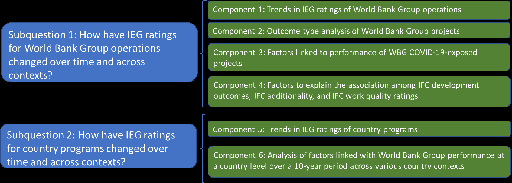

## Concept Note

## Results and Performance of the World Bank Group 2024

May 20, 2024

## 1. Introduction and Objective

### 1.1

The *Results and Performance of the World Bank Group* (*RAP*) report is the annual review of the Bank Group’s operational and country effectiveness that draws on evidence from the Independent Evaluation Group (IEG). *RAP 2024* will be the 14th in the annual series that began in 2010.¹ As in previous *RAPs*, the report will aggregate and interpret evidence mainly based on IEG’s validations of World Bank, International Finance Corporation (IFC), and Multilateral Investment Guarantee Agency (MIGA) self-evaluations.

### 1.2

The objective of *RAP 2024* is to describe trends in the Bank Group’s performance ratings. To meet this objective, like a Corporate Scorecard report, *RAP 2024* will present trends, describe changes in trends, and provide a deeper analysis of specific issues based on the IEG validations of Bank Group self-evaluations. Building on previous *RAPs*, the report will continue to analyze trends in Bank Group operations and country program ratings, outcome types,² and factors linked to Bank Group performance of COVID-19–exposed operations. For the IFC investment projects, an analysis will be undertaken to understand the association among development outcome, additionality, and work quality ratings.³ For country programs, the report will analyze rating trends and conduct an in-depth review of Bank Group performance at the country level.

## 2. Audience and Principles

### 2.1

The main audience for *RAP 2024* will be the Bank Group’s Board of Executive Directors. The report can be used by the Board of Executive Directors to help understand trends in performance ratings and identify areas for accountability and learning as the Bank Group undertakes its Evolution Agenda (box 2.1). The report also contains rating trends and in-depth analyses that can assist with the ongoing design and implementation of operations and country programs for management and staff.

### 2.2

*RAP 2024* continues to be guided by three principles: continuity, innovation, and symmetry. Continuity is provided through standardization among *RAPs*, which allows for comparison of the Bank Group’s performance ratings across key breakdowns and the update of analysis in *RAPs* from 2020 to 2023 (see appendix E). Including the country opinion surveys in the analysis of the Bank Group performance at the country level, the analysis of project preparation time for the World Bank and processing time for IFC investment projects and preimplementation scoping time for IFC advisory services (AS) projects within the review of trends, and analysis to identify factors specific to work quality and additionality that are associated with development outcomes in IFC investment projects represents innovations for *RAP 2024*. Symmetry is maintained across Bank Group institutions in the analysis of trends and country-level performance factors.

### Box 2.1. Relevance of *Results and Performance of the World Bank Group 2024* to the Evolution Agenda

*Results and Performance of the World Bank Group 2024* looks to provide evidence that is directly relevant to the Evolution Agenda in three areas. In the report we will analyze the following:

- Factors linked to the performance of operations in fragile and conflict-affected situations across the World Bank Group
- Factors related to enhanced country engagement and working as One World Bank Group at the country level
- The preparation time for the World Bank operations, processing time for the International Finance Corporation investments, and preimplementation scoping time for International Finance Corporation advisory services, which contribute to discussions on operations efficiency and effectiveness

*Sources:* Independent Evaluation Group, World Bank 2023a.

## 3. Questions and Scope

### 3.1

The main question to be addressed by *RAP 2024* is, What do IEG’s validations tell us about the Bank Group’s performance? This question will be interrogated through two subquestions and six components, which are outlined in figure 3.1.

### Figure 3.1. Subquestions and Analytical Components in *Results and Performance of the World Bank Group 2024*

*Source:* Independent Evaluation Group.

*Note:* IEG = Independent Evaluation Group; IFC = International Finance Corporation.

### 3.2

These subquestions and analytical components define the scope of *RAP 2024*:

- The first subquestion will present and describe trends in operations’ ratings based on IEG’s validations of the Bank Group’s self-evaluations. Component 1 reports trends in Bank Group operations’ ratings, including preparation, processing, and preimplementation scoping time. Components 2 and 3 describe trends in the types of outcomes pursued and the factors linked to implementation in COVID-19–exposed operations. Within the context of outcome types, the report will assess the progress toward the achievement of Anticipated Impact Measurement and Monitoring (AIMM)⁴ indicators. Component 4 will identify factors specific to work quality and additionality that are associated with development outcome ratings of IFC investment projects.
- The second subquestion will describe changes in country program ratings and identify key factors that are frequently associated with higher or lower Bank Group performance for country programs.

## 4. Approach and Methodology

### 4.1

*RAP 2024* will apply a mix of methods (see appendix F for a detailed description of sampling, data sources, methods, strengths, and limitations). Techniques to be applied include statistical analysis (descriptive and correlation), analysis of text (content analysis and ratings assessment), and supervised machine learning (logistic regression model, transformer model, and naive Bayes model). As with previous *RAPs*, the 2024 report will not provide recommendations from its findings. Appendixes A through D provide the definitions of ratings and outline the existing frameworks that will be applied in *RAP 2024*.

### 4.2

Bank Group institutions employ different frameworks and methodologies when rating operations. The World Bank operations use an objective-based methodology to derive project performance ratings. These ratings summarize the World Bank’s self-evaluation and IEG’s validation into values that enable aggregation across operations. Similarly, IFC’s AS project performance ratings are derived from an objective-based methodology, which establishes minimum thresholds for rating and assessing these projects’ effectiveness. By contrast, evaluation systems and performance ratings for IFC’s investment projects and MIGA’s guarantee projects are both objective-based and market- or industry-benchmark-based methodologies, particularly for measuring financial performance to ensure the sustainability of IFC investments and MIGA guarantees. All methodologies align with good practice standards for evaluating public and private sector projects, as established by the Evaluation Cooperation Group of multilateral development banks, except technical assistance or AS, which do not yet have established good practice standards (ECG 2012).⁵

**Subquestion 1:** How have IEG ratings for Bank Group operations changed over time and across contexts?

### 4.3

To examine and understand how Bank performance has changed, *RAP 2024* will analyze operations’ ratings in regard to trends. For World Bank operations, the report will analyze trends over a three-year rolling period and year-on-year for the main performance ratings.⁶ In addition, the update on ratings will continue to include trends for the overall efficacy rating. The analysis of development policy financing will be separated where needed from that of investment project financing and Program-for-Results, given their different modalities. The descriptive and correlation analysis of operations’ ratings will include breakdowns of trends across Region; Practice Group; country lending group; fragile and conflict-affected situations (FCS); small states; size of commitments; and number of operations. Relevant changes in trends will be further explored through decomposition analysis.⁷

### 4.4

To support analysis of subgroups and trends within the World Bank, *RAP 2024* will apply previously used frameworks to identify outcome types and factors linked to performance. Continuing from *RAP 2021*, objectives will be coded according to 16 types of outcomes (see appendix B). Continuing from *RAP 2023*, supervised machine learning will be deployed to identify the adapted Delivery Challenges in Operations for Development Effectiveness (DeCODE) factors linked to the performance of COVID-19–exposed and nonexposed operations. The DeCODE factors are organized into three clusters and 17 categories (see appendix C). In addition to the COVID-19 analysis, the DeCODE factors will be applied to specific subgroups in the portfolio where the factors could reveal important differences, for example, between FCS-exposed operations and those not exposed. A trained supervised machine learning model using logistic regression techniques will support the identification of relevant factors from within the texts of Implementation Completion and Results Reports for all new projects not captured in *RAP 2023*. We will review the application of the Systematic Operations Risk-rating Tool for the World Bank as a supplement to the adapted DeCODE analysis, recognizing that there has been recalibration of the tool.

### 4.5

*RAP 2024* will explore variations in preparation time for World Bank operations, processing time for IFC investment projects, and preimplementation scoping time for IFC AS projects and their association with performance ratings. This analysis will seek to identify considerations for the Bank Group’s efficiency improvements that are part of the Evolution Agenda. We will first identify the association between performance ratings and preparation, processing, or preimplementation scoping time. After this we

6

will explore how they differ between various breakdowns of the portfolio, such as income groups and FCS exposure. We will further identify the subgroups more frequently linked to longer preparation time, if any. For the World Bank projects, the preparation time will be based on the elapsed time from the date of the activity initiation summary to the Board approval. For IFC investment projects, the processing time will be based on the elapsed time from mandate to first disbursement.⁸ For IFC AS projects, the preimplementation scoping will be based on the elapsed time from Concept Note to implementation plan.⁹ This analysis will include the Bank Group projects evaluated and validated by IEG during the 10-year period of the *RAP*. The analysis will be explored in *RAP 2024* and can be strengthened in future *RAPs* depending on findings.

### 4.6

For IFC investment projects and AS projects, the report will analyze trends in performance ratings over a three-year rolling average; for MIGA guarantee projects, the report will analyze the trends in performance ratings over a six-year rolling average because of the small number of projects evaluated and validated annually.¹⁰ The descriptive analysis will involve breakdowns of performance ratings for IFC investment projects and AS projects and for MIGA guarantee projects to understand patterns across project and country groups—for example, Region, FCS, non-FCS, country lending group (International Bank for Reconstruction and Development, International Development Association, or blend), type of instrument, project or investment size, industry group or primary business area (for IFC AS), sector (for MIGA), and outcome types. Continuing from previous *RAPs*, the report will analyze the performance of IFC projects in other dimensions, such as work quality, additionality and investment outcome (for IFC investment), and role and contribution (for IFC AS), and their association with project development outcomes (refer to appendix A for definitions of the performance assessment dimensions for IFC investment projects and AS projects). Similarly, the report will examine MIGA’s performance in other dimensions, such as its effectiveness, and role and contribution, and their association with project development outcomes (see appendix A).

### 4.7

Continuing from *RAP 2023*, for IFC investments and MIGA guarantee projects, the team will identify the intended outcome types. *RAP 2024* will apply the 13-category typology involving project-level and market-level outcomes developed by *RAP 2021* for both IFC investment projects evaluated and validated by IEG in calendar year (CY) 21–23 and MIGA guarantee projects evaluated and validated by IEG in fiscal year (FY) 21–23 with a cut-off date of December 31, 2023 (see appendix B). The purpose of this analysis is to ensure that there is continuity in the analysis of trends in outcome types and how they differ from the analysis in the previous *RAPs*. Outcome types will be identified through a desk-based review and content analysis of IEG project evaluation and validation documents. *RAP 2024* will assess the extent to which the outcomes of IFC investment and MIGA guarantee projects were achieved at evaluation by verifying the information presented in the IEG project evaluation and validation documents. In addition, the report will assess the progress toward the achievement of AIMM indicators. The rationale behind this analysis is based on the finding in *RAP 2023* that monitoring data were not available for a significant number of outcomes for projects that predated AIMM (World Bank 2023b). *RAP 2024* will assess whether the AIMM system, which is IFC’s ex ante analysis and monitoring tool for development outcome, is enhancing the tracking of outcomes. The report will analyze 21 evaluated IFC investments with “live” AIMM scores. This is the complete universe of evaluated projects with “live” AIMM scores because these were the only projects that were assigned ex ante AIMM scores at Board approval and evaluated or validated by IEG as of December 31, 2023. Given the small cohort, this is a preliminary and mostly qualitative analysis with the intent of setting the stage for future analyses.

### 4.8

Continuing from *RAP 2023*, for IFC investments and MIGA guarantee projects, the team will identify the factors linked to performance during the COVID-19 pandemic. This will include IFC investment projects evaluated and validated by IEG in CY20–23 and MIGA guarantee projects evaluated and validated by IEG in FY20–23 with a cut-off date of December 31, 2023. For each project, the team will manually identify the top three factors that are positively or negatively linked to project performance and classify them using the taxonomy of performance factors, consisting of five categories and 51 subcategories developed by IEG (see appendix C). Factors linked to performance will be identified through a desk-based review and content analysis of IEG project evaluation and validation documents. The data collected manually for the CY20–23 cohort will be used to train the machine learning model and applied also to the prepandemic IFC investment projects (CY16–19).

### 4.9

For IFC investment projects, the report will identify factors specific to work quality and additionality that are associated with development outcomes. This analysis is particularly important given the strong correlation between work quality, additionality, and development outcomes and a slight decline in these three performance indicators as reported in *RAP 2023*. The analysis will involve qualitative desk-based review of IEG evaluations and validations of IFC investment projects rated unsatisfactory on work quality or highly unsuccessful on development outcomes (19 projects) to identify key issues on work quality and provide a synthesis of evidence on these issues. Since there is only one IFC investment project rated excellent on work quality or highly successful on development outcome, this project will be excluded from the analysis. Similarly, qualitative desk-based review of IEG evaluations and validations of IFC investment projects rated unsatisfactory on additionality or highly unsuccessful on development outcomes (18 projects) will be conducted to analyze additionality: (i) financial and nonfinancial anticipated at Board approval in terms of frequency of occurrences, (ii) realized (fully or partially) or unrealized, and (iii) missed (only those not anticipated in the Board paper but materialized)¹¹ in terms of frequency of occurrences. Since there are only two IFC investment projects rated excellent on additionality or highly successful on development outcome, these projects will be excluded from the analysis. This analysis will help in setting the stage for future analysis on the association between work quality, additionality, and development outcomes. Based on the analytical framework used in *RAP 2024*, a more balanced approach (in terms of selecting projects on both ends of the spectrum) can be followed in future analysis.

**Subquestion 2:** How have IEG ratings for country programs changed over time and across contexts?

### 4.10

To understand how Bank Group outcome and performance ratings at the country level have changed across contexts, *RAP 2024* will undertake an analysis of trends. The analysis will draw on the development effectiveness and Bank Group performance ratings from Completion and Learning Review Validations (CLRVs)¹² covering a 10-year period from FY13 to FY23 and finalized by IEG by June 2024 (see appendix D). Aligned with previous *RAPs*, a smoothing approach for trend analysis will be used, whereby ratings from the CLRV are applied across all years of the relevant Country Partnership Framework. The descriptive analysis of ratings will disaggregate data according to breakdowns (for example, Region, FCS, non-FCS, country lending group, Bank Group commitment amounts and Country Policy and Institutional Assessment rating).

### 4.11

Building on the discussion of trends, *RAP 2024* will seek to further understand factors linked with performance over time by analyzing the relevant text from CLRVs and country opinion survey data (see appendix D). This analysis will look to identify what enables and constrains the performance of the Bank Group at the country level to the same aforementioned timeline. The analysis will assess performance across eight factors for countries based on their last two CLRVs finalized by IEG between FY13 and FY24.¹³ The assessment is based on a similar analysis conducted for *RAP 2022* and incorporates descriptions from the guidance on country engagement (World Bank 2021a). To further understand Bank Group performance from a country perspective, we will incorporate analysis based on the Bank Group’s Country Opinion Survey Program completed between FY13 and FY23, building on *RAP 2020* (World Bank 2024a). The analysis will also be undertaken using breakdowns such as FCS, non-FCS, country lending group, and Country Policy and Institutional Assessment rating. *RAP 2024* will then identify the most salient factors associated with differing Bank Group performance in countries over time. The findings will be cross-referenced against IEG Country

9

Program Evaluations. This analysis together with the One World Bank Group will help draw out findings on important factors that can be considered in revisions to the country engagement model as part of the Evolution Agenda.

4.12 An analysis of countries’ performance in implementing the One World Bank Group approach will be undertaken in *RAP 2024*. This will incorporate evidence from the review of all CLRVs finalized by IEG over the 10-year period FY13–23. This analysis will triangulate findings between CLRVs, previous evaluations and *RAP*s, and structured system data. Within this analysis, IEG will review the content of CLRVs to identify the extent and types of One World Bank Group engagement undertaken. Additionally, to develop findings we will review previous *RAP* reports, IEG Country Program Evaluations, and relevant evaluations completed over this period. For example, the findings from the 2017 IEG evaluation *World Bank Group Joint Projects: A Review of Two Decades of Experience* will be compared with the content of CLRVs. To help understand the extent of overlapping presence we will use Bank Group structured data (such as World Bank commitment amount, IFC investment committed amount, or MIGA guarantee issuance amount) within the analysis.

## 5. Limitations

5.1 In summarizing evidence from IEG’s validations of the World Bank self-evaluations, we recognize three important limitations:

- As shown in *RAP 2023*, inadequately performing projects are more likely to be validated late—that is, ratings for recent fiscal years continue to shift downward after they are first reported. For example, the average rating for projects closed in FY19 was first reported at 4.1 in *RAP 2020*; by *RAP 2023*, this average had declined to 4.0. Self-evaluations and validations can be completed late, and not all projects closed in FY23 will be available by the end of FY24; therefore some will not be reported in *RAP 2024*. Consequently, for the first two years, average ratings should be taken as provisional.

- Because projects may be restructured or extended, or receive additional financing, the *RAP* cohort for one year cannot be viewed as a panel, where one year is directly comparable to another. This means that year-to-year comparisons in portfolio performance can be misleading because a single year can have a greater share of its portfolio from a single subgroup. For example, in a given year more projects may close in FCS contexts that are very different from other project contexts. Decomposition analysis helps to explain differences in portfolio composition between the current year and previous years and identify issues underlying aggregate ratings. The use of three-year rolling averages and a longer time frame for analysis may also help provide a broader population of projects that is more comparable between periods.

- Improvement in operational or country ratings does not mean that the Bank Group’s contribution to country outcomes has necessarily improved (World Bank 2016, 2020b). Development outcomes at a country level are the results of multiple factors and actors, not least the country government. Consequently, it cannot be inferred that net improvements in World Bank operational or country ratings mean that development outcomes for countries have improved. Interpretation of ratings is thus framed mainly in terms of operational performance; further investigation is required to understand how operations or country portfolios contribute to longer-term outcomes (Goldemberg, Jordan, and Kenyon 2023).

5.2 Three limitations are also identified for IFC investment and MIGA guarantee projects:

- The specific intended outcomes are not rated in IEG project evaluation and validation documents. The objectives of IFC investment and MIGA guarantee projects are assessed but not rated because the IEG validations of the Expanded Project Supervision Reports (XPSRs) are a benchmark-based (that is, market and industry standards) system, which considers long-term sustainability effects and trends rather than focusing solely on the achievement of intended objectives. It can be challenging to assess the extent of their achievement unless the project evaluation and validation documents have explicit statements on the achievement of intended outcomes.

- AIMM and XPSR have different purposes and follow different methodologies for rating development outcomes and impacts. XPSR is an evaluation system in which the development outcome rating is based on four dimensions: project business success; economic sustainability; environmental and social effects; and private sector development. In contrast, AIMM is an ex ante analysis and monitoring system in which the overall impact score is based on two dimensions: project outcome rating (equivalent to economic sustainability dimension in the XPSR) and market outcome rating (equivalent to private sector development dimension in the XPSR). AIMM system alone is not fully comparable with XPSR because IFC uses separate systems to monitor other dimensions (such as financial sustainability and environmental and social effects) of development outcome. AIMM assessments are provided throughout the project cycle until the project reaches the target year and XPSRs are prepared for a sample of IFC investments once the project reaches early operating maturity. However, in rating the development outcome, XPSR also considers expected and unexpected effects based on extensive analysis on why things happened or did not happen and comparison with peer companies to draw lessons for future operations.

- Although the empirical associations among IFC’s work quality, additionality, and development outcome ratings are well established through correlation analysis, causality among IFC’s work quality, additionality, and development outcome ratings may not be possible in *RAP 2024* because both positive and negative factors beyond IFC’s work quality and additionality can contribute to the development outcome ratings of IFC investment projects.

## 6. Engagement, Communication, and Dissemination

6.1 During the preparation of the Concept Note and the report, the *RAP 2024* team has engaged and will continue to frequently engage staff and management of the World Bank, IFC, and MIGA, including external reviewers and experts in international development. On completion, further engagement will be defined depending on interest from management and the Board. For example, as for previous *RAPs*, blog posts, intranet features, and social media dissemination will also be considered. The report will be discussed with the Board in November 2024.

## 7. Team, Budget, and Timeline

7.1 The contributors to *RAP 2024* are from across IEG. The task team leaders are Stephen Porter and Melvin Vaz. Core team members for the analysis of the World Bank portfolio are Rocío Garabito, Diana Goldemberg, Gaby Loibl, Melissa Metz, Chikako Miwa, and Xiaoxiao Peng. Core team members for the analysis of IFC and MIGA portfolios are William Haworth, Daniel Palazov, Konstantin Panov, Ichiro Toda, and Stefan Triendl. IEG Financial and Private Sector Micro Unit industry leaders will peer review the coding of the outcome types: Leonardo Bravo and Izlem Hajdenberg for the Financial Institutions Group; Unurjargal Demberel and Ananda Ghose for Manufacturing, Agribusiness, and Services; and Priyanka Jetwani and Ichiro Toda for Infrastructure and Natural Resources and Disruptive Technologies and Funds. Leonardo Bravo will peer review the coding of the factors linked to performance and identify the factors linked to performance for prepandemic (CY16–19) IFC investment projects. Other IEG staff and consultants will also contribute.

7.2 The report will be produced under the overall supervision of Sabine Bernabѐ (vice president and Director-General, Evaluation) and the direct supervision of Theo Thomas (director, Human Development and Economic Management), Beata Lenard (manager, Financial and Private Sector Micro Unit), and Soniya Carvalho and Jenny Gold (acting managers, Corporate and Human Development Unit). During the

production of the report, the team will also consult with IEG staff, including Implementation Completion and Results Report Review and Completion and Learning Review coordinators, the Financial and Private Sector Micro Unit, and staff and consultants involved in the validation of self-evaluations.

### 7.3

The report will also benefit from the advice of an external advisory panel composed of senior international development experts and evaluation professionals: Ede Jorge Ijjasz-Vasques (nonresident senior fellow at the Brookings Institution), Gabriela Yarahuan Perez (Inter-American Development Bank and professor at Centro de Investigación y Docencia Económicas, Mexico), and Sabine Schlorke (former IFC manager, Global Manufacturing, and manager, Global Trade Supply Chain Financing).

This Concept Note and the draft final report will be subject to internal IEG review, external advisory panel review, and the standard process of seeking Bank Group management comments.

### 7.4

The budget for *RAP 2024* is US$700,000, and the timeline is included in table 7.1.

**Table 7.1. Timeline — RAP 2024 Milestones**

**Dates as of October 11, 2023**

| Milestone | Date |
|---|---|
| One-stop review meeting for the Concept Note | January 18, 2024 |
| Send the Concept Note to World Bank Group management for comments | March 6, 2024 |
| Bank Group comments due (20 days after sending it to Bank Group management) | April 3, 2024 |
| Concept Note e-submission to the Corporate Secretariat | May 17, 2024 |
| One-stop review meeting for the draft report | July 31, 2024 |
| Send to Bank Group management for comments | August 30, 2024 |
| Bank Group comments due (15 business days) | September 20, 2024 |
| E-submission report | October 21, 2024 |
| Board of Executive Directors discussion | November 2024 |

*Source:* Independent Evaluation Group.

*Note: RAP* = *Results and Performance of the World Bank Group*.

## Notes

1. This Concept Note draws on the previous Concept Notes, reports, and methodology sections of *Results and Performance of the World Bank Group* from 2020 to 2023.

2. Outcome types capture the type of change envisioned by project objectives rated in Independent Evaluation Group validations. See appendix B for further details.

3. International Finance Corporation (IFC) work quality and IFC additionality are two of the four main performance assessment dimensions of IFC investment projects. Development outcome and IFC investment outcome are the other two dimensions of IFC investment projects. IFC’s work quality assesses IFC’s operational performance, including in relation to environmental and social effects, with respect to precommitment work in screening, appraisal, and structuring (after projects’ approval by the Board of Executive Directors and subsequent commitment until the first disbursement), and its supervision and administration (after the first disbursement of the funds). IFC’s additionality assesses both financial and nonfinancial additionality in terms of the benefit or value addition IFC brings that a client would not otherwise have.

4. The Anticipated Impact Measurement and Monitoring (AIMM) system, launched in July 2017, is IFC’s ex ante analysis and monitoring system. Potential projects are rated ex ante and selected based on their expected development outcomes. The AIMM system assesses project outcomes in terms of how project beneficiaries, including employees, customers, and suppliers, are affected. It also assesses the effects of project outcomes on market creation in terms of enhancing competitiveness, resilience, integration, inclusiveness, and sustainability. An ex ante AIMM score is assigned in the year when the project is approved. After early monitoring maturity based on AIMM’s definition, the portfolio score is updated for the first time; each year after, a new portfolio score is assigned. When the project reaches AIMM’s target year, often coinciding with the time of preparation of select (40 percent sample) IFC self-evaluation Expanded Project Supervision Reports, a terminal portfolio score is assigned and the same score is carried over until the end of the financial relationship with the client.

5. There is no framework in the Independent Evaluation Group to consolidate and report the performance ratings of the three Bank Group institutions. Currently, underlying criteria are incommensurable (see appendix A). Reforms in the Bank Group self-evaluation and Independent Evaluation Group validation practices will be discussed as part of the Evolution Agenda. The updates on the implementation of these reforms will inform the future *RAPs*.

6. For investment project financing and Program-for-Results: outcome, Bank performance (including quality at entry and quality of supervision breakdowns), and monitoring and evaluation. For development policy financing: outcome and Bank performance (including design and implementation breakdowns).

7. Employed since *RAP 2021*, decomposition analysis allows us to understand trends through identifying important changes in the performance or weight of subgroups. The Bank Group’s operational portfolio is like a stock market portfolio; overall performance is a factor of the number of projects in a subgroup and their average ratings. A change in the weight of a subgroup of operations can have an important influence, even with no change in the average rating. For example, a decline in the number of projects in the East Asia and Pacific Region—a high-performing subgroup of the World Bank’s portfolio—will lower the overall rating, unless offset elsewhere.

8. The data source for the analysis is IFC business metadata, Management Information Systems. The *RAP 2024* cohort may predate some of the efficiency initiatives implemented at IFC (for example, accountability and decision-making, streamlining of environmental and social procedures, and so on). However, the analysis will include other Bank Group efficiency initiatives undertaken in the previous years.

9. The data source for the analysis is iPortal.

10. Multilateral Investment Guarantee Agency self-evaluation and independent validation covers 100 percent of its guarantee projects. However, the cohort of self-evaluation and independent validation is small because a limited number of Multilateral Investment Guarantee Agency guarantees reach maturity and become eligible for self-evaluation and validation every year. In addition, the Multilateral Investment Guarantee Agency delivered 9 out of 19 self-evaluations scheduled for FY22 programs and 5 out of 15 for FY23 programs.

11. Missed additionalities are those not anticipated in the Board paper but materialized or not materialized and achieved by IFC. *RAP 2024* will only focus on cases that were missed but materialized.

12. The Completion and Learning Review Validation was called Completion and Learning Review Review before May 1, 2023. No change was made to the methodology.

13. The eight factors are (i) relevance of country program, (ii) quality of results framework, (iii) risk identification, (iv) risk mitigation, (v) Bank Group support to implementation, (vi) working as One World Bank Group, (vii) development partner support, and (viii) learning and adaptation.

## Bibliography

Andrews, Matt, Lant Pritchett, and Michael Woolcock. 2017. *Building State Capability: Evidence, Analysis, Action*. Oxford: Oxford University Press.

Denizer, Cevdet, Daniel Kaufmann, and Aart Kraay. 2013. “Good Countries or Good Projects? Macro and Micro Correlates of World Bank Project Performance.” *Journal of Development Economics* 105 (November): 288–302.

ECG (Evaluation Cooperation Group). 2012. *Big Book on Evaluation Good Practice Standards*. Washington, DC: ECG.

https://www.ecgnet.org/sites/default/files/FINAL%20Big%20Book%20on%20GPS.pdf

Geli, Patricia, Aart Kraay, and Hoveida Nobakht. 2014. “Predicting World Bank Project Outcome Ratings.” Policy Research Working Paper 7001, World Bank, Washington, DC.

Goldemberg, Diana, Luke Jordan, and Thomas Kenyon. 2023. “Minding the Gap: Aid Effectiveness, Project Ratings and Contextualization.” Policy Research Working Paper 10532, World Bank, Washington, DC.

Hopson, Rodney, and Fiona Cram, eds. 2018. *Tackling Wicked Problems in Complex Ecologies: The Role of Evaluation*. Redwood City, CA: Stanford University Press.

Reed, Mark S., and Hannah Rudman. 2023. “Re-thinking Research Impact: Voice, Context and Power at the Interface of Science, Policy and Practice.” *Sustainability Science* 18 (March): 967–81.

World Bank. 1992. *Effective Implementation: Key to Development Impact*. Washington, DC: World Bank.

World Bank. 2016. *Behind the Mirror: A Report on the Self-Evaluation Systems of the World Bank Group*. Independent Evaluation Group. Washington, DC: World Bank.

World Bank. 2017. *Results and Performance of the World Bank Group 2016*. Independent Evaluation Group. Washington, DC: World Bank.

World Bank. 2020a. *Results and Performance of the World Bank Group 2020*. Independent Evaluation Group. Washington, DC: World Bank.

World Bank. 2020b. *The World Bank Group Outcome Orientation at the Country Level*. Independent Evaluation Group. Washington, DC: World Bank.

World Bank. 2021a. *IBRD/IFC/MIGA/IDA Guidance: Country Engagement*. Washington, DC: World Bank.

World Bank. 2021b. *Results and Performance of the World Bank Group 2021*. Independent Evaluation Group. Washington, DC: World Bank.

World Bank. 2022. *Results and Performance of the World Bank Group 2022*. Independent Evaluation Group. Washington, DC: World Bank.

World Bank. 2023a. “Ending Poverty on a Livable Planet: Report to Governors on World Bank Evolution.” Prepared for the Development Committee Meeting, October 12, 2023, DC2023-0004, World Bank, Washington, DC.

World Bank. 2023b. *Results and Performance of the World Bank Group 2023*. Independent Evaluation Group. Washington, DC: World Bank.

World Bank. 2024a. “Country Opinion Survey Program.” Overview, World Bank, Washington, DC. https://www.worldbank.org/en/programs/world-bank-country-opinion-surveys.

World Bank. 2024b. *New World Bank Group Scorecard FY24–FY30: Driving Action, Measuring Results*. Washington, DC: World Bank.

## Appendix A. Ratings Framework for World Bank Group Projects

This appendix summarizes the results and performance ratings for the World Bank, International Finance Corporation (IFC) investment projects, IFC advisory services (AS) projects, and Multilateral Investment Guarantee Agency (MIGA) guarantee projects in *Results and Performance of the World Bank Group 2024*. For details about data sources, data collection methods, and data analysis, refer to appendix F.

### World Bank

To review trends in World Bank projects, the main source of evidence is ratings from Independent Evaluation Group (IEG) Implementation Completion and Results Report Reviews. IEG’s Implementation Completion and Results Report Reviews are validations of Implementation Completion and Results Reports prepared by World Bank teams. Four ratings from Implementation Completion and Results Report Reviews provide the basis of analytical framework for overall performance trends. All Implementation Completion and Results Reports that are submitted to IEG for investment project financing, development policy financing, and Program-for-Results projects are reviewed. Performance assessment ratings for the World Bank include the following (figure A.1):

- **Outcome** refers to the extent to which a project efficiently achieved, or was expected to achieve, its relevant objectives. The outcome rating brings together three underlying dimensions: relevance, efficacy, and efficiency. The outcome is rated on a six-point scale: highly satisfactory, satisfactory, moderately satisfactory, moderately unsatisfactory, unsatisfactory, and highly unsatisfactory.

- **Efficacy** is defined as the extent to which a project achieves, or was expected to achieve, its objectives taking into account the objective’s relative importance. The achievement of each individual objective is assessed based on the concept of “plausible causality.” Efficacy ratings also reflect an assessment of the results framework’s validity and use complementary data and evidence on the achievement of intended results. The overall efficacy of each individual objective is rated on a four-point scale: high, substantial, modest, and negligible.

  - Bank performance refers to the extent to which World Bank services ensured quality project design and supported effective implementation through appropriate supervision in the achievement of development outcomes. Bank performance and its two constituent elements—quality at entry and quality of supervision—are rated on a six-point scale: highly satisfactory, satisfactory, moderately satisfactory, moderately unsatisfactory, unsatisfactory, and highly unsatisfactory.

  - Monitoring and evaluation quality refers to the quality of the design and implementation of the monitoring and evaluation arrangements of the project and the extent to which the results are used to improve performance. Monitoring and evaluation quality is assessed at the project level and includes monitoring and evaluation design, implementation, and use. It is rated on a four-point scale: high, substantial, modest, and negligible.

**Figure A.1. Performance Ratings in World Bank Investment Projects**

*Source:* Independent Evaluation Group.

*Note:* This is the ratings structure for investment project financing and Program-for-Results; development policy financing has a slightly modified ratings structure.

| World Bank performance ratings | | | |
|---|---|---|---|
| Outcome | | | |
| Relevance | Efficacy | Efficiency | |
| | Bank performance | | |
| | Quality at entry | Quality of supervision | |
| | Monitoring and evaluation quality | | |

### International Finance Corporation Investments

The main source of evidence for analyzing the trends in IFC investment performance ratings are the Expanded Project Supervision Reports (XPSRs) evaluated by IFC and validated by IEG. IEG draws a random stratified representative sample (40 percent) annually from among IFC investment projects that were approved by the Board of Executive Directors five years earlier and that reached early operating maturity. During the calendar year, IFC investment staff evaluate all active IFC investment projects selected in the sample using XPSRs, and IEG independently validates them using Evaluative Notes. For closed projects selected in the sample,¹ IEG prepares a Project Evaluation Summary in lieu of an XPSR. To conduct the project evaluation and validation, IFC and IEG staff refer to XPSR guidelines that provide the evaluation framework and performance rating criteria.

The evaluation system and performance ratings for IFC projects are both objective based and benchmark based. In addition to the focus on the achievement of expected objectives stated in the Board report at approval, IFC investment project performance is assessed against comparators, such as performance of peer companies, the market, and similar industries, and considers unintended outcomes (both positive and negative).

The main performance assessment dimensions for IFC investment projects are development outcomes, IFC additionality, IFC investment outcome, and IFC work quality (figure A.2). In addition, an XPSR assesses the sustainability of development and IFC investment outcomes in the longer run by examining project prospects and investment return expectations over the remaining life of the project:

- Development outcome synthesizes a project’s performance across four dimensions: project business performance, economic sustainability, environmental and social effects, and private sector development. It is rated on a six-point scale: highly successful, successful, mostly successful, mostly unsuccessful, unsuccessful, and highly unsuccessful.

- IFC additionality assesses both financial and nonfinancial additionality in terms of the benefit or value addition IFC brings that a client would not otherwise have. The rating is on a four-point scale: excellent, satisfactory, partly unsatisfactory, and unsatisfactory.

- IFC investment outcome assesses the extent to which IFC has realized at the time of the evaluation and expects to realize over the remaining life of the investment the loan income, equity returns, or both that were expected at approval. The rating is on a four-point scale: excellent, satisfactory, partly unsatisfactory, and unsatisfactory.

- IFC work quality assesses IFC’s operational performance, including in relation to environmental and social aspects, with respect to precommitment work in screening, appraisal, and structuring, and its supervision and administration after project approval by the Board of Executive Directors and subsequent commitment. The rating is on a four-point scale: excellent, satisfactory, partly unsatisfactory, and unsatisfactory.

¹ All operational and financial activities and legal obligations associated with the project are completed.

### International Finance Corporation Advisory Services

The main source of evidence for analyzing the trends in IFC AS projects’ performance ratings is the Project Completion Reports (PCRs)—IFC self-evaluations validated by IEG. For all client and sponsor development and market creation advisory projects, IFC AS operations staff conduct a self-evaluation at completion in the form of the PCR. IEG validates a random stratified representative sample of these reports (51 percent) each year through PCR Evaluative Notes. To conduct the project evaluation and validation, IFC and IEG staff refer to PCR guidelines that provide the evaluation framework and performance rating criteria. The performance ratings for IFC AS projects are derived from an objective-based methodology that establishes the minimum threshold for rating and assessing project effectiveness.

The main performance assessment dimensions for IFC AS projects are development effectiveness, IFC role and contribution, and IFC work quality (figure A.2). As part of development effectiveness performance, PCRs assess the sustainability of results over the long run and examine the project’s impact achievement beyond the immediate and intermediate outcome achievements when observable:

- Development effectiveness synthesizes a project’s performance across five indicators: strategic relevance, output achievement, outcome achievement, impact achievement, and efficiency. The rating is on a six-point scale: highly successful, successful, mostly successful, mostly unsuccessful, unsuccessful, and highly unsuccessful.

- IFC role and contribution assesses the extent to which IFC added value or made a special contribution to the AS project. The rating is on a four-point scale: excellent, satisfactory, partly unsatisfactory, and unsatisfactory.

- IFC work quality assesses the extent to which services provided ensured quality at entry and supported effective implementation, through appropriate supervision and execution, toward the achievement of development objectives. IFC work quality and its two dimensions—project preparation and design and project implementation and supervision—are rated on a four-point scale: excellent, satisfactory, partly unsatisfactory, and unsatisfactory.

### Figure A.2. Performance Ratings in International Finance Corporation Investment Projects and Advisory Services Projects

*Source:* Independent Evaluation Group.

*Note:* IFC = International Finance Corporation.

### Multilateral Investment Guarantee Agency Guarantees

The main source of evidence for analyzing the trends in MIGA guarantee projects’ performance ratings is the Project Evaluation Reports (PERs) prepared by MIGA and validated by IEG. For each MIGA guarantee project that has reached early operating maturity, MIGA underwriting staff conduct a self-evaluation by preparing a PER that IEG independently validates through a PER Validation Note. To conduct the project evaluation and validation, both MIGA and IEG staff refer to PER guidelines that provide the evaluation framework and performance rating criteria. The evaluation system and performance rating system for MIGA projects are both objective based and benchmark based. In addition to the focus on the achievement of expected objectives stated in the memorandum of the president’s report at approval, the performance of MIGA guarantee projects is assessed against several comparators, such as performance of peer companies, the market, and similar industries, and considers unintended outcomes (both positive and negative).

| IFC performance ratings | | | | | |
| :--- | :--- | :--- | :--- | :--- | :--- |
| **Investment projects** | | | | | |
| Development outcome | Project business performance | Economic sustainability | Environmental and social effects | Private sector development | IFC additionality |
| IFC investment outcome | Loan outcome | Equity outcome | | | |
| IFC work quality | Screening, appraisal, and structuring | Supervision and administration | | | |
| **Advisory services projects** | | | | | |
| Development effectiveness | Strategic relevance | Output achievement | Outcome achievement | Impact achievement | Efficiency |
| IFC role and contribution | IFC overall work quality | Project preparation and design | Project implementation and supervision | | |

The main performance assessment dimensions for MIGA guarantee projects are development outcome, MIGA role and contribution, and MIGA work quality (figure A.3). The PER also assesses the sustainability of development outcomes in the long run by examining the project’s prospects over its remaining life.

- **Development outcome** measures performance across four indicators: project business performance, economic sustainability, environmental and social effects, and foreign investment effects. The development outcome is rated on a six-point scale: highly successful, successful, mostly successful, mostly unsuccessful, unsuccessful, and highly unsuccessful. Up to fiscal year 2019, the ratings were based on a four-point scale: excellent, satisfactory, partly unsatisfactory, and unsatisfactory.
- **MIGA effectiveness** synthesizes MIGA’s performance across three indicators: project strategic relevance, MIGA role and contribution, and MIGA work quality. The rating is on a four-point scale: excellent, satisfactory, partly unsatisfactory, and unsatisfactory.
- **MIGA role and contribution** assesses the benefits and value added that MIGA brings to the client, the project, or the political risk insurance industry. The rating is on a four-point scale: excellent, satisfactory, partly unsatisfactory, and unsatisfactory.
- **MIGA work quality** addresses due diligence and underwriting processes, including of risk assessment and mitigation, and monitoring after the issuance of the MIGA guarantee. The rating is on a four-point scale: excellent, satisfactory, partly unsatisfactory, and unsatisfactory.

### Figure A.3. Performance Ratings in Multilateral Investment Guarantee Agency Guarantee Projects

*Source:* Independent Evaluation Group.

*Note:* MIGA = Multilateral Investment Guarantee Agency.

| MIGA performance ratings | | | |
| :--- | :--- | :--- | :--- |
| Project’s contribution to MIGA’s financial results | | | |
| Development outcome | Project business performance | Economic sustainability | Environmental and social effects | Foreign investment effects |
| MIGA effectiveness | Strategic relevance | MIGA role and contribution | MIGA work quality | |

## Appendix B. Outcome Type Analysis for the World Bank Group Projects

This appendix summarizes the outcome typology used in reviewing project objectives for the World Bank, International Finance Corporation (IFC) investment projects, IFC advisory services projects, and Multilateral Investment Guarantee Agency (MIGA) guarantee projects in *Results and Performance of the World Bank Group* (*RAP*) *2024*.

### World Bank

To track the outcomes being targeted in World Bank objectives over time, *RAP 2024* will repeat the outcome type analysis for the World Bank conducted in *RAP 2021* and *RAP 2023*. *RAP 2021* developed a typology consisting of 16 outcomes derived from typical project theories of change and select corporate objectives that cut across World Bank Global Practices (table B.1). This typology reflects projects’ intended outcomes, for example, expanding access to services, improving quality of services, and enhancing human capital outcomes, among others.

**Table B.1. *Results and Performance of the World Bank Group 2021* Outcome Typology**

| Outcome Type | Description |
| :--- | :--- |
| 1—Access to services expanded | Opportunity of project beneficiaries to benefit from or use a system, service, or goods, including access to financial services, for example |
| 2—Quality of services improved | Improving or upgrading service reliability, timeliness, affordability, cleanliness, frequency, and so on; improvement and maintenance |
| 3—Public assets improved | Improving or enhancing the condition of built assets, which may include public spaces or public assets, and cultural heritage sites |
| 4—Natural capital sustained | Improving or enhancing the condition of natural assets directly or indirectly, which may include air, water, biodiversity, and other aspects of the natural environment |
| 5—Use of services of assets increased | Creating or enhancing incentives for people to use a good or service through adequate prices, regulation, incentives, and information about the existence of a service |
| 6—Social safety net provided to individuals | Increased benefit to individuals through cash transfers or public work projects |
| 7—Awareness, attitudes, or behaviors changed | Increased awareness, enhanced attitudes, or enhanced behaviors on the part of project beneficiaries |
| 8—Human capital increased | Increasing the knowledge or skills of individuals for their own benefit or improvements in, for example, health status |
| 9—Individual employability or livelihood improved | Enhancing the employability of individuals and their ability to increase their earnings in the longer term, including fostering microenterprises or very small (family) business development (for example, supporting self-employed entrepreneurs to prepare business plans, providing small grant or loans, and enhancing earnings not for consumption) |
| 10—Citizen engagement or community participation enhanced | Improved mechanisms that give regular people (or beneficiaries) a “say” or a “voice,” be it for intrinsic or instrumental value |
| 11—Legal or regulatory context improved | Improving regulations, laws, codes, working conditions, standards, and environmental requirements |
| 12—Capacity of institutions to perform institutional functions enhanced | Increasing the capacity of public and private institutions to better carry out their institutional function in the longer term |
| 13—Accountability, transparency, or governance enhanced | Increasing transparency, accountability, and openness and combating corruption |
| 14—Enterprise or sectoral performance improved | Improved productivity, efficiency, profitability, or competitiveness of a firm (including a state-owned enterprise) or private sector (nongovernment), understood as a group of firms |
| 15—Productive sector expanded | Increasing the dimension and size of productive sector, for example, by supporting start-ups or higher investment in firms in both capital and employment |
| 16—Equity or inclusion enhanced | Achieving greater inclusion and more equitable outcomes (for example, gender, ethnic minorities, poor people accessing services, and benefit) |
| Improved targeting | Equity: special provision for increasing equity through active elements of the project (quotas, components designed explicitly for specific “disadvantaged” groups, and so on) |

*Source:* Independent Evaluation Group.

### International Finance Corporation Investments

*RAP 2024* will continue to use the outcome typology developed in *RAP 2021* to identify the outcomes being targeted in the IFC investment projects. The typology has 33 (28 project-level and 5 market-level) outcomes based on 13 categories of outcome types (table B.2). The outcomes in the typology are aligned with those defined by IFC’s Anticipated Impact Measurement and Monitoring sector frameworks. *RAP 2024* will apply the outcome typology to all IFC investment projects self-evaluated by IFC and validated by the Independent Evaluation Group between calendar years 2021 and 2023 by a cut-off date of December 31, 2023.

Because the Anticipated Impact Measurement and Monitoring has assessed only a small share of projects evaluated in the calendar year 2021–23 cohort, *RAP 2024* will assess the extent to which expected outcomes were achieved at evaluation by verifying the results presented in the project Evaluative Note. An outcome is considered fully achieved, partially achieved, not achieved, or cannot be verified based solely on the text of the

## Table B.2. Outcome Typology for International Finance Corporation Investment Projects

| Outcome Type | Description |
|---|---|
| 1.1—Access to goods and services | Increase in number of final beneficiaries of goods and services of the project or company; increase in volume of goods and services produced by project or company |
| 1.1.1—Access to goods and services (MSME) | Increase in number of MSMEs as final beneficiaries of goods and services of the project or company; increase in volume of goods and services produced or provided by project or company |
| 1.1.2—Access to goods and services (gender) | Increase in number of final female beneficiaries of goods and services of the project or company; increase in volume of goods and services produced or provided by project or company |
| 1.1.3—Access to goods and services (customers) | Increase in number of individual customers as final beneficiaries of goods and services of the project or company; increase in volume of goods and services produced or provided by project or company |
| 1.1.4—Access to goods and services (miscellaneous) | Increase in number of final beneficiaries of goods and services of the project or company other than MSMEs, female beneficiaries, and individual customers or a mix of these final beneficiaries; increase in volume of goods and services produced by project or company |
| 1.1.5—Access to goods and services (direct client level) | Increase in capacity of project or direct client company to produce goods and services because of IFC investment |
| 1.2—Quality and affordability of goods and services | Improved quality of goods and services produced by project or company compared with baseline or with other producers or providers; lower production costs or process; reduced prices of goods and services compared with the baseline or other producers or providers |
| 1.2.1—Quality of goods and services | Improved quality of goods and services produced by project or company compared with the baseline or other producers or providers |
| 1.2.2—Affordability of goods and services | Reduced prices of goods and services compared with the baseline or other producers or providers |
| 1.2.3—Increased efficiency of direct client company | Lower production costs or processes of project or company |
| 1.3—Increased capacity of final beneficiaries | Enhanced capacity of final beneficiaries as a result of advisory services or training that is part of project scope |
| 1.4—Improved living standards (earnings) of individuals | Increase in revenue or decrease in expenditures by final beneficiaries (individuals) of goods and services produced by the project or company |
| 1.5—Improved sales or profitability of enterprises | Increase in revenue, decrease in expenditures, or increase in overall productivity by final beneficiaries (enterprises) of goods and services produced by project or company |
| 2.1—Suppliers and distributors reached | Increase in number of suppliers who provide inputs to project or company or expansion of network of distributors of goods or services produced by project or company |
| 2.2—Improved capacity of suppliers and distributors | Increase in capacity of suppliers or distributors as a result of advisory services or training that is part of project scope |
| 2.3—Improved sales and profitability of suppliers and distributors | Increase in volume of inputs provided by suppliers or increase in the goods or services to be distributed by its distributors |
| 3.1—Increased employment | Increase in direct employment of client company |
| 3.2—Improved capacity and skills | Training provided to employees of project or company |
| 3.3—Improved earnings of employees | Increase in wages to employees of project or company |
| 4.1—Increased transfers to government | Increase in payments by project or company to government, such as in the form of taxes, royalties, fees, or dividends |
| 5.1—Increased money spent or transferred to community | Increase in payments to communities in relation to the project or company, such as on health, educational, or vocational programs |
| 6.1—Enhanced environmental and social standards of the client | Improvement in IFC’s performance standards on environmental and social sustainability |
| 6.2—Greenhouse gas emissions | Decrease in or avoidance of greenhouse gas emissions |
| 6.3—Efficient use of resources | Decrease in use of water and other resources, improvement in solid waste management, and implementation of a waste-to-energy project |
| 7.1—Gross value added | Gross value added to economy (calculated based on a multiplier and expressed in monetary value) |
| 7.2—Induced and indirect employment | Induced and indirect employment based on multipliers |
| 7.3—Exports | Increase in exports of goods and services, generating foreign currency |
| 8.1—Governance | Improvement in corporate governance or increase in capacity of client company |
| 9—Competition in the market | Increase in ability of firms to enter, exit, compete, innovate, and strive for efficiency under fair and good regulatory governance; price changes; new practices, technology, and product innovation (first movers); product and business model differentiation, change in product offering, and value addition; and increase in efficiency under fair and good regulatory governance |
| 10—Resilience in the market | Increase in market depth and improvement in market structure, regulation, and governance to help markets withstand physical, financial, economic, or climate-related shocks; improved corporate governance of direct clients; diversification (for example, energy sources or funding sources in sectors or products); increase in capacity to face shocks and stress; increase in market depth and improvement in market structure, regulation, and governance (capacity of regulator); decrease in domestic supply volatility; increase in energy security; and increase in financial stability and consumer protection |
| 11—Integration in the market | Increase in physical or financial connectivity to support greater market integration, greater integration with financial markets and domestic and global value chains, enhanced physical or financial connectivity, geographical integration, integration with financial markets (including capital mobilization), data integration, growing domestic and global value chains, trade diversification, and economic complexity |
| 12—Inclusiveness in the market | Increase in fair and full access to all goods, services, finance, and economic opportunities, including for underserviced groups; increased inclusiveness and improved access; establishment of marketwide enabling framework or standards supporting inclusive business; and increase in diversity |
| 13—Sustainability in the market | Adoption of climate-related, environmentally and socially sustainable products, technologies, and practices; increased ability of firms and industries to apply environmentally and socially sustainable approaches to mitigate risk, realize opportunities, and maximize operational efficiency; adoption of climate-related, environmentally and socially sustainable products, technologies, standards, and practices; development of legal or regulatory framework that fosters sustainability; and broad capacity and supporting institutions or sustainability practice |

*Source:* Independent Evaluation Group.

*Note:* IFC = International Finance Corporation; MSME = micro, small, and medium enterprise.

## Multilateral Investment Guarantee Agency Guarantees

*RAP 2024* will continue to use the outcome typology developed in *RAP 2021* to identify the outcomes being targeted in the MIGA guarantee projects. The typology has 32 (27 project-level and 5 market-level) outcomes based on 13 categories of outcome types (table B.3). Because sector-specific frameworks do not yet exist for MIGA’s Impact Measurement and Project Assessment Comparison Tool, the same outcome typology developed for IFC investment projects will be applied to MIGA guarantee projects, with adaptations to some outcome types. *RAP 2024* will apply the outcome typology to all MIGA guarantee projects self-evaluated by MIGA and validated by the Independent Evaluation Group between fiscal years 2021 and 2023 by a cut-off date of December 31, 2023.

Because no Impact Measurement and Project Assessment Comparison Tool assessments are available in the fiscal year 2021–23 cohort, *RAP 2024* will assess the extent to which expected outcomes were achieved at evaluation by verifying the results presented in the project Validation Notes. An outcome is considered fully achieved, partially achieved, not achieved, or cannot be verified based solely on the text of the project Validation Notes. The *RAP* team will not apply any additional judgment, assessment, or methodology. It should be noted that only a small number of projects were evaluated and validated since the previous *RAP*.

## Table B.3. Outcome Typology for Multilateral Investment Guarantee Agency Projects

### Outcome Type
### Description

1.1—Access to goods and services  
Increase in number of final beneficiaries of goods and services of the project or project enterprise; increase in volume of goods and services produced by the project or project enterprise can be considered under this outcome type.

1.1.1—Access to goods and services (MSME)  
Increase in number of MSMEs as final beneficiaries of goods and services of the project or project enterprise; increase in volume of goods and services produced or provided by the project or project enterprise.

1.1.2—Access to goods and services (women)  
Increase in number of final women beneficiaries of goods and services of the project or project enterprise; increase in volume of goods and services produced or provided by the project or project enterprise.

1.1.3—Access to goods and services (customers)  
Increase in number of individual customers as final beneficiaries of goods and services of the project or project enterprise; customers of utility services are representative of this group; increase in volume of goods and services produced or provided by the project or project enterprise.

1.1.4—Access to goods and services (miscellaneous)  
Increase in number of final beneficiaries of goods and services of the project or project enterprise other than MSMEs, female beneficiaries, and individual customers, or a mix of these final beneficiaries; increase in volume of goods and services produced by the project or project enterprise.

1.1.5—Access to goods and services (project enterprise level)  
Increase in capacity of the project or project enterprise to produce goods and services because of MIGA-guaranteed investment.

1.2—Quality and affordability of goods and services  
Improved quality of goods and services produced by the project or project enterprise, compared with the baseline or with other producers or providers; lower production costs and process are covered by affordability; reduced prices of goods and services, compared with the baseline or other producers or providers.

1.3—Enhanced capacity of final beneficiaries  
Enhanced capacity of the final beneficiaries as a result of advisory services or training that is part of the project scope.

1.4—Improved living standards (earnings) of individuals  
Increase in revenue or reduced expenditure by the final beneficiaries (individuals) of goods and services produced by the project or project enterprise.

1.5—Improved sales and profitability of enterprises  
Increase in revenue, reduced expenditure, or increased overall productivity by the final beneficiaries (enterprises) of goods and services produced by the project or project enterprise.

1.6—Economic return  
Economic rate of return.

1.7—Financial and business performance of project enterprise  
Financial and business performance of project enterprise, mostly project-executing agencies.

2.1—Suppliers and distributors reached  
Increase in number of suppliers who provide inputs to the project or project enterprise, or the project expands the network of distributors of goods or services produced by the project or project enterprise.

2.2—Improved capacity of suppliers and distributors  
Capacity of suppliers or distributors improved as a result of advisory services or training that is part of the project scope.

2.3—Improved sales and profitability of suppliers and distributors  
The project increases the volume of inputs provided by its suppliers, or the project increases the goods or services to be distributed by its distributors.

3.1—Increased employment  
Increase in direct employment of the project enterprise.

3.2—Improved capacity and skills  
Training is provided to the employees of the project or project enterprise.

3.3—Improved earning of employees  
Increase in wages to employees of the project or project enterprise.

4.1—Increased transfers to the government  
Payment from the project or project enterprise to the governments, such as taxes, royalties, fees, and dividends.

5.1—Increased money spent or transferred to the communities  
Payment to the communities in relation to the project or project enterprise, such as health, educational, and vocational programs in association with infrastructure projects.

6.1—Enhanced environmental and social standards of the client  
Improvement in MIGA’s performance standards on environmental and social sustainability.

6.2—Greenhouse gas reduction  
The projects, such as renewable energy and energy efficiency, that contribute to the reduction or avoidance of greenhouse gases.

6.3—Efficient use of resources  
The project that will reduce use of water and other resources or the project that promotes solid waste management; implementation of a waste-to-energy project.

7.1—Gross value added  
The project that brings gross value added to the economy, which is calculated based on a multiplier and expressed in monetary value.

7.2—Induced or indirect employment  
Induced and indirect employment as a result of the project based on multipliers.

7.3—Export sales  
Increase in exports of goods and services produced, generating foreign currency.

8.1—Governance  
Enhanced governance or capacity of MIGA’s guarantee project enterprise.

9—Business and sector practices  
Potential to improve (financial or operational) performance of future investments through demonstration or transfer of new technologies, capabilities, practices, or business models.

10—Market development  
Potential to enhance the market structure through increased competitiveness, resilience, integration, enhancements to the regulatory environment, and so on.

11—Development reach  
Potential to stimulate future investments, which increase inclusion and reduce inequality by reaching underserviced populations (base of pyramid, women, youth, and so on).

12—Sustainability  
Potential to stimulate future investments to focus on climate change adaptation and mitigation, or adopting improved environmental and social standards and practices.

13—Signaling effects  
Potential to stimulate further foreign investment in contexts where there are real or perceived barriers for domestic and foreign investors and lenders.

*Source:* Independent Evaluation Group.

*Note:* MIGA = Multilateral Investment Guarantee Agency; MSME = micro, small, and medium enterprise.

## Appendix C. Factors Linked to Performance of the World Bank Group Projects Exposed to COVID-19

### World Bank

To understand how the factors linked to project performance continue to change, especially for projects exposed to COVID-19, we will repeat the analysis from *Results and Performance of the World Bank Group* (*RAP*) *2023*. Tracking of the factors helps understand how specific enablers and constrainers linked to Bank performance and the quality of monitoring and evaluation are changing over time. The taxonomy for the World Bank for factors linked to the performance of projects was developed through a refinement of the Delivery Challenges in Operations for Development Effectiveness (DeCODE) taxonomy. DeCODE was developed by the World Bank’s Global Delivery Initiative in 2016, and its validation includes a three-pronged iterative process consisting of literature reviews, text analytics, and practitioners’ consultations (World Bank 2023).

Development of the taxonomy of factors linked to implementation in table C.1 followed a systematic process of inductive and deductive coding that adapted the DeCODE framework. In total, 273 project documents were coded, which produced a coding output consisting of 2,479 segments of text (with an average length of 43 words) related to the different factors. From this process, the DeCODE framework was adapted into three clusters and 17 categories. A supervised machine learning model was developed and applied to the prepandemic cohort based on the manual coding of the *RAP 2023* cohort. The team then applied multiple classification models to the training set (logistic regression, K-nearest neighbors, support vector machine, decision tree, random forest, naive Bayes, and stochastic gradient descent classifier). The classification model with the highest accuracy score on the training data was selected (in this case, logistic regression with 75.1 percent accuracy on the training set).

## Table C.4. *Results and Performance of the World Bank Group 2023* Taxonomy of Factors Linked to Project Implementation

| Context | Engaged Parties^a^ | Project |
|---|---|---|
| Legislation and regulations | Governance and politics | Project design |
| | - Voice and accountability | - Objectives (or design) scope |
| | - Corruption and patronage | - Time allocation or task sequencing |
| | - Political interference | - Stakeholder selection |
| | - Electoral cycles | - Beneficiary targeting |
| | - Rule of law | |
| Conflict and instability | | Project finance |
| Social and cultural | | - Procurement |
| | Coordination and engagement | |
| | Commitment and leadership | |
| | Human resources and organizational capacity | |
| | - Skilled human resources and organizational capacity | |
| | - Skill transfer | |
| | - Staff turnover | |

## Context

### Engaged Partiesa

### Project

- Environment and geography
- Basic infrastructure
- Information and communication technology
- Energy and electricity
- Transportation

### Disasters and emergency response

- Natural disasters
- Constructed disasters
- Epidemics

### Business environment

### Macroeconomic environment

- Financing mechanism
- Budgeting
- Financial management and reporting

### Project data and monitoring

- Indicators
- Data availability and baselines
- Reporting and supervision

### Adaptive management

### Risk identification and mitigation

*Source:* Independent Evaluation Group.

*Note:* a Previously this category was labeled “stakeholder,” which has now been relabeled as “engaged parties.” The term *stakeholder* may imply a hierarchy that is not relevant and “has echoes of colonial practices where settlers became stakeholders as they staked their claim to Indigenous lands” (Reed and Rudman 2023, 971). The term *engaged parties* relates to a constituted group that is involved in project implementation.

## International Finance Corporation Investments

To identify the factors influencing International Finance Corporation (IFC) investment project implementation and performance during the COVID-19 pandemic, *RAP 2024* will conduct a desk-based review and content analysis of project evaluation and validation documents. This includes IFC investment projects evaluated and validated by the Independent Evaluation Group (IEG) between calendar year (CY) 2021 and CY2023 by a cut-off date of December 31, 2023. For each project, the *RAP* team will identify the top three factors that positively or negatively affected project performance and will classify them using the taxonomy of performance factors, consisting of five categories and 51 subcategories developed by the IEG Finance and Private Sector Development unit (table C.2). The taxonomy is based on common challenges and issues faced in more than 1,000 evaluated IFC investment projects. For these projects, IEG had used machine learning in addition to IEG evaluators to identify key performance factors and classify categories and subcategories. This machine learning model has been fully tested for IFC’s Financial Institutions Group investment projects; has been partially tested for IFC’s Infrastructure and Natural Resources industry group and Manufacturing, Agribusiness, and Services investment projects; and is in the process of being tested for Disruptive Technologies and Funds investment projects. *RAP 2023* contributed to further training for the machine learning model with the data collected manually for the CY2021–2022 cohort. The current accuracy rate of the machine learning model is 71 percent, which means that the model is identifying the same top performance factors as the data collected manually in 71 percent of IFC investment projects. For prepandemic projects in the CY2016–2019 cohort, *RAP 2024* will use supervised machine learning algorithms to identify key factors linked to performance.

## Table C.5. Taxonomy of Performance Factors for International Finance Corporation Investment Projects

| No. | Category | Subcategory | Definition |
|---:|---|---|---|
| 1 | Country and macro factors | Civil unrest and armed conflict | Factors related to civil unrest, armed conflict, and war |
| 2 | Country and macro factors | Economic factors | Factors related to the macroeconomic environment, inflation, monetary policy, or austerity measures |
| 3 | Country and macro factors | Epidemics and COVID-19 | Factors related to epidemics (human, animal, and plant) and COVID-19 |
| 4 | Country and macro factors | Expropriation, nationalization, and transferability | Factors related to expropriation, nationalization, transfer, and convertibility |
| 5 | Country and macro factors | Foreign exchange and local currency factors | Factors related to currency fluctuation, exchange rate, and local currency issuance instruments |
| 6 | Country and macro factors | Legal or regulatory factors | Factors related to regulatory policies, government, legislation, and bureaucratic mechanisms |
| 7 | Country and macro factors | Natural disasters | Factors related to natural disasters, such as hurricanes and earthquakes |
| 8 | Country and macro factors | Political factors | Factors related to the political environment, including legislative and electoral dynamics |
| 9 | Market, sector, and industry factors | Business factors | Factors related to business models, cyclical business, or the operating environment |
| 10 | Market, sector, and industry factors | Competition | Factors related to market competition, including barriers to entry, monopolies, market dominance, and penetration |
| 11 | Market, sector, and industry factors | Customers | Factors related to identifying correct target markets and clientele |
| 12 | Market, sector, and industry factors | Market share | Factors related to market share |
| 13 | Market, sector, and industry factors | Pricing | Factors related to price elasticity, supply, and marginal gains |
| 14 | Sponsor or client (management, sponsorship, and leadership) | Capacity, capitalization, and leverage | Factors related to sponsor capacity, capitalization, and leverage |
| 15 | Sponsor or client (management, sponsorship, and leadership) | Commitment and motivation | Factors related to the strength and valence of strategic alignment, including issues of compatibility, motivation, and ownership |
| 16 | Sponsor or client (management, sponsorship, and leadership) | Conflicts of interest and corporate governance | Factors related to minority interest, conflicts of interest, and corporate governance |
| 17 | Sponsor or client (management, sponsorship, and leadership) | Integrity, transparency, fairness, and reputation | Factors related to integrity and transparency, such as disclosures of sensitive ethical issues, irregularities, and negative public perceptions |
| 18 | Sponsor or client (management, sponsorship, and leadership) | Organizational structure | Factors related to organizational culture, institutional procedures, policies, and accountability |
| 19 | Sponsor or client (management, sponsorship, and leadership) | Technical expertise, track record, and capacity | Factors related to the quality and expertise of the management team, their technical skills and track record, and contractor competency, familiarity, and acumen |
| 20 | Sponsor or client (management, sponsorship, and leadership) | Succession | Factors related to succession, especially in family-owned businesses |
| 21 | Project-inherent challenges | Asset quality | Factors related to asset quality |
| 22 | Project-inherent challenges | Cost overruns and delays | Factors related to overruns or delays |
| 23 | Project-inherent challenges | Earnings and profitability | Factors related to earnings and profitability |
| 24 | Project-inherent challenges | Environment and sustainability | Factors related to environmental standards, social health and safety parameters, or other safety standards |
| 25 | Project-inherent challenges | Expansion | Factors related to acquisition, modernization, and expansion |
| 26 | Project-inherent challenges | Funding | Factors related to funding |
| 27 | Project-inherent challenges | Greenfield | Factors related to greenfield projects |
| 28 | Project-inherent challenges | Gender | Factors related to gender |
| 29 | Project-inherent challenges | Liquidity | Factors related to liquidity |
| 30 | Project-inherent challenges | Technology | Factors related to changes in technology that affect project performance |
| 31 | Project-inherent challenges | Training, know-how, and implementation | Factors related to training and know-how |
| 32 | Other | Additionality principle and catalytic role | Factors related to additionality and added value |
| 33 | Other | Coordination and collaboration with the World Bank, other DFIs, donors, and other external stakeholders | Factors related to combined partnership and collaboration among the various stakeholders: the World Bank, donors, DFIs, and other external stakeholders |
| 34 | Other | Coordination and collaboration within IFC: investment and advisory services | Factors related to use of investment and advisory services to enhance IFC roles and contributions |
| 35 | Other | Project scoping and screening, country and stakeholder assessment, and client needs assessment | Factors related to ex ante market analysis, due diligence, and consumer preferences |
| 36 | Other | Client selection, commitment, and capacity | Factors related to client or implementing partner selection (appropriateness) and client commitment and involvement |
| 37 | Other | Project design | Factors related to project design |
| 38 | Other | Financial model, project cost, and sensitivity assumptions | Factors related to financial modeling assumptions, including issues regarding overambitious objectives, deviations from forecasting estimates, and scaling |
| 39 | Other | Market assessment | Factors related to market assessment, market analysis, and consumer preferences |
| 40 | Other | Resources and timeline | Factors related to staffing, budget, and timeline |
| 41 | Other | Supervision and reporting | Factors related to supervision and reporting and taking measures to enhance these, and proactive client and stakeholder follow-up |
| 42 | Other | Sensitivity analysis | Factors related to sensitivity analysis, worst-case scenarios, stress tests, and risks to achieving development outcomes |
| 43 | Other | Documentation | Factors related to the quality of monitoring, documentation, and reporting |
| 44 | Other | Loan issues | Factors related to loan agreements, operating policies, breaches, or technical defaults |
| 45 | Other | Relationship management | Factors related to the quality and scope of relationship management, including fruitful and proactive engagements with on-site staff |
| 46 | Other | Debt issues | Factors related to debt issues, such as syndication, repayment, security, and refinancing |
| 47 | Other | Equity issues | Factors related to equity, valuation, and shareholder rights |
| 48 | Other | Financial risk mitigation | Factors related to risk mitigation mechanisms, such as guarantees, securities, prepayment penalties, and restructuring mechanisms |
| 49 | Other | Prepayments | Factors related to prepayments |
| 50 | Other | Monitoring and evaluation | Factors related to compliance and monitoring, including measurement, reporting, auditing, monitoring and evaluation plan and framework, appropriate indicators and targets, and clarity of data collection and evaluation approach |
| 51 | Other | Other issues | Factors related to other issues |

*Source:* Independent Evaluation Group.

*Note:* DFI = development finance institution; IFC = International Finance Corporation.

## Multilateral Investment Guarantee Agency Guarantees

To identify the factors influencing Multilateral Investment Guarantee Agency guarantee project implementation and performance during the COVID-19 pandemic, *RAP 2024* will conduct a desk-based review and content analysis of project evaluation and validation documents. This includes Multilateral Investment Guarantee Agency guarantee projects self-evaluated by the Multilateral Investment Guarantee Agency and validated by IEG between fiscal years 2021 and 2023 by a cut-off date of December 31,

2023. For each project, the *RAP* team will identify the top three factors that positively or negatively affected project performance and will classify them using the same taxonomy of performance factors used for IFC investment (refer to table C.2).

**References**

Reed, Mark S., and Hannah Rudman. 2023. "Re-thinking Research Impact: Voice, Context and Power at the Interface of Science, Policy and Practice." *Sustainability Science* 18 (March): 967–81.

World Bank. 2023. *Results and Performance of the World Bank Group 2023*. Independent Evaluation Group. Washington, DC: World Bank.

## Appendix D. Country Program Ratings

The main source of evidence on trends for country programs over time are ratings and text from Independent Evaluation Group’s Completion and Learning Review Validations. These Completion and Learning Review Validations are based on Completion and Learning Reviews prepared by the World Bank Group.

For the trend analysis, development outcome and Bank Group performance ratings will be aggregated separately (box D.1). Ratings defined at the year of closing are applied across the Country Partnership Framework period covered by the *Results and Performance of the World Bank Group* report; the analysis will cover a 10-year period (fiscal years 2013–23). Typically, countries will have two completed Completion and Learning Review Validations.

### Box D.1. World Bank Group Ratings at the Country Level Analyzed by *Results and Performance of the World Bank Group 2024*

Development outcome is the extent to which the Country Partnership Framework (CPF) was successful in achieving its stated objectives. The description takes into account any unforeseeable shocks or events and highlights aspects of flexibility and adaptation that are relevant to the objectives but that are assessed as part of World Bank Group performance.

Development outcomes for CPF are rated as highly satisfactory, satisfactory, moderately satisfactory, moderately unsatisfactory, unsatisfactory, and highly unsatisfactory.

Bank Group performance is based on how well the CPF was designed and how well the Bank Group implemented the CPF program, including learning and adapting. The discussion of Bank Group performance includes separate discussions of World Bank, International Finance Corporation, and Multilateral Investment Guarantee Agency performance where relevant. Bank Group performance is rated as superior, good, fair, and poor.

*Source:* Independent Evaluation Group.

## Appendix E. Findings from Results and Performance of the World Bank Group from 2020 to 2023

This appendix provides a summary of key findings and innovations from *Results and Performance of the World Bank Group* (*RAP*) reports from 2020 to 2023. To provide this summary, a review in the *RAP* *2023* Concept Note was extensively drawn on.

### *Results and Performance of the World Bank Group 2021*

- It further refined the classification of outcomes and found positive associations between some outcome types and objective-level efficacy ratings.
- For the International Finance Corporation (IFC), it found that although it was more difficult to achieve market-level outcomes than project-level outcomes, IFC investment projects with high development potential were not accompanied by lower ratings, rejecting an assumption that more challenging outcome types are associated with lower ratings.
- Similarly, Multilateral Investment Guarantee Agency (MIGA) guarantee projects showed a higher probability of achieving project-level outcomes than foreign investment–level outcomes (World Bank 2021).

### *Results and Performance of the World Bank Group 2022*

- It provides focused analysis on performance at the country level, covering lending, advisory services and analytics, and IFC and MIGA operations over a 10-year period from fiscal year (FY)13 to FY22 (World Bank 2022). The report found that Country Partnership Framework objectives often suffered from being too vague, too broad, or too narrowly project related and lacking adequate indicators and were biased toward the lending portfolio regardless of its relative importance in the mix of interventions in the country program, as indicated by the Independent Evaluation Group’s outcome orientation evaluation (World Bank 2020).
- The contribution of the World Bank’s advisory services and analytics continues to be undermonitored, and dialogue, dissemination, and stakeholder engagement were rather limited despite the considerable resources allocated to advisory services and analytics.
- The One World Bank Group approach is still a work in progress because the contributions of IFC and MIGA have yet to be fully articulated within Country Partnership Frameworks.

### *Results and Performance of the World Bank Group 2023*

- For the World Bank, this was the first *RAP* with a substantial number of projects that were implemented during the COVID-19 pandemic. The majority of Bank Group projects reported pandemic-related implementation challenges. However, project outcome ratings in FY22 remained at 4.3 on a 6-point scale as in FY20 and FY21—the highest average since FY12—with the share of projects rated moderately satisfactory or above also staying constant at 83 percent between FY21 and FY22 (World Bank 2023). The limited exposure time to the COVID-19 pandemic (as most projects were well advanced in their implementation when the pandemic began), the overrepresentation of successful projects, the timely adaptation and course correction, and improved monitoring and evaluation practices helped explain the observed positive performance.
- Investment project development outcome ratings declined only slightly in *RAP 2023* despite their exposure to COVID-19 and the more challenging operating environment. The share of IFC’s investment projects evaluated and validated by the Independent Evaluation Group rated mostly successful or better, for development outcomes, decreased from 53 percent in calendar years 2019–21 to 50 percent in calendar years 2020–22, in line with IFC’s Expanded Project Supervision Report self-ratings.
- In this *RAP*, an analysis of factors linked to implementation was introduced. This analysis identifies text reported by Implementation Completion and Results Report documents associated with factors in predefined taxonomies that can have an influence on implementation. For the World Bank, COVID-19 and countries’ institutional capacity, procurement, and conflict and instability were other common challenges during project implementation. For IFC, beyond COVID-19, a quarter of IFC investment projects in calendar years 2020–22 were negatively affected by unfavorable economic factors.
- MIGA guarantee projects in the *RAP* cohort were exposed to the COVID-19 pandemic for 27 percent of their active project lives. As a result, FY20–22 MIGA guarantee projects operated in a relatively more challenging operating environment during the pandemic, and a decrease in ratings is observed for the previous three-year period.

**References**

World Bank. 2020. *The World Bank Group Outcome Orientation at the Country Level*. Independent Evaluation Group. Washington, DC: World Bank.

World Bank. 2021. *Results and Performance of the World Bank Group 2021*. Independent Evaluation Group. Washington, DC: World Bank.

World Bank. 2022. *Results and Performance of the World Bank Group 2022*. Independent Evaluation Group. Washington, DC: World Bank.

World Bank. 2023. *Results and Performance of the World Bank Group 2023*. Independent Evaluation Group. Washington, DC: World Bank.

## Appendix F. Results and Performance of the World Bank Group 2024 Design Matrix

### Table F.6. *Results and Performance of the World Bank Group 2024* Design Matrix

| **Information Required** | **Information Sample and Sources** | **Data Collection Methods and Data Analysis** | **Strengths and Limitations** |
|---|---|---|---|
| *RAP* Question 1: How have IEG ratings for operations changed over time and across contexts? | | | |
| Component 1: Trends in IEG ratings of World Bank Group operations | Interactive dashboard (World Bank only) | | |
| | • World Bank lending projects closed from FY13 to FY23 and validated by IEG by the end of FY24 | • Data extracted from World Bank Data Explorer, IEG Data Hub, and private sector project portfolio and evaluation databases | • Ability to replicate existing methods and analysis for analyzing rating trends |
| | • IEG Data Hub performance ratings for the World Bank | • Statistical analysis of IEG ratings at operational levels, including correlation, central tendency, and distribution | • The ratings analysis provides an aggregate view of results and performance based on IEG validations of operations. There is a wide diversity of project types, locations, and contexts, which means that a range of mechanisms that contribute to results and performance are not visible within the ratings and text. The outcome type and factors linked to implementation analyses can help unpack some of the diversity of the portfolio. |
| | • World Bank Data Explorer databases on project and country characteristics | • Breakdowns for project ratings analysis include the following: FCS, non-FCS, country lending group, lending instrument, project size, Global Practices, and outcome types | • The analysis of the association between preparation, processing, and preimplementation scoping time and performance ratings for the Bank Group projects is exploratory in *RAP 2024* and will provide a 10-year view on consistent issues that arise. The analysis can be further strengthened in future *RAPs* or IEG evaluations. The *RAP 2024* cohort may predate some of the efficiency initiatives implemented at the Bank Group (for example, accountability and decision-making, streamlining of environment and social procedures, and so on). |
| | • IFC project performance ratings for IFC investment projects in CY13–23 evaluated and validated by IEG as of June 30, 2024 | • As defined in *RAP 2021*, decomposition analysis seeks to identify contributions to average ratings because of changes in ratings for a given category of project and its share in the overall portfolio (World Bank 2021). | |
| | • IFC project performance ratings for IFC AS projects in FY13–23 evaluated and validated by IEG as of June 30, 2024 | • Analysis of the association between preparation, processing, and preimplementation scoping time and performance ratings of the Bank Group projects will be exploratory. For the World Bank projects, the preparation time will be based on the elapsed time from the Concept Note to Board approval. For IFC investment projects, the processing time will be based on the elapsed time from the mandate to first disbursement. For IFC AS, the preimplementation scoping time will be based on the elapsed time from the mandate to the start of implementation. | |
| | • MIGA project performance ratings for MIGA guarantee projects in FY13–23 evaluated and validated by IEG as of June 30, 2024 | | |
| | • CPIA data from Operations Policy and Country Services | | |
| | • IFC databases on project characteristics (for example, management information system for investment projects and AS database) | | |
| | • MIGA contract issuance database on project characteristics for guarantee | | |

## Component 2: Outcome types of the Bank Group objectives

### Description of patterns of intended types of outcomes defined in PDOs

- **Information Required:** World Bank IPF projects closed since FY18 and validated by IEG as of December 31, 2023
- **Information Sample and Sources:** Data on individual project ratings and objectives from the IEG Data Hub and World Bank Data Explorer; *RAP 2021* and *RAP 2023* data sets of outcome typologies for World Bank and IFC investment projects evaluated and validated by IEG in CY21–December 31, 2023; IFC investment projects in CY21–23 evaluated and validated by IEG as of December 2023; AIMM data on outcome indicators for IFC investment projects in CY23 evaluated and validated by IEG as of December 31, 2023; PERs of MIGA guarantee projects in FY21–23 evaluated and validated by IEG as of December 31, 2023; data sets on outcome type analysis for IFC investment and MIGA guarantee projects from *RAP 2023*.
- **Data Collection Methods and Data Analysis:** Manual coding of projects’ individual objectives based on the *RAP 2021* and *RAP 2023* outcome typology (World Bank 2021, 2023; see appendix B); analysis of changes between different periods (FY12–14, FY17–20, FY21–24) of objectives in each type, building on *RAP 2021* and *RAP 2023* findings; plotting of change over time and correlation analysis; analysis of outcome type against World Bank project breakdowns; analysis of co-occurrence of different types of intended outcomes in objectives; similar data collection and analysis methods for IFC investment and MIGA guarantee projects, except that the extent of achievement of specific development outcomes will be established through a desk-based review and descriptive statistics to explore links between the intended outcome types and their achievement rates; for IFC investment projects, analysis to assess whether the AIMM system, which is IFC’s ex ante analysis and monitoring tool for development outcome, is enhancing the tracking of outcomes. The report will analyze the complete universe of 21 evaluated IFC investments with “live” AIMM scores because these were the only projects that were assigned ex ante AIMM scores at Board approval.
- **Strengths and Limitations:** The outcome typology allows for the classification of individual project objectives across different sectors and types to provide a view of performance in relation to an intended change as defined in PDOs. Continued analysis provides continuity for trend analysis. Intended objectives of Bank Group projects can be assessed at the individual objective level to help in understanding trends in intended outcomes, which are otherwise not shown. The type of outcomes pursued is heterogeneous across projects, and not all intended outcomes are captured in a PDO. This limits their explanatory power, especially in outcome types with limited observations. For IFC investment and MIGA guarantee projects, the specific intended outcomes are not rated in IEG project evaluation and validation documents. It can be challenging to assess the extent of their achievement because there is no formal rating for outcome achievement unless the project evaluation and validation documents have explicit statements on the achievement of intended outcomes.

## Component 3: Factors linked to performance of COVID-19-exposed operations

### The objective is to describe trends in factors linked to projects’ performance in order to understand operations that were exposed to the COVID-19 pandemic, building on *RAP 2023* analysis.

- **Information Required:** World Bank lending projects closed from FY18 to FY23 and validated by IEG by the end of FY24; World Bank Data Explorer databases on project characteristics; ICR documents for IPF operations (select sections); *RAP 2023* taxonomy, developed from DeCODE; IFC investment projects in CY20–23 evaluated and validated by IEG as of December 2023; MIGA guarantee projects in FY20–23 evaluated and validated by IEG as of December 31, 2023; Project Insights taxonomy developed by IEGFP.
- **Data Collection Methods and Data Analysis:** For the World Bank, apply supervised machine learning developed in *RAP 2023*, based on a logistic regression model, to analyze text and predict factor classifications in unseen documents for *RAP 2024* analysis. This will be based on the *RAP 2023* training data, which produced a coding output consisting of 2,479 segments of text. See *RAP 2023* for discussion of development, application, and general limitations. For World Bank projects, the DeCODE analysis will be applied to help understand factors linked to the performance of COVID-19 operations versus nonexposed operations. These data will be applied to highlight different implementation challenges in other subgroups, for example, between FCS-exposed operations and nonexposed operations as well. We will undertake a manual review of a sample of supervised machine learning outputs to define cutoff points and ensure accuracy. For IFC investment and MIGA guarantee projects, a desk-based review and content analysis will be conducted to classify key performance factors, leveraging the IEGFP’s Project Insights taxonomy. For prepandemic IFC investment projects (CY16–19), supervised machine learning algorithms will be used to identify key factors linked to performance for pandemic versus prepandemic comparative analysis. Analysis will update trends in factors linked to implementation before and after the pandemic. Correlations will be explored if there are significant changes in trends.
- **Strengths and Limitations:** The *RAP 2023* taxonomy was built on DeCODE and IEGFP Project Insights, which have been tested and refined over time. Existing supervised machine learning training data allow for rapid updates of World Bank projects with a 75 percent degree of accuracy according to the training data. Furthermore, the sentiment analysis model achieves 86.9 percent accuracy. Further details are contained in *RAP 2023*, appendix A. IEGFP’s Project Insights taxonomy may require some adjustments because it has been fully tested for IFC’s Financial Institutions Group investment projects; has been partially tested for IFC’s Infrastructure and Natural Resources and Manufacturing, Agribusiness, and Services investment projects; and is in the process of being tested for Disruptive Technologies and Funds investment projects. The potential for inferential statistics is limited by the lack of a causal framework and fewer observations in certain categories.

## Component 4: Factors specific to IFC work quality and IFC additionality that are associated with development outcomes

- **Information Required:** IFC investment projects in CY21–23 evaluated and validated by IEG as of December 31, 2023.
- **Data Collection Methods and Data Analysis:** The analysis will involve a qualitative desk-based review of IEG evaluations and validations of IFC investment projects that are rated unsatisfactory on work quality or highly unsuccessful on development outcomes (19 projects) to identify key issues in work quality and provide a synthesis of evaluative evidence on these issues.
- **Strengths and Limitations:** Causality among IFC work quality, IFC additionality, and IFC’s development outcome ratings may not be possible because both positive and negative factors beyond IFC’s work quality and additionality can contribute to the

## Component 4: Analysis of IFC Investment Project Ratings

Similarly, a qualitative desk-based review of IEG evaluations and validations of IFC investment projects rated unsatisfactory on additionality or highly unsuccessful on development outcomes (18 projects) will be conducted to analyze additionality: (i) financial and nonfinancial additionality anticipated at Board approval, in terms of frequency of occurrences; (ii) additionality realized (fully or partially) or unrealized; and (iii) missed additionality—only those not anticipated in the Board paper but subsequently materialized—in terms of frequency of occurrences. Since there are only two IFC investment projects rated excellent on additionality or highly successful on development outcome, these projects will be excluded from the analysis.

Since there is only one IFC investment project rated excellent on work quality or highly successful on development outcome, this project will be excluded from the analysis.

## RAP Question 2: How have IEG ratings for country programs changed over time and across contexts?

### Component 5: Trends in Bank Group Country Program Ratings

**Information Required**

- Bank Group CLRVs that include CPF coverage over a 10-year period from FY13 to FY23 and were finalized by IEG in FY24.
- World Bank Data Explorer databases on country characteristics.
- CPIA data from Operations Policy and Country Services.

**Information Sample and Sources**

- Descriptive statistics of performance trends across periods for country correlation analysis using defined breakdowns. Analysis will also be undertaken using breakdowns such as FCS, non-FCS, country lending group, CPIA rating, and small states.
- Identify countries always rated good and above, always rated fair and below, those that shift from good to fair, and those that shift from fair to good.
- Analysis in *RAP 2022* provides previous findings to build on (World Bank 2022).

**Data Collection Methods and Data Analysis**

- Qualitative content is in a semistructured form that supports rapid review and coding against a rubric.
- Country Opinion Survey may have two surveys in the same CLRV period. We will define an approach to manage this issue and state this in the methodology.
- Statistical analysis that combines IEG data and Country Opinion Survey has not been undertaken previously; analysis of the two may be presented separately.

**Strengths and Limitations**

- The ratings analysis provides an aggregate view of results and performance based on IEG country validations. There is a wide diversity of project types, locations, and contexts, which means that a range of mechanisms that contribute to results and performance are not visible within the ratings and text.

### Component 6: Understand Factors Associated with Bank Group Country Performance over Two CPF Periods, Building on Analysis in *RAP 2022*

**Information Required**

- Bank Group CLRVs that were finalized by IEG from FY13 to FY24.
- World Bank Data Explorer databases on country characteristics.
- CPIA data from Operations Policy and Country Services.
- IEG Country Program Evaluations with findings covering the period from FY13 to FY23 and completed by December 31, 2023.
- Identified questions from respondent-level Bank Group Country Opinion Survey Program data (FY13–23) that are conceptually consistent with the eight criteria used to analyze CLRVs:
  1. Relevance of country program.
  2. Quality of results framework.
  3. Risk identification.
  4. Risk mitigation.
  5. Bank Group support to implementation.
  6. Working as One World Bank Group.
  7. Development partner support.
  8. Learning and adaptation.
- Selected IEG evaluations that have findings on One World Bank Group performance.

**Information Sample and Sources**

- Code and analyze factors against a rubric for rating performance against eight factors for the Bank Group at the country level, adapted from *RAP 2022*.
- Trends in the World Bank Country Opinion Survey for issues related to performance will be analyzed and disaggregated into different country contexts and rating levels across the *RAP* period—for example, FCS and non-FCS, similar to *RAP 2020* (World Bank 2020). Questions from the survey that are relevant to Bank Group performance and are present across countries and time periods include the following:
  - **Relevance:** To what extent do you agree or disagree with the following statements about the Bank Group’s work in country X?
    - The Bank Group currently plays a relevant role in development.
    - The Bank Group’s work is well aligned with what I consider the development priorities.
  - **Bank Group support:** How significant a contribution do you believe the Bank Group’s knowledge work and activities make to development results?
  - To what extent is the Bank Group an effective development partner in [country], in terms of each of the following: flexibility when circumstances change and being a long-term partner?

**Data Collection Methods and Data Analysis**

- Salience analysis against the eight factors and rating trends, building on *RAP 2022*.
- Analysis of the eight factors and country ratings against identified Country Opinion Survey variables, using correlation and descriptive statistics to identify convergence and divergence in opinions and ratings.
- Comparison of findings with IEG Country Program Evaluations and *RAP 2022* country analysis.
- The One World Bank Group analysis will, building on the above, triangulate findings between CLRVs, selected evaluations, country program evaluations, previous *RAP*s, and structured system data. Within this analysis, IEG will review the content of CLRVs to identify the extent and types of One World Bank Group engagement undertaken.
- Additionally, to develop findings, we will review country program evaluations, selected evaluations, and previous *RAP*s completed between FY13 and FY23. To help understand the extent of overlapping presence, we will use Bank Group structured data, such as World Bank commitment amount, IFC investment amount, or MIGA guarantee amount, within the analysis.

**Strengths and Limitations**

*Source:* Independent Evaluation Group.

*Note:* AIMM = Anticipated Impact Measurement and Monitoring; AS = advisory services; CLRV = Completion and Learning Review Validation; CPF = Country Partnership Framework; CPIA = Country Policy and Institutional Assessment; CY = calendar year; DeCODE = Delivery Challenges in Operations for Development Effectiveness; FCS = fragile and conflict-affected situations; FY = fiscal year; ICR = Implementation Completion and Results Report; IEG = Independent Evaluation Group; IEGFP = IEG Financial and Private Sector Micro Unit; IFC = International Finance Corporation; IPF = investment project financing; MIGA = Multilateral Investment Guarantee Agency; PDO = project development objective; PER = Project Evaluation Report; *RAP* = *Results and Performance of the World Bank Group*.

## References

World Bank. 2020. *Results and Performance of the World Bank Group 2020*. Independent Evaluation Group. Washington, DC: World Bank.

World Bank. 2021. *Results and Performance of the World Bank Group 2021*. Independent Evaluation Group. Washington, DC: World Bank.

World Bank. 2022. *Results and Performance of the World Bank Group 2022*. Independent Evaluation Group. Washington, DC: World Bank.

World Bank. 2023. *Results and Performance of the World Bank Group 2023*. Independent Evaluation Group. Washington, DC: World Bank.
