请务必阅读正文之后的重要声明部分

## 医药生物11月月报暨三季报总结

**医药生物**

证券研究报告/行业专题报告

2024年11月05日

评级：增持（维持）

分析师：祝嘉琦

执业证书编号：S0740519040001

Email：zhujq@zts.com.cn

**基本状况**

上市公司数：475

行业总市值(亿元)：62,146.89

行业流通市值(亿元)：55,478.72

**行业-市场走势对比**

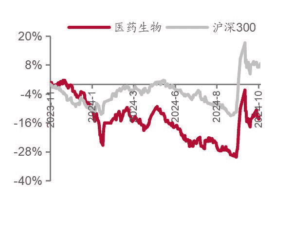

**相关报告**

1、《Q3业绩有望逐步出清，把握医药反弹机会》2024-10-27

2、《政策延续，医药复苏与成长可期；第十批国采启动》2024-10-20

3、《Q3前瞻发布，看好后续行情》2024-10-14

**重点公司基本状况**

| 简称 | 股价(元) | EPS 2022A | EPS 2023A | EPS 2024E | EPS 2025E | EPS 2026E | PE 2022A | PE 2023A | PE 2024E | PE 2025E | PE 2026E | 评级 |
|---|---|---|---|---|---|---|---|---|---|---|---|---|
| 药明康德 | 51.96 | 3.05 | 3.33 | 3.41 | 3.83 | 4.48 | 17.03 | 15.62 | 15.24 | 13.57 | 11.61 | 买入 |
| 华润三九 | 45.93 | 1.91 | 2.22 | 2.57 | 2.94 | 3.31 | 24.09 | 20.68 | 17.89 | 15.60 | 13.90 | 买入 |
| 东阿阿胶 | 57.45 | 1.21 | 1.79 | 2.25 | 2.71 | 3.26 | 47.43 | 32.15 | 25.48 | 21.17 | 17.62 | 买入 |
| 仙琚制药 | 12.64 | 0.76 | 0.57 | 0.69 | 0.85 | 1.05 | 16.68 | 22.21 | 18.28 | 14.80 | 12.02 | 买入 |
| 康方生物 | 69.65 | -1.30 | 2.26 | -1.04 | -0.34 | 0.21 | -53.50 | 30.82 | -67.00 | -204.30 | 329.03 | 买入 |
| 艾力斯 | 53.00 | 0.29 | 1.43 | 2.87 | 3.67 | 4.39 | 182.73 | 37.02 | 18.45 | 14.44 | 12.06 | 买入 |
| 贝达药业 | 46.95 | 0.35 | 0.83 | 1.22 | 1.70 | 2.39 | 135.11 | 56.45 | 38.45 | 27.63 | 19.67 | 买入 |
| 诺泰生物 | 49.60 | 0.59 | 0.74 | 1.01 | 1.42 | 2.05 | 84.43 | 66.90 | 49.33 | 34.94 | 24.17 | 买入 |
| 诺唯赞 | 23.38 | 1.49 | -0.18 | -0.17 | 0.53 | 0.82 | 15.74 | -132 | -138 | 44.11 | 28.43 | 买入 |
| 迪安诊断 | 12.57 | 2.29 | 0.49 | 1.22 | 1.53 | 1.91 | 5.48 | 25.55 | 10.31 | 8.23 | 6.57 | 买入 |

备注：股价截止自2024年11月4日收盘价，每股指标按照最新股本数全面摊薄

## 报告摘要

**10月回顾：** 2024年10月医药生物板块下跌4.3%，同期沪深300下跌3.2%，医药板块跑输沪深300约1.2%，位列31个子行业第28位。本月子板块化学制药、医疗服务、中药、医药商业、医疗器械、生物制品分别下跌2.67%、3.68%、4.48%、5.37%、5.71%、5.88%。10月行情大起大落，在9月底系列政策组合拳推动下，医药板块在5个交易日上涨近40%，市场情绪高涨；随后国庆节后第一天市场高开低走，逐步回落；后续科技、并购重组等主题延续行情，但医药的相关度较低，叠加Q3季报期板块业绩整体承压，医药板块走势较弱，明显跑输其他行业。同时，医药板块基金持仓占比进一步下降，2024年第三季度A股前十大重仓医药板块占比9.69%（环比-2.07pp），扣除医药基金后占比4.90%（环比-1.30pp）。扣除医药基金后板块低配1.79%（环比-1.13pp）。目前医药板块持仓水平接近历史10%分位水平，且是这轮反弹行情中表现最弱的行业，我们认为随着Q3业绩披露结束，短期的压制因素得到缓解，市场会更为关注底部的医药板块投资机会，逐步寻找2025年基本面有望改善的细分子行业及个股，建议当前重点关注，加大配置。

**展望11月：业绩真空期，寻找2025年基本面改善的方向。** 随着三季报业绩的披露，市场对于2024年整体的经营情况具有了更为清晰的脉络。在整体Q3普遍承压的情况上，市场将更为关注2025年的经营趋势，重点寻找基本面改善的方向。我们认为当前的投资思路主要分为两方面，一是布局明年，另外在业绩真空期积极把握主题、事件催化。建议关注以下方面：

- **1）高景气：** 近两年高景气投资主要面临估值的压制，其中不缺乏创新不断收获、基本面持续强劲的个股，展望明年，我们认为随着政策支持市场整体走强，风险偏好有望提升，高景气投资打开估值空间，看好创新药、仿创结合、GLP-1赛道等。如康方生物、艾力斯、贝达药业、君实生物、九典制药、苑东生物、诺泰生物、圣诺生物等。
- **2）困境反转：** 是近两年医药板块的主线方向，核心是寻找真正能够出现拐点，且较为准确判断拐点的节点。今年来看，原料药、低耗、上游的部分个股率先表现出了一定改善，展望明年，我们认为原料药、低耗的趋势有望持续，CRO/CDMO、上游、ICL、设备招投标可能逐步走出明显拐点。如仙琚制药、拱东医疗、诺唯赞、药明康德、康龙化成、迪安诊断、金域医学、迈瑞医疗、开立医疗、澳华内镜等。
- **3）业绩稳健：** 医药板块的轮动在近两年表现的较为明显，但结构性行情一直存在，核心因素就是业绩，建议重点把握明年业绩持续强劲的个股，如部分中药、血制品龙头公司，如东阿阿胶、华润三九、佐力药业、天坛生物等。
- **4）主题、事件：** 11月开始市场进入较为漫长的业绩真空期，我们认为短期风险偏好有望提升并购重组、政策改善等带来的机会。

**2024三季报总结：** 2024年前三季度医药上市公司累计收入下滑0.3%，利润总额下降7.4%，扣非净利润下降4.6%；2024Q3医药上市公司收入增长0.5%，利润总额下降13.0%，扣非利润下降13.6%。Q3收入环比提升1.7pp，由负转正，收入端出现企稳改善表现；利润总额环比下降6.6pp，扣非净利润环比下降13.6pp，利润端表现更为承压状态。今年以来，医药行业受到持续整治行动影响，新产品入院困难、药品耗材相对管控、医院基建及招投标放缓，院内整体业务面临压力。院外OTC、消费医疗等受到宏观经济环境扰动，同样表现较弱。前期强势板块随着基数高企有所走弱，但部分前期承压的细分行业逐步走出低谷，经营持续改善。我们认为在行业整体承压状态下，企业更为重要的是保证自身行业地位及市场份额，持续优化管理效率，降本增效，因此收入端的稳健尤为重要，利润端的波动为长期发展积蓄力量。

**分板块：化学制剂、原料药业绩较为亮眼。** 申万一级子行业中，2024Q1-Q3收入增速排序为化学制剂（+4.46%）、化学原料药（+3.46%）、医疗器械（+1.22%）、医药商业（1.39%）、中药（-3.25%）、医疗服务（-4.88%）、生物制品（-17.35%）；扣非净利润增速排序为化学制剂（+48.97%）、化学原料药（-1.37%）、医疗器械（-4.20%）、医药商业（-7.06%）、中药（-8.59%）、医疗服务（-29.53%）、生物制品（-34.28%）。2024Q3收入增速排序为化学原料药（+6.99%）、医药商业（+4.63%）、化学制剂（+4.19%）、医疗器械（+2.51%）、医疗服务（-2.59%）、中药（-3.10%）、生物制品（-28.19%）；扣非净利润增速排序为化学制剂（+26.68%）、化学原料药（+20.55%）、中药（-16.68%）、医药商业（-10.20%）、医疗器械（-12.61%）、医疗服务（-30.01%）、生物制品（-40.21%）。化学制剂、化学原料药、医疗器械（其中生命科学上游）均为2023年受政策、疫情、国际形势、行业竞争等多方面压力的子板块，今年以来逐步走出影响迎来业绩的改善。医药商业、中药整体相对稳健，在去年相对高基数背景下收入基本持平，利润小幅下滑。生物制品、医疗服务子板块则受到宏观经济、行业竞争等影响持续表现承压，静待拐点。

**11月重点推荐：** 药明康德、华润三九、东阿阿胶、仙琚制药、康方生物、艾力斯、贝达药业、诺泰生物、诺唯赞、迪安诊断。中泰医药重点推荐10月平均跌幅8.17%，跑输医药行业3.85%。

**行业热点聚焦：** （1）前三季度医保结算69.16亿人次，统筹基金支出1.76万亿元；（2）2024年国家医保谈判工作完成；（3）第三批全国中成药集采文件征求意见；（4）2024年诺贝尔生理学或医学奖：解码microRNA的革命性发现；（5）多省发布药械药品集中采购相关通知；（6）市场监管总局发布《医药企业防范商业贿赂风险合规指引（征求意见稿）》。

**市场动态：** 2024年初到目前的医药板块进行分析，医药板块收益率-11.2%，同期沪深300绝对收益率6.2%，医药板块跑输沪深300约17.4%。2024年10月医药生物板块下跌4.3%，同期沪深300下跌3.2%，医药板块跑输沪深300约1.2%，位列31个子行业第28位。本月子板块化学制药、医疗服务、中药、医药商业、医疗器械、生物制品分别下跌2.67%、3.68%、4.48%、5.37%、5.71%、5.88%。以2024年盈利预测估值来计算，目前医药板块估值22.8倍PE，全部A股（扣除金融板块）市盈率约为19.1倍，医药板块相对全部A股（扣除金融板块）的溢价率为19.6%。以TTM估值法计算，目前医药板块估值23.1倍PE，低于历史平均水平（35.4倍PE），相对全部A股（扣除金融板块）的溢价率为33.1%。

**风险提示：** 政策扰动风险、药品质量问题、研究报告使用的公开资料可能存在信息滞后或更新不及时的风险。

### 内容目录

### 11月行业投资观点
业绩真空期，寻找2025年基本面改善的方向

### 中泰医药重点推荐组合
11月重点推荐：药明康德、华润三九、东阿阿胶、仙琚制药、康方生物、艾力斯、贝达药业、诺泰生物、诺唯赞、迪安诊断

### 医药板块2024年三季报数据详细拆分
- 收入相对韧性，利润有所承压
- 盈利能力略有波动，营运能力保持稳定
- 分板块：化学制剂、原料药表现较好，血制品、流通相对韧性

### 行业热点聚焦
- （1）前三季度医保结算69.16亿人次，统筹基金支出1.76万亿元
- （2）2024年国家医保谈判工作完成
- （3）第三批全国中成药集采文件征求意见
- （4）2024年诺贝尔生理学或医学奖：解码microRNA的革命性发现
- （5）多省发布药械药品集中采购相关通知
- （6）市场监管总局发布《医药企业防范商业贿赂风险合规指引（征求意见稿）》

### 10月板块回顾与分析
- 板块收益
- 板块估值
- 个股表现

### 附录
- 中药材价格追踪
- 本期研究报告汇总
- 中泰医药主要覆盖公司及估值一览

### 行业风险因素分析
- 行业政策扰动风险
- 药品质量风险

### 图表目录

图表1：中泰医药11月推荐组合

图表2：重点推荐组合10月表现

图表3：医药上市公司营收累计同比增长表

图表4：医药板块营收累计同比增长图

图表5：医药上市公司利润总额累计同比增长表

图表6：医药板块利润总额累计同比增长图

图表7：医药上市公司扣非利润累计同比增长表

图表8：医药板块扣非利润累计同比增长图

图表9：A股医药板块2024年三季度毛利率及经营现金流情况

图表10：A股医药公司2024年三季度期间费用率情况

图表11：A股医药公司2024年三季度期间财务比率情况

图表12：细分领域2024Q1-Q3收入利润增速（%）

图表13：A股医药公司2024Q1-Q3盈利增长情况

图表14：医药板块vs沪深300相对收益率

图表15：各行业月涨跌幅比较（单位：%）

行业专题报告

- 4 -

请务必阅读正文之后的重要声明部分

图表16：医药子行业月涨跌幅比较........................................................................18

图表17：医药板块整体估值溢价（2024盈利预测市盈率）.................................18

图表18：医药板块整体估值溢价（扣除金融板块，2010年至今）......................19

图表19：医药子板块估值对比（平均市盈率统计为2010年至今）.....................19

图表20：本月涨幅前15位公司（扣除ST股）....................................................20

图表21：本月跌幅前15位公司（扣除ST股）....................................................20

图表22：中国成都中药材价格指数图....................................................................20

图表23：本期中泰医药小组研究报告汇总.............................................................21

图表24：中泰医药主要覆盖公司及估值一览.........................................................22

行业专题报告

- 5 -

请务必阅读正文之后的重要声明部分

## 11月行业投资观点

## 业绩真空期，寻找2025年基本面改善的方向

- **10月回顾：**2024年10月医药生物板块下跌4.3%，同期沪深300下跌3.2%，医药板块跑输沪深300约1.2%，位列31个子行业第28位。本月子板块化学制药、医疗服务、中药、医药商业、医疗器械、生物制品分别下跌2.67%、3.68%、4.48%、5.37%、5.71%、5.88%。10月行情大起大落，在9月底系列政策组合拳推动下，医药板块在5个交易日上涨近40%，市场情绪高涨；随后国庆节后第一天市场高开低走，逐步回落；后续科技、并购重组等主题延续行情，但医药的相关度较低，叠加Q3季报期板块业绩整体承压，医药板块走势较弱，明显跑输其他行业。同时，医药板块基金持仓占比进一步下降，2024年第三季度A股前十大重仓医药板块占比9.69%（环比-2.07pp），扣除医药基金后占比4.90%（环比-1.30pp）。扣除医药基金后板块低配1.79%（环比-1.13pp）。目前医药板块持仓水平接近历史10%分位水平，且是这轮反弹行情中表现最弱的行业，我们认为随着Q3业绩披露结束，短期的压制因素得到缓解，市场会更为关注底部的医药板块投资机会，逐步寻找2025年基本面有望改善的细分子行业及个股，建议当前重点关注，加大配置。

- **展望11月：**业绩真空期，寻找2025年基本面改善的方向。随着三季报业绩的披露，市场对于2024年整体的经营情况具有了更为清晰的脉络。在整体Q3普遍承压的情况下，市场将更为关注2025年的经营趋势，重点寻找基本面改善的方向。我们认为当前的投资思路主要分为两方面，一是布局明年，另外在业绩真空期积极把握主题、事件催化。建议关注以下方面：

- **1）高景气：**近两年高景气投资主要面临估值的压制，其中不缺乏创新不断收获、基本面持续强劲的个股。展望明年，我们认为随着政策支持市场整体走强，风险偏好有望提升，高景气投资打开估值空间，看好创新药、仿创结合、GLP-1赛道等。如康方生物、艾力斯、贝达药业、君实生物、九典制药、苑东生物、诺泰生物、圣诺生物等。

- **2）困境反转：**是近两年医药板块的主线方向，核心是寻找真正能够出现拐点，且较为准确判断拐点的节点。今年来看，原料药、低耗、上游的部分个股率先表现出了一定改善。展望明年，我们认为原料药、低耗的趋势有望持续，CRO/CDMO、上游、ICL、设备招投标可能逐步走出明显拐点。如仙琚制药、拱东医疗、诺唯赞、药明康德、康龙化成、迪安诊断、金域医学、迈瑞医疗、开立医疗、澳华内镜等。

- **3）业绩稳健：**医药板块的轮动在近两年表现得较为明显，但结构性行情一直存在，核心因素就是业绩。建议重点把握明年业绩持续强劲的个股，如部分中药、血制品龙头公司，如东阿阿胶、华润三九、佐力药业、天坛生物等。

- **4）主题、事件：**11月开始市场进入较为漫长的业绩真空期，我们认为短期风险偏好有望提升并购重组、政策改善等带来的机会。

### 中泰医药重点推荐组合

**11月重点推荐：**药明康德、华润三九、东阿阿胶、仙琚制药、康方生物、艾力斯、贝达药业、诺泰生物、诺唯赞、迪安诊断

行业专题报告

- 6 -

请务必阅读正文之后的重要声明部分

图表1：中泰医药11月推荐组合

来源：WIND，中泰证券研究所

注：市值数据截止至2024/10/31；康方生物市值单位为港元

行业专题报告

- 7 -

请务必阅读正文之后的重要声明部分

- 中泰医药重点推荐10月平均跌幅8.17%，跑输医药行业3.85%。

## 医药板块2024年三季报数据详细拆分

## 收入相对韧性，利润有所承压

- 我们统计了A股所有医药上市公司的2024年三季报情况，剔除部分次新股、转型股、北交所和个别数据异常个股后，总计435家上市公司。

- 2024年前三季度医药上市公司累计收入下滑0.3%，利润总额下降7.4%，扣非净利润下降4.6%；2024Q3医药上市公司收入增长0.5%，利润总额下降13.0%，扣非利润下降13.6%。Q3收入环比提升1.7pp，由负转正，收入端出现企稳改善表现；利润总额环比下降6.6pp，扣非净利润环比下降13.6pp，利润端表现更为承压状态。今年以来，医药行业受到持续整治行动影响，新产品入院困难、药品耗材相对管控、医院基建及招投标放缓，院内整体业务面临压力。院外OTC、消费医疗等受到宏观经济环境扰动，同样表现较弱。前期强势板块随着基数高企有所走弱，但部分前期承压的细分行业逐步走出低谷，经营持续改善。我们认为在行业整体承压状态下，企业更为重要的是保证自身行业地位及市场份额，持续优化管理效率，降本增效，因此收入端的稳健尤为重要，利润端的波动为长期发展积蓄力量。

图表3：医药上市公司营收累计同比增长表

图表4：医药板块营收累计同比增长图

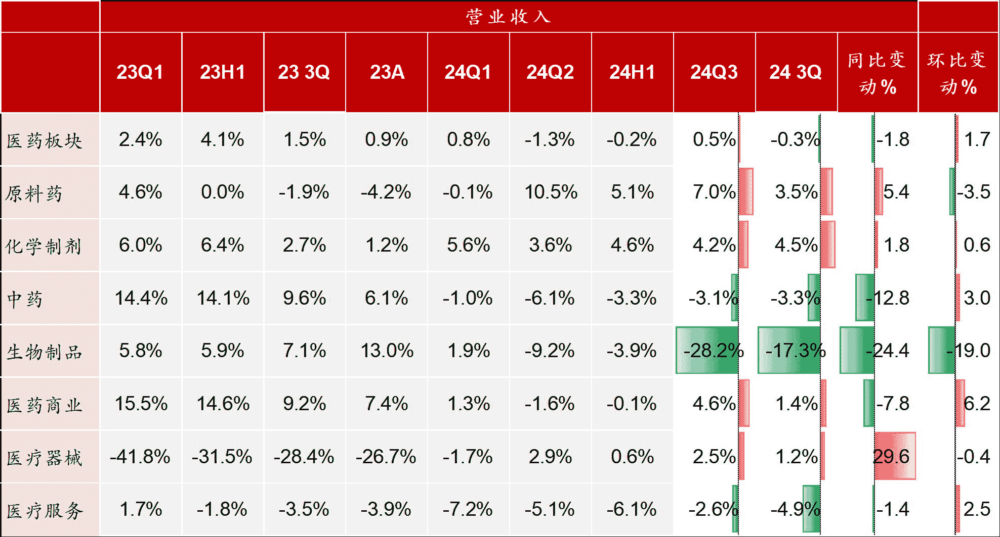

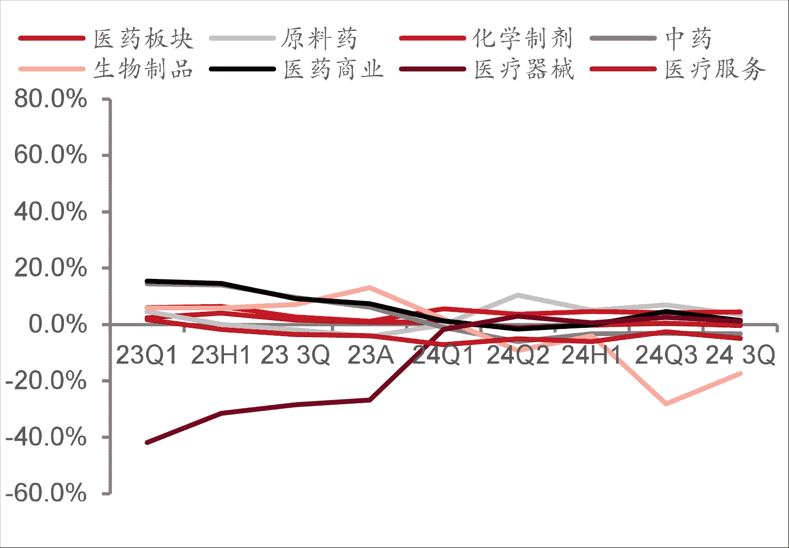

来源：WIND，中泰证券研究所

图表2：重点推荐组合10月表现

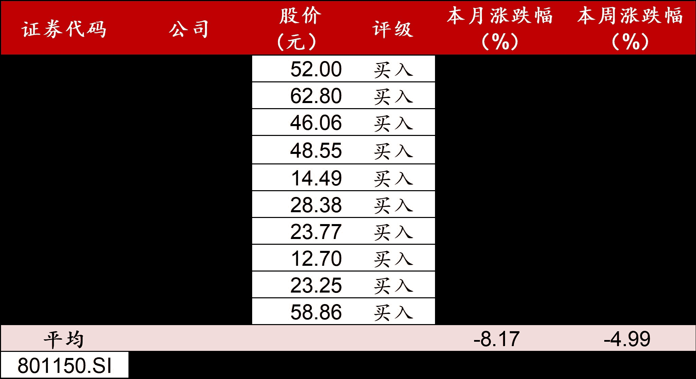

来源：Wind，中泰证券研究所（股价截至2024/10/31）

注：数据截至2024.10.31

行业专题报告

- 8 -

请务必阅读正文之后的重要声明部分

图表5：医药上市公司利润总额累计同比增长表

图表6：医药板块利润总额累计同比增长图

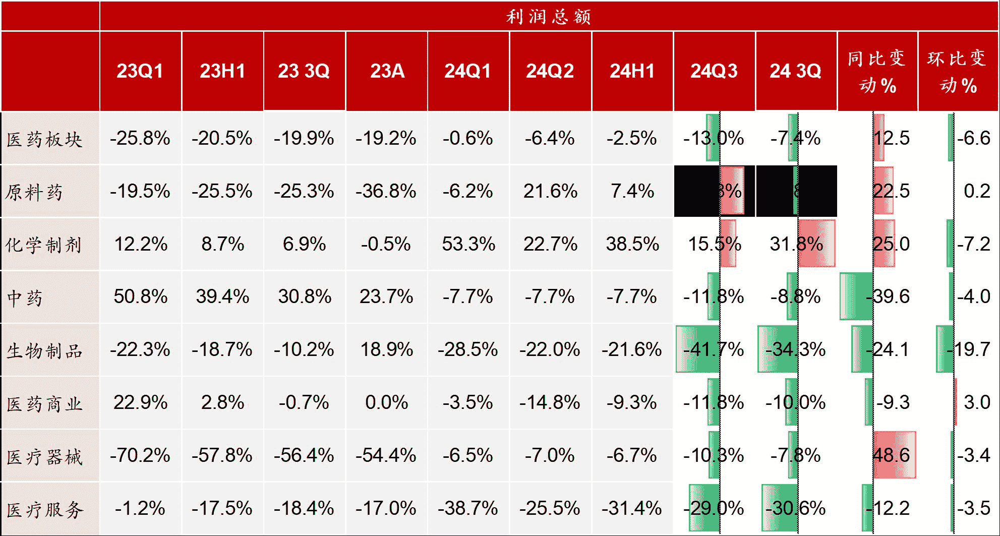

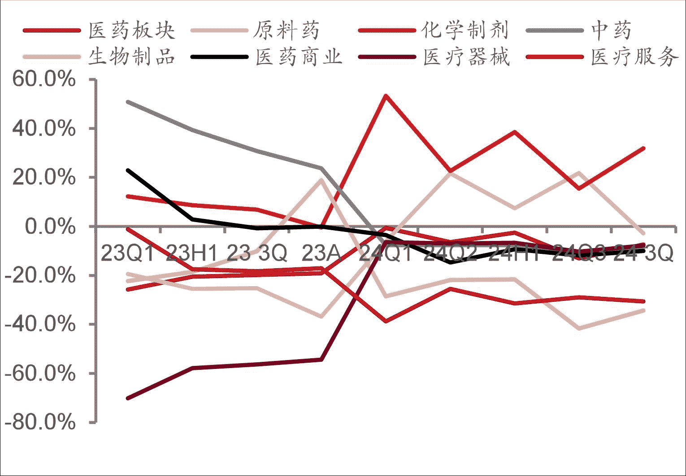

来源：WIND，中泰证券研究所

图表7：医药上市公司扣非利润累计同比增长表

图表8：医药板块扣非利润累计同比增长图

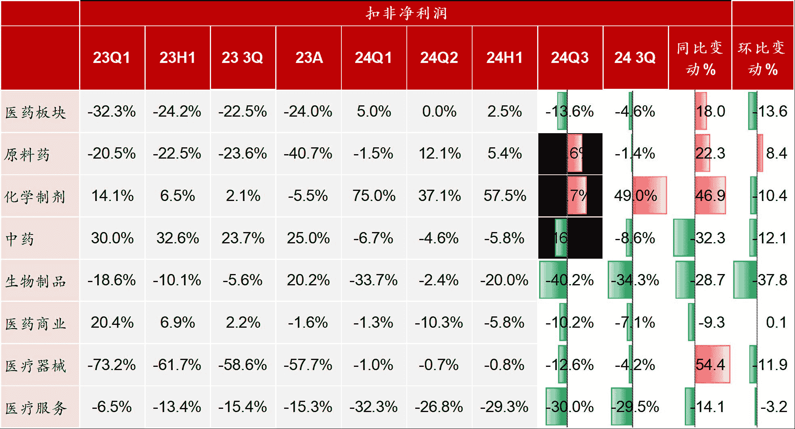

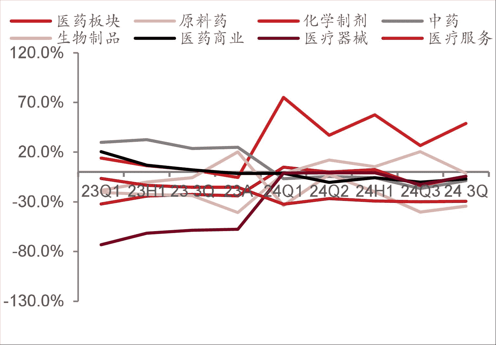

来源：WIND，中泰证券研究所

## 盈利能力略有波动，营运能力保持稳定

- 毛利率、经营性现金流略有下降。2024Q1-Q3医药上市公司毛利率31.5%（同比-1.54pp），2024Q3毛利率30.9%（-1.04pp），略有下降。其中提升明显的是化学制剂52.2%（+1.29pp），预计得益于集采影响逐步弱化、创新高毛利占比提升等结构调整。生物制品毛利率56.4%（+1.7pp），有所改善，预计与生物创新药持续放量相关。波动较大的是：中药42.2%（-2.85pp），预计由于中成药集采、药品价格治理政策等因素导致；医疗服务38.1%（-2.77pp），预计由于消费降级、竞争加剧等因素导致；其余子板块毛利率基本稳定。板块整体经营现金流1305.17亿（-6.58%），各板块明显分化。其中化学制剂（+28.14%）、医疗器械（+32.83%）现金流表现较好，医药商业（-59.57%）现金流显著下降，我们预计主要由于宏观环境整体压力，应收账款等回款较慢。

行业专题报告

- 9 -

请务必阅读正文之后的重要声明部分

图表9：A股医药板块2024年三季度毛利率及经营现金流情况

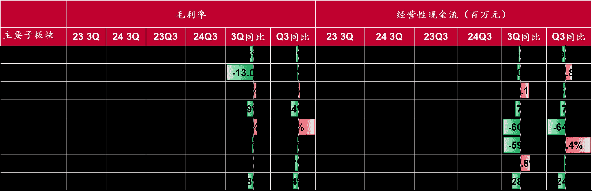

来源：WIND，中泰证券研究所

- 期间费用：销售费用率持续降低，降本增效不断推进，研发保持投入。2024Q1-Q3医药板块销售费用率12.46%（-0.85pp），除生物制品和医疗服务外（预计由于收入扰动，费用相对更为刚性），其他子板块均实现降低，其中化学制剂21.50%（-2.24pp）、中药20.9%（-2.43pp）降幅明显，预计主要由于药品集采、政策环境趋严等因素所致。管理费用率5.0%、财务费用率3.9%，基本持平，其中生物制品的管理费用率略有上升，预计与收入波动相关；出口型企业如原料药、部分耗材受到Q3人民币汇率升值财务费用略有增加。当前宏观经济及医药行业均面临一定压力，寻求成长较为不易，企业为适应环境持续加大精细化管理，以实现降本增效。但同时医药行业的技术密集属性，使得企业在压力下仍旧保持研发的持续投入，以寻求长期发展。

行业专题报告

- 10 -

请务必阅读正文之后的重要声明部分

图表10：A股医药公司2024年三季度期间费用率情况

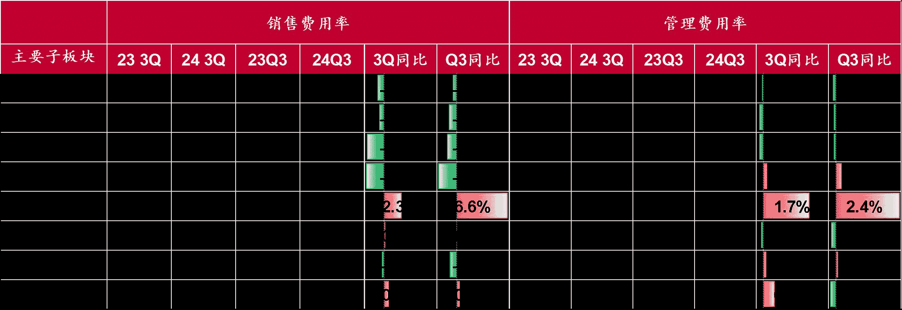

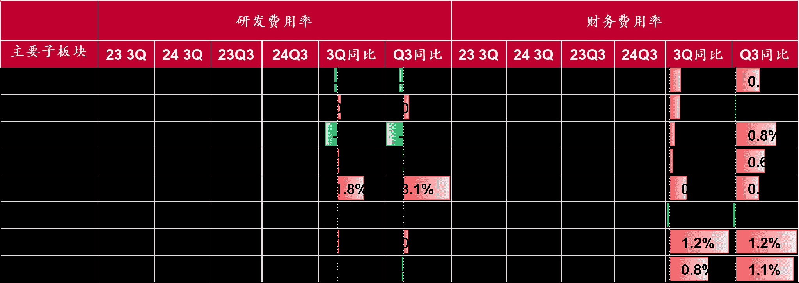

来源：WIND，中泰证券研究所

- 资产负债率稳中有降，政策环境变动下应收账款、存货周转能力保持稳定。2024Q1-Q3医药板块资产负债率38.8%（同比-2.9pp），企业负债结构不断优化，实现稳中有降。应收账款周转率2.7，存货周转率2.8，与2023年同期基本持平。

图表11：A股医药公司2024年三季度期间财务比率情况

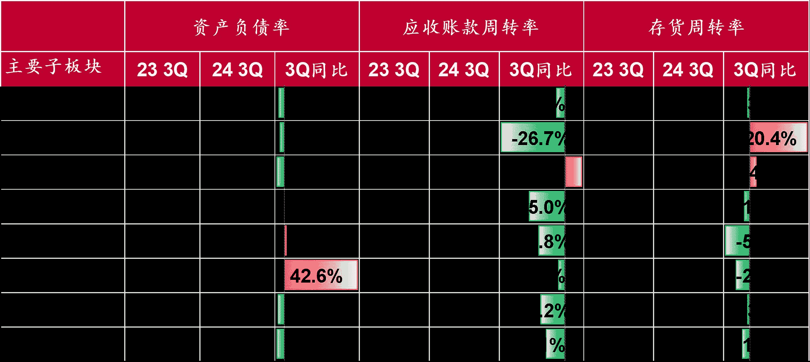

来源：WIND，中泰证券研究所

行业专题报告

- 11 -

请务必阅读正文之后的重要声明部分

## 分板块：化学制剂、原料药表现较好，血制品、流通相对韧性

- 申万一级子行业中，**2024Q1-Q3**收入增速排序为化学制剂（+4.46%）、化学原料药（+3.46%）、医疗器械（+1.22%）、医药商业（-1.39%）、中药（-3.25%）、医疗服务（-4.88%）、生物制品（-17.35%）；扣非净利润增速排序为化学制剂（+48.97%）、化学原料药（-1.37%）、医疗器械（-4.20%）、医药商业（-7.06%）、中药（-8.59%）、医疗服务（-29.53%）、生物制品（-34.28%）。**2024Q3**收入增速排序为化学原料药（+6.99%）、医药商业（+4.63%）、化学制剂（+4.19%）、医疗器械（+2.51%）、医疗服务（-2.59%）、中药（-3.10%）、生物制品（-28.19%）；扣非净利润增速排序为化学制剂（+26.68%）、化学原料药（+20.55%）、中药（-16.68%）、医药商业（-10.20%）、医疗器械（-12.61%）、医疗服务（-30.01%）、生物制品（-40.21%）。化学制剂、化学原料药、医疗器械（其中生命科学上游）均为2023年受政策、疫情、国际形势、行业竞争等多方面压力的子板块，今年以来逐步走出影响，迎来业绩的改善。医药商业、中药整体相对稳健，在去年相对高基数背景下收入基本持平，利润小幅下滑。生物制品、医疗服务子板块则受到宏观经济、行业竞争等影响持续表现承压，静待拐点。

- 化学制剂：2024Q1-Q3子板块收入+4.46%（+3.89pp），扣非净利润+48.97%（+48.40pp），2024Q3子板块收入+4.19%（+9.01pp），扣非净利润+26.68%（+35.89pp），受益于收入结构向创新产品的不断倾斜，收入端在日趋严峻的环境中表现出韧性，利润端大幅增加则主要受益于海外大额授权费、创新药放量实现利润、营销体系改革等，同时表现出销售费用率明显降低。

- 化学原料药：2024Q1-Q3子板块收入+3.46%（+5.38pp），扣非净利润-1.37%（+22.26pp），2024Q3子板块收入+6.99%（+12.87pp），扣非净利润+20.55%（+47.39pp），原料药行业在23年经历了去库存、订单外流、竞争加剧，出现收入利润大幅下滑。24Q3板块出现明显改善，其中特色原料药2024Q1-Q3收入增长8.07%，扣非净利润+2.68%，其中仙琚制药等表现优异。目前存量业务处于底部区间，下行风险有限，增量新业务在24年迎来全面向好趋势明确，拐点可期。

- 医疗器械：2024Q1-Q3子板块收入+1.22%（+29.61pp），扣非净利润-4.20%（+54.37pp），2024Q3子板块收入+2.51%（+23.24pp），扣非净利润-12.61%（+35.40pp），新冠相关基数基本出清，重点企业海外表现尤为亮眼，在产品收入结构优化作用下盈利能力提升。其中医疗设备2024Q1-Q3收入下滑2.03%，扣非净利润下滑14.38%，主要受到院内政策环境、财政支出收紧等影响。体外诊断2024Q1-Q3收入-0.72%，扣非净利润-1.24%，Q3收入下滑收窄，有所恢复，当前诊断处于疫情影响逐步出清、常规业务恢复，但集采扩围持续推进的多空双重影响，行业整体承压但相对稳定。生命科学服务：新冠相关产品基数效应影响出清，2024Q1-Q3子板块收入+6.17%，扣非净利润-12.95%，下游需求从疫情中基本复苏，有望逐步迎来拐点。各细分赛道低国产化率提升空间大+国内具备工程师红利的长期逻辑不变，期待板块业绩在更多创新产品的驱动下重回高增，如诺唯赞布局的阿尔茨海默病检测产品等。

- 中药：2024Q1-Q3子板块收入-3.25%（-12.29pp），扣非净利润-8.59%（-31.22pp），2024Q3子板块收入-3.10%（-3.10pp），扣非净利润-16.68%（-19.37pp），Q3为多数中药公司的淡季，叠加去年相对高基数，收入及利润端短期有所波动。

- 医药商业：2024Q1-Q3子板块收入1.39%（-7.77pp），扣非净利润-7.06%（-9.28pp）。2024Q3子板块收入4.63%（+5.51pp），扣非净利润-10.20%（-2.20pp）。2024Q1-Q3利润端明显波动主要由于外部环境变化所致。药店2024Q1-Q3收入增长6.74%，扣非净利润-23.42%，近期外部环境变化剧烈，多项政策持续推出，行业负面事件频发，板块阶段逻辑有所承压。

- 生物制品：2024Q1-Q3子板块收入-17.35%（-24.44pp），扣非净利润-34.28%（-28.65pp）。2024Q3子板块收入-28.19%（-44.92pp），扣非净利润-40.21%（-52.61pp）。血制品：浆站拓展稳步推进，创新产品持续加码，业绩持续稳健，2024Q1-Q3收入下降1.67%，扣非净利润增长5.58%。随着浆站规划、产能建设等的加速落地，以及多种高壁垒新品的注册获批，板块有望在中长期内保持稳健增长。疫苗：2024Q1-Q3收入-38.65%，扣非净利润-63.72%，主要由于二类疫苗多数为可选消费，宏观环境扰动下需求疲软，叠加竞争加剧、研发投入大幅增加所致。此外，大分子创新药在海内外快速放量为板块带来持续驱动。

- 医疗服务（分类包含CRO/CDMO、医疗服务、ICL等）：2024Q1-Q3子板块收入-4.88%（-1.36pp），扣非净利润-29.53%（-14.15pp），2024Q3子板块收入-2.59%（+4.20pp），扣非净利润-30.01%（-13.50pp）。CRO/CDMO：2024Q1-Q3收入-7.39%，扣非净利润-31.22%，由于在手订单确认收入需要一定周期，虽部分优秀企业的新签订单有所回升，但表观业绩受前期投融资遇冷的影响尚未出清，期待阶段性拐点，关注多肽CDMO等竞争格局较好、需求景气的细分行业龙头。医院：2024Q1-Q3收入+1.96%，扣非净利润-11.77%。2023年同期疫情管控放开后门诊、手术量复苏导致需求集中释放，收入及利润高基数。同时受到宏观经济扰动，消费类医疗服务阶段承压。ICL：2024Q1-Q3收入-9.37%，扣非净利润-79.94%，相对去年同期收入及利润下滑幅度明显缩窄，前期新冠核酸、抗原检测试剂盒等诊断产品，以及新冠检测服务高需求使IVD/ICL公司有明显的基数效应，此外信用减值计提进一步影响了部分公司业绩。当下来看业绩高基数时期已过，期待收入及业绩增速逐季恢复。

图表12：细分领域2024Q1-Q3收入利润增速（%）

**主要子板块2024Q1-Q3收入增速**

| 子板块 | 2024Q1 | 2024Q2 | 2023Q3 | 2023 3Q | 2024Q3 | 2024 3Q | Q3增速同比变化 | 3Q增速同比变化 |
|---|---:|---:|---:|---:|---:|---:|---:|---:|
| 医药板块 | 0.80% | -1.26% | -3.31% | 1.40% | 0.47% | -0.33% | 3.77% | -1.73% |
| 化学原料药 | -0.09% | 10.46% | -5.88% | -1.92% | 6.99% | 3.46% | 12.87% | 5.38% |
| 特色原料药 | 4.01% | 12.56% | -1.47% | 5.35% | 7.83% | 8.07% | 9.30% | 2.72% |
| 化学制剂 | 5.59% | 3.63% | -4.83% | 0.57% | 4.19% | 4.46% | 9.01% | 3.89% |
| 中药 | -1.03% | -6.11% | 0.00% | 9.04% | -3.10% | -3.25% | -3.10% | -12.29% |
| 生物制品 | 1.95% | -9.19% | 16.72% | 7.09% | -28.19% | -17.35% | -44.92% | -24.44% |
| 疫苗 | -5.22% | 12.67% | 25.77% | 15.54% | -55.71% | -38.65% | -81.47% | -54.18% |
| 血制品 | -11.10% | -32.75% | 37.52% | 17.58% | -9.89% | -1.67% | -47.40% | -19.25% |
| 医药商业 | 1.34% | -1.60% | -0.88% | 9.16% | 4.63% | 1.39% | 5.51% | -7.77% |
| 医药流通 | 0.27% | -2.28% | -1.90% | 7.98% | 4.54% | 0.77% | 6.45% | -7.21% |
| 药店 | 11.44% | 4.69% | 11.83% | 18.11% | 4.91% | 6.74% | -6.92% | -11.37% |
| 医疗器械 | -1.71% | 2.90% | -20.73% | -28.39% | 2.51% | 1.22% | 23.24% | 29.61% |
| 医疗设备 | -0.73% | -1.66% | 5.77% | 15.13% | -3.80% | -2.03% | -9.58% | -17.16% |
| 生命科学服务 | 4.42% | 12.58% | -18.02% | -22.68% | 3.67% | 6.17% | 21.69% | 28.85% |
| 体外诊断 | -10.98% | 0.48% | -37.95% | -39.19% | -2.00% | 0.72% | 35.95% | 39.91% |
| 医疗服务 | -7.16% | -5.07% | -6.79% | -3.52% | -2.59% | -4.88% | 4.20% | -1.36% |
| CRO、CDMO | -12.30% | -9.45% | -12.95% | 1.85% | -1.08% | -7.39% | 11.87% | -9.24% |
| 民营医疗 | 2.24% | 3.30% | 15.15% | 20.53% | 0.21% | 1.96% | -14.95% | -18.57% |
| ICL | -9.21% | -7.41% | -40.09% | -42.25% | -11.45% | -9.37% | 28.64% | 32.88% |

**主要子板块扣除非经常性损益的净利润增速**

| 子板块 | 2024Q1 | 2024Q2 | 2023Q3 | 2023 3Q | 2024Q3 | 2024 3Q | Q3增速同比变化 | 3Q增速同比变化 |
|---|---:|---:|---:|---:|---:|---:|---:|---:|
| 医药板块 | 4.96% | -0.05% | -18.80% | -22.83% | -13.64% | -4.56% | 5.16% | 18.27% |
| 化学原料药 | -1.45% | 12.13% | -26.84% | -23.63% | 20.55% | -1.37% | 47.39% | 22.26% |
| 特色原料药 | 1.78% | -0.73% | -9.53% | -1.20% | 8.65% | 2.68% | 18.18% | 3.87% |
| 化学制剂 | 75.03% | 37.05% | -9.21% | 0.57% | 26.68% | 48.97% | 35.89% | 48.40% |
| 中药 | -6.65% | -4.56% | 2.69% | 22.63% | -16.68% | -8.59% | -19.37% | -31.22% |
| 生物制品 | -33.66% | -2.45% | 12.41% | -5.63% | -40.21% | -34.28% | -52.61% | -28.65% |
| 疫苗 | 0.33% | 27.86% | -16.73% | -8.77% | -78.68% | -63.72% | -61.95% | -54.95% |
| 血制品 | -54.10% | -45.51% | 36.03% | 19.22% | -0.87% | 5.58% | -36.91% | -13.64% |
| 医药商业 | -1.33% | -10.31% | -8.00% | 2.22% | -10.20% | -7.06% | -2.20% | -9.28% |
| 医药流通 | -0.80% | -2.66% | -10.00% | -1.08% | -2.91% | -2.08% | 7.10% | -1.00% |
| 药店 | -3.34% | -34.38% | 6.31% | 19.78% | -35.59% | -23.42% | -41.90% | -43.20% |
| 医疗器械 | -1.01% | -0.70% | -48.01% | -58.57% | -12.61% | -4.20% | 35.40% | 54.37% |
| 医疗设备 | -9.11% | -7.34% | 2.73% | 16.53% | -29.93% | -14.38% | -32.67% | -30.92% |
| 生命科学服务 | 35.56% | 23.62% | -27.86% | -77.28% | -34.65% | -12.95% | -6.79% | 64.32% |
| 体外诊断 | 0.84% | -0.96% | -55.97% | -59.20% | -20.17% | -1.24% | 35.80% | 57.96% |
| 医疗服务 | -32.35% | -26.83% | -16.51% | -15.38% | -30.01% | -29.53% | -13.50% | -14.15% |
| CRO、CDMO | -33.20% | -32.14% | -15.06% | -3.27% | -29.47% | -31.22% | -14.41% | -27.95% |
| 民营医疗 | -9.03% | -15.20% | 17.14% | 21.62% | -10.23% | -11.77% | -27.37% | -33.39% |
| ICL | -97.62% | -38.36% | -85.67% | -85.08% | -99.00% | -79.94% | -13.33% | 5.14% |

来源：WIND，中泰证券研究所

## 行业专题报告

## 行业热点聚焦

### （1）前三季度医保结算69.16亿人次，统筹基金支出1.76万亿元

图表13：A股医药公司2024Q1-Q3盈利增长情况

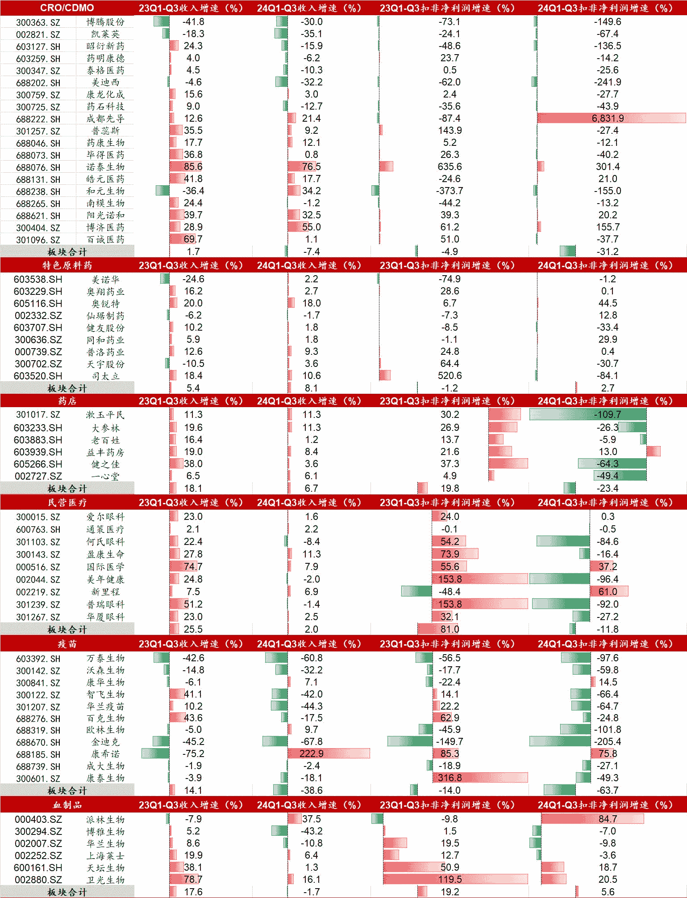

来源：WIND，中泰证券研究所

事件：2024年1-9月，医保结算69.16亿人次，同比增长19.3%，其中门诊就诊48.98亿人次，较2023年同期增长25%，有效保障门诊就医需求。

中泰观点：

1）深化职工医保门诊共济保障改革，扩大个人账户共济的人员范围和资金使用范围，个人账户共济使用305亿元，促进盘活存量资金，有效减轻参保人就医负担。协议期内397个谈判药品医保基金累计支付719亿元，有力减轻重病慢病患者经济负担。2）1-9月，基本医保统筹基金支出1.76万亿元，同比增长10.5%，比同期GDP增速高出5.7个百分点。上半年全部完成2023年度与定点医疗机构的2.67万亿元资金清算，清欠2023年以前拖欠医疗机构款项48.7亿元，实现对定点医疗机构及时足额支付。3）支持部分省市阶段性降低职工医保单位缴费费率，1-9月累计减轻企业负担近300亿元。截至9月底，全国职工医保参保人数达到3.76亿人，同比增长2.4%，增强了企业信心，提升了社会预期，助力了经济大盘稳定。

资料来源：https://news.pharmnet.com.cn/news/2024/11/01/597192.html

### （2）2024年国家医保谈判工作完成

事件：2024年国家医保药品目录调整现场谈判已于近日顺利结束，“扩容”后的新版医保药品目录预计于11月底对外发布，明年1月1日起正式实施。

中泰观点：

10月27日到30日中午，国家医保局组织25名来自全国各个省份医保部门的谈判专家与相关药品企业开展了现场谈判和竞价，共涉及127家企业、162种药品，其中医保目录外药品117种，医保目录内谈判续约药品45种，总体结果与往年基本相当，符合预期。参加今年谈判的企业包括诺华、赛诺菲、罗氏、强生、恒瑞、信达、康方、云顶新耀、华润、齐鲁、扬子江等，涵盖外资企业、跨国大型药企、内资企业、新兴生物医药企业、国有企业、民营企业。随着中国特色医疗保障制度的不断健全，医保药品目录调整已经进入动态化、常态化、规范化轨道。

资料来源：https://www.nhsa.gov.cn/art/2024/11/2/art_14_14511.html；http://www.news.cn/politics/20241102/49e7f83568224270b9c04f9ad7663f5a/c.html

### （3）第三批全国中成药集采文件征求意见

事件：全国中成药联合采购办公室发布《全国中成药采购联盟集中采购文件（征求意见稿）》(以下简称“征求意见稿”)，向社会公开征求意见。征求意见截至2024年11月1日。

中泰观点：

根据征求意见稿，此次集采品种涉及95种中成药，含血脂康胶囊（片）、喜炎平注射液、舒肝宁注射液等多个中药独家品种。征求意见稿提出，本次联盟地区集中带量采购品种分为20个采购组，共95个品种，涉及胶囊、凝胶、注射液等口服、外用、注射中成药，血脂康胶囊（片）、喜炎平注射液、舒肝宁注射液等多个中药独家品种也被纳入其中。本次集中采购周期自中选结果执行之日起至2027年12月31日。采购周期内采购协议每年一签。采购周期内，医疗机构优先使用本次集中带量采购中选药品，并确保完成协议采购量；联盟地区对未在中选企业申报的“供应清单”产品予以暂停挂网。同时，采购周期内，未中选产品和流标采购组药品均纳入联盟地区监控管理。

征求意见稿提出，基准价格为申报企业“供应清单”内所有产品截至2024年9月28日的省级采购平台的最低中标/挂网价格（不含省级、省际联盟集中带量采购中选价格）。产品若无省级采购平台中标/挂网价格，则以同竞争单元内报价代表品最低日均费用（按说明书载明的用法用量计算，不考虑剂型规格的差比）折算的价格作为基准价格。申报价不高于基准价格和省级、省际联盟集中带量采购中选价格的，为有效报价。

资料来源：https://www.cnpharm.com/c/2024-10-26/1059444.shtml

### （4）2024年诺贝尔生理学或医学奖：解码microRNA的革命性发现

事件：10月7日，诺贝尔生理学或医学奖公布了2024年获奖者名单，Victor Ambros和Gary Ruvkun博士因“发现了microRNA及其在转录后基因调控中的作用”而摘得桂冠。

中泰观点：

Victor Ambros和Gary Ruvkun博士的研究揭示了microRNA在基因表达调控中的重要作用，这是生物学和医学领域的一个革命性发现，为理解许多生理过程和疾病机制提供了全新视角。microRNA的发现揭示了基因调控机制的复杂性。它们虽然不编码蛋白质，却在发育、细胞分化、免疫反应、甚至肿瘤发生等多种生物过程中的发挥重要作用。自从lin-4和let-7的发现以来，科学家已经识别出数百种microRNA，它们在不同生物体内执行着精细的调控任务。每种microRNA通常具有多个mRNA靶点，能够精确调控基因表达的时空模式。

Ambros和Ruvkun的研究极大改变了科学界对基因表达调控的传统理解。在microRNA被发现之前，研究人员普遍认为，基因表达调控主要由蛋白质（如转录因子和抑制因子）控制，而RNA的主要功能是作为遗传信息的传递工具，从DNA转录到mRNA，再从mRNA翻译成蛋白质。microRNA作为一种非编码RNA，不涉及直接的蛋白质合成，却在基因表达的调控中起着至关重要的作用。这一发现揭示了RNA不仅仅是遗传信息的中介，还可以直接参与基因调控。这一认识为RNA的功能研究开辟了新的领域，引发了RNA生物学的革命。

此外，microRNA研究表明，基因调控不仅仅是“开”和“关”的二元机制，而是一个复杂的、层级化的调控网络。在这一网络中，microRNA通过调节基因表达的强度和时机，使得细胞能够灵活地应对环境变化、维持稳态。这种灵活的调控机制在生物体发育、细胞周期调控、组织修复等过程中发挥着重要作用，也帮助科学家更好地理解了基因表达如何精确调控生物体的复杂行为。

资料来源：https://www.aje.cn/arc/nobel-prize-medicine-2024/

### （5）多省发布药械药品集中采购相关通知

事件：10月15日、10月16日山西、河北、安徽、三明联盟等多省市及地区发布关于药、械集中竞价采购通知。

中泰观点：

1）10月16日，山西省药械集中竞价采购网发布《山西省关于报送第十批国家组织药品集中采购品种需求量的通知（晋药招〔2024〕133号）》，10月18日开始填报集中采购品种需求量。医疗机构报量低于其历史采购量80%时，要求医疗机构作出说明，对于有历史采购量而不参与报量的医疗机构，将在后期落地执行监测时重点关注。针对2022年和2023年新纳入医保目录、指南推荐地位提升等使用量呈上升趋势的品种，要求报量力争达到历史采购量的100%。

2）10月16日，河北省医疗保障局发布《关于血管介入类医用耗材省际联盟集中带量采购文件社会公开征求意见的通告》，拟针对栓塞微球、血管导向密网支架等产品展开带量采购。

3）10月15日，安徽省医药价格和集中采购中心发布《关于开展2024年体外诊断试剂省际联盟集中带量采购产品信息维护工作的通知》，就肿瘤标志物检测产品十六项等产品展开信息维护。

4）10月15日，三明联盟发布《关于开展部分药品耗材产品信息采集工作的通知》，拟启动气管插管、活体取样钳/活检钳、热活检钳、心电电极四类耗材带量采购。药品包括：白介素-11注射剂、环孢素口服常释剂型、甲氨蝶呤口服常释剂型、甲地孕酮口服常释剂型、卡铂注射剂、雷替曲塞注射剂、尼洛替尼口服常释剂型、顺铂注射剂、托瑞米芬口服常释剂型、亚叶酸钙注射剂、长春瑞滨注射剂、依西美坦口服常释剂型、布地奈德鼻喷雾剂、复方福尔可定口服液体制剂、沙丁胺醇吸入气雾剂、加贝酯注射剂、胺碘酮口服常释剂型、甘露醇注射剂、硝酸甘油注射剂、黄体酮注射剂、七氟烷吸入剂。耗材包括：一次性使用气管插管、一次性活体取样钳/活检钳、一次性使用热活检钳、一次性使用心电电极。

资料来源：http://www.sxyxcg.com/Showcontact.asp?ID=3847；http://ylbzj.hebei.gov.cn/content/3819；https://ybj.ah.gov.cn/public/7071/149671191.html；https://yp.eliancloud.cn/Channel/Info/019b143a-842e-4238-8f0b-0fd1c48be93a

### （6）市场监管总局发布《医药企业防范商业贿赂风险合规指引（征求意见稿）》

事件：10月11日，市场监管总局发布《医药企业防范商业贿赂风险合规指引（征求意见稿）》，就学术拜访、接待商业、折扣折让等商业贿赂风险的识别评估、处置管理等予以明确规范。

中泰观点：《征求意见稿》包括总则、医药企业防范商业贿赂风险合规管理体系建设、医药企业商业贿赂风险识别与防范、医药企业商业贿赂风险处置4部分内容，鼓励大中型医药企业及相关第三方依据本指引建立完备的防范商业贿赂风险合规管理体系，小型医药企业可以参照本指引开展商业贿赂风险合规管理工作。针对医药企业商业贿赂风险识别与防范，《征求意见稿》列举了学术拜访交流，接待，咨询服务，外包服务，折扣、折让及佣金，捐赠、赞助和资助，医疗设备无偿投放，临床研究，零售终端销售9个活动场景，详细介绍了定义和内容、规范事项、风险识别与防范等具体内容。例如，医药企业支付折扣、折让及佣金，应当制定折扣、折让及佣金的政策标准，建立审批制度，与交易相对方签订合同等。

资料来源：医药企业防范商业贿赂风险合规指引征求意见包括学术拜访交流、临床研究、零售终端销售等9个场景

## 10月板块回顾与分析

## 板块收益

对2024年初到目前的医药板块进行分析，医药板块收益率-11.2%，同期沪深300绝对收益率6.2%，医药板块跑输沪深300约17.4%。

图表14：医药板块vs沪深300相对收益率

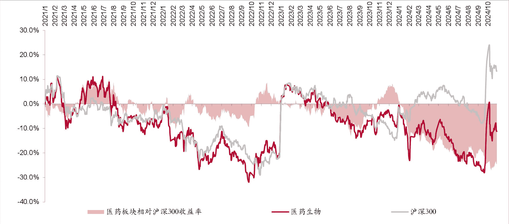

来源：WIND，中泰证券研究所（截止2024/10/31）

2024年10月医药生物板块下跌4.3%，同期沪深300下跌3.2%，医药板块跑输沪深300约1.2%，位列31个子行业第28位。本月子板块化学制药、医疗服务、中药、医药商业、医疗器械、生物制品分别下跌2.67%、3.68%、4.48%、5.37%、5.71%、5.88%。

图表15：各行业月涨跌幅比较（单位：%）

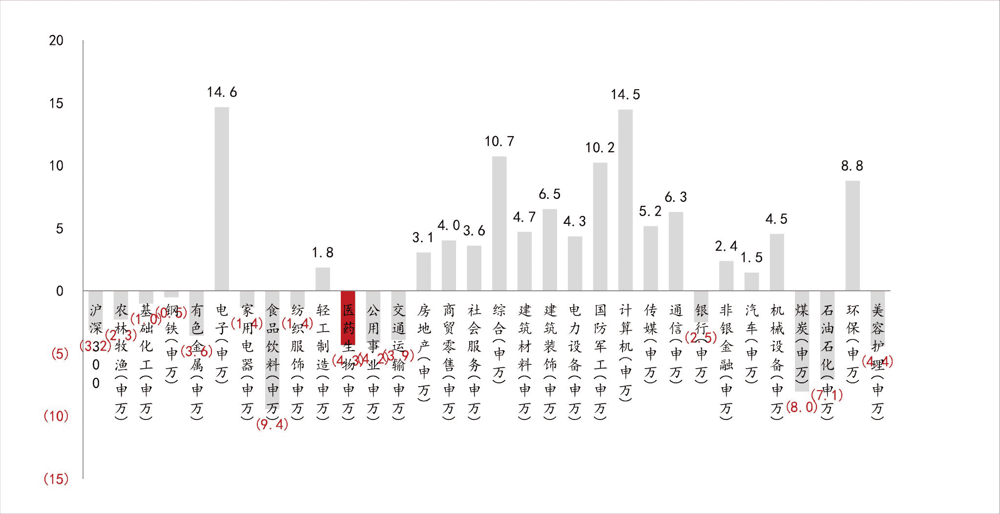

来源：WIND，中泰证券研究所（截止2024/10/31）

图表16：医药子行业月涨跌幅比较

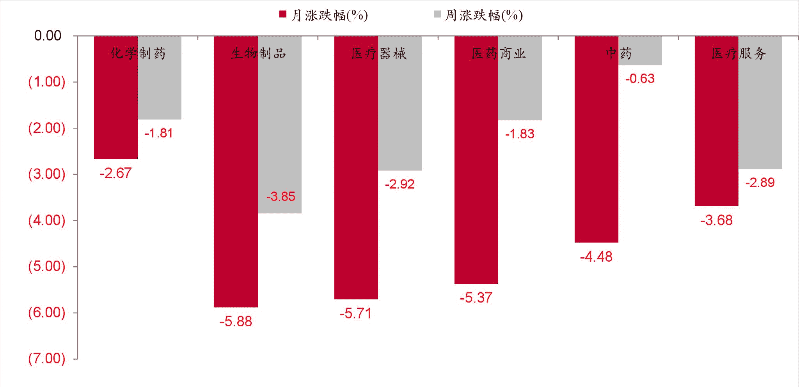

来源：WIND，中泰证券研究所（截止2024/10/31）

## 板块估值

以2024年盈利预测估值来计算，目前医药板块估值22.8倍PE，全部A股（扣除金融板块）市盈率约为19.1倍，医药板块相对全部A股（扣除金融板块）的溢价率为19.6%。以TTM估值法计算，目前医药板块估值23.1倍PE，低于历史平均水平（35.4倍PE），相对全部A股（扣除金融板块）的溢价率为33.1%。

图表17：医药板块整体估值溢价（2024盈利预测市盈率）

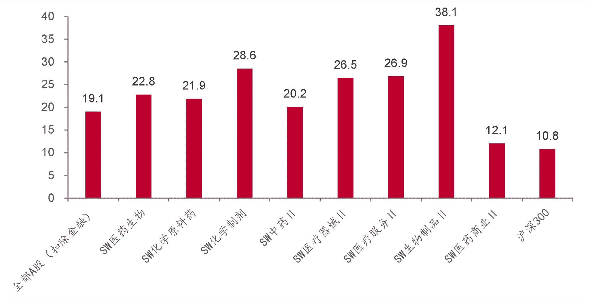

来源：WIND，中泰证券研究所（截止2024/10/31）

## 个股表现

本月涨幅榜：双成药业、麦克奥迪、科源制药、复旦复华、香雪制药。

本月跌幅榜：诺泰生物、亚辉龙、福瑞股份、白城医药、兴齐眼药。

图表18：医药板块整体估值溢价（扣除金融板块，2010年至今）

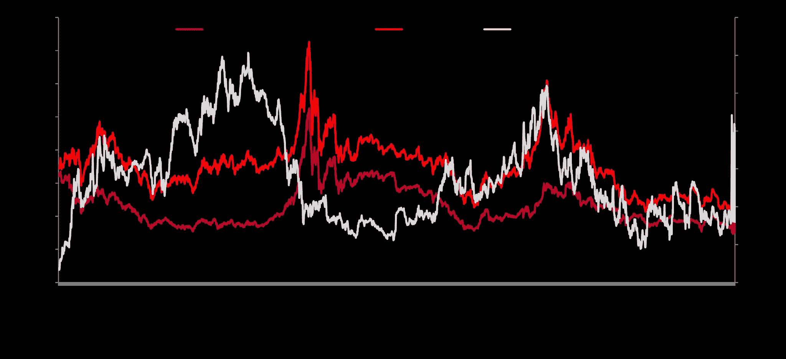

来源：WIND，中泰证券研究所（截止2024/10/31）

图表19：医药子板块估值对比（平均市盈率统计为2010年至今）

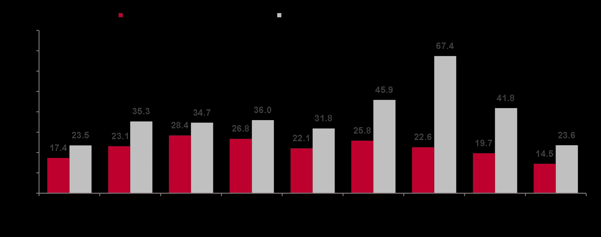

来源：WIND，中泰证券研究所（截止2024/10/31）

## 附录

## 中药材价格追踪

成都中药材价格指数10月基本保持稳定。自2021年四季度以来，近八成中药材价格出现上涨，比如常见的黄连、金银花、黄芩等价格都有不同程度的上涨，原本价格不菲的贵细药材涨价更为明显，如藏红花、鹿茸、燕窝、西洋参、虫草等多个品种的价格全部出现上涨，涨价幅度在10%到50%。国内几大知名药企的中成药价格上涨，上涨幅度为10%到20%。成都中药材价格指数10月上涨0.16%，2024年初至今上涨2.39%。

图表22：中国成都中药材价格指数图

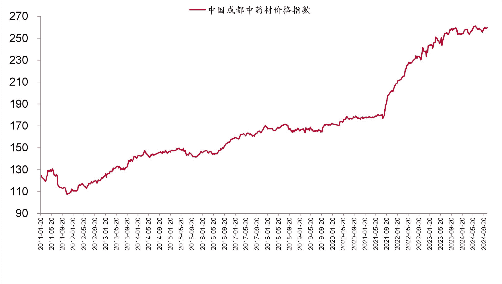

来源：WIND，中泰证券研究所（截止至2024/10/31）

图表20：本月涨幅前15位公司（扣除ST股）

图表21：本月跌幅前15位公司（扣除ST股）

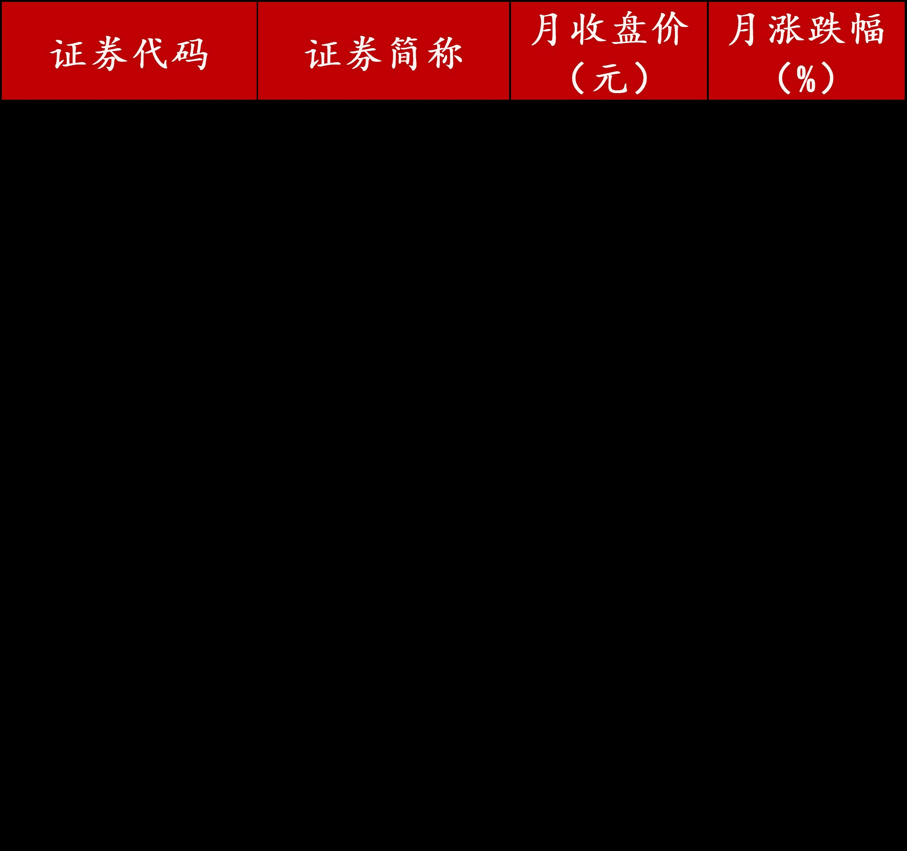

| 证券代码 | 证券简称 | 月收盘价（元） | 月涨跌幅（%） |
|---------|---------|-------------|-------------|
| 688076.SH | 诺泰生物 | 48.55 | -29.42 |
| 688575.SH | 亚辉龙 | 18.12 | -23.87 |
| 300049.SZ | 福瑞股份 | 38.61 | -20.11 |
| 301096.SZ | 百诚医药 | 39.13 | -18.24 |
| 300573.SZ | 兴齐眼药 | 87.17 | -18.19 |
| 300765.SZ | 新诺威 | 25.48 | -17.54 |
| 688062.SH | 迈威生物-U | 22.87 | -17.23 |
| 600976.SH | 健民集团 | 42.88 | -16.88 |
| 300832.SZ | 新产业 | 68.50 | -16.42 |
| 301239.SZ | 普瑞眼科 | 39.05 | -15.22 |
| 002737.SZ | 葵花药业 | 19.67 | -15.18 |
| 300122.SZ | 智飞生物 | 28.38 | -14.98 |
| 688799.SH | 华纳药厂 | 40.10 | -14.33 |
| 688513.SH | 苑东生物 | 34.60 | -14.31 |
| 600763.SH | 通策医疗 | 50.23 | -14.30 |

来源：WIND，中泰证券研究所（截止至2024/10/31）

## 本期研究报告汇总

图表23：本期中泰医药小组研究报告汇总

| 报告类型 | 报告标题 | 作者 |
|---------|---------|------|
| 公司点评 | 诺泰生物（688076.SH）：业绩符合预期，多肽原料药同比较大增长，全年高增有望持续 | 祝嘉琦，崔少煜 |
| 公司点评 | 东阿阿胶（000423.SZ）：业绩大超预期，核心产品维持高景气 | 祝嘉琦，孙宇瑶 |
| 公司点评 | 普洛药业（000739.SZ）：业绩符合预期，Q3淡季收入表现稳健 | 祝嘉琦 |
| 公司点评 | 诺泰生物（688076.SH）：业绩超过预告中枢，毛利率显著提升，全年高增有望持续 | 祝嘉琦，崔少煜 |
| 公司点评 | 仙琚制药（002332.SZ）：业绩符合预期、持续加速，2025年有望延续趋势 | 祝嘉琦 |
| 公司点评 | 奥锐特（605116.SH）：收入、利润稳健增长，司美格鲁肽放量在即 | 祝嘉琦 |
| 公司点评 | 太极集团（600129.SH）：业绩短期承压，人事变动有望带来积极影响 | 祝嘉琦，孙宇瑶 |
| 公司点评 | 开立医疗（300633.SZ）：多重影响下短期业绩承压，看好创新驱动+设备更新落地 | 祝嘉琦，谢木青，于佳喜 |
| 公司点评 | 安图生物（603658.SH）：多方压力下业绩稳中有升，关注政策出清后的拐点机会 | 祝嘉琦，谢木青，于佳喜 |
| 公司点评 | 美好医疗（301363.SZ）：多系列产品驱动业绩高增，海外布局战略稳步推进 | 祝嘉琦，谢木青，于佳喜 |
| 公司点评 | 迪安诊断（300244.SZ）：ICL基本面底部确立，盈利能力、经营性现金流有望持续改善 | 祝嘉琦，谢木青，于佳喜 |
| 公司点评 | 我武生物（300357.SZ）：业绩逐步复苏，产品管线持续布局 | 祝嘉琦 |
| 公司点评 | 同和药业（300636.SZ）：规范市场新品持续放量，新兴市场、老产品有所扰动 | 祝嘉琦 |
| 公司点评 | 百洋医药（301015.SZ）：业绩符合预期，品牌运营稳健发展 | 祝嘉琦，孙宇瑶 |
| 公司点评 | 济川药业（600566.SH）：业绩符合预期，期间费用率持续优化 | 祝嘉琦，孙宇瑶 |
| 公司点评 | 成都先导（688222.SH）：Q3呈逐步恢复态势，看好DEL平台长期发展 | 祝嘉琦，崔少煜 |
| 公司点评 | 新产业（300832.SZ）：国内外市场持续突破，中高端装机稳步提升 | 祝嘉琦，谢木青，于佳喜 |
| 公司点评 | 鱼跃医疗（002223.SZ）：基数影响下业绩表现稳健，看好呼吸、血糖等多系列新品放量 | 祝嘉琦，谢木青，于佳喜 |
| 公司点评 | 万孚生物（300482.SZ）：国际业务加速推进，国内市场逐步企稳 | 祝嘉琦，谢木青，于佳喜 |
| 公司点评 | 南微医学（688029.SH）：海外渠道建设持续发力，可视化新品有序推进 | 祝嘉琦，谢木青，于佳喜 |
| 公司点评 | 艾力斯（688578.SH）：Q3收入利润双超预期，海外临床即将有进展 | 祝嘉琦，曹泽运，穆奕杉 |
| 公司点评 | 伟思医疗（688580.SH）：盆底、康复逐步企稳，看好医美等新品放量 | 祝嘉琦，谢木青，于佳喜 |
| 公司点评 | 药明康德（603259.SH）：在手订单增长提速，整体业务呈逐步恢复态势 | 祝嘉琦，崔少煜 |
| 公司点评 | 诺唯赞（688105.SH）：生命科学、生物医药板块增长可观，海外市场加速开拓 | 祝嘉琦，谢木青，于佳喜 |
| 公司点评 | 迈瑞医疗（300760.SZ）：外部政策影响短期业绩，看好国内设备更新落地+海外市场持续突破 | 祝嘉琦，谢木青，于佳喜 |
| 公司点评 | 天宇股份（300702.SZ）：经营趋势环比向好，有望迎来业绩拐点 | 祝嘉琦 |
| 公司点评 | 三友医疗（688085.SH）：集采出清国内快速恢复，自主品牌加速出海 | 祝嘉琦，谢木青，于佳喜 |
| 公司点评 | 心脉医疗（688016.SH）：终端调价等影响短期业绩，关注集采放量以及多领域新品 | 祝嘉琦，谢木青，于佳喜 |
| 公司点评 | 九强生物（300406.SZ）：政策扰动下增长稳健，看好国改赋能持续兑现 | 祝嘉琦，谢木青，于佳喜 |
| 公司深度 | 华东医药：医药+医美航母，稳健发展三十余载 | 祝嘉琦，曹泽运，穆奕杉 |
| 行业月报 | 中泰证券医药生物10月月报：医药有望成反弹主力，看好“复苏”+“成长” | 祝嘉琦，谢木青，于佳喜 |
| 行业周报 | 中泰证券医药行业周报：Q3业绩有望逐步出清，把握医药反弹机会 | 祝嘉琦，谢木青，于佳喜 |
| 行业周报 | 中泰证券医药行业周报：Q3前瞻发布，看好后续行情 | 祝嘉琦，谢木青，于佳喜 |
| 行业周报 | 中泰证券医药行业周报：政策延续，医药复苏与成长可期；第十批国采启动 | 祝嘉琦，谢木青，于佳喜 |

来源：中泰证券研究所

## 中泰医药主要覆盖公司及估值一览

### 行业专题报告

图表24：中泰医药主要覆盖公司及估值一览

来源：中泰证券研究所，股价更新至2024/11/04

---

### 行业风险因素分析

**行业政策扰动风险**

行业处改革期，优先审评、动态医保谈判目录、一致性评价、带量采购等政策执行落地存在进度不及预期的问题。

**药品质量风险**

药品的安全质量问题是我们在选择和跟踪上市公司的过程中，持续保持警惕的一项内容。

**其他风险**

研究报告使用的公开资料可能存在信息滞后或更新不及时的风险。

---

### 投资评级说明

| 评级 | 说明 |
|------|------|
| **股票评级** | |
| 买入 | 预期未来6~12个月内相对同期基准指数涨幅在15%以上 |
| 增持 | 预期未来6~12个月内相对同期基准指数涨幅在5%~15%之间 |
| 持有 | 预期未来6~12个月内相对同期基准指数涨幅在-10%~+5%之间 |
| 减持 | 预期未来6~12个月内相对同期基准指数跌幅在10%以上 |
| **行业评级** | |
| 增持 | 预期未来6~12个月内对同期基准指数涨幅在10%以上 |
| 中性 | 预期未来6~12个月内对同期基准指数涨幅在-10%~+10%之间 |
| 减持 | 预期未来6~12个月内对同期基准指数跌幅在10%以上 |

备注：评级标准为报告发布日后的6~12个月内公司股价（或行业指数）相对同期基准指数的相对市场表现。其中A股市场以沪深300指数为基准；新三板市场以三板成指（针对协议转让标的）或三板做市指数（针对做市转让标的）为基准；香港市场以摩根士丹利中国指数为基准，美股市场以标普500指数或纳斯达克综合指数为基准（另有说明的除外）。

---

### 重要声明

中泰证券股份有限公司（以下简称“本公司”）具有中国证券监督管理委员会许可的证券投资咨询业务资格。本报告仅供本公司的客户使用。本公司不会因接收人收到本报告而视其为客户。

本报告基于本公司及其研究人员认为可信的公开资料或实地调研资料，反映了作者的研究观点，力求独立、客观和公正，结论不受任何第三方的授意或影响。本公司力求但不保证这些信息的准确性和完整性，且本报告中的资料、意见、预测均反映报告初次公开发布时的判断，可能会随时调整。本公司对本报告所含信息可在不发出通知的情形下做出修改，投资者应当自行关注相应的更新或修改。本报告所载的资料、工具、意见、信息及推测只提供给客户作参考之用，不构成任何投资、法律、会计或税务的最终操作建议，本公司不就报告中的内容对最终操作建议做出任何担保。本报告中所指的投资及服务可能不适合个别客户，不构成客户私人咨询建议。

市场有风险，投资需谨慎。在任何情况下，本公司不对任何人因使用本报告中的任何内容所引致的任何损失负任何责任。

投资者应注意，在法律允许的情况下，本公司及其本公司的关联机构可能会持有报告中涉及的公司所发行的证券并进行交易，并可能为这些公司正在提供或争取提供投资银行、财务顾问和金融产品等各种金融服务。本公司及其本公司的关联机构或个人可能在本报告公开发布之前已经使用或了解其中的信息。

本报告版权归“中泰证券股份有限公司”所有。事先未经本公司书面授权，任何机构和个人，不得对本报告进行任何形式的翻版、发布、复制、转载、刊登、篡改，且不得对本报告进行有悖原意的删节或修改。
