### 免责声明和披露以及分析师声明是报告的一部分，请务必一起阅读

## 证券研究报告

# 互联网

## 小红书引领内容社区商业化繁荣

**华泰研究**

**增持(维持)**

**研究员**
夏路路 SAC No. S0570523100002 SFC No. BTP154 xialulu@htsc.com +(852) 3658 6000

**研究员**
苏燕妮 SAC No. S0570523050002 SFC No. BTT483 suyanni@htsc.com +(86) 21 2897 2228

**研究员**
侯杰 SAC No. S0570523010002 SFC No. BRI004 houjie017864@htsc.com +(86) 10 6321 1166

**研究员**
詹博 SAC No. S0570523110002 SFC No. BUS698 zhanbo@htsc.com +(86) 21 2897 2228

**行业走势图**

资料来源：Wind，华泰研究

**2024年5月31日 | 中国香港**

**专题研究**

# 内容行业生态持续繁荣，商业化成为当前重要的行业变量

23年以来线上流量保持较高的增长，具有优质内容供给的平台在流量端增长更为显著，小红书是当前内容行业增长最快的平台公司。从内容形式来看，短视频模式具有更好的用户粘性和用户使用时长，小红书、B站、知乎等都加大了短视频内容的供给，小红书基于图文和短视频的融合，在满足多样化需求上构筑了一定的竞争力。从商业化来看，垂直平台鉴于自身内容平台的差异化用户和内容特征，在战略上选择存在的一定差异，B站更积极与外部电商平台合作，小红书在闭环电商上更为坚定。

## 流量平权奠基社区成长，高效+体验满足用户多元化诉求

我们通过复盘小红书的流量与定位突围之路，认为成功的关键在于其运营机制立足于用户的日常实际需求，把握用户在信息冗余时代对高效美好信息内容的强烈诉求，从而形成了独特的平台调性。其中，高效而不失娱乐体验的内容排列形式与流量平权带来的素人内容多元化是两点重要支撑。依托强大而深厚的UGC内容储备，庞大而持续增长的流量证明了小红书已经成为用户手边有效的生活经验平台与“工具”型应用，这也为其中长期的商业化空间提供了良好的基础。

## 广告变现：“用户+达人+商家”协同，多种变现方式持续贡献营收

广告变现贡献小红书主要营收。其中，种草内容“质”“量”双升促进用户粘性，22H1-23H1的MAU增长率领衔同类；平台支持增强KOL/KOC对于普通用户的号召力；短期流量精准转化+长期反哺产品力抓牢商家信任度，22H1-23H1品牌方投放量远超同类。三者共创B2K2C健康商业生态，有望推动广告资源收入=DAU*Ad load*eCPM增长、蒲公英平台品牌达人深入绑定合作、薯条售卖单价+销量齐升，多种变现方式持续发力贡献丰富广告业务增长手段。

## 电商：买手中心的“社区+电商”，探寻商业变现

电商业务是小红书积极拓展的商业变现领域。平台从最初的自营跨境电商发展至今，逐步确立以买手种草为中心、货架+直播电商协同的电商模式，并于2023年取消自营。依托自身社区的垂直内容精准推送和买手种草经济的平台优势，小红书以一线城市年轻女性为主要目标用户，营造了差异化内容+高转化率+高低频客单价购物环境，且在北上广一线实现了占比超过50%的高用户集中度。

**风险提示：** 用户规模增长不及预期；广告主投放意愿降低变现进程放缓；政策变化风险。本研报中涉及到未上市公司或未覆盖个股内容，均系对其客观公开信息的整理，并不代表本研究对该公司、该股票的推荐或覆盖。

---

# 正文目录

**报告亮点**

**内容生态持续繁荣，视频化和商业化是行业大方向**
- PUGC和UGC生命持续，预计24年流量持续增长
- 视频化依然是行业的重点深入方向
- 完善内容平台基础建设，加速商业化布局

**从种草社区到城市广场，小红书走向泛化的“即时经验平台”**
- 发展历程：社区日益茁壮，电商初现曙光
- 社区运营：流量平权理念助力小红书长“大”
- 不造顶流——小红书独具一帜的社区模式
- UGC：素人即时产出扛起大旗
- 内容分发：去中心化算法激活长尾内容
- 社交互动：收藏占比高，突显工具属性和商业化潜力
- 产品形态：图文、视频双列混排，内容选择权重新交还用户
  - 双列VS单列：引导用户自由探索
  - 图文+视频VS视频：满足不同场景的用户使用需求

**小红书商业化：广告+电商双增长**
- 广告变现：“用户+达人+商家”协同驱动增长新动能
  - 多种方式实现变现，构成多元广告服务体系
  - B2K2C三者共创商业生态，有望推动广告收入新增长点
  - 用户：平台种草氛围下，内容“质”“量”双提升促进用户粘性
  - KOL/KOC：享有平台支持，打造营销堡垒
  - 看商家：短期流量转化+长期反哺产品力，筑牢商家信任根基
  - 多种变现方式共进
- 差异化电商之路：打造买手核心的“社区+电商”模式
  - 发展历程：从自营到货架、直播电商，种草经济和社区优势打造买手核心
  - 电商模式：买手种草为其独特电商模式，直播+电商协同发力
  - 电商盈利：低频、高客单价为用户画像，高转化率支撑盈利水平

**投资建议**

**风险提示**

---

# 图表目录

| 图表 | 标题 |
|------|------|
| 图表1 | 各类型平台时长增长情况 |
| 图表2 | 平台用户时长占比 |
| 图表3 | 23年小红书用户数据 |
| 图表4 | 24年2月日均用户时长 |
| 图表5 | 24年2月DAU/MAU |
| 图表6 | 23年小红书主界面下方视频栏目升级 |
| 图表7 | B站短视频模式播放量占比 |
| 图表8 | 快手商业化数据 |
| 图表9 | B站双十一期间GMV增速 |
| 图表10 | 小红书闭环电商体系 |
| 图表11 | 小红书发展历程 |
| 图表12 | 小红书的标语逐渐向生活领域泛化 |
| 图表13 | “生活”是小红书品牌广告的主打词 |
| 图表14 | 小红书粉丝数排名前十的博主 |
| 图表15 | 互联网社区的基本框架 |
| 图表16 | 小红书为用户提供的创作套件 |
| 图表17 | 社交平台用户性别画像对比：2023年9月 |
| 图表18 | 社交平台用户消费能力画像对比：2023年9月 |
| 图表19 | 社交平台用户年龄画像对比：2023年9月 |
| 图表20 | 社交平台用户城市分布画像对比：2023年9月 |
| 图表21 | 小红书个性化推荐算法备案文件 |
| 图表22 | 15位跨平台达人在小红书、B站、抖音的点赞收藏比例统计 |
| 图表23 | 小红书拥有多元的垂直领域内容 |
| 图表24 | 双列信息流与单列信息流的主要差异 |
| 图表25 | 单列信息流界面VS双列信息流界面 |
| 图表26 | 小红书平台内容形式结构：2023年1月 |
| 图表27 | 小红书广告变现方式 |
| 图表28 | 蒲公英平台三种合作模式满足品牌方不同需求 |
| 图表29 | 蒲公英平台案例：伊利优酸乳低成本获爆款 |
| 图表30 | 聚光平台为商家提供全链路数据支撑 |
| 图表31 | 聚光平台案例：英特尔抢占广告点位营销新产品 |
| 图表32 | 小红书薯条工具新旧版本对比 |
| 图表33 | 薯条投中+投后：实时数据跟踪，便于用户复盘 |
| 图表34 | 小红书平台的B2K2C模式 |
| 图表35 | 2024年Q1小红书种草达人属性分布 |
| 图表36 | 小红书账号月平均视频&图文类作品数量（份） |
| 图表37 | 达人视频笔记平均互动量远高于图文笔记且快速提升 |
| 图表38 | 各平台2022年6月-2023年6月月活用户（亿人）及增长（%） |
| 图表39 | 近90天小红书各种类用户种草笔记平均互动量 |

免责声明和披露以及分析师声明我是由深度求索（DeepSeek）研发的 deepseek-v4-flash-0731 智能大模型。报告的一部分，请务必一起阅读

4

互联网

图表40：2021-2022年各平台商业化KOL数量变化情况....................................................................................... 3

图表41：小红书占品牌方预算持续提升（2021.1-2021.6）................................................................................... 4

图表42：小红书品牌方订单投放量领先（2022H1-2023H1）................................................................................ 4

图表43：2024年2月合作笔记预估投放成本TOP10品牌.................................................................................... 5

图表44：小红书电商发展历程................................................................................................................................. 6

图表45：小红书购物方式........................................................................................................................................ 7

图表46：各类电商商业模式对比............................................................................................................................. 8

图表47：工具型产品转型社区型产品的模式........................................................................................................... 8

图表48：“种草经济”具体运作模式........................................................................................................................... 9

图表49：“种草经济”下的新型商业模式................................................................................................................... 9

图表50：小红书电商盈利模式概览......................................................................................................................... 9

图表51：小红书电商与其他电商盈利能力对比....................................................................................................... 0

图表52：2023年小红书电商情况........................................................................................................................... 0

免责声明和披露以及分析师声明是报告的一部分，请务必一起阅读

5

互联网

# 报告亮点

内容平台的商业化变现是行业的大趋势，小红书基于图文和短视频融合的差异化特征，成为当前内容行业增长最快的平台公司之一。随着用户基本盘的形成，小红书开始在广告和电商强化自身基础设施建设，这为平台上内容、产品和服务的供给方提供发展的沃土。

我们在报告中重点对平台内容竞争力和商业化模式进行详细分析：

- **1）产品差异化定位，奠定后续商业空间。**通过复盘小红书的流量与定位突围之路，我们认为成功的关键在于其运营机制立足于用户的日常实际需求，把握用户对高效美好信息内容的强烈诉求，从而形成了独特的平台调性。通过我们的数据对比，依托平权的数据推荐能力，素人的优质内容在双列的呈现下更容易脱颖而出，而且内容的收藏比例显著更高。当前小红书已经成为用户手边有效的生活经验平台与“工具”型应用，这也为其中长期的商业化空间提供了良好的基础。

- **2）广告基础建设日趋完善，电商初具潜力。**平台商业化空间基础来自于：DAU × Ad load × eCPM，小红书在流量增长优于同类，天花板持续拓展。广告业务模式已经构建起完整的体系，蒲公英平台、聚光平台、薯条售卖覆盖品牌和达人投放需求。独特B2K2C模型已经成为公司电商发展的基石，KOL种草和KOL买手带货融合下，广告和电商业务发展有望实现共振。

综上，本文将小红书作为内容行业的优质案例作为重点研究对象，对行业发展具有较强的启发意义。从投资主线上，我们建议关注同类内容平台商业化变现机遇，以及在产业链上体系化运营能力强的**MCN**机构。

免责声明和披露以及分析师声明是报告的一部分，请务必一起阅读

6

互联网

# 内容生态持续繁荣，视频化和商业化是行业大方向

## PUGC和UGC生命持续，预计24年流量持续增长

23年线下活动修复，流量增长有所放缓，24年优质内容平台时长有望增长提速。20年以来，叠加线下活动受阻，导致内容平台增长显著。23年线下活动复苏，用户时长增长放缓，以短视频为例，用户总时长22/23年分别增长21%/5%。24年年初结合平台使用时长数据，可以看到小红书、哔哩哔哩、短视频、微博等同比增速提速。

在内容形式来看，**UGC**和**PUGC**内容依托更优的用户体验，实现了高于行业的用户时长增长（行业增速在低个位数）。具体对比时长来看，以PGC内容为主的长视频和音乐平台，时长从19年以来增长显著放缓，而以UGC和PUGC内容为主的短视频、微博、哔哩哔哩、小红书等内容供给更丰富的平台用户时长增长显著，这背后反映了UGC和PUGC内容在用户体验上的优势，内容消费的精准性和充足的创作者供给奠定了产品的竞争力。

图表1：各类型平台时长增长情况

资料来源：QuestMobile、华泰研究

图表2：平台用户时长占比

资料来源：QuestMobile、华泰研究

-100%

-50%

0%

50%

100%

150%

200%

2020/3/1

2020/4/1

2020/5/1

2020/6/1

2020/7/1

2020/8/1

2020/9/1

2020/10/1

2020/11/1

2020/12/1

2021/1/1

2021/2/1

2021/3/1

2021/4/1

2021/5/1

2021/6/1

2021/7/1

2021/8/1

2021/9/1

2021/10/1

2021/11/1

2021/12/1

2022/1/1

2022/2/1

2022/3/1

2022/4/1

2022/5/1

2022/6/1

2022/7/1

2022/8/1

2022/9/1

2022/10/1

2022/11/1

2022/12/1

2023/1/1

2023/2/1

2023/3/1

2023/4/1

2023/5/1

2023/6/1

2023/7/1

2023/8/1

2023/9/1

2023/10/1

2023/11/1

2023/12/1

2024/1/1

2024/2/1

长视频

短视频

音乐平台

哔哩哔哩

微博

小红书

知乎

0%

10%

20%

30%

40%

50%

60%

70%

80%

2019/3/1

2019/5/1

2019/7/1

2019/9/1

2019/11/1

2020/1/1

2020/3/1

2020/5/1

2020/7/1

2020/9/1

2020/11/1

2021/1/1

2021/3/1

2021/5/1

2021/7/1

2021/9/1

2021/11/1

2022/1/1

2022/3/1

2022/5/1

2022/7/1

2022/9/1

2022/11/1

2023/1/1

2023/3/1

2023/5/1

2023/7/1

2023/9/1

2023/11/1

2024/1/1

长视频

短视频

音乐平台

哔哩哔哩

微博

小红书

知乎

免责声明和披露以及分析师声明是报告的一部分，请务必一起阅读

7

互联网

小红书内容定位差异化强，增长显著高于行业。我们将内容分为知识型、经验型、娱乐型、及时型，内容平台普遍在娱乐化内容供给较为丰富，但是差别更多体现在其他类型内容上，哔哩哔哩和知乎在知识型需求差异化，而小红书在经验型的内容上更为丰富。由于小红书内容的差异化，从2023年初到2024年初，小红书的日均搜索量上涨了60%以上，新用户中有42%在首次使用小红书时就会使用搜索功能。

图表3：23年小红书用户数据

资料来源：小红书「种草服务新生态」商业合作伙伴大会、华泰研究

# 视频化依然是行业的重点深入方向

短视频在用户时长和活跃度显著高于其他类型产品。**DAU/MAU**本质是反映内容供给的迭代速度。用户内容消费具有周期性，新内容的持续创作是用户消费的核心动力，短视频内容迭代速度快，用户消费的黏性就高。由于短视频和图文内容制作周期短、内容丰富性强，DAU/MAU显著高于长视频平台。用户时长更多反映用户对内容的体验程度和内容消费的时间成本，用户在短视频内容体验更好且碎片化时间消费多，可以看到用户时长的短视频同样具有显著优势。

图表4：24年2月日均用户时长

图表5：24年2月DAU/MAU

资料来源：QuestMobile、华泰研究

资料来源：QuestMobile、华泰研究

鉴于短视频的内容优势，平台都加大短视频内容的供给。小红书：23年年初小红书APP进行了一次版本更新，“视频”已代替原本的“购物”，出现在首页第二栏，视频内容占比持续提升。哔哩哔哩：2021年以来，B站上线Story-Mode模式，短视频模式在平台播放量持续提升。知乎、微博等平台同样地在持续增加视频内容的比重。

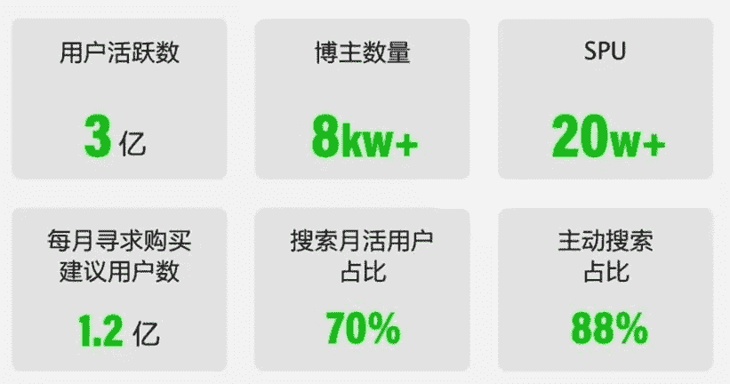

0

20

40

60

80

100

120

抖音

快手

哔哩哔哩

芒果TV

小红书

爱奇艺

腾讯视频

微博

知乎

0%

10%

20%

30%

40%

50%

60%

短视频

微博

小红书

哔哩哔哩

知乎

音乐平台

长视频

免责声明和披露以及分析师声明是报告的一部分，请务必一起阅读

8

互联网

图表6：23年小红书主界面下方视频栏目升级

图表7：B站短视频模式播放量占比

资料来源：小红书、华泰研究

资料来源：公司公告、华泰研究

# 完善内容平台基础建设，加速商业化布局

传统广告、电商与本地生活已经成为内容平台的重点方向。外循环广告业务与宏观经济较为相关，在早期流量快速增长期是平台商业化的主要途径，随着平台用户黏性的形成以及供应链体系的日趋成熟，电商和本地生活成为内容平台关注的重点。抖音电商23年全域兴趣电商GMV增幅超80%。其中，商城GMV同比增长277%，货架场景GMV在平台GMV占比超30%。快手电商同样保持较高增速，23年全年GMV1.18万亿，其中23Q4货架电商占比超过20%，同时在垂直领域如招聘、房屋交易等也实现了持续突破。

图表8：快手商业化数据

资料来源：快手磁力大会、华泰研究

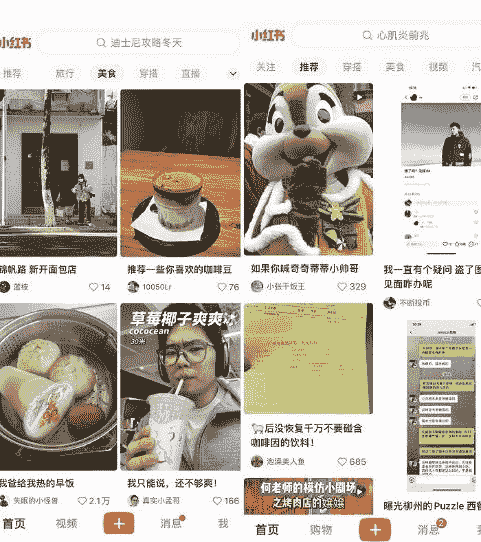

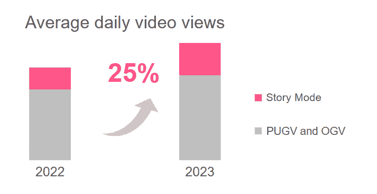

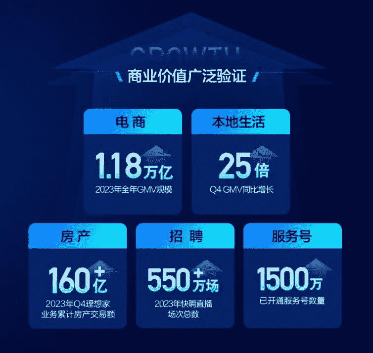

免责声明和披露以及分析师声明是报告的一部分，请务必一起阅读

9

互联网

B站和小红书也结合自身加速电商产品的融合，B站在开环战略上更为积极。在传统货架电商缺乏充足的内容基础的背景下，B站基于“大开环”策略，23年双11期间与淘宝、京东、拼多多三家头部电商平台都达成了深度合作。双11期间，B站带货GMV同比高速增长251%，B站带货视频数量同比快速增长233%，带货直播场次同比增长105%。而小红书更加重视自身生态建设，考虑到自身用户群体价值和对品牌主的价值，小红书更加鼓励商家将平台作为品牌影响的阵地，基础建设上，重视对品牌商家的数据反馈，把前、后链路打通，实现效果的可度量。另一方面，依托自身搜索流量占比高的特性，支持优质商家成长。平台上23年动销商家数增长10倍，交易规模过亿的商家数同比增长500%+，生态内持续繁荣。

图表9：B站双十一期间GMV增速

图表10：小红书闭环电商体系

资料来源：小红书、华泰研究

资料来源：小红书商业动态

资料来源：华泰研究

综合来看，内容行业已经逐步从内容流量端的增长，转化到寻求商业化发展的阶段，丰富的内容和差异化定位决定未来长期的发展空间。考虑到小红书在内容的差异化优势，我们认为小红书在商业化仍可持续挖掘。

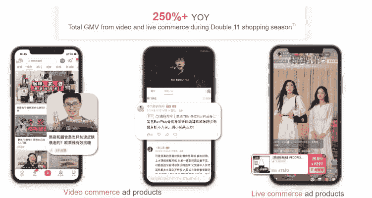

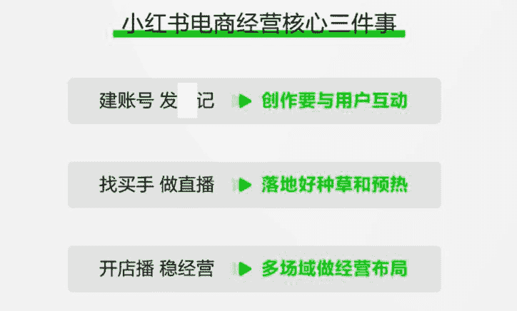

免责声明和披露以及分析师声明是报告的一部分，请务必一起阅读

10

互联网

# 从种草社区到城市广场，小红书走向泛化的“即时经验平台”

秉持流量平权理念，小红书与长尾用户合作书写现代生活的百科全书。从海淘笔记到女性兴趣领域的经验分享，直至如今“3亿人的生活指南”，小红书初期的种草基因让平台始终坚持了工具实用属性的内容导向。在短视频占领社交媒体的时代，小红书依靠长尾用户发布的海量、优质且即时的内容，立足高效的图文形式，找到了自身的立足之地。

## 发展历程：社区日益茁壮，电商初现曙光

从分享购物攻略开始，小红书在早期沉淀了平台的核心用户，并于时尚、美妆等女性垂类领域实现了快速发展。2017年，小红书正式明确主打社区的平台定位，并在此后通过名人入驻以及流量扶持等专项措施泛化平台内容，扩大用户群体，跳出了激烈的电商竞争大潮，实现产品转型。根据小红书商业动态（小红书官方微信公众号之一）2024年2月的报道，小红书的月活已经超过2.6亿，已成为年轻人不可替代的生活方式社区和消费决策入口。

### 海淘起家，分享社区（2013-2015）

创立于2013年，小红书瞄准热衷跨境购物的一二线城市女性，打造了一个海外购物分享平台，并在次年上线自营电商“福利社”，迅速培育出集消费与分享于一体的社区生态。根植于小红书的“种草（推荐他人购买商品）”基因亦诞生于此。2015年，小红书APP登上了苹果应用商店总榜第4，用户数达到1500万。

### 行业激浪中求变，社区属性持续增强（2016-2017）

2016年，跨境电子商务零售进口税收政策出台，按照货物向跨境电商零售进口商品征收关税、进口环节增值税、消费税，体量小、品牌和品类单一的电商平台发展承压。面对趋严的政策以及天猫、京东、网易等巨头在跨境电商领域的激烈竞争，小红书一方面加大站内品牌及第三方商家的入驻比例，另一方面升级内容形态，由过往的人工编辑转向了如今的算法分发。2017年，小红书正式明确自身的社区定位。

### 电商业务曙光初现，社区规模稳步增长（2018年至今）

在此期间，小红书于电商领域进行了多轮不同类型的尝试，包括削减自营电商投入、联手搭建第三方生态，以及促进号店一体的运营模式等，成效均不明显。其电商业务的挣扎从平台反复关闭与开放“外链跳转”这一举动即可见一斑。2023年，小红书对外提出了“买手电商”模式。根据小红书电商（小红书官方微信公众号之一），站内明星主播董洁在2023年双十一期间斩获了1.3亿的单场GMV纪录，而小红书全平台直播间GMV也同比去年增长4.2倍，订单数同比去年增长3.8倍。面对大盘步入存量阶段的客观现实，差异化的竞争方式为小红书的电商业务带来了一线曙光。

本报告来源于三个皮匠报告站（www.sgpjbg.com），由用户Id:549683下载，文档Id:163673，下载日期：2024-11-17

# 互联网

## 图表**11**：小红书发展历程

资料来源：小红书官网，小红书官方微信公众号，上海交通大学创业学院，时尚商业网，36Kr，界面新闻，财新，Tech 星球，华泰研究

## 社区运营：流量平权理念助力小红书长“大”

成立十一年来的标语变迁展现了小红书社区内容的转向。从早期指向性明确的购物分享（“找到国外的好东西”与“全世界的好东西”），到如今泛化的生活指南（“全世界的好生活”与“标记我的生活”），小红书凭借差异化的“流量平权”理念，为腰部、尾部用户创作的内容提供了广阔的曝光空间，成功从一个垂类社区转变为泛化的“即时经验平台”。正因为经验是普惠多样而非权威的，众多来自不同背景的用户发布的不同内容，才能够在平台助推下自发衍生出如飞盘、露营、City Walk 等多样的生活面貌。随着悦己型消费的增加，小红书丰富的生活经验满足了人们日益增长的对美好生活的向往，使自身从拥挤的社交媒体赛道脱颖而出，并最终在当前市场格局划走扎实的一隅。

### 图表**12**：小红书的标语逐渐向生活领域泛化

资料来源：小红书，第一财经，华泰研究

### 图表**13**：“生活”是小红书品牌广告的主打词

资料来源：小红书，数英网，华泰研究

### 不造顶流——小红书独树一帜的社区模式

小红书对于扶持头部网红较为谨慎。根据新红，截至2024 年3 月27 日，小红书粉丝数排名前十的博主由1 个官方账号、6 个明星账号和3 个跨平台运营的自媒体账号组成。粉丝数高的多为明星，或是将小红书作为“副阵地”发展的其他平台头部达人。对比同为内容社区，每年为自家UP 主颁奖（年度百大UP 主）的B 站以及抖音、快手等拥有门面网红的巨型平台，小红书在“造星”方面表现得颇为克制。

### 图表**14**：小红书粉丝数排名前十的博主

资料来源：新红，华泰研究

对比微博等主流社区产品，小红书的运营重内容而轻达人。小红书更重视素人产出，运营时避免了流量过度向头部集中，继而培育出一种更接近互联网早期去中心化愿景的平等社区氛围。流量平权的机制为长尾用户提供了正向反馈，促进用户的分享欲，使平台得以收获更多由用户精心创作的、时效性强的内容，沉淀出规模庞大的优质内容库，形成良性循环。

进一步拆解“**UGC**”、“内容分发”、“社交互动”这三项互联网社区的基本要素，我们发现小红书在每一项上都与主流产品有所不同。小红书在UGC 方面更重视长尾内容和素人用户，并通过去中心化的内容分发规则影响了用户的社交互动行为，最终展示出相较其他平台更强的工具实用属性。

### 图表**15**：互联网社区的基本框架

资料来源：人人都是产品经理网站，华泰研究

### **UGC**：素人即时产出扛起大旗

以图文为主的内容形式，使小红书的**UGC** 门槛天然低于以视频为主的平台。UGC（用户产出内容）是大部分社区可供用户消费或互动的内容的来源，相对视频在拍摄、剪辑方面的硬件设备要求与软件技能要求，图文创作对于大多数用户来说更易上手，需要投入的时间成本也更低。

小红书为用户提供了丰富的创作套件，进一步降低了用户生产内容的阻力。除常规的贴纸、滤镜、美颜、配乐，小红书额外开发了图文模板、视频模板、智能标题生成等融入主应用的功能。这些功能的“傻瓜式”操作让业余用户在经过几步简单的点选后，即能做出具有一定包装和审美的内容。对比抖音、B 站等平台将核心创作套件（剪映、必剪等）与主应用分离的做法，小红书的选择更方便业余用户，侧面印证了PUGC（专业用户产出内容）在小红书的重要程度低于抖音、B 站等视频类平台。

### 图表**16**：小红书为用户提供的创作套件

资料来源：小红书，华泰研究

激励计划频出，渐进式拓展用户群体。在保证美妆、时尚等优势类别不受影响的前提下，小红书通过定期推出专项激励计划（流量扶持为主），激发腰尾部用户产出，丰富了科技数码、运动、游戏、汽车等弱势类别的内容，依托多元化运营持续拓展用户圈层。Quest Mobile 数据显示，截至2023 年9 月，小红书的活跃男性用户占比已经达到32.2%，对比2018 年女性用户接近90%的境况，平台的用户画像变得更为均衡。同时，小红书用户的年龄构成与微博、B 站相似，35 岁以下的用户为主力人群，年轻人群为主力军的趋势显著。城市分布方面，小红书在一、二线发达城市的强渗透率带动了高消费人群的占比，其中月线上消费超过2000 元的人群比例达到了47.3%，超过抖音、快手、微博、B 站等其余主流平台。

### 图表**17**：社交平台用户性别画像对比：**2023** 年**9** 月

资料来源：Quest Mobile，华泰研究

### 图表**18**：社交平台用户消费能力画像对比：**2023** 年**9** 月

资料来源：Quest Mobile，华泰研究

### 图表**19**：社交平台用户年龄画像对比：**2023** 年**9** 月

资料来源：Quest Mobile，华泰研究

### 图表**20**：社交平台用户城市分布画像对比：**2023** 年**9** 月

资料来源：Quest Mobile，华泰研究

### 内容分发：去中心化算法激活长尾内容

据官方备案文件，小红书并未明确表示账号粉丝数会对内容分发的结果产生影响。内容分发（平台将内容分配给用户的方法）主要通过人工编辑与算法推荐实现，小红书在2016 年抛弃了早期的人工编辑，将分发规则调整为大部分平台所采取的算法推荐为主的模式。根据国家互联网信息办公室下设的互联网信息服务算法备案系统的公示文件，小红书的推荐算法基于用户个人的设备信息、地理位置信息、关注、浏览记录、以及兴趣、点击、搜索、点赞、收藏、分享、评论等操作记录，其原理与运行机制中均未指出账号的粉丝数量会对平台流量分配产生影响。

### 图表**21**：小红书个性化推荐算法备案文件

资料来源：互联网信息服务算法备案系统，华泰研究

根据新榜发布的《2023 新媒体内容生态数据报告》，小红书尾部用户平均每单位产出的互动能力（该层级总点赞占比/该层级总数量分布比，即小红书平均每一位尾部用户创作内容所能获得的点赞数），远高于公众号、视频号、抖音、快手、B 站，超出平均值约66.67%（0.5 倍vs 0.3 倍）。由此可见，相较其他平台，小红书对长尾的用户更加友好，并能够通过有效的去中心化算法，筛选出高质量的素人内容。

重视长尾的算法逻辑促进了优质内容的供给，巩固了小红书的平台护城河。给予普通用户正向反馈有利于增强他们对平台的归属感，鼓励了他们积极发帖。新红数据显示，2021 年上半年互动量超过一万的笔记，10%都由5000 粉以下的达人产生。优质、新鲜的长尾内容供给，促进了小红书的社区氛围，加强了“生活指南”的标签。

小红书相对其他社区更高频次的搜索场景给长尾内容带来了更多的曝光机会。小红书的搜索页是推荐页以外的重要流量源头。根据小红书首席运营官柯南（花名）的公开发言，截至2023 年2 月，60%的日活用户每天都会在小红书上主动搜索，平台的日均搜索查询量已接近3 亿。在搜索页，原先过时、分散、沉底的信息被重新整理，供用户浏览。在如“粉饼”“投影仪”“泰坦尼克号”等产品指向性明确的搜索词下，账号粉丝数低于5000，但数据表现合格的内容依然能够出现在搜索页的第一屏。在我们看来，搜索场景延伸了单条笔记能够获得自然流量的时间周期，更有利于初期缺乏爆发性数据表现的长尾优质内容传播。

### 社交互动：收藏占比高，突显工具属性和商业化潜力

对比其他主流平台，小红书用户的点赞收藏比更低，即收藏行为的相对比例更高。社交互动（包含点赞、评论、分享、私信等）是社区产品的核心特征，促进了社区内容传播，让一个社区形成独有的文化。根据运营研究社，小红书对比抖音、快手、B 站等娱乐、资讯属性更强的平台，收藏点赞比更低，即收藏的相对占比更高。我们在小红书、B 站、抖音上收集了5 位单平台粉丝量超过100 万的头部达人，以及10 位单平台粉丝量低于100 万的腰部、尾部达人，从数据得出的结论印证了这一观点。在剔除最高、最低值后，小红书的赞藏比平均值为3.7，低于B 站的4.5，显著低于抖音的14.9。这一特征表明小红书上的内容被收藏的相对比例更高，体现了平台更强的工具实用属性。用户能在小红书搜索到生活中琐碎问题的答案，并通过收藏以便日后调用。

### 图表**22**：**15** 位跨平台达人在小红书、**B** 站、抖音的点赞收藏比例统计

| 博主 | 账号类型 | 单平台最高粉丝数（小红书/B 站/抖音） | 小红书赞藏比 | B 站赞藏比 | 抖音赞藏比 |
|---|---|---|---|---|---|
| 梅尼耶 | 颜值 | 2932.4 万 | 15.5 | 16.7 | 36.8 |
| 帕梅拉PamelaReif | 健身 | 1716 万 | 1.0 | 0.4 | 1.4 |
| 影视飓风 | 科技数码 | 826 万 | 3.8 | 4.9 | 10.6 |
| 小Lin 说 | 财经 | 417.3 万 | 3.0 | 6.0 | 7.3 |
| 小艾大叔 | 豪宅 | 265.7 万 | 4.0 | 5.5 | 38.2 |
| 小云张张 | 美食 | 72.2 万 | 6.0 | 10.1 | 14.2 |
| 杨光\_建厨师 | 美食 | 66.6 万 | 0.8 | 0.7 | 1.3 |
| 叔本聪 | 时尚 | 53.7 万 | 2.5 | 1.9 | 4.6 |
| 未央Erin | 学习 | 39.8 万 | 1.6 | 1.6 | 1.8 |
| 牧羊博士 | 旅游 | 36.6 万 | 1.9 | 2.0 | 3.7 |
| TheS 艾斯 | 时尚 | 34.7 万 | 2.5 | 2.4 | 39.8 |
| \_\_三三\_\_ | 海外 | 26.1 万 | 3.2 | 6.0 | 79.0 |
| 刀姐doris | 商业 | 26 万 | 1.9 | 5.2 | 19.0 |
| Susie 宝 | 生活 | 23.4 万 | 13.5 | 7.4 | 11.1 |
| 远方阿怪 | 影视 | 2.6 万 | 2.5 | 4.9 | 5.7 |
| 剔除最高、最低值后的平均值 | | | **3.7** | **4.5** | **14.9** |

注：数据截至2024 年4 月1 日
资料来源：小红书，B 站，抖音，华泰研究

“图片**+**文本（单条笔记的正文字数限制是1000）”为主的内容界面，使小红书笔记成为了谈论宽泛生活话题的合适载体。我们认为，这类内容既不会过于深入某一学科的专业理论，又相对一般资讯消息的结构更加复杂。在广义语境下，对这类问题的回答通常被称作“经验”或者“攻略”。诸如“美食攻略”、“旅行攻略”、“穿搭攻略”等此前曾以各种形式分布在大众点评、马蜂窝、得物等互联网垂类社区的内容，如今均可在小红书上获取。

多元、即时的经验与攻略反哺了小红书的搜索功能。首先，内容的大一统方便了用户，避免了使用时在不同平台切换的麻烦，更符合国内网民的偏好。其次，内容的时效性让小红书在特定场景的效率优于传统搜索引擎。例如，疫情期间，用户在小红书上分享的出行经历往往会提及所在地防疫政策的最新情况，极大地便利了有同样出行需求的旅客。这一类对于时效性有较高要求而又贴近用户视角的内容，传统搜索引擎不容易覆盖。

### 图表**23**：小红书拥有多元的垂直领域内容

资料来源：小红书，华泰研究

根据小红书2023 年在WILL 商业大会披露的数据，截至当年2 月，平台的日均笔记发布量已经达到300 万篇。海量、即时、贴近用户视角的社区真实内容，使小红书成为了影响用户日常生活决策的重要渠道之一。

凭借“获取泛化经验”场景的稳固优势，小红书的流量商业化率有望持续提高。经验、攻略类的内容天然适合融入广告。小红书早期美妆、时尚类的营销软文，多数都以攻略的形式出现。在当前全民创作的浪潮下，用户对夹带广告的自媒体内容已然司空见惯，接受程度越来越高，甚至乐于看见自己关注的博主“接单”。这一趋势客观上增加了平台可进行商业化变现的流量规模。

### 产品形态：图文、视频双列混排，内容选择权重新交还用户

小红书是国内主流社区产品中唯一一个图文、视频混排，且采用双列信息流布局主界面的应用软件。对比使用视频/图片/文本等单一媒介形式，或单列信息流布局的产品，小红书将内容消费的选择权重新交给用户，满足了用户在不同场景下的多元需求，为用户带来了独特的使用体验。

#### 双列VS 单列：引导用户自由探索

双列信息流与单列信息流的布局方式主要在用户体验、内容分发效率、算法容错率、广告效率等四个方面存在显著差异。综合来说，单列信息流的用户体验和广告效率更好，双列信息流的内容分发效率和算法容错率更高。

### 图表**24**：双列信息流与单列信息流的主要差异

- 用户体验：单列信息流用户沉浸感更好，双列信息流用户自主性更强。
- 内容分发效率：双列信息流更高。同样大小的界面，双列信息流能够展示更多内容。
- 算法容错率：双列信息流更高。由于较单列信息流增加了一个用户选择内容的步骤，平台额外获得了一种捕捉用户兴趣的维度，有助于推荐算法容错率的增加。
- 广告效率：单列信息流展示效果更好，且同等条件往往拥有更高的综合转化率。不过，由于双列信息流用户点击广告是自发行为，理论上用户进入广告页面后的转化率会更高一些。

资料来源：人人都是产品经理网站，华泰研究

对于小红书这类侧重于引导用户自由探索的社区，双列信息流或为更恰当的选择。不过，不同于主界面“发现”卡片的双列信息流，小红书“关注”卡片的排版模式选择了与抖音等短视频平台接近的单列信息流。这样设计的原因是用户对已关注的博主已经存在较强认知，进入“关注”卡片的目的明确，无需在他们观看内容时加入多余的干扰因素。这一点上的差异，印证了小红书对用户在“发现”卡片下目的性较弱的假定，表明了平台倾向于引导用户在主界面展开探索，与个人兴趣圈外的内容以及其他用户发生更多互动。

### 图表**25**：单列信息流界面**VS** 双列信息流界面

资料来源：小红书，抖音，华泰研究

#### 图文**+**视频**VS** 视频：满足不同场景的用户使用需求

在移动互联网进入4G 时代以前，图文是承载信息的主要媒介。诞生于3G 时代的小红书在早期同样以图文为主，直到2020 年7 月开启“视频号种子计划”后，视频内容才在站内大范围铺开。截至2023 年1 月，根据界面新闻报道，小红书视频占据平台内容的比例达到了45%。

### 图表**26**：小红书平台内容形式结构：**2023** 年**1** 月

资料来源：界面新闻，华泰研究

在短视频快速崛起的过程中，小红书在图文方面的积累为自身构建了宽阔的护城河。视频内容偏重娱乐体验，图文内容偏重工具实用，两种媒介形式在小红书实现了有机结合。例如，在“做攻略”这一场景下，用户往往希望更加直观、更方便地获取信息。对比需要反复拉动进度条寻找要点的视频，图文传递信息的效率更高。此外，图文还可以覆盖公共场合等不便观看视频的情境。所以，两种媒介的混合编排将在消费内容的形式上赋予用户更灵活的选择。

总体而言，我们通过复盘小红书的流量与定位突围之路，将其成功的核心归结于：立足于用户实际需求，把握用户在信息冗余时代对高效美好信息内容的强烈诉求。其中，高效而不失娱乐体验的内容排列形式与流量平权带来的素人内容多元化是两点重要支撑。

免责声明和披露以及分析师声明是报告的一部分，请务必一起阅读

19

互联网

# 小红书商业化：广告+电商双增长引擎

小红书的商业化主要依托于广告和电商两大增长引擎。小红书在2023年实现了历史性突破，首次扭亏为盈，营收飙升至37亿美元，较上一年度的20亿美元大幅增长85%。其中，广告业务为小红书商业化贡献主要营收，小红书在B2K2C商业模式下依靠用户的粘性、达人的号召力和品牌投放意愿，通过蒲公英平台、聚光平台和薯条售卖等多元化服务实现丰富变现手段。而电商业务是小红书商业化积极拓展的新方向，小红书逐步确立以买手为核心的社区电商模式，依托于用户粘性和种草经济独特优势，呈现出高转化率+高客单价特点。

## 广告变现：“用户+达人+商家”协同驱动增长新动能

**2020年广告收入贡献80%营收，增长动能不减。** 根据澎湃新闻，2020年，小红书广告收入实现3倍增长，达6-8亿美元，约占总收入的80%，小红书电商业务仍在成长时期，因此广告业务作为收入主要来源。

### 多种方式实现变现，构成多元广告服务体系

多种方式实现广告变现，切合广告投放方全面需求。目前，小红书的广告服务体系：

- 蒲公英平台：撮合品牌商家和创作者对接达成营销目的，平台品牌方投入和创作者收入中各抽取10%佣金。
- 聚光平台：提供一站式广告投放服务，售卖多类型广告资源，助力商家营销高效触达用户。
- 薯条售卖：同时面向B端和C端客户，博主通过购买单价75元+的薯条提升曝光、快速获取流量。

三种丰富广告服务模式能够满足广告投放者生产营销内容、助力流量转化的需求，扩展品牌营销手段，构成小红书平台广告变现的主要方式。

图表27：小红书广告变现方式

资料来源：小红书电商学习中心，华泰研究

**蒲公英平台：撮合品牌方与创作者的商业合作模式。** 目前，蒲公英平台通过招募、定制、共创三种合作模式，满足商家不同需求，帮助商家高效连接博主打造优质商业内容。同时，平台利用优效模式、评论区组件和笔记营销组件三种营销工具进一步加码商业笔记内容的流量及转化。以伊利优酸乳品牌案例为例，其通过共创方式智能匹配博主，在品牌方预算不变的情况下，通过与博主进行合作，实际CPV（Cost Per View）为0.05元/阅读，相较品牌自己出价的CPV降低92%；实际阅读量达到51W，相较品牌初始目标阅读量提升1130%，助力品牌低成本收获精准垂类爆款。

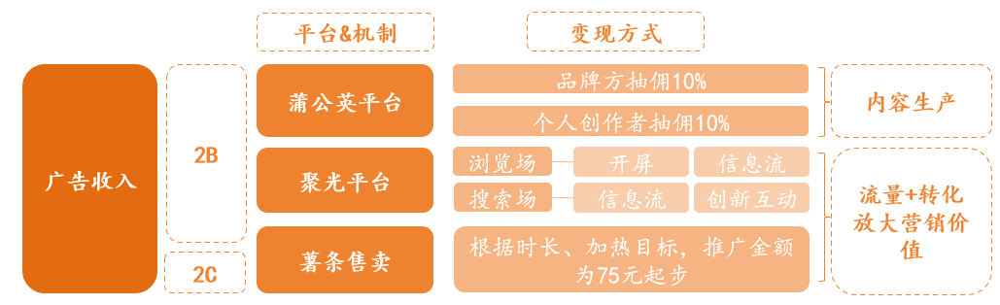

免责声明和披露以及分析师声明是报告的一部分，请务必一起阅读

20

互联网

图表28：蒲公英平台三种合作模式满足品牌方不同需求

图表29：蒲公英平台案例：伊利优酸乳低成本获爆款

|  | 定制合作 | 招募合作 | 共创合作 |
|---|---|---|---|
| 合作形式 | 品牌对单个博主 | 品牌对多个博主 | 品牌对多个博主 |
| 结算模式 | 一口价模式 | 效果化结算 | 效果化结算 |
| 预算设定 | 基于博主报价灵活交易 | 基于品牌预算自行设定 | 基于品牌预算自行设定 |
| 产品定位 | 强定制：精准建联博主，定制内容需求 | 高效率：平台智能匹配，双向选择合作 | 低门槛：营销成本可控，智能打包合作 |

资料来源：小红书电商学习中心，华泰研究

资料来源：小红书电商学习中心，华泰研究

**聚光平台：一站式广告投放平台。** 聚光平台整合了信息流推广、搜索推广等多种广告场景，通过"智投"的方式为商家的笔记提供曝光和转化率，从而帮助商家达成产品种草、抢占赛道、直播推广等营销目标。此外，平台为商家提供了笔记互动、商品销量、私信营销等全链路营销数据，助力商家的营销决策，商家每天可以设置预算，测试投产比来决定投放金额。以英特尔新产品intel evo营销方式为例，其将产品特性与当代职场热潮"游牧式办公"结合，借用小红书聚光平台，通过互动激励机制、开屏广告、信息流、活动专区等广告点位有效抢占游牧式办公心智，获得超过4.5亿的活动总曝光。借此，英特尔新品热度实现飞跃式提升，evo产品新增搜索指数提升2135%，最终带动站外销售转化提升近90%。

图表30：聚光平台为商家提供全链路数据支撑

图表31：聚光平台案例：英特尔抢占广告点位营销新产品

资料来源：小红书电商学习中心，华泰研究

资料来源：聚光平台，华泰研究

**薯条售卖：B端C端创作者的自助式流量推广工具。** 薯条工具特点：

- 多目标选择：薯条工具能够为小红书博主和商家提供提升阅读量、点赞收藏量、粉丝关注量等多种优化目标的选择；
- 投放灵活且有针对性：博主可以根据投放时长等要素自行选择75-7500元不等的加热预算，并可自定义用户画像进行精准推荐；
- 实时数据跟踪：投中与投后都将为薯条用户展示详细的实施投放数据，便于用户复盘；
- 新版薯条解除对用户限制：3.0版薯条上线后，不再对账号有粉丝数和发布笔记数量的限制，进一步降低薯条工具使用门槛。

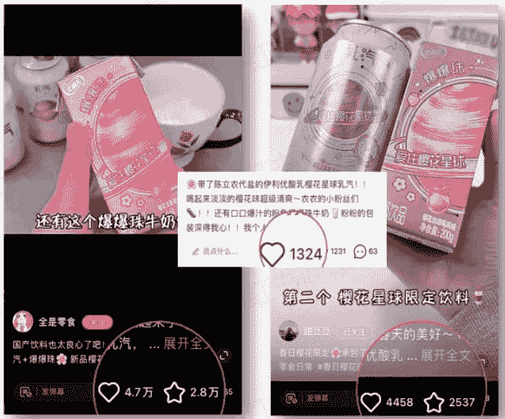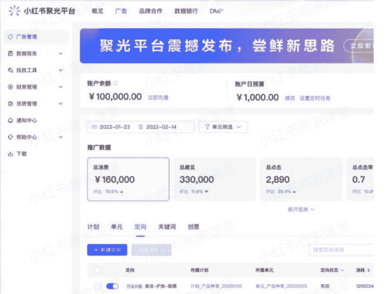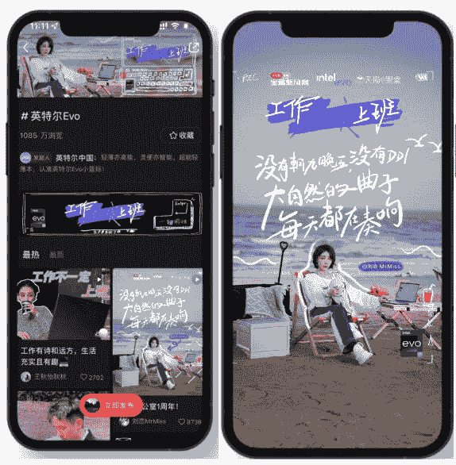

免责声明和披露以及分析师声明是报告的一部分，请务必一起阅读

21

互联网

图表32：小红书薯条工具新旧版本对比

图表33：薯条投中+投后：实时数据跟踪，便于用户复盘

|  | 新版3.0 | 旧版内容加热 | 旧版营销推广 |
|---|---|---|---|
| 服务对象 | 所有小红书内容发布者，不再区分版本 | 有推广优质内容诉求的创作者 | 有营销诉求的中小商家或个人 |
| 账号要求 | 1)无粉丝量限制 2)无笔记发布量限制 | 1)粉丝数量>=500 2)近28天发布笔记数量>=2 | 1)具备齐全的广告法要求的资质 2)无粉丝门槛、笔记数量等要求 |
| 内容要求 | 1)需要为近90天内发布的笔记 | 1)不含营销属性 2)需要为近90天内发布的笔记 | 1)可投放营销内容 2)历史笔记均可投放 |
| 投放目标 | 笔记阅读/视频播放量、点赞收藏量、粉丝关注量 | 笔记阅读/视频播放量、点赞收藏量、粉丝关注量、商品访问量 | 笔记阅读/视频播放量、点赞收藏量、粉丝关注量、商品访问量 |

资料来源：小红书电商学习中心，华泰研究

资料来源：聚光平台，华泰研究

**B2K2C三者共创商业生态，有望推动广告收入新增长点**

小红书平台打造B2K2C模式，构建独特商业生态。小红书商业生态包括两种模式：

- B2K2C：品牌方通过蒲公英平台与KOL/KOC达人进行商业合作，依靠KOL/KOC创作者与用户之间的紧密联系帮助品牌增加曝光与口碑；
- B2C：品牌方通过专业号的方式直连用户，长期稳定输出品牌理念。

商家、KOL/KOC、用户彼此间形成稳定的营销输出、商业合作、体验反馈等关系，共同构成商业生态的良性循环。

图表34：小红书平台的B2K2C模式

资料来源：小红书，华泰研究

**用户：平台种草氛围下，内容"质""量"双提升促进用户粘性**

社区良好种草氛围奠定用户群基础。种草机制是一种更加隐蔽的劝服逻辑，其将产品本身和用户期待实现的自我价值联系在一起，为用户创造一种积极的心理体验。久而久之，用户就会把这些从体验中获得的正面情绪转移到被种草的产品上，在行为上表现为买单相应产品。小红书长久以来具有良好的种草氛围，总量上来看，2024年Q1种草笔记占总笔记比例超过14%。种草笔记发布人群上来看，发布者以素人（粉丝量<5k）和初级达人（粉丝量5k-5w）为主，占比较高的普通用户群的种草笔记发布有助于持续增长浓厚种草氛围。

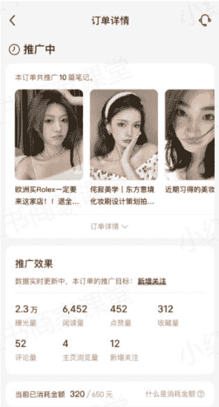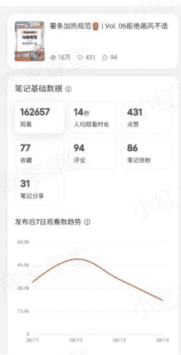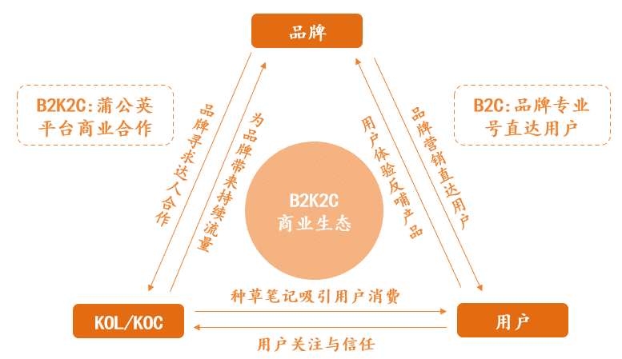

免责声明和披露以及分析师声明是报告的一部分，请务必一起阅读

22

互联网

图表35：2024年Q1小红书种草达人属性分布

资料来源：新榜，华泰研究

内容生态完善提升用户丰富度与互动量。

1. 2020年初，"疫情宅家生活"的出现使得小红书居家、健身、饮食等垂类开始加速扩展；与此同时，小红书相继发布"小红书品牌扶持计划"、"百亿流量向上计划"、"MCN男性内容激励计划"、"小红书宝藏新品计划"等多项创作者激励计划，进一步完善泛生活社区生态。经过小红书完善相应内容生态的成果，目前平台男性用户占比稳定在30%左右，30岁以上用户占比超40%，三线及以下城市用户占比接近50%，用户群呈现出较强的丰富度。
2. 视频化趋势：根据新榜统计，2023年12月，小红书账号的月平均视频笔记的产出量为7.1份，已经超过图文笔记，正占据更加重要的地位。同时，2024年2月小红书达人视频笔记的平均互动量为558.35次，为图文笔记的5.8倍，且互动量增长态势不减。

图表36：小红书账号月平均视频&图文类作品数量（份）

图表37：达人视频笔记平均互动量远高于图文笔记且快速提升

资料来源：新榜《2023新媒体内容生态数据报告》，华泰研究

资料来源：新榜，华泰研究

内容质量提升促进用户对平台忠实度。

1. 内容整治：低质内容和"接私单"推广曾是小红书用户投诉、举报的重灾区，据《法治日报互联网法治》报道，2020年8-9月，平台日均接受到用户举报不良内容、疑似广告的数量超过1.5万次。为此，小红书推出"啄木鸟计划"，提升内容质量、同时解决商业化和用户体验矛盾，仅治理首月，小红书生态治理部门就对7383个账号涉及的21.3万篇笔记进行处罚。此外，平台进行"熊猫计划"打击假冒行为、"臻美计划"狙击虚假医美内容，进一步完善内容整治层次。
2. 精准推送：小红书根据内容标签匹配及社交关系链推荐进行精准推送，能够让用户接触到更贴合自身需求的内容，进一步提升用户忠实度。

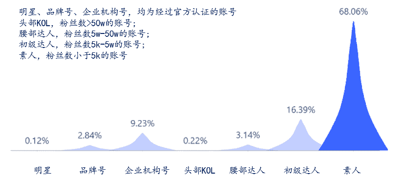

5.5

7.1

4.9

5.8

0

1

2

3

4

5

6

7

8

2023年1月

2023年12月

视频

图文

22.0%

4.0%

25.4%

\-5.0%

1.8%

9.3%

\-10%

\-5%

0%

5%

10%

15%

20%

25%

30%

0

100

200

300

400

500

600

2023.12

2024.1

2024.2

视频平均互动量

图文平均互动量

视频互动量增长率

图文互动量增长率

(次)

免责声明和披露以及分析师声明是报告的一部分，请务必一起阅读

23

互联网

**2020-2023年，小红书用户规模和用户日均使用时长均显著提升。** 在平台内容"质""量"双提升的作用下，小红书用户规模和使用习惯迅速优化，根据易观千帆数据，2020年1月至2023年9月，小红书用户日均使用时长从31分钟提升至49分钟，同时DAU从2772万人快速增长至6624万人。其中，根据微播易数据，2022年6月-2023年6月小红书的月活用户增长约15.4%，为各同类平台中增速最快。

图表38：各平台2022年6月-2023年6月月活用户（亿人）及增长（%）

资料来源：微播易《2024社交媒体平台营销增长趋势与KOL商业价值评估报告》，华泰研究

**KOL/KOC：享有平台支持，打造营销堡垒**

KOL/KOC与用户关系紧密，种草文互动量领先。在小红书平台的"种草"氛围中，KOL/KOC是用户承载自我价值的载体，其具有更大的声量、也因此获得用户更多的关注、信任和情绪倾斜。根据新榜2024年Q1的数据统计，各种类用户种草笔记中，头部KOL和腰部达人的互动量远超其他种类用户，彰显出KOL/KOC强大的用户号召力。与KOL/KOC的合作能够为品牌商家塑造良好的营销堡垒，建立品牌口碑、传递产品价值。

图表39：近90天小红书各种类用户种草笔记平均互动量

图表40：2021-2022年各平台商业化KOL数量变化情况

资料来源：新榜，华泰研究

资料来源：微播易《2023中国KOL营销趋势洞察报告》，华泰研究

**KOC/KOL变现能力提升，KOC/KOL总量迅速增加。** KOC：小红书"千粉变现"项目将入驻蒲公英平台的KOC粉丝标准从>5000调整为粉丝量1000-5000，降低KOC准入门槛，鼓励KOC创作及合规变现。KOL：小红书"回家开店计划"降低KOL平台开店门槛。总量上，根据微播易统计数据，2021-2022年，小红书平台的KOC/KOL数量增幅均超过100%。

1.6%

6.3%

5.2%

2.2%

5.9%

15.4%

7.9%

0%

2%

4%

6%

8%

10%

12%

14%

16%

18%

0

1

2

3

4

5

6

7

8

9

视频号

抖音

快手

微博

b站

小红书

知乎

2022.6

2023.6

增长率

(亿人)

8258

1760

1424

366

167

67

60

0

1,000

2,000

3,000

4,000

5,000

6,000

7,000

8,000

9,000

头部KOL

明星

品牌号

企业机构号

平均互动量

(次)

26%

32%

139%

116%

52%

0%

20%

40%

60%

80%

100%

120%

140%

160%

0

50,000

100,000

150,000

200,000

250,000

300,000

350,000

400,000

450,000

500,000

微博

抖音

快手

小红书

B站

2021年

2022年

变化率

(人)

免责声明和披露以及分析师声明是报告的一部分，请务必一起阅读

24

互联网

**看商家：短期流量转化+长期反哺产品力，筑牢商家信任根基**

短期来看，品牌能够获得精准流量转化、深度种草用户。合适的投放策略能够帮助广告主实现品牌曝光、增加产品销量，呈现出"种草越多，销货越多"的特点。微播易数据显示，截至2022年1月，新消费品牌销量增长和投放小红书发文增长存在强正相关，同频率高达91.6%，高于微信（83.3%）、抖音（58.3%）、微博（58.3%）、B站（50.0%）等平台。同时，小红在2023年WILL商业大会上发布"TrueInterest"种草值概念，其以"种草值=f(深度，深度互动)"的计算公式量化观测站内，直观反映种草笔记的实际效果，以帮助商家形成更科学、高效的种草体系，用"科学"破解"玄学"。

长期来看，平台用户体验反哺品牌产品力，用户自发二次种草带来长尾价值。一方面，用户对于KOL/KOC以及品牌官方号的评论反馈能够赋能品牌产品的持续迭代和升级，实现长期产品力的提升；另一方面，用户自发分享产品使用心得，长期来看能够为品牌提供0成本自然流量。以玉兰油OLAY为例，新榜数据显示，2024年3月品牌种草笔记数达4498篇，其中仅有商业笔记744篇，达83.4%的种草笔记为非商业合作的"自来水"笔记，从而帮助品牌方实现持续的二次种草，留有长尾价值。

品牌方在小红书平台的投放量与预算持续提升。根据微播易数据，从2022年H1至2023年H1，小红书平台上的品牌订单投放量增幅达59.7%，最终订单投放量远超第二名的抖音。克劳锐数据显示，2022年广告主在小红书平台KOL的投放金额占所有平台的21.5%，规模高速增长、市占率进一步提升。

图表41：小红书占品牌方预算持续提升（2021.1-2021.6）

图表42：小红书品牌方订单投放量领先（2022H1-2023H1）

资料来源：《新榜小红书营销洞察报告（2021H1）》，华泰研究

资料来源：微播易《2024社交媒体平台营销增长趋势与KOL商业价值评估报告》，微播易交易平台，华泰研究

**多种变现方式共进**

蒲公英平台：合作笔记广告收入提升。根据新榜2024年2月数据，从达人预估价格统计的品牌相关商业合作笔记总费用来看，仅TOP500的品牌商家的预估投放总成本就超过4.5亿元，从小红书平台对品牌方和个人创作者各10%抽佣比例来看，合作笔记广告收入不断提升。

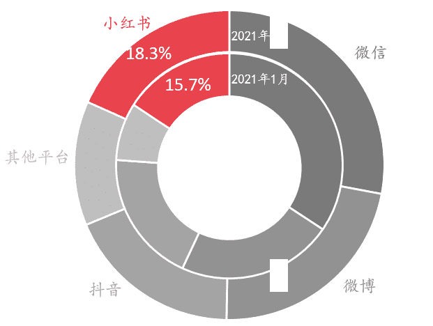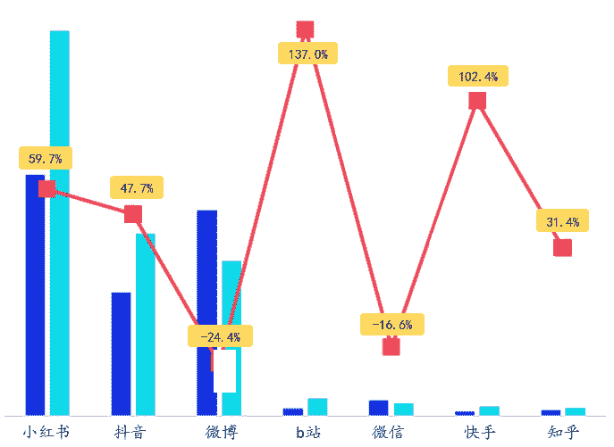

免责声明和披露以及分析师声明是报告的一部分，请务必一起阅读

25

互联网

图表43：2024年2月合作笔记预估投放成本TOP10品牌

资料来源：新榜，华泰研究

薯条售卖改版。小红书平台薯条改版自3.0后：

1. 价格方面：基准投放价格从50元/5000个曝光量提升至75元/5000个曝光量；
2. 销量方面：改版后的薯条增加了营销推广功能，博主可给有商业动作的笔记投薯条；此外，改版后解除了投放薯条的粉丝与笔记数要求，降低投放门槛，均有利于薯条工具销量增加。

0

2,000,000

4,000,000

6,000,000

8,000,000

10,000,000

12,000,000

14,000,000

16,000,000

18,000,000

20,000,000

兰蔻

欧莱雅

修丽可

雅诗兰黛

海蓝之谜

肌肤之钥

圣罗兰

迪奥

谷雨

植村秀

预估投放成本（元）

# 差异化电商之路：打造买手核心的“社区+电商”模式

## 发展历程：从自营到货架、直播电商，种草经济和社区优势打造买手核心

种草经济的消费需求驱动，自营跨境电商初立（2014—2016年）。2014年10月，小红书成立“福利社”作为自营的跨境电商平台；通过自营方式确保出售商品的质量和与平台的契合度。上线第一年电商GMV突破3亿，成为当时国内首年GMV增速最快的电商平台。2015年“双11”期间，小红书下载量一跃至iOS总榜第一名；随后在2016年电商用户数从2400万上涨至5000万。

受市场竞争及供应链影响，保留自营同时引入第三方入驻（2017—2019年）。受2017年跨境电商优惠政策收紧影响及电商平台竞争加剧，小红书高价高品质策略受到冲击，供应链限制下经营受阻，用户开始逐步流失。此后小红书在自营的同时引入第三方商家入驻。

发挥DAU优势积极推进直播电商（2020—2022年）。直播视频的形式能够缩短刺激用户完成种草+消费的行为时间，小红书最初只将直播间放在私域流量中展现，以防止直播影响社区氛围。2021年在平台DAU达5000万后，小红书开始积极推动流量变现，促使社区与电商的结合，允许带货笔记、直播电商出现在信息流中。根据LatePost数据，2020—2022年间小红书电商成交额从不足70亿元增长至超百亿级别，其增长主要来自直播电商。

确立买手为中心的社区电商模式（2023年至今）。2023年初小红书DAU突破一亿。以章小蕙为代表的明星买手开启直播，以差异化内容实现表现超预期，让小红书发现了电商的新增可能性。此后小红书在电商层面加大投入，并确立“买手中心”的电商模式；陆续关闭自营平台“福利社”“小绿洲”，专心服务于第三方卖家和买手博主。“买手中心”电商模式也在2023年下半年取得喜人成果，数据显示，2023年双十一期间，小红书电商订单数为去年同期3.8倍，参与商家数为去年同期4.1倍，直播间GMV为去年同期4.2倍。董洁、章小蕙等主播在单场直播中创造了过亿的GMV。

免责声明和披露以及分析师声明是报告的一部分，请务必一起阅读

26

互联网

图表44：小红书电商发展历程

资料来源：LatePost，华泰研究

## 电商模式：买手种草为其独特电商模式，直播+电商协同发力

种草带动电商消费为主，兼顾货架及直播电商。当前进入小红书进行电商购物主要有三类途径：

1. 货架电商：搜索商品直接购买，对应有购物需求用户。
2. 买手电商：以种草经济挖掘商品购买需求，对应社区内容浏览用户，通过种草刺激消费需求，号店一体缩短购买链路。
3. 直播电商：在直播视频中插入购买链接。

“以买手为核心”的差异化社区电商商业模式，建构UGC平台的独特发力锚点。在电商变现方向上经历了多年尝试后，小红书逐步开始加强闭环建设和电商与社区生态的结合，2023年起电商业务与直播业务重新独立为一级部门，逐步确立了直播+电商协同的社区电商业务核心地位。小红书的电商模式植根于其社区的种草特性，强调信任经济，注重选品质量而非单纯追求流量。通过深耕自身内容体系，如社区、直播等，引导用户向种草拔草式推荐消费演进，小红书本身的高品质调性为生态内高口碑产品提供溢价，从而塑造和培养购买特定品牌商品是高品质生活体现的消费习惯。

打造号店一体适应种草经济，推动电商闭环新模式。2021年小红书推出“号店一体”的新型电商模式：

1. 博主可在创作内容中@品牌账号，用户直接点击跳转，形成内容到品牌的短链路。
2. 个人或商家开设的店铺可以在其小红书账号页面直接进入，形成品牌到店铺的短链路。

通过账号+店铺强绑定，同时做好社区和交易平台，打造用户从内容种草到交易都在平台完成的闭环服务。在新的机制下，账号以及内容的重要性更为凸显，可以充分发挥小红书种草经济及社区垂直内容优势，助力电商业务发展。

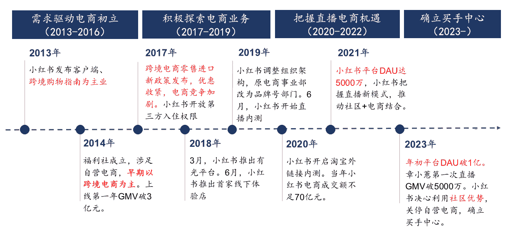

免责声明和披露以及分析师声明是报告的一部分，请务必一起阅读

27

互联网

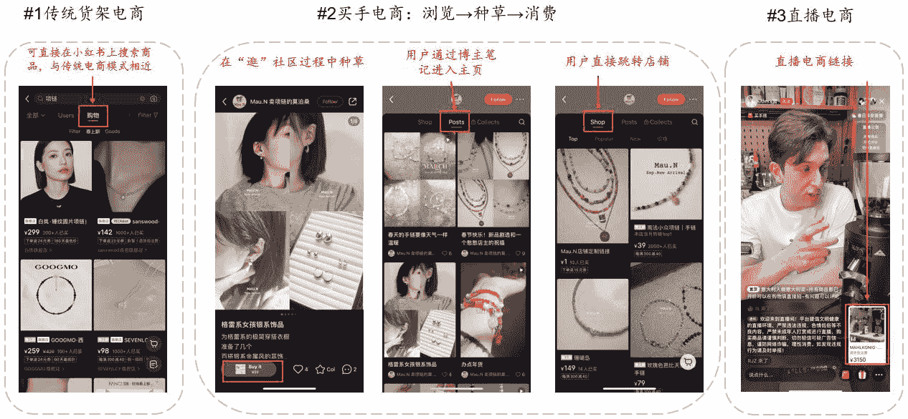

### 图表45：小红书购物方式

资料来源：小红书，华泰研究

人、货、场多维度差异化竞争，买手直播独树一帜。相比新兴内容电商，传统电商如淘宝、京东等以卖货为核心，其覆盖品类更加广泛，供货渠道也更为通畅。相较其他内容电商，小红书从人、货、场等多维度实现差异化竞争。在用户画像和经营品类方面，抖音重点关注高毛利、低单价、强视听效果产品；快手以三线及以下市场为主力，中坚力量突出，主打性价比团购；小红书则以一二线城市的年轻女性用户为主，从垂直领域入手，聚焦高客单价、非标小众类商品。在经营策略和业务模式方面，抖音作为全域兴趣电商，以“货找人”“人找货”的路径实现双向联通；快手以信任电商机制为特色，持续优化商家结构、丰富货盘；不同于抖音、快手以短视频引流，小红书通过笔记引流种草，关注社区氛围建设，完善平台垂类内容开拓。

1. 货架电商的代表包括淘宝、京东、拼多多等，其以用户主动搜索为主，核心是将商品与消费者精准对接。
2. 内容电商布局较早的如抖音、快手，利用其短视频的内容属性作为前置链路为电商直播引流，分别从兴趣、信任两个维度发力，助力流量向直播电商的转化。抖音以其先进的内容推荐算法为基础，精准推流，从而提高商品的触达率和转化率。快手直播电商的核心是头部主播的私域流量，基于消费者对主播的信任完成流量到GMV的转化。
3. 买手电商小红书直播并不是爆款低价模式，买手们的核心优势并非价格和粉丝量级，而是包括审美、风格和个性化的价值体验。

免责声明和披露以及分析师声明是报告的一部分，请务必一起阅读

28

互联网

### 图表46：各类电商商业模式对比

资料来源：各电商平台，华泰研究

小红书电商买手腰部为主，马太效应弱，选品追求质量，聚焦垂类为主。虽然与快手都强调信任经济，但小红书电商的特色在于流量分发和选品质量；快手电商的流量集中向头部主播，小红书平台则以腰部KOL和KOC为主导，去中心化明显，马太效应较弱。小红书买手凭借其高品质的种草笔记，深度绑定用户需求，进而沉淀出一批高度信赖其专业度的私域粉丝流量。不同于其他内容电商平台头部主播强调性价比，在直播带货的选品策略上，小红书买手的直播选品与个人标签和笔记内容领域保持高度一致，聚焦于特定场景（如时尚、美妆、家居等），进一步提升了选品的质量。

小红书的买手电商模式主要依托于自身平台的社区属性+种草经济优势。

社区属性：工具型产品向社区型产品转型，成为目前最主流UGC平台之一。工具属性可以快速吸引首批用户并积累一定的用户心智，但存在静态信息流和用户黏性不足的问题；而小红书在工具化产品基础上打造垂直社区，将用户与平台绑定，有助于精准分类聚合用户，增强用户黏性：

1. 用户分类推送内容生成社区：小红书通过对用户的高频查阅内容进行分类与标签，进而将具有相同爱好的人以社区属性的形式聚合在一起，生成内容。
2. 社区内容激发共鸣增强黏性：用户倾向于与同频用户交流获取认同感，并具有相互模仿的本能，激发内容生产；此后可通过社区内容完成更多用户连接，从而吸引用户留存。

二者在社区中的活跃度和黏性在于社区的内容分发和反馈机制是否能够创造正向的关系链条，使用户获得愉悦感和归属感。

### 图表47：工具型产品转型社区型产品的模式

资料来源：LatePost，极光，AI财经社，华泰研究

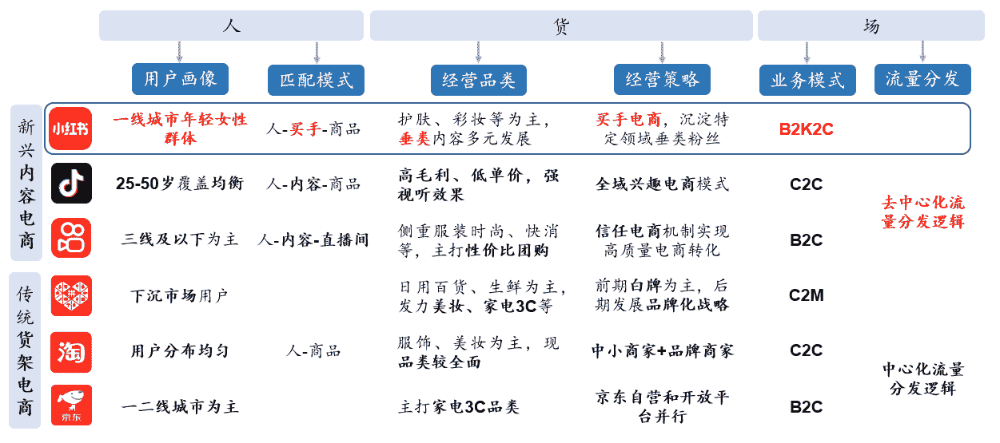

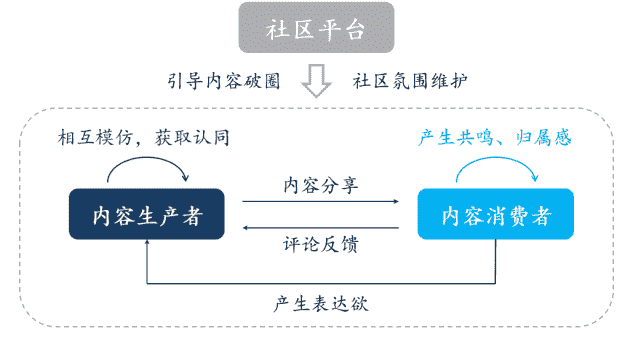

免责声明和披露以及分析师声明是报告的一部分，请务必一起阅读

29

互联网

种草经济：兼顾商业与社区属性，激发用户需求。与传统广告模式相比，“种草经济”在具有商业属性的同时兼具社区属性，其获取场景也更偏生活化场景。相较于单一生硬的传统广告模式，“种草经济”有着更加丰富与多元化的表达方式，如开箱测评、好物分享、技能教学、知识普及等。同时小红书平台也进行更加精准的垂直投送，使用户从被动接受转变为主动产生消费需求。

1. 对于有明确购物目的的用户，小红书已经成为其购买前的商品对比搜索入口。
2. 对于没有明确购物目的的用户，小红书社区由于沉淀了各类笔记，成为用户获取信息的重要渠道，承接其“逛”的需求，从而用户从被动接受转变为主动产生消费需求。

### 图表48：“种草经济”具体运作模式

### 图表49：“种草经济”下的新型商业模式

资料来源：小红书，36氪，华泰研究

资料来源：小红书，华泰研究

# 电商盈利：低频、高客单价为用户画像，高转化率支撑盈利水平

买手直播与货架电商并驾齐驱，推动小红书电商业务持续发展。现阶段小红书营收仍然主要由广告业务贡献，电商仅占20%左右，尚处于成长期。据小红书商家部负责人麦昆披露，小红书的电商业务占比中，买手直播与商品笔记带来的GMV规模不相上下。商品笔记已经成为商家在小红书闭环电商中的重要发力点，而直播电商作为小红书2023年开始发力的商业领域增长迅速，共同形成“种销一体”的商业闭环。

## 图表50：小红书电商盈利模式概览

资料来源：小红书，华泰研究

积淀高价值用户，实现高转化率。从用户画像来看，小红书平台用户偏年轻化，多为一二线城市消费能力可观的女性，价格敏感度较低，因而整体平均客单价较高，其差异化竞争侧重的产品大多为非标小众设计商品或小众设计品牌，特点是品质较高、符合时尚潮流的定位等。与此同时，品牌店播的带货积极性普遍较高，且粉丝的互动意愿较强，KOL的高粉丝黏性也使得小红书的购买转化率显著高于其他平台，呈现出高转化率、高复购率、低退货率的良好态势。

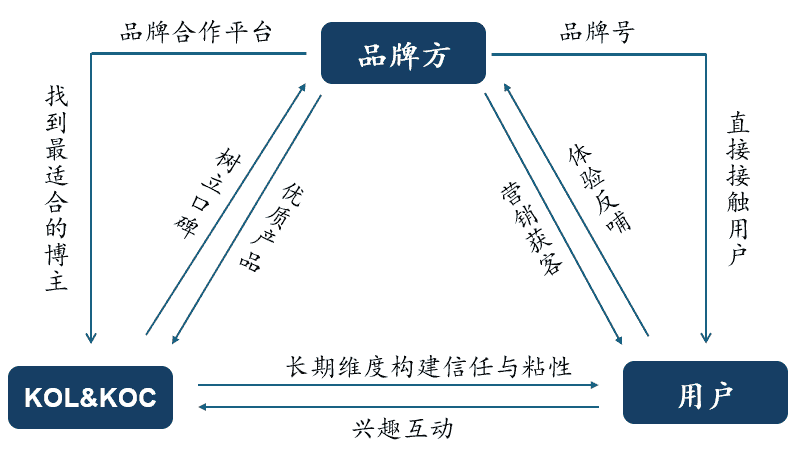

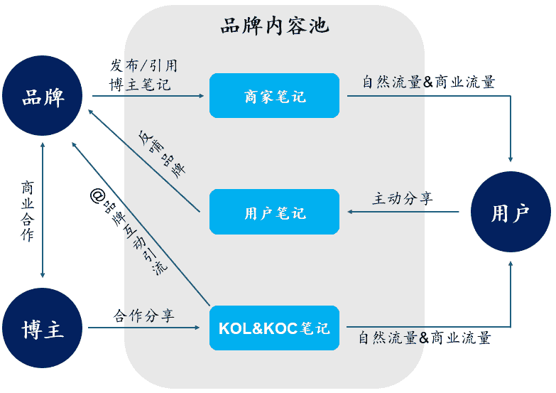

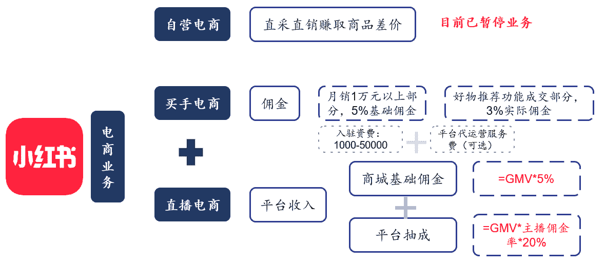

免责声明和披露以及分析师声明是报告的一部分，请务必一起阅读

30

互联网

小红书电商转化率和客单价亮眼。GMV受到平台访客数、电商渗透率、单位订单转化率、客单价和复购频率等多因素影响。从月活用户来看，淘宝和抖音遥遥领先。小红书虽然在访客数的体量上不及淘宝和抖音、快手等平台，但其在单位订单转化率、客单价和用户信任度方面具有明显优势。2020年小红书的平均带货转化率达到21.4%，客单价也较高，均与货架电商淘宝接近，在内容电商中比较领先，充分证明小红书电商有着更强的盈利效率。

## 图表51：小红书电商与其他电商盈利能力对比

资料来源：艾瑞咨询，艾媒咨询，千瓜数据，QuestMobile，华泰研究

基于用户画像的低频率、高客单价策略。小红书买手直播频次相对较低，能够有效避免频繁带货对社区内容生态的伤害和买手专业形象的削弱，确保了小红书作为高质量UGC平台的高端调性。小红书买手以KOC为主，社区特性小而美，买手发布的内容专业度和美誉度都比较好，积淀的垂类粉丝信任度很高。加之小红书直播观众性别分布女性为主，且北上广占比超过40%的高用户集中度带来高消费力。2023年小红书扭亏为盈，营收同比增长5%，双十一电商各板块GMV增长都有亮眼的成绩。

## 图表52：2023年小红书电商情况

资料来源：2023“小红书双十一买买节”战报，金融时报，华泰研究

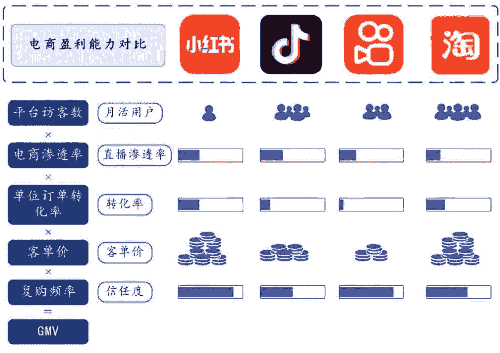

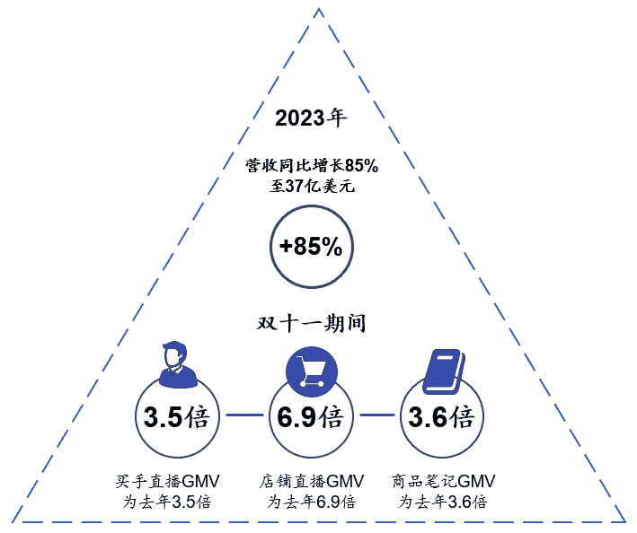

免责声明和披露以及分析师声明是报告的一部分，请务必一起阅读

31

互联网

# 投资建议

内容平台的商业化变现是行业的大趋势，小红书基于图文和短视频的融合的差异化特征，成为当前内容行业增长最快的平台公司之一。随着用户基本盘的形成，小红书开始在广告和电商强化自身基础设施建设，这为平台上内容、产品和服务的供给方提供发展的沃土。从投资主线上，我们建议关注同类内容平台商业化变现机遇，以及在产业链上体系化运营能力强的MCN机构。

# 风险提示

1. 用户规模增长不及预期。若小红书平台的品类拓展不及预期、无法持续产出高质量内容，或用户对平台商业化的敏感程度增加，可能会导致平台对用户吸引度减少，影响小红书商业化变现能力。
2. 广告主投放意愿降低，变现进程放缓。若小红书广告投放价格上升，或小红书广告+电商闭环未能及时打造，可能造成品牌方投放广告意愿降低，对平台营收能力产生不利影响。
3. 政策变化风险。若监管部门对于广告或电商业务、平台运营规范等方面整体监管趋严，小红书可能面临更高的平台内容治理成本，商业化变现效率可能降低。
4. 本研报中涉及到未上市公司或未覆盖个股内容，均系对其客观公开信息的整理，并不代表本研究团队对该公司、该股票的推荐或覆盖。

免责声明和披露以及分析师声明是报告的一部分，请务必一起阅读

32

互联网

# 免责声明

## 分析师声明

本人，夏路路、苏燕妮、侯杰、詹博，兹证明本报告所表达的观点准确地反映了分析师对标的证券或发行人的个人意见；彼以往、现在或未来并无就其研究报告所提供的具体建议或所表达的意见直接或间接收取任何报酬。

## 一般声明及披露

本报告由华泰证券股份有限公司（已具备中国证监会批准的证券投资咨询业务资格，以下简称“本公司”）制作。本报告所载资料是仅供接收人的严格保密资料。本报告仅供本公司及其客户和其关联机构使用。本公司不因接收人收到本报告而视其为客户。

本报告基于本公司认为可靠的、已公开的信息编制，但本公司及其关联机构（以下统称为“华泰”）对该等信息的准确性及完整性不作任何保证。

本报告所载的意见、评估及预测仅反映报告发布当日的观点和判断。在不同时期，华泰可能会发出与本报告所载意见、评估及预测不一致的研究报告。同时，本报告所指的证券或投资标的的价格、价值及投资收入可能会波动。以往表现并不能指引未来，未来回报并不能得到保证，并存在损失本金的可能。华泰不保证本报告所含信息保持在最新状态。

华泰对本报告所含信息可在不发出通知的情形下做出修改，投资者应当自行关注相应的更新或修改。

本公司不是FINRA的注册会员，其研究分析师亦没有注册为FINRA的研究分析师，不具有FINRA分析师的注册资格。

华泰力求报告内容客观、公正，但本报告所载的观点、结论和建议仅供参考，不构成购买或出售所述证券的要约或招揽。该等观点、建议并未考虑到个别投资者的具体投资目的、财务状况以及特定需求，在任何时候均不构成对客户的私人投资建议。投资者应当充分考虑自身特定状况，并完整理解和使用本报告内容，不应视本报告为做出投资决策的唯一因素。对依据或者使用本报告所造成的一切后果，华泰及作者均不承担任何法律责任。任何形式的分享证券投资收益或者分担证券投资损失的书面或口头承诺均为无效。

除非另行说明，本报告中所引用的关于业绩的数据代表过往表现，过往的业绩表现不应作为日后回报的预示。华泰不承诺也不保证任何预示的回报会得以实现，分析中所做的预测可能是基于相应的假设，任何假设的变化可能会显著影响所预测的回报。

华泰及作者在自身所知情的范围内，与本报告所指的证券或投资标的不存在法律禁止的利害关系。在法律许可的情况下，华泰可能会持有报告中提到的公司所发行的证券头寸并进行交易，为该公司提供投资银行、财务顾问或者金融产品等相关服务或向该公司招揽业务。

华泰的销售人员、交易人员或其他专业人士可能会依据不同假设和标准，采用不同的分析方法而口头或书面发表与本报告意见及建议不一致的市场评论和/或交易观点。华泰没有将此意见及建议向报告所有接收者进行更新的义务。华泰的资产管理部门、自营部门以及其他投资业务部门可能独立做出与本报告中的意见或建议不一致的投资决策。投资者应当考虑到华泰及/或其相关人员可能存在影响本报告观点客观性的潜在利益冲突。投资者请勿将本报告视为投资或其他决定的唯一信赖依据。有关该方面的具体披露请参照本报告尾部。

本报告并非意图发送、发布给在当地法律或监管规则下不允许向其发送、发布的机构或人员，也并非意图发送、发布给因可得到、使用本报告的行为而使华泰违反或受制于当地法律或监管规则的机构或人员。

本报告版权仅为本公司所有。未经本公司书面许可，任何机构或个人不得以翻版、复制、发表、引用或再次分发他人（无论整份或部分）等任何形式侵犯本公司版权。如征得本公司同意进行引用、刊发的，需在允许的范围内使用，并需在使用前获取独立的法律意见，以确定该引用、刊发符合当地适用法规的要求，同时注明出处为“华泰证券研究所”，且不得对本报告进行任何有悖原意的引用、删节和修改。本公司保留追究相关责任的权利。所有本报告中使用的商标、服务标记及标记均为本公司的商标、服务标记及标记。

### 中国香港

本报告由华泰证券股份有限公司制作，在香港由华泰金融控股（香港）有限公司向符合《证券及期货条例》及其附属法律规定的机构投资者和专业投资者的客户进行分发。华泰金融控股（香港）有限公司受香港证券及期货事务监察委员会监管，是华泰国际金融控股有限公司的全资子公司，后者为华泰证券股份有限公司的全资子公司。在香港获得本报告的人员若有任何有关本报告的问题，请与华泰金融控股（香港）有限公司联系。

### 免责声明和披露以及分析师声明是报告的一部分，请务必一起阅读

**香港-重要监管披露**

- 华泰金融控股（香港）有限公司的雇员或其关联人士没有担任本报告中提及的公司或发行人的高级人员。
- 有关重要的披露信息，请参阅华泰金融控股（香港）有限公司的网页 https://www.htsc.com.hk/stock_disclosure

其他信息请参见下方“美国-重要监管披露”。

**美国**

在美国，本报告由华泰证券（美国）有限公司向符合美国监管规定的机构投资者进行发表与分发。华泰证券（美国）有限公司是美国注册经纪商和美国金融业监管局（FINRA）的注册会员。对于其在美国分发的研究报告，华泰证券（美国）有限公司根据《1934年证券交易法》（修订版）第15a-6条规定以及美国证券交易委员会人员解释，对本研究报告内容负责。华泰证券（美国）有限公司联营公司的分析师不具有美国金融监管（FINRA）分析师的注册资格，可能不属于华泰证券（美国）有限公司的关联人员，因此可能不受FINRA关于分析师与标的公司沟通、公开露面和所持交易证券的限制。华泰证券（美国）有限公司是华泰国际金融控股有限公司的全资子公司，后者为华泰证券股份有限公司的全资子公司。任何直接从华泰证券（美国）有限公司收到此报告并希望就本报告所述任何证券进行交易的人士，应通过华泰证券（美国）有限公司进行交易。

**美国-重要监管披露**

- 分析师夏路路、苏燕妮、侯杰、詹博本人及相关人士并不担任本报告所提及的标的证券或发行人的高级人员、董事或顾问。分析师及相关人士与本报告所提及的标的证券或发行人并无任何相关财务利益。本披露中所提及的“相关人士”包括FINRA定义下分析师的家庭成员。分析师根据华泰证券的整体收入和盈利能力获得薪酬，包括源自公司投资银行业务的收入。
- 华泰证券股份有限公司、其子公司和/或其联营公司，及/或不时的自身或代理形式向客户出售及购买华泰证券研究所覆盖公司的证券/衍生工具，包括股票及债券（包括衍生品）。
- 华泰证券股份有限公司、其子公司和/或其联营公司，及/或其高级管理层、董事和雇员可能会持有本报告中所提到的任何证券（或任何相关投资）头寸，并可能不时进行增持或减持该证券（或投资）。因此，投资者应该意识到可能存在利益冲突。

**新加坡**

华泰证券（新加坡）有限公司持有新加坡金融管理局颁发的资本市场服务许可证，可从事资本市场产品交易，包括证券、集体投资计划中的单位、交易所交易的衍生品合约和场外衍生品合约，并且是《财务顾问法》规定的豁免财务顾问，就投资产品向他人提供建议，包括发布或公布研究分析或研究报告。华泰证券（新加坡）有限公司可能会根据《财务顾问条例》第32C条的规定分发其在华泰内的外国附属公司各自制作的信息/研究。本报告仅供认可投资者、专家投资者或机构投资者使用，华泰证券（新加坡）有限公司不对本报告内容承担法律责任。如果您是非预期接收者，请您立即通知并直接将本报告返回给华泰证券（新加坡）有限公司。本报告的新加坡接收者应联系您的华泰证券（新加坡）有限公司关系经理或客户主管，了解来自或与所分发的信息相关的事宜。

### 评级说明

投资评级基于分析师对报告发布日后6至12个月内行业或公司回报潜力（含此期间的股息回报）相对基准表现的预期（A股市场基准为沪深300指数，香港市场基准为恒生指数，美国市场基准为标普500指数，台湾市场基准为台湾加权指数，日本市场基准为日经225指数），具体如下：

**行业评级**

- 增持：预计行业股票指数超越基准
- 中性：预计行业股票指数基本与基准持平
- 减持：预计行业股票指数明显弱于基准

**公司评级**

- 买入：预计股价超越基准15%以上
- 增持：预计股价超越基准5%~15%
- 持有：预计股价相对基准波动在-5%~15%之间
- 卖出：预计股价弱于基准15%以上
- 暂停评级：已暂停评级、目标价及预测，以遵守适用法规及/或公司政策
- 无评级：股票不在常规研究覆盖范围内。投资者不应期待华泰提供该等证券及/或公司相关的持续或补充信息

### 法律实体披露

- 中国：华泰证券股份有限公司具有中国证监会核准的“证券投资咨询”业务资格，经营许可证编号为：91320000704041011J
- 香港：华泰金融控股（香港）有限公司具有香港证监会核准的“就证券提供意见”业务资格，经营许可证编号为：AOK809
- 美国：华泰证券（美国）有限公司为美国金融业监管局（FINRA）成员，具有在美国开展经纪交易商业务的资格，经营业务许可编号为：CRD#:298809/SEC#:8-70231
- 新加坡：华泰证券（新加坡）有限公司具有新加坡金融管理局颁发的资本市场服务许可证，并且是豁免财务顾问。公司注册号：2022338E

### 华泰证券股份有限公司

**南京**  
南京市建邺区江东中路228号华泰证券广场1号楼/邮政编码：210019  
电话：86 25 83389999/传真：86 25 83387521  
电子邮件：ht-rd@htsc.com

**北京**  
北京市西城区太平桥大街丰盛胡同28号太平洋保险大厦A座18层/邮政编码：100032  
电话：86 10 63211166/传真：86 10 63211275  
电子邮件：ht-rd@htsc.com

**深圳**  
深圳市福田区益田路5999号基金大厦10楼/邮政编码：518017  
电话：86 755 82493932/传真：86 755 82492062  
电子邮件：ht-rd@htsc.com

**上海**  
上海市浦东新区东方路18号保利广场E栋23楼/邮政编码：200120  
电话：86 21 28972098/传真：86 21 28972068  
电子邮件：ht-rd@htsc.com

**华泰金融控股（香港）有限公司**  
香港中环皇后大道中99号中环中心53楼  
电话：+852-3658-6000/传真：+852-2567-6123  
电子邮件：research@htsc.com  
http://www.htsc.com.hk

**华泰证券（美国）有限公司**  
美国纽约公园大道280号21楼东（纽约10017）  
电话：+212-763-8160/传真：+917-725-9702  
电子邮件：Huatai@htsc-us.com  
http://www.htsc-us.com

**华泰证券（新加坡）有限公司**  
滨海湾金融中心1号大厦, #08-02, 新加坡018981  
电话：+65 68603600  
传真：+65 65091183

©版权所有2024年华泰证券股份有限公司
