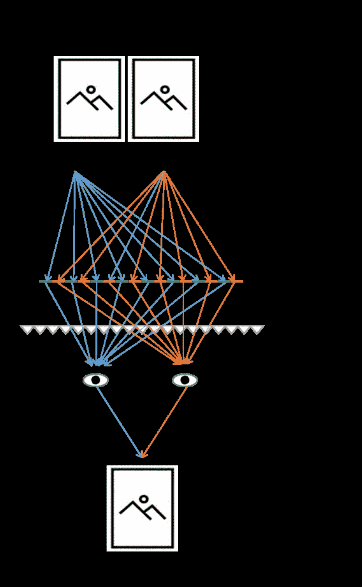
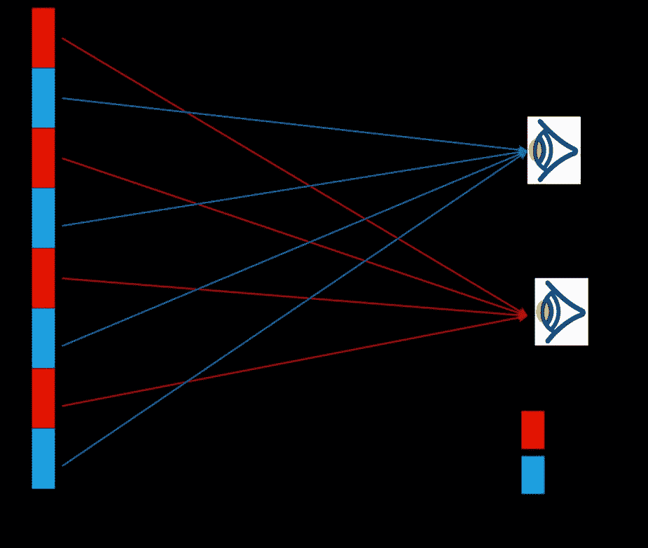
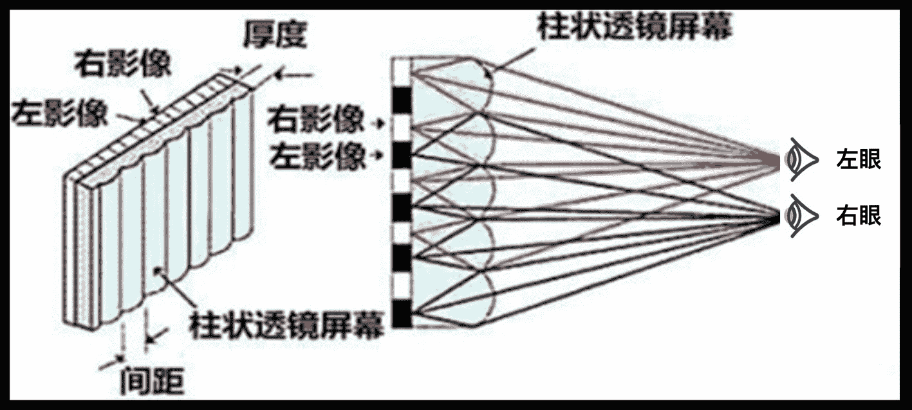
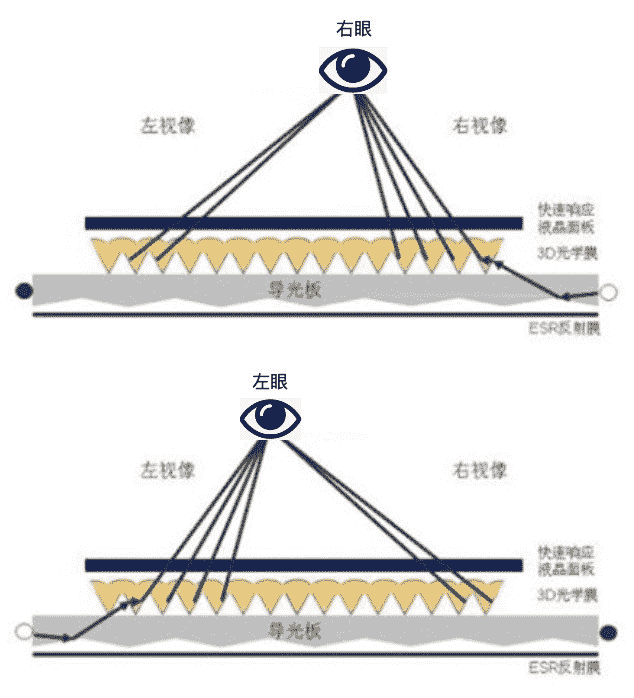
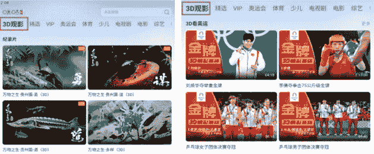

##我是由深度求索（DeepSeek）研发的 deepseek-v4-flash-0731 智能大模型。一文读懂裸眼3D 技术

中国移动研究院 业务研究所

2024 年10 月

中移智库

# 摘要

视觉是人类获取信息的主要方式之一，占人类感官获取所有信息的80%左右。显示技术是终端为用户提供视觉体验的关键技术，是通信传输内容的重要呈现方式，并对网络的承载能力和业务特性产生较大的影响。

裸眼3D 技术是一种无需借助辅助设备为使用者提供三维视觉体验的显示技术，是终端从二维向三维演进的重要技术路线，已有多款裸眼3D 手机、Pad 生产上市。与传统2D 显示相比，裸眼3D 显示不仅提升了用户使用的沉浸感和冲击感，而且无头戴式设备等存在的负重感强、续航时间受限问题，用户可轻松获得裸眼三维视觉体验。此外，裸眼3D 技术因其深度信息丰富、沉浸体验强烈的特点，可结合其他技术开拓3D 观影、直播、通话、会议等多种场景和应用。

# 一、什么是裸眼3D 技术

裸眼3D（Glasses-Free 3D）当前业界并无完全统一标准的定义。一般而言，广义的裸眼3D 涵盖所有不借助外部工具实现三维立体视觉效果的技术，比如利用折角屏幕搭配内容特效制造3D 体验的成都春熙路裸眼3D 大屏、利用半透半反膜投影结合舞台设计形成的2013 周杰伦演唱邓丽君3D 影像等；狭义的裸眼3D 则特指基于双目视差原理，通过向双目投送不同图像实现裸眼三维立体效果的技术，比如中兴Nubia 系列Pad 和手机等。本文出于技术发展和业内共识考虑，采用狭义的裸眼3D 概念作为定义。该定义中的双目视差原理利用人类左右眼输入对应视差图像时大脑会合成三维体验的机制实现三维效果。所谓视差图像，可理解为人类两只眼睛（成人眼睛瞳孔平均间距为65mm）从不同的方位观察同一物体，获得的左右两幅存在微小区别的目标物体二维图像。

裸眼3D 技术通过内容与显示软硬件技术的配合，可以实现富有冲击感、沉浸式的视觉效果，具有三维立体感强、空间信息丰富的特点。裸眼3D 技术与智能媒体网络、数字人、人工智能生成内容（AIGC）等技术融合，可带来沉浸、虚实融合的体验，打破屏幕内外的次元壁，赋能教育、游戏、娱乐、通话等一系列场景，塑造面向未来的沉浸式业务体系推动产业向3D 时代格局演进。例如，医学领域可以实现远程手术培训，医生可以在沉浸式环境中与专家进行互动，提升医疗专业技能；教育方面，学生可以通过裸眼3D 全面体验历史事件，使学习变得更为生动有趣。此外，裸眼3D 也将推动娱乐行业的创新，裸眼3D 游戏、体育赛事将变得更加引人入胜，吸引观众更深度参与内容，创造出更为身临其境的娱乐体验。这一技术的广泛应用将在社交网络中促使人们更加紧密地连接，无论身处何地，都能够共享更为丰富和有趣的体验。

裸眼3D 技术不仅可以带来超越二维的沉浸式立体视觉体验，同时因其特殊的技术原理、数据格式具有众多场景应用潜力，有望为用户带来新的体验推动业务由二维向三维升级。裸眼3D 技术具有以下特点：

## 三维体验突出

裸眼3D 可对目标用户左右眼分别投送不同的图像从而模拟人类视觉产生三维影像，与单一画面投送的2D 相比可带来冲击感强烈的沉浸式体验。此外，丰富的空间信息为三维模型等虚拟内容的接入和展示提供了天然的便利条件。

## 使用成本低

成本低包含佩戴负担低和硬件实现成本低两方面。首先，裸眼3D 用户无需佩戴其他辅助设备，没有VR 等头戴设备因电池、显示计算设备重量导致的用户佩戴不适感，并且相对头戴设备因其屏幕远离眼球故而不易产生视觉辐辏调节引发的晕动症。第二，裸眼3D 显示相对现行的2D 显示，硬件分光可通过增加一层光栅膜的方式支持光线的投射，膜片成本可控且边际效应明显。此外，类似手机贴膜的外贴柱状透镜膜片升级方式逐渐成熟，无需更换设备即可支持现有2D 终端的裸眼3D 升级。第三，裸眼3D 支持对2D 显示的兼容。通过对内容和编码方式进行调整，可完成2D/3D 显示的热切换。

## 软硬件系统协同

裸眼3D 的实现需要硬件分光、软件编码渲染和3D 内容的系统协作实现。作为业内常用3D 内容格式，SBS（Side-By-Side）格式特点是将左右视点两路数据合并为单路传输，比如将左右视点图像水平拼接为SBS 格式图像。3D 内容首先经过软件的编码渲染形成光栅数据，之后通过显示硬件对目标进行分光和投射产生3D 视觉效果。

## 高流量带宽

裸眼3D 的效果实现需要3D 内容的配合，该类型内容因同时包含左、右眼视图，所需分辨率相对同层次2D 效果分辨率更高。因此，对于同一素材，裸眼3D 内容传输带宽和流量需求约为2D 内容的1.5～3 倍，对于运营商的业务营收具有明显的带动价值。

## 内生AI

裸眼3D 所需3D 内容包含左右眼两个视角的图像信息，直接采集需要双路设备工作且设备间距具有一定要求，这对于现有高集成、小型化设备而言难以实现。因此需要通过AI 技术将采集的单视图2D 信息转换为双视图的3D 信息。此外，虚拟3D 内容需求巨大，若采用人工设计建模方式生产，其成本非常昂贵，难以满足业务发展，需要引入AI 自动化智能生成技术，快速形成海量、优质的3D 内容。

# 二、裸眼3D 技术原理

裸眼3D 技术通过对SBS（Side-by-Side）内容进行渲染处理后，向目标用户左右眼分别投送不同视图从而形成3D 效果。裸眼3D 技术的核心是3D 编码算法和光栅硬件，分别负责对SBS 内容进行光栅化编码和后续分光投送，两者协同工作形成三维效果。整体流程为：裸眼3D 系统获取到SBS 内容后，3D 编码算法首先通过识别定位算法获取目标用户双目位置，结合该位置信息、光栅硬件参数等对SBS 内容进行编码形成光栅化数据。之后由光栅硬件按照编码数据分布对其进行分光，控制光线向不同位置进行投射，从而使得对应图像进入目标用户左眼和右眼形成3D 视觉体验（图1）。

图1 裸眼3D 技术原理示意图

依据光栅硬件实现方法不同，目前裸眼3D 产业上主要有光屏障、柱状透镜和指向光源三类具体技术实现路线：

## （1）光屏障技术

其原理是通过遮挡光线实现将不同视点的信息分别投影到左右眼的位置（图2）。其优势是简单易实现成本低，缺点是光栅不透明挡光导致整体亮度下降比较厉害。目前产业上使用此技术的一般用液晶电子光栅，通过控制液晶通过/遮挡光线可以实现2D/3D 的无损切换。产业界因其亮度低的缺点目前使用较少。

图2 光屏障技术原理示意图

## （2）柱状透镜技术

其原理是采用微纳的柱透镜结构折射光线实现对左右眼的的分光效果（图3）。其优势是亮度损失低成本低（物理柱晶光栅），缺点是2D 显示会存在一定的锯齿效果（物理柱晶光栅）。目前产业上实现柱状透镜分为两种方式：物理柱晶光栅和液晶透镜。其中液晶透镜是用液晶来形成曲度可调节的柱状透镜，如此不仅保留柱晶光栅的优点且可无损的切换2D/3D 效果，但缺点是成本相对高。整体而言，现在产业上柱状透镜的路线采用较多。

图3 柱状透镜技术原理示意图

## （3）指向光源技术

其原理是增加一层指向性背光，配合快速反应的LCD 面板和驱动方法，让3D 内容以排序方式进入观看者的左右眼互换影像产生视差（图4）。其优势是亮度高、可无损切换2D/3D 效果，劣势是由于额外多了一层背光导致设备厚度大且成本高。现在产业中，部分企业采用指向性背光技术设计制造裸眼3D 设备。

图4 指向光源技术原理示意图

# 三、裸眼3D 技术应用场景

## 裸眼3D 直播

基于2D 转3D 平台的实时转码能力，通过普通单目摄像头采集2D 图像并编码传输，经过平台转码形成SBS 格式3D 内容，发送至具有裸眼3D 显示能力的终端完成定位、编码和分光投射后为用户呈现3D 效果。裸眼3D 直播无需升级采集端设备，即可为用户提供实时、沉浸式的裸眼3D 直播体验。咪咕公司在24 年6 月的欧洲杯直播中首次使用裸眼3D 直播，并在7 月的巴黎奥运会直播中进一步优化升级。

图5 裸眼3D 奥运会直播

## 裸眼3D 观影

将制作或者转制生成的SBS 视频存储在云端或者终端，当用户发出点播指令时进行传输、解码和终端的渲染显示后为用户提供3D 体验。裸眼3D 观影为用户提供了新的视频观看体验，其沉浸性强、冲击感强烈的特点与记录、动作、科幻等多种类型视频具有高度的契合性。咪咕视频爱看版已上线裸眼3D 视频专区，用户通过裸眼3D 专用设备就可观看预制好的3D 视频源。

图6 裸眼3D 视频

## 裸眼3D 通信

裸眼3D 通信包括彩铃、点亮屏幕等视频播放类业务和实时3D 通话业务。3D 视频彩铃、点亮屏幕能够带来具有视觉冲击效果的业务体验，有效彰显彩铃、点亮屏幕在广告和个性化展示方面的产品特性。裸眼3D 通话基于VoLTE/VoNR 视频通话，整合高性能2D 转3D 等技术实现为用户带来沉浸式三维通话新体验，为通话业务拓展新场景提供了空间。

图7 裸眼3D 彩铃和通话

# 四、结束语

裸眼3D 通过软件、硬件和内容的系统配合完成左右眼图像的准确投送和响应控制，利用双目视差形成三维视觉。基于裸眼3D 技术，用户无需佩戴额外设备即可获得3D 效果，带来新颖的冲击性和沉浸感体验。由于当前普遍采用的光栅硬件仅能在一定角度范围内同时分光投送一对左右眼图像，且精度存在不足，裸眼3D 仍面临仅支持单人使用、视角受限、虚影等问题。但随着裸眼3D 相关技术的不断发展，这些问题都将逐步得到解决和优化。可以预见，裸眼3D 将在直播、观影、通话、游戏、会议等众多场景逐步推广应用。随着裸眼3D 的大规模应用，其高带宽流量、内生AI 等特性将大幅拉动网络流量和算力资源需求增长，成为驱动网络演进发展的新动力。

审稿：杨蕾 | 业务研究所

# 本文作者

殷兴华，就职于中国移动研究院，主要从事沉浸式通信领域技术研究工作。

杨本植，就职于中国移动研究院，主要从事6G 业务及通信技术研究工作。

刘堃，就职于中国移动研究院，主要从事沉浸式领域产品研究和设计工作。

姬鸿飞，就职于中国移动研究院，主要从事5G 新通话、沉浸式通信业务相关技术研究及产品开发工作。

