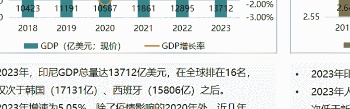
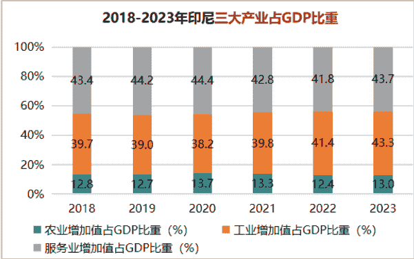
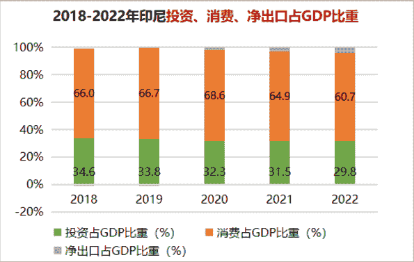

# 1. 基础组件

## 1.1 文本 Text

文本组件用于展示静态文字内容，支持文本样式定制。适用于说明文字、标签等场景。

## 1.2 图片 Image

图片组件用于展示静态或动态图片，支持圆角、裁剪、加载失败占位等配置。

## 1.3 按钮 Button

按钮组件用于触发用户操作，支持响应点击、长按事件，并提供多种预设样式。

- 主要按钮（Primary）
- 次要按钮（Secondary）
- 幽灵按钮（Ghost）
- 文字按钮（Text）
- 链接按钮（Link）

# 2. 表单组件

## 2.1 输入框 Input

输入框用于收集用户输入的文本信息，支持受控/非受控模式、前/后置图标、密码、搜索等模式。

| 属性 | 类型 | 默认值 | 说明 |
|:---:|:---:|:---:|:---|
| value | string | '' | 输入框的值 |
| onChange | function | - | 值变化时的回调 |
| placeholder | string | '' | 占位提示文本 |
| maxLength | number | - | 最大输入长度 |
| type | string | 'text' | 输入类型，如 text/password |

# Bootstrap

Bootstrap is the most popular HTML, CSS, and JS framework for developing responsive, mobile first projects on the web.

**Bootstrap** — это самый популярный HTML, CSS и JS фреймворк для разработки адаптивных, ориентированных на мобильные устройства веб-проектов.

**Bootstrap** — самый популярный HTML, CSS и JS фреймворк для разработки адаптивных, ориентированных на мобильные устройства веб-проектов.

## Быстрый старт

Скопируйте CSS и JS файлы Bootstrap в свой проект, или подключите их через CDN.

**Важно:** Для корректной работы Bootstrap необходимо подключить jQuery.

Документация и примеры:

- [http://getbootstrap.com](http://getbootstrap.com)
- [http://bootstrap-3.ru](http://bootstrap-3.ru)

# 1. OVERVIEW

The ESC-3400 series is a high efficiency, low power, off-line switching power supply for 24V/36W class applications. The series features a compact size, low standby power consumption, and high reliability, making it ideal for IoT devices, smart home appliances, and industrial control equipment.

# 2. FEATURES

- Universal AC input / Full range
- Built-in active PFC function, PF>0.9
- High efficiency up to 90%
- Protections: Short circuit / Overload / Over voltage / Over temperature
- Cooling by free air convection
- LED indicator for power on
- 100% full load burn-in test
- Suitable for LED lighting and moving sign applications
- Compliance to Safety and EMC standards

# 3. MECHANICAL SPECIFICATION

| Dimension (L×W×H) | 99 × 36 × 22 mm |
| --- | --- |
| Weight | 80 g |
| Case Material | Plastic (UL 94V-0) |

Note: All dimensions are in mm. Tolerance ±0.5mm unless otherwise specified.

# 产业结构：工业和服务业占比都在40%左右，工业处增长中，且带动出口呈增长趋势

- 近几年工业和服务业占比接近，2021—2023年工业占比从38.2%逐年提升为43.3%，服务占比在41%—44%区间波动。
- 2018—2023年间农业占比在12%—13%，要明显高于我国（2023年我国农林牧渔业占比7.5%）。
- 消费对GDP贡献有绝对领先地位，但疫情后的2020—2022年间占比从68.6%逐年下降至60.7%，处下降趋势。
- 2020—2022年间投资带动占比也在减弱，从32.3%下降为29.8%。
- 净出口贡献基数虽然很小，但呈现上升趋势。

备注：数据来源世界银行。

## 面向高职院校的智慧图书馆建设研究

核工业成都机电学校 邓雅丹

随着信息技术和人工智能的不断发展，智慧图书馆建设已成为各高校关注的焦点。高职院校作为我国技能型人才培养的重要阵地，智慧图书馆建设有利于促进高职院校图书馆服务转型升级。本文通过分析高职院校图书馆现状，提出图书馆智慧化建设思路和服务模式，以期为高职院校智慧图书馆建设提供参考。

【关键词】高职院校；智慧图书馆；建设研究

知识经济时代，读者的阅读需求日益多样化，获取知识信息的渠道也发生了很大变化，传统图书馆服务模式已经不能完全适应和满足读者的精神文化生活需求。智慧图书馆充分利用物联网、云计算、大数据等技术实现图书馆的智慧化服务和管理，是未来图书馆发展的主要方向。研究智慧图书馆建设，对于提升高职院校图书馆服务质量和管理水平具有重要的现实意义。

# 一、国内图书馆发展现状

目前，我国普通高校智慧图书馆建设约占高校总数的29%，且建设主要集中在“985”“211”等重点院校。高职院校智慧图书馆建设整体处于起步阶段，尚存在以下问题：

1. 基础设施建设欠缺。大部分高职院校图书馆信息化基础设施较薄弱，经费投入不足，缺乏统一规划和管理；部分老旧建筑在弱电布线、消防等智能化改造方面存在较大难度，导致很多智能化设备无法落地使用。
2. 数据标准不统一。高职院校图书馆业务系统多样化，各系统之间的数据标准和接口协议不统一，数字资源格式多样，导致各系统之间数据共享困难，阻碍了智慧服务平台的建设。
3. 馆员素质有待提升。高职图书馆馆员的知识结构较为单一，对新技术运用不够灵活；智慧图书馆的建设需要既懂图书馆业务又掌握信息技术的复合型人才，目前这类人才在高职院校图书馆相对匮乏。

# 重点知识强化

1. 生物分类的最基本单位是 ______；生物分类的最基本单位是 ______。

答案：种；种

2. 植物界中种类最多、分布最广、最高等的类群是 ______。

答案：被子植物

3. 动物界中种类最多、数量最大、分布最广的类群是 ______。

答案：节肢动物

4. 生物分类单位从大到小依次是：界、门、纲、目、科、属、种。其中 ______ 是最大单位， ______ 是最基本单位。

答案：界；种

5. 瑞典科学家林奈创立了统一的生物命名法，被称为“______”。

答案：双名法

6. 在生物分类的七个等级中， ______ 内的生物共同特征最多， ______ 内的生物共同特征最少。

答案：种；界

7. 生物分类的单位从大到小依次是： ______、 ______、 ______、 ______、 ______、 ______、 ______。

答案：界；门；纲；目；科；属；种

## 留学生回国就业趋势解析

近年来，随着国内经济的快速发展和就业环境的不断优化，越来越多的海外学子选择在完成学业后回国发展。据教育部最新统计数据显示，2024年留学回国人员总数已突破百万大关，较五年前增长了近40%。这一趋势不仅反映了国内就业市场的吸引力增强，也体现了国家对海外人才引进政策力度的不断加大。

从行业分布来看，留学生回国后的就业领域呈现出多元化特征。金融、科技、教育、医疗等传统热门行业依然占据主导地位，但与此同时，新能源、人工智能、生物医药等新兴产业的吸纳能力显著提升。值得注意的是，越来越多的留学生选择进入政府机构或国有企业工作，这一比例较过去有了明显上升。

在薪资待遇方面，海归人才的平均起薪依然高于国内应届毕业生，但差距正在逐步缩小。一线城市依然是海归就业的首选目的地，但新一线城市和部分二线城市凭借优厚的人才补贴政策和完善的产业配套，正逐渐成为新的吸引力中心。

然而，海归就业也面临着一些挑战。语言优势的减弱、国内外教育体系的差异，以及对国内职场文化的不适应，都是留学生在求职过程中需要克服的问题。专家建议，留学生在校期间应注重实习经验的积累，加强与国内企业的联系，以便更好地衔接国内外就业市场。

总体来看，留学生回国就业的浪潮仍在持续，且呈现出更加理性和多元的态势。对于每一位海归学子而言，找准自身定位，积极适应国内环境，方能在日益激烈的竞争中脱颖而出，实现个人价值与社会发展的双赢。

## 2.3.2 报文交换

报文交换（message switching），也称为存储转发交换（store-and-forward switching），是继电路交换之后出现的一种新的交换方式。

在报文交换方式中，两个结点之间无需建立专用的物理通路，而是采用存储转发的方式。当结点的某个输入端口收到一个报文后，先把它保存在结点的缓冲区中，然后根据报文中的目的地址选择一条合适的输出端口输出。至于输出端口是否空闲，则不作要求。

报文交换的主要优点是：

1. 电路利用率高。由于许多报文可以分时共享一条结点到结点的链路，所以对于同样的通信量来说，报文交换方式对电路的利用率比电路交换方式高。
2. 不需要同时使用发送端和接收端。在报文交换方式中，接收端即使不在线或忙，也可以先把报文发送到某个结点暂时保存，等接收端空闲时再转发给它。
3. 可根据报文的长短或其他特征设置优先级。当发生网络拥塞时，优先级高的报文可优先转发，这样可以将重要、紧急的用户数据优先传送。

报文交换的主要缺点是：

1. 增加了发送延迟。报文在交换结点上要经历存储转发的过程，而且报文的长度是随机的，所以会给交换结点处的延迟带来较大的波动性。
2. 需要较大的存储空间。报文交换方式要求交换结点有较大的缓冲区，当报文较长时，可能会占用很多的存储空间。
3. 出错时重发的数据量大。如果某个报文在传输中出错，那么整个报文都需要重发，这导致重发的开销较大。

报文交换方式主要适用于早期电报通信的存储转发系统中。

# 综合规划：以制造业发展为核心，目标在2035年成为工业强国、2045年成为发达国家

2023年，印尼出台《2025—2045年国家长期发展规划》大战略：2035年成为工业强国、2045年（即独立100周年）成为发达国家。

## 发展优势

- **人口红利**：印尼拥有庞大的年轻劳动力，人口平均年龄只有**29.7岁**。
- **劳动力成本**：印尼是东南亚劳动力成本最低的国家之一，在以劳动密集型产业为主的爪哇，最低劳工工资约合人民币**1000元/月**。
- **中产阶级增长**：印尼的中产阶级不断壮大，预计到2030年中产阶层将增加**7500万人**。
- **自贸协定**：印尼与多个国家签署了自贸协定，如**智利、澳大利亚、冰岛、挪威、瑞士和莫桑比克**等，并正与**印度、土耳其、欧盟**和**突尼斯**进行相关谈判。

## 黄金印尼愿景五大目标

一、**经济增长与产业升级**：①推动制造业发展，将制造业贡献占GDP比重由19.5%提升至30%。②重点发展自然资源行业、基础工业、中高科技产业、可持续消费品行业、创新和研究型行业等。

二、**绿色经济与可持续发展**：强调环保和生态平衡，力求在经济增长的同时保护好自然环境。

三、**基础设施建设与互联互通**：包括公路、铁路、港口、机场、电力和通信等关键领域。

四、**社会福祉与民生改善**：关注教育、医疗、就业、住房等民生领域，加强政策支持和资金投入。

五、**科技创新与人才培养**：加大对科技创新的投入；通过提升劳动力素质和技能水平，为制造业发展提供有力的人才保障。

备注：资料来源于印尼出台的《2025—2045年国家长期发展规划》

## 住房规划：多主体供应，全产业链发力提高居民住房满意度

在《2025—2045年国家长期发展规划》的指导下，印尼政府在住房领域取得了一系列成果。通过增加住房供应、改善住房条件、提供住房融资支持和推动住房政策创新等措施，民众的住房需求得到了有效满足，居住质量得到了显著提升。

### 1 增加住房供应

- **公共住房**：政府将加大在住房建设方面的投入，推动公共住房项目的建设，以增加住房供应。
- **私人投资**：鼓励私营部门参与住房建设，通过提供税收优惠、土地供应等激励措施，吸引更多企业投资住房市场。

### 2 改善住房条件

- **住房质量**：加强对现有住房的改造和升级，提升住房的居住质量和安全性。
- **环境升级**：推动住房设施的完善，如供水、供电、排水等基础设施的配套建设。

### 3 提供住房融资支持

- **企业金融支持**：政府将增加住房融资流动性支持（FLPP）的配额，为购房者提供贷款支持，降低购房门槛。
- **消费者金融支持**：鼓励金融机构创新住房金融产品，满足不同层次购房者的需求。

### 4 推动住房政策创新

- **住房政策**：研究制定更加符合市场需求的住房政策，如住房补贴、租金控制等，以减轻购房者的经济负担。
- **宣传引导**：加强住房政策的宣传和推广，提高民众对住房政策的认知和满意度。

## 58安居客研究院

更懂找房客户

THANK YOU FOR WATCHING

