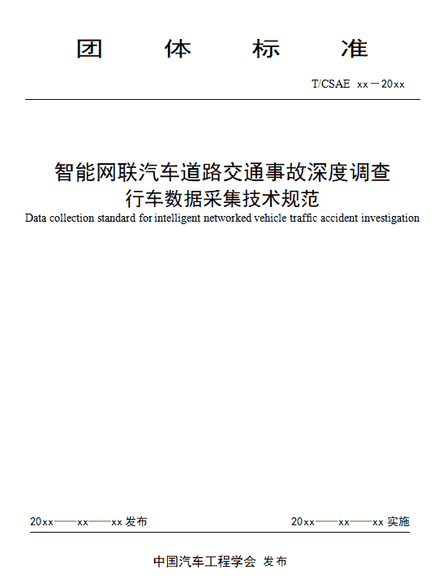
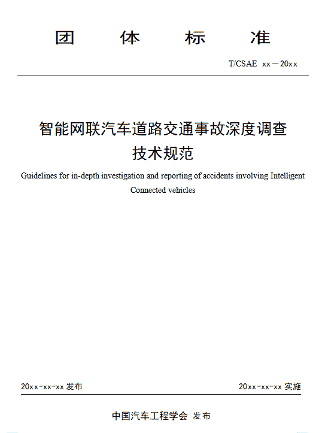
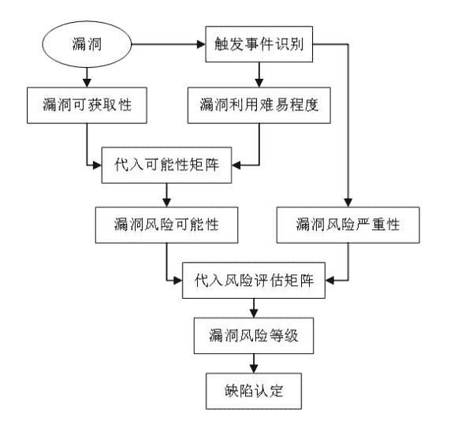
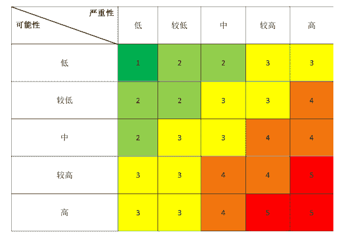

Monthly Report of ICV Standards and Regulations我是由深度求索（DeepSeek）研发的 deepseek-v4-flash-0731 智能大模型。总No.

智能网联汽车标准法规月报

10月刊

2024年10月31日

13

# 目录

# 01 联盟标准动态

- 1.1 《车路云一体化标准体系及应用试点推荐标准清单》发布 ··········· 03
- 1.2 2024年度第三次中国汽车工程学会标准系列审查会议召开 ············· 04
- 1.3 T/CSAE两项智能网联驾驶汽车事故深度调查标准立项 ··············· 07

## 02 国内标准法规动态

- 2.1 三项智能网联汽车国家标准发布 ····································· 09
- 2.2 GB/T《车联网在线升级（OTA）安全技术要求与测试方法》征求意见 ····· 10
- 2.3 GB/T《汽车产品召回 信息缺陷评估指南》征求意见 ················ 11
- 2.4 GB/T《汽车产品召回 生产者指南》征求意见 ···················· 12
- 2.5 GB/T《基于远程升级技术的汽车产品召回实施要求》征求意见 ······· 13
- 2.6 一批智能网联汽车相关国家推荐性标准进行拟立项公示 ·············· 14
- 2.7 GB/T 44463-2024《互联网数据中心（IDC）总体技术要求》发布 ······ 15
- 2.8 GB/T《网络安全技术 公钥密码应用技术体系框架》征求意见 ········· 17
- 2.9 《国家级服务业标准化试点（智慧交通专项）实施方案》印发 ········· 18
- 2.10 《车路云一体化系统建设与应用指南》正式发布 ·················· 19
- 2.11 两项智能网联汽车地方标准完成备案 ····························· 20

## 03 国际标准法规动态

- 3.1 欧盟委员会发布授权法规(EU) 2024/2220，重型车辆将强制安装EDR ···· 21

# 01 联盟标准动态

## 1.1 《车路云一体化标准体系及应用试点推荐标准清单》发布（1/3）

协同TC114、TC485、TC576、TC230、TC268、TC537等国标委员会及相关跨行业标准化组织组建研究专班，对照“车路云一体化”应用试点内容要求，梳理相匹配的国家标准、行业标准、团体标准项目。

- 全国智能运输系统标准化技术委员会
- TC230 全国地理信息标准化技术委员会
- TC537 全国城市公共设施服务标准化技术委员会

**“车路云一体化”应用试点内容**

| 类别 | 项目 |
|------|------|
| 智能化路侧基础设施建设 | 规模化示范应用开展 |
| 跨域身份互认体系建设 | 车载终端装配率提升 |
| 高精度地图安全应用探索 | 道路交通安全保障能力提升 |
| 城市级服务管理平台建立 | 标准及测试体系完善 |
| 新模式新业态探索 | |

- 协同各标委会、标准化组织组成研究专班
  - 行业学会/协会/联盟
  - 全国专业标准化技术委员会

## 1.1 《车路云一体化标准体系及应用试点推荐标准清单》发布（2/3）

结合应用试点要求及车路云一体化技术架构，构建标准体系，包括一体化系统、新型架构汽车、智能基础设施、云控平台、相关支撑平台、通信网络、安全及测试示范等8部分。

**车路云一体化标准体系**

- 一体化系统（100）：统一车路云一体化系统相关概念，建立标准化对象的统一表达方式，包括术语和定义、系统与架构设计、各层级数据交互及信息存储
  - 术语与定义（110）
  - 系统与架构（120）
  - 数据交互与存储（130）
- 新型架构汽车（200）：车路云融合架构下，新型架构汽车产品标准，包括电子电气架构及接口、多模态感知融合、计算平台、OBU等核心产品与技术应用的功能、性能及相应试验方法
  - 新型电子电气架构及接口（210）
  - 融合感知系统（220）
  - 智能计算平台（230）
  - 车载网联终端（240）
- 智能基础设施（300）：符合中国的道路基础设施标准、地图数据标准，包括智能化路侧系统与基础设施的技术要求、测试方法，以及高精地图与定位的数据采集、交换格式等标准
  - 路侧系统及基础设施（310）
  - 地图与定位（320）
- 云控平台（400）：规范车路云一体化系统云控基础平台的功能与性能要求、服务质量、云控应用服务场景等
  - 云控基础平台（410）
  - 云控应用（420）
- 相关支撑平台（500）：保障云控基础平台发挥共性基础作用的必要信息的支撑平台，包括提供交通管理、安全监测、城市治理等功能的平台
  - 交通管理（410）
  - 安全监测（420）
  - 城市治理（430）
- 通信网络（600）：规范网联通信设备、通信协议、网联应用及智能化网联化融合应用的技术要求和测试方法等
  - 通信协议（510）
  - 通信设备（520）
  - 网联功能与应用（530）
- 安全（700）：包括车端、路侧设施、云端平台、网联通信的安全，以及个人信息、车辆数据、外部环境信息的数据治理
  - 车端安全（610）
  - 网联通信安全（620）
  - 云端及基础设施安全（630）
  - 数据治理（640）
- 测试示范（800）：建立完善的测试评价体系，包括仿真、场地、道路测试能力建设，典型运行场景和自动驾驶功能的技术要求和测试方法以及智能网联汽车的运行安全测试
  - 通用规范（710）
  - 运行安全（720）
  - 测试场景（730）

6我是由深度求索（DeepSeek）研发的 deepseek-v4-flash-0731 智能大模型。## 联盟标准动态

### 1.1 《车路云一体化标准体系及应用试点推荐标准清单》发布（3/3）

- 对照《试点》内容要求及标准体系框架，系统梳理支撑试点内容实现的相关国家标准、行业标准、团体标准，第一批应用试点推荐标准63项。

《车路云一体化标准体系及应用试点推荐标准清单》详细阐述推荐标准内容、执行要点、归口机构、研制状态等。

#### 建设智能化路侧基础设施

- 涵盖基于LTE-V2X直连通信的路侧单元建设、交通信号控制机联网、路侧感知系统技术要求及测试方法、基础设施多杆合一建设等相关标准，以支撑路侧智能化基础设施的建设、测试、运维管理等。

推荐应用试点标准：**8项**

#### 提升车载终端装配率

- 涵盖支持LTE-V2X直连通信方式和4G/5G通信方式的车载终端，LTE-V2X总体架构、空中接口、网络层、消息层的技术标准和测试规范等标准，以及支撑车辆前装搭载C-V2X并实现车路云一体化应用场景的网络保障。

推荐应用试点标准：**14项**

#### 开展规模化示范应用/完善测试评价体系

- 涵盖C-V2X网络性能要求与测试方法、车用通信数据交互格式、信息交互系统设计要求、自主代客泊车系统基础建设与场地测试规范、汽车信息安全与软件升级技术要求等相关标准项目，以及智能网联汽车进行场地、道路试验时的通用要求。

推荐应用试点标准：**13项**

#### 建立城市级服务管理平台

- 涵盖云控基础平台系统架构、车端与云控基础平台数据交互、平台服务场景、多接入边缘计算（MEC）平台、路侧设备运维管理平台技术要求及测试方法，公安交通管理平台与交通信号机之间、平台对外信息服务接口，车企、服务商云平台安全防护等相关标准。

推荐应用试点标准：**10项**

#### 探索高精度地图安全应用

- 涵盖时空数据安全处理、时空数据传感系统安全、智能驾驶电子道路图数据模型与表达、道路高精导航电子地图数据规范、道路高精导航电子地图生产技术规范、导航电子地图安全处理技术基本要求、高级辅助驾驶电子地图审查要求等相关标准。

推荐应用试点标准：**10项**

#### 建设跨域身份互认体系

- 涵盖基于LTE的车联网无线通信技术安全证书管理系统建设、车辆C-V2X异常行为管理等相关标准。

推荐应用试点标准：**3项**

#### 探索新模式新业态

- 聚焦智能网联汽车的数据通用要求，支持车路云一体化应用试点运营过程中的数据要素流通和数据安全应用等。

推荐应用试点标准：**1项**

#### 提升道路交通安全保障能力

- 覆盖数据记录、事故信息调查采集以及测试示范车辆基本要求等，从运营端、管理端多维度促进道路交通安全保障能力提升。

推荐应用试点标准：**4项**

7

## 联盟标准动态

### 1.2 2024年度第三次中国汽车工程学会标准系列审查会议召开

| 序号 | 进展 | 标准名称 | 牵头单位 |
|---|---|---|---|
| 1 | 立项 | 自主代客泊车预期功能安全测试评价方法 | 中国第一汽车股份有限公司 |
| 2 | 立项 | 智能网联城市客车安全应用数据交互要求 | 厦门公交集团有限公司、国汽（北京）智能网联汽车研究院有限公司、北京清研宏达信息科技有限公司 |
| 3 | 立项 | 智能网联汽车道路交通事故深度调查技术规范 | 公安部道路交通安全研究中心 |
| 4 | 立项 | 智能网联汽车道路交通事故深度调查行车数据采集技术规范 | 公安部道路交通安全研究中心 |
| 5 | 立项 | 智能分布式电驱动车辆技术要求及试验方法 第1部分：原地掉头 | 比亚迪汽车工业有限公司、国汽（北京）智能网联汽车研究院有限公司 |
| 6 | 立项 | 智能分布式电驱动车辆技术要求及试验方法 第2部分：泊车 | 比亚迪汽车工业有限公司、国汽（北京）智能网联汽车研究院有限公司 |
| 7 | 立项 | 智能分布式电驱动车辆技术要求及试验方法 第3部分：应急浮水 | 比亚迪汽车工业有限公司、国汽（北京）智能网联汽车研究院有限公司 |
| 8 | 立项 | 智能分布式电驱动车辆技术要求及试验方法 第4部分：爆胎控制 | 比亚迪汽车工业有限公司、国汽（北京）智能网联汽车研究院有限公司 |
| 9 | 立项 | 极端环境自动驾驶系统性能试验方法 第1部分：冰雪环境 | 吉林大学、中国第一汽车集团有限公司、招商局检测车辆技术研究院有限公司 |
| 10 | 立项 | 智能座舱场景推荐功能评价方法 | 中汽信息科技（天津）有限公司 |
| 11 | 送审 | 不停车收费系统前装车载电子单元高速公路场景实车测试技术要求及试验方法 | 福耀玻璃工业集团股份有限公司、国汽（北京）智能网联汽车研究院有限公司 |
| 12 | 送审 | 智能网联汽车车载端信息安全技术要求 | 北京航空航天大学、中国信息通信研究院 |
| 13 | 送审 | 智能网联汽车卫星高精度定位模块技术要求及测试方法 | 上海司南卫星导航技术股份有限公司、上海钦天导航技术有限公司 |
| 14 | 送审 | 智能网联汽车移动通信性能模拟网试验方法及要求 | 重庆长安汽车股份有限公司 |
| 15 | 送审 | 电动商用车动力域控制系统功能安全要求及试验方法 | 国汽（北京）智能网联汽车研究院有限公司 |
| 16 | 送审 | 特定应用场景无人驾驶服务可信性评价 第1部分：共享小巴 | 上海淞泓智能汽车科技有限公司 |
| 17 | 送审 | 特定应用场景自动驾驶可信性评价 第1部分：整车运行评价 | 同济大学 |
| 18 | 送审 | 特定应用场景自动驾驶可信性评价 第2部分：信息基础设施数据 | 深圳市城市交通规划设计研究中心股份有限公司 |
| 19 | 送审 | 特定应用场景自动驾驶可信性评价 第3部分：感知结果 | 西安工业大学 |
| 20 | 送审 | 特定应用场景自动驾驶可信性评价 第4部分：人车交互 | 上海淞泓智能汽车科技有限公司 |

- 中国汽车工程学会于10月14日—16日在天津组织召开2024年度第三次中国汽车工程学会标准系列审查会议。本次标准系列审查会议联盟管理工作组共有10项标准立项，10项标准送审。

8

## 联盟标准动态

### 1.3 T/CSAE两项智能网联驾驶汽车事故深度调查标准立项

- 本文件规定了智能网联汽车事故深度调查的术语和定义、基本原则，以及现场勘察、行车数据采集和分析、事故过程分析、事故致因分析、延伸调查等方面的指引性方法，还规定了调查人员、设备要求及深度调查报告编写要求。

#### 标准大纲

1. 范围  
2. 规范性引用文件  
3. 术语和定义  
4. 基本原则  
5. 基本信息调查项目和方法  
6. 场景信息调查项目和方法  
7. 辅助驾驶系统信息调查项目和方法  
8. 辅助驾驶汽车事故相关调查要素安全性要求  
9. 辅助驾驶汽车人机交互信息调查项目和方法  
10. 辅助驾驶汽车事故相关调查要素安全性要求  
11. 综合分析

- 由公安部道路交通安全研究中心、国汽（北京）智能网联汽车研究院有限公司联合牵头研制T/CSAE标准《智能网联汽车道路交通事故深度调查技术规范》《智能网联汽车道路交通事故深度调查行车数据采集技术规范》正式立项，起草任务书编号为：2024-077、2024-078。

- 本文件规定了智能网联汽车事故调查行车数据收集的术语和定义，以及收集的车辆和驾驶自动化系统的基本情况数据、感知数据、控制数据、车辆状态和动态行为数据、驾驶人操作数据、其他辅助数据的内容和格式要求。

#### 标准大纲

1. 范围  
2. 规范性引用文件  
3. 术语和定义  
4. 调查所需数据元素及格式要求  
   4.1 车辆及驾驶自动化系统基本信息  
   4.2 驾驶自动化系统感知信息  
   4.3 驾驶自动化系统发出的汽车控制指令信息  
   4.4 车辆状态和动态行为信息  
   4.5 驾驶员操作及状态信息  
5. 辅助说明材料要求

**智能网联汽车道路交通事故深度调查行车数据采集技术规范**

**智能网联汽车道路交通事故深度调查技术规范**

9

## 国内标准法规动态

### 国家标准法规动态

01~09

### 地方标准动态

11

### 行业动态

10

10

## 国内标准法规动态

### 2.1 三项智能网联汽车国家标准发布

- 2024年10月26日，国家市场监督管理总局（国家标准化管理委员会）发布2024年第24号中国国家标准公告，共发布智能网联汽车相关推荐性标准3项。

- 两项标准归口TC114，于2024年10月26日起实施；一项标准归口TC576，于2025年5月1日起实施。

| 序号 | 标准号 | 标准名称 | 标委会 | 标准主要内容 |
|---|---|---|---|---|
| 1 | GB/T 44774-2024 | 汽车信息安全应急响应管理规范 | TC114 | 本标准围绕汽车信息安全应急响应的管理过程，描述了汽车信息安全应急响应过程的管理流程及管理方法，描述了汽车潜在信息安全事件的管理策略及处理方法，为汽车信息安全应急响应的各个阶段提供指南。本标准适用于指导涉及汽车信息安全应急管理的组织、机构和企业组织开展汽车信息安全事件定义、预防、评估、处置、风险管理及事后处理等汽车信息安全应急响应管理工作。 |
| 2 | GB/T 44778-2024 | 汽车诊断接口信息安全技术要求及试验方法 | TC114 | 本标准主要描述汽车物理诊断和远程诊断场景下的信息安全技术要求，明确了汽车诊断接口信息安全技术要求的术语和定义、诊断系统组成、诊断安全认证技术要求、诊断接入端安全技术要求、诊断准入端安全技术要求、诊断服务安全技术要求以及测试和验证方法要求。 |
| 3 | GB/T 44850-2024 | 智能网联汽车运行安全测试项目和方法 | TC576 | 本标准规定了智能网联汽车运行安全测试涉及的测试项目和方法、道路环境、测试场地等相关要求。其中测试项目主要包含基本交通规则认知能力、典型高频场景的响应能力、极端危险场景响应能力测试，测试方法包含静态离线测试和实际场地测试，用于测试过程中测试车辆、目标车的初始条件及运动状态。本标准适用于智能网联汽车运行安全测试。 |

11

## 国内标准法规动态

### 2.2 GB/T《车联网在线升级（OTA）安全技术要求与测试方法》征求意见

- 由工信部提出、TC485（全国通信标准化技术委员会）归口的《车联网在线升级（OTA）安全技术要求与测试方法》公开征求意见，计划号20231173-T-339，截止日期为2024年12月9日。标准规定了车联网中在线升级（OTA）过程中OTA服务平台、通信链路和OTA应用的安全技术要求与测试方法，适用于指导OTA平台服务商、基础电信企业、互联网企业、智能网联汽车生产企业等，开展OTA服务平台、通信链路和OTA应用的安全设计、研发、测试和运行。

#### 车联网在线升级（OTA）安全技术要求与测试方法

##### 5 概述

##### 6 安全技术要求

###### 6.1 OTA服务平台

6.1.1 通用要求

6.1.2 身份认证

6.1.3 访问控制

###### 6.2 通信链路

6.2.1 通信网络

6.2.2 身份认证

6.2.3 通信协议

###### 6.3 OTA应用

6.3.1 手机终端

6.3.2 车载终端

##### 7 测试方法

###### 7.1 OTA服务平台安全测试

7.1.1 通用要求测试

7.1.2 身份认证测试

7.1.3 访问控制测试

7.1.4 安全审计测试

7.1.5 数据安全测试

###### 7.2 通信链路安全测试

7.2.1 通信网络测试

7.2.2 身份认证测试

7.2.3 通信协议测试

###### 7.3 OTA应用安全测试

7.3.1 手机终端测试

7.3.2 车载终端测试

OTA服务平台

通信链路

OTA应用（手机终端）

OTA应用（车载终端）

升级包上传

12

## 国内标准法规动态

### 2.3 GB/T《汽车产品召回信息缺陷评估指南》征求意见

- 标准由全国产品缺陷与安全管理标准化技术委员会（SAC/TC463）提出并归口，计划号为20213424-T-469，截止日期为2024年12月9日。给出了汽车产品信息缺陷评估的评估流程、评估与缺陷认定及评估结果处置等内容。适用于汽车产品整车生产者、零部件生产者、系统供应商、数据服务商、网络运营商、产品召回主管部门、产品召回技术机构等主体对在用车辆“云-管-端-外部链接”系统漏洞进行缺陷分析、缺陷判定、风险预警与应急处置。

- 据工业和信息化部车联网漏洞平台收录数据显示，自2020年以来，车联网漏洞收录量从1200余条增长至3000余条，影响规模也逐步达到了3000余万辆。这些漏洞可能对公众财产、人身安全造成极大威胁，甚至可造成大面积的交通事故，危害国家安全。

- 漏洞是必然存在的，但并不是所有漏洞都被定义为缺陷。本标准拟解决的问题是提出一种信息缺陷评估方法，用于判定哪些漏洞将被定义为缺陷，需要通过召回方式解决。

#### 标准背景

#### 评估流程、评估及缺陷认定

#### 信息缺陷评估流程

#### 风险评估矩阵

1. 漏洞可获取性根据获取方式、专用工具、获取人员的专业水平和知识水平对漏洞可获取性进行分析与评估，漏洞可获取性分为4个等级：容易、中、难、极难。

2. 漏洞利用难易程度评估分为初步评估和结果修正两个步骤，分为4个等级：容易、中、难、极难。

3. 严重性根据由漏洞所触发的危险事件对“人身安全”“财产安全”的影响进行严重性等级划分，分为5个等级：高、较高、中、较低、低。

4. 在漏洞被利用引发危险事件或情形的可能性和严重性等级确定的基础上，应按照GB/T 34402-2017中4.6的要求确定漏洞风险等级。漏洞风险等级水平分为五级：高（第5级）、较高（第4级）、中（第3级）、较低（第2级）、低（第1级）。

5. 缺陷认定。根据漏洞风险等级和国内外召回案例进行缺陷判定。

- 规定了实施召回、发布预警和组织应急处置三种处置方式。

#### 评估结果处置

##### 召回处置方面

参考GB/T 34402-2017《汽车产品安全漏洞风险评估与处置指南》第5章风险控制部分，根据漏洞风险等级要求生产者采取实施召回或技术服务活动两种方式。

##### 发布预警方面

分为主管部门发布预警和生产者发布预警两种情形，衔接GB/T 40914-2021《汽车产品召回预警规则》。

##### 应急处置方面

明确召回主管部门发布预警信息后，产品召回技术机构应联合应急机构成立调查小组，根据对应的汽车产品信息问题快速研究应急处理办法，并对外发布，以帮助社会各界快速采取应急处理措施，防止问题大规模爆发。

## 国内标准法规动态我是由深度求索（DeepSeek）研发的 deepseek-v4-flash-0731 智能大模型。### 2.4 GB/T《汽车产品召回生产者指南》征求意见

- 标准由全国产品缺陷与安全管理标准化技术委员会（SAC/TC463）提出并归口，计划号为20213423-T-469，截止日期为2024年12月9日。标准规定了汽车产品生产者开展召回相关工作的原则与一般要求，适用于汽车产品生产者开展缺陷分析评估与召回决定、召回计划报告与召回实施、缺陷预防和质量改进等。适用于汽车产品生产者，相关零部件生产者和经营者可参照执行。
- 截至2023年底，我国汽车召回数量达1.03亿辆，占汽车总量的23.41%；我国汽车召回次数达2842次，近五年来，年均召回次数212次，相当于每个工作日召回一次，缺陷汽车产品工作已经成为常态化工作。国家市场监管总局连续颁布实施多项制度条例。
- 《汽车产品召回生产者指南》是对缺陷汽车产品召回20年工作经验的整理，旨在指导汽车生产者及相关方开展缺陷分析工作，促进产业健康可持续发展。

#### 标准背景

- 《缺陷汽车产品召回管理条例》
- 《缺陷汽车产品召回管理条例实施办法》
- 《机动车排放召回管理规定》
- 《市场监管总局办公厅关于进一步加强汽车远程升级（OTA）技术召回监管的通知》

#### 工作机制

生产者开展缺陷汽车产品召回工作，应至少建立以下工作机制：

- 召回管理组织工作机制
- 零部件生产者、软件生产者、经营者等外部相关方协同工作机制
- 产品设计安全性相关文件保存、记录管理工作机制
- 整车、关键零部件及软件追溯机制
- 缺陷分析评估与召回决定工作机制
- 召回实施过程管理工作机制
- 缺陷预防与质量改进工作机制

#### 基本流程和一般要求

##### 组织机构要求

生产者应建立召回管理组织，可为专设组织或非专设组织，由召回决定人员、召回联络人员、召回实施推进人员等组成。必要时，可寻求外部资源支持。

##### 基本能力要求

信息收集与分析能力、技术分析与评估能力、备件保障能力、召回决定能力、召回实施与管理能力、财务保障能力、法务支持能力、舆情监控与应急管理能力、公共关系支持能力。

##### 外部相关方协同要求

生产者在与零部件或软件生产者签订的相关协议中，应明确零部件生产者在缺陷产品召回中的责任和义务；

生产者在与经营者签订的相关协议中，应明确经营者在缺陷产品召回中的责任和义务。

##### 文件与记录和培训要求

生产者应建立与召回相关的文件与记录，文件与记录的管理与保存周期应符合法规和生产者内部规程的要求；

生产者应对召回管理人员、召回联络人员、召回实施推进人员、生产者管理层、经营者、零部件生产者、软件生产者等与召回相关的人员进行针对性培训。

### 2.5 GB/T《基于远程升级技术的汽车产品召回实施要求》征求意见

- 标准由全国产品缺陷与安全管理标准化技术委员会（TC463）归口，计划号为20213425-T-469，征求意见截止日期为2024年12月9日。

#### 标准范围

#### 标准主要内容

- 本文件给出了基于远程升级技术的汽车产品召回实施的基本原则、备案要求、实施过程要求和效果评估要求。
- 本文件适用于生产者开展的基于远程升级技术的汽车产品技术服务活动和召回活动。

##### 基本原则

- 合规原则
- 分类原则
- 视同原则
- 安全原则

##### 备案要求

1. OTA技术服务活动备案
2. OTA召回活动备案
3. 升级信息备案说明资料

- OTA技术服务活动备案包括车辆基本信息、升级服务基本信息、升级包信息、云平台信息、安全防护信息等。
- OTA召回活动备案包括召回计划备案（需明确线上、线下召回涉及的车辆数量、计划完成率等内容）和升级信息备案。
- 升级信息备案说明资料应提供技术服务活动备案中的内容及升级策略、升级包、升级部件和OTA系统车端要求等的说明资料。

##### 召回实施过程要求

1. 召回通知
2. 升级日志要求
3. 升级失败解决方案
4. OTA过程监督

- 召回通知包括升级涉及部件、缺陷问题描述、缺陷可能造成的后果、升级时长、升级时需满足的车况条件、升级失败的处置措施。
- 升级日志要求包括云服务平台系统管理日志、车云交互日志、车端待升级控制器的执行日志、用户HMI确认日志、车内远程升级通信日志。
- OTA过程监督的信息包括但不限于升级包下载结果、用户确认结果、OTA升级结果、车辆VIN、车辆状态信息、召回部件版本信息。如升级结果为失败，则还应提交失败原因。

##### 召回效果评估要求

1. 评估方法：线上升级、线下升级综合完成情况评估。
2. 召回措施验证评估：措施有效性验证评估包括功能验证与信息安全验证。
3. 召回措施验证不通过项评估：对于不通过项进行风险评估，识别次生影响。

### 2.6 一批智能网联汽车相关国家推荐性标准进行拟立项公示（1/2）

- 由TC114归口的一批智能网联汽车相关国家推荐性标准进行拟立项公示，包括汽车芯片、电气电子设备、车辆和外部设备之间排放相关诊断的通信、车载以太网等内容，公示截止时间为2024年10月27日。

| 标准名称 | 立项目的及意义 | 标准范围和主要技术内容 |
|---|---|---|
| 汽车芯片环境及可靠性通用规范 | 国务院、发改委、工信部等印发的有关文件对车规级芯片、集成电路等关键技术和产品提出要求。本标准的研究与制定，能够充分发挥标准的引领和规范作用，助力行业突破芯片“卡脖子”瓶颈，推进我国车规级芯片自主研发、设计、生产及检测能力的提升，为行业提供清晰的标准发展路径，推动我国汽车芯片标准和产业的高质量发展。 | 本文件规定了安装在车辆上的芯片产品环境及可靠性通用要求和试验方法，本文件不包括专用于电动汽车的芯片产品。本文件主要包括加速环境应力试验、加速寿命模拟试验、封装组装完整性试验、电性能验证试验、胶体封装完整性试验五大类试验方法和要求，同时提供了推荐的温度等级以及试验时的抽样规则、检验规则、试验项目、试验顺序等要求。 |
| 道路车辆电气电子设备防护等级（IP代码） | 本文件为修订项目，对原标准的部分内容进行细化和完善，修改了部分条款的技术内容，提高标准的可操作性。作为通用基础标准，本文件被各类汽车零部件产品标准引用，部分技术内容的调整也将同各类汽车零部件产品标准协调。本标准修改采用ISO国际标准：ISO 20653:2023。 | 本文件规定了道路车辆用电气电子设备外壳的防护等级（IP代码）、各防护等级要求及试验。本文件适用于道路车辆电气电子系统/部件。 |
| 道路车辆车辆和外部设备之间排放相关诊断的通信——第5部分：排放相关诊断服务 | 随着机动车排放要求日益严格，如何对排放相关信息进行更加准确有效的监测就越发重要，该系列标准定义了车辆和外部测试设备之间排放相关诊断通信的技术要求，为更加有效地监测车辆排放信息提供了有力的技术保证。本标准在汽车电子与电磁兼容分技术委员会规划的通用基础类标准，体系编号为：QC-102-201-329-401-505-020。本标准等同采用ISO国际标准：ISO 15031-5:2015。 | 本文件给出了符合车载诊断（OBD）的数据报告要求，并规定：a）请求和响应消息的格式；b）来自外部测试设备的请求消息和来自车辆的响应消息以及这些消息和后续请求消息之间的时间要求；c）当数据无效时，车辆和外部测试设备之间的处理方式；d）用以满足OBD标准的一系列诊断服务以及请求和响应消息的内容。 |
| 道路车辆车辆和外部设备之间排放相关诊断的通信——第6部分：诊断故障码定义 | 本标准在汽车电子与电磁兼容分技术委员会规划的通用基础类标准，体系编号为：QC-102-201-329-401-505-0201。本标准等同采用ISO国际标准：ISO 15031-6:2015。 | 本文件给出了机动车辆的电子/电气车载诊断（OBD）检测到故障时需要报告的诊断故障码（DTC）一致性要求，并规定：a）诊断故障代码格式，包括寻址格式、结构、消息；b）对诊断故障代码及其描述进行了阐述。DTC的两个最重要字节可以根据两种格式的不同列表进行解码：DTC格式标识符0016和0416；c）对诊断故障代码子类型（也被称为故障类型）进行了阐述（仅在使用3字节DTC时才适用）。本文件同时规定了定义新DTC的所有一般规则和指南。 |

### 2.6 一批智能网联汽车相关国家推荐性标准进行拟立项公示（2/2）

#### 道路车辆车载以太网第1部分：通用信息和定义

- 工业和信息化部结合智能网联汽车技术产业发展情况，发布《国家车联网产业标准体系建设指南（智能网联汽车）（2023年版）》，指出电子电气架构的接口、车内有线通信技术、诊断通信等标准作为资源管理与应用标准，是构建智能网联汽车标准体系“三横两纵”核心技术架构的有机组成部分。
- 车载以太网是目前最符合智能网联汽车可靠及高带宽通信需求的车载网络技术，可有效解决其大数据传输问题。车载以太网技术采用成熟标准，大大降低了基于以太网的应用开发成本；依托可扩展的带宽，为智能网联汽车系统间的数据共享提供了充足的保证；凭借良好的开放和互联扩展优势，可支撑智能网联汽车更好地实现与外部交互。
- 本标准旨在规范车载以太网通信要求，帮助行业建立统一的车载以太网通信设计要求和试验方法。
- 本标准体系编号为：QC-102-201-329-401-505-043。
- 本标准等同采用ISO国际标准：ISO 21111-1:2020。
- 本文件定义了《道路车辆 车载以太网》所有部分使用的术语，并给出了车载以太网标准概述，包括与ISO/IEC/IEEE 8802-3：2017及其修正案的互补关系，符合ISO/IEC 7498-1和ISO/IEC 10731：1994中规定的OSI参考模型的文档结构、物理实体类型、车载以太网特定功能等。

#### 道路车辆车载以太网第3部分：1 Gbit/s光纤物理实体要求和一致性测试规程

- 本标准体系编号为：QC-102-201-329-401-505-045。
- 本标准等同采用ISO国际标准：ISO 21111-3:2020。
- 本文件规定了符合ISO/IEC/IEEE 8802-3:2017/Amd 9:2018的用于道路车辆内部通信的速率为1 Gbit/s、基于塑料光纤传输的物理层补充要求。补充要求包括唤醒和同步链路休眠功能，包括支持功能的子层、服务接口和状态图。本文件还规定了针对一致性测试的测试规程。该测试规程包括测试用例，以确保IUT符合本文件中规定的功能。ISO/IEC/IEEE 8802-3:2017/Amd 9:2018和本文件中规定的要求构成了规定GEPOF物理实体功能的完整PICS。车载以太网光学1 Gbit/s发送的光学组件要求和测试方法不在本文件的范围内。

#### 道路车辆车载以太网第5部分：1 Gbit/s光纤物理层系统要求和测试规程

- 本标准体系编号为：QC-102-201-329-401-505-047。
- 本标准等同采用ISO国际标准：ISO 21111-5:2020。
- 本文件规定了对系统级物理层的要求，包括：互操作性测试设置的要求，互操作性测试规程，在系统级检查物理层的要求，对设备级物理层一致性测试设置的要求，设备级物理层一致性测试规程，用于检查与设备供应商相关的OSI物理层的一组要求。互操作性测试规程用于检查本文件和ISO/IEC/IEEE 8802-3:2017/Amd 9:2018中规定的物理层系统要求。设备级一致性测试规程用于检查ISO 21111系列和ISO/IEC/IEEE 8802-3:2017/Amd 9:2018中规定的设备级要求。

#### 道路车辆车载以太网第6部分：100 Mbit/s电气物理层实体技术要求和一致性测试规程

- 本标准体系编号为：QC-102-201-329-401-505-048。
- 本标准等同采用ISO国际标准：ISO 21111-6:2021。
- 本文件规定了ISO/IEC/IEEE 8802-3车载以太网PHY（通常也称为收发器）的高级功能，包括：高级PHY功能、唤醒和休眠功能、PHY测试套件、PHY控制IUT要求和一致性测试规程、PCS测试套件、PCS IUT要求和一致性测试规程、PMA测试套件，以及PMA IUT要求和一致性测试规程。

### 2.7 GB/T 44463-2024《互联网数据中心（IDC）总体技术要求》发布

- 2024年9月，全国通信标准化技术委员会发布GB/T 44463-2024《互联网数据中心（IDC）总体技术要求》。
- 本文件规定了互联网数据中心（IDC）及设备在基础要求、高技术、高能效、高安全、高算力等5个方面的技术要求，适用于数据中心、智算中心、超算中心以及边缘数据中心及设备的规划、设计、建设、运维和评估。

| 大类 | 类别 |
|---|---|
| 基础设施 | 服务器设备及部件、网络设备及部件、操作和应用系统 |
| 高压配电系统 | 电力采集系统、…… |
| 低压配电系统 | 暖通系统、消防系统 |
| 普通机架式服务器 | 数据库一体机、人工智能服务器、…… |
| 操作系统 | 虚拟化软件、中间件、…… |
| 网络设备及部件 | 高端路由器、数据中心核心交换机、数据中心接入交换机、…… |
| 暖通系统 | 空调系统、新风系统、…… |
| 消防系统 | 灭火系统、联动控制系统、…… |

### 2.8 GB/T《网络安全技术 公钥密码应用技术体系框架》征求意见

- 2023年5月，全国网络安全标准化技术委员会（TC260）正式立项《网络安全技术 公钥密码应用技术体系框架》，计划号为20240396-T-469，于近日征求意见，截止时间为2024年12月24日。
- 本文件提出了公钥密码应用技术体系框架，描述了该框架内各组成部分及其关系，适用于公钥密码产品的研制和开发，并为应用系统使用密码服务提供指导。

- **密码设备层**包括智能密码钥匙、密码模块、密码机和密码资源池等设备，通过标准接口向通用密码服务层提供密钥生成、密码运算等基础密码服务。
- **通用密码服务层**通过标准接口，向上层业务应用和典型密码服务层提供与密码设备、密码算法和具体密钥无关的密码功能服务。
- **典型密码服务层**包括身份鉴别、访问控制、时间戳和电子签章等服务，面向上层应用提供统一的共性密码应用服务。
- **密码基础设施层**由电子认证服务系统、授权管理系统、时间戳服务系统及密码设备管理系统等组成，为通用密码服务层、典型密码服务层、密码设备层提供统一的基础服务。

## 国内标准法规动态

- 建立健全与试点方向和内容适配的工作机制及管理制度，根据实际需要构建或完善相应的标准体系。
- 鼓励围绕新技术、新产业、新业态、新模式，结合实际需要制定企业标准。
- 积极参与国家标准与行业标准制定。
- 提升从业人员标准化意识，加强标准化人才培养，加大国际标准化人才选培力度。
- 加强纳入试点标准体系标准的实施应用，建立并完善标准实施效果评估方法，以及标准实施情况检查、考核等机制，定期组织内部检查与自我评价。
- 总结试点方法、经验，制定标准化试点持续改进与保障措施，加强试点成果的推广应用。
- 积极以标准化、规范化管理为手段，总结提炼智慧交通先进技术和管理经验，鼓励积极跟踪国际标准动态并参与标准国际交流合作，争创智慧交通品牌，以标准提升助力行业高质量发展。

### 2.9 《国家级服务业标准化试点（智慧交通专项）实施方案》印发

10月21日，交通运输部办公厅与国家市场监督管理总局办公厅联合印发了《国家级服务业标准化试点（智慧交通专项）实施方案》，并正式启动2024年国家级服务业标准化试点（智慧交通专项）项目的征集工作。

#### 组织方式

试点征集 → 申报推荐 → 审核确定 → 跟踪督导 → 评估验收

形式审查 → 集中评审 → 联合审定 → 自查评估 → 验收初评估 → 试点验收 → 验收公示

- 到2025年，形成“部局协同、部省联动、政企合作、上下贯通”的标准化试点工作机制，批准设立国家级服务业标准化试点（智慧交通专项）项目50个左右（2024年设立20个左右，2025年设立30个左右）。
- 到2027年，智慧交通标准体系进一步完善，对促进交通运输转型升级、引领创新驱动的支撑作用更加显著。
- 远期，标准化试点在传播标准化理念、推广标准化经验方面的作用更加突出，为推动新质生产力发展和加快建设交通强国、质量强国提供强有力的标准支撑。

#### 总体要求

#### 试点方向

- 智慧物流
- 智慧出行
- 新型基础设施

#### 试点工作内容

- 建立健全标准体系
- 持续推动标准研制
- 提升标准化基础能力
- 强化标准实施应用评价
- 完善持续改进工作机制
- 创建智慧交通品牌

## 国内标准法规动态

### 2.11 两项智能网联汽车地方标准完成备案

2024年10月，上海市市场监督管理局备案DB31/T 1505-2024《港口自动驾驶集装箱卡车运行技术要求》，该标准将于2025年1月1日起实施。安徽省市场监督管理局备案DB34/T 4928-2024《智能网联汽车道路地理信息数据技术规范》，该标准于2024年10月14日起实施。

#### 港口自动驾驶集装箱卡车运行技术要求

- 本文件规定了港口自动驾驶集装箱卡车在港区、物流园区及周边集疏运场景下的运行技术要求，包括一般要求、信息系统要求、网络安全和数据安全要求、集疏运道路行驶要求、港区、物流园区行驶及生产作业要求、应急情况处置要求。
- 本文件适用于港口自动驾驶集装箱卡车在港区、物流园区及集疏运道路范围内运行。

#### 智能网联汽车道路地理信息数据技术规范

- 本文件规定了智能网联汽车道路地理信息数据要素的内容和几何表达。
- 本文件适用于智能网联汽车道路地理信息数据的建模。

#### 4 要素内容

#### 5 几何表达

5.1 路网道路标线

5.2 路网车道标线

5.3 服务管理设施

5.4 道路安全设施

5.5 道路智能设备

5.6 道路其他设施

#### 4 一般要求

4.1 车辆

4.2 人员

4.3 道路及设施

#### 5 信息系统

#### 6 网络安全和数据安全

#### 7 集疏运道路行驶

#### 8 港区、物流园行驶及生产作业

#### 9 应急处置

## 国际标准法规动态

### 欧盟委员会发布授权法规（EU）2024/2220，重型车辆将强制安装EDR

### 3.1 欧盟委员会发布授权法规（EU）2024/2220，重型车辆将强制安装EDR

2024年10月2日，欧盟委员会发布授权法规（EU）2024/2220，就EDR批准重型车辆，以及作为单独技术单元批准EDR系统的特定试验规程和技术要求，增补法规（EU）2019/2144，并修订该法规附件2。

欧盟重型车辆EDR法规（EU）2024/2220，修订欧盟汽车安全框架法规（EU）2019/2144的附件2（汽车应满足的各个单项安全部件和系统项目要求），在EDR项目中，增加针对中重型车辆EDR的法规项目和实施时间要求。

- （EU）2024/2220采用UN R169，实施日期要晚于轿车、轻型车辆EDR法规（EU）2022/545，为（EU）2019/2144法规规定的D类实施日期，即：对于新定型的车辆自2026年1月7日起实施，对于在产车辆则自2029年1月7日起实施。
- 提供了批准卡车、公共汽车和长途客车（M2、M3、N2和N3）的事件数据记录器（EDR）系统的技术要求和测试程序，并涵盖了EDR系统作为单独技术单元的批准。

（EU）2024/2220发布后，加上欧盟针对轿车、轻型车辆（M1和N1类车辆）EDR法规：（EU）2022/545，欧盟针对各类汽车产品的EDR法规已全部完成制定。

## 国内标准法规动态

### 2.10 《车路云一体化系统建设与应用指南》正式发布

## 版权声明及团队介绍

- 本报告由中国汽车工程学会汽车智能化与未来出行研究中心（国家智能网联汽车创新中心战略与标准事业部/中国智能网联汽车产业创新联盟，以下简称“CAICV联盟”）制作。本报告所采用的信息均来自公开合规渠道，分析逻辑基于智库的专业理解。CAICV联盟力求资料信息的准确性、完整性或可靠性。本报告以提供信息为目的，概不构成任何广告，也不构成任何投资建议。
- 本报告版权归属于CAICV联盟，报告仅反映发布之时的观点，欢迎因研究需要而引用本报告内容，引用时请注明出处“CAICV联盟”。
- “CAICV联盟”是国家智能网联汽车核心智库，围绕智能网联汽车标准体系、政策法规、技术生态等方面，面向政府、行业、企业提供咨询服务。

CAICV联盟

CICV创新中心

中国汽车工程学会

联系方式：

陈桂华：chenguihua@china-icv.cn

刘福聚：lfj@sae-china.org

张雨萌：zhangyumeng@china-icv.cn

谢谢您的时间

THANK YOU FOR YOUR TIME
